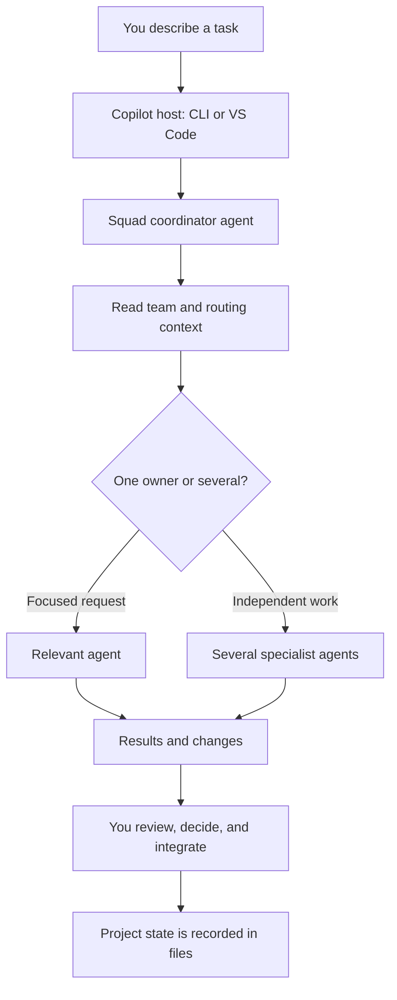
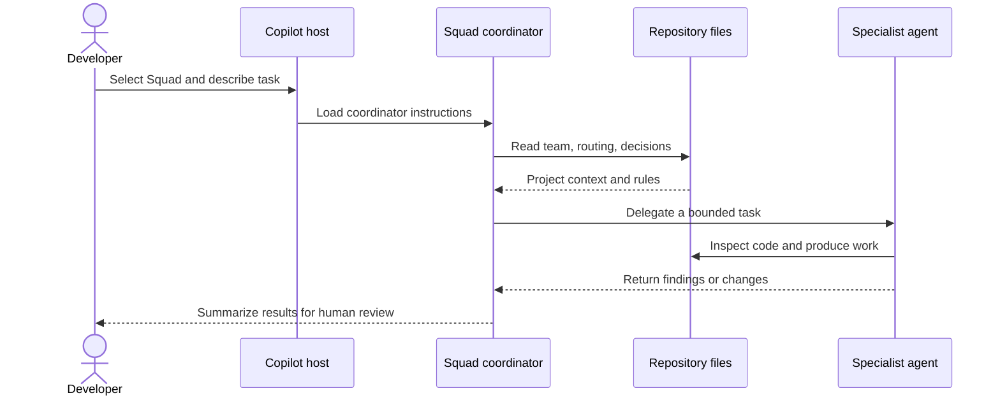

# Chapter 1: What Is Squad?

> **Prerequisites:** None.

## What You'll Learn

- Explain how Squad turns a single Copilot conversation into a coordinated team of focused agents.
- Distinguish the coordinator, specialist agents, and the files that give them continuity.
- Understand what lives in `.squad/` and why it belongs in version control.
- Decide when parallel agents help—and when a single assistant is the better tool.
- Relate Squad to GitHub Copilot CLI, VS Code, and the separate `squad` command-line tool.
- Preview the Tasktrack project that we will develop throughout this book.

> **Preview (Squad 2.0):** The team model expands beyond GitHub Copilot: 2.0 supports seven hosts total—Copilot plus Claude Code, Kiro, OpenCode, Cursor, OpenAI Codex, and Google Antigravity. The shared-team idea stays; host projections vary. See Chapters 18 and 19 (Volume 2) and the [2.0 client scenario](https://bradygaster.github.io/squad/docs/scenarios/using-squad-across-clients/).

## A team, not a collection of chat personas

A capable coding assistant can explain a bug, suggest a design, and write a patch. But a long-running project asks it to do those things repeatedly, across different specialties, while staying consistent with decisions made last week. Squad addresses that continuity and coordination problem. It is an open-source framework for defining and running a team of agents through GitHub Copilot. The team lives with the repository rather than in a separate hosted workspace.

The central idea is modest: give each agent a defined role, boundaries, and durable project context, then let a coordinator decide which agent—or agents—should handle a request. One agent might focus on API behavior, another on user interface work, and another on tests. They are still AI agents running through Copilot; Squad does not create independent human-like employees. Its contribution is the shared structure around those agents: identity, routing, context, memory, and coordination.

This distinction matters. A prompt such as “act like a tester” asks one assistant to role-play a specialty for this turn. A Squad agent has a persistent charter and history associated with its role. The coordinator can route testing work to that agent, and the result can be reviewed and refined in the same repository as the code. These files do not guarantee correctness; they make the team's instructions inspectable and repeatable.

### The three moving parts

Think of Squad as three connected layers:

1. **The Copilot host** provides the model, tools, authentication, and agent-execution environment. For everyday work this is usually GitHub Copilot CLI or GitHub Copilot in VS Code.
2. **The coordinator** interprets your request, consults team instructions and routing, and selects work to do itself or delegate to agents.
3. **The repository state** describes the team and preserves decisions and agent knowledge. It is ordinary files that you can inspect, diff, and review.

There is also a time dimension. A single assistant session contains working context while it is open; Squad's on-disk files supply selected context to later work. The model does not become a permanently retrained version of itself when a history file changes. Instead, the host and agent instructions make relevant files available again. This is both a strength and a boundary: a decision can persist as text, but a stale or poorly written note can persist too. Treat memory as maintained project documentation, not as infallible recall.

The coordinator is not another name for the `squad` executable. The executable is primarily the setup and operations CLI: it initializes a team, diagnoses a setup, updates Squad-owned files, and runs other explicit commands. The conversational coordinator is an agent definition discovered by Copilot. A normal project initialization installs that definition at `.github/agents/squad.agent.md`.



### From a request to a durable change

A useful way to observe Squad is to follow one task across the boundary between conversation and files. Imagine you ask for a new `GET /tasks` filter. First, the coordinator decides whether the request is a quick question, one focused task, or a request that benefits from delegation. It consults the repository's team and routing instructions. An API agent can inspect the existing route and tests; a tester can independently identify the expected cases if that work is scoped around a clear contract. Their work may produce proposed edits, test results, or a recommendation.

Next comes integration. If two agents touched separate files, their changes may be easy to combine. If they made incompatible assumptions—perhaps one calls the query parameter `state` and the other expects `status`—the coordinator must surface that mismatch and you must choose the public contract. The code review is not an optional final flourish: it is where consistency, regressions, and acceptance criteria are checked.

Finally, what should persist is written as repository state. The API implementation and tests persist as application code. A decision about the parameter name belongs in a decision record if it is likely to matter later. A reusable testing practice may become a skill, while a one-off detail probably should not. An agent's history should capture useful project knowledge rather than an unfiltered transcript. This separation prevents an important architectural decision from being hidden in one assistant's temporary chat while keeping routine output out of the team's long-term context.

This lifecycle also gives you practical checkpoints. Before the coordinator routes, verify that your request describes the outcome. Before an agent edits files, make sure the task scope is clear. After parallel work, compare assumptions. Before accepting a result, run the relevant tests and review the diff. Afterward, capture only durable information that will help the next session. Squad supplies a structure for these transitions; good engineering judgment still supplies the criteria.

### The coordinator: traffic controller, not omniscient manager

When you ask the team for work, the coordinator is the point of entry. Its instructions explain how to inspect the request, use the repository's routing conventions, decide whether to answer directly or delegate, and return a useful result. You can ask for a direct answer, address a known agent by name, or make a team-wide request. Explicitly naming a specialist can focus a task; saying “team” can signal that a task should be decomposed. Neither phrase is a magic guarantee of parallel execution—the coordinator still considers the task and the available host capabilities.

The coordinator's most important job is to make the handoff intelligible. It should choose appropriate agents, describe bounded pieces of work, and consolidate their results. It does not remove your responsibility to inspect the resulting code. Parallel agents can disagree, make overlapping edits, or miss requirements just as a single assistant can. The value is not “more AI is always better”; it is the ability to assign independent reasoning in parallel without losing shared project context.

Agents are separate work contexts. They receive task-specific instructions and repository access through Copilot's execution environment. They do not automatically share private conversations with each other. Coordination happens through the coordinator and persistent project artifacts. That separation reduces cross-talk and makes delegation explicit, but it also means that an agent needs enough context in its assignment or in the repository to do its work.

### What Squad is—and what it is not

Squad is a coordination framework for repository work, not a separate source-control system, a hosted knowledge database, or an automatic code-approval service. It relies on its host for models and tool execution, and relies on the repository (or an explicitly configured state backend) for durable team material. The framework can organize work and make preferences reproducible, but it does not ensure every agent's output compiles, follows your security policy, or satisfies the actual product requirement.

It is also not a reason to fragment every task. A single assistant remains a good fit when you want a direct explanation or one tightly coupled edit. Use multiple agents when parallel investigation is valuable and you can define boundaries. A team is a way to increase the amount of independent work you can supervise, not an instruction to maximize agent count. You stay accountable for the change that lands.

### The `.squad/` directory: context you can audit

The project-level `.squad/` directory is the main home for team state. Its exact contents can grow as you enable features, but common files include:

| Path | Role in the team |
|---|---|
| `.squad/team.md` | Team identity, project context, and member roster. |
| `.squad/routing.md` | Guidance for matching requests or areas of work to agents. |
| `.squad/decisions.md` | Shared record of decisions and their rationale. |
| `.squad/agents/<name>/charter.md` | An agent's role, expertise, and working boundaries. |
| `.squad/agents/<name>/history.md` | Durable notes that help an agent resume project-specific work. |
| `.squad/skills/` | Reusable, task-specific knowledge and procedures as configured. |
| `.squad/ceremonies.md` | Optional team routines and governance definitions. |

A separate but related file, `.github/agents/squad.agent.md`, tells Copilot how to act as the coordinator. Squad's CLI also installs supporting templates and may create or update other repository configuration. Do not treat every `.squad/` path as immutable boilerplate: the team and its operating rules can be edited, and later chapters explain which files are authoritative for particular concerns.

Version control is a practical feature, not administrative overhead. A change to routing can be reviewed like a change to application behavior. A decision can be traced through history. A teammate who clones the repository receives the same project-local team context. A commit or branch can also roll back a harmful change. Squad is built around files precisely so you can see what has accumulated rather than trusting a hidden memory service.

> **Tip:** Commit project `.squad/` state alongside your code unless your team has chosen another managed backend. If agent knowledge changes what the team will do, that knowledge deserves the same review and backup discipline as other project configuration.

### Why use more than one agent?

The strongest case for multiple agents is **independent work**. Suppose a change has a clear API contract. One agent can implement the server path, another can add tests against the contract, and another can review the existing client integration. If their scopes do not overlap, all three can investigate at once. The coordinator can present the separate outputs for you to compare.

A useful decomposition has three traits: the pieces are **independent enough** to start without waiting for one another; each has a **bounded deliverable** such as a test file or a review report; and there is a clear **integration point** where you or the coordinator can reconcile results. Without those traits, fan-out can become a distributed guessing exercise. For example, two agents editing the same API file under different assumptions can create more work than a single carefully scoped implementation.

Parallelism can also improve coverage. A reviewer who did not write the implementation may notice assumptions that the implementer has stopped questioning. A documentation specialist can describe the new behavior while an engineer finishes a separate task. An agent with a testing charter may naturally look for edge cases that are easy to miss when you focus on the happy path.

There are costs. Each agent consumes model and tool time. Delegation needs clear scope. Shared-file edits can conflict, and a task with strict ordering may not parallelize at all. For a one-line fix, a question about an unfamiliar function, or work where every step depends on the previous one, one assistant is usually faster and easier to supervise. Squad helps you allocate attention; it does not make coordination free. Nor does a roster of specialists prove that each agent is a separately trained expert. Roles shape the instructions and expectations each agent receives; the model, repository context, and task quality still influence results. Use the role as a helpful lens, not as a guarantee or credential.

| Work shape | Likely approach | Reason |
|---|---|---|
| One narrow, sequential change | Ask the coordinator or one agent | Delegation overhead would dominate. |
| Independent implementation and test investigation | Delegate separate scopes | Agents can reason concurrently against a shared contract. |
| A design with unresolved product choices | Discuss and decide first | Parallel coding before a decision can multiply rework. |
| A risky or consequential change | Use focused implementation plus independent review | The human decision point remains essential. |
| A broad request with unclear acceptance criteria | Clarify it before fan-out | Ambiguity is not improved by multiplying agents. |

### Copilot CLI, VS Code, and the `squad` CLI

Squad is designed to work through GitHub Copilot. The **GitHub Copilot CLI** is a conversational terminal host: you can open a repository, select the Squad agent, and ask for work. **VS Code** provides an editor-integrated Copilot Chat experience and discovers the project agent file. Both use the same project `.squad/` files, although the host may differ in execution details and available controls.

The **Squad CLI**, invoked as `squad`, serves a different purpose. Use commands such as `squad init`, `squad doctor`, `squad status`, or `squad upgrade` for setup and operations. It is not a replacement name for the Copilot CLI. The product also offers an SDK for programs that need to load team configuration or coordinate Squad functionality; that is an engineering extension path, not the usual way to start a beginner's coding session.

The useful mental model is: Copilot is where you talk to the team; the coordinator is the agent that organizes the work; `squad` is the project tool that prepares and maintains the team; `.squad/` is the durable project record. Later chapters compare the interfaces and their constraints in detail.

> **Note:** Squad does not include GitHub Copilot access. You need a supported Copilot host and authentication. The `squad` command is useful even if you do not use its optional issue-tracking integrations; GitHub CLI (`gh`) is needed for workflows that operate on GitHub issues, pull requests, or boards, not simply to read a local repository.

### Governance is part of the working model

Agent instructions can include limits and review steps, and the repository's history makes many team changes visible. That is useful governance, but it is important to state the limits precisely. A charter describes expected behavior; it does not replace permissions enforced by the host, a security review, or your organization's policies. A routing rule helps decide who should handle work; it is not necessarily a sandbox that prevents an agent from reading every accessible file. Use workspace permissions, branch protections, and human review for the controls they are intended to provide.

Likewise, a decision log is valuable when it records a real choice, its reason, and the conditions under which it should be revisited. It is not a dumping ground for every conversation. A short durable record can prevent the team from repeating a debate; a large pile of stale details can make the context less useful. Later chapters develop the team's memory and governance practices, but the principle is already clear: persistent state should be deliberate and reviewable.

A few practical questions help keep this model grounded. Which files can the host read and write? That depends on the host's workspace permissions and your approval settings. Which model answers the request? That depends on the Copilot environment and selected model. Where does a decision persist? In the repository or configured state location, not automatically in a universal Squad cloud account. Who approves a pull request or release? Your human review process does. These boundaries prevent the word “team” from implying capabilities Squad does not claim.

The benefit is that you can change one layer without losing the others. You can move from terminal work to VS Code and keep project state. You can update the CLI without redesigning the agent roster. You can edit routing or a charter through a normal reviewed commit. When something behaves unexpectedly, trace which layer owns it: the host, coordinator instructions, team state, or application code. That question is a useful diagnostic throughout the book.

### A realistic example: Tasktrack

This book uses Tasktrack, a small task-tracking application, as a companion project. It is already implemented as a deliberately simple baseline so that the early chapters can concentrate on learning Squad rather than debugging a large framework. The `api/` directory contains a TypeScript HTTP API using Node's built-in `node:http`; `web/` contains a static browser interface. The API supports health checks and task listing, creation, status updates, and deletion. There are no npm dependencies.

The repository is a good test of the team idea because it has natural boundaries. API behavior lives under `api/`, the browser experience lives under `web/`, and contract tests live alongside the API. A future task to add due dates might need a shared decision about data shape before the backend and UI can safely proceed. A bug confined to validation can be handled by one agent. The project makes both the advantage and the coordination cost visible.

For this chapter, do not ask agents to change code yet. First make an inventory: What are the app's two main areas? Which tests describe existing behavior? Which pieces could be investigated independently? That practice teaches you to define the work before asking a team to do it.

## Hands-On: Preview Tasktrack

This is an orientation exercise, not the first Squad session. You will make a local copy of the starter in Chapter 2, after installing Squad; here, inspect the supplied starter in place or read the files without changing them.

1. Open `sample/README.md`, then inspect `sample/api/src/app.ts`, `sample/api/src/tasks.ts`, `sample/api/test/app.test.ts`, and `sample/web/index.html`.
2. Write down the API's existing routes: `GET /health`, `GET /tasks`, `POST /tasks`, `PATCH /tasks/:id`, and `DELETE /tasks/:id`.
3. Identify one change that can be owned entirely by an API specialist, one requiring the browser and API to agree on a contract, and one that should be reviewed independently.
4. If you have Node.js 22.18 or later, from `sample/` run:

```bash
node --test api/test/
```

Expected result: five tests pass. The sample's package scripts expose the same test runner as `npm test`; the exact Node version requirement for running Tasktrack is separate from the Squad CLI's minimum Node version.

Do not initialize Squad in the book repository. You will prepare an isolated Tasktrack repository in Chapter 2, then initialize the team and hold your first session in Chapter 3.

## How Squad Fits Together

Four layers cooperate, and it helps to know which one you are touching. The **host** (GitHub Copilot CLI or VS Code) runs the conversation and supplies models and tools. The **coordinator** is a set of instructions, installed by `squad init` as `.github/agents/squad.agent.md`, that the host loads when you select Squad. The **team state** in `.squad/` holds the roster, routing rules, decisions, and each agent's charter and history. Finally, the **`squad` CLI** prepares and maintains the files; it is not a background service.

At runtime nothing runs on its own: Copilot reads the coordinator file as agent instructions, the coordinator reads the team files, and specialists are spawned through the host's own mechanism. This is also why updating the CLI and running `squad upgrade` in a project are separate steps. One updates the tool; the other refreshes the Squad-managed files in that repository.



The persistent files are not a model's hidden long-term memory. They are inputs that the host and agents can read on later turns, which is why reviewing, backing up, and pruning team state matters. The `.squad/` files and the bootstrap logic behind `squad init` are explained in the chapters ahead; the full architecture, including the SDK and runtime internals, is the subject of Chapter 11 (Volume 2).

## Pitfalls and Troubleshooting

- **Treating `squad` and `copilot` as interchangeable.** Use `squad` for setup and diagnostics; use a Copilot host to converse with the coordinator.
- **Expecting a team to appear from an empty repository without setup.** Install Squad, initialize the repository, and then select the Squad agent in your Copilot host.
- **Assuming the coordinator will fan out every request.** Delegation is a decision, not a guarantee. A small or sequential request may be handled directly.
- **Assuming the agents can see each other's hidden conversations.** They work in separate contexts; make durable project decisions available in files and give each assignment enough context.
- **Assuming parallel output is automatically correct.** Review proposed changes and ensure overlapping edits are reconciled.
- **Committing secrets or personal data into team memory.** `.squad/` is repository content. Keep credentials and sensitive data out of it.
- **Keeping no history.** Without Git or another backup strategy, project context can be lost or become difficult to audit.
- **Using `gh` for a local-only first experiment.** It is needed for GitHub-backed features, not as a prerequisite to understanding the local team model.

## Summary

Squad gives Copilot work a durable team structure. A coordinator receives requests and routes them to focused agents; the team is described by inspectable files in `.squad/`, with a Copilot-discoverable coordinator definition in `.github/agents/`. That arrangement can make independent tasks run concurrently and preserve project context across sessions, while keeping human review and decision-making in the loop. Use GitHub Copilot CLI or VS Code for conversations, the `squad` command for setup and operations, and the SDK only when building programmatic integrations. Tasktrack gives us a small, testable place to practice those ideas.

## Exercises

1. In your own words, distinguish the Copilot host, the Squad coordinator, and the `squad` CLI. Give one action you would perform with each.
2. For each task—answering “what port does the API use?”, implementing an isolated API validation change, and designing a change that affects both API and UI—choose whether you would ask one agent or consider a team fan-out. Explain the trade-off.
3. Inspect the Tasktrack starter. List its routes and propose two independent workstreams plus one decision the team should agree on before parallel implementation.
4. Explain why committing `.squad/` can help a teammate reproduce context, and name one kind of information that should not be stored there.

## Quiz

1. Which component interprets a request and chooses how to route it: the Copilot host, the coordinator, or the `squad` CLI?
2. True or false: Squad agents automatically share their private conversation histories with one another.
3. Which path normally contains the Copilot-discoverable coordinator definition?
4. Name two examples of project state that can be kept under `.squad/`.
5. Why can a small sequential task be a poor candidate for parallel agents?
6. Which tools are used for conversational work, and which command-line program handles setup and diagnostics?
7. Does storing team context in files make human review unnecessary? Explain briefly.

## Further Reading

- [What Is Squad?](https://bradygaster.github.io/squad/docs/concepts/what-is-squad/)
- [Squad Architecture](https://github.com/bradygaster/squad/blob/v1.1.0/packages/squad-cli/src/cli/core/init.ts)
