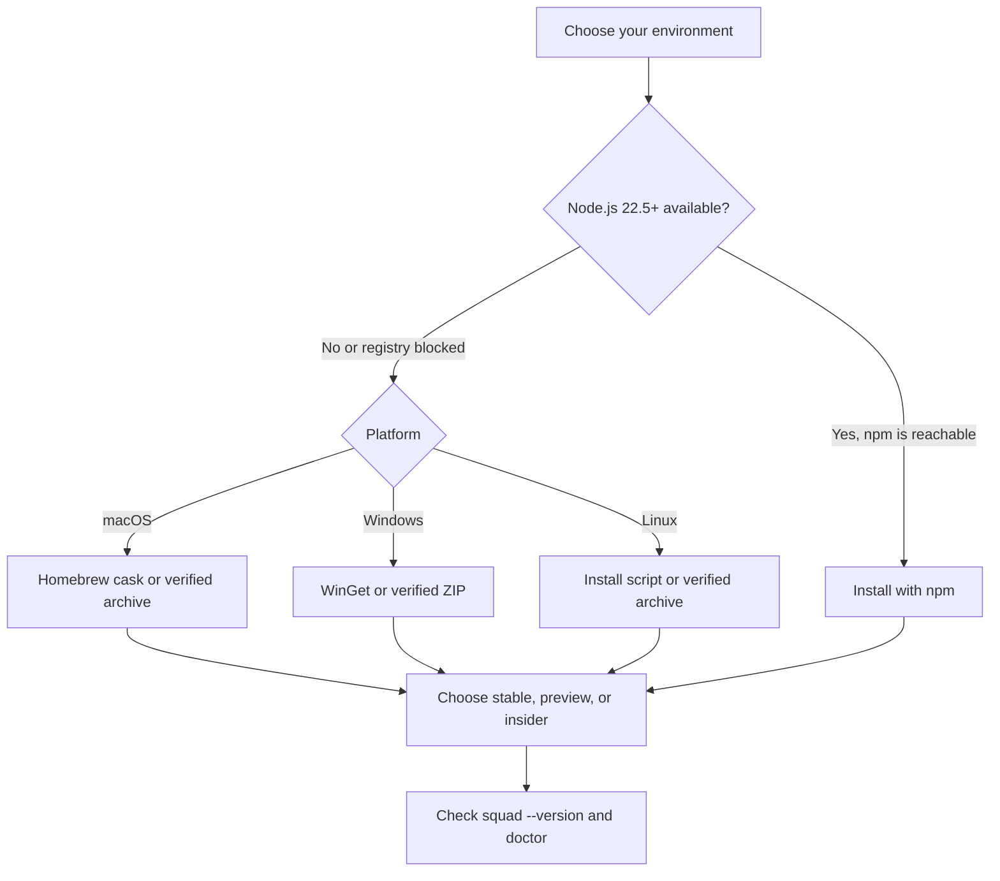
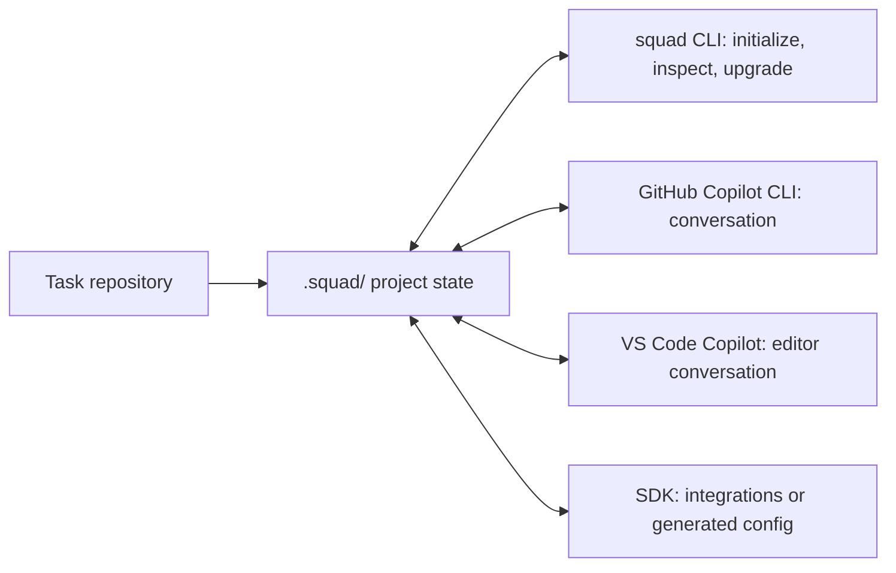
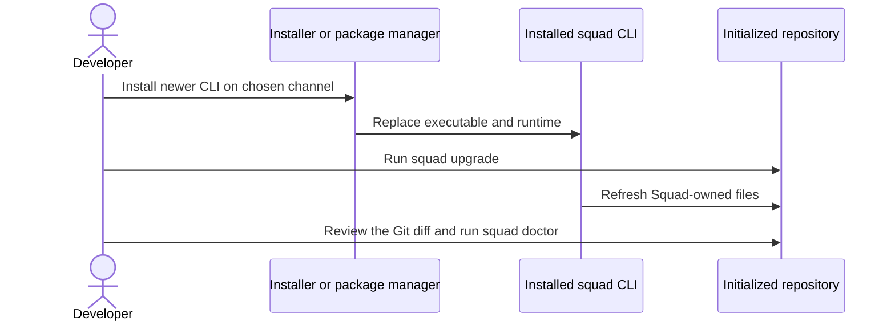

# Chapter 2: Install Squad and Choose Your Interface

> **Prerequisites:** Chapter 1.

## What You'll Learn

- Select a Squad CLI installer that matches your operating system, network restrictions, and update policy.
- Distinguish the stable, preview, and insider release channels, and decide between Squad 1.1 and the 2.0 preview.
- Verify the CLI version, diagnose a project with `squad doctor`, and interpret its output.
- Choose between GitHub Copilot CLI, VS Code, the `squad` CLI, and SDK-first mode for the job in front of you.
- Update the CLI package and project-installed Squad files as separate steps.
- Prepare an isolated Tasktrack repository, ready for `squad init` in the next chapter.

> **Preview (Squad 2.0):** `latest` remains v1.1.0; v2.0.0-preview.2 is distributed on npm's `insider` channel, with `preview` as a compatibility alias. It supports seven client hosts instead of one, and it removes personal squads and global mode. See "Which Squad Should I Use? (1.1 vs 2.0)" below, Chapters 18, 19, and 22 (Volume 2), and the [2.0 release notes](https://github.com/bradygaster/squad/blob/v2.0.0-preview.2/docs/src/content/docs/whatsnew.md).

## Start with the layers, not the download button

A working Squad setup involves several distinct pieces. The `squad` CLI performs setup and maintenance. A Copilot host—typically GitHub Copilot CLI or VS Code with GitHub Copilot—runs the conversational coordinator and its agents. Your repository holds the team files. Some optional workflows also use GitHub CLI (`gh`) to access issues, pull requests, or project boards.

Installing one piece does not install the others. Installing the Squad CLI does not create a Copilot subscription or authenticate Copilot. Installing Copilot CLI does not initialize `.squad/` in every repository. Installing the SDK as an application dependency is different again: that is for programs that build on Squad, not a prerequisite for using the CLI.

You will make three decisions in this chapter, in order: how to install the CLI, which release to install, and which interface you will use for daily conversation. Then you will verify the result and prepare Tasktrack for the first session.

## Prerequisites and version boundaries

The v1.1.0 CLI package requires Node.js **22.5.0 or later**, because the runtime depends on `node:sqlite`; the CLI entry point checks the version before loading the rest of the application. This applies to npm-based installs and SDK development. Standalone bundles include a matching Node runtime, so they need no preinstalled Node or npm.

You also need Git and a repository in which to initialize project-local Squad. A Copilot CLI or VS Code Copilot extension is installed and authenticated separately. `gh` is needed for workflows that talk to GitHub, such as issue, pull request, and project-board operations, not merely for running `squad init`.

Tasktrack's sample app has a different runtime boundary: its own `package.json` declares Node 22.18 or later because it runs TypeScript through Node's built-in type stripping. Do not mix that up with the CLI minimum. You can install the CLI from a standalone package on a host without Node and still need Node 22.18+ to run the sample.

## Which Squad Should I Use? (1.1 vs 2.0)

Two lines of Squad exist, and they share the `squad` command name.

| | Squad 1.1 | Squad 2.0 preview |
|---|---|---|
| Version | v1.1.0 | v2.0.0-preview.2 |
| Channel | `latest` (stable) | `insider`, with `preview` as an alias |
| Hosts | GitHub Copilot (CLI and VS Code) | Seven hosts: Copilot, Claude Code, Kiro, OpenCode, Cursor, OpenAI Codex, Google Antigravity |
| Covered in this book | All parts except Volume 2, Part IV | Volume 2, Part IV (Chapters 18–22) |
| Personal squads (`squad init --global`) | Supported | Removed |

The 2.0 preview adds multi-client support: `squad init --client <host>` projects one `.squad/` team into the native agent format of the host you choose, without changing the team state itself. That makes it the right tool if your colleagues use Claude Code, Codex, or Cursor and you want a single shared team.

**Recommendation:** start with 1.1.0. It is the stable release, every example outside Volume 2, Part IV targets it, and Copilot CLI plus VS Code cover most workflows. Switch to the preview only if you need multi-client support or want to evaluate 2.0, and do that in a disposable project first. Chapter 22 (Volume 2) walks through the upgrade, and Chapter 19 (Volume 2) covers working across clients. The [Insider Program](https://bradygaster.github.io/squad/docs/insider-program/) page describes how early builds are published.

## Choose an installation method

Before choosing, answer four questions. What OS and CPU architecture will run the command? Can the machine reach npm? Do you want stable releases or early builds? Is this a single-user install or centrally managed?

### npm: the Node.js route

If Node.js 22.5+ and npm are already available, install the stable CLI globally:

```bash
npm install -g @bradygaster/squad-cli@latest
```

This is the simplest route for developers who already manage Node tools with npm. If the install succeeds but the shell cannot find `squad`, npm's global executable directory is probably not on `PATH`; see troubleshooting below. Use a channel tag explicitly rather than assuming an unqualified install selects the version you want. The CLI help also documents a project-local form (`npm install --save-dev @bradygaster/squad-cli`), but this book assumes the global install.

### macOS and Linux: verified install script

The POSIX installer retrieves a platform bundle from GitHub Releases, verifies its checksum against the release's `SHA256SUMS.txt`, unpacks it, and links the executable into a bin directory:

```bash
curl -fsSL https://raw.githubusercontent.com/bradygaster/squad/main/scripts/install.sh | sh
```

This avoids `registry.npmjs.org` and needs no Node toolchain. It installs under `/usr/local` as root or `$HOME/.local` for a normal user. Three environment variables adjust it:

| Variable | Default | Effect |
|---|---|---|
| `VERSION` | Latest stable release | Pin an exact release tag. |
| `PREFIX` | `/usr/local` as root; otherwise `$HOME/.local` | Choose the installation prefix. |
| `REPO` | `bradygaster/squad` | Select the GitHub repository or an internal mirror. |

```bash
curl -fsSL https://raw.githubusercontent.com/bradygaster/squad/main/scripts/install.sh \
  | VERSION="v1.1.0" PREFIX="$HOME/tools" sh
```

Make sure `$PREFIX/bin` is on `PATH`. The script tracks stable releases; for preview or insider builds use the matching package channel or release asset.

> **Warning:** As with any installer piped to a shell, confirm the URL is the official project source or your trusted mirror. In locked-down environments, download and inspect the script first.

### macOS: Homebrew

```bash
brew tap bradygaster/squad
brew install --cask squad
```

Early-build casks are named `squad-preview` and `squad-insider`. Casks vendor Node, so no separate Node install is needed. A new release may take a short while to reach the cask.

### Windows: WinGet

```powershell
winget install --id bradygaster.Squad --exact
```

Preview and insider builds use `bradygaster.Squad.Preview` and `bradygaster.Squad.Insider`. WinGet manifests are submitted to the community repository after a release, so a fresh release may not be discoverable yet; install the direct archive instead of retrying. The package includes its runtime.

### Any supported OS: direct release archive

The release page publishes archives for Linux, macOS, and Windows, in x64 and arm64 variants:

```text
squad-linux-x64.tar.gz       squad-darwin-x64.tar.gz      squad-win32-x64.zip
squad-linux-arm64.tar.gz     squad-darwin-arm64.tar.gz    squad-win32-arm64.zip
SHA256SUMS.txt
```

Download the archive for your OS and CPU, plus the same release's checksum file. Compute the digest (`shasum -a 256 <archive>` on macOS, `sha256sum <archive>` on Linux, or `Get-FileHash <archive> -Algorithm SHA256` in PowerShell) and compare it with the entry in `SHA256SUMS.txt` before unpacking. A mismatch is a stop condition. Put the folder containing `squad` (or `squad.exe`) on `PATH`, and do not move the executable away from its companion directories.

### No npm access, CI, and containers

Standalone packages exist for machines that cannot reach the npm registry. Set `REPO` to a trusted mirror for the install script, or mirror the archive and checksums. The installer still needs GitHub-hosted assets or a mirror, so a fully disconnected machine needs staged artifacts; keep the checksum manifest from the same immutable release as the archive. The repository also documents a `squad-init` GitHub Action and a bundle-based Docker image, which are deployment paths rather than different runtimes. Keep version selection explicit in automation.

> **Note:** Bundles omit optional dependencies by default. In v1.1.0 that means OpenTelemetry export and the `sql.js` state backend are absent unless the bundle was built with them; the published container build includes them.



## Release channels

**Stable** (`latest`) is the default and what this book teaches. **Preview** is a release-candidate channel and **insider** carries development builds; both are published from work on `dev`, and "preview" is a channel name, not a branch. As described above, the 2.0 preview currently ships on `insider`, with `preview` as an alias.

| Channel | npm tag | Homebrew cask | WinGet ID | Typical use |
|---|---|---|---|---|
| Stable | `latest` | `squad` | `bradygaster.Squad` | Normal use and this book. |
| Preview | `preview` | `squad-preview` | `bradygaster.Squad.Preview` | Try a release candidate. |
| Insider | `insider` | `squad-insider` | `bradygaster.Squad.Insider` | Test ongoing development; expect rough edges. |

All channels provide the same `squad` command, so do not install several side by side. Uninstall the active channel before switching package managers' channels, and check `squad --version` before running `squad upgrade` in any repository. Your `.squad/` data is designed to survive updates, but back it up before trying unstable builds, and test early builds in a disposable project or branch. When reporting an insider issue, include `squad --version`, your host and OS, and reproduction steps.

## Verify the executable

```bash
squad --version
```

For the book's baseline, expect `1.1.0` (some launcher builds prefix it with `squad v`). If an older version appears after an update, inspect command resolution with `command -v squad` (macOS/Linux) or `Get-Command squad` (PowerShell); a second installation earlier on `PATH` may be winning.

Then run `squad doctor` to inspect the local setup. Before initialization it will correctly report that `.squad/` and the coordinator agent file do not exist. Doctor is a diagnostic report, not a test suite: in v1.1.0 it returns success even when a check fails, so read the report rather than relying on the exit code in CI.

## Choose your interface

Squad has several interfaces because they do different jobs. Treating `squad`, `copilot`, the VS Code agent picker, and the SDK as four competing ways to type the same prompt is a common beginner mistake. They are layers:

| If you want to... | Start here | Why |
|---|---|---|
| Talk to a team while working in a terminal | GitHub Copilot CLI with the Squad agent | Conversational host with agent spawning and tool use. |
| Work from an editor and inspect code as you go | VS Code with GitHub Copilot | The same project team is available from Copilot Chat. |
| Set up, diagnose, or maintain project files | Squad CLI (`squad`) | Explicit commands such as `init`, `doctor`, `status`, and `upgrade`. |
| Define a team in TypeScript or write an integration | Squad SDK / SDK-first mode | Typed configuration instead of a chat session. |

A good default is to use `squad` for setup, Copilot CLI or VS Code for daily conversation, and `.squad/` in Git as the shared record. You are not choosing one forever; the project state is the common ground.



### The `squad` command is not the chat host

`squad init` sets up the repository, `squad doctor` reports setup problems, `squad status` shows which team is active, and `squad upgrade` refreshes Squad-owned files. These return reports; they do not open a conversation. For conversational work, start Copilot CLI and select the Squad agent (one documented shortcut is `copilot --agent squad`), or open Copilot Chat in VS Code and select Squad. In both cases the host loads the coordinator from your repository and supplies the model and tools. The repository guide calls Copilot CLI the recommended conversational interface; that reflects its full agent workflow, not a requirement to leave VS Code. See the [Squad Product Guide](https://bradygaster.github.io/squad/docs/guide/) for the wider map of features, and treat it as a reference to dip into rather than a manual to read front to back.

### Copilot CLI or VS Code?

Both hosts use the same `.squad/` directory, so switching does not create a second team. Their execution surfaces differ.

| Dimension | GitHub Copilot CLI | VS Code Copilot |
|---|---|---|
| Main strength | Terminal-first conversation and command integration. | Source, diffs, and chat in one workspace. |
| Agent spawning | Delegated agent work through the CLI workflow. | Supported; several subagents in one turn run in parallel, with results returning together. |
| Per-spawn model selection | Available in CLI task workflows where supported. | Uses the session model from the model picker. |
| SQL tool | Available in the documented CLI environment. | Not available in the documented setup. |
| File permissions | Governed by CLI and workspace settings. | Workspace trust and write approvals apply. |

For an edit that depends on selected code and visible diagnostics, VS Code is convenient. For large parallel work, per-spawn model choices, or the SQL tool, use Copilot CLI. See [Squad in VS Code](https://bradygaster.github.io/squad/docs/features/vscode/) for the host's details.

For VS Code, install the GitHub Copilot extension, sign in, open a trusted workspace, and select Squad from the agent picker. Initialize with the CLI first so you can inspect exactly what was generated. `squad init` sets VS Code's default chat mode to Squad when no value exists and preserves an existing value; opt out with:

```bash
squad init --no-vscode-default
```

> **Tip:** Use a single-root workspace when first setting up Squad; the v1.1.0 guide notes path-resolution problems in multi-root workspaces.

### The interactive shell

Running `squad` with no command enters an interactive shell with slash commands such as `/status`, `/history`, `/agents`, and `/quit`, described in the [Interactive Shell Guide](https://bradygaster.github.io/squad/docs/guide/shell/). The v1.1.0 product guide marks that shell as deprecated and recommends `copilot --agent squad` for conversation. Treat the shell guide as reference for existing users, not as a starting point. If a command is missing from `squad --help`, do not infer it from an older page.

### SDK-first mode: when configuration is code

In SDK-first mode you define the team with builder functions in `squad.config.ts` or `squad/index.ts` and run `squad build` to generate the `.squad/` governance files. The TypeScript is the source of truth; the generated markdown is output.

```bash
squad init --sdk
squad build
squad build --check
```

`--check` validates that generated files match the current disk without writing, which suits CI. SDK-first mode is worth it when you want type checking and code-reviewed team configuration. It is not needed for ordinary use, and hand-editing generated files will be overwritten by the next build. Do not confuse it with simply depending on `@bradygaster/squad-sdk` in an application. The [SDK-First Squad Mode](https://bradygaster.github.io/squad/docs/sdk-first-mode/) page has the builder reference; Chapter 14 (Volume 2) covers the SDK in depth.

> **Note:** v1.1.0 documentation labels SDK-first mode "Phase 1" and describes `--watch` as coming soon. Check `squad build --help` before relying on it.

### Personal squads

A personal squad (`squad init --global`) is an optional, user-level team root holding identity and selected knowledge you want to reuse across repositories. The directory is `~/.config/squad/` on Linux, `~/Library/Application Support/squad/` on macOS, and `%APPDATA%\squad\` on Windows. A project then points at it through a `teamRoot` entry in its own `.squad/config.json` while keeping its decisions and logs local. Use it only for genuinely personal, stable content, never for project-specific or confidential details, and treat the folder as a separate trust boundary that is machine-local unless you back it up. You can ignore it entirely while learning. The [Your Personal Squad](https://github.com/bradygaster/squad/blob/v1.1.0/docs/src/content/docs/guide/personal-squad.md) guide has the details; see also the [Personal Squad](https://bradygaster.github.io/squad/docs/guide/personal-squad/) page. Squad 2.0 removes this feature.

### Choosing a path

The [Choose Your Interface](https://bradygaster.github.io/squad/docs/get-started/choose-your-interface/) and [Choosing Your Path](https://bradygaster.github.io/squad/docs/get-started/choosing-your-path/) pages cover the same ground from the official side. The practical beginner path is:

1. Install Squad and verify it (this chapter).
2. Initialize a repository and hold a first session (Chapter 3).
3. Meet and shape the team (Chapter 4), then learn routing (Chapter 5).
4. Deepen selectively. Memory, skills, workflows, and operations are there when your project needs them.

The [Five-Minute Start](https://bradygaster.github.io/squad/docs/get-started/five-minute-start/) shows the shortest version: `squad init`, `squad doctor`, `squad status`, then select Squad in your host and describe the project in a sentence or two. Its example uses a React/Node app; Tasktrack plays that role here, and Chapter 3 annotates the whole conversation.

## Update the CLI and update project files separately

There are two updates to think about: a **tool update** installs a newer CLI the same way you installed the current one, and a **project update** runs `squad upgrade` in each initialized repository to refresh Squad-owned agent instructions, templates, and workflows.

| Installed by | Tool update |
|---|---|
| npm (stable, preview, insider) | `npm install -g @bradygaster/squad-cli@latest` (or `@preview`, `@insider`) |
| Homebrew | `brew upgrade --cask squad` (or `squad-preview`, `squad-insider`) |
| WinGet | `winget upgrade --id bradygaster.Squad --exact` (or `.Preview`, `.Insider`) |
| Install script | Re-run the script, pinning a version if required. |
| Direct archive | Download, verify, and unpack the newer matching release. |

Then, from each project:

```bash
squad upgrade
squad doctor
```

`upgrade` refreshes files owned by Squad and is intended to leave user-managed state (agents, decisions, histories) alone. A dry run previews changes, and local coordinator customizations are backed up. Still review the diff and keep a clean working tree. `squad upgrade --self` updates the npm CLI package itself and accepts `--insider`; standalone bundles are not managed by it, so reinstall them, use the package manager, or pull a newer image. Update `@bradygaster/squad-sdk` in your applications separately. Chapter 14 covers upgrades and migration in depth.



## Hands-On: Install, verify, and prepare Tasktrack

1. Choose one installation method and the stable channel, unless you have a reason to try the preview.
2. Open a new terminal if your installer changed shell paths, then run `squad --version` and confirm it reports `1.1.0`.
3. Confirm your Copilot host is installed and authenticated on its own (for example, check the `copilot` command's version). It is a different program from `squad`.
4. Create your Tasktrack working copy in a **new scratch location**, not inside the book repository. From the root of the `squad-book` repository:

```bash
cp -R sample ~/tasktrack
cd ~/tasktrack
git init
git add .
git commit -m "Tasktrack starter"
git tag ch02-start
```

If Git asks for an author, set your usual local `user.name` and `user.email`; never put credentials in the repository. If `~/tasktrack` exists, pick another empty destination.

5. Verify the baseline:

```bash
npm test
git status --short
git tag --list ch02-start
```

With Node.js 22.18 or newer, expect five passing tests, a clean working tree, and the `ch02-start` tag. The sample has no dependencies to install. If `npm test` fails because the runtime is too old, run `node --test api/test/` and check `node --version`.

6. Run `squad doctor` here. Missing project files are expected before initialization; do not mistake them for an install failure.

Do not run `squad init` yet. The tag gives you a clean checkpoint of the uninitialized starter, so that everything the initializer and your agents create later can be reviewed or rolled back. Chapter 3 initializes the project and holds the first session. Where this book mentions the scratch copy later, it means this `~/tasktrack` repository.

## Configuration Reference

| Setting or path | Default / values | Notes |
|---|---|---|
| CLI Node runtime | Node.js `>=22.5.0` for the npm package | Standalone bundles vendor their runtime. |
| `VERSION`, `PREFIX`, `REPO` | See the install script table | Install-script release pin, prefix, and source. |
| npm channel tag | `latest`, `preview`, `insider` | Choose one explicitly. |
| `squad init --no-workflows` | Not passed by default | Skip generated CI workflows. |
| `squad init --no-vscode-default` | Not passed by default | Leave VS Code's default chat mode alone. |
| `squad init --sdk` | Not passed by default | Scaffold SDK-first configuration. |
| `squad init --global` | Not passed by default | Create a personal squad root (1.1 only). |
| `squad build` / `--check` | SDK-first projects | Generate / validate generated team files. |
| `squad upgrade --dry-run` | Not passed by default | Preview project file updates. |
| `squad upgrade --self` | Not passed by default | Update the CLI package, not project files. |
| `.github/agents/squad.agent.md` | Created by init | Copilot-discoverable coordinator. |
| `.squad/` | Created by init | Project team state and configuration. |

The full option lists are in Appendix A (CLI Reference) and Appendix B (Configuration and File Reference).

## Pitfalls and Troubleshooting

### `squad: command not found`

Open a new shell, then check that the install directory is on `PATH`. For npm, inspect the global prefix's bin directory; for the install script, verify `$PREFIX/bin`; for an archive, add the folder containing `squad` or `squad.exe`. On Windows, start a new terminal after editing `PATH`.

### The install script cannot reach a release

Confirm the host architecture, outbound access to the release host, and any proxy or mirror configuration. `REPO` selects the repository; it does not open a blocked network path. For a restricted host, stage the archive and checksum manifest through your approved pipeline.

### `squad --version` prints an unexpected version

You may have both a package-manager copy and an npm copy. Find all installations, then update or remove the one that appears first in `PATH`; reinstalling the other will not change what the shell finds.

### Node version error on npm install

Check `node --version`; the CLI needs 22.5.0 or newer. If you cannot change Node, use a standalone bundle. That solves the CLI's prerequisite, not Tasktrack's 22.18 requirement.

### Doctor says `.squad/` does not exist

Expected before initialization. Run `squad init` from the intended repository root. Do not copy `.squad/` from another project; state belongs to one repository.

### Copilot CLI is not available

Install and authenticate the Copilot host separately. `gh` is not the same program as Copilot CLI. Restart the terminal and verify the host command is on `PATH`.

### GitHub features fail even though local Squad works

Install GitHub CLI, run `gh auth login`, and confirm repository access. Some features need extra scopes, such as project boards. Never commit a personal access token.

### WinGet says the package cannot be found

The manifest may still be under community review. Use the direct archive as a bridge, and do not install a similarly named package.

### The standalone bundle is blocked by the OS

The v1.1.0 docs identify a signing gap: macOS Gatekeeper may quarantine downloaded bundles and Windows SmartScreen may warn. Verify checksums, follow your organization's policy, and do not bypass protections for an untrusted artifact.

### You updated the CLI but the repository still looks old

Run `squad upgrade` in that repository, then review the diff.

### Choosing the wrong interface

Using `squad` to chat, running `squad init` in the book source tree, expecting identical controls in Copilot CLI and VS Code, adopting SDK-first mode because it sounds advanced, or assuming a personal squad is required are all common detours. The tables above tell you which layer owns which job.

### Mixing 1.1 and 2.0

Installing the `insider` channel into a machine that also hosts 1.1.0 projects means `squad upgrade` can refresh those projects with 2.0 files. Check `squad --version` first and keep early builds in a disposable project until you have read Chapter 22 (Volume 2).

## Summary

Install the CLI in the way that suits your runtime and network constraints, keep to one channel, and verify with `squad --version` and `squad doctor`. Start with Squad 1.1.0 unless you need multi-client support from the 2.0 preview. Use Copilot CLI or VS Code for conversation, `squad` for setup and operations, and SDK-first mode only when TypeScript configuration earns its keep. Keep tool updates distinct from per-project `squad upgrade`. Tasktrack is now copied into its own Git repository and tagged `ch02-start`, ready for the first session in Chapter 3.

## Exercises

1. Pick an installation method for a macOS developer with Node installed, a Windows CI runner with no npm access, and an air-gapped Linux runner with an internal artifact mirror. Defend each choice.
2. Describe the difference between updating the installed CLI and running `squad upgrade` in a project. Which data is intended to stay user-owned?
3. Your `squad --version` reports the old version after a successful package update. Give two diagnostic steps before reinstalling.
4. Choose an interface for each situation: editing a file with diagnostics visible, diagnosing missing project files, authoring a reusable TypeScript team config, and running a multi-agent request that needs per-spawn model choices. Then say whether you would use 1.1 or the 2.0 preview for a team that mixes Copilot and Claude Code users, and why.
5. Complete the Tasktrack preparation. Confirm a clean worktree, five tests, and a `ch02-start` tag, and write down what the API tests currently protect.
6. In a hypothetical SDK-first repository, the generated `.squad/team.md` disagrees with `squad.config.ts`. Which file do you change and which command do you run? How could CI catch drift?

## Quiz

1. Which installation methods include a Node runtime rather than requiring a separately installed Node?
2. What does `VERSION` control in the POSIX install script?
3. Which npm tag carries the Squad 2.0 preview, and which tag is stable?
4. True or false: `squad upgrade` and `squad upgrade --self` do the same update.
5. Which two conversational hosts share the same project `.squad/` state in Squad 1.1?
6. What per-spawn model selection limitation applies in VS Code?
7. Does a `squad doctor` failure necessarily produce a nonzero exit code in v1.1.0?
8. What is SDK-first mode's TypeScript source-of-truth file commonly named, and what does `squad build --check` do?

## Further Reading

- [Installation](https://bradygaster.github.io/squad/docs/get-started/installation/)
- [Installation in Depth](https://bradygaster.github.io/squad/docs/get-started/install-comprehensive/)
- [Standalone Install](https://bradygaster.github.io/squad/docs/features/standalone-install/)
- [Insider Program](https://bradygaster.github.io/squad/docs/insider-program/)
- [CLI Reference](https://bradygaster.github.io/squad/docs/reference/cli/)
- [Squad in VS Code](https://bradygaster.github.io/squad/docs/features/vscode/)
- [Choose Your Interface](https://bradygaster.github.io/squad/docs/get-started/choose-your-interface/)
- [Choosing Your Path](https://bradygaster.github.io/squad/docs/get-started/choosing-your-path/)
- [Five-Minute Start](https://bradygaster.github.io/squad/docs/get-started/five-minute-start/)
- [Squad Product Guide](https://bradygaster.github.io/squad/docs/guide/)
- [Personal Squad](https://bradygaster.github.io/squad/docs/guide/personal-squad/)
- [Your Personal Squad (v1.1.0 source)](https://github.com/bradygaster/squad/blob/v1.1.0/docs/src/content/docs/guide/personal-squad.md)
- [Interactive Shell Guide](https://bradygaster.github.io/squad/docs/guide/shell/)
- [SDK-First Squad Mode](https://bradygaster.github.io/squad/docs/sdk-first-mode/)
