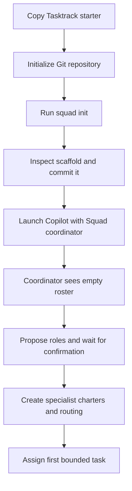
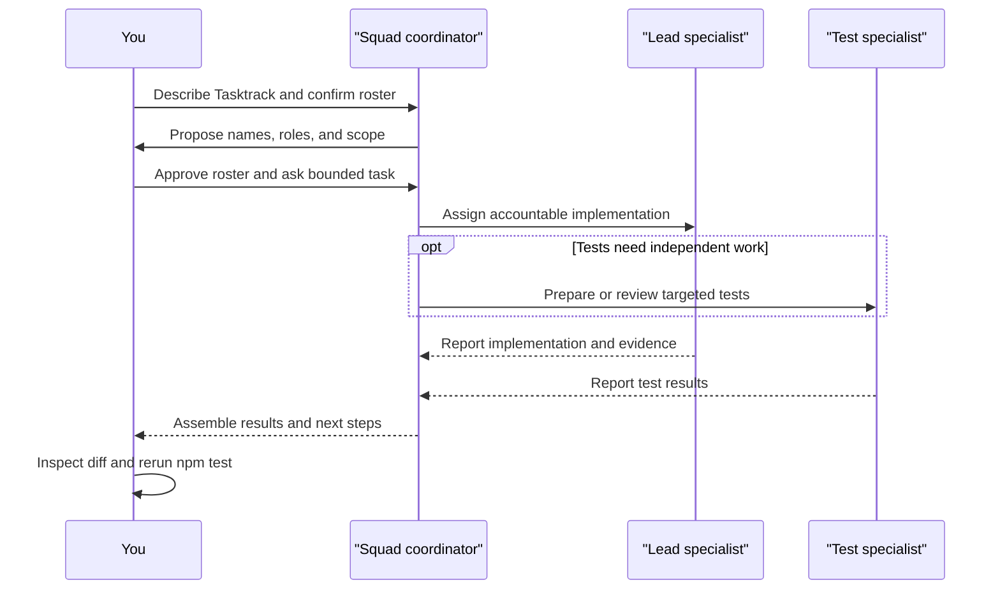

# Chapter 3: Your First Session, Annotated

> **Prerequisites:** Chapter 2.

## What You'll Learn

- Separate what `squad init` writes immediately from what the coordinator creates only after you start a Copilot session.
- Read a real v1.1.0 scaffold file by file instead of treating `.squad/` as a mysterious generated folder.
- Understand the coordinator prompt in `.github/agents/squad.agent.md` and how it selects Init Mode or Team Mode.
- Start Tasktrack from its Chapter 2 baseline, ask for a modest first roster, and give the team a verifiable first task.
- Check the result, preserve the project’s state, and know which paths are safe to customize.

## Init Is the Scaffold; the First Session Is the Team Setup

The command `squad init` is not a request to an AI model to invent a finished team. In v1.1.0 it lays down the project-side structure and the coordinator agent that Copilot can load. The first interactive conversation then reads that structure, enters Init Mode because the roster is empty, proposes a cast, and waits for you to confirm before it writes the specialist roster and charters.

That distinction matters when you are diagnosing a new install. If `team.md` has no specialist rows after the terminal command, that is not necessarily a failure. The generated `squad.agent.md` explicitly checks whether a team exists and whether the Members table has entries. An empty table is a signal to conduct team setup in the first Copilot session.

I verified this against the installed **Squad v1.1.0** CLI in a scratch Git repository containing a copy of the Tasktrack starter. The command completed without a Copilot conversation. It created the coordinator prompt, support-agent files, casting and memory scaffolding, workflows, and configuration, while `team.md` still had an empty Members table. It ended with the instruction to run `copilot --agent squad`. Because the scratch folder itself was named `.scratch-tasktrack-init`, the generated project label used that directory name; use `~/tasktrack` below to get the intended project identity. The observed run is evidence about `init`; the dialogue below is a guided first-session script, not a claim that I ran an agent model or that a model-generated roster has fixed names.



The sample has no runtime dependencies. Its API is TypeScript on `node:http`, its browser interface is static HTML and JavaScript, and its tests use Node’s built-in test runner. Node 22.18 or newer is the companion project’s stated minimum. In this environment the direct command `node --test api/test/` passed all five starter tests. That baseline is useful: you can tell a Squad-generated regression from a problem that was already present.

## Before the First Prompt: Record a Baseline

Copy the sample to a working directory; do not develop in the book repository’s `sample/` folder. If you completed Chapter 2’s hands-on, you already have this: `~/tasktrack`, tagged `ch02-start`. Otherwise create it now:

```bash
cp -R ~/Projects/squad-book/sample ~/tasktrack
cd ~/tasktrack
git init
git add .
git commit -m "Tasktrack starter"
git tag ch02-start
npm test
```

If you already have the repository, simply `cd ~/tasktrack`, confirm `git status --short` is clean, and run `npm test`.

`npm test` invokes `node --test api/test/` according to `sample/package.json`. If your local Node is older than 22.18, upgrade Node before using this companion project; `npm install` is not required because the package declares no dependencies. The API can also be started in a second terminal with `npm start`, which runs `node api/src/server.ts` and listens on port 3000 by default (or `PORT` if set). You can leave the server stopped while working on a static or documentation task.

Now initialize Squad:

```bash
squad init
```

The observed v1.1.0 output begins with “Let's build your team” and reports installation of the `squad_state` MCP server in `.mcp.json`, a VS Code default-mode setting, the `.squad/` state files, the coordinator file, and four GitHub workflows. It also says non-interactive init skipped `@copilot` setup. The completion instruction is `copilot --agent squad`. A fresh run created four workflow files: heartbeat, issue assignment, triage, and label synchronization. This observation supersedes older quick-start snippets that describe a different template or workflow count; options such as `--no-workflows` can of course change the result.

Inspect the scaffold before launching Copilot:

```bash
git status --short
find .squad -type f | sort
sed -n '1,100p' .squad/team.md
```

The scaffold is readable Markdown, JSON, YAML, and a few scripts. It is not a database hidden behind the CLI. You can inspect and version its files like other project assets. Do not edit the copied template library just to record Tasktrack-specific knowledge: the active team’s canonical files are outside `.squad/templates/`.

> **Preview (Squad 2.0):** The v2 CLI no longer supports the `--global` personal-squad initialization shown in the v1.1.0 examples and tables here. Existing profile-level personal/global directories are not read by 2.0; use project-local `.squad/` state. See Chapters 18 and 22 (Volume 2) and the [2.0 release notes](https://github.com/bradygaster/squad/blob/v2.0.0-preview.2/docs/src/content/docs/whatsnew.md).

## The Generated Tree, Annotated

Here is the actual shape observed after a default v1.1.0 `squad init` in a clean Git repository. The files under `.squad/templates/` are numerous because init copies the shipped template/reference library recursively. This is intentionally more than the small roster most beginners expect.

### State files created outside the template library

| Path | What it is for; what the fresh copy showed |
|---|---|
| `.squad/team.md` | Roster and project label. The observed file contained the coordinator row and project context, but no specialist member rows yet. The initial label comes from the current directory name. |
| `.squad/routing.md` | Work-routing rules. The initial table had no specialist routes; the issue-routing conventions and general rules were present. Add a route only after its owner exists. |
| `.squad/decisions.md` | Shared decisions and governance notes. It started with “No decisions recorded yet”; it is distinct from any one agent’s personal history. |
| `.squad/ceremonies.md` | Team meeting definitions. The generated copy included design review and retrospective procedures. You can tune triggers and participation as your project matures. |
| `.squad/config.json` | Small configuration root. The observed default contained `{"version": 1}`; options and later configuration can add fields such as `stateBackend`. |
| `.squad/.first-run` | A first-run marker used by the coordinator flow; it is not your project description or a task file. |
| `.squad/agents/scribe/charter.md` and `history.md` | Scribe’s role contract and cross-session notes. Init seeds the charter; history starts with a small scaffold rather than accumulated work. |
| `.squad/agents/ralph/charter.md` and `history.md` | Ralph’s work-monitor contract and history. Ralph is not a new specialist that you need to hire for every roster. |
| `.squad/agents/Rai/charter.md` and `history.md` | Rai’s Responsible AI review contract and history. The directory uses the observed capitalized `Rai` spelling. |
| `.squad/agents/fact-checker/charter.md` and `history.md` | Fact Checker’s verification and Devil’s Advocate contract plus history. |
| `.squad/rai/policy.md`, `.squad/rai/audit-trail.md` | Rai’s check policy and append-only evidence trail. The initial audit file contains only a heading/instruction. |
| `.squad/fact-checker/policy.md`, `.squad/fact-checker/audit-trail.md` | Fact Checker’s method/policy state and evidence trail; separate from its agent charter and history. |
| `.squad/identity/now.md` | Current focus marker for the team. It gives the coordinator a compact sense of what is active now. |
| `.squad/identity/wisdom.md` | Durable team-wide lessons/identity notes. It starts as a template, not a history of work that has not happened. |
| `.squad/casting/registry.json` | Current agent provenance records. The fresh registry’s `agents` object was empty and revision 1. |
| `.squad/casting/history.json` | Casting history and assignment snapshots. The initial arrays/maps were empty; the registry/history pair shared a transaction identifier. |
| `.squad/casting/policy.json` | Policy for names/universes/casting. Keep any custom policy consistent with its validated schema. |
| `.squad/casting/registry-history.commit.json` | Commit metadata used to verify that the registry and history are a consistent pair. It is machine-managed state, not an extra roster. |
| `.squad/memory/config.json` | Memory-provider and policy settings. The observed default provider was `local`; external host-injected support was disabled and approval-gated. |
| `.squad/memory/index.json`, `audit.jsonl` | Memory index and append-style audit record. The index was empty; audit began as an empty file. |
| `.squad/memory/local/`, `policy-inbox/`, `semantic-inbox/`, `tombstones/` | Empty directory scaffolding for local memory, policy/semantic intake, and deletion markers. Empty folders may not appear in `find -type f`. |
| `.squad/ralph-instructions.md` | Instructions Ralph can use for work-monitor behavior; this is separate from the Ralph charter and reference template. |

### `.squad/templates/`: the shipped toolbox, not the live roster

The actual copied tree also included these reference and bootstrap assets. Their names are useful clues, but the README inside that folder is the authority for which are read at runtime, which seed other files, and which are user copy-sources. The library is not a list of active agents.

| Template paths observed | Purpose, at a glance |
|---|---|
| `README.md` | Explains template categories, consumers, and the rule not to delete unclassified material. |
| `after-agent-reference.md`, `casting-reference.md`, `ceremony-reference.md`, `client-compatibility-reference.md` | On-demand procedures for collecting agent results, casting, ceremonies, and client-specific behavior. |
| `constraint-tracking.md`, `multi-agent-format.md`, `raw-agent-output.md`, `run-output.md` | Output assembly, constraint tracking, and preserving agent results in a consistent form. |
| `spawn-reference.md`, `session-init-reference.md`, `worktree-reference.md`, `orchestration-log.md` | Spawn protocol, session checklist, worktree setup/lifecycle, and Scribe logging reference. |
| `charter.md`, `history.md`, `roster.md`, `skill.md` | Starter formats for agent charters/history, roster entries, and skills. |
| `scribe-charter.md`, `ralph-charter.md`, `rai-charter.md`, `fact-checker-charter.md` | Canonical bootstrap charter sources for the built-in support identities. |
| `fact-checker-policy.md`, `rai-policy.md`, `ralph-circuit-breaker.md`, `ralph-instructions.md`, `ralph-reference.md`, `ralph-triage.js` | Support-role policies and Ralph triage/circuit-breaker references or script. |
| `casting-history.json`, `casting-policy.json`, `casting-registry.json`, `casting/Futurama.json` | Example/schema-like casting assets and a character dataset; the live registry/history are under `.squad/casting/`. |
| `ceremonies.md`, `routing.md`, `copilot-instructions.md`, `copilot-agent.md`, `squad.agent.md.template` | Templates for ceremonies/routing and Copilot integration; the coordinator prompt itself is installed at `.github/agents/squad.agent.md`. |
| `issue-lifecycle.md`, `prd-intake.md`, `mcp-config.md`, `plugin-marketplace.md`, `model-selection-reference.md`, `cooperative-rate-limiting.md`, `keda-scaler.md`, `machine-capabilities.md` | Deeper operational references loaded or copied when the corresponding feature is used. |
| `notes-protocol.md`, `package.json`, `schedule.json`, `scripts/notes/fetch.ps1`, `scripts/notes/write-note.ps1` | Supporting data and copyable scripts for notes, scheduled work, or related integrations. |
| `workflow-wiring-guide.md`, `workflow-wiring-appendix-a-code-reviewer.md`, `workflow-wiring-appendix-b-documenter.md` | Guidance for wiring agent workflows. |
| `workflows/squad-ci.yml`, `squad-docs.yml`, `squad-heartbeat.yml`, `squad-insider-release.yml`, `squad-issue-assign.yml`, `squad-label-enforce.yml`, `squad-preview.yml`, `squad-promote.yml`, `squad-release.yml`, `squad-triage.yml`, `sync-squad-labels.yml` | Workflow source files. Init installs only the applicable default workflow set into `.github/workflows/`; the rest remain examples/templates. |
| `identity/now.md`, `identity/wisdom.md` | Seed sources for the live team identity files. |
| `skills/agent-collaboration/SKILL.md`, `agent-conduct/SKILL.md`, `architectural-proposals/SKILL.md`, `ci-validation-gates/SKILL.md`, `cli-wiring/SKILL.md`, `client-compatibility/SKILL.md`, `coordinator-init-mode/SKILL.md`, `coordinator-response-mode/SKILL.md`, `coordinator-source-of-truth/SKILL.md`, `cross-machine-coordination/SKILL.md`, `cross-squad-communication/SKILL.md`, `cross-squad/SKILL.md`, `distributed-mesh/SKILL.md`, `docs-standards/SKILL.md`, `e2e-template-testing/SKILL.md`, `economy-mode/SKILL.md`, `error-recovery/SKILL.md`, `external-comms/SKILL.md`, `fact-checking/SKILL.md`, `gh-auth-isolation/SKILL.md`, `gh-aw-enlistment/SKILL.md`, `git-workflow/SKILL.md`, `github-multi-account/SKILL.md`, `history-hygiene/SKILL.md`, `humanizer/SKILL.md`, `init-mode/SKILL.md`, `iterative-retrieval/SKILL.md`, `model-selection/SKILL.md`, `nap/SKILL.md`, `notification-routing/SKILL.md`, `personal-squad/SKILL.md`, `pr-review-response/SKILL.md`, `pr-screenshots/SKILL.md`, `project-conventions/SKILL.md`, `ralph-two-pass-scan/SKILL.md`, `reflect/SKILL.md`, `release-process/SKILL.md`, `reskill/SKILL.md`, `retro-enforcement/SKILL.md`, `reviewer-protocol/SKILL.md`, `secret-handling/SKILL.md`, `session-recovery/SKILL.md`, `squad-commands/SKILL.md`, `squad-conventions/SKILL.md`, `squad-help/SKILL.md`, `squad-version-check/SKILL.md`, `squad/SKILL.md`, `test-discipline/SKILL.md`, `tiered-memory/SKILL.md`, `versioning-policy/SKILL.md`, `windows-compatibility/SKILL.md` | Skill sources. The observed CLI also copied active skill files to `.github/skills/`, where Copilot can discover them. |
| `skills/distributed-mesh/mesh.json.example`, `skills/distributed-mesh/sync-mesh.ps1`, `skills/distributed-mesh/sync-mesh.sh` | Example/configuration and helper scripts nested under the distributed-mesh skill. |

A few generated project files live beside `.squad/` and are part of the observed setup too:

| Path | Purpose |
|---|---|
| `.github/agents/squad.agent.md` | The custom Copilot agent definition and long coordinator operating prompt. |
| `.github/skills/` | Skills available to the Copilot host; these are not the same thing as copied template sources. |
| `.github/workflows/squad-heartbeat.yml`, `squad-issue-assign.yml`, `squad-triage.yml`, `sync-squad-labels.yml` | Four default GitHub Actions workflow files observed with a normal init. |
| `.mcp.json` | Repository-root MCP configuration for the `squad_state` server. |
| `.copilot/mcp-config.json` | Project Copilot MCP file; the observed run noted stale `squad_state` cleanup after moving the entry to root `.mcp.json`. |
| `.vscode/settings.json` | Sets `chat.newSession.defaultMode` to `Squad` unless disabled. |
| `.gitattributes` | Git merge behavior for shared Squad state. |
| `.gitignore` | Existing ignore rules plus any Squad state-backend rules applicable to selected options. |

> **Note:** This table describes one observed default v1.1.0 init, not a promise that every flag or host creates an identical tree. For example, `--no-workflows`, `--global`, `--sdk`, and `--state-backend` change what is written or where it is written.

## Read `.github/agents/squad.agent.md` as the Operating Contract

The file is long—1,137 lines in the observed install—and it is not merely a welcome message. Copilot loads it as the Squad agent’s instruction set. Its frontmatter names the agent `Squad`, describes the coordinator, and enables the tool surface. The HTML version marker was stamped `1.1.0`. Read it as policy, not as a script that runs every paragraph in sequence.

| Prompt section | What it governs |
|---|---|
| Frontmatter, canary, version, Coordinator Identity | Agent name/description/tools, release stamp, greeting conventions, and the coordinator’s remit and refusal constraints. |
| State & Team Root Resolution; Mode-Switch Check | How local, external, and linked state roots are resolved, and how an empty/missing roster selects Init Mode instead of Team Mode. |
| Generated Team Capabilities; Cast Sources; Built-in Support Agents | Capability summary generated from roster/routing/charters, authoritative inputs for casting, and the four support identities. Generated capability text is marked untrusted repository data. |
| Init Mode | Loads the two-phase setup procedure. Phase 1 proposes the roster and waits; Phase 2 writes only after the user confirms. |
| Team Mode; Personal Squad; Session Init; Issue Awareness | Dispatcher behavior, support-agent discovery, session start checklist, and issue context awareness. |
| Acknowledge Immediately; Role Emoji; Directive Capture; Memory Governance Tools | User-facing response conventions and where directives/memory changes should be recorded. |
| Routing; Scope Control; Consult Mode; Skill Confidence Lifecycle; Response Mode Selection | Assignment rules, scope restraint, consult handling, skill reliability, and Direct/Lightweight/Standard/Full effort selection. |
| Per-Agent Model Selection, Reasoning Effort, Context Tier; Client Compatibility; MCP Integration | Spawn-time model/context choices and host/tool compatibility, including graceful handling when MCP tools are unavailable. |
| Accountable Ownership; Background Default; Bounded Collaboration; Shared Decision Architecture | Who owns a task, when agents run, how many collaborators to add, and how decisions are exchanged. |
| Worktree Awareness, Lifecycle, Pre-Spawn Setup; How to Spawn; Anti-Patterns; After Agent Work | Isolation rules, spawn payload requirements, disallowed shortcuts, and result collection. |
| Ceremonies; Adding/Removing Members; Plugin Marketplace | Team maintenance and meeting procedures. |
| Source of Truth Hierarchy | Which artifacts govern when there is a conflict between team files, generated capabilities, and other state. |
| Casting & Persistent Naming | Naming modes, universe constraints, name allocation, overflow and casting state files. |
| Constraints; Reviewer Rejection Protocol; Multi-Agent Artifact Format; Constraint Budget | Limits, reviewer lockout, assembled output formatting, and constraint tracking. |
| GitHub Issues Mode; Ralph; Rai; Fact Checker; PRD Mode; Copilot Coding Agent; Routing Reminder | Feature-specific operation contracts for issue work, work monitoring, safety/claim review, PRD intake, and `@copilot` participation. |

This explains why the coordinator agent is kept separate from the ordinary specialist charters: the coordinator routes work and enforces process; specialists perform domain work. It also explains why you should not “fix” an unexpected behavior by blindly editing the prompt. First find the governing state file or on-demand reference; a more specific file may be the source of truth.

## Hands-On: Launch Squad and Form a Tasktrack Team

The command starts the Copilot CLI with the repository’s Squad agent definition:

```bash
copilot --agent squad
```

If your client uses an agent picker instead, choose **Squad** from the available agent list. On startup, the coordinator should identify the current user from `git config user.name`, resolve the team root, read the project state, and notice that the Members table is empty. Follow the setup confirmation; do not start implementation while the roster proposal is still awaiting your review.

Give it a description that highlights real constraints in the sample:

```text
I’m working on Tasktrack, a small task tracker. The API is TypeScript on
node:http with no dependencies, and Node 22.18+ runs the TypeScript directly.
The web UI is plain HTML and JavaScript. Keep the team small and include
someone for API work, the UI, tests, and technical decisions. Do not add a
framework or package unless I ask.
```

The roster names are yours to accept or edit. Ask for the roles you need, not a particular fictional cast. A reasonable shape is a lead/architect, backend developer, frontend developer, and test engineer. Scribe, Ralph, Rai, and Fact Checker are built-in support identities; they are not substitutes for those four project specialists. Review each proposed specialty, edit any role that assumes React/Express/a database that Tasktrack does not use, and then confirm.

Use a first, bounded request that forces the team to inspect and respect the sample instead of rewriting it:

```text
Backend specialist: inspect the current API and tests. Do not change files yet.
Report the route contract and one low-risk next improvement. Run the existing
Node tests and preserve the zero-dependency design.
```

This is intentionally a read-first task. Check the report against `api/src/app.ts`, `api/src/tasks.ts`, and `api/test/app.test.ts`. The known API surface is `GET /health`, `GET /tasks`, `POST /tasks`, `PATCH /tasks/:id`, and `DELETE /tasks/:id`; statuses are `todo`, `doing`, and `done`. The tests cover health, task create/list, empty title rejection, status updates/validation/unknown IDs, and deletion. The API’s current store is in-memory, so a restart clears it. Those are facts you can verify before accepting a proposed change.

Then ask for a small implementation and name the expected verification:

```text
Backend specialist: add GET /tasks/:id using the existing TaskStore.get method.
Return JSON for a found task and {"error":"not found"} with 404 otherwise.
Add node:test coverage for both outcomes. Do not add dependencies. Run npm test.
```

The coordinator should assign this to one accountable specialist, while the tester may be asked to prepare or review tests as bounded collaboration. Inspect the diff and run `npm test` yourself before accepting. If the task is cross-domain, for example adding a filter UI and API contract together, ask explicitly for a coordinated team task; otherwise avoid turning every small change into a full fan-out.



For the walkthrough’s next step, make the backend change and test; then ask the frontend specialist to call the API and render tasks in the static page. The current page already loads and adds tasks but does not display status controls or handle network errors. Keep those as separate increments. A good prompt says what observable behavior should change and which files are in scope. Avoid asking for a whole product redesign in the first session.

## Configuration Reference

| Item | Default or observed value | Why it matters |
|---|---|---|
| `squad init` | Markdown-oriented scaffold, project-local | Creates `.squad/` and host integration. Existing files are preserved by default. |
| `--sdk` | Off | Selects SDK builder syntax instead of the default markdown-only config style. |
| `--roles` | Off | Records a marker for built-in base-role casting during the later roster flow; it does not itself open a Copilot conversation. |
| `--global` | Off | Initializes a personal/global Squad rather than the current repository’s project-local team. |
| `--no-workflows` | Off | Skips the default workflow installation. |
| `--no-vscode-default` | Off | Skips the VS Code `chat.newSession.defaultMode: Squad` setting. |
| `--preset <name>` | Unset | Applies a named preset after initialization. Presets are discussed in Chapter 4. |
| `--state-backend <type>` | Default local behavior | Supported init help lists `local`, `orphan`, and `two-layer`; state ownership affects where mutable memory is persisted. |
| `.squad/config.json` | `{"version":1}` in observed run | Squad configuration root; later features add settings. Do not invent keys. |
| `.squad/team.md` | Coordinator present; no specialist rows | Human-readable project/team roster. The first session sets up the cast. |
| `.github/agents/squad.agent.md` | Stamped v1.1.0 | Copilot discovers Squad through this agent definition. |
| `.mcp.json` | `squad_state` server installed | Enables Copilot CLI to discover Squad state tools on a later invocation. |
| Tasktrack `PORT` | `3000` when unset | The sample API reads `process.env.PORT` and falls back to 3000. |

Appendix A (CLI Reference) lists every `squad init` option.

## Under the Hood

`squad init` is a thin CLI wrapper (`packages/squad-cli/src/cli/core/init.ts`) around an SDK initializer that writes each file only if it is absent, which is why you can rerun it safely; it is not a reset button or a substitute for backups. The initializer also creates `.github/agents/squad.agent.md` from the coordinator template and copies the template library. The fresh tree makes one distinction worth remembering: “support scaffolding exists” and “project specialists have been cast” are different states, and a coordinator prompt saying the squad “has not been cast yet” is consistent with a brand-new init. For the initializer’s internals and the SDK it builds on, see Chapter 11 (Volume 2); the file layout is listed in Appendix B.

## Pitfalls and Troubleshooting

- **The terminal said “initialized,” but no specialists appear.** Launch `copilot --agent squad`; Init Mode runs in that conversation. Confirm the proposed roster before expecting charters or specialist routes.
- **The coordinator did not appear in Copilot’s agent list.** Check that `.github/agents/squad.agent.md` exists at the Git root and contains valid frontmatter. In monorepos the agent file may be placed at the Git root while `.squad/` stays in the subdirectory.
- **The folder label looks wrong.** The scaffold uses the current directory name as its project label. Rename/edit the project context deliberately; don’t infer that the app itself has been rebranded.
- **A template file appears in two places.** `.squad/templates/` is the template source/reference library; `.github/skills/` contains active Copilot skill files. The live team state uses `.squad/team.md`, `.squad/routing.md`, charters, and history.
- **You expected a sample app test or implementation to be created by init.** It does not modify Tasktrack’s feature code as a side effect of the observed initialization. The first-session task is where you direct that work.
- **A walkthrough shows `.ai-team/`.** Treat that as legacy wording: the v1.1.0 prompt and actual CLI create `.squad/`. The old path can appear as a migration fallback, but it is not the fresh-install location.
- **Your workflow count differs.** Flags and release-specific templates affect it. Inspect the generated files rather than relying on a number in an older quick-start.
- **You have an empty git identity.** Squad uses `git config user.name` as session context. Set your name and email locally before starting if they are missing.
- **The scaffold is committed but no history exists.** That is expected. Make your first task useful, review it, run the tests, then commit both code and the resulting team state as appropriate.

## Summary

`SQUAD init` installs the coordinator and project-side state; it does not replace the first interactive roster conversation. In the actual v1.1.0 Tasktrack scratch run, the default command created the `.squad/` infrastructure, four support-agent charters and state, template library, MCP configuration, VS Code setting, coordinator prompt, and workflows, while leaving the specialist Members table empty. The prompt then directs you to start Copilot as Squad. Treat that first session as a setup review: describe Tasktrack accurately, choose a small set of roles, correct false assumptions, confirm, and start with a bounded task whose result you can test. The next chapter, Chapter 4, focuses on how to choose and shape that team.

## Exercises

1. Inspect Tasktrack’s baseline and list each endpoint, status value, and existing test. Which facts should you include in your first project description?
2. After running `squad init`, explain the difference between `.squad/team.md`, `.squad/decisions.md`, `.squad/agents/<name>/charter.md`, and `.squad/templates/charter.md`.
3. Write a first-session prompt that asks for a small, read-only API review and explicitly preserves Tasktrack’s no-dependency constraint.
4. A teammate says init failed because the Members table is empty. Give them a short diagnostic sequence based on the generated agent prompt.

## Quiz

1. True or false: `squad init` always asks the language model to propose the team before it writes any files.
2. Which file tells Copilot how to behave as the coordinator: `.squad/team.md` or `.github/agents/squad.agent.md`?
3. What does an empty `agents` object in `.squad/casting/registry.json` mean immediately after the observed initialization?
4. Does `squad init` install Tasktrack’s API dependencies?
5. Which Tasktrack command runs the built-in test suite?
6. Name two settings that can make the generated tree differ from the default run.

## Further Reading

- [Your First Session](https://bradygaster.github.io/squad/docs/get-started/first-session/)
- [First Session Walkthrough](https://bradygaster.github.io/squad/docs/tour-first-session/)
