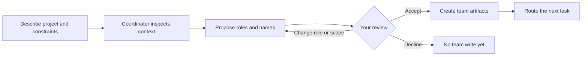
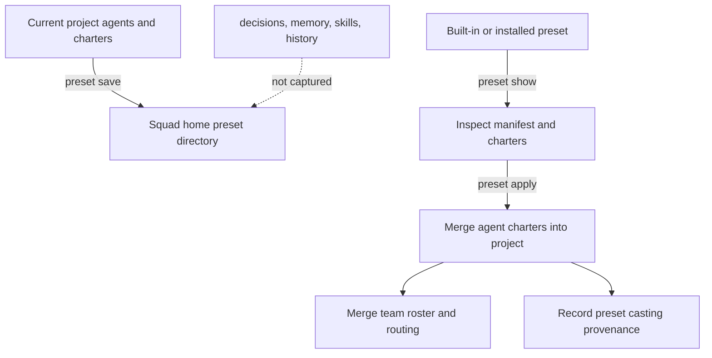

# Chapter 4: Meet the Team: Casting, Charters, and Roles

> **Prerequisites:** Chapter 3.

## What You'll Learn

- Design a useful first roster for Tasktrack instead of filling the team with overlapping specialists.
- Distinguish the coordinator, project specialists, built-in support identities, human members, and GitHub Copilot coding agent.
- Understand what Squad means by casting, how names and role assignments are persisted, and what the SDK’s casting module actually exposes.
- Read and improve a charter, then connect it to the roster and routing table.
- Browse the 21 built-in base roles and choose when a curated role is a better starting point than a custom one.
- Save, inspect, apply, and share presets without confusing a reusable roster with a complete Squad export.

## A Team Is a Set of Contracts, Not a Crowd

The coordinator is Squad’s task router and process owner. It is not one more developer in the roster. Project specialists supply accountable expertise; support identities handle persistent team functions; human members are people who can make approval decisions; and `@copilot` is a separate issue-driven coding-agent integration. Mixing these categories leads to a roster that looks impressive but routes work ambiguously.

For Tasktrack, start with the work the sample actually contains: an in-memory API, a plain browser client, and tests. A small project team might include a lead/architect, an API/backend specialist, a frontend specialist, and a test engineer. Avoid roles for React, Express, a database administrator, or an infrastructure specialist unless the project has grown to need them. You can add a specialist later when there is a recurring body of work for that domain.

Squad’s team-setup guidance describes proposal, review, and confirmation as separate phases. In this v1.1.0 coordinator prompt, Init Mode is deliberately two-phase: phase one proposes the team and pauses for your decision; phase two writes the active roster, charters, routing, and casting state only after you confirm. That pause matters. A roster affects every later task, so first inspect what the proposal assumes about your stack, responsibilities, and approval gates.



A useful confirmation is more than “yes.” For the sample, you could say:

```text
Keep the team to a lead, API developer, frontend developer, and test engineer.
The project is intentionally dependency-free: Node 22.18+ runs the TypeScript
with built-in type stripping, and the tests use node:test. The API uses node:http;
the UI is plain HTML and JavaScript. Keep the starter behavior intact unless a
task specifically asks to change it. Please show me the final roles and routes.
```

Names and fictional backstories can make agents easier to distinguish, but they do not replace role boundaries. The best cast is the smallest one that can handle likely work without leaving an important responsibility unowned.

## Casting: Names, Roles, and Durable Identity

**Casting** is how Squad associates a specialist role with a persistent display identity and charter. In the interactive flow, the coordinator proposes roles and a naming universe; you can accept, change role, add a member, or request a particular name. Names are memorable labels, not evidence that agents share a human personality or hidden continuity. The charter and the recorded history are what define the agent’s working contract and accumulated context.

The shipped SDK module makes this separation visible. `CastingEngine` can choose members from a universe and returns a `CastMember` with a name, role, personality, backstory, and display name. Its typed `CastingConfig` includes a universe, optional team size, required roles, and custom names. The v1 engine’s built-in identifiers are `usual-suspects` and `oceans-eleven`; `custom` accepts user-supplied names. It fills required roles first, prefers characters whose first listed role matches, then falls back to another compatible or unassigned character. Team size is clamped to available characters. If custom names are requested without a non-empty `customNames` map, it throws an error. If a requested universe cannot supply a required role, casting fails rather than silently promising a complete cast.

The CLI flow wraps this lower-level idea with project-aware setup, registry updates, generated charters, and state validation. Do not equate the compact SDK class with the entire conversation protocol. After a successful cast, the roster, agent directories, role-specific charters, routes, and casting provenance need to agree. Existing display names should stay stable across later sessions; changing a role does not mean casually reassigning the same name to a different specialty.

The live casting state lives in `.squad/casting/`, not in a team member’s history. In a fresh project the registry has no specialist records. After a cast, registry records identify agents, roles, naming universe, and lifecycle status; history records universe use and snapshots. The registry/history pair is written transactionally and validated together. The prompt marks these JSON files as casting-state sources of truth. They are machine-maintained state: do not hand-edit them to add a name when the coordinator or `squad cast` can perform the operation safely.

A key distinction: the copy at `.squad/templates/casting/Futurama.json` is a shipped character data file, while the SDK’s typed v1 `UniverseId` union lists only `usual-suspects`, `oceans-eleven`, and `custom`. The template folder README also says the `casting/` subtree has no known runtime consumer. Treat that JSON as available data, not proof that `Futurama` is selectable through every v1.1.0 casting path.

## Charters: What an Agent Is Allowed to Own

An AI specialist’s charter is the role contract loaded into the specialist’s prompt. It should answer four questions clearly:

1. **Identity:** Who is this agent, what is its role, and what expertise is relevant here?
2. **Ownership:** Which work should route to it, and which outputs should it produce?
3. **Method:** How should it work, including what state or evidence it reads and writes?
4. **Boundaries:** What is out of scope, what must be escalated, and who reviews the result?

The template at `.squad/templates/charter.md` is a starting point, not the live charter. A cast creates `.squad/agents/<slug>/charter.md`; it also creates a history file for that agent. A charter should be specific enough to change a spawn prompt. “Expert at everything” does not help the coordinator choose an owner. For example, a Tasktrack API charter can say “own `api/src/**`; preserve `node:http` and zero runtime dependencies; coordinate API contract changes with frontend; add or update `node:test` cases; do not make persistence claims beyond the in-memory store.”

A good charter includes exclusions as well as positive ownership. If the frontend specialist owns `web/**`, it should not independently alter server route contracts without coordinating. If the tester owns test strategy, it can write tests early, but should not claim a test passed unless it actually ran. If the lead owns architecture and review, it should make trade-offs explicit and should not take over routine implementation by default.

The roster and routing table are linked. The roster says a person/agent exists, its role, its charter path, and status. Routing says which work goes where. A routing row that names a nonexistent agent is broken policy, not a harmless note. When adding an AI specialist, update the charter, team roster, routing, and casting state as one coordinated change; the `squad cast --name <name> --role <role>` command handles these pieces in the CLI path. When retiring a member, move the agent into the alumni location rather than leaving an active route to a missing charter. Human-member rows are different: they do not require an AI charter or history.

> **Tip:** Give each specialist one clear “first call” domain. Add secondary collaboration through task-specific coordination rather than making every charter claim ownership of the same files.

## Built-In Base Roles: The Starting Catalog

The command `squad roles` in the installed v1.1.0 CLI reported **21 base roles**. They are curated charter starting points, not 21 mandatory members. `squad roles --category <name>` filters the catalog, and `squad roles --search <query>` searches it. The base-role option to `squad init --roles` tells the later team-casting flow to use this catalog rather than relying only on fictional-universe role casting. The role’s depth is in its charter: its expertise, approach, voice, and boundaries can be refined for the project.

| Role ID | Title | Useful ownership |
|---|---|---|
| `lead` | Lead / Architect | Scope, architecture, trade-offs, coordination, and code review. |
| `frontend` | Frontend Developer | Browser behavior, components, accessibility, and UI quality. For Tasktrack, use plain DOM/HTML/JS rather than assuming a framework. |
| `backend` | Backend Developer | APIs, server behavior, data flow, and backend contracts. Tasktrack’s current server is `node:http`. |
| `fullstack` | Full-Stack Developer | End-to-end changes when one specialist can own API and UI together. Avoid it if parallel independent owners are preferable. |
| `reviewer` | Code Reviewer | Independent quality, correctness, and maintainability review. |
| `tester` | Test Engineer | Test design, edge cases, and regression checks using the existing runner. |
| `security` | Security Engineer | Threat modeling, code security, and security architecture. Add when the project’s risk warrants a dedicated owner. |
| `data` | Data Engineer | Data modeling, pipelines, and analytical/query concerns. Tasktrack currently has an in-memory `Map`, not a database. |
| `ai` | AI / ML Engineer | Intelligent systems and model-driven functionality. Not needed for the starter app unless its scope changes. |
| `fact-checker` | Fact Checker | Source verification and challenges to risky assumptions; also a built-in support identity, discussed below. |
| `devops` | DevOps Engineer | Reliable infrastructure, deployment, and delivery automation. |
| `docs` | Technical Writer | Technical documentation and developer-facing explanations. |
| `designer` | UI/UX Designer | User journeys, visual design, and usability. |
| `marketing-strategist` | Marketing Strategist | Positioning, channels, growth, and communication strategy. |
| `sales-strategist` | Sales Strategist | Buyer discovery, deal strategy, and sales enablement. |
| `product-manager` | Product Manager | Product priorities, user value, and feature scope. |
| `project-manager` | Project Manager | Scheduling, coordination, milestones, and delivery tracking. |
| `support-specialist` | Support Specialist | User support, issue triage, and documented resolutions. |
| `game-developer` | Game Developer | Game mechanics and player-facing systems. |
| `media-buyer` | Media Buyer | Paid-channel planning and campaign return measurement. |
| `compliance-legal` | Compliance & Legal | Legal/compliance review and risk identification. |

Use a base role when its curated expertise fits; customize the charter when the codebase has important local conventions. Use a custom role when a durable responsibility is genuinely missing from the catalog. In SDK builder syntax, the docs show `useRole('backend', { name: 'kane', expertise: [...] })`; the role remains a starting point, while the project-specific expertise explains what the agent should know in your stack. The built-in catalog is adapted from agency-agents under its stated MIT attribution; do not remove that attribution when describing its origin.

> **Note:** The role documentation’s prose says “20” and its software/business subgroup counts do not match its own rows. I ran `squad roles` from the installed v1.1.0 CLI: it reported 21, with 10 under “Software Development” and 11 under “Business & Operations.” Use the CLI output as the verified count for this release.

## The Four Built-In Support Identities

A normal project cast does not require you to add the support identities manually. The actual `squad init` run scaffolded four support charters and histories: Scribe, Ralph, Rai, and Fact Checker. The coordinator prompt describes them as mandatory support identities, separate from ordinary specialist registry entries and routing destinations. The team-generation flow can surface them in the active roster, but they are not four more project specialists competing for the same API or UI work.

| Identity | Responsibility | How to think about it |
|---|---|---|
| **Scribe** | Merges durable decisions and logs substantial sessions. | A quiet memory function, not a general documentation developer. It helps the team retain decisions without making every agent share private history. |
| **Ralph** | Monitors work queues and runs the work-monitor lifecycle when activated. | A monitor, not another implementation specialist and not synonymous with every continuous `loop` command. It can scan work, act under its configured lifecycle, and watch for follow-up. |
| **Rai** | Reviews responsible-AI concerns such as safety, fairness, privacy, and harmful or biased behavior. | A focused reviewer. The prompt defines traffic-light findings; critical red findings can block shipping and invoke the reviewer-rejection protocol. Documentation/test/dependency fast paths are narrower than a full code review. |
| **Fact Checker** | Verifies factual claims and plays Devil’s Advocate. | Verification asks whether claims, URLs, packages, and API references are real. Devil’s Advocate steelmans a counterargument, surfaces assumptions, and sketches alternatives. It is advisory by default, not an implementation agent or final decision-maker. |

The support roles have their own policy, audit, and history files because each function needs a different record. Rai’s policy is under `.squad/rai/`; Fact Checker has a corresponding `.squad/fact-checker/` policy folder. Their charters live under `.squad/agents/`. Scribe’s durable decision workflow centers on the shared decision inbox and `decisions.md`; Ralph has its instructions and on-demand reference. They commonly run in background, so they do not stall ordinary work unless a configured gate requires a blocking review.

The `fact-checker` base role and the built-in Fact Checker are related but not identical concepts. One is a selectable curated base role in the 21-role catalog; the other is a pre-scaffolded support identity with a specific two-mode review contract. Similarly, Scribe and Ralph are not base roles shown by `squad roles`.

## Human Members, `@copilot`, and Review Gates

A human roster entry is useful when Squad should stop and wait for that person’s decision—for example, product approval, a recurring design sign-off, or a required security reviewer. A human is not an AI agent: it has no generated charter, no per-agent history, and is never spawned as a subagent. It appears on the roster as a human member and can be a routing target. Squad cannot message the person directly; you relay the request and later report the answer. Stale reminders can nudge you if a human decision remains outstanding.

For example:

```text
Add Jordan as security reviewer. Route the production-auth design to Jordan
for approval before implementation proceeds.
```

A review request that merely tags an occasional collaborator on a GitHub pull request does not need a permanent roster entry. Use a human member when the process genuinely requires a pause and an explicit response. You do not need to roster yourself for Squad to know who is driving: the coordinator reads `git config user.name`; listing yourself is an optional formalization.

Do not confuse a human roster member with GitHub’s `@copilot` coding agent. The latter is a special integration that works through issue assignment, has no standard agent directory/charter/history, and uses `.github/copilot-instructions.md`. It can appear on the roster, but it does not spawn like a Squad specialist. Init’s non-interactive message says it skipped `@copilot` setup; you can add or enable it separately when your repository and workflow are ready.

Review gates make the distinction concrete. A human can provide business judgment or approval; Lead or Reviewer can assess code quality; Tester can assess correctness and coverage; Rai can review responsible-AI risks; Fact Checker can verify evidence. Those are different kinds of authority. Decide which ones are advisory and which ones block work before relying on them as a release process.

## Presets: Reusable Team Shapes

A preset packages a team’s **agent charters**, not the complete history or knowledge of a project. The installed v1.1.0 CLI supports these operations:

| Command | What it does |
|---|---|
| `squad preset list` | Lists presets found in the Squad home directory. |
| `squad preset show <name>` | Shows manifest information and each agent’s name, role, and description. |
| `squad preset apply <name> [--force]` | Applies preset agents to an initialized Squad. Without force, same-name agents are not overwritten. |
| `squad preset save <name> [--force] [--description "..."]` | Saves the current project’s agents as a local preset. Force replaces an existing preset. |
| `squad preset install <source> [--name <override>] [--force]` | Installs a preset from a supported GitHub URL, SSH URL, or local path; `--name` renames/selects a preset and force replaces. |
| `squad preset init [--remote]` | Initializes the presets directory locally or links Squad home to a private GitHub repository. |
| `squad init --preset <name>` | Creates the normal project scaffold and applies the named preset as part of setup. |

Local presets live under `~/.squad/presets/<name>/` by default (or the configured Squad home), with a `preset.json` manifest and `agents/<name>/charter.md` files. The manifest identifies the preset name, version, description, agents, optional author, and tags. `squad preset init` seeds the bundled starter. For v1.1.0 source verification, the installed SDK contains a built-in `default` preset with lead, reviewer, devrel, security, and docs agents. Do not assume illustrative names such as `backend-team` from an example are installed unless `squad preset list` shows them.

Applying a preset does more than copy charters. In the current SDK it also merges roster entries and routes and writes casting provenance with a `preset:<name>` universe label. It preserves existing entries and only adds missing ones; `--force` controls overwrite of agent files. This is a distinction from a full backup: presets do not preserve project decisions, routing customizations as a complete snapshot, skills, ceremonies, memory, or casting history. Use `squad export` for the fuller portable snapshot.

Remote preset home is a convenience for the same GitHub account across machines. `squad preset init --remote` requires `gh` and an authenticated account, and may create a **private** repository named `squad-home`; it can clone the existing repository on another machine. Sharing a preset with another user is distinct from this personal cross-machine sync. Use `squad preset install` when you have a supported source. Review the preset charters before applying them: a preset is executable team policy, not a trusted package merely because it has a friendly name.



## Hands-On: Cast the Tasktrack Team

Use the Tasktrack repository from Chapters 2 and 3 (`~/tasktrack`). If your first session already confirmed a roster, treat it as the starting point and refine it here. Start with a clean checkpoint and ask the coordinator to propose a cast grounded in the actual files:

```bash
cd ~/tasktrack
git status --short
copilot --agent squad
```

Prompt it to inspect the project, then review the role proposal before confirming:

```text
Propose a small team for this repository. Read package.json and the API/UI/test
files first. Keep the API on node:http, the UI on plain HTML/JavaScript, and the
runtime dependency count at zero. I want a lead, backend, frontend, and tester.
Show the proposed role scopes and routes. Do not write the team until I confirm.
```

When the proposal looks right, confirm and ask for the roster to be recorded. Check `.squad/team.md`, `.squad/routing.md`, `.squad/agents/`, and `.squad/casting/registry.json`. There should be a charter for each AI specialist, no charter/history for any human member, and concrete routes that name only actual roster members. Keep Scribe, Ralph, Rai, and Fact Checker in their support role rather than manually creating duplicate specialists with the same purpose.

Next, make one roster adjustment that demonstrates a charter boundary. For example, if the proposed backend role assumes Express, say:

```text
Keep the backend role, but update its charter: this project uses node:http,
not Express. It owns api/src/** and API tests, adds no dependencies, and must
coordinate contract changes with the frontend specialist.
```

Then use a human only if you have a real gate:

```text
Add Jordan as product approver for changes that alter task status semantics.
Do not route routine implementation to Jordan.
```

Now test routing with one narrow task and one cross-domain task. A narrow task can be addressed to the backend agent by its actual proposed name. A cross-domain prompt can ask the API and frontend specialists to coordinate an API change and its browser behavior, while naming the expected contract and tests. Inspect the resulting routes and ask “who handles API tests?” if you want to test the coordinator’s explanation of the routing table.

Finally, save a preset only after you like the team’s charters:

```bash
squad preset init
squad preset save tasktrack-starter --description "Tasktrack's dependency-free API/UI/test team"
squad preset show tasktrack-starter
```

On another initialized scratch project, try `squad preset apply tasktrack-starter` and inspect the resulting roster and routes before doing work. Run `squad preset list` first if you need to verify that the preset exists in your Squad home. Keep this as an experiment; the book’s Tasktrack companion starts from `sample/`, not from a preset containing your personal roster.

## Configuration Reference

| Setting/file/command | Meaning and default |
|---|---|
| `squad init --roles` | Opt into the base-role catalog for the subsequent roster flow; off by default. |
| `squad roles [--category <name>] [--search <query>]` | Browse the 21-role catalog; without filters it lists all roles. |
| `.squad/team.md` | Canonical roster, including agent roles/status and any human entries. |
| `.squad/agents/<slug>/charter.md` | Per-agent role contract; slug is the agent directory name. |
| `.squad/agents/<slug>/history.md` | Per-agent cross-session work context; absent for humans. |
| `.squad/routing.md` | Domain/task routing; route destinations should exist as members. |
| `.squad/casting/registry.json` | Persistent agent identity/provenance records. |
| `.squad/casting/history.json` | Casting history and assignment snapshots. |
| `.squad/casting/policy.json` | Constraints and defaults for casting operations. |
| `squad cast --name <name> --role <role>` | Add a project agent through the CLI; `squad hire` is an alias. |
| `squad preset init` | Seed local presets in Squad home. |
| `squad preset init --remote` | Personal preset home backed by GitHub; requires `gh` auth and can create private `squad-home`. |
| `squad preset apply <name> [--force]` | Merge agent charter(s), team, routing, and casting provenance; collision behavior is controlled by force. |
| `squad preset save <name> [--force] [--description "..."]` | Capture the current project’s AI agent charters as a reusable preset. |
| `squad preset install <source> [--name <override>] [--force]` | Install external/local preset source into Squad home. |
| `squad init --preset <name>` | Apply a named preset during project initialization. |
| Human member | Roster/routing target only; no charter, history, or spawned agent session. |
| `@copilot` | Issue-driven GitHub coding-agent member; uses `.github/copilot-instructions.md`, not a Squad specialist charter. |

## Under the Hood

Casting and presets are implemented in `packages/squad-cli/src/cli/core/cast.ts`, `packages/squad-sdk/src/casting/`, `packages/squad-sdk/src/roles/`, and `packages/squad-sdk/src/presets/`. Two points are enough for a beginner. First, `squad cast` writes several files at once (charter, history, roster entry, routing, casting provenance), and the registry and history are written as a consistent pair so an interruption cannot leave a mismatched identity. That is why you should cast through the coordinator or the CLI rather than hand-editing `team.md`. Second, applying a preset merges roster, routing, and casting files while preserving unrelated entries, so review it as a multi-file change. The deeper walkthrough of the SDK modules is in Chapter 14 (Volume 2); file layouts are summarized in Appendix B.

## Pitfalls and Troubleshooting

- **The proposed team assumes the wrong stack.** Correct the role scope before confirming; the Tasktrack sample is not a React/Express/PostgreSQL project.
- **Everyone owns the same files.** Narrow each charter to a primary domain and use explicit coordination on shared contracts.
- **A human is being treated as an agent.** Humans are not spawned and have no charter/history. They are external approval or routing targets; you relay their answer.
- **An agent is absent from casting records after a manual edit.** Avoid hand-editing just `team.md`; use the coordinator or cast command so roster, charter, routes, and provenance stay aligned.
- **`fact-checker` looks duplicated.** The base catalog role is available for a curated specialist; the always-on support identity is a separate built-in contract. Decide whether you need a second dedicated specialist rather than blindly adding one.
- **A preset silently skips a same-name agent.** That is the safer default. Inspect the diff; pass `--force` only when replacing existing charters is intended.
- **Applying a preset changed more than charters.** In v1.1.0 the apply path also merges roster entries, routing, and casting provenance. Review all affected state.
- **You expected `backend-team` or `full-stack` to exist.** These names are examples, not guaranteed shipped presets. Use `squad preset list`; source verification found the built-in `default` manifest.
- **You expect a preset to carry project memory.** It does not. Use `squad export` when decisions, skills, and broader Squad state must travel with the team.
- **The preset page’s sharing note is stale for v1.1.0.** It describes a formal install flow as a roadmap item, but the verified CLI supports `squad preset install <source>` for GitHub URLs, SSH URLs, and local paths. `preset init --remote` is separate: it backs your own Squad home with a private repo.
- **You run remote preset init casually.** It needs `gh` authentication and may create a private GitHub repo. Choose local init if you do not want that side effect.
- **The role count in a doc does not match the CLI.** The v1.1.0 command reports 21 roles; some page prose says 20. The verified command is the relevant reference for installed behavior.

## Summary

A useful Squad team has clear contracts: coordinator routes, specialists own domains, support identities preserve team functions, humans supply decisions that require human judgment, and `@copilot` participates through its own issue workflow. Casting links stable names to roles and provenance; a charter makes each agent’s responsibility and limits concrete; routing connects those contracts to work. Use the base catalog as a curated starting point, not a mandate to hire every role. Presets make charters reusable, while exports carry broader team state. For Tasktrack, a small cast grounded in the actual dependency-free API, static UI, and built-in tests is more effective than a generic full-stack roster.

Your team now exists, but it only helps if work reaches the right member. Part II begins with Chapter 5, which explains how routing rules, capability routing, and response modes decide who handles each request.

## Exercises

1. Draft four one-sentence charter boundaries for Tasktrack’s lead, backend, frontend, and tester. Include one explicit exclusion for each.
2. Explain why adding a database specialist to the current Tasktrack roster is premature. Name the evidence that would change your answer.
3. Compare a human security approver with the `security` base role and with `@copilot`. Which one is an approval target, which one is a spawnable AI specialist, and which one works through GitHub issue assignment?
4. Create a local preset from a team you have reviewed. Inspect its `preset.json` and list the project state it does not capture.
5. Your cast has a route to an agent whose charter directory was manually renamed. Describe the files and references you would reconcile before accepting more work.

## Quiz

1. What is the difference between a specialist’s charter and history?
2. How many base roles did the installed v1.1.0 `squad roles` command report?
3. Name the four built-in support identities and give one function for each.
4. What happens if a task routes to a human member?
5. Does applying a preset capture the project’s decisions and skills?
6. Which SDK `UniverseId` values are implemented by the v1 casting engine?
7. What does `--force` change when applying a preset?

## Further Reading

- [Team Setup & Init Mode](https://bradygaster.github.io/squad/docs/features/team-setup/)
- [Built-in Base Roles](https://bradygaster.github.io/squad/docs/features/built-in-roles/)
- [Human Team Members](https://bradygaster.github.io/squad/docs/features/human-team-members/)
- [Presets — Curated Agent Collections](https://bradygaster.github.io/squad/docs/features/preset/)
- [Your Team](https://bradygaster.github.io/squad/docs/concepts/your-team/)
