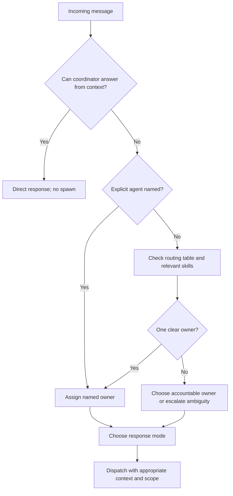
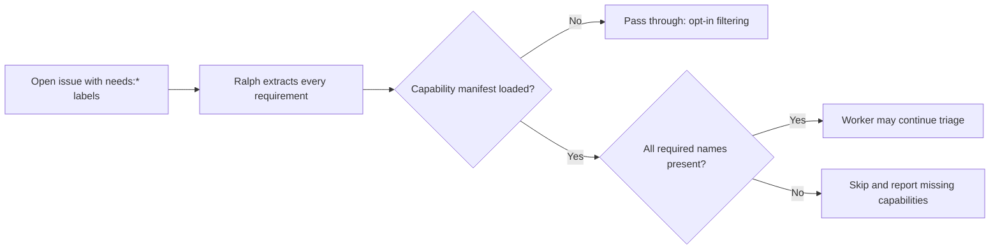

# Chapter 5: Routing, Capability Routing, and Response Modes

> **Prerequisites:** Chapter 4.

## What You'll Learn

- Separate the question “who owns this work?” from “how much coordination does it need?”
- Configure routing rules for Tasktrack's API and web areas without confusing examples with filesystem enforcement.
- Understand explicit agent addressing, work-type matches, skill-aware routing, and fallback behavior.
- Use machine capability requirements to keep Ralph from claiming issues on an unsuitable machine.
- Distinguish personal-agent consult behavior from the CLI's project-level consult mode.
- Choose among Direct, Lightweight, Standard, and Full without assuming response-time promises.

> **Preview (Squad 2.0):** The personal-squad consult behavior and the `squad consult` mode described here were removed. The coordinator template is rendered for the selected host, while routing still assigns work from the shared project team. See Chapters 18 (Volume 2) and 41 (Volume 2) for the changed coordinator and host boundaries; the [release notes](https://github.com/bradygaster/squad/blob/v2.0.0-preview.2/docs/src/content/docs/whatsnew.md) list the removed 1.x profile features.

## Routing answers WHO; mode answers HOW

Routing begins by deciding who should take responsibility for a request. Response mode comes after that: it determines how much context and parallelism to spend. This ordering avoids a common category error. “Send this to Backend” names an owner; “use Lightweight” asks for a smaller dispatch. Neither replaces the other.

In the coordinator instructions, the default is one accountable specialist selected using `.squad/routing.md`. Additional participants are appropriate when the outcomes can be separated or the task has a bounded dependency. The prompt explicitly warns against launching a crowd merely because the user said “Team.” It also specifies that a personal agent can advise while a project agent carries out changes. Later sections in this chapter unpack these distinctions.



This is the prompt's decision model, not a universal hard-coded algorithm. In a particular CLI shell or SDK embedding, input parsing and matching may implement only part of it. When behavior is surprising, inspect the active path rather than assuming every routing feature runs in every host.

## Three routing signals

### Explicit names

A direct instruction such as “Backend, fix the API validation” is a strong routing signal. The v1.1.0 coordinator prompt says to route a named specialist directly. The CLI shell parser recognizes `/command` input, `@AgentName message`, and `AgentName, message` syntax when the name matches the known roster. Unknown names do not become valid agents automatically; the parser passes the text onward to the coordinator. A known `@Agent` without a message is also treated as coordinator input rather than a blank task.

The SDK router has its own explicit-mention behavior: an `@name` is only honored if it occurs among agents appearing in the compiled routing rules, and `@coordinator` is deliberately not treated as an agent. That has an important operational implication: an agent can exist in the roster while a given SDK router does not recognize it as a valid destination unless the compiled router has it. Do not equate the prompt's roster lookup with the SDK's own known-name calculation.

### Work-type and domain rules

The routing table is a human-readable team policy. Its standard template uses a work type, target, and examples. A sample row for Tasktrack can be:

```markdown
| Work Type | Route To | Examples |
|-----------|----------|----------|
| tasktrack-api | Backend | `api/`, REST endpoints, task validation |
| tasktrack-web | Frontend | `web/`, browser UI, form behavior |
```

Replace `Backend` and `Frontend` with the actual persistent names in your `.squad/team.md`. The rules are meaningful only when the owners are real roster members. The template explicitly warns that preset routes should refer to names found in the casting registry.

The current prompt tells its coordinator to consult `.squad/routing.md`, to prefer a clear owner, and to escalate unmatched work or ownership disputes to `architect` when available. It also checks project skills before dispatch. Skills can add domain capability to the routing decision, but they are not a second roster: a skill is relevant context attached to the chosen agent, not permission to invent a new team member.

The SDK's `config/routing.ts` compiler is more literal. It accepts typed work-type rules or parses a Markdown routing table, creates match patterns from work-type words and examples, calculates a specificity priority, then sorts rules by priority. `matchRoute()` checks explicit agent mentions, checks patterns in order, and returns a fallback when nothing matches. In the typed configuration, `RoutingRule` has `workType`, `agents`, optional `examples`, and optional confidence. The compiler does not interpret `api/**` as a shell glob; pattern syntax is not the same as the prompt's semantic understanding of examples. Use examples to describe the signal and treat file paths as cues unless your active host provides a documented path matcher.

> **Tip:** Write routing rows in terms of user-visible work (“API endpoints,” “browser interactions”) and add concrete examples. A narrowly meaningful work-type name and examples are easier to audit than an opaque row of glob-like strings.

### Skills and capabilities are different

A **skill** is reusable task knowledge—for example, a Tasktrack API conventions guide. The coordinator prompt asks the host to scan designated skill directories and attach the highest-precedence matching skill before spawning. A **machine capability** describes what an execution environment can do: browser automation, GPU access, a particular account, or an installed tool. Skills help choose or inform a person-like agent; machine capabilities qualify whether a machine should claim a work item.

The docs article on capability routing describes Ralph's label filter. An issue may have `needs:gpu` or `needs:docker`; each required capability must be present on the current machine. Requirements combine conjunctively: if an issue has `needs:gpu` and `needs:windows`, a worker with only one of them must skip it. The system is opt-in: no `needs:*` labels means any machine passes; in v1.1.0 code, no manifest also passes issues through. Filtering does not provision the missing hardware or send the issue to a central scheduler. It lets workers self-select when Ralph evaluates work.

The SDK declares common identifiers such as `browser`, `gpu`, `personal-gh`, `emu-gh`, `azure-cli`, `docker`, `onedrive`, and `teams-mcp`, but the code allows custom `needs:X` values. At runtime, requirements are compared to the `capabilities` array in a manifest. The supported lookup locations in code are `.squad/machine-capabilities.json` in the team root, then the Squad home directory (`~/.squad/` by default, respecting `SQUAD_HOME`). In `squad-per-pod` deployment mode, a pod-specific manifest is tried first when both `SQUAD_DEPLOYMENT_MODE=squad-per-pod` and `SQUAD_POD_ID` are set.

The capability-routing docs show a bare JSON array at the project root, but the SDK implementation reads a manifest object with a `capabilities` property. The template's object example is the compatible shape. This is a material docs/code discrepancy: use the object form, not a root-level array, with v1.1.0. `SQUAD_DEPLOYMENT_MODE` defaults to `agent-per-node`; unknown or absent mode values do not enable pod-specific behavior.



Issue labels such as `squad:backend` and `needs:gpu` solve different routing problems. The first indicates an agent assignment in the GitHub work lifecycle; the second is a machine requirement. A single issue can use both, but satisfying one does not satisfy the other.

## Ambiguity, fallback, and readable routing policy

Not every message maps cleanly to one specialist. A request may mention several domains, use a broad word such as “feature,” or ask for an opinion instead of implementation. The prompt's accountable-owner rule helps: choose one lead for the requested outcome, add a second contributor only for an independently useful slice or a concrete dependency, and keep the overall scope in one hand. If no appropriate owner exists, the coordinator should explain its choice or escalate rather than route to an invented name.

Routing quality depends on policy quality. A good table row specifies a meaningful type, a real owner, and examples that distinguish it from neighboring rows. The SDK compiler sorts typed rules by a calculated specificity score; equal or near-equal rules still deserve human review. The prompt router reasons from prose and may interpret examples semantically, but that flexibility is not a guarantee of deterministic precedence. If two rows describe the same request differently, simplify the policy rather than relying on a hidden tie-breaker.

The CLI shell's direct-agent syntax has its own edge cases. A slash-prefixed input is treated as a command before coordinator routing. A recognized `@Name` at the start of the input with a non-empty body becomes a direct-agent message. A bare known agent name with no body is sent to the coordinator for clarification or status. A comma form such as `Backend, inspect the failing test` is also recognized. A misspelled or unknown name is not an alias; it falls through to coordinator input, where it may be interpreted as ordinary text. This makes persistent spelling important for reliable handoffs.

Issue routing and chat routing are also distinct. The `squad:{member}` label is used by issue workflows to direct work toward a member; a chat message's explicit mention or work-type rule is resolved by the active coordinator. The SDK's `RoutingConfig` has both `rules` for work types and `issueRouting` for label rules, but merely defining an issue rule does not mean every chat request consults it. Follow the workflow that receives the item.

## Four response modes

The coordinator prompt distinguishes four modes. This is a policy for effort and spawn shape, not an SLA.

| Mode | Work shape | Context and dispatch | Typical fit |
|---|---|---|---|
| **Direct** | Coordinator answers without spawning | Uses context already available; no agent session | Status, roster, a fact already in context |
| **Lightweight** | One specialist, small scope | Minimal task prompt; no full charter/history/decision ceremony; explore may suit read-only questions | Tiny edit, follow-up, scoped lookup |
| **Standard** | One accountable specialist | Full context and normal ceremony; default for most work | Ordinary implementation, review, or multi-file task within one domain |
| **Full** | Several specialists in parallel | Full context for each; split only independent deliverables or concrete roles | Multi-domain effort, or explicit request to bring the team |

The docs page supplies approximate times, but actual latency depends on the client and model. The useful contract is the dispatch shape, not whether a request finishes in a fixed number of seconds. The prompt biases upward if uncertain: choose Lightweight rather than Direct when an agent may be needed, and Standard rather than Lightweight when full context matters. It says not to downgrade a task after starting at a higher mode.

The SDK's exported `selectResponseTier()` is a separate implementation that uses `direct`, `lightweight`, `standard`, and `full` tier names. It checks a configured tier override first, then full-task keywords, direct patterns, lightweight patterns, a history hint, and a standard default. It describes suggested model tier, maximum agent count, and timeout: Direct = 0 agents/0 seconds; Lightweight = 1/30 seconds; Standard = 1/120 seconds; Full = up to 5/300 seconds. A current load of at least four caps Full at Standard; at least six caps Standard at Lightweight. These values are returned as policy data; they are not proof that the surrounding client enforces a wall-clock timeout or that the coordinator will spawn exactly that many agents.

An important v1.1.0 boundary: the module exports `selectResponseTier()`, but `SquadCoordinator.handleMessage()` does not call it. The SDK coordinator's shown dispatch pipeline checks a direct-response handler and otherwise derives `single`, `multi`, or `fallback` from the matched agent list. The prompt's response-mode selection and the SDK helper should therefore not be conflated. The helper is an SDK capability; a host must wire it into a path before it determines that path's behavior.

The helper's heuristic order makes edge cases predictable. A matching configured tier wins first. Full-pattern checks then happen before Direct checks, so a complex-looking request is not reduced to Direct just because it ends in a question mark. The Full examples include broad rewrites, feature/module builds, explicit multi-agent or multi-file wording, security-audit language, and “full review/analysis/sweep.” Direct patterns include greetings, selected questions about name/version/status, help or usage requests, and text ending in a question mark. Lightweight patterns include retrieval verbs such as list/show/find/search, status/info/check, and simple rename/move/delete/remove actions. Anything unmatched defaults to Standard. The recent-history condition returns Standard, which is already the default; its comment says “standard+,” but this helper does not upgrade it above Standard.

Load adjustment runs only for tiers passed through the helper's adjustment function. At four active sessions, Full becomes Standard; at six, Standard becomes Lightweight. Explicit configured tier overrides return immediately and bypass that adjustment. These are selection-function details, not necessarily the behavior of the prompt coordinator. This illustrates why “mode selection” needs a code path and context source: an absent `currentLoad` means no load-based change, and the SDK coordinator pipeline shown here supplies neither this context nor a call to the selector.

## Consult is two related workflows

“Consult” is used for two related but distinct behaviors in the v1.1.0 prompt and CLI.

### A personal agent advising a project squad

When the user addresses a personal agent by name, the coordinator prompt labels that interaction as consult mode: the personal specialist advises; if its recommendation calls for changes, the appropriate project agent executes them. The prompt's Ghost Protocol says personal agents are read-only with respect to project state and should be transparently identified. This protects the project owner's control of its own work while still allowing you to reuse personal expertise.

### `squad consult` on a project without its own Squad

The CLI command is a separate setup workflow for using your personal squad in an external project. `squad consult --check` previews preconditions, and `squad consult --status` checks whether a project already has consult configuration. Normal `squad consult` requires a personal squad and a Git repository; it refuses a project that already has `.squad/`. It also refuses linked worktrees and directories within an outer repository when `.git/info/exclude` would resolve outside the named project. That protects sibling worktrees from an unintended local ignore rule.

On success, the SDK copies the personal squad into project `.squad/`, writes `config.json` with `consult: true` and its source path, creates staging/session directories, patches the Scribe charter, writes a local `squad.agent.md`, and adds `.squad/` plus that agent file to `.git/info/exclude`. The personal squad remains separate while work happens. The copied project state is the session's workspace.

When finished, `squad extract` is an explicit path back to the personal squad. The CLI reads staged learnings, detects the project's license, lets you select which items to merge, records a consultation, and removes extracted items from the staging folder. Copyleft licenses block extraction by default; `--accept-risks` overrides that gate. Unknown licenses warn rather than prove safety. `--dry-run` previews; `--clean` asks before deleting the project `.squad/` unless `--yes` is supplied. `--force` can override an extraction-disabled setting. The project `.git/info/exclude` is local Git metadata, not a committed `.gitignore` rule.

There is a cleanup nuance worth understanding: the v1.1.0 `extract` command's `--clean` path deletes `.squad/`; the consult-created `.github/agents/squad.agent.md` and the lines appended to `.git/info/exclude` are separate setup artifacts. Do not assume `--clean` removes every trace of the consult setup. Inspect status and local excludes before reusing a checkout, especially if you need to restore a clean environment.

> **Warning:** Consult mode is isolation, not a promise that every possible project change disappears. Keep the worktree clean before entering, inspect `git status` afterward, and review exactly what is being extracted. Extraction transfers selected generic learnings, not project-specific files or code.

## Capability routing in distributed workers

Capability labels become especially useful when the same issue queue is polled by heterogeneous workers. One worker may have a browser, Docker, an authenticated Azure CLI, or a GPU; another may not. The label expresses a precondition for taking the issue, not a desired role or a request to install software. If the operation requires both a browser and Docker, applying `needs:browser` and `needs:docker` makes the requirement explicit. The filter compares the labels literally against the manifest capability strings; it does not infer that `gpu` means `cuda`, nor does it test whether a browser is functioning.

In the default `agent-per-node` mode, the team-level manifest is tried before the user-level Squad home manifest. The optional `squad-per-pod` mode can use a pod-specific file first. The selected file is parsed as JSON; malformed files are skipped in favor of later candidates, and if no valid file is found the filter returns `null`, which means pass through. The manifest type includes descriptive fields (`machine`, `missing`, `lastUpdated`, optional `podId`) as well as `capabilities`. Keep those descriptive values accurate for operations and auditability, even though the eligibility check itself is based on the capabilities array.

Do not use the labels as a security boundary. They are operational routing metadata, not proof that a machine is safe, isolated, or authorized to access a resource. Normal authentication and tool permissions still apply. A capability mismatch should leave an issue for a capable worker; it should not be bypassed by claiming that the current machine has a capability it lacks.

## Hands-On: Route Tasktrack work deliberately

Continue in your Tasktrack repository, where Chapter 4's team already exists. Open `.squad/team.md` and note the persistent member names and roles. Then edit `.squad/routing.md` and add rows in the existing Routing Table, replacing the example names below with the actual names from your cast:

```markdown
| Work Type | Route To | Examples |
|-----------|----------|----------|
| tasktrack-api | Backend | `api/`, REST endpoints, task validation |
| tasktrack-web | Frontend | `web/`, browser UI, form behavior |
```

Do not create a second header if the table already exists. Now ask your coordinator:

> Who owns a change to POST /tasks input validation, and who owns a change to the browser's new-task form? Explain the routing evidence, then suggest an owner for a change that touches both layers. Do not edit files.

Expected result: the API validation request maps to the backend-role member; the form request maps to the frontend-role member; an end-to-end change gets one accountable owner plus bounded collaboration if needed. If the names are not recognized, check that the table names exactly match the roster. If routing is ambiguous, make examples more specific rather than creating duplicate or contradictory rows.

As a small mode check, ask “Who is on the team?” and then “Add task due-date support across the API and UI.” The first can be Direct if the roster is already in context. The second requires at least Standard and may warrant Full if work is independently split across API and UI. These are expectations to discuss, not deterministic timing tests.

## Configuration Reference

| Item | Location or syntax | Effect |
|---|---|---|
| Routing table | `.squad/routing.md` → Routing Table | Human-maintained mapping from work type to owner and examples. Use real cast names. |
| Typed SDK rule | `routing.rules[]` with `workType`, `agents`, optional `examples` and `confidence` | Input to the SDK route compiler. |
| Issue label route | `.squad/routing.md` Issue Routing section; `squad:{member}` | Associates issue work with a named squad member in workflows that process the labels. |
| Machine requirements | issue labels `needs:{capability}` | Every listed requirement must match the machine manifest. No requirements (or no manifest) passes through. |
| Capability manifest | `.squad/machine-capabilities.json` or `$SQUAD_HOME/machine-capabilities.json` | Manifest object with `machine`, `capabilities`, optional `missing`, `lastUpdated`, and optional `podId`. |
| Pod-specific manifest | `.squad/machine-capabilities-{podId}.json` | Considered first only in `squad-per-pod` mode with `SQUAD_POD_ID`. |
| Deployment variables | `SQUAD_DEPLOYMENT_MODE`, `SQUAD_POD_ID`, `SQUAD_HOME` | Select pod-specific lookup or user-level Squad home. Default mode: `agent-per-node`. |
| Capability names | e.g. `browser`, `gpu`, `docker`, `azure-cli` | Built-ins are documented in the SDK; arbitrary names work as custom labels. |
| Consult preview/status | `squad consult --check`, `squad consult --status` | Preview the setup or inspect current state; neither is a replacement for reviewing the checkout. |
| Extraction options | `squad extract --dry-run --clean --yes --accept-risks` | Preview, optionally remove `.squad/`, skip confirmation, or acknowledge copyleft risk. `--force` overrides extraction-disabled configuration. |

## Under the Hood

The prompt treats routing as a two-stage decision. First it chooses WHO: direct naming, issue or PRD workflows, skill signals, routing policy, accountability, and scope. Then it chooses HOW: Direct/Lightweight/Standard/Full. Direct is explicitly no-spawn. For non-Direct work, Lightweight is still a real dispatch, only with less ceremony. Full is not a synonym for “the coordinator writes code”; the coordinator remains a dispatcher.

In the SDK, `compileRoutingRules()` builds patterns and priorities, while `matchRoute()` returns an agent list plus confidence and a reason. `SquadCoordinator` uses that result to choose a spawn strategy. In `response-tiers.ts`, the tier object is deliberately simple data:

```ts
const TIER_FULL: ResponseTier = {
  tier: 'full',
  modelTier: 'premium',
  maxAgents: 5,
  timeout: 300,
};
```

The surrounding implementation applies keyword and load heuristics, but the architecture still separates a recommendation from an execution backend. `fan-out.ts` handles several spawn requests using `Promise.allSettled`; one agent's failure does not invalidate all results. `spawn-backend.ts` defines platform-specific dispatch. The Copilot App backend can create sub-sessions with a concurrency cap; task-backed spawning uses an injected session factory, with a fallback path if a platform backend fails.

Capability filtering lives under `packages/squad-sdk/src/ralph/capabilities.ts`, not in the ordinary chat routing table. It loads a manifest, extracts labels beginning with `needs:`, compares every requirement with the available capability set, and returns handled issues separately from skipped issues. This is why a machine capability check should not be explained as a specialist-selection rule.

Consult behavior has a further distinction in implementation: `packages/squad-sdk/src/sharing/consult.ts` does file copying, `.git/info/exclude` updates, license classification, and extraction support; `packages/squad-cli/src/cli/commands/consult.ts` parses `--status` and `--check`; `extract.ts` owns CLI confirmation and cleanup. The high-level feature docs are useful orientation but should be reconciled with those versioned files.

## Pitfalls and Troubleshooting

- **A named agent is not necessarily a supported route in every execution path.** Check the roster and, for the SDK router, whether the name appears in compiled rules.
- **A route is not a file glob.** The markdown table is read by an LLM-oriented coordinator; the typed SDK compiler builds text patterns from work types and examples. Do not assume it applies Git path matching.
- **WHO is not HOW.** A Frontend assignment does not inherently mean Lightweight, and a Full mode does not imply every roster member should spawn.
- **Do not copy the capability article's bare-array example.** The v1.1.0 SDK expects a JSON object with a `capabilities` property, as shown in the template.
- **No manifest is not a fail-closed hardware gate.** With no capability file, issues pass through. Configure manifests on every worker if labels are meant to be meaningful.
- **Use `needs:` for environment requirements, not `squad:`.** Confusing the labels can direct an issue to a person while leaving it on the wrong machine.
- **Use consult mode only when the project does not already own a squad.** The CLI refuses an existing `.squad/` rather than blending two teams.
- **Check Git metadata and cleanup.** `.git/info/exclude` is local to the clone; `extract --clean` removes project `.squad/` but may leave consult agent metadata and ignore entries.
- **Treat `--force` as an implementation detail in this release.** The v1.1.0 `extract` handler parses it to override extraction-disabled configuration, but `squad extract --help` does not list it. Prefer documented flags; if a workflow depends on this override, verify the installed CLI version and source.
- **Do not overfit on approximate times.** Mode labels communicate context depth and dispatch shape; network, model, and platform latency vary.

## Summary

Routing assigns ownership; response mode sizes the effort. The coordinator can use explicit names, work-type policy, and relevant skills to find an owner, while capability labels qualify which worker environment may take an issue. Personal agents can advise a project team, and the CLI's consult setup can isolate a personal squad in an external Git repository with an explicit extraction path. Those mechanisms overlap in vocabulary but have different code paths. Use the existing roster, prefer a single accountable owner, and verify versioned source where docs and implementation disagree.

## Exercises

1. **Resolve a collision.** Add a general `tasktrack-api` row and a more specific row for validation. Explain which should win for an invalid-title change and why; consider what an LLM-based prompt router can and cannot guarantee about specificity.
2. **Design a capability manifest.** Create a sample manifest object for a machine with browser and Docker support. Add an issue with `needs:browser` and `needs:gpu`. State whether the worker should process it and what happens if no manifest exists.
3. **Choose a response mode.** Classify four requests—“What port is Tasktrack on?”, “Fix the typo in its README,” “Add API validation,” and “Build a due-date feature across API and web”—and justify who would be spawned and how much context is appropriate.
4. **Compare consult meanings.** Describe one safe use of a personal agent in an existing project squad and one safe use of `squad consult` in a project without a squad. Include one behavior that differs.
5. **Audit the docs/code gap.** Explain why the capability article's root-level JSON array should not be used with the v1.1.0 implementation. Give the compatible path and top-level JSON keys.

## Quiz

1. In the coordinator model, what question does routing answer, and what question does response mode answer?
2. In the SDK routing compiler, what are the four main fields of a work-type rule?
3. What conditions must all be true for a `needs:*` issue to pass capability filtering when a manifest is present?
4. What is the default behavior when the capability manifest is absent?
5. Which response mode uses no agent spawn? Is Lightweight also no-spawn?
6. What are the two distinct workflows called “consult” in v1.1.0?
7. Does `SquadCoordinator.handleMessage()` call `selectResponseTier()` in the inspected implementation?
8. What does `squad extract --clean` remove, and why should you verify the remaining local metadata?

## Further Reading

- [Work Routing](https://bradygaster.github.io/squad/docs/features/routing/)
- [Capability Routing](https://bradygaster.github.io/squad/docs/features/capability-routing/)
- [Consult Mode (v1.1.0 source)](https://github.com/bradygaster/squad/blob/v1.1.0/docs/src/content/docs/features/consult-mode.md)
- [Response Modes](https://bradygaster.github.io/squad/docs/features/response-modes/)
