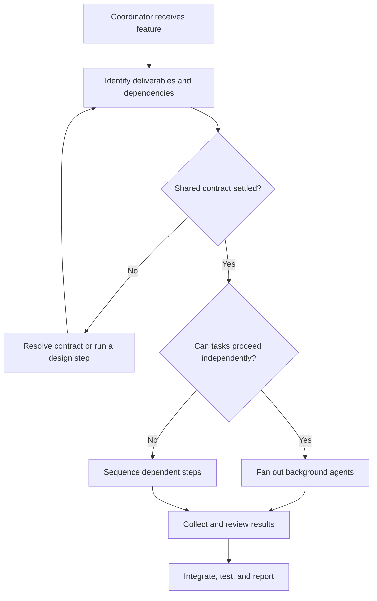
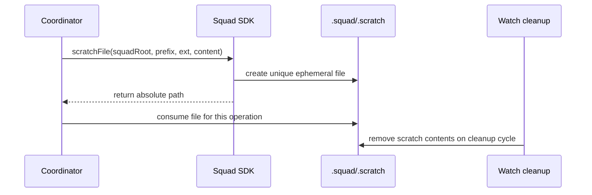

# Chapter 6: The Parallel Work Model

> **Prerequisites:** Chapters 4 and 5.

## What You'll Learn

- Break a request into independent work streams and identify dependencies before dispatch.
- Choose background parallel execution, sequential execution, or a staged hybrid based on the work's actual dependencies.
- Separate agent-level parallelism from Git branch and working-directory isolation.
- Create and manage Git worktrees safely, including Squad's worktree-local and main-checkout state strategies.
- Use `.squad/.scratch/` for ephemeral artifacts and understand its cleanup and ignore behavior.
- Reduce merge conflicts by assigning file ownership, agreeing on interfaces, and integrating in a deliberate order.

## Parallel Work Has Two Dimensions

“Run two agents in parallel” can mean two distinct things. The coordinator can launch more than one agent at once; Git can also give those agents separate working directories and branches. The first is **execution parallelism**. The second is **workspace isolation**. They complement each other, but neither implies the other.

A coordinator can ask two agents to analyze different questions in one shared conversation context without creating two Git branches. Conversely, you can have two worktrees open and still run agents one after the other. When agents modify files, use both layers deliberately: dispatch genuinely independent tasks concurrently, and give potentially colliding changes separate worktrees/branches.

The benefit is shorter elapsed time and focused ownership. The cost is additional model usage, coordination overhead, integration work, and possible conflicts. Parallelism is not automatically more efficient if the tasks are coupled or each requires a long review-and-merge cycle.

### Dependency analysis before fan-out

Start by asking what each work stream needs to know and what it will write. Tasks are independent when they have separate deliverables and can proceed using an agreed contract. A backend and frontend change can happen in parallel if both know the API shape up front. If the interface is undecided, either settle it first or create a short design step before the implementation fan-out.

A useful decomposition names each stream, its ownership boundary, its inputs, its output, and its acceptance check. “Build the feature” is too broad. “Add optional `dueDate` validation and serialization in `api/`; do not edit `web/`” gives an agent a bounded scope. “Add a date control to `web/` that sends the agreed ISO date string; do not edit `api/`” gives the other agent a compatible, non-overlapping task.



A dependency does not mean the whole feature must be serial. You can parallelize independent discovery or implementation and then stage the dependent parts. For example, a backend agent can establish an API contract while a frontend agent prepares a UI skeleton with a clearly marked integration point; once the contract is agreed, the frontend completes its data wiring. The coordinator synchronizes the boundary, not every keystroke.

### Background execution versus sequential gates

In Squad's orchestration pattern, independent agents are launched in background mode. The coordinator tracks their outcomes, collects the results, checks how they fit together, and routes the next task. Agents should not assume they can see one another's unsynthesized output. If one task requires another's exact result, make that dependency explicit and run it after the prerequisite completes.

Sequential execution is appropriate when one output determines the next task, when a reviewer must approve a change before it continues, when agents would write the same central file, or when you intentionally trade elapsed time for lower concurrent usage. A reviewer gate is not a failure of parallelism; it is a control point that protects quality and ownership.

A hybrid pattern is often best:

1. Run independent research or implementation tracks concurrently.
2. Collect their results and reconcile any assumptions.
3. Run integration or contract-dependent work after the shared facts are known.
4. Review the combined result and run tests across the integrated workspace.

If a request contains circular dependencies—A requires B's output while B requires A's—parallelizing both does not solve the cycle. Have the coordinator identify the cycle and ask you to choose a sequence or redesign the work to establish a stable interface first.

### Concurrency and cost

The coordinator prompt describes a practical simultaneous-sub-session range of four to five. In the Copilot App `SessionSpawnBackend`, the SDK defaults `maxConcurrent` to 5 and rejects a spawn when active plus starting sessions have reached that cap; it does not queue that rejected spawn. Task-backed spawns do not use that same concurrency cap. Therefore, do not treat “five” as a universal limit across every host or spawn backend. A host may impose its own limit, and a failure may trigger fallback behavior rather than successful fan-out.

More concurrent agents can increase parallel throughput but also increase cost, rate-limit pressure, review demand, and the number of assumptions that must be reconciled. Use a user-directed limit when appropriate (“Run at most two agents at once”), and ask what outcome you need rather than equating maximum parallelism with best performance. The source docs also cover model selection; that is a separate lever: choosing a cheaper model can reduce cost per task, while limiting concurrency reduces simultaneous work. Neither changes Git isolation.

## Worktrees: Separate Workspaces, One Repository

A Git worktree is another checkout linked to the same repository object database. It gives you a different branch and filesystem directory without cloning the repository. This is especially useful when two work streams need to edit files concurrently: each agent can inspect and change its own branch while you switch among worktrees without repeatedly stashing changes.

Example from a clean Tasktrack checkout:

```bash
git worktree add ../tasktrack-backend -b feature/due-date-backend
git worktree add ../tasktrack-frontend -b feature/due-date-frontend
```

The backend and frontend directories now have separate checked-out files and branches. The worktrees share Git's repository storage and branch reference database: the same branch cannot be checked out as the current branch in two linked worktrees at once. Each worktree has its own `HEAD` and index. In linked worktrees, `.git` is usually a small pointer file, not a `.git/` directory; Git resolves the common repository metadata through that pointer.

Worktrees do not automatically share every file's live contents. If `.squad/` is tracked, its working copy in each branch starts from that branch's commit and can diverge with branch changes. If `.squad/` is ignored runtime state, each worktree may have independent local state unless you explicitly share it. This choice affects team context, logs, and decisions—not the Git branch mechanism itself.

### Choosing a Squad state strategy

Squad recognizes two patterns:

| Strategy | State location | Useful when | Trade-off |
|---|---|---|---|
| Worktree-local | Each branch/worktree has an independent `.squad/` | Experiments, different teams, isolated configuration or logs | Decisions and mutable state do not automatically appear in sibling worktrees. |
| Main-checkout / shared | Worktrees resolve or link to the main checkout's `.squad/` | Same team coordinating across branches | Agents can observe shared state, but concurrent writes share one mutable directory. |

Use the local approach when a worktree is meant to be a genuinely separate project context. Use shared state when multiple branches are executing as one team and must consult the same routing and decisions. A shared directory does not make conflicting file edits safe; it just makes that state visible to both work streams.

Squad's initialization guard detects when you run `squad init` from a linked worktree whose main checkout already has `.squad/`. It offers a shared/main-checkout choice (the default, including in non-interactive mode) or a local `.squad/` choice. If you select shared, the guard avoids scaffolding a duplicate directory and advises you to run `copilot --agent squad` from the main checkout. If you select local, initialization proceeds in that worktree. The SDK's path resolver first checks the current worktree for `.squad/`; when absent, it can follow the `.git` pointer and fall back to the main checkout. That fallback is not the same as a magical merge of independently edited local state.

> **Tip:** Decide how state should behave before creating or initializing several worktrees. Keep shared team configuration stable, and do not assume that ignored logs or scratch files are synchronized just because Git worktrees share the object database.

### Integrating and cleaning up

Each agent should commit only the files in its assigned scope. From the main checkout, integrate branches one at a time and test after each meaningful merge. If backend and frontend changes are separate, merge one branch and then the other; once both are integrated, run the tests and a manual end-to-end check. A worktree is not ready to remove while it contains uncommitted changes you still need.

After merging and confirming a clean tree, remove each linked worktree with `git worktree remove ../tasktrack-backend` (and similarly for the frontend). Git refuses to remove a worktree with uncommitted changes unless you explicitly force it. Avoid `--force` as a cleanup shortcut: it can discard the exact work an agent was expected to return. If a directory was deleted outside Git, `git worktree prune` can clean stale administrative metadata, but it does not recover the removed files.

## `.squad/.scratch/`: Ephemeral Means Disposable

Squad's SDK uses a scratch directory beneath the resolved `.squad/` root for temporary prompts, processing artifacts, and draft files. The helper is `scratchDir(squadRoot, create = true)`; it returns an absolute path and normally creates `.scratch/` if absent. `scratchFile(squadRoot, prefix, ext = '.tmp', content?)` returns a unique path beneath it. If content is supplied, the SDK writes it; if omitted, the caller is responsible for writing and deleting the file or relying on cleanup.

The `squadRoot` parameter is the absolute path to the `.squad/` directory—not the repository root. The helper sanitizes the prefix with `path.basename` to prevent it from supplying a directory traversal path and replaces path separators in the extension. It creates a timestamp-plus-random-suffix filename. This reduces accidental repo-root clutter and makes collisions unlikely, but it is not a durable storage API or a place for files another agent must retain as an explicit deliverable.

Initialization adds `.squad/.scratch/` to `.gitignore`. The watch cleanup capability removes scratch contents on round 1 and every configured `everyNRounds` interval thereafter (default: every 10 rounds), so files there can disappear during normal operation. Treat every scratch artifact as disposable: save final decisions in the appropriate durable artifact, copy completed work to its actual destination, and never store a unique source file there without another retained copy.



Scratch space is team-wide relative to the selected `.squad/` root, not automatically per agent or per session. Under separate worktree-local roots, each worktree's scratch path is separate. If worktrees resolve to the same shared `.squad/`, scratch files share that directory and may be cleaned while another task is running. Therefore scratch filenames should be unique, and a workflow that requires longer retention should store the data elsewhere. Don't run broad manual deletion commands against a shared scratch directory while other work is active.

## Conflict Avoidance Is an Architecture Skill

Worktrees isolate filesystem changes, but they do not prevent semantic or merge conflicts. Two agents can make incompatible assumptions on distinct files; they can also both modify the same file on separate branches and only discover the overlap at integration. The coordinator and human reviewer reduce these risks before work begins.

Use these practices:

1. **Name an owner per file or component.** If the backend owns `api/` and the frontend owns `web/`, say so explicitly. Avoid assigning the same central manifest, root package file, or shared configuration to both agents.
2. **Agree on the contract first.** State request fields, response shape, validation, status codes, and backward-compatibility expectations in each prompt. The API and UI can then evolve independently against the same interface.
3. **Keep changes narrow.** Ask each agent not to reformat or opportunistically refactor files outside scope. Broad formatting churn obscures both actual behavior and merge overlap.
4. **Identify shared-file work.** If both tasks need a shared file, assign it to one owner or make a separate contract-first commit that both branches can build upon. Do not rely on Git's conflict markers to resolve design decisions.
5. **Use tests as integration contracts.** Backend tests verify the API independently; end-to-end testing verifies that the frontend's request matches it. Run the tests after integration, not only in each branch.
6. **Collect before combining.** Ask the coordinator to summarize each branch's changed files, assumptions, tests, and blockers. Do not merge based only on “done.”
7. **Respect review gates.** If a reviewer rejects a particular artifact, assign the revision to another agent according to the reviewer protocol instead of letting the original author repeatedly overwrite the review.

Git's `merge=union` driver is configured for certain append-only Squad logs and histories. It can preserve lines from both sides in those designated files; it is not a general conflict-resolution strategy for source code, task plans, or arbitrary shared configuration. Even for append-only records, union merging does not prove semantic consistency or prevent duplicate events. Keep the driver confined to the configured paths and review the result.

## Hands-On: Backend and Frontend Work in Parallel Worktrees

In this exercise, you add optional due-date support to Tasktrack. The two work streams share a small contract and own distinct directories, so they can be implemented independently and integrated with little overlap.

### 1. Start from a clean Tasktrack repository

Use your copy from the companion-project setup and make sure previous work is committed. From the repository root:

```bash
git status --short
git worktree add ../tasktrack-backend -b feature/due-date-backend
git worktree add ../tasktrack-frontend -b feature/due-date-frontend
```

The first command should show no pending changes. The two `git worktree add` commands create separate branch checkouts beside the main Tasktrack directory. If a branch name already exists, choose another unique name rather than deleting an existing branch.

Before running initialization in either worktree, decide whether its Squad state should be local or shared. The `.squad/` directory from your committed starting point will be present if it is tracked. If you run `squad init` in a linked worktree and it detects a main checkout `.squad/`, select the state strategy that matches your exercise. Do not initialize a second team just to create a Git worktree.

### 2. Establish the shared interface contract

Both agents will implement this contract:

- A task may have an optional `dueDate` property containing a calendar date string in `YYYY-MM-DD` form.
- Existing tasks without a due date remain valid and render normally.
- `POST /tasks` accepts the optional property; an invalid date returns HTTP 400.
- The API returns a task's `dueDate` when supplied.
- The web form lets a user enter an optional date and displays it alongside the task.

The UI is allowed to be complete before the backend branch lands because the contract is explicit. No agent should edit files outside its owned path: backend owns `api/`; frontend owns `web/`.

### 3. Launch both work streams

Open two terminals. In the backend worktree, ask the coordinator to assign backend implementation and tests. In the frontend worktree, ask for the UI changes. Example commands and prompts:

**Terminal A — backend:**

```bash
cd ../tasktrack-backend
copilot --agent squad
```

Then request:

```text
Implement optional Tasktrack dueDate support in api/ only. Contract: dueDate is optional YYYY-MM-DD; POST /tasks validates it and returns HTTP 400 for invalid values; tasks returned by the API include it when present; tasks without it remain unchanged. Add or update node:test coverage. Do not edit web/ or root files. Commit your changes on this branch and report changed files, test command, and result.
```

**Terminal B — frontend:**

```bash
cd ../tasktrack-frontend
copilot --agent squad
```

Then request:

```text
Add optional due-date entry and display to Tasktrack web/ only. Contract: submit optional dueDate as YYYY-MM-DD to POST /tasks; show due dates for tasks that have one and leave undated tasks unchanged. Do not edit api/ or root files. Commit your changes on this branch and report changed files and assumptions. Do not require backend changes to complete the UI.
```

The sessions can run simultaneously because they have distinct ownership paths and the same interface contract. Each is still expected to inspect its branch, run relevant checks, and report outcomes. If either agent discovers that the contract is inadequate, pause integration and ask the coordinator to reconcile it rather than silently diverging.

### 4. Collect and integrate

Wait for both sessions to finish. In each worktree, inspect the changes and ensure the commits contain only the assigned area. Return to the main checkout and merge each branch:

```bash
cd ~/tasktrack
git merge --no-ff feature/due-date-backend
git merge --no-ff feature/due-date-frontend
npm test
```

If your Tasktrack checkout lives somewhere else, replace `~/tasktrack` with its actual path. The current starter's API tests run with `npm test` and Node's built-in test runner; no package installation is required. Review conflicts manually if they occur. Because the agents owned `api/` and `web/` separately, a textual conflict should be unexpected; do not resolve it by dropping either branch wholesale.

Run the API locally and verify the feature manually, or add an integration test that submits a valid date, checks the response, and rejects an invalid date. Open `web/index.html` against the API and confirm both dated and undated tasks display correctly. Once the merged main checkout is clean, remove the extra worktrees:

```bash
git worktree remove ../tasktrack-backend
git worktree remove ../tasktrack-frontend
git worktree list
```

Expected result: `git worktree list` shows the main checkout; the feature branches remain available in Git until you choose to delete them. Tag your own checkpoint as `ch06-end` if you are following the book's progression. Do not tag or alter the book's repository for this exercise.

## Configuration Reference

| Setting / path | Default or behavior | Notes |
|---|---|---|
| Session spawn mode | Background for independent work; sync for dependencies or gates | Coordinator selects based on task relationships. The term describes orchestration, not Git isolation. |
| `SessionSpawnOptions.maxConcurrent` | `5` in the Copilot App session backend | Rejects over-cap spawn; no queue is configured there. Other backends differ. |
| Coordinator concurrency guidance | Up to roughly four or five simultaneous sub-sessions | Host and platform limits may be lower. Ask for a lower cap to control cost. |
| `git worktree add <path> -b <branch>` | Creates a worktree and new branch | Path must not already be an incompatible working tree; branch must be available. |
| `git worktree list` | Lists registered checkouts | Useful to verify which branches and paths are active. |
| `git worktree remove <path>` | Removes a clean linked checkout | Commit or preserve needed work first; do not force-remove as routine cleanup. |
| `squad init` worktree guard | Shared/main-checkout choice is default when main `.squad/` is detected | Choosing local creates a separate `.squad/` in the current worktree. |
| `resolveSquad(startDir)` | Current `.squad/` first; main-checkout fallback for linked worktree | Fallback only when the current path has no `.squad/`. |
| `.squad/.scratch/` | Ephemeral SDK/CLI working files | Added to `.gitignore`; watch cleanup removes its contents on cleanup rounds. |
| `scratchDir(squadRoot, create = true)` | Creates `.scratch/` unless `create` is false | `squadRoot` is the `.squad/` directory path. |
| `scratchFile(squadRoot, prefix, ext = '.tmp', content?)` | Unique filename; content is optional | With no content, caller must write the file and clean it up. |
| `.gitattributes` merge rules | `merge=union` on selected append-only logs/history | Not enabled for arbitrary source files. Union does not resolve semantic conflicts. |

There is no standalone environment variable or project configuration key that turns every agent task into an isolated Git worktree. Worktree creation is a Git operation; Squad's state resolver and `squad init` guard determine how the `.squad/` state is located or initialized inside it.

## Under the Hood

The coordinator's fan-out implementation lives in `packages/squad-sdk/src/coordinator/fan-out.ts`. For each assignment it compiles the charter, resolves the model and reasoning/context preferences, builds the initial prompt, and asks the configured spawn backend for a background session when one is available. If that backend reports failure, the code emits a `session.spawn_fallback` event and may try the direct `createSession` path. The coordinator then registers the spawned agent in its session pool and tracks completion. This explains why “background” describes how the coordinator launches a session; it does not imply the agent has its own Git worktree.

The Copilot App session backend is in `packages/squad-sdk/src/coordinator/spawn-backend.ts`. It has a configurable `maxConcurrent` option defaulting to 5. It counts active and pending session spawns and rejects a new session when the cap is reached; the error specifically states that no queue is configured. The task-backed backend does not impose that same cap. A chapter should therefore distinguish a backend-specific default from a universal limit.

The SDK's `resolveSquad` in `packages/squad-sdk/src/resolution.ts` walks upward for `.squad/`, preferring a worktree-local directory. If it sees a `.git` file, it parses the `gitdir:` pointer to derive the main checkout and checks there before giving up. The CLI's `packages/squad-cli/src/cli/core/detect-squad-dir.ts` performs a similar detection for `.squad/` and legacy `.ai-team/`. During initialization, `packages/squad-cli/src/cli/core/init.ts` detects a linked worktree, warns that the main checkout already has `.squad/`, and defaults to sharing when running non-interactively; selecting local continues scaffold creation.

A simplified SDK excerpt shows the resolver's priority:

```ts
const candidate = path.join(current, '.squad');
if (storage.existsSync(candidate) && storage.isDirectorySync(candidate)) {
  return candidate;
}
const gitMarker = path.join(current, '.git');
if (storage.existsSync(gitMarker)) {
  if (storage.isDirectorySync(gitMarker)) return null;
  const mainCheckout = getMainWorktreePath(current, gitMarker);
  if (mainCheckout) {
    const mainCandidate = path.join(mainCheckout, '.squad');
    if (storage.existsSync(mainCandidate) && storage.isDirectorySync(mainCandidate)) {
      return mainCandidate;
    }
  }
  return null;
}
```

The scratch API is in `packages/squad-sdk/src/resolution.ts`. The canonical helper takes a `.squad/` root and appends `.scratch`; scratch-file prefixes are basename-sanitized and filenames include a timestamp and random suffix. Init adds `.squad/.scratch/` to `.gitignore`. The watch cleanup capability in `packages/squad-cli/src/cli/commands/watch/capabilities/cleanup.ts` clears its files when that capability runs. These are implementation facts; retain durable outputs elsewhere.

Squad's `.gitattributes` setup is in `packages/squad-sdk/src/config/init.ts`. It registers `merge=union` for selected append-oriented state such as decisions, agent histories, logs, orchestration logs, and audit trails. It does not declare all `.squad/` files union-mergeable. Union is a line-preserving merge driver, not a lock or cross-branch transaction system.

## Pitfalls and Troubleshooting

- **Parallelizing coupled work too early:** Settle the API, schema, or ownership contract first. Otherwise independent branches can encode incompatible assumptions.
- **Assuming the coordinator gives every agent a worktree:** Spawn mode and workspace mode are separate. Confirm the working directory/branch strategy for implementation work.
- **Assuming a shared `.squad/` means shared Git state:** A shared state directory shares mutable context, but each worktree still has its own branch, index, and checked-out project files.
- **Reusing one branch in multiple worktrees:** Git prevents a branch from being checked out simultaneously in two linked worktrees. Create one branch per work stream.
- **Committing outside the assigned boundary:** Keep root files and shared API contracts under one owner. Ask the coordinator before broadening scope.
- **Treating a concurrency cap as a queue:** The App session backend rejects at the cap; the caller must handle the error or fallback path.
- **Expecting union merge to solve source conflicts:** It applies only to configured paths and does not resolve behavioral disagreement.
- **Saving durable work in scratch:** Watch cleanup is allowed to delete scratch contents. Store accepted decisions and deliverables in their intended files.
- **Passing the repo root to the scratch helper:** `scratchDir` and `scratchFile` expect the `.squad/` root.
- **Removing a dirty worktree with force:** First commit or preserve its contents. Force removal can erase unreturned work.
- **Testing only in feature branches:** Integrate both work streams and run tests in the combined checkout; integration can reveal contract failures that isolated tests miss.

## Summary

Parallel work is a dependency-management decision, and worktrees are a source-control isolation decision. Use background fan-out for independent deliverables, sync steps for true dependencies and review gates, and explicit contracts to let separate branches converge. Worktrees share Git's object store but not their checked-out files; choose intentionally whether `.squad/` state is local or shared. Keep scratch files ephemeral, treat union merge as a narrow aid for append-only logs, and test the merged application. Tasktrack's backend/frontend split demonstrates how ownership, a shared API contract, separate branches, and one deliberate integration pass turn parallelism into usable throughput.

## Exercises

1. **Build a dependency graph.** For a feature that adds task labels, list backend, frontend, tests, and docs deliverables. Mark which can proceed in parallel and identify the contract needed before fan-out.
2. **Choose state strategy.** You are testing an experimental routing configuration in a separate worktree. Should it share the main `.squad/` state? Explain which files or observations would be affected.
3. **Spot a hidden conflict.** Two agents own different files but each plans to rename the same API field. Explain why Git may merge cleanly while the application still fails, and propose a coordination fix.
4. **Plan scratch retention.** An agent writes a generated schema into `.squad/.scratch/` and another task needs it tomorrow. What is unsafe about this plan, and where should the durable artifact go?
5. **Recover safely.** A feature worktree has uncommitted changes and you need to integrate the branch. List a safe sequence that preserves the work and leaves the worktree removable.

## Quiz

1. What is the distinction between background execution and a Git worktree?
2. When is a synchronous or sequential step preferable to fan-out?
3. What is the default concurrency cap in the Copilot App `SessionSpawnBackend`, and does the code queue excess spawns?
4. Does a Git worktree share its checked-out files with another linked worktree?
5. Which directory must be passed as `squadRoot` to `scratchFile`?
6. Why is `merge=union` not a general conflict-avoidance mechanism?
7. What must be verified before removing a worktree?

## Further Reading

- [Parallel Work & Models](https://bradygaster.github.io/squad/docs/concepts/parallel-work/)
- [Parallel Execution](https://bradygaster.github.io/squad/docs/features/parallel-execution/)
- [Scratch Directory](https://bradygaster.github.io/squad/docs/features/scratch-dir/)
- [Git Worktree Awareness](https://bradygaster.github.io/squad/docs/features/worktrees/)
