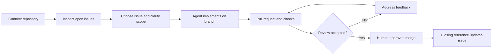
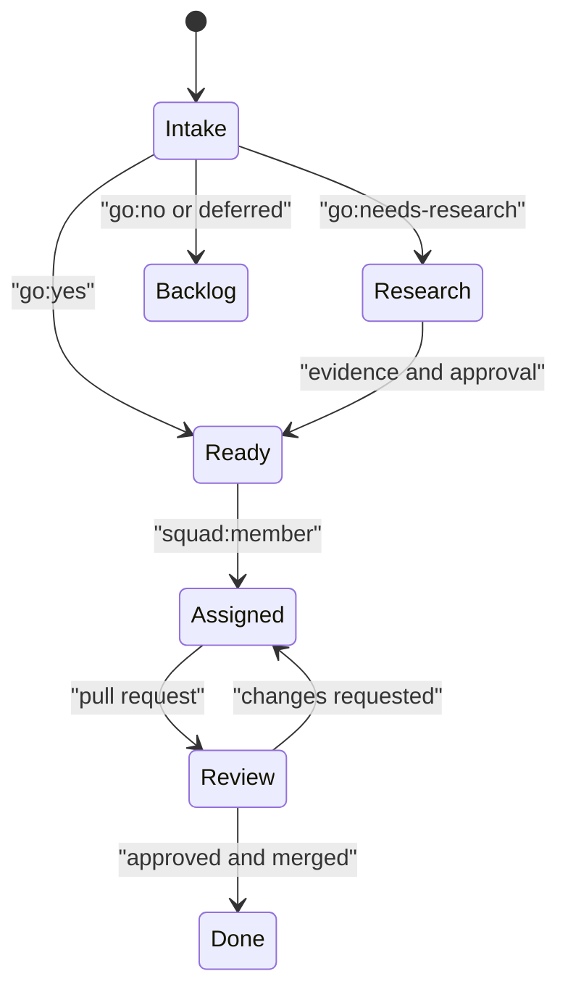

# Chapter 7: GitHub Workflow and Issue-Driven Development

> **Prerequisites:** Chapters 2 and 4.

## What You'll Learn

- Treat a GitHub issue as a durable work request, not merely a conversation starter.
- Connect Squad to a repository and use the backlog-to-PR lifecycle without confusing prompts with CLI commands.
- Design issue templates that capture context and acceptance criteria before work starts.
- Use Squad's namespaced labels as a lightweight triage vocabulary, and understand which automation depends on installed workflows.
- Decide when a GitHub Projects board adds value and what Squad v1.1.0 can and cannot synchronize.
- Follow a representative issue-driven workflow and understand the more structured agentic-SDLC demo.

## Start with a Work Item, Not a Chat Transcript

A chat request is excellent for exploration. An issue is better when work must survive a session, be prioritized alongside other requests, be reviewed by a person, or connect implementation to a release. Issue-driven development gives Squad a stable artifact to inspect: title, description, labels, assignees, and a URL that humans can share.

Think of the issue as a compact contract. It should say what outcome matters, what constraints apply, and how someone can recognize completion. It should not dictate every implementation detail unless those details are actual requirements. A useful issue makes the intent testable while leaving the implementing agent room to inspect the repository and choose an appropriate design.

A practical issue body might look like this:

```markdown
## Goal
Let a signed-in user filter tasks by their due date.

## Acceptance criteria
- The API accepts an optional due-date range.
- The task list shows only tasks inside the selected range.
- Invalid dates produce a helpful client error.
- Tests cover empty, bounded, and invalid ranges.

## Constraints
- Preserve existing task response fields.
- Do not add runtime dependencies.
```

This structure is intentionally modest. A short fix may need only a paragraph and a reproduction step; a cross-cutting feature may need explicit acceptance tests, non-goals, compatibility constraints, and links to prior decisions. Add detail where it reduces ambiguity, not as ceremony for its own sake.

### The lifecycle is a sequence of reviewable handoffs

The familiar pattern is **connect → inspect → select → implement → review → merge → check again**. In the first step, you tell Squad which repository is the issue source. You can then ask it to show the backlog, work on a particular issue, or address feedback on an existing pull request. The agent's work should still follow the project's branch, testing, and review practices. Issue-driven development makes the work traceable; it does not remove code review or make every issue safe to execute automatically.



The phrases in the workflow documentation—such as “Connect to `myorg/myrepo`,” “Show the backlog,” and “Work on issue #42”—are natural-language requests in a Squad session. They are not `squad` subcommands. The repository adapter underneath uses the GitHub CLI (`gh`) for issue, label, and pull-request operations, so the CLI must be installed and authenticated. Run `gh auth status` to check your current login; use `gh auth login` if needed. The adapter may also need permission to the repository and the operations you ask it to perform.

When multiple issues are selected, they can be handled as separate pieces of work. Do not assume that “parallel” means every issue can safely modify the same checkout at once: use the work isolation practices covered in Chapter 6, and split issues along real boundaries. If two changes touch the same code or depend on one another, a clear sequence is safer than a larger batch.

### Issue quality is an engineering control

A high-quality issue gives an agent enough context to make a bounded change. Prefer concrete evidence over a guessed fix: include an error message, affected route, sample input, or observed-versus-expected behavior. State a non-goal when a tempting adjacent change must remain out of scope. Identify external dependencies and access constraints early. If the task is a question rather than implementation, mark it as research or ask for an investigation rather than disguising it as a feature.

Use acceptance criteria to define observable outcomes. “Make it robust” is hard to verify; “return 400 for a malformed date and add a test for it” is much better. Avoid prescribing implementation details that are not essential, because that can trap an agent into matching the wording rather than solving the underlying problem. A reviewer can then compare the pull request with the agreed result, not with an undocumented conversation.

Before work begins, check for duplicates and confirm the issue is ready. Some repositories use a `go:needs-research` label before approval; others use GitHub's built-in `Status` field or milestones. Squad does not impose a universal approval committee. A team's process comes from its own labels, issue content, directives, ceremonies, and permissions.

## Templates Turn Capture into a Repeatable Habit

GitHub issue forms live in `.github/ISSUE_TEMPLATE/`. They are GitHub features, not special Squad syntax: GitHub renders the form, validates required inputs, and creates the issue. Squad later sees the resulting issue through the configured platform adapter. This separation is useful: a template can improve intake even if no Squad agent is running, and a Squad can work with issues that were created by hand.

Here is a compact form for the Tasktrack companion project:

```yaml
name: Tasktrack feature
description: Capture a bounded feature request for the Squad backlog
 title: "[Feature]: "
 labels:
   - squad
   - type:feature
 body:
   - type: textarea
     id: goal
     attributes:
       label: Goal and current behavior
       description: What should change, and what happens today?
       placeholder: Describe the user-visible outcome and any useful example.
     validations:
       required: true
   - type: textarea
     id: acceptance
     attributes:
       label: Acceptance criteria
       placeholder: |
         - [ ] Expected behavior is implemented
         - [ ] Tests cover the important cases
     validations:
       required: true
   - type: textarea
     id: constraints
     attributes:
       label: Constraints and non-goals
       placeholder: Note compatibility, dependency, or scope boundaries.
     validations:
       required: false
```


GitHub supports other body component types, including markdown, input, dropdown, and checkboxes. Use a dropdown for a small closed set such as severity or priority; do not make a form feel like a compliance questionnaire. Set only truly essential fields as required. The template's `labels` must already exist in the repository when GitHub attempts to apply them; maintain them through the repository's normal process or the Squad label-sync workflow. A template does not create missing labels, assign an agent, or start work by itself.

A repository can include `.github/ISSUE_TEMPLATE/config.yml` to disable blank issues or offer links to discussions and documentation. Be deliberate about `blank_issues_enabled: false`: it can improve consistency, but it can also frustrate maintainers who need to report an unusual problem. Templates do not replace triage. A form's defaults are a first hint, not proof that the issue is approved, correctly scoped, or ready to implement.

For bug and documentation reports, use separate forms when their required evidence differs. A bug form might request reproduction steps, expected behavior, actual behavior, and version. A docs form can ask for the page or file, the confusing passage, and the intended reader. Each form should produce an issue that is useful to a human as well as an agent.

## Labels Make the Queue Legible

Labels are flexible metadata. Squad's label guidance recommends using prefixes to make common decisions queryable and consistent. The principal namespaces described in the repository are:

| Prefix | Example | Intended question |
|---|---|---|
| `go:` | `go:yes`, `go:no`, `go:needs-research` | Is the work approved, declined, or awaiting investigation? |
| `release:` | `release:backlog`, `release:v1.2.0` | Which release target, if any, owns the work? |
| `type:` | `type:feature`, `type:bug`, `type:docs` | What kind of work is this? |
| `priority:` | `priority:p0`, `priority:p1`, `priority:p2` | How urgent is it? |
| `squad:` | `squad:backend`, `squad:tester` | Which team member or agent should handle it? |

Use only labels your repository has defined. The exact release labels and agent names are project-specific; the examples in docs are not a promise that every repository has a `release:v0.4.0` or `squad:fenster` label. The base `squad` label is significant for `squad watch`: the watcher scans open issues carrying that label, then it uses routing rules and the roster to add a member label when it can identify a suitable agent. A normal issue without `squad` is not automatically part of the watch queue.

The recommended model allows one label at a time in the `go:`, `release:`, `type:`, and `priority:` families, while permitting multiple `squad:{member}` labels for pair work. This is a convention, not a GitHub invariant. The repository includes a label-enforcement workflow template that removes conflicting labels in selected namespaces, and a label-sync workflow template that creates or updates the base, member, type, priority, and selected release labels from the team roster. Those workflows must be installed, enabled, and authorized in your repository before they have effects. In particular, do not assume that simply typing `go:yes` causes every cascading action described in older examples.

You can create a custom member label directly with GitHub CLI:

```bash
gh label create "squad:backend" --color "0366d6" --description "Work assigned to the backend agent"
```

If it already exists, inspect it rather than creating duplicate variants such as `squad:Backend`, `squad-backend`, and `backend`. Stable spelling makes filters and automation predictable. A query can combine namespaced labels:

```bash
gh issue list --label "squad,type:bug,priority:p0" --state open
```

Treat the label set as a shared language. A label should answer one question; avoid turning every conversation detail into a new tag. If an issue is blocked, add the blocker details in the issue itself and use the repository's agreed blocked status. If it is not approved, do not apply a ready-to-work convention just to make a bot notice it.



The diagram is a useful mental model, not an automatic state machine in every installation. GitHub labels do not enforce legal transitions on their own. Workflows, permissions, and team habits determine which transitions are automatic.

## Project Boards: Visualization, Not the Source of Truth

GitHub Projects is valuable when a team needs a view across issues, pull requests, milestones, or multiple repositories. Start by deciding what a board should answer: “What is ready?”, “Where are reviews stuck?”, or “What belongs in the next release?” Prefer a small number of columns and a single canonical signal for each state. If labels are your canonical signal, document how columns map to labels; if a Project's Status field is canonical, make clear who updates it.

The Project-board feature notes describe a board as a projection of labels, with example columns Backlog, Needs Research, Ready, In Progress, and Done. Those descriptions include planned or aspirational operations—creating a board automatically, bidirectional drag-and-drop synchronization, arbitrary custom-field mappings, and webhook-driven state changes. They are not all part of Squad v1.1.0's stable board implementation.

In v1.1.0, `squad watch --board` enables an optional board lifecycle capability. It uses `gh project` to inspect items and can reconcile certain issue/Status mismatches; execution-mode transitions can add an issue to a project and attempt to set a status such as In Progress or Done. The capability is best-effort, assumes an accessible project and compatible Status field, and does not create a complete board for you. It does not implement the docs' general bidirectional drag-to-label workflow or arbitrary mapping from `priority:*` labels to custom Project fields. The simplest way to verify your environment is to inspect the board and run a small test on a non-production issue before enabling this capability broadly.

Project access may require the `project` scope for your `gh` authentication. The docs suggest `gh auth refresh -s project`, followed by `gh auth status`. You can manage Projects manually with `gh project` commands as well. If a board is not essential, skip it: an accurate issue list and disciplined labels are more useful than a visually elaborate board that agents and humans do not keep in sync.

## A Walk Through the GitHub Issue Tour

Use this scenario to see how the pieces connect. The names and output are illustrative; your team, repository, branch strategy, and agent selection will differ.

1. **Connect:** in a Squad session, ask it to connect to the target repository. Confirm the repository identity before allowing changes. The connection is normally recorded as the team's issue source so later requests have context.
2. **Inspect:** ask to show open issues. Read the list, open the likely issue, and confirm its body, labels, and acceptance criteria. A table is a starting point, not a full requirements review.
3. **Select:** ask the coordinator to work on one issue. If details are missing, have the coordinator ask clarifying questions or update the issue before implementation. This preserves the agreed scope for the next person.
4. **Implement:** the agent inspects the working tree and tests, makes a branch and the relevant changes, and reports what it changed. Check that the implementation addresses the issue rather than merely matching its title.
5. **Review:** open the pull request, inspect the diff and test evidence, and leave focused feedback. The original author can address the comments on the same PR branch; a new request to address feedback is a continuation of the issue, not permission to skip review.
6. **Merge:** after the required human and CI approvals, merge through the repository's policy. Include a closing reference such as `Closes #42` in the PR body when appropriate; GitHub then links the merge to the issue's closure semantics. Squad's adapter can issue GitHub operations, but the repository's branch protection and review rules remain authoritative.
7. **Re-check:** refresh the backlog and update labels or priorities if the next step has changed. Close or split stale work instead of letting it remain a misleading “ready” ticket.

A normal prompt might be “Work on issue #42 and follow the acceptance criteria. If the issue is ambiguous, ask before broadening scope.” For feedback, say “Review the comments on PR #57 and address the actionable requests; do not merge.” Clear constraints reduce the risk of an agent interpreting a casual “looks good” as approval to take a privileged action.

The branch naming and sample transcripts in the tour are examples, not a strict contract. The source adapter has a branch operation that checks out a base branch, pulls, and creates a new branch; it defaults to `main` if no other base is supplied. This is why a repository that uses `dev` or release branches should state that convention in its instructions instead of assuming every example matches its repository.

## The Agentic SDLC Demo Is a Different, More Structured Path

The assigned agentic-SDLC walkthrough is a presenter-led demonstration of a larger planning workflow. It uses a GitHub issue as the durable intent artifact, then illustrates research, triage, a program plan, an implementation plan, validation, acceptance, and activation into linked issues and milestones. Its strength is showing that a human can review the scope before the system creates a backlog. It is not simply another way of saying “work on issue #42.”

The walkthrough's example starts by casting a squad, opens a root intent issue, and uses issue-comment slash commands such as `/squad research`, `/squad triage`, and `/squad plan program`. Later steps accept scope and implementation, validate dependencies and traceability, and activate generated work items. The demo describes the issue as a living status tracker and calls out a “Next Steps” chain, so a person can see the current phase and what approval is needed next.

> **Preview:** The walkthrough assumes a GitHub Agentic Workflows (`gh-aw`) setup with dispatcher, implementation worker, and advisory reviewer workflows. Those workflows are not equivalent to the baseline Squad `gh` issue adapter. Treat its slash-command sequence, automatic generated hierarchy, and lifecycle tracker as demo-specific integration behavior; verify that your repository has the required workflows and schemas before presenting those commands as executable.

The safety boundary is important: planning comments remain proposals; activation is the point at which the walkthrough says real issues are created. Keep humans involved in scope acceptance, security-sensitive changes, and merge decisions. If you use this flow, verify generated links, dependencies, labels, and milestones after activation. Structured artifacts improve traceability but do not guarantee that a proposal is complete or that an implementation is correct.

## Hands-On: Give Tasktrack a Better Intake Path

This exercise adds a GitHub issue form and one small backlog item to the Tasktrack repository you prepared in Chapters 2–4. If you have not connected that checkout to GitHub yet, create a repository for this exercise and confirm that `gh auth status` succeeds. Do not point it at a production repository.

1. From the Tasktrack repository root, create the form directory and file:

   ```bash
   mkdir -p .github/ISSUE_TEMPLATE
   ```

   Add `.github/ISSUE_TEMPLATE/squad-task.yml` with the following content:

   ```yaml
   name: Tasktrack task
   description: Add a scoped API or web task to the Squad backlog
   title: "[Task]: "
   labels:
     - squad
   body:
     - type: textarea
       id: goal
       attributes:
         label: Goal and current behavior
         description: State the outcome and what Tasktrack does now.
       validations:
         required: true
     - type: textarea
       id: acceptance
       attributes:
         label: Acceptance criteria
         placeholder: |
           - [ ] Behavior is implemented
           - [ ] Tests cover success and failure cases
       validations:
         required: true
     - type: textarea
       id: constraints
       attributes:
         label: Constraints
         placeholder: Preserve the zero-dependency runtime unless the issue says otherwise.
       validations:
         required: false
   ```

2. Confirm that the `squad` label exists. If it does not, create it:

   ```bash
   gh label create squad --color 9B8FCC --description "Work selected for Squad"
   ```

   A duplicate-label error means the label is already present; inspect it with `gh label list`.

3. Commit and push the template so GitHub can render it:

   ```bash
   git add .github/ISSUE_TEMPLATE/squad-task.yml
   git commit -m "docs: add Tasktrack issue template"
   git push
   ```

4. Open the repository's **Issues → New issue** page. Select **Tasktrack task**, create an issue titled “Add due-date filtering,” and include a goal, at least two acceptance criteria, and the zero-dependency constraint. Confirm the created issue has the `squad` label.
5. In your Squad session, ask to show the backlog and confirm the new issue appears. Do not ask the watcher to execute it yet; Chapters 9 and 10 introduce persistent monitoring and PRD decomposition.

**Expected result:** the repository contains a reusable issue form, and the backlog contains a bounded due-date feature issue with its acceptance criteria attached. If the form does not appear, check that the filename ends in `.yml`, the directory is exactly `.github/ISSUE_TEMPLATE/`, and the pushed branch is the repository's default branch.

> **Tip:** Tag your Tasktrack repository with your own `ch07-start` / `ch07-end` markers as described in `sample/README.md`. These comparison tags are reader-managed; this book repository does not create them for you.

## Configuration Reference

| Item | Location or command | What it controls | v1.1.0 note |
|---|---|---|---|
| Issue source | `.squad/team.md` / team context | Which repository Squad should inspect for work | Confirm it points to the intended repo |
| GitHub CLI authentication | `gh auth login`, `gh auth status` | CLI credentials used by the GitHub adapter | Ensure required repository/project access |
| Issue form | `.github/ISSUE_TEMPLATE/*.yml` | GitHub-native issue fields, defaults, and labels | Squad does not parse the YAML form itself |
| Template config | `.github/ISSUE_TEMPLATE/config.yml` | Blank-issue and contact-link settings | Optional GitHub feature |
| Triage label | `squad` | Includes an open issue in the watch scan | Watch scans this label by default |
| Member labels | `squad:{member}` | Associates an issue with a roster member | Names must match the installed team's labels and routing |
| Workflow labels | `go:*`, `release:*`, `type:*`, `priority:*` | Shared triage vocabulary | Automation requires the corresponding workflow to be installed/enabled |
| Project capability | `squad watch --board` | Enables the watch board lifecycle capability | Needs usable `gh project` access and an existing project |
| Project number | `squad watch --board --board-project N` | Selects the project number used by the capability | CLI help documents default project number `1` |

## Under the Hood

The stable implementation centers on the SDK's `PlatformAdapter`. `packages/squad-sdk/src/platform/github.ts` wraps `gh` with `execFileSync`, normalizes issue data into `WorkItem`, exposes label changes and comments, and maps pull-request states into a common interface. `packages/squad-sdk/src/platform/index.ts` creates an adapter from `.squad/config.json` GitHub overrides or a parsed `origin` remote. This abstraction explains why the user can ask for repository work in natural language while the implementation remains tied to GitHub's CLI.

The watcher is a separate CLI process. In `packages/squad-cli/src/cli/commands/watch/index.ts`, `runCheck` requests open work items labeled `squad`, compares labels with roster member labels, routes untriaged items using `routing.md`, and checks pull requests. The routing decision comes from `packages/squad-sdk/src/ralph/triage.ts`: the code tries module ownership, then routing rules, then a Lead/Architect fallback. That automatic triage may add a member label; it does not mean every open issue is eligible or that every choice is high confidence.

Issue forms are not a Squad parser or runtime API. They are static GitHub files. Label automation is also separate: `templates/workflows/sync-squad-labels.yml` syncs labels when triggered, and `templates/workflows/squad-label-enforce.yml` enforces mutual exclusivity when the relevant workflow runs. The names and behavior in those files—not the mere presence of a label taxonomy page—determine what automation exists in a repository.

The board capability lives in `packages/squad-cli/src/cli/commands/watch/capabilities/board.ts`. It runs in the watch post-execution phase and uses `gh project item-list`, `item-add`, and `item-edit`. Its reconciliation is narrower than a general board integration: it checks closed/open issue status against a Done column and can attempt status updates. This is the source-level reason to treat Projects as a useful view, not as a guaranteed two-way issue state machine.

## Pitfalls and Troubleshooting

- **“The issue is missing from watch.”** Confirm it is open and labeled `squad`; the default scan does not mean “all repository issues.” Confirm the connected repo and `gh auth status` too.
- **“The template cannot apply the label.”** Create the label before publishing the form, or install and run the label-sync workflow. A template label is a reference, not label provisioning.
- **“A label did not trigger a transition.”** Check that the relevant workflow exists in `.github/workflows/`, is enabled, has the needed permissions, and listens for that label event. Prefix conventions do nothing by themselves.
- **“The agent chose the wrong owner.”** Review `.squad/routing.md`, module ownership, and roster labels. Give the issue a precise path, domain, or acceptance criteria. Triage is a proposal to verify, not an oracle.
- **“A board command fails.”** Verify `gh project --help`, project authorization, owner, project number, and the project's Status field. Start with a test issue; board capability errors are best-effort and can be easy to overlook.
- **“The demo slash command is unrecognized.”** The agentic SDLC walkthrough depends on `gh-aw` workflows and their schemas. It is not a general Squad prompt or a core `squad` CLI subcommand.
- **“Parallel issue work conflicts.”** Separate work in dedicated worktrees or sequence the tasks. A GitHub issue number alone does not isolate a working directory.
- **“The PR merged but issue stayed open.”** Confirm the PR body contains the correct closing reference and that the PR targets a branch whose merge closes issues in that repository.

## Summary

GitHub issues give Squad's work a durable, reviewable home. Write a clear outcome and acceptance criteria, use templates to make good intake easier, and keep the label vocabulary small enough for people to apply consistently. The base `squad` label places open work in the v1.1.0 watch scan; member labels and routing rules help triage it. A Projects board can help visualize work, but its synchronization is narrower than some feature notes suggest. The ordinary issue workflow and the gh-aw agentic-SDLC demo are distinct paths, and both should retain human review and repository safeguards.

## Exercises

1. Improve the due-date issue from the Hands-On section. Add a concrete example request and response, one explicit non-goal, and a testable error criterion. Explain how each addition reduces ambiguity.
2. Design a bug-report issue form for Tasktrack. Include fields for reproduction steps, expected behavior, actual behavior, and Node.js version. Decide which fields must be required and justify the choice.
3. Propose a minimal label set for a two-agent Tasktrack team. Include one label in each workflow namespace and explain which labels are conventions versus operational inputs for `squad watch`.
4. A teammate assumes dragging an issue into “Ready” automatically applies `go:yes`. Explain which workflow or integration would need to exist for that behavior, and name the stable v1.1.0 board capability's actual boundary.
5. Compare a one-sentence user request with a structured issue. List the information you would preserve in the issue before asking an agent to start.

## Quiz

1. Which label causes the default `squad watch` issue scan to include an open GitHub issue?
2. Are `.github/ISSUE_TEMPLATE/*.yml` files interpreted by Squad or by GitHub?
3. Name two fields that make acceptance criteria useful to a reviewer.
4. Does the namespaced label convention enforce exclusivity without a workflow?
5. What work does the v1.1.0 `--board` capability attempt, and what does it not promise?
6. What additional integration does the agentic-SDLC walkthrough assume?
7. Does an issue number automatically isolate simultaneous agent work into separate working directories?

## Further Reading

- [GitHub Workflow concept](https://bradygaster.github.io/squad/docs/concepts/github-workflow/)
- [GitHub Issues Mode](https://bradygaster.github.io/squad/docs/features/github-issues/)
- [Issue Templates](https://bradygaster.github.io/squad/docs/features/issue-templates/)
- [Label Taxonomy](https://bradygaster.github.io/squad/docs/features/labels/)
- [Project Boards](https://bradygaster.github.io/squad/docs/features/project-boards/)
- [Issue-Driven Development scenario](https://bradygaster.github.io/squad/docs/scenarios/issue-driven-dev/)
- [GitHub Issues Walkthrough](https://bradygaster.github.io/squad/docs/tour-github-issues/)
- [Agentic SDLC demo walkthrough](https://github.com/bradygaster/squad/blob/v1.1.0/docs/demo-agentic-sdlc-walkthrough.md)
