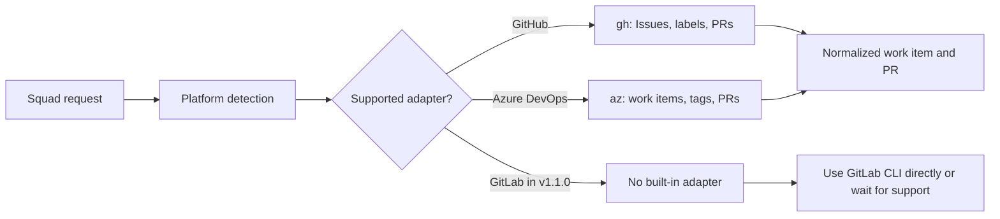
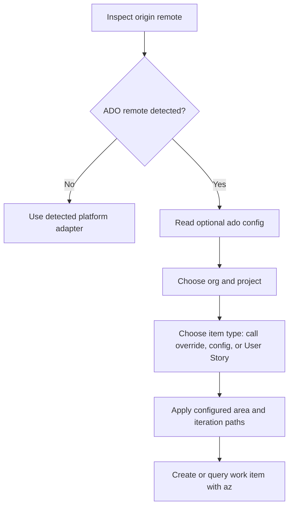

# Chapter 8: GitLab and Azure DevOps

> **Prerequisites:** Chapter 7.

## What You'll Learn

- Compare issue-driven work across GitHub, GitLab, and Azure DevOps without assuming that similar labels imply identical automation.
- Understand the GitLab issue workflow and tour as experimental documentation, not a verified v1.1.0 built-in adapter.
- Explain how Squad detects Azure DevOps remotes and translates work items and pull requests through the platform adapter.
- Describe the platform-adapter design at a high level and distinguish the intended contract from the stable implementation.
- Configure Azure DevOps work-item organization, project, type, area path, and iteration path in `.squad/config.json`.
- Distinguish documented ADO introspection ideas from the subset of configurable behavior implemented in the stable adapter.
- Keep Tasktrack's platform configuration intentional and avoid breaking an existing GitHub connection while experimenting.

## One Work Lifecycle, Different Platform Contracts

Squad's platform layer tries to give the coordinator a common way to list work, inspect one item, apply tags, assign a person, create a pull request, and create a branch. That shared interface is useful, but it does not erase the differences among issue trackers. GitHub has Issues and labels; GitLab has issues and Merge Requests; Azure DevOps has work items, tags, process templates, and pull requests. The terminology and transition rules still matter.

A short comparison helps set expectations:

| Platform | Work item | Tagging vocabulary | Code review artifact | CLI in the docs |
|---|---|---|---|---|
| GitHub | Issue | Label | Pull request (PR) | `gh` |
| GitLab | Issue | Label | Merge Request (MR) | `glab` |
| Azure DevOps | Work item | Tag (`System.Tags`) | Pull request | `az` with the Azure DevOps extension |

A conversational request like “show the backlog” can be portable at the intent level, but the operation behind it depends on an adapter, credentials, permissions, and repository configuration. An issue number is local to its tracker; include a platform or URL when there is any ambiguity. For GitLab, users write `!24` for a merge request to distinguish it from issue numbers. For ADO, a work item ID and a pull-request ID refer to different records.



The current SDK `PlatformType` includes `github`, `azure-devops`, and `planner`; its remote detection code recognizes GitHub and ADO URL forms, then defaults unknown remotes to GitHub. It does not recognize GitLab as a distinct platform. This implementation detail is essential when switching a repository: do not infer support from a page that describes what a platform workflow is intended to do.

### How a platform adapter is designed

A platform adapter is a translation layer between Squad's common work lifecycle and a particular service's API or CLI. The internal platform-adapter PRD proposes one normalized contract for operations such as listing and updating work items, adding tags, creating branches, and managing pull requests. A GitHub issue and an ADO work item have different fields and status rules, but an adapter can map the parts the coordinator needs into shared concepts such as title, state, tags, assignees, and URL.

The PRD also favors small, interface-based implementations and using the platform's established CLI (`gh` or `az`) where appropriate. Detection can use the repository's `origin` remote, while actionable errors should tell an operator which CLI or authentication step is missing. This design helps keep the coordinator's workflow understandable without pretending the underlying services are identical. In practice, each adapter can have optional operations and service-specific limits; a normalized interface is not a promise that every platform supports every action in the same way.

For a beginner, the useful rule is to separate the **common task** from the **platform-specific mechanism**: the coordinator may ask to inspect a work item, while the adapter decides how that becomes a GitHub API/CLI call or an ADO query. The PRD describes design intent, so check the stable adapter and CLI configuration before relying on a proposed operation. Chapter 11 (Volume 2) explains the broader SDK architecture and adapter boundaries in more depth.

## GitLab Issues: A Documented Tour with a Stability Boundary

The GitLab feature page and tour present a familiar sequence: connect a GitLab project, list open issues, work on one or more issues, address MR feedback, merge, and refresh the backlog. The tour requires `glab` installed and authenticated, using `glab auth login` and `glab auth status`. It describes self-managed instances as well as gitlab.com and shows `glab issue list`, `glab issue view`, `glab mr create`, `glab mr list`, and `glab mr merge` as the CLI vocabulary.

The comparison is still valuable even when the Squad integration is unavailable. A well-written GitLab issue can use the same structure as a GitHub issue: goal, expected behavior, acceptance criteria, constraints, and test evidence. A reviewer still needs the implementation diff, CI results, and a way to send actionable comments back to the author. A closing reference in the MR body can link work to its issue, subject to GitLab's project rules. Labels and milestones can organize GitLab work, but GitHub-specific namespaces and bot behavior do not automatically carry over.

> **Preview:** The GitLab Issues Mode pages are explicitly marked experimental. More importantly, the v1.1.0 SDK platform types and adapter factory do not include a GitLab adapter: `detectPlatformFromUrl()` checks GitHub and Azure DevOps and otherwise falls back to GitHub, while `createPlatformAdapter()` constructs only GitHub or ADO adapters. Therefore, do not expect a standard `squad watch` or connected Squad workflow to call `glab` for you in v1.1.0. The sample GitLab conversation is a design/tour of the intended workflow, not a verified stable Squad integration.

If you operate GitLab today, you can still use `glab` directly to maintain work items and MRs, or connect an external automation that explicitly understands GitLab. Make that boundary clear to a team: using similar prompt language does not install an adapter. Do not point an unverified default Squad adapter at a GitLab remote and assume safe behavior; it may be classified as GitHub because unknown URLs fall back to that platform.

### Reading the GitLab tour critically

The tour's seven stages are: connect, view backlog, work on an issue, handle parallel work, handle MR review feedback, merge, and check remaining work. Treat its command/output blocks as illustrative transcripts. In particular, branch naming and sample agent names do not establish a universal implementation contract. Verify the actual tool's behavior and branch policy before using them on a real project.

Before automating a GitLab flow, answer these practical questions:

- Which `glab` version and instance are supported, and how are credentials scoped?
- Does the workflow create branches and MRs, or only read issues?
- Which GitLab approval rules and protected-branch policies must remain in force?
- How do issue references close issues in this project's configuration?
- How are review discussions, pipeline results, and MR state mapped to the agent's work status?
- What is the retry or recovery behavior if an API call partially succeeds?

Those are implementation requirements, not details to assume from a tour. In an enterprise setting, also verify whether a self-managed deployment has the same API and feature set as gitlab.com.

## Azure DevOps: Work Items Follow Your Process Template

Azure DevOps replaces the simple issue-and-label model with work items and tags. Squad's adapter detects common Azure DevOps remote formats such as `https://dev.azure.com/org/project/_git/repo`, `git@ssh.dev.azure.com:v3/org/project/repo`, and legacy `org.visualstudio.com` URLs. Branch operations remain ordinary Git operations; work tracking and PR operations use the ADO CLI.

Set up the platform tools before trying to connect:

```bash
az extension add --name azure-devops
az login
az devops configure --defaults \
  organization=https://dev.azure.com/CONTOSO \
  project="Tasktrack"
az devops configure --list
```

The adapter authenticates through the Azure CLI context and uses `az boards` and `az repos` operations. Its query for an open work item excludes terminal states such as Closed, Resolved, Removed, and Done. It reads work item tags from `System.Tags`, a semicolon-separated field, and updates tags by reading the item and writing the revised tag list. For PRs it maps ADO statuses and reviewer votes into normalized states; a positive reviewer vote can map to approval, negative votes to requested changes, and an absent or neutral vote remains pending.

Azure DevOps process templates vary. Scrum, Agile, CMMI, and organization-specific templates can expose different work-item types and paths. A hard-coded “User Story” assumption is not universally valid. Squad's adapter therefore supports a configurable default work-item type, organization, project, area path, and iteration path. These settings are particularly useful when the code repository and the backlog live in different ADO projects or organizations.

The ADO configuration path is intentionally explicit:



### Configure work-item defaults

The ADO work-item adapter reads an `ado` object from `.squad/config.json`. A minimal example is:

```json
{
  "ado": {
    "org": "contoso",
    "project": "Tasktrack Work Items",
    "defaultWorkItemType": "Bug",
    "areaPath": "Tasktrack Work Items\\Backend",
    "iterationPath": "Tasktrack Work Items\\Sprint 4"
  }
}
```

JSON requires a literal backslash in a string to be escaped, hence `\\` in the Markdown source above produces one path separator in the parsed value. If your config already contains model, state, or team settings, merge the `ado` object into that JSON; do not replace the whole file with this fragment. Every field is optional. When `org` or `project` is omitted, the adapter uses the values inferred from the ADO remote. When a work-item type is omitted, the code defaults to `User Story`. When area or iteration is omitted, the ADO project/team defaults apply.

The selection order for an item is: explicit per-item type, configured `defaultWorkItemType`, then `User Story`. For area and iteration, an explicit value can override the configuration in adapter calls; otherwise the configured path is used. The base adapter API and normal CLI command set do not expose every proposed per-item override as a user-facing `squad create issue` option, so use the settings documented and implemented for your actual entry point rather than guessing a flag.

### Introspection and validation: what exists in v1.1.0

The stable SDK exports `getAvailableWorkItemTypes(org, project)` and `validateWorkItemType(org, project, typeName)`. The adapter also exposes methods with those operations. It queries `az boards work-item type list`, parses the returned types, and reports disabled types. If the CLI call fails, the helper falls back to a small common list (User Story, Bug, Task); validation is deliberately fail-open when the type list cannot be retrieved. As a result, a “valid” result when the ADO call could not be made is not the same as proof that the type exists in your project.

The assigned ADO feature page describes a richer sequence—`squad init --introspect`, saving suggestions, checking area paths and iterations, `squad config set`, and `squad config validate`. Those command examples do not match the v1.1.0 CLI help or the implementation. The installed v1.1.0 `squad init --help` does not list `--introspect`, and the CLI's `squad config` help does not promise those setter or validation commands. The ADO adapter code introspects work-item types, but it does not implement a matching area-path and iteration-path discovery/validation flow. Use direct JSON configuration for the implemented fields and verify paths in Azure DevOps itself.

> **Note:** For a low-risk first test, configure the ADO defaults on a dedicated test repo, confirm `az devops configure --list`, and list an existing work item before allowing any automated process to add tags or create work items.

## Enterprise Platform Choices and Hybrid Work Tracking

An enterprise may keep code in one system and tasks in another. The docs describe GitHub and Azure DevOps repositories, and a hybrid Microsoft Planner model in which Planner buckets represent assignments while PRs remain on the GitHub or ADO side. Conceptually, that separates the work-item source from the code host. A team should decide which platform owns the task's state, who is authorized to update it, and how a task maps to its branch and review artifact.

Planner is not an alias for ADO. Its tasks, buckets, and Graph API are a separate contract; the enterprise guide describes obtaining an Azure CLI token for Microsoft Graph and configuring a plan ID. The SDK has a Planner type and adapter-related code, but the primary factory shown in `packages/squad-sdk/src/platform/index.ts` selects based on the repo remote and constructs GitHub or ADO. The docs' hybrid config and Planner workflow should therefore be treated as an integration requiring explicit verification rather than a guarantee that every `squad watch` call follows `workItems: planner` automatically.

The enterprise guide also documents Azure DevOps MCP as an optional way to expose richer API access. It is not required for the stable ADO adapter, which calls `az`; any MCP server must be configured and trusted in the actual agent host. Avoid a configuration that installs an unpinned package without review. If your organization provides a managed MCP server, use its approved install instructions and permission model rather than copying a generic example blindly.

For Microsoft Entra-managed or multiple GitHub accounts, the GitHub adapter supports `gh auth` account switching as a non-fatal best effort when a preferred account or inferable owner is available. That behavior does not change ADO auth, which is tied to Azure CLI. Keep identity boundaries explicit in a multi-org setup: the active CLI account and the repository remote must match the intended enterprise identity.

## From ADO Work Item to Pull Request

The common adapter makes it possible to reason about an ADO work item using the same lifecycle vocabulary as a GitHub issue, but the platform-specific details still matter. A simplified pass through the lifecycle looks like this:

1. **Find work:** Watch queries ADO through WIQL and reads each matching work item. The `squad` tag indicates that it belongs to the Squad queue; a `squad:{member}` tag identifies a routed member.
2. **Triage:** the roster and `routing.md` provide the same domain context used by the GitHub path. The adapter writes an assignment as a tag, not as a GitHub label. A tag is metadata; it does not necessarily assign the work item to a particular ADO identity.
3. **Implement:** an agent uses Git to create a branch. The adapter's branch operation defaults to `main`, checks it out, pulls, and creates a new branch. If the repository uses another base branch, make that choice explicit in the project workflow.
4. **Review:** PR operations are made with `az repos pr` commands. ADO reviewer votes are not identical to GitHub's review-decision field; the adapter maps them into normalized `approved`, `changes-requested`, or `pending` states.
5. **Complete:** an ADO PR can be updated to completed status. Whether that also resolves a work item depends on ADO's linking and process rules, not on the adapter's normalized return type alone. Verify the work-item link and branch policy.

For a read-only check, the SDK command reference includes WIQL such as:

```bash
az boards query --wiql "SELECT [System.Id],[System.Title],[System.State],[System.Tags] FROM WorkItems WHERE [System.Tags] Contains 'squad:untriaged' ORDER BY [System.CreatedDate] DESC" --output table
```

Use the ADO CLI's WIQL rules for filtering and protect quoted values when building a query. The adapter escapes apostrophes in query values before interpolation, but a manual query still deserves careful quoting. Query one small, known tag before running an automation against an entire project.

A semantic difference deserves emphasis: in GitHub, a `squad:backend` label often serves as the visible routing marker. In ADO, tags are a semicolon-separated string on the work item. ADO can also have a true `Assigned To` field. Do not equate adding the tag with assigning a user in that field. Decide whether the member tag, ADO identity, or both are the official ownership signal, and write that convention into the team's process. The adapter has a `setAssignee` operation, but the ADO form cannot resolve `@me` the same way GitHub can; the adapter treats that special input as a no-op.

### Choosing a process template

A process template determines which work-item types and fields exist, and fields that are required by your process may not be satisfied by the generic creation operation. Before relying on automatic creation, select a representative type and confirm its required fields in the project. Scrum commonly distinguishes Product Backlog Items, Bugs, Tasks, and Epics; Agile or CMMI may use different names or hierarchy. Your organization can customize the process, so examples such as `Bug`, `Scenario`, or `User Story` are not guaranteed. The v1.1.0 helper can list types if the Azure CLI call succeeds, but it does not infer a complete schema for custom fields or automatically populate every required field.

When creation fails, diagnose the exact ADO response. A type may be disabled, an area path may be misspelled, an iteration can be outside the active team's schedule, or a required custom field may be missing. If the adapter is being used by `watch`, the failure may occur after issue discovery and triage; avoid retrying an operation blindly if you do not know whether the work item was already created. Use the item URL or ID to detect partial success.

## Enterprise Readiness: Identity, Ownership, and Rollback

Multi-platform support is also an identity and audit problem. For every automated actor, identify which CLI account it uses, the minimum scopes it needs, where its credentials are stored, and how the team revokes access. GitHub operations use `gh`; ADO operations use `az`. Both tools can be logged into a developer's personal account, which may be acceptable for an experiment but inappropriate for a shared service. A production runner should use an explicitly governed identity, with repository and project permissions kept as narrow as practical.

Keep code hosting and work tracking ownership explicit in hybrid designs. If a team records code in GitHub but the work item in Planner or ADO, define the stable cross-reference that links the task, branch, PR, and release. A PR can be completed while the external work item remains open if the linkage is not configured. Conversely, an external tracker may mark a task done before a PR is actually merged. A reconciliation report should expose these mismatches instead of silently choosing one system's truth.

A responsible rollout can progress from read-only discovery, to label/tag-only triage on a test project, to creating a branch and PR for a low-risk item, and finally to broader automation after human review. Keep merge authority separate from issue-routing authority. Log the work-item ID and PR URL, define what happens after a timeout, and ensure the operator can stop the watcher. For self-managed GitLab or ADO instances, add a compatibility test for the instance's API and CLI version before treating a cloud-hosted example as applicable.

The docs discuss GitHub Enterprise and Microsoft Planner alongside GitLab and ADO, but the existence of an enterprise feature page does not mean every enterprise topology is automatically discovered. For example, `detectPlatformFromUrl()` recognizes specific GitHub and ADO patterns; it does not read an organization-wide platform registry. If a URL is unusual or the work-item project differs from the code project, configure the known ADO overrides and verify the resulting adapter behavior. If the work item source is Planner, verify the exact runtime path separately because the ordinary repository adapter factory selects from the Git remote.

## Hands-On: Prepare Tasktrack for an ADO Backlog

This lab prepares the Tasktrack companion project to use an ADO backlog without changing its code or replacing its existing configuration. You need no ADO organization to complete the preparation. If you have a test project, continue to the optional verification step.

1. From the Tasktrack repository, inspect what is already configured:

   ```bash
   git remote -v
   test -d .squad && echo ".squad exists" || echo "initialize Squad first"
   ```

   If this is the first time using Squad in Tasktrack, run `squad init` only in the Tasktrack repository after checking that you are in the intended checkout. Existing `.squad` state is preserved by init. Do not run `squad init` in the book repository.

2. Open `.squad/config.json` if it exists. Preserve all of its current keys. Add an `ado` object using values from a dedicated Azure DevOps test project:

   ```json
   {
     "ado": {
       "org": "YOUR_ORG",
       "project": "Tasktrack Work Items",
       "defaultWorkItemType": "User Story",
       "areaPath": "Tasktrack Work Items\\API",
       "iterationPath": "Tasktrack Work Items\\Sprint 1"
     }
   }
   ```

   This is a fragment for merging, not necessarily the complete generated config. The ADO adapter only uses these values when the repo adapter is created for an ADO remote. If Tasktrack remains on GitHub, the extra object does not turn its GitHub adapter into ADO.

3. If you have a test ADO repository, configure Azure CLI defaults as shown earlier, then inspect the available work-item types with the native command:

   ```bash
   az boards work-item type list \
     --org https://dev.azure.com/YOUR_ORG \
     --project "Tasktrack Work Items" \
     --output table
   ```

   Use one of the returned, enabled type names for `defaultWorkItemType`. Verify area and iteration paths in the ADO project settings; the stable adapter does not introspect them for you.

4. Review the JSON syntax and your diff:

   ```bash
   python3 -m json.tool .squad/config.json
   git diff -- .squad/config.json
   ```

**Expected result:** Tasktrack's `.squad/config.json` still contains its previous settings and now has ADO defaults only if you chose to configure them. A GitHub remote remains a GitHub connection; the ADO values are activated by ADO platform detection and are not a platform switch on their own. If you have an actual ADO test remote, verify read-only access to one existing work item before testing writes.

## Configuration Reference

| Setting / command | v1.1.0 behavior | Notes |
|---|---|---|
| `az extension add --name azure-devops` | Installs CLI extension used by the adapter | Requires Azure CLI |
| `az login` | Establishes Azure CLI authentication | ADO operations use that context |
| `az devops configure --defaults organization=... project=...` | Sets CLI defaults | Adapter also passes explicit org/project arguments |
| `ado.org` | Overrides inferred ADO org for work items | Optional; useful for a separate work-item org |
| `ado.project` | Overrides inferred project for work items | Optional; useful for a separate project |
| `ado.defaultWorkItemType` | Default ADO creation type | Defaults to `User Story` in adapter code |
| `ado.areaPath` | Default area path for created items | Omit to use ADO's project/team default |
| `ado.iterationPath` | Default iteration path | Omit to use ADO's project/team default |
| `squad init --introspect` | Not present in v1.1.0 CLI help | Described by assigned feature docs, but unverified against stable CLI |
| `squad config set ...` / `config validate` | Not documented by v1.1.0 CLI help | Edit JSON and validate it with a JSON parser; verify ADO values in ADO |
| GitLab `glab` flow | Experimental documentation | No GitLab adapter in stable v1.1.0 platform factory |

## Under the Hood

`packages/squad-sdk/src/platform/detect.ts` parses GitHub and ADO remote URL formats. Its detection function returns GitHub when the URL is unrecognized, which is why GitLab must not be treated as a supported adapter. `packages/squad-sdk/src/platform/index.ts` reads optional `.squad/config.json` values, detects the `origin` remote, and instantiates either `GitHubAdapter` or `AzureDevOpsAdapter`. This factory behavior is a more reliable guide to stable support than a feature page's roadmap language.

The ADO implementation is in `packages/squad-sdk/src/platform/azure-devops.ts`. `AdoWorkItemConfig` contains the five ADO-specific settings used here. `listWorkItems()` builds a WIQL query and fetches each result's detail; `getWorkItem()` normalizes `System.Tags`, `System.AssignedTo`, title, state, description, and URL. `createWorkItem()` selects the type by per-call override, configured default, or `User Story`, then optionally checks the type if `validateType` is true. `getAvailableWorkItemTypes()` calls `az boards work-item type list`, but area- and iteration-path validation from the feature page is not implemented in the same adapter.

The GitLab feature and tour live in `docs/src/content/docs/features/gitlab-issues.md` and `docs/src/content/docs/tour-gitlab-issues.md`, and are explicitly marked experimental. Comparing those pages with the adapter factory surfaces the support boundary: the tour presents a desired `glab` flow; the stable factory does not create that integration.

## Pitfalls and Troubleshooting

- **ADO commands report a missing extension.** Install `azure-devops` with `az extension add --name azure-devops`, then retry `az devops configure --list`.
- **The remote is ADO but the CLI uses the wrong project.** Check the URL-encoded project segment and `ado.project`; test with `az boards work-item show` against an existing ID.
- **A custom type is rejected.** Use the exact name reported by `az boards work-item type list`; confirm the type is enabled. Remember that offline fallback values are not authoritative.
- **The area or iteration does not appear on the board.** Confirm the path exists and is assigned to the correct team/sprint in ADO. The stable adapter does not discover those paths automatically.
- **GitLab commands target the wrong system.** The current stable Squad platform factory does not detect GitLab; `glab` commands are direct GitLab CLI operations, not evidence that Squad selected a GitLab adapter.
- **Config changes silently do nothing.** Check that the JSON object is named exactly `ado`, is in `.squad/config.json`, and that the actual remote is ADO. ADO org/project overrides apply to work-item queries and creation.
- **A GitHub project is mistaken for ADO work tracking.** The `project` permission scope belongs to GitHub Projects; ADO work items use `az` authentication and organization/project context.
- **Planner hybrid claims do not match runtime behavior.** Verify that the exact code path uses Planner as the work-item source before relying on the docs' hybrid example.

## Summary

GitLab, GitHub, and Azure DevOps share an issue-driven shape but differ in their artifacts and adapter support. The GitLab pages give a useful experimental tour using `glab`, but v1.1.0's platform detection and factory do not provide a GitLab adapter. Azure DevOps is a supported repo/work-item adapter: it uses the Azure CLI, maps tags and work items into Squad's shared model, and reads optional `ado` defaults from `.squad/config.json`. Configure only the fields implemented in the stable adapter, and verify paths and permissions directly in ADO. Treat Planner's enterprise hybrid workflow and richer GitLab paths as integrations to validate, not universal defaults.

## Exercises

1. Given a GitLab remote URL and the v1.1.0 platform factory behavior, explain why a standard `squad watch` run must not be assumed to use `glab`. Name two safe alternatives for a team that needs GitLab today.
2. An ADO organization uses a custom work-item type named `Scenario` and stores tasks in a separate project, `Platform Intake`. Write the `ado` configuration fragment that sets the type and project while leaving area and iteration paths to the project defaults.
3. Describe how `System.Tags` is represented when the adapter reads an ADO work item and how it updates tags. Why should an automation read current tags before replacing them?
4. The ADO type-introspection call fails because the developer is offline, but validation returns a list including `Bug`. Explain why this is not proof that `Bug` exists in the real project, then identify the evidence needed before accepting an adapter/type-mapping proposal for production.
5. Compare the platform-adapter PRD with the v1.1.0 SDK: identify two ways the implementation is broader or more nuanced, and describe how you would verify actual CLI/auth behavior before relying on it.
6. Match these needs to the appropriate layer: list an ADO work item, add an ADO tag, create a pull request, and create a programmatic Copilot session. Explain why the session API is not the work-tracking adapter.

## Quiz

1. Which two platform implementations does the v1.1.0 remote adapter factory construct?
2. What is the default ADO work-item type when no per-call or config override is provided?
3. Which CLI authenticates the stable ADO adapter?
4. What do the assigned GitLab pages say about the maturity of GitLab Issues Mode?
5. Does `squad init --introspect` appear in the installed v1.1.0 init help?
6. Which ADO setting controls the default team area path for new work items?
7. Can a GitLab URL be safely assumed to select a native GitLab adapter in v1.1.0?
8. Which SDK abstraction normalizes work items and pull requests, and does the PRD guarantee every proposed operation is implemented in v1.1.0?

## Further Reading

- [GitLab Issues Mode](https://bradygaster.github.io/squad/docs/features/gitlab-issues/)
- [GitLab Issues Walkthrough](https://bradygaster.github.io/squad/docs/tour-gitlab-issues/)
- [Enterprise Platforms](https://bradygaster.github.io/squad/docs/features/enterprise-platforms/)
- [ADO Configurable Work Items](https://github.com/bradygaster/squad/blob/v1.1.0/docs/features/ado-configurable-work-items.md)
- [Platform Adapter PRD](https://github.com/bradygaster/squad/blob/v1.1.0/docs/_internal/specs/platform-adapter-prd.md)
