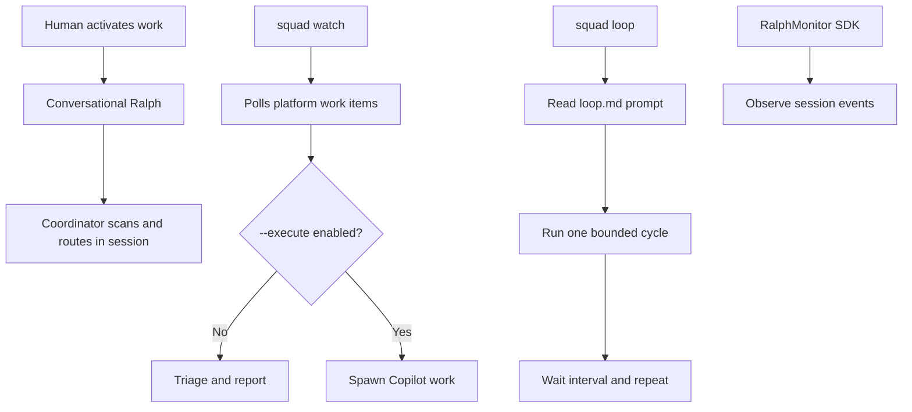
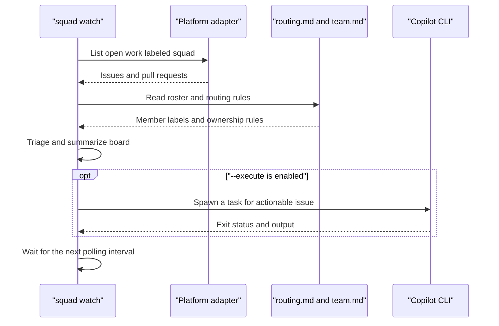

# Chapter 9: Ralph, the Loop, and Scheduling

> **Prerequisites:** Chapters 4 and 7.

## What You'll Learn

- Distinguish conversational Ralph, `squad watch`, prompt-driven `squad loop`, the SDK monitor, and the generic scheduler.
- Write a bounded, repeatable `loop.md` prompt and understand how frontmatter and CLI overrides interact.
- Start `squad watch` in triage-only mode before opting into agent execution.
- Configure the schedule manifest's trigger, task, provider, retry, and state fields while recognizing what the current CLI actually runs.
- Separate the persistent-Ralph documentation vision from the concrete v1.1.0 monitor state and lifecycle.
- Use safe observation, permissions, stop signals, and review gates when running recurring automation.

## Ralph Is a Role; Watch and Loop Are Different Runtimes

“Ralph” names a work-monitor role in the Squad vocabulary, not one single daemon. It can describe conversational behavior in a Copilot session, a standalone polling process, or an SDK class that observes agent-session events. Each has a different lifetime and authority boundary. Before enabling an automation, identify which one you mean and what it can change.

The conversational Ralph behavior is activated through natural language, for example “Ralph, status” for a report or “Ralph, go” to keep reviewing the queue. It is guidance for the coordinator: inspect issues and pull requests, route findings, report progress, and continue according to the active instructions. Prompts like “Ralph, idle” communicate a stop request for that conversation. This mode is not itself an operating-system service and its conversation-local context does not create durable state across unrelated sessions.

The `squad watch` command is a separate CLI process. It polls at a configurable interval, scans Squad-labeled work, applies routing decisions, reports pull-request information, and can enable opt-in capabilities. By default, it is triage-oriented; `--execute` allows it to spawn Copilot work on actionable issues. Use the default mode first to learn what it would triage. The `--execute` option changes the risk: it can launch coding sessions, and those sessions may make repository changes according to their tools and permissions.

The `squad loop` command is another separate process, but it does not require an issue queue to choose each task. It reads a prompt from `loop.md` and runs that prompt repeatedly. The prompt, not labels, is the work driver. This makes Loop suitable for recurring checks, cleanup, inbox triage, or another task that can be described clearly and safely. When the prompt calls for work on the issue backlog, it can resemble Ralph, but it is still an explicitly authored prompt loop.

Finally, `RalphMonitor` in `packages/squad-sdk/src/ralph/index.ts` is an SDK class that subscribes to an EventBus and tracks session activity and milestones. It is not the same thing as the conversational prompt persona, nor a general productivity analytics product. Watch wires this monitor into its runtime. The distinction between these mechanisms prevents a common operational mistake: expecting a prompt file, CLI poller, and SDK event observer to share one persistent state store.



The diagram highlights four mechanisms with shared vocabulary but different inputs. In-session Ralph is prompted by the person and the coordinator context. Watch is driven by issue labels and platform state. Loop is driven by the instructions in a Markdown file. The SDK monitor is driven by session events. Choose the simplest mechanism that meets your need.

## Conversational Ralph: Work-Queue Momentum

The Ralph reference describes a repeating check cycle: scan for untriaged issues, assigned items, draft PRs, changes requested, CI failures, and work ready for review; report the highest-priority findings; coordinate follow-up work; then scan again. The purpose is to keep work moving rather than stop after each agent finishes and wait for a new prompt.

That behavior is not a license to bypass governance. Ralph does not decide that a change is safe to merge because a board looks green. Human review, branch protection, tests, and configured ceremonies remain in effect. If a team adopts an instruction that lets an agent modify issues or PRs, review its permissions and repository policy as carefully as code access. An “approved” status must mean what the team says it means.

A useful first request is a single status check. Ask what is open, what is blocked, what needs review, and what the next action should be. Once the report matches the repository, a human can decide whether to activate a loop, select one issue, or stop. Requests like “scope: just issues” narrow the requested focus, but the exact behavior depends on the active coordinator prompt and connected tools.

The term “idle” also deserves care. In a conversation, it can mean stop the active loop. In a local watcher, the process continues sleeping and polling until interrupted. In a long-running loop, Ctrl+C (or SIGTERM) stops the CLI process. A person should know which process they are stopping; ending one chat does not necessarily terminate a separate terminal process.

## `squad watch`: Observe First, Execute Deliberately

Start with the command's current help output:

```bash
squad watch --help
```

The v1.1.0 command reports a default interval of ten minutes and supports `--interval <minutes>`, `--health`, `--log-file`, `--execute`, `--copilot-flags`, `--max-concurrent`, `--timeout`, and opt-in capabilities such as `--self-pull`, `--board`, `--board-project`, `--monitor-teams`, `--monitor-email`, `--two-pass`, `--wave-dispatch`, `--retro`, and `--decision-hygiene`. Capabilities can also be configured under the `watch` object in `.squad/config.json`; CLI options override file settings. The public CLI help is the right reference for the flags available in the installed binary.

The basic cycle is approximately:



Watch requires an initialized Squad directory and a recognized platform connection. For GitHub it checks that `gh` exists and is authenticated; for Azure DevOps it checks for the `az` CLI and a valid login. On the GitHub adapter path, the core scan requests open items carrying the `squad` label, up to the configured internal limit, and compares those labels with roster-derived `squad:{member}` labels. The SDK triage code looks for module paths, routing-rule matches, and then a Lead/Architect fallback. Because the scan is bounded, a large queue may need additional attention rather than assuming a single pass contains every issue.

With execution disabled, Watch is useful for discovering labels, routing mistakes, and unrecognized work without spawning agents. When you enable `--execute`, Watch can dispatch Copilot CLI sessions. In the current code, execute mode defaults to `--yolo` if no Copilot flags are supplied, because non-interactive Copilot calls need permission behavior configured. This is a material change to the trust boundary: test first on a disposable branch or low-risk issue, use least-privilege credentials, constrain work in the issue and agent instructions, and review each resulting branch and PR.

The `--timeout` option caps a task's run time; `--max-concurrent` bounds concurrency. More concurrency can increase throughput, but it also increases resource use, collisions, and the number of changes a human must review. Set the interval and concurrency based on your rate limits and review capacity—not simply the shortest values the CLI accepts.

Optional capabilities add behavior at specific points in a watch round. `--self-pull` attempts to fetch and fast-forward before scanning; use it only where automatically updating the active checkout is acceptable. `--board` turns on project-board lifecycle behavior; `--board-project N` selects a project. `--two-pass` makes issue scanning more economical by hydrating only actionable items, and `--wave-dispatch` enables dependency-aware subtask handling. Teams/email monitoring requires the corresponding WorkIQ integration. `--retro` and `--decision-hygiene` enforce additional governance or state-maintenance actions. Use one capability at a time until you understand its permissions and output.

Use a separate terminal and begin in observation mode:

```bash
squad watch --interval 10
```

Stop it with Ctrl+C when you have enough information. If the running process has a health/status view, invoke the documented `squad watch --health` operation to inspect it. Write diagnostics to a project-controlled path only when required; `--log-file ./watch.log` is more reviewable than sending long-running logs to an unexpected location. Do not copy sample flags from the separate next-generation watch page without confirming they are accepted by the v1.1.0 binary.

### Watch boundaries and opt-in automation

The watcher is a local process, not a cloud service. It polls while running and needs the machine and credentials to remain available. A GitHub Actions workflow may offer a different event-driven or scheduled arrangement, but the lifecycle of that workflow is distinct from your local watch process. Never assume that closing a terminal starts a cloud heartbeat or that a schedule manifest is automatically installed as a daemon.

The board capability's behavior is narrower than a general Kanban synchronization service. It uses `gh project` calls and attempts to add issues and update project status during execution; it can also reconcile some Done/open mismatches. It does not create a complete organization-wide board, provide arbitrary custom-field mappings, or convert every drag-and-drop event into labels. Check Chapter 7 for the details and limitations.

## `squad loop`: Repeat a Prompt, Not an Issue Query

`loop.md` is a Markdown document with a simple YAML-like frontmatter block and a prompt body. `squad loop --init` creates a starter file in the project root. The frontmatter supports `configured`, `interval`, `timeout`, and `description`; the interval and timeout are in minutes. The command can also take `--file <path>`, `--interval`, `--timeout`, `--copilot-flags`, `--agent-cmd`, and several optional capabilities listed in `squad loop --help`.

A safe loop prompt has four qualities:

1. **Specific:** it names inputs and observable outcomes.
2. **Bounded:** it limits the number of items, duration, and permitted side effects.
3. **Repeat-safe:** running it twice does not duplicate work or corrupt state.
4. **Auditable:** it reports actions, skipped items, blockers, and references.

For example, “Review at most three Tasktrack API issues labeled `squad`, report missing acceptance criteria, and do not edit code or issue labels” is a good observation-only first loop. It has a clear queue, a scope cap, and an explicit prohibition. After several successful cycles, you could deliberately widen the scope.

The starter template's `configured: false` is an onboarding signal, not an execution lock in the v1.1.0 implementation. When `configured` is false or missing, `squad loop` prints an onboarding-mode banner and still runs the prompt. When true, it follows the normal loop flow. Therefore, do not rely on that field as your only safety mechanism. Set it to true once you have intentionally prepared the prompt, but also use explicit scope limits and permissions.

The loop parser accepts simple `key: value` pairs between the first two `---` lines; it is not a full YAML parser. Numeric values are parsed as integers. Missing or invalid values fall back to defaults—ten minutes for interval and thirty for timeout—but the runtime rejects intervals or timeouts below one minute. A quoted description has its outer quotes stripped. Keep frontmatter simple and test the resulting output rather than adding nested YAML or complex values.

CLI values override values in frontmatter. For example, `squad loop --interval 3 --timeout 15` runs at three-minute intervals with a fifteen-minute maximum cycle time even when the file has different values. The first cycle begins immediately; the process then waits the configured interval between later runs. Each cycle invokes an agent command in the project's worktree and enforces a timeout. By default it checks for a Copilot CLI and injects the configured MCP context; `--agent-cmd` replaces the default agent command, so the caller owns its policy and tool configuration.

An optional `--self-pull` capability fetches and pulls before the prompt cycle. Avoid enabling that in a checkout with uncommitted changes or where an automatic update could change the code being worked on. `--monitor-email` and `--monitor-teams` add external inputs and depend on the appropriate integration. If your prompt can send messages, update issues, or edit code, make those actions explicit and reviewable. The ability to repeat an instruction does not make its side effects idempotent.

> **Warning:** A loop can repeat a bad instruction. Keep the initial prompt read-only, set a conservative interval and timeout, and observe several rounds before allowing it to create or modify work. “Stop after one task” should be encoded in the prompt, not left as an assumption.

## The Generic Scheduler: Manifest and Commands

The generic scheduler represents scheduled work in `.squad/schedule.json`. The CLI exposes four subcommands:

```bash
squad schedule init
squad schedule list
squad schedule status
squad schedule run ralph-heartbeat
```

`init` creates the default manifest if it does not already exist. `list` validates and displays configured entries; `status` reads the saved run state and reports whether an entry is due now; `run <id>` executes one entry immediately using the local provider and updates the state file. These commands do not make a background scheduler appear. There is no `squad schedule watch` subcommand in v1.1.0 CLI help.

The core manifest shape is:

```json
{
  "version": 1,
  "schedules": [
    {
      "id": "tasktrack-review-reminder",
      "name": "Tasktrack review reminder",
      "enabled": true,
      "trigger": { "type": "interval", "intervalSeconds": 3600 },
      "task": { "type": "script", "ref": "node --version" },
      "providers": ["local-polling"],
      "retry": { "maxRetries": 1, "backoffSeconds": 5 }
    }
  ]
}
```

A manifest has a numeric `version` and a `schedules` array. Every entry requires a unique, nonempty `id`, a `name`, an `enabled` boolean, a trigger, a task, and a nonempty providers array. An optional retry policy sets nonnegative `maxRetries` and positive `backoffSeconds`. The scheduler validates the entry's types and required values before using it. Keep identifiers stable so run history remains meaningful.

The scheduler supports four trigger kinds:

| Trigger | Fields | Meaning in the manifest |
|---|---|---|
| `interval` | `intervalSeconds` > 0 | Eligible when enough time has elapsed since its last run; eligible immediately if never run |
| `cron` | `cron` string | Evaluated as a five-field local-time expression with limited syntax |
| `event` | `event` string | Event is fired externally; the poll-based due evaluator does not dispatch it |
| `startup` | none | Eligible until it has run once |

Cron support is intentionally narrow. The runtime checks five fields—minute, hour, day of month, month, day of week—and supports wildcards, `*/N` steps, and comma-separated numeric values. It does not implement full cron ranges and special syntax. It uses the process's local clock and prevents the same entry from being due a second time during the same minute. Do not paste a complex enterprise cron expression and assume its semantics match another scheduler.

Task types are `script`, `workflow`, `copilot`, and `webhook`, each with a required `ref`. A script may supply an explicit `argv` array; otherwise the scheduler tokenizes the `ref`. Script execution uses `execFile`, not shell parsing, with a default sixty-second timeout and output buffer limit. This makes arbitrary shell composition a poor fit; prefer a small checked-in script or explicit arguments. Null bytes and newlines are rejected. Webhook tasks send a POST with a JSON body containing the schedule ID and timestamp. Avoid placing secrets in a webhook URL or manifest.

A provider chooses how tasks are handled. The `LocalPollingProvider` runs script tasks locally and can POST webhooks. In the current CLI, local `workflow` and `copilot` task implementations return stub messages rather than triggering a real GitHub Actions workflow or Copilot session. The SDK also contains a `GitHubActionsProvider` that can generate workflow files, but its generated workflow is an illustrative placeholder (`echo`) rather than a complete task executor. The CLI's `schedule run` path always constructs the local provider; it does not create or dispatch generated workflows.

> **Note:** The assigned scheduler feature page describes richer local polling and `init-ci` behavior than the stable v1.1.0 CLI exposes. Use `squad schedule --help` and inspect the actual generated files before relying on an automation path. A manifest entry with `providers: ["github-actions"]` does not mean that `squad schedule run` has configured GitHub Actions for you.

When a retry policy exists, `executeTask` performs the initial attempt plus up to `maxRetries` additional attempts. Delay doubles after each failure: `backoffSeconds`, then twice that, then four times, and so on. No retry setting means zero retries. The saved schedule state is `.squad/.schedule-state.json`, containing run timestamps and status. `squad schedule status` reports past status and whether an entry is due; it does not calculate the formatted “next run” time promised by some feature-page examples.

## Persistent Ralph: What the Code Actually Persists

The “Persistent Ralph” feature page describes continuous monitoring, history, stale-session alerts, productivity trends, and a 24/7 heartbeat. This is a useful product vision to compare with the current source, but it is broader than what the v1.1.0 SDK monitor implements.

`RalphMonitor` tracks a `Map` of agents keyed by name, each with a session ID, status, last activity time, optional current task, and milestones. It subscribes to `session:created`, `session:destroyed`, `session:error`, and `agent:milestone` events. A timer calls `healthCheck()` at a configurable interval; the default is 30 seconds. A session exceeding the default five-minute stale threshold is marked stale. On a later health check, the code can move an already-stale agent to idle. The monitor exposes `getStatus()` and stops its timer and event subscriptions in `stop()`.

The monitor's observations array is part of its state, but no public trend aggregation or session archive query is provided in this class. Persistence is conditional: `stop()` writes a JSON snapshot only when `statePath` is configured. Watch creates the monitor with a path under the local Squad directory, so that runtime can write a snapshot on shutdown. That is not equivalent to a documented retention/archive system, a 24/7 service, or guaranteed persistence after a crash. Treat the state file as an implementation detail unless the runtime's lifecycle and backup contract says otherwise.

Persistent monitoring can also mean “a process keeps polling” rather than “the monitor database survives.” `squad watch` provides the former while it is running; `RalphMonitor` provides event tracking within a runtime. The generic scheduler describes a place to record a recurring task. None of these concepts alone guarantees a cloud process stays alive. To run unattended, select an actual host—such as an approved CI workflow or managed service—and configure its credentials, schedule, logs, restart policy, and stop mechanism deliberately.

## Hands-On: Observe Tasktrack Before Automating It

This lab advances the companion project without immediately granting an agent permission to execute a backlog. Start from the Tasktrack repo and GitHub issue setup from Chapter 7. Chapter 8 explores additional platform-adapter options but is not required for this GitHub exercise. Confirm the repository has a Squad setup and at least one open issue labeled `squad`.

1. Run the read-only watcher briefly:

   ```bash
   squad watch --interval 10
   ```

   Let the first pass report its findings, then stop with Ctrl+C. If there are no `squad`-labeled issues, add that label to a low-risk test issue before continuing. Review the report and compare the suggested owner with `.squad/routing.md`.

2. In the Tasktrack project root, generate a loop template:

   ```bash
   squad loop --init
   ```

   If `loop.md` already exists, keep it and edit that file rather than regenerating over your prompt. Change its description to `Tasktrack issue intake review`, keep `interval` at 10 and `timeout` at 5 or higher, and set `configured: true` when you have finished editing.

3. Replace the template body with a read-only task:

   ```markdown
   # Tasktrack intake review

   Each cycle, inspect at most three open GitHub issues labeled `squad`.
   For each issue, report whether the goal, acceptance criteria, and tests are
   clear. Do not modify issues, labels, code, branches, or pull requests. If an
   issue is ambiguous, explain the missing information and stop there.
   ```

   This prompt is designed to observe and report. It explicitly rules out edits and caps work per cycle.

4. Inspect the file and run the loop with a short timeout only after checking its content:

   ```bash
   sed -n '1,120p' loop.md
   squad loop --file loop.md --interval 10 --timeout 5
   ```

   Observe the immediate first cycle and its report. Stop with Ctrl+C. The loop may not be able to query GitHub unless the host and prompt provide the needed integration; if it cannot, record that limitation rather than broadening its permissions silently.

5. If you also want to explore schedule manifests, run `squad schedule init` in the Tasktrack project only if `.squad/schedule.json` does not already exist. Run `squad schedule list` to inspect the manifest. Do not add a schedule task that edits issues or runs Copilot unattended in this introductory exercise.

**Expected result:** you have seen the watcher's triage-only behavior, created or reviewed a bounded `loop.md`, and learned whether the configured agent can perform the read-only report. You should be able to stop both local processes explicitly. If a watcher does not recognize Tasktrack's platform or has no `squad` issue, resolve those conditions before enabling `--execute`.

## Configuration Reference

### `loop.md` frontmatter and flags

| Option | Type | Default | Description |
|---|---|---:|---|
| `configured` | boolean-like text | `false` | Selects onboarding banner versus normal flow; false does not prevent execution in v1.1.0 |
| `interval` | integer minutes | `10` | Delay between loop cycles; must be at least one |
| `timeout` | integer minutes | `30` | Maximum time per cycle; must be at least one |
| `description` | string | `Squad Loop` or onboarding label | Human-readable loop title |
| `--init` | flag | off | Generate a starter `loop.md` |
| `--file <path>` | path | `loop.md` | Select a different prompt file |
| `--interval <N>` | minutes | from frontmatter | Override the file interval |
| `--timeout <N>` | minutes | from frontmatter | Override the file timeout |
| `--copilot-flags "..."` | string | none | Add flags to the default Copilot command |
| `--agent-cmd <cmd>` | string | default Copilot CLI | Replace the agent command; the caller owns its policy |
| `--self-pull`, `--monitor-email`, `--monitor-teams` | flags | off | Opt into pre-scan or monitoring capabilities when available |

### Watch, schedule, and monitor files

| File / setting | Purpose | Important detail |
|---|---|---|
| `.squad/config.json` → `watch` | Default watch options and capabilities | CLI options override file values |
| `.squad/schedule.json` | Versioned list of schedule entries | Created by `squad schedule init` if absent |
| `.squad/.schedule-state.json` | Last-run status by schedule ID | CLI-managed state; don't edit during a run |
| `.squad/.ralph-state.json` | Optional monitor snapshot path used by watch | A snapshot is not the same as long-term analytics |
| `squad watch --interval N` | Local polling cadence | Default ten minutes |
| `squad watch --execute` | Agent execution capability | Enables changes; observe first |
| `squad watch --max-concurrent N` | Parallel issue limit | Default one |
| `squad watch --timeout N` | Per-issue timeout | Default thirty minutes |
| `squad schedule run <id>` | Run one manifest task now | Uses the local provider in the CLI |

## Under the Hood

The conversational guidance is supplied by the Ralph references and team instructions, while the actual polling behavior lives in `packages/squad-cli/src/cli/commands/watch/index.ts`. Watch obtains an adapter from the platform factory, verifies the relevant CLI, parses the team roster and routing file, ensures member labels where possible, sets up the event monitor, and then executes scan and capability phases. Its default interval is ten minutes, `execute` is false, and `maxConcurrent` is one. The watcher constructs a `RalphMonitor` with a state path under `.squad` and an interval derived from the polling interval.

The SDK monitor is `packages/squad-sdk/src/ralph/index.ts`. Its `start()` method subscribes to the four event types and starts a periodic timer. `handleEvent()` creates, removes, or updates a per-agent entry; `healthCheck()` compares activity age with the stale threshold; `stop()` unsubscribes, clears the timer, and serializes state only when `statePath` exists. This narrow event-oriented class is why trend-analysis claims should not be attributed to it without another source.

The prompt loop is `packages/squad-cli/src/cli/commands/loop.ts`. `parseLoopFile()` reads simple frontmatter fields and keeps the remaining body as the prompt. `runLoop()` requires an initialized team, resolves the loop file, checks the prompt body and numeric bounds, checks for the Copilot CLI unless an alternate agent command is supplied, runs a first cycle immediately, and repeats on a timer. It reuses Watch capabilities for pre-scan and housekeeping phases, not the full issue-execution capability set. The `templates/loop.md` file is the generated starter and uses `configured: false` as an onboarding marker.

The generic scheduler lives in `packages/squad-sdk/src/runtime/scheduler.ts`; the command wrapper is `packages/squad-cli/src/cli/commands/schedule.ts`. The scheduler validates manifests, evaluates limited due logic, executes tasks through a provider, saves run state, and exposes `LocalPollingProvider` and `GitHubActionsProvider`. The CLI's `schedule run` explicitly constructs the local provider. In that provider, workflow and Copilot tasks are stubs; scripts and webhooks are the actual local execution paths. The GitHub Actions provider's generated YAML currently echoes a task reference rather than invoking a real agent, so don't promote the feature page's production scheduler example without additional implementation.

The `templates/ralph-*` files provide prompt references, charters, and examples, not proof that each described behavior is wired into the v1.1.0 binary. For example, the circuit-breaker template describes a model fallback design; Watch's CLI options and SDK rate-limiting modules determine what is live in a given execution path. Likewise, `templates/ralph-instructions.md` controls the spawned prompt when used, while its own comments explain that user-owned instructions influence a privileged agent and must be treated like code.

## Pitfalls and Troubleshooting

- **Watch says there is no Squad.** Initialize the intended project and confirm `.squad/team.md` exists. Run commands from the correct checkout.
- **No issue is found.** Confirm the active platform adapter, CLI authentication, open state, and `squad` label. The watcher is not a general all-issues scanner.
- **A routing result is surprising.** Check module ownership and routing rules; ambiguous or missing matches fall back only when a Lead/Architect is present.
- **Watch changes code unexpectedly.** Confirm whether `--execute` was set by CLI or `.squad/config.json`. Execute mode is not a read-only monitor.
- **Loop runs even though `configured` is false.** That is current implementation behavior: false selects onboarding mode but does not stop the cycle. Do not rely on it as a safety lock.
- **Loop runs the wrong prompt.** Check `--file`, the first two frontmatter delimiters, and the body after the closing `---`. The parser only handles simple key/value fields.
- **Loop repeats or overlaps unexpectedly.** Keep cycles shorter than the interval and the prompt repeat-safe. Use Ctrl+C to stop; don't depend on a chat session ending to stop a separate process.
- **`schedule status` doesn't show a future timestamp.** It reports last status and whether a schedule is due now; it does not expose a computed next-run value in v1.1.0.
- **A schedule says it ran but did not dispatch Copilot or Actions.** The current local provider returns stub results for those task types. Inspect task type and provider code before treating a successful status as completed work.
- **A GitHub Actions workflow is only an echo.** The SDK generator is placeholder scaffolding. It is not proof of an unattended production execution path.
- **A persistent-Ralph report promises archives or trend data.** The SDK monitor tracks runtime status and can write one snapshot on stop when configured; it does not implement the documented weekly archive and analytics in this module.
- **A docs flag is rejected by the installed command.** Check `squad watch --help` and `squad loop --help` for the installed v1.1.0 surface. Feature notes can describe a future or alternate implementation.

## Summary

Ralph, Watch, Loop, the SDK monitor, and the scheduler solve related but distinct problems. Use conversational Ralph to keep an interactive queue moving. Use `squad watch` to poll platform work, beginning without execution; opt in to `--execute` only after validating identity, scope, and permissions. Use `squad loop` when a carefully written prompt—not an issue selector—should repeat. Use the schedule manifest as structured task metadata, while remembering that `squad schedule run` executes locally and several provider task types remain stubs. The SDK monitor observes session events and can persist a shutdown snapshot, not an entire 24/7 analytics service. For every recurring process, decide what it can change, how it stops, and who reviews the result.

## Exercises

1. Write a read-only `loop.md` prompt for Tasktrack that checks at most three `squad`-labeled issues, reports missing acceptance criteria, and forbids edits. Set a five-minute timeout and a ten-minute interval. Explain why `configured: false` is not a safety gate.
2. Compare `squad watch --interval 10` with `squad watch --execute --interval 10`. List the additional risks and protections you would require before using the second command on a shared repository.
3. Given an interval schedule with `intervalSeconds: 300` and one retry, calculate the number of attempts and the retry delay. Why is `event` not automatically due in the polling evaluator?
4. Explain what data `RalphMonitor` tracks, what event types update it, and under what condition it writes a snapshot. Identify two claims from the persistent-Ralph feature page that this module alone does not substantiate.
5. A team wants GitHub Actions to run the default schedule every five minutes. Explain why `providers: ["github-actions"]` and `squad schedule run` are not sufficient proof that an agent task is being dispatched. What source or output would you inspect?
6. Design a gradual rollout for a recurring watcher: observation, low-risk execution, then broader execution. State the stop mechanism, concurrency limit, timeout, and human review check at each stage.

## Quiz

1. Which input drives `squad loop` task selection?
2. What is the default polling interval for `squad watch` in v1.1.0?
3. Does `--execute` make Watch more or less read-only?
4. What does `configured: false` do in the current Loop implementation?
5. Which four trigger types appear in the generic scheduler schema?
6. Which provider does the CLI's `squad schedule run <id>` instantiate?
7. Under what condition does `RalphMonitor.stop()` write its JSON snapshot?
8. Name one major operational difference between an in-session Ralph request and a local `squad watch` process.

## Further Reading

- [Ralph — Work Monitor](https://bradygaster.github.io/squad/docs/features/ralph/)
- [Prompt-driven Loop](https://bradygaster.github.io/squad/docs/features/loop/)
- [Persistent Ralph](https://github.com/bradygaster/squad/blob/v1.1.0/docs/features/persistent-ralph.md)
- [Generic Scheduler](https://github.com/bradygaster/squad/blob/v1.1.0/docs/features/generic-scheduler.md)
- [Watch — Next Generation](https://github.com/bradygaster/squad/blob/v1.1.0/docs/features/watch-next-gen.md)
