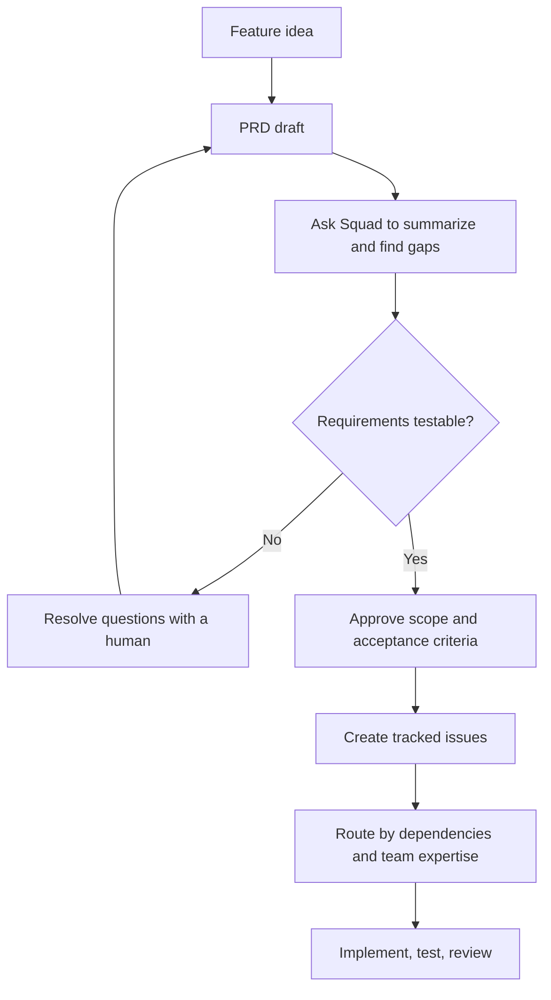
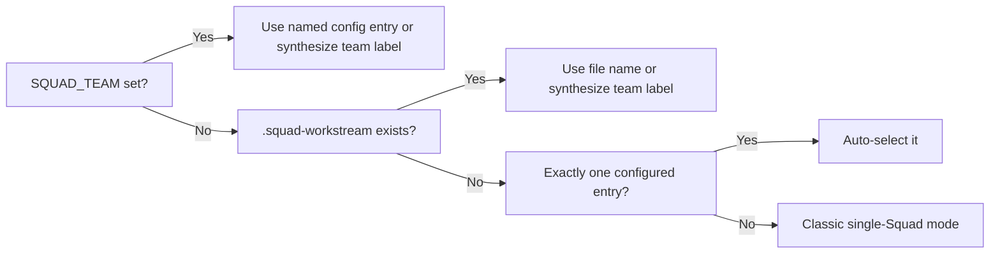

# Chapter 10: PRD Mode, Streams, and Fleet Dispatch

> **Prerequisites:** Chapters 4 and 7.

## What You'll Learn

- Use Squad to ingest and decompose a product requirements document without mistaking conversational guidance for a built-in PRD tracker.
- Turn an ambiguous feature idea into acceptance criteria, dependencies, and a reviewable issue plan.
- Understand how SubSquads partition an issue queue, how local activation is resolved, and why folder scope is advisory.
- Configure a Fleet Dispatch watch round for parallel, read-only analysis while keeping implementation work on the safer task path.
- Recognize which parts of the streams and fleet documentation are fully wired in v1.1.0 and which are only partially integrated.

## Start with the PRD as a Contract

A product requirements document (PRD) is a working agreement about a product outcome. It should make clear what problem is being solved, for whom, what behavior counts as success, and which constraints matter. It is not necessarily a design document: implementation details belong in the plan unless a technical constraint is itself a requirement.

Squad's PRD workflow begins with a document that already exists or with requirements you provide in chat. You can ask the coordinator to read a file, summarize it, identify gaps, or propose implementation slices. This is useful even if your team has not adopted a formal PRD template. The key distinction is between **PRD ingestion** and **PRD authoring**: v1.1.0 does not provide a special command that writes a PRD, persists work-item IDs, maintains a dependency graph, or gives you a PRD board. A prompt asking for a PRD is still a conversation; review and save the result as an ordinary repo file.

The `templates/prd-intake.md` document is an on-demand instruction template for agents. It suggests noting the source path, ingestion date, and content hash in `.squad/team.md`, then asking the Lead to split the input into small, ordered work items. Treat that as a prompt pattern, not as a guarantee that every install has an automated PRD parser, hash watcher, backlog writer, or approval gate. If those behaviors matter, ask for them explicitly and inspect the artifacts before proceeding.

A strong intake produces four tangible results:

1. A concise statement of the product goal and non-goals.
2. Requirements written so that a test or reviewer can determine whether each is met.
3. Questions and assumptions separated from settled requirements.
4. A proposed sequence of changes small enough to assign and verify independently.

The conversation is not the source of truth after the meeting. Put the approved PRD in the repository, then create GitHub issues or another explicitly chosen tracker for approved slices. Chapter 7 covers the issue-driven workflow; Chapter 9 covers Ralph's watch loop.

### From idea to reviewable requirements

A useful decomposition table includes a title, outcome, acceptance criteria, dependencies, size, and suggested owner. Dependencies should describe real prerequisites, not merely preferred order. For example, a backend due-date field must exist before a UI can render it, but a tag input and a due-date validation unit test may proceed in parallel once the API contract is agreed.



A practical prompt asks for analysis, not blind approval:

```text
Read docs/product-spec.md. Summarize the user outcome, list explicit requirements,
separate assumptions from decisions, identify risks and open questions, then propose
independent implementation slices. Do not edit code or create issues yet. For each
slice, include acceptance criteria, dependencies, and a suggested Tasktrack owner.
```

Review the result against the PRD. An agent can expose ambiguity, but only the product owner can decide whether a due date is optional, whether past dates are allowed, or what tags mean to users. These decisions affect the product contract and should not be silently inferred from implementation convenience.

## Hands-On: Write the Tasktrack Due Dates and Tags PRD

In your Tasktrack clone from earlier chapters, create `docs/product-spec.md`. Tasktrack currently stores `id`, `title`, `status`, and `createdAt` in memory. Its API has `GET /health`, `GET/POST /tasks`, `PATCH/DELETE /tasks/:id`; `POST` creates from a title, and `PATCH` currently changes only status. The static page displays each task's status and title. Keep this baseline in view so the PRD describes an extension instead of pretending the feature already exists.

Ask Squad to help draft and critique this requirements text:

```markdown
# Tasktrack: due dates and tags

## Goal
Help a person organize tasks by deadline and category without changing the existing
status workflow.

## Requirements
- A task may have no due date or one calendar date, represented as YYYY-MM-DD.
- A task may have zero or more tags. Each tag is a trimmed, non-empty string;
  duplicate tags on one task are not useful and should be removed case-insensitively.
- GET /tasks returns dueDate and tags for every task. Existing tasks with no values
  return null for dueDate and [] for tags.
- POST /tasks accepts optional dueDate and tags while retaining title validation.
- PATCH /tasks/:id can update status, dueDate, tags, or a combination. Omitted fields
  remain unchanged; explicit null clears dueDate; an empty tags array clears tags.
- Invalid calendar dates and malformed tag values return HTTP 400 with a useful error.
  Unknown task IDs continue to return HTTP 404.
- The UI displays due dates and tags without breaking task creation or status display.

## Non-goals
- Persistence across server restarts, user accounts, tag colors, recurring tasks,
  notifications, and task sorting are out of scope.

## Acceptance checks
- API tests cover defaults, valid create/update, clear semantics, invalid dates/tags,
  existing status behavior, and unknown IDs.
- The browser can create and display a task with a due date and multiple tags.
```

Treat this as a starting contract, not an instruction to accept every design choice. Ask the coordinator to identify decisions a product owner should settle. In particular, agree whether date validation should reject dates such as `2026-02-31` (it should), whether matching tags is case-sensitive, and whether an omitted `dueDate` differs from `null` on PATCH. Save the approved version, then ask for a dependency-aware issue breakdown. Convert only approved items into GitHub issues; PRD chat alone does not create durable work tracking.

A reasonable result is a short set of slices such as: define the task/API contract and tests; extend `TaskStore` and the API's POST/PATCH validation; add UI inputs and display; run a browser/API regression pass. Split further if any slice exceeds a day's work or mixes independent concerns. After implementation, run `npm test` from the Tasktrack root; Node 22.18+ and the starter's built-in `node:test` runner are used, so no dependency installation is needed. The test command should exit successfully. Keep the approved PRD and issues as your before/after record; tag your own repo `ch10-start` and `ch10-end` if you are following the book's suggested checkpoints.

> **Tip:** Ask Squad to report uncertainties separately from recommendations. A list of open product decisions is more valuable than a confident-looking backlog built on guesses.

### Manage changes to the specification

A PRD is a versioned agreement, not a one-time prompt. When the product owner changes the acceptance criteria, preserve the old and new intent long enough to understand the impact. Ask the coordinator to compare the current file with its prior version, summarize only material changes, and classify affected slices as new, modified, obsolete, or unchanged. A change to copy text might be local; changing whether `null` clears a due date can affect the API contract, tests, and UI. Do not silently overwrite an issue's acceptance criteria after an agent has started: comment with the updated decision, identify work that must be repeated, and ask the owner before cancelling in-progress work.

The intake template sketches this “re-ingest, diff, propose, approve, route” loop. In a repository, implement it with normal Git history and issue updates: commit the revised PRD, link changed requirements to the relevant issues, and keep acceptance tests aligned. A content hash can help a workflow recognize a changed file, but a hash only tells you that bytes differ; it cannot tell you whether the change is important or whether an existing pull request still satisfies the new contract. That interpretation remains a human review task.

Likewise, a dependency table is a planning aid, not a dependency scheduler. Before sending work in parallel, confirm that independent tasks agree on shared types and API shapes. Ask the team to list the specific contract they need from a predecessor, such as a JSON field name and nullability, rather than marking every related issue as blocked. This makes it possible to review the plan for false dependencies that unnecessarily serialize delivery.

## Streams: Partition Work, Not Repositories

The stream feature is referred to in the v1.1.0 docs and SDK as **SubSquads**. A SubSquad is a named work partition selected by a label such as `team:ui` or `team:backend`; it can also carry a directory scope and a preferred workflow. The design is for teams that want separate Squads to work in separate Codespaces, or one operator to switch between partitions serially. It is not a new repository, a second team roster, or a central orchestrator coordinating child Squads.

The conceptual configuration is an array of definitions:

```json
{
  "workstreams": [
    {
      "name": "api",
      "labelFilter": "team:api",
      "folderScope": ["api"],
      "workflow": "branch-per-issue",
      "description": "Tasktrack API changes"
    },
    {
      "name": "web",
      "labelFilter": "team:web",
      "folderScope": ["web"],
      "workflow": "branch-per-issue",
      "description": "Tasktrack web UI changes"
    }
  ],
  "defaultWorkflow": "branch-per-issue"
}
```

`name` and `labelFilter` are required for an entry. `folderScope` and `description` are optional; `workflow` can be `branch-per-issue` or `direct`. When an entry omits workflow, the configuration's `defaultWorkflow` is used, which resolves to `branch-per-issue` if absent or invalid. Folder scope is guidance for an agent, not a filesystem sandbox or permission check. Shared types or configuration files may need edits from more than one stream; branch isolation postpones integration conflicts until merge, but does not prevent semantic incompatibilities.

### Activation and resolution

The documented priority is:

1. `SQUAD_TEAM` environment variable.
2. `.squad-workstream` local file (written by `squad subsquads activate <name>`).
3. Automatic selection when exactly one configured SubSquad exists.
4. No active SubSquad: traditional single-team behavior.

The resolver can synthesize a minimal definition for a selected name absent from configuration, assigning the conventional label `team:<name>`. This makes activation fail open rather than blocking on a config edit. It also means a typo may select a partition that has no matching issues; use `squad subsquads list` to inspect names and labels before starting an unattended run.



There is an implementation detail worth checking before copying sample JSON: the v1.1.0 SDK resolver reads `.squad/workstreams.json`, while the docs, type comment, and CLI's guidance text mention `.squad/streams.json`. `squad init`'s config writer also creates `workstreams.json` when SubSquad definitions are provided. For code-level behavior in this release, place the definitions in `.squad/workstreams.json`; treat the differently named documentation path as a doc/source mismatch. `squad subsquads list`, `status`, and `activate <name>` are the management verbs. `squad workstreams` and `squad streams` are deprecated aliases in the docs.

> **Warning:** The SDK exports a label-filter helper and the CLI can resolve and display a selected SubSquad, but a source search in v1.1.0 shows no caller of `filterIssuesBySubSquad()` in the CLI/Ralph path. Do not assume that merely activating a SubSquad enforces issue triage scoping in every watch workflow. Verify the watch behavior in your installed build and rely on explicit issue labels and filters until the end-to-end integration is confirmed.

The streams PRD explains the motivation: independent teams can reduce context pressure and isolate parallel work, but separate Codespaces cost more and still need pull-request coordination. A single machine can switch between streams at lower infrastructure cost, at the price of serialized execution. Its ideas for round-robin scheduling, conflict warnings, a meta-coordinator, dependency tracking, and metrics are future-work proposals, not capabilities to promise from this release.

### Choosing a SubSquad topology

The stream design is a scale-out choice with an explicit cost tradeoff. Multiple Codespaces can work simultaneously on separately labeled queues, using separate context windows and avoiding a single Ralph process collecting every issue. This is most valuable when the work is genuinely independent and the team can review separate pull requests. A single machine switching `SQUAD_TEAM` or `.squad-workstream` can reduce Codespaces cost, but it does not deliver simultaneous capacity. It is an operations choice, not a throughput multiplier.

Before creating streams, agree on ownership labels and who adds them. Labels are visible, easy to search, and usable as the work partition key. But they are only metadata: a missing label can leave an issue unclaimed; overlapping labels can let two owners see the same issue; and a shared `team:api` label does not guarantee that the API issue's scope is small. A triage checklist should ask whether each issue has one primary owner label, whether a cross-cutting item needs a coordinating issue, and whether a shared-contract change needs reviewers from both streams.

`status` is a convenience view, not a conflict detector. The CLI queries a small number of matching PRs and looks for branch names containing the SubSquad name; it does not compare all file paths in open PRs or determine that two changes are semantically compatible. Review shared files and interfaces as part of normal pull-request review. The streams PRD's Tetris example makes the distinction concrete: Git may merge edits to one file without conflict while the resulting exports or shared APIs still disagree.

## Fleet Dispatch for Read-Heavy Work

Fleet Dispatch is a watch capability for sending multiple issue-analysis tracks through one Copilot CLI `/fleet` invocation. Avoid confusing it with SubSquads: streams divide ownership over a longer period, while fleet dispatch batches a set of read-focused analyses within one watch round. Nor is it the same as ordinary parallel coding in worktrees. Fleet's safe case is triage, review, research, or audit that reads issue context and writes findings back as issue comments; it explicitly should not edit source files, create branches, or commit.

The three modes in the feature documentation are `sequential`, `fleet`, and `hybrid`; the v1.1.0 watch implementation names the baseline `task` rather than `sequential`. `fleet` sends the executable issue set to fleet analysis. `hybrid` selects issues classified as read-heavy for fleet and leaves other work to task execution. Classification uses title keywords (for example “review,” “audit,” “investigate,” “why does,” and “how does”) plus labels; uncertain classification should remain on the safer task path. The exact candidates depend on the watch capability filter and current issue set, not just the text in the example.

For a deliberate setup, first ensure Copilot CLI and GitHub CLI are available and authenticated. In `.squad/config.json`, opt into the capability and set the mode:

```json
{
  "watch": {
    "execute": true,
    "dispatchMode": "hybrid",
    "fleet-dispatch": true,
    "interval": 10,
    "maxConcurrent": 1,
    "timeout": 30
  }
}
```

The equivalent flag `squad watch --execute --dispatch-mode hybrid` sets the dispatch mode, but a warning is emitted if `fleet-dispatch` is not enabled. Use `--dispatch-mode fleet` for an explicitly read-only triage round and `--dispatch-mode task` for ordinary per-task execution. The feature page's sample JSON uses an `interval` of 300, whereas the CLI's interval is expressed in minutes; follow the installed CLI help and your actual scheduling intent rather than copying ambiguous units.

The implementation builds one track per issue, includes the issue title and number, requests urgency assessment and a next-step recommendation, and tells the agent to write a comment without modifying files. It invokes `copilot` with a prompt and non-interactive/autopilot flags, then reports a summary. This is not a promise that every fleet track succeeds, that comments are posted, or that API access is configured correctly; inspect the run output and issue comments. The documented 2.9× figure is a reported comparison of six read-only issues and chiefly reflects one cold start instead of six. Treat it as an illustrative workload result, not a guaranteed throughput benchmark.

### Planning with confidence and reversibility

A good intake also records how you will know that each slice is done. “Add tags” is a capability; “create a task with two tags and receive both normalized tags from `GET /tasks`” is a checkable result. Add negative cases as first-class requirements rather than assuming an error response will be obvious. When behavior is not yet decided, keep the question in the PRD as a blocker instead of embedding a guessed answer in issue text. After release, compare actual behavior with the original goal and use the same PRD to discuss what should change next.

### A cautious first rollout

Do not begin with three streams and a large untriaged backlog. Add two labels, assign a handful of issues to one partition, and confirm the selector is visible in the CLI before multiplying the arrangement. Write down who owns shared API contracts, generated files, test infrastructure, and release decisions. If every issue requires both streams to coordinate, the partition may add more handoffs than it removes. Conversely, if each team has a stable folder and review boundary, even imperfect folder advisory can reduce irrelevant context.

For each candidate issue, check its labels before dispatch, then check the assigned issue and branch/PR afterward. A status report that lists a PR is a useful discovery mechanism, not a proof of which process created it. If two projects share a label convention, be explicit about the repository and team in the issue description. Keep the queue rules understandable to a human who opens GitHub; avoiding a hidden runtime-only partition is part of keeping work auditable.

## Configuration Reference

| Item | Location or option | Meaning / default |
|---|---|---|
| PRD input | pasted text or file path | No dedicated PRD CLI mode; ask for analysis explicitly. |
| PRD intake template | `templates/prd-intake.md` | Prompting guidance; does not itself persist tracker state. |
| SubSquad JSON (v1.1.0 resolver) | `.squad/workstreams.json` | `workstreams` array and optional `defaultWorkflow`; docs also say `streams.json`. |
| `name`, `labelFilter` | Each SubSquad entry | Required string values; label match is case-insensitive in the SDK helper. |
| `folderScope` | Each entry | Optional string array; advisory, not enforced access control. |
| `workflow` | Each entry | `branch-per-issue` or `direct`; default resolves to `branch-per-issue`. |
| Activation environment | `SQUAD_TEAM` | Highest-priority selected name; unknown names synthesize `team:<name>`. |
| Local activation | `.squad-workstream` | Written by `squad subsquads activate <name>`; local setting. |
| Fleet dispatch mode | `watch.dispatchMode` / `--dispatch-mode` | `task` default; `fleet` or `hybrid` opt into fleet behavior. |
| Fleet capability | `watch.fleet-dispatch` | Must also be enabled for batching; otherwise watch warns and does not batch. |
| Watch controls | `watch.execute`, `interval`, `maxConcurrent`, `timeout` | Execution is off by default; CLI help lists 10-minute polling, concurrency 1, timeout 30 minutes. |

## Under the Hood

`templates/prd-intake.md` provides conversation triggers and a Lead decomposition prompt, including a work-item table, dependency ordering, and a follow-up flow for changed PRDs. It describes active work tracking in team state, issues, or an offline backlog. That is a template for an agent workflow, not proof that the CLI has a PRD parser or that issue creation and approvals occur automatically. `docs/src/content/docs/features/prd-mode.md` states the narrower, accurate product contract: read, summarize, identify uncertainty, and propose breakdowns.

The streams SDK lives in `packages/squad-sdk/src/streams/`. `types.ts` defines the SubSquad data shapes; `resolver.ts` loads configuration, applies env/file/single-entry precedence, and supplies a synthesized label for an unknown selected name; `filter.ts` exports a case-insensitive issue-label filter. The current CLI in `packages/squad-cli/src/cli/commands/streams.ts` lists entries, reports branch/PR hints using `gh` and `git`, and writes the local selector file. The writer and resolver path discrepancy is important because readable CLI guidance is not identical to the actual SDK lookup.

Fleet is a registered `WatchCapability` in `packages/squad-cli/src/cli/commands/watch/capabilities/`. Its `preflight()` checks `copilot --version`; `execute()` obtains open `squad` work items, applies the machine-capability and executable-issue filters, selects work according to the mode, builds a single read-only prompt, and invokes Copilot. The ordinary task executor and Fleet Dispatch are separate capabilities, so validate the configuration and run output before relying on a particular scheduling result.

## Pitfalls and Troubleshooting

- **Squad says the PRD is missing:** give the exact repository-relative path or paste the approved contents. Do not expect a magic `/prd` command.
- **A decomposition invents behavior:** compare each acceptance criterion against the product decision; add an explicit clarification rather than letting an agent turn an assumption into scope.
- **SubSquads list as empty:** check that the JSON is valid and stored at `.squad/workstreams.json` for the v1.1.0 resolver. `streams.json` is the documented path but is not the path the resolver opens.
- **No issues match:** confirm the selected `SQUAD_TEAM` value and exact label spelling. The helper is case-insensitive, but the issue must actually have the configured label.
- **Folder boundaries are crossed:** they are advisory. Review the diff, route more narrowly, and use isolated issue branches; do not treat them as sandbox controls.
- **Fleet mode does not batch:** enable `watch.fleet-dispatch` as well as `dispatchMode`, install the Copilot CLI, and check preflight/watch logs. Check `copilot --version` separately.
- **Fleet writes seem possible:** stop and inspect the prompt/track. The intended contract is analysis-only; ordinary implementation should stay on task execution.
- **Watch uses confusing interval units:** CLI help describes minutes, while some docs show a numeric example without matching that unit. Use the actual installed CLI's help.

## Summary

PRD work with Squad is an ingestion-and-reasoning workflow: have the team read a real spec, surface uncertainty, and propose testable slices; then approve and persist the work through ordinary repository files and issue tracking. SubSquads partition an issue stream through labels and local selection, but treat the actual config path and runtime integration carefully. Fleet dispatch is a speed optimization for read-heavy analysis, not a parallel-write strategy or a replacement for careful review.

## Exercises

1. Revise the Tasktrack due-date/tag PRD so it says exactly how invalid dates, duplicate tags, omitted PATCH fields, `null`, and empty arrays behave. Mark any policy choice that requires a product owner.
2. Decompose the PRD into four or more issue-sized work items. Add dependency edges only where one task truly blocks another and include one verification task.
3. Create two SubSquad definitions for `api` and `web`. Explain which file v1.1.0's resolver reads, how you would activate each partition, and why `folderScope` is not security enforcement.
4. Classify these issues for fleet vs task execution: “Why does task creation return 400?”, “Add dueDate validation,” and “Review test coverage for tag normalization.” Justify each choice and name one risk of sending a write-heavy issue to `/fleet`.
5. Configure a hybrid watch that enables the Fleet Dispatch capability. Explain how you would validate it without trusting the mode setting alone.

## Quiz

1. Does v1.1.0 have a dedicated PRD-authoring command and persistent PRD backlog?
2. Which SubSquad activation source has highest precedence?
3. Is `folderScope` a hard filesystem boundary?
4. What is the v1.1.0 resolver's configuration filename, and how does that compare with the feature page?
5. What work is Fleet Dispatch intended to parallelize?
6. What additional setting must be enabled beyond `dispatchMode` for watch to batch fleet work?
7. Why is the published 2.9× speedup not a universal performance guarantee?

## Further Reading

- [PRD Mode](https://bradygaster.github.io/squad/docs/features/prd-mode/)
- [Streams / SubSquads](https://bradygaster.github.io/squad/docs/features/streams/)
- [Fleet Dispatch](https://bradygaster.github.io/squad/docs/features/fleet-dispatch/)
- [Streams PRD](https://github.com/bradygaster/squad/blob/v1.1.0/docs/_internal/specs/streams-prd.md)
- [PRD intake template](https://github.com/bradygaster/squad/blob/v1.1.0/templates/prd-intake.md)
- [Streams SDK resolver](https://github.com/bradygaster/squad/blob/v1.1.0/packages/squad-sdk/src/streams/resolver.ts)
- [Fleet Dispatch implementation](https://github.com/bradygaster/squad/blob/v1.1.0/packages/squad-cli/src/cli/commands/watch/capabilities/fleet-dispatch.ts)
