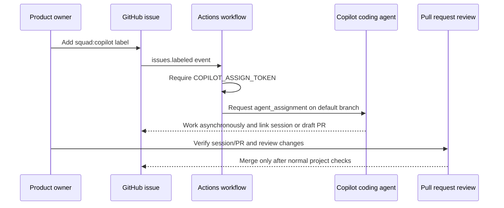
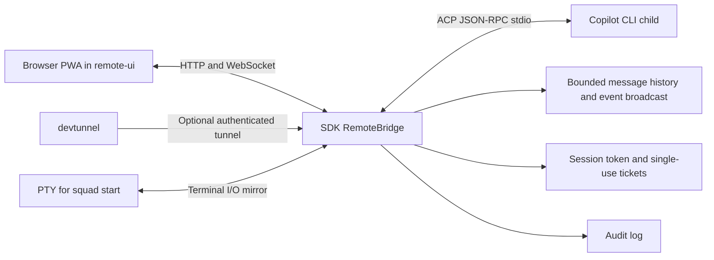

# Chapter 11: Copilot Coding Agent and Remote Control

> **Prerequisites:** Chapters 7 and 10.

## What You'll Learn

- Distinguish Squad's in-session agents from GitHub Copilot coding agent (`@copilot`), an asynchronous issue worker.
- Prepare a repository, capability profile, and narrowly scoped issue for a coding-agent handoff.
- Understand the label-triggered assignment workflow and what evidence does—and does not—prove that Copilot started work.
- Compare `squad rc`'s browser bridge with `squad start`'s PTY mirror and choose the right interaction model.
- Trace the remote UI, WebSocket bridge, authentication, rate limiting, and Copilot ACP subprocess in the v1.1.0 source.

## Two Different Ways to Put Copilot on the Team

The phrase “Copilot agent” can refer to two different execution paths. Squad's ordinary specialists are invoked from a coordinator session and share the context, routing rules, charters, and review ceremonies that the coordinator supplies. The GitHub Copilot coding agent, commonly represented as `@copilot`, is a separate asynchronous worker. GitHub starts it from an issue assignment; it works in a fresh repository context and can eventually propose a pull request. It is not another Squad subprocess and it does not participate in the live terminal conversation.

This distinction is useful when work is independent and can proceed while you continue collaborating with the rest of the team. A small bug with a clear reproduction, a test gap, documentation cleanup, or a bounded feature can be handed to the coding agent. Cross-cutting design, security-sensitive changes, ambiguous requirements, or work that depends on unstated conversation context should stay with a Squad member who can ask questions and coordinate interactively.

| Dimension | Squad-spawned specialist | GitHub Copilot coding agent |
|---|---|---|
| Starts from | Coordinator routing in a live session | GitHub issue assignment request |
| Context | Session plus charter and team context | Fresh issue/repository task context and repository instructions |
| Timing | Synchronous with the coordinator's work | Asynchronous GitHub work queue |
| Branch/PR | Depends on the session workflow | Coding agent produces a draft PR/branch when it completes work |
| Best fit | Collaboration, dependencies, broad planning | A well-specified, bounded issue that can be reviewed as a PR |
| Oversight | Squad's review gates and session decisions | Human review of the coding agent's resulting PR |

Adding `@copilot` to `.squad/team.md` makes its role and capability profile visible to the team. It does not create an ordinary Squad charter for the bot. Its repository-level guidance belongs in `.github/copilot-instructions.md`, and its work is tracked through GitHub issues, comments, sessions, and pull requests rather than a Squad agent history file.

### Prerequisites and capability boundaries

Before using it, confirm that coding agent is enabled for the repository, GitHub Actions are permitted, and the repository has a suitable `.github/copilot-instructions.md`. If you want Squad's automatic assignment workflow, the repo also needs the generated `squad-issue-assign.yml` and the `COPILOT_ASSIGN_TOKEN` Actions secret. Test the capability with a low-risk issue before routing important work.

The capability profile should start conservative. Label categories as good fit, needs review, or not suitable. A green task is routable when the issue is clear; yellow means route only with explicit review; red means use another owner. This is a policy for routing and review, not a technical permission boundary. A profile cannot substitute for branch protection, code-owner review, or access controls.

A strong issue is self-contained: it names the behavior to change, supplies relevant acceptance criteria, says which existing behavior must remain stable, and identifies test commands. It should not depend on private chat context. The coding agent's instructions template tells the worker to read team/routing context, check the capability profile, follow project conventions, create an issue branch, reference the issue in its PR, and write durable decisions to the decision inbox.

## Assignment Is a Workflow, Not an Assignee Command

The normal user-facing route is to ask the coordinator to add Copilot or use `squad copilot`; `squad copilot --auto-assign` adds it with automatic assignment enabled, while `squad copilot --off` removes it. Inspect the resulting diff before committing. The CLI label path is preferred over trying `gh issue edit --add-assignee @copilot`: GitHub's coding agent is not assigned like a normal human account.

The `.github/workflows/squad-issue-assign.yml` workflow handles the special handoff. When the `squad:copilot` label is applied, the workflow checks that the classic PAT secret is present, fetches the issue and repository default branch, then calls GitHub's agent-assignment API with `copilot-swe-agent[bot]`. It verifies the returned status and assignee before posting an acknowledgment. A successful Actions job or a label alone is not proof of a running coding session. Verify a Copilot session linked to the issue or an actual linked `copilot/*` draft PR with Copilot activity.

The `COPILOT_ASSIGN_TOKEN` must be a classic Personal Access Token with repository permission, stored as a repository secret. Never paste it into a workflow file, PR, issue, or terminal transcript. The default `GITHUB_TOKEN` cannot perform this assignment. Keep the token's scope and lifetime aligned with your repository's policy, and rotate it if it may have been exposed.

The auto-routing path is deliberately split. Triage and heartbeat can apply labels and invoke the assignment workflow when auto-assign is enabled, but the workflow is the authority that makes the Copilot assignment API request. It checks the label is still present before handoff, uses the repository default branch as the base, and only repairs the parent `squad` label after the PAT-backed request and acknowledgment succeed. If a workflow fails after making an API request but before recording a response, inspect the issue and linked session before retrying: an ambiguous failure can mean the remote side accepted the request.



The workflow also handles labels for ordinary Squad members, and the template may show examples of a Lead directly assigning `@copilot`. Do not generalize those examples into a second assignment path: in this release the PAT-backed workflow is the coding-agent assignment authority. The documentation says automated triage uses deterministic keyword matching against the capability profile and routing table. A Lead can separately inspect a result, but an automated triage comment does not mean an LLM analyzed the issue.

## Hands-On: Hand Off a Tasktrack Issue

Use the due dates and tags feature from Chapter 10 as a source of bounded work, but do not assign the whole feature at once. Choose one isolated slice, such as adding validation tests for `dueDate` and tags after the API contract is approved. First ensure `docs/product-spec.md` contains stable decisions, then create a GitHub issue with acceptance criteria and test instructions.

A useful issue body is:

```markdown
## Goal
Reject malformed Tasktrack due dates and tag values at the API boundary.

## Acceptance criteria
- `POST /tasks` and `PATCH /tasks/:id` accept only valid YYYY-MM-DD calendar dates,
  or `null` to clear the date on PATCH.
- Tag values are trimmed, non-empty strings and are deduplicated case-insensitively.
- Invalid input returns HTTP 400 with a useful JSON error.
- Existing status updates, title validation, and unknown-ID 404 behavior still pass.
- Add focused tests in `api/test/app.test.ts` and run `npm test`.

## Out of scope
Do not change the browser UI or add persistence.
```

Check that your team capability profile marks this work as green or yellow; if yellow, say explicitly in the PR that a Squad member must review it. Ask the coordinator to add `@copilot` and enable auto-assign if appropriate, or invoke the documented CLI route. Commit the generated repository setup only after reviewing token names, permissions, workflow triggers, and instruction text. Add `squad:copilot` to the issue. The expected first result is a successful Actions run acknowledging that the assignment API accepted the request—not a guaranteed completed implementation. Watch the issue for a linked Copilot session or draft PR; when the PR appears, inspect its diff, run `npm test` locally, and request the appropriate Squad reviewer. Tag the Tasktrack repo `ch11-start` and `ch11-end` around the work if you are preserving chapter checkpoints.

> **Warning:** Never treat the bot's assignment or an Actions checkmark as approval to merge. The coding agent can misunderstand requirements just like a session agent; review tests, scope, and behavior independently.

### The coding-agent lifecycle and review boundary

Think of the handoff as a state transition rather than a single assignment operation: an issue is eligible, a human or automation applies the correct label, the assignment workflow validates its preconditions, GitHub accepts the assignment request, the coding agent begins asynchronous work, and eventually a PR or explicit failure becomes visible. The state between “accepted” and “visible session” is especially important. A successful API response is evidence that GitHub accepted a request, but the agent may still be queued, initializing, or unable to complete the task. Avoid telling teammates that implementation is underway until you can see a linked session or agent-produced draft PR.

Before adding the label, check the issue's body for all context the worker needs: definition of done, relevant files, required tests, and out-of-scope work. The sample repository is dependency-free and runs with Node 22.18+, so a useful acceptance check is `npm test`; for a production repository, include the real lint/build/test commands and note any setup prerequisites. Avoid including secrets or personal access tokens in the issue. Repository instructions may be read by a worker, but they are not a place to store credentials.

When a PR arrives, compare its changes with the original issue rather than with the agent's own summary. Check that the issue is linked, that the branch and touched files fit the requested scope, that the tests actually exercise the edge cases, and that unrelated changes were not bundled in. Run the tests independently and request a reviewer who understands the subsystem. If the task is yellow in the capability profile, preserve the required-review warning in the PR description. If the task is red, stop the coding-agent route and reassign to an appropriate owner before implementation proceeds.

The auto-assignment workflow's token gate protects against an accidental incomplete install, but it does not make the PAT least-privileged by magic. Review the workflow file that is actually in your repo, its `permissions` block, pinned Actions versions, and secret scope. A token with repository write access is powerful. Keep it as an Actions secret, do not echo it in script output, and use your organization's token rotation policy. The assignment workflow's `agent_assignment` request is a GitHub integration point; if GitHub changes its requirements or supported token behavior, a green local test of the YAML cannot validate the remote API. Verify against GitHub's current status and a low-risk issue.

## Remote Control: Browser Chat or Terminal Mirror

The source contains two remote experiences that are easy to collapse into one name:

- **`squad rc`** runs a browser chat bridge. The CLI starts an HTTP/WebSocket server, serves the remote PWA in `packages/squad-cli/src/remote-ui`, and can spawn Copilot CLI in ACP mode as a child process. The browser sends prompts and receives streamed events through the bridge.
- **`squad start`** runs Copilot in a local pseudo-terminal (PTY) and mirrors the interactive terminal to a remote browser. It is for seeing and operating that same terminal session, not a chat-first ACP UI.

The `rc` command offers `--tunnel`, `--port <n>`, and `--path <dir>`. Port `0` chooses an available port. Tunnel mode requires `devtunnel` installed and authenticated; without tunnel mode the server is local-only. The installed v1.1.0 CLI prints a deprecation warning for `squad rc` and recommends using `gh copilot` directly, so treat this as a version-specific convenience rather than a long-term stable interface. `squad start` supports a local PTY by default and optional tunnel; it needs the optional `node-pty` package. Copilot arguments can be passed through, and a custom `--command` can be used where supported by the command parser. Check `squad start --help` on the installed build before relying on optional flags.

The architecture is:



The UI is a static progressive web application with chat messages, agent roster, status, tool/permission events, and usage details rendered by the client. The SDK bridge supplies HTTP and WebSocket behavior, bounded message history, session metadata, WebSocket broadcasts, and command callbacks. The CLI's `rc.ts` wires in the Copilot process and static file handler. The `start.ts` code separately creates a PTY and pipes its terminal I/O through the bridge. In either mode, opening a tunnel means remote access to a process in your working repository; treat it as a privileged interface.

### A careful remote session

For a remote session, start from a trusted development checkout, verify which repository and branch the command prints, and use local mode if you only need access from the same machine. If phone or browser access is necessary, authenticate `devtunnel` first and review the exact URL before sharing it. Connect from the expected device, avoid copying the URL into public channels, and stop the process/tunnel immediately when you finish. If you are screen-sharing, remember that terminal history and chat replay may display prior content to newly connected clients.

Separate remote interaction from host authority. The mobile UI can send a prompt into the local Copilot process; it does not grant GitHub issue approval, bypass branch protection, or replace a human merge decision. Nevertheless, tools available to Copilot may read or modify the checkout. Use a disposable or appropriately permissioned workspace for demonstrations, keep production credentials out of the environment, and verify any request to run a destructive command through an approved interaction channel. The safest remote session is one where the repository, identity, scope, and expected stop condition are clear before you open the tunnel.

### Security controls and their limits

The `RemoteBridge` implementation binds its server to `127.0.0.1`. Its session token gates API routes, and the PWA exchanges the token for a short-lived, single-use ticket for WebSocket authentication. A four-hour session lifetime is enforced; the bridge applies an HTTP request limit per client address, a WebSocket payload ceiling, connection checks, and message throttling. Its redaction helper strips terminal escape/invisible characters before applying secret-pattern replacements. Audit events are written under `~/.cli-tunnel/audit/` with restrictive directory permissions. The tunnel setup is private by default and uses the `devtunnel` CLI.

These are defense-in-depth measures, not a reason to expose a development machine to untrusted users. Redaction uses patterns and cannot guarantee that every sensitive value is caught. The PWA has broad ability to prompt Copilot, whose tools operate in the repository context. Keep tunnel credentials private, use only a trusted account/device, stop the process when the session is finished, and avoid handling production credentials on a remotely controlled workstation. Do not copy example URLs or session tokens into chat or tickets.

Some details in the remote-control docs overstate or conflate behavior. In source, `squad rc` has ACP passthrough code; `squad start` is the PTY mirror. The remote UI is a browser client, and the SDK files are under `packages/squad-sdk/src/remote/`. Check the implementation rather than assuming every documented mobile key, number of connections, replay setting, expiry behavior, or audit event schema is identical across both commands. The CLI itself deprecates `rc` in v1.1.0.

A quick post-session checklist helps close the loop: verify the bridge process ended, the tunnel is no longer accepting connections, the repository is still on the expected branch, and there are no unreviewed local changes from the remote interaction. If the run changed files, record the resulting commit or PR and share only the information needed for the next reviewer. This turns “I controlled it from my phone” into a reproducible development action rather than an unexplained workstation state.

### Keep the audit trail useful

The issue, Actions run, Copilot session, and pull request form an audit trail across different systems. Link them explicitly where possible: reference the issue in the PR, include the workflow run when reporting handoff problems, and summarize the human review decision before merging. Avoid relying on a mobile chat transcript as the only record of a product decision; commit consequential decisions to the repository's normal decision log or spec. A durable trail makes it possible to distinguish an accepted request, work in progress, a completed change, and an approved release.

### Select the interaction surface deliberately

A remote browser may appear simpler than opening a terminal, but it changes how you observe context. A chat interface presents messages and events; a terminal mirror presents the process's actual terminal output, including prompts and terminal control behavior. Decide whether you need a chat surface or a faithful TUI mirror before starting either command. Avoid launching a PTY mirror and an ACP bridge against the same working tree without a reason: two control surfaces can make it unclear which input caused a file change.

For a local-only bridge, use the loopback address and a specific port only when another local component needs a predictable endpoint. A random port reduces accidental collisions. For a tunnel, let the CLI print the authenticated URL rather than reconstructing it manually. Confirm the branch, repository, and machine labels; if the tunnel helper is unavailable, the remote path should not be assumed to have come up just because a local bridge started. After ending the session, verify the process stopped and remove or expire the tunnel according to your team's devtunnel policy.

## Configuration Reference

| Concern | File / setting / command | Notes |
|---|---|---|
| Add/remove coding agent | `squad copilot`, `squad copilot --auto-assign`, `squad copilot --off` | Manage `@copilot` membership and optional auto-assign setup. |
| Capability profile | `.squad/team.md` | Green / yellow / red examples guide routing; customize to your repo. |
| Coding-agent context | `.github/copilot-instructions.md` | Repository instructions, branch, PR, capability, and decision behavior. |
| Assignment workflow | `.github/workflows/squad-issue-assign.yml` | Label/dispatch event; owns PAT-backed coding-agent assignment. |
| Required secret | `COPILOT_ASSIGN_TOKEN` | Classic PAT stored as an Actions repository secret for the workflow. |
| Work label | `squad:copilot` | Requests coding-agent assignment; do not treat as proof of completion. |
| RC local port | `squad rc --port <n>` | Default is 0 (ephemeral port) in v1.1.0 code. |
| RC tunnel | `squad rc --tunnel` | Requires authenticated `devtunnel`; command is deprecated in v1.1.0. |
| RC working directory | `squad rc --path <dir>` | Selects the path passed to the command. |
| PTY mirror | `squad start [--tunnel]` | Requires `node-pty`; see installed help for command and flag support. |
| SDK bridge | `packages/squad-sdk/src/remote/` | `RemoteBridge`, types, and protocol exports. |
| Browser client | `packages/squad-cli/src/remote-ui/` | Static PWA: HTML, CSS, JS, and manifest. |

## Under the Hood

`templates/copilot-agent.md` describes how to represent `@copilot` in the team roster and set a capability profile. `templates/copilot-instructions.md` is the worker's repository guidance. The issue assignment workflow is a separate template under `templates/workflows/squad-issue-assign.yml`; it distinguishes ordinary member-label acknowledgment from the special Copilot PAT assignment and verifies the API response. The auto-assign docs are the best user guide, but verify the installed generated workflow before committing because your repository's actual permissions and branch defaults matter.

In `packages/squad-cli/src/cli/commands/rc.ts`, `runRC()` discovers repository and branch context, reads active roster entries, creates a `RemoteBridgeConfig`, starts the bridge, serves files from `remote-ui`, and launches Copilot ACP as a transparent child-process relay. The SDK in `packages/squad-sdk/src/remote/bridge.ts` owns server state and the browser-side protocol. `packages/squad-cli/src/cli/commands/start.ts` is a distinct PTY-oriented entry point. The package layout therefore mirrors the interaction distinction: reusable transport/security machinery in the SDK, host-specific process setup and browser assets in the CLI.

The bridge keeps bounded history (`maxHistory` is supplied by the CLI), can replay events for late clients when configured, routes incoming prompt/direct-message/command callbacks, and broadcasts agent, tool, permission, delta, and usage events. The protocol is a transport contract—not Squad's normal agent-routing system by itself. A remote UI message only reaches the behavior wired by the CLI callback or ACP relay; it does not turn the phone into a separate coordinator.

## Pitfalls and Troubleshooting

- **`@copilot` is not assignable from `gh issue edit`:** use the `squad:copilot` label and configured assignment workflow.
- **Actions fails before assignment:** verify the repository secret name and non-empty classic PAT, workflow permissions, issue label, and default branch. Never paste the token into logs to debug it.
- **Workflow succeeds but no session is visible:** check the issue for linked Copilot session or draft PR. The workflow's API acknowledgment is not proof of started work.
- **Issue is too broad:** split it into smaller tasks with explicit behavior and tests; do not rely on the coding agent to reconstruct chapter-long chat history.
- **No remote response:** verify Copilot CLI availability, bridge startup logs, and the first-run ACP/MCP initialization delay. Local bridge startup is not the same as Copilot being ready.
- **`devtunnel` unavailable or unauthenticated:** install and sign in using the current Microsoft devtunnel instructions. Do not bypass tunnel auth with a public endpoint.
- **Tunnel URL leaked:** stop/destroy the tunnel and bridge, rotate any exposed token, inspect the audit logs, and assess repository/host access.
- **`squad rc` behavior differs from documentation:** remember the command is deprecated and compare the local `squad rc --help`/source; prefer the supported Copilot CLI workflow for ongoing use.

## Summary

GitHub Copilot coding agent is an issue-triggered, asynchronous collaborator, not a live Squad specialist. Use capability-based routing, precise issues, repository instructions, and human PR review. Squad's `squad:copilot` workflow uses a PAT-backed API handoff, and you must verify that a session or PR actually materialized. Remote Control is a separate interface concern: `rc` is a deprecated ACP/browser bridge, while `start` mirrors a PTY. Both expose a powerful local context through a remote connection, so use them with deliberate access and security boundaries.

## Exercises

1. Write a capability profile for Tasktrack that marks due-date validation as green, tag UI integration as yellow, and a redesign of the storage architecture as red. Explain why these are different risk levels.
2. Rewrite the Hands-On issue so it is self-contained and does not rely on the PRD being open in a hidden chat. Include non-goals and a test command.
3. Draw the assignment evidence chain from adding `squad:copilot` through the Actions API response to an actual draft PR. Mark the first point at which the work is confirmed to have started.
4. Compare `squad rc` and `squad start` in terms of user experience, process model, prerequisites, and best use. Why should a tunnel be treated as privileged?
5. A workflow run failed after calling the assignment API but before posting its comment. Describe a safe recovery procedure that avoids duplicate assignment and protects the PAT.

## Quiz

1. Does adding `@copilot` create a regular Squad charter and history file?
2. Why should you use `squad:copilot` instead of directly assigning `@copilot` with the ordinary GitHub CLI?
3. What secret does automatic assignment require, and what type of token does the docs specify?
4. Does a green Actions run prove that a Copilot coding session has started?
5. Which command is ACP/browser chat, and which one mirrors a PTY?
6. What does `squad rc`'s v1.1.0 CLI warning recommend instead?
7. Why is remote secret redaction not an adequate guarantee for exposing a development environment?

## Further Reading

- [Copilot Coding Agent](https://bradygaster.github.io/squad/docs/features/copilot-coding-agent/)
- [Remote Control](https://bradygaster.github.io/squad/docs/features/remote-control/)
- [squad rc](https://bradygaster.github.io/squad/docs/features/squad-rc/)
- [Coding agent template](https://github.com/bradygaster/squad/blob/v1.1.0/templates/copilot-agent.md)
- [Coding agent instructions template](https://github.com/bradygaster/squad/blob/v1.1.0/templates/copilot-instructions.md)
- [Issue assignment workflow template](https://github.com/bradygaster/squad/blob/v1.1.0/templates/workflows/squad-issue-assign.yml)
- [Remote UI](https://github.com/bradygaster/squad/tree/v1.1.0/packages/squad-cli/src/remote-ui)
- [Remote SDK bridge](https://github.com/bradygaster/squad/blob/v1.1.0/packages/squad-sdk/src/remote/bridge.ts)
- [Remote protocol](https://github.com/bradygaster/squad/blob/v1.1.0/packages/squad-sdk/src/remote/protocol.ts)
