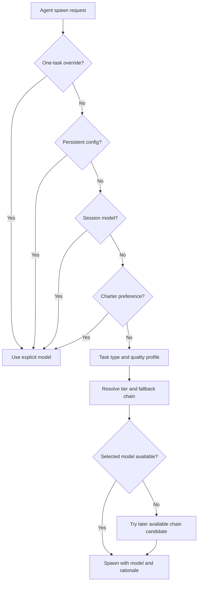
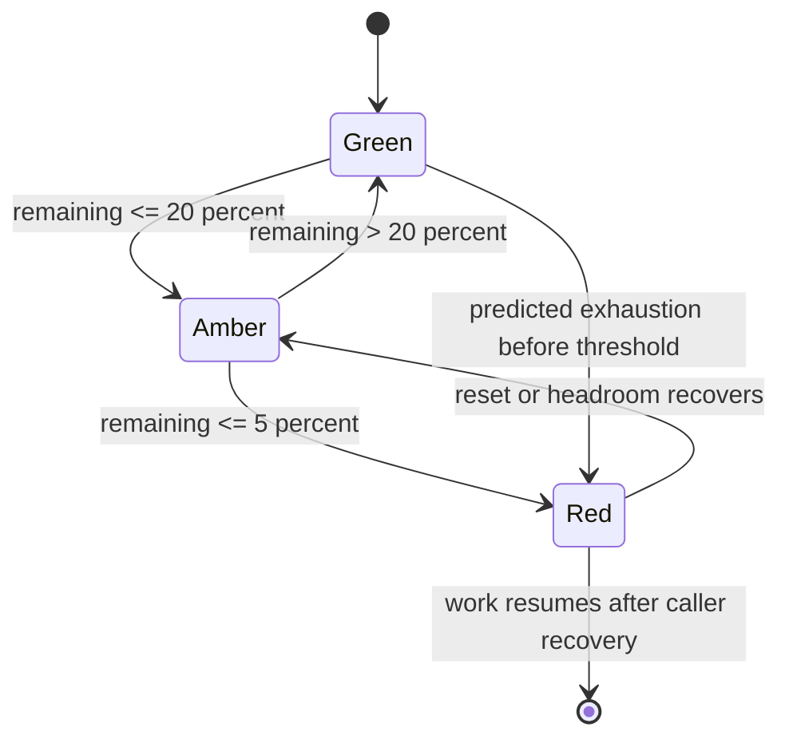

# Chapter 12: Models, Cost, and Rate Limiting

> **Prerequisites:** Chapters 4 and 10.

## What You'll Learn

- Select a model by task risk and quality needs instead of applying one expensive model to every task.
- Understand Squad's model precedence, quality profiles, economy substitutions, availability fallback, and reasoning-effort settings.
- Change a model for one task, one session, one agent, or persistently for the team.
- Interpret `squad cost` output, including its structured usage ledger, legacy estimates, and coverage indicator.
- Distinguish usage reporting and a cost estimate from a hard budget cap.
- Explain the SDK's traffic-light, predictive circuit-breaker, and cooperative rate-pool helpers—and their integration limits in v1.1.0.

## Model Choice Is a Routing Decision

The model that answers a request influences latency, quality, and spend. A simple typo fix rarely needs the same reasoning depth as a security review. A blanket model choice can be wasteful in routine work, while an aggressively cheap model can cost more in the end if it misses requirements and forces repeated fixes.

Squad's default model selection is task-aware: classify the kind of work, determine a tier, then resolve a concrete model from that tier's chain. The tiers in the SDK are **premium**, **standard**, and **fast**. A quality-first profile selects premium models for work that benefits from careful reasoning (architecture, research, verification, review, security, design, and visual work); standard for code, prompts, documentation, writing, and planning; and fast for mechanical tasks such as logging and routine operations. A model's name or tier is not a guarantee of output quality, plan availability, latency, or price; the supported set depends on Copilot access and can change.

The tradeoff is not “premium equals good, fast equals bad.” It is “buy the level of capability this work merits.” Use an inexpensive model for repetitive labeling or straightforward edits with tests. Keep a strong reviewer for work where subtle edge cases have high impact. A model budget should account for the full loop: generation, review, retries, and rework—not just the first completion.

### Resolution precedence

At each spawn, Squad resolves a model using the first applicable source in this order:

1. A one-spawn user override.
2. A persistent per-agent override or global `defaultModel` from `.squad/config.json`.
3. A session model inherited by spawned agents.
4. A preference in the agent charter's `## Model` section.
5. Task-aware selection under the active profile.
6. The default model for that profile.

`auto` means that layer does not force a particular model, so resolution continues. Fallback happens after a model has been chosen and is found unavailable; it is not another preference tier. A live list of available models can be authoritative. If an unavailable model appears in its chain, Squad searches only later entries; it does not jump back to an earlier premium option. If no candidate remains, the resolver marks the model to be omitted and lets the host choose its default.



The decision should be observable: resolved model, source, rationale, and fallback should be available to the caller/logging surface. That provenance helps answer “why did the reviewer use this model?” and helps diagnose a surprising downgrade. An explicit user selection should not be silently remapped by an economy profile; the explicit choice wins.

## Profiles and Switching Models

The GA profiles affect automatic selection and defaults, not explicit choices:

| Profile | Selection behavior | Good starting use |
|---|---|---|
| `quality-first` | Premium for quality-sensitive work; standard for code and language work; fast for mechanical work. Default profile. | General work where quality matters and model choice should adapt by task. |
| `balanced` | Premium for review-like gates; research stays standard; planning moves to fast; code remains standard. | Mixed workloads where routine analysis should cost less but review still gets stronger reasoning. |
| `economy` | Cost-first task tiers plus cheaper substitutions. | Bulk triage, logs, repetitive edits, or a deliberately constrained budget. |
| `hydrafusion` | Research preview; quality-sensitive categories try HydraFusion first, remaining categories follow quality-first. | Opt-in experimentation only, when the account and client support it. |

You can state a preference to the coordinator in ordinary language:

```text
Use Opus for this security review only.
Have all agents use Sonnet for the rest of this session.
Always use gpt-5.3-codex for Fenster.
Use the balanced profile for this session.
Switch back to automatic model selection.
```

These phrases represent different lifetimes. “For this” changes a single spawn; “for this session” changes the inherited session model; “always” stores a preference across sessions; “for Fenster” configures that agent; “automatic” clears a persistent default so task-aware routing can resume. Review the coordinator's proposed settings and inspect `.squad/config.json` when the preference should persist.

A persistent config may look like:

```json
{
  "version": 1,
  "defaultModel": "claude-opus-5.5",
  "modelProfile": "balanced",
  "agentModelOverrides": {
    "fenster": "gpt-5.3-codex",
    "mcmanus": "claude-haiku-5.5"
  }
}
```

A per-agent override takes precedence over the global default. Model profiles can be stored in `modelProfile`; the legacy `economyMode: true` also selects economy. When changing a value, preserve unrelated config keys. The SDK's model persistence helpers merge model fields into the existing JSON document. Avoid hand-editing malformed JSON: the reader deliberately treats unparseable config as absent, which can make the runtime appear to ignore the setting.

> **Note:** `squad models` in v1.1.0 is a catalog refresh/diagnostics command, not the command that switches every agent's model. Switching behavior is prompted through the coordinator; persistent values live in `.squad/config.json`.

### Economy substitutions and preview models

Economy mode changes auto-selected models using a map: premium to standard, standard to fast, and some fast models to a lower-cost fast alternative. For example, code that would ordinarily use `claude-sonnet-5.5` may be remapped to `gpt-5.6-luna`. The rationale should disclose the economy profile. An explicit model at the user, config, or session layer is not silently rewritten. Cost savings trade against reasoning depth, and economy should not be the automatic answer for a high-stakes security review simply because the remaining budget is low.

`hydrafusion` and `hydrafusion-max` are preview identifiers rather than standard fallback-chain members. The opt-in profile selects HydraFusion only for its configured quality-sensitive tasks; explicitly naming `hydrafusion-max` is a distinct, deliberate choice. If HydraFusion is not available, resolution falls forward to a GA premium candidate. Since preview availability can change, verify the Copilot plan, organization settings, and client support before relying on it. If you do not need a research preview, stay with a GA profile.

### Refreshing a catalog is not switching a model

The installed `squad models` command supports `squad models refresh`. It refreshes the committed model catalog from an authenticated Copilot models API where possible, uses a docs-data fallback if needed, and reports what it found. It does not update the current agent, session, or `.squad/config.json` selection. Model lists and picker availability can change independently of your chosen preference; a saved model ID may become unavailable, in which case fallback behavior matters.

### Resolve a concrete example

Suppose a code specialist has a charter preference for `claude-sonnet-5.5`, the team config sets `defaultModel` to `claude-opus-5.5`, and you ask for `gpt-5.3-codex` for one API task. The per-spawn user override wins for that task. If you remove the one-off request, a configured per-agent model wins over the global default and session model; if neither config entry applies, the session model comes next, then the charter, then task-aware selection. This layered model lets you define sensible defaults without preventing an intentional exception.

Now consider availability. If that chosen explicit model is unavailable, the resolver uses the model's fallback chain, but only moves forward from the chosen ID within the chain. It does not silently upgrade a fast task to a premium model. Under an active cost ceiling, catalog-known candidates above the ceiling are skipped. The result carries provenance such as `fallbackFrom` and a rationale, so a report can explain why the model differs from the original preference. If no candidate remains, the resolver can omit a model argument and defer to the platform's default; this is different from promising that the original model will eventually be retried.

When investigating unexpected model choice, inspect one layer at a time: actual user directive, `.squad/config.json` global and agent keys, session choice, charter model section, task type, active profile, availability list, and cost policy. This sequence is faster than repeatedly asking the coordinator to “use the right model” without knowing which setting is dominant. If the setting is temporary, explicitly say when it should expire so it does not become an accidental persistent default.

## Hands-On: Tune Tasktrack for Quality and Spend

Use the work from Chapters 10–11. Do not select one model just because it is currently fashionable; choose based on the work. For a Tasktrack sprint, a balanced profile is a reasonable experiment: standard for API/UI implementation, fast for simple planning and mechanical notes, and premium for a final reviewer if the task is security-sensitive or the requirements are disputed.

Ask Squad for a session-only change first:

```text
Use the balanced model profile for this Tasktrack session. Keep the existing
per-agent settings intact, and tell me which model and rationale each agent
will resolve to for API implementation, documentation, and final review.
```

Inspect the answer before proceeding. Then, if you want a durable team default, ask for a persistent setting and inspect `.squad/config.json`:

```text
Always use the balanced profile for this repository. Do not change any explicit
per-agent model overrides. Show me the resulting config diff.
```

Run a small, bounded task such as adding one test for invalid dates. After the session, inspect actual usage:

```bash
squad cost
squad cost --agent fenster
squad cost --all
```

`--agent` filters by a case-insensitive name. Without `--all`, the command scopes structured entries to the current session boundary when it can identify one; `--all` includes historical ledger entries. Compare the summary to the changes and test result, not just the token total. If the task needed multiple retries, consider whether cheaper selection caused expensive rework or whether the requirements should have been clearer. Tag your Tasktrack checkpoint `ch12-start` / `ch12-end` if you are preserving the book's tags.

The exact dollar amounts in a report are estimates derived from model pricing and recorded token usage; they are not an invoice or a contractual spend cap. If the command reports partial usage coverage, failed/aborted turns may not have a recorded usage result. For a controlled experiment, record the task, selected model, output quality, duration, and retries alongside estimated spend.

## Cost Tracking: Measure, Estimate, and Control Separately

Three concepts often get called “budgeting,” but they are different mechanisms:

- **Usage tracking** records input/output tokens and model metadata.
- **Cost estimation** applies pricing information to token counts and produces an estimate.
- **Spend control** prevents additional work after a configured limit.

A tracker can do the first two without implementing the third. The SDK `CostTracker` accumulates entries per agent and session, sums token counts and estimated cost, tracks turn and fallback counts per agent, formats a summary, and can subscribe to `session:message` events on an `EventBus`. It is an in-memory accumulator; wiring it up and persisting records is the caller's responsibility. The class does not itself enforce a budget or prevent a spawn. Do not confuse a demo budget threshold or an old example's `defineBudget()` with a hard v1.1.0 CLI cost limit.

The `squad cost` CLI reads the structured `UsageLedger` from the active state backend. It prefers structured usage, reports the number of attempted turns that have matching recorded usage, and can skip invalid records. If no structured entries are available, it can parse legacy self-reported orchestration-log rows, which it explicitly labels as estimates. No usage data may mean no completed turn carried usage information; it does not prove that no model calls occurred. Keep the coverage line in reports you use for budget decisions.

`estimateCost()` in the model catalog returns zero if it cannot find pricing for a model. A zero estimate for an unpriced model is not evidence that the actual request was free. Pricing can change; compare model identifiers and the current Copilot billing policy when reconciling estimates. The `squad models refresh` catalog tooling exposes unpriced models rather than inventing a price.

OpenTelemetry can export token/cost metrics when a caller emits or wires the relevant usage events and telemetry is configured. That is an observability path, not a financial ledger. Use an authoritative provider-side billing surface for invoices and account-level quota.

### Establish a cost envelope before running a batch

A practical spending control starts outside the model selector. Estimate the number of tasks, expected input context, likely output size, and number of review/retry turns. Set an alert level below the maximum you are willing to spend, then decide what will happen at the alert: stop dispatching optional work, switch automatic tasks to the economy profile, or require human approval before continuing. Make that policy explicit in the wrapper or orchestrator that launches work. The built-in summary command will help you observe the result, but it does not stop a run when the estimate crosses a line.

Do not change a high-quality reviewer to a fast model solely because the budget dashboard turns red. First reduce waste: trim irrelevant context, reduce duplicate agent work, make acceptance criteria clearer, and cap concurrency. If the choice is truly between continuing and pausing, a deliberate pause is safer than silently changing the quality of a mandatory review. Also separate personal Copilot subscription limits, provider-level usage and billing, and a project's internally estimated cost: they are different ledgers and may use different pricing or quotas.

## Cooperative Rate Limiting

Rate limiting protects a team from exhausting shared API quota in a burst of concurrent work. The documentation describes a traffic-light model: green allows normal work, amber limits lower-priority work, and red pauses until headroom recovers. The source `packages/squad-sdk/src/ralph/rate-limiting.ts` includes pure scheduling helpers for that policy.

`getTrafficLight(remaining, limit)` computes a percentage from rate-limit headers: green above 20%, amber above 5% and up to 20%, red at or below 5%; a zero limit is red. `shouldProceed()` permits every priority in green, only priority `0` in amber, and no priorities in red. Priorities are `0` for lead, `1` for specialist, and `2` for Ralph/Scribe. Retry delays use exponential growth capped by a priority-specific window and add random jitter, so lower-priority work waits longer.

The `PredictiveCircuitBreaker` retains a bounded number of samples (10 by default) and requires at least three. It compares the first and last samples to estimate the observed consumption rate and predicts seconds until the remaining quota reaches zero. If the predicted time is below its warning threshold (120 seconds by default), `shouldOpen()` returns true. It returns `null` when it lacks samples, time has not advanced, or quota is not decreasing. Despite one comment referring to “linear regression,” this implementation is a first-to-last delta, not a least-squares fit. It predicts and reports a condition; the caller must decide what to pause or retry.

Cooperative multi-agent quota sharing uses a `RatePool` with a total limit, reset timestamp, and per-agent allocations (`priority`, `allocated`, `used`, `leaseExpiry`). `canUseQuota()` is a read-only check. `consumeQuota()` increments an agent's used count and reclaims expired allocations from other agents. `loadRatePool()` checks a repository state file at `.squad/rate-pool.json`, then a user-level file at `~/.squad/rate-pool.json`.



There is an important integration limit: these SDK helpers do not, by themselves, install a global interceptor around all Copilot requests, coordinate atomic cross-process leases, or prove that every Ralph dispatch waits and resumes exactly as the feature page describes. The `RatePool` is loaded from a shared JSON file; `canUseQuota()` and `consumeQuota()` are synchronous in-memory operations, and they are not an atomic distributed locking protocol. The docs describe intended cooperative behavior, but the code alone is not evidence of automatic request queueing, 50% concurrency reduction, reset polling, or “no work dropped.” Treat these APIs as building blocks until you verify the host integration in the version you deploy.

### What “cooperative” means operationally

A cooperative policy depends on every participant honoring shared information. If one worker sees amber and pauses while five other workers keep dispatching at full speed, the policy is not cooperative in effect. A complete deployment needs a single source of rate-limit observations, admission decisions, and reset/retry state that all relevant workers consult. It also needs a policy for requests whose provider returns no quota headers, for separate model-provider quotas, and for unexpected 429 responses. The helpers in the SDK make state calculations possible, but they do not answer all those operational questions by themselves.

The traffic-light calculation uses the most recent remaining/limit pair for a basic state, whereas predictive exhaustion requires a sequence of samples. A red light at 4% is a direct threshold decision; a circuit opening because the remaining percentage is still healthy but projected exhaustion is under two minutes is a forecast. These signals can disagree if the rate is changing quickly. Consumers should avoid oscillating between unrestricted and fully paused behavior: use bounded retries, respect reset timing, and log the state, sample timestamps, and decision reason for post-incident analysis.

### Practical policy

Use rate protection as a layered operational practice even if the SDK enforcement is only partially integrated: limit concurrent agents; measure current headroom; pause or slow lower-priority work on amber; stop dispatching on red; respect reset information from the API; use bounded retry with jitter; and make each retry idempotent. Do not let every agent independently hammer the same endpoint after a 429. If you run multiple Squads, a shared quota needs a genuinely coordinated source of truth—not just separate processes writing the same JSON file without locking.

## Configuration Reference

| Setting / API | Location | Behavior |
|---|---|---|
| `defaultModel` | `.squad/config.json` | Persistent default for automatic selection unless a higher-precedence per-agent value applies. |
| `agentModelOverrides` | `.squad/config.json` | Map from agent key to model ID; takes precedence over global config. |
| `modelProfile` | `.squad/config.json` | `quality-first`, `balanced`, `economy`, or `hydrafusion`; unset means quality-first. |
| `economyMode` | `.squad/config.json` | Legacy boolean; `true` selects economy profile. |
| Session / one-spawn model | Coordinator directive | Ephemeral session or single-task override; explicit selections are not economy-remapped. |
| Reasoning effort | `.squad/config.json` model fields / SDK resolver | Valid stored values include `low`, `medium`, `high`, `xhigh`, `max`; `auto` is a no-preference sentinel. Availability depends on the model/host. |
| Model discovery | `squad models refresh` | Refreshes the model catalog; not a model-selection command. |
| Cost report | `squad cost [--all] [--agent <name>]` | Current-scope estimate by default; `--all` historical records; optional agent filter. |
| Cost tracker | `CostTracker` | Accumulator with manual `recordUsage()` or EventBus wiring; no built-in hard budget stop. |
| Quota light | `getTrafficLight(remaining, limit)` | Green >20%; amber >5–20%; red <=5%, or `limit === 0`. |
| Retry policy | `getRetryDelay(priority, attempt)` | Exponential delay with jitter, priority-specific caps. |
| Predictive breaker | `PredictiveCircuitBreaker` | Default 10 samples, 120-second threshold, minimum 3 samples. |
| Shared quota file | `.squad/rate-pool.json`, fallback `~/.squad/rate-pool.json` | Shared-pool data shape; file-based loading, not an atomic distributed lock. |

## Under the Hood

`packages/squad-sdk/src/agents/model-selector.ts` defines the preference precedence, task-type tiers, profile resolution, availability fallback, rationale/provenance, and cost-policy finalization. `packages/squad-sdk/src/config/models.ts` owns the catalog, model pricing, fallback chains, economy map, persistent model/profile/reasoning/context read-write helpers, and model metadata. The `squad models` CLI command is separate: its implemented subcommand is `refresh`, which reconciles available model data; it is not where users set `defaultModel`.

`packages/squad-sdk/src/runtime/cost-tracker.ts` contains the live accumulator API. The CLI's `packages/squad-cli/src/cli/commands/cost.ts` has evolved to read a structured usage ledger via the active state backend, with a fallback parser for legacy markdown logs. This distinction matters: an in-memory tracker example is useful for SDK consumers, but does not describe the CLI's actual persistence path or prove that every attempted model call is recorded.

The cooperative primitives are in `packages/squad-sdk/src/ralph/rate-limiting.ts`: thresholds, proceed decisions, jittered retry delay, a predictive breaker, pool allocations, and JSON loading. They are small components, not a complete centralized admission-control service. The `samples/cost-aware-router` demonstrates tier choice and cost accounting as an SDK sample. Its docs and PRD are older than some current model APIs and IDs; inspect the current sample and exported SDK types rather than assuming every PRD snippet compiles unchanged against v1.1.0.

## Pitfalls and Troubleshooting

- **A session change became permanent:** distinguish “this session” from “always”; inspect and revert only the relevant config fields.
- **Agent ignores the requested model:** check precedence. A persistent per-agent override can beat a global default; a charter choice can beat task-aware selection.
- **Requested model is unavailable:** check account/organization access and the exact model ID; inspect rationale and fallback provenance.
- **Economy profile still uses a higher model:** explicit preferences are not substituted. The profile only changes automatic layers.
- **Cost is zero or absent:** confirm usage was recorded and the model has known pricing. A missing estimate is not proof of zero billing.
- **Coverage is below 100%:** some attempted turns may not have completed with structured usage. Keep the coverage note; do not treat recorded totals as complete spend.
- **Cost summary is labeled legacy:** those rows were reconstructed from markdown and are self-reported estimates, not structured usage records.
- **Rate limiter does not pause work:** a helper returning red or `shouldOpen()` is not automatically a queue. Find and test the caller that consumes the result.
- **Two agents overrun a shared pool:** the file-based rate pool has no atomic cross-process reservation. Add real coordination or reduce concurrency instead of assuming JSON sharing prevents races.
- **Docs refer to a “linear regression”:** the current predictive calculation uses a first-to-last sample delta; interpret it as a rough forecast, not a robust statistical model.

## Summary

Model choice is a per-task routing decision with explicit precedence and fallback—not a single global quality slider. Try a temporary preference before committing to a persistent one, and review the resolved model and rationale. Track token usage and estimated cost, but keep reporting separate from hard spend controls and provider billing. Finally, treat cooperative rate limiting as a set of useful SDK primitives whose orchestration must be verified: the traffic light and pool schema are not automatically a distributed quota manager.

## Exercises

1. For a Tasktrack typo fix, API implementation, and security review, select an appropriate profile/tier and justify your choices. Identify one task where a cheaper model could increase total cost through rework.
2. Given a config with `defaultModel: "claude-opus-5.5"`, `agentModelOverrides.fenster: "gpt-5.3-codex"`, and a session model of `claude-sonnet-5.5`, determine the effective model for Fenster under the documented precedence. Explain how your answer changes if the per-agent override is cleared.
3. Inspect a `squad cost` report with 7 attempted turns but 5 recorded turns. Explain what you can report and what you cannot conclude about total spend.
4. Given `remaining=150`, `limit=1000`, identify the traffic light and which priorities may proceed. Then repeat at `remaining=40`.
5. Design a safe, cooperative rate-limit response for multiple local agents. Include concurrency control, retry behavior, priority, and the limitation of a shared JSON pool.
6. Open `samples/cost-aware-router` and identify which parts are demonstrations versus guarantees supplied by `squad cost` in the CLI.

## Quiz

1. List the model-resolution precedence from the highest-priority user choice through default selection.
2. Does the economy profile remap a model explicitly selected by the user or configured for a particular agent?
3. What does `squad models refresh` do, and what does it not do?
4. What is the default `PredictiveCircuitBreaker` warning threshold, and how many samples are needed before prediction?
5. What computation does the v1.1.0 predictor actually use despite a comment referring to linear regression?
6. Which rate-light states allow priority-1 specialists to proceed?
7. Does `CostTracker` impose a hard budget cap? Is `squad cost` an invoice?
8. Why can a file-based `RatePool` fail to coordinate multiple concurrent processes safely?

## Further Reading

- [Model Selection](https://bradygaster.github.io/squad/docs/features/model-selection/)
- [Cost Tracking](https://bradygaster.github.io/squad/docs/features/cost-tracking/)
- [Rate Limiting](https://bradygaster.github.io/squad/docs/features/rate-limiting/)
- [Switching Models scenario](https://bradygaster.github.io/squad/docs/scenarios/switching-models/)
- [Cost-aware router sample](https://github.com/bradygaster/squad/tree/v1.1.0/samples/cost-aware-router)
- [Model resolver](https://github.com/bradygaster/squad/blob/v1.1.0/packages/squad-sdk/src/agents/model-selector.ts)
- [Cost tracker](https://github.com/bradygaster/squad/blob/v1.1.0/packages/squad-sdk/src/runtime/cost-tracker.ts)
- [Rate-limiting primitives](https://github.com/bradygaster/squad/blob/v1.1.0/packages/squad-sdk/src/ralph/rate-limiting.ts)
