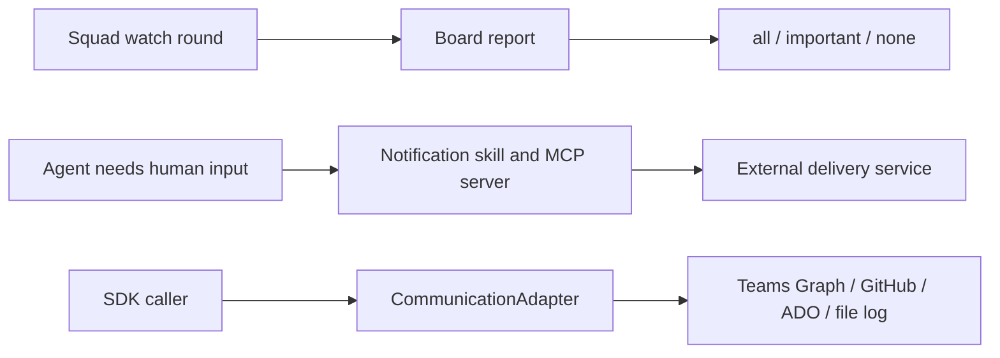
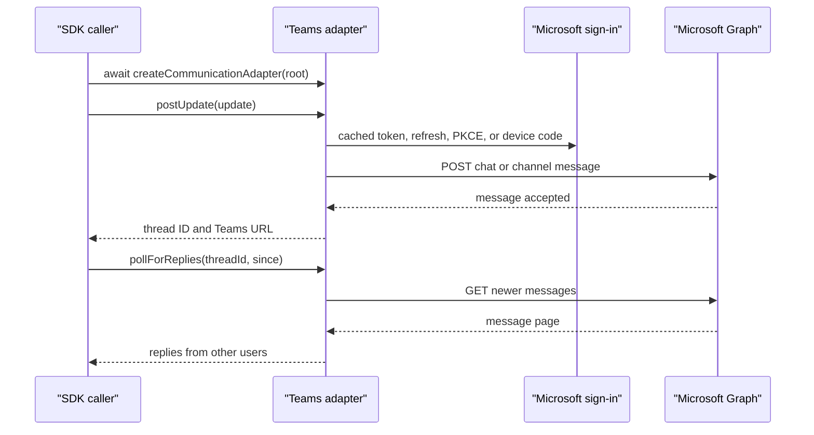

# Chapter 13: Notifications and Team Communication

> **Prerequisites:** Chapters 4 and 9.

## What You'll Learn

- Distinguish watch-round reporting from messages delivered through a notification service.
- Choose an appropriate notification level for an interactive terminal, a shared channel, or unattended monitoring.
- Understand the difference between a one-way webhook notification and Squad's bidirectional Teams Graph communication adapter.
- Configure the Teams adapter for a one-to-one chat or a team channel, including its authentication and token-storage behavior.
- Migrate SDK callers to the asynchronous communication-adapter factory.
- Recognize which notification examples are documented workflows and which are not implemented as built-in v1.1.0 CLI commands.

## Notifications Are a Delivery Design, Not a Single Switch

A notification is useful only when it moves the right information to the right person at the right time. A stream of low-value “still running” messages is not better communication than no message at all. Before wiring a channel, decide what action should follow each alert: answer a question, unblock a task, review a pull request, or simply know that a run finished.

Squad has two related but distinct ideas that are easy to conflate:

1. **Ralph watch reporting** is the status Ralph prints while polling a work board. The `--notify-level` option is intended to control how much of that board status appears in the watch output.
2. **Human-directed communication** moves a message beyond that terminal output. The documentation describes an agent skill that can call an MCP notification server; the SDK also has a `CommunicationAdapter` API for posting updates and polling for replies. Those are different integration paths, not one universal notification toggle.

A watch output level does not configure Teams, create a webhook, or decide which agent events are sent to a person. Conversely, configuring a Teams adapter does not by itself make every completed session post a message. The application calling the adapter must choose when to send and what to include.



> **Note:** In the v1.1.0 source, `createCommunicationAdapter()` is an SDK factory. It is not a built-in `squad test-notification` command. The notification docs show MCP examples and prompts, but the shipped CLI source does not contain that test command or a bundled `human-notification` skill. Treat those examples as an integration pattern; verify the MCP server and skills available in your own Copilot environment.

## Ralph's Notification Levels

The three levels describe how verbose a watch board report should be:

| Level | Intended behavior | Appropriate use |
|---|---|---|
| `all` | Print every round, including an empty board | Troubleshooting, observing polling cadence, or confirming the board scan remains active |
| `important` | Print rounds with work on the board, but suppress a completely clear board | A busy terminal or a shared output stream where idle reports are distracting |
| `none` | Suppress ordinary round reports | A quiet/headless workflow where another process handles the status |

An “important” round is not just a newly created issue. The feature documentation describes the set as any nonzero board counter: untriaged work, assigned work, draft pull requests, requested changes, failing checks, reviews needed, items ready to merge, or work executed during the round. Errors and rate-limit warnings are operationally different from an empty-board status and should not be hidden just because ordinary board output is quiet.

The documented interface accepts a one-run flag and a persistent setting in `.squad/config.json`:

```bash
squad watch --notify-level important
squad watch --notify-level all
squad watch --notify-level none
```

```json
{
  "watch": {
    "notifyLevel": "important",
    "interval": 10,
    "execute": true
  }
}
```

The intended precedence is defaults, then the `watch` config object, then CLI flags. A command-line value should therefore override the saved preference for only that invocation. Valid values are precisely `all`, `important`, and `none`; an unknown spelling is not another supported mode.

### A v1.1.0 implementation caveat

There is a discrepancy between the feature page and the v1.1.0 implementation that matters if you are relying on quiet output. The CLI parses `--notify-level` and the config loader stores `watch.notifyLevel`, but the two watch call sites of `reportBoard()` do not pass that setting. `reportBoard()` consequently falls back to `all` when it is called without options. The source also leaves the `WatchConfig` default undefined. In other words, the option is recognized, but the complete watch path does not currently honor it as documented. The same calls omit the reporter's optional `machineName` and `repoName`, so the documented machine/repository attribution is also not wired through those current watch paths.

You can confirm the call chain in `packages/squad-cli/src/cli-entry.ts`, `packages/squad-cli/src/cli/commands/watch/config.ts`, and `packages/squad-cli/src/cli/commands/watch/index.ts`. Until the source is corrected in a release you have verified, don't promise an operations team that `important` or `none` suppresses output. If noise matters, capture the output at the wrapper or log-forwarding layer and test the exact installed version. This is a source-level discrepancy, not an alternative interpretation of the three levels.

Each board header can include the machine hostname and repository name. That attribution helps when multiple Ralph processes share one log or channel: the report has a source context instead of an ambiguous “Round 4.” It is not a substitute for naming the environment or repository in messages sent by a separate integration.

## Human Notifications: MCP and Skills

The notification feature documentation describes a loose coupling between the agent's decision to notify and the delivery service. A skill can teach an agent which circumstances warrant a message; an MCP server provides the concrete tool that sends it. This design can work with a Teams workflow webhook, Discord, Slack, iMessage, or a custom HTTP service, provided the chosen MCP server implements the necessary action and is configured in the Copilot host.

The doc's example triggers are blocked work, a human decision, an error, a completed task, and a review that needs a response. These are useful categories for a notification policy, not a guarantee that every v1.1.0 Squad agent automatically emits such events. A notification should carry just enough context to make it actionable: who needs the person, the reason, the linked issue or PR, and the next step. Avoid sending credentials, secrets, or private task data to a channel that is not approved for it.

For webhook-style delivery, Teams Workflows is recommended over retired Office 365 connectors. The general shape is: create a workflow endpoint, configure a compatible MCP server with that endpoint, register the server in Copilot's MCP configuration, and restart the host so it loads the new configuration. Webhook URLs are bearer-like secrets: keep them out of source control and logs. A webhook notification is generally one-way; a human reply in Teams does not automatically become an agent reply unless the MCP server implements a receive path.

A policy can also control which triggers the MCP service sends, if that service supports such controls. The notification guide gives `NOTIFY_BLOCKED`, `NOTIFY_DECISION`, `NOTIFY_ERROR`, and `NOTIFY_COMPLETE` as example environment variables and `QUIET_HOURS_*` as a possible quiet-hours convention. These names are **MCP-server-specific**, not Squad CLI environment variables. Do not expect Squad to interpret them unless the server you selected documents them.

> **Tip:** Begin with only one high-value notification, such as a human decision request. Once delivery is reliable, add completion or error notifications. This makes it easier to tell whether an alert is useful before you increase the volume.

## Designing Useful Messages

A delivery system is only half the design; the other half is deciding what to say and how often. A useful notification answers three questions quickly: **what happened, why does it matter to me, and what should I do next?** A short title can name the urgency or owner; the body can state the blocker or result; a link can take the recipient to the issue, pull request, or run log. Avoid messages that merely say “something happened” and force the human to search the whole conversation.

Treat each notification class as a policy choice. A blocked agent may need a prompt question, while a test failure may need a summary and log link. Completion alerts are useful when the person is away, but sending one for every small subtask can obscure the one alert that requires an answer. “Decision needed” and “blocked” can overlap; decide whether your system should send one combined notification or two. If the external service supports quiet hours, batching, or per-trigger flags, document those at the service boundary and test them there. Squad itself does not provide a universal `NOTIFY_*` policy engine in the v1.1.0 CLI.

Think through failure paths too. The notification server might be unavailable, credentials may expire, an endpoint may be rate-limited, or a reply may arrive after the agent has stopped polling. Decide whether the work should pause until a human responds, continue with a safe default, or record the pending question for the next session. A one-way alert cannot make a workflow interactive by itself. A bidirectional adapter can return replies, but your caller still needs to poll, associate each reply with the right task, and decide whether the reply author is authorized to make that decision.

For a shared Teams channel, include repository and run context because multiple projects can post to the same destination. For a direct message, avoid assuming that the recipient is the current user or that the user's account can access every project link. Keep webhook URLs and OAuth caches out of commits, and use only channels approved for the data you send. These are integration responsibilities: a transport delivering a message is not a guarantee that its recipient is correct, its content is safe to share, or the alert will be acted upon.

## The Teams Graph Communication Adapter

For an integration that needs to both post an update and read human replies, the SDK includes a built-in `teams-graph` communication adapter. This is separate from the webhook-based notifications described above. The adapter uses Microsoft Graph delegated access, authenticates the signed-in user, and returns a thread identifier that a caller can use when polling for replies.

The SDK factory reads `.squad/config.json` under `communications`. An explicit `communications.channel` takes precedence over platform auto-detection. Without an explicit channel, the factory can select GitHub Discussions or Azure DevOps based on the remote; `file-log` is the fallback. For Teams, select `teams-graph` and configure its channel-specific settings under `adapterConfig`:

```json
{
  "communications": {
    "channel": "teams-graph",
    "adapterConfig": {
      "teams-graph": {
        "tenantId": "organizations",
        "recipientUpn": "teammate@contoso.com"
      }
    }
  }
}
```

The adapter supports two destinations:

| Mode | Required fields | Behavior |
|---|---|---|
| One-to-one chat | `recipientUpn` for a new direct chat, or `chatId` for a known chat | The adapter creates a direct chat with the configured UPN or reuses the supplied chat ID. `recipientUpn: "me"` is only safe with an explicit `chatId`; without it, the adapter refuses to guess which self-chat to use. |
| Team channel | Both `teamId` and `channelId` | Messages are posted to that channel. If either is absent, the implementation follows the one-to-one branch instead. |

A channel post returns a composite thread ID in the form `teamId|channelId`; a chat post returns the chat ID. The adapter also returns a Teams link. `pollForReplies({ threadId, since })` asks Graph for up to 50 messages newer than the supplied timestamp, sorts them oldest first, and filters out messages authored by the authenticated user. Replies contain a display-name author, stripped text, timestamp, and Graph message ID. Polling is pull-based, not real-time push: the caller chooses when and how often to poll.

The adapter escapes HTML in its title, body, and optional author before formatting a message. It validates IDs before placing them in Graph URL paths. Graph requests use `Chat.ReadWrite ChatMessage.Send ChatMessage.Read User.Read offline_access`; transient HTTP 429, 503, and 504 responses are retried up to three times, respecting a capped `Retry-After` delay. Other HTTP failures surface as errors. Reply polling catches Graph errors, emits a warning, and returns an empty reply list, so callers should distinguish “no replies” from a polling warning in their own monitoring.

### Authentication and token handling

Authentication follows a fallback order:

1. Load a valid cached access token.
2. Refresh an expired access token when a refresh token exists.
3. Start an OAuth authorization-code flow with PKCE in the browser.
4. Fall back to device-code login if the browser flow cannot run.

The browser flow uses a random verifier, S256 challenge, and OAuth state check. Its callback server binds to loopback on a random port and has a 120-second timeout. The device-code flow caps its total wait at 15 minutes and clamps polling intervals to 2–30 seconds. These bounds prevent an open-ended sign-in wait or an unreasonable polling cadence.

By default, the adapter uses the `organizations` authority and the Microsoft Graph PowerShell first-party client ID. You may set `tenantId` and `clientId` in the adapter config. The token cache filename is derived from a hash of both configured values, so different tenant/app combinations do not reuse the same cache entry. The cache also records the authenticated tenant and user IDs as metadata. On non-Windows systems, the directory is restricted to owner access and token files to `0600`; Windows uses `icacls` to restrict the file. The default cache lives in the Squad home directory, usually `~/.squad`, with `SQUAD_HOME` respected by the source.

The adapter automatically migrates the legacy single-file token cache on first use to the identity-scoped cache and removes the old file. A permanent refresh failure such as `invalid_grant`, `interaction_required`, or `consent_required` clears stale cached credentials before re-authentication; transient network failures preserve them. Calling `logout()` clears the in-memory token and the current adapter's local cache file. It does **not** revoke a server-side Microsoft token.



## Migrating to the Async Teams Adapter

The factory became asynchronous in the SDK v0.10 generation because a Teams adapter can require interactive authentication and network calls. Code written against the older synchronous API must await factory creation. The factory's actual v1.1.0 signature accepts the repository root string and resolves channel selection from config:

```typescript
import { createCommunicationAdapter } from '@bradygaster/squad-sdk';

async function sendUpdate(repoRoot: string): Promise<void> {
  const adapter = await createCommunicationAdapter(repoRoot);
  await adapter.postUpdate({
    title: 'Tasktrack tests passed',
    body: 'The current test run is green.',
    author: 'Tasktrack squad',
  });
}
```

The migration itself is small, but the asynchronous boundary changes where initialization errors can occur. Add `await` at every factory call; make the enclosing function `async`; and decide where to catch authentication, network, or configuration errors. If a legacy integration created the adapter at module scope, move creation into an async startup function. Do not simply add `await` at top-level in a CommonJS entrypoint; top-level `await` depends on the module system.

The adapter's optional `logout?(): Promise<void>` method is available on implementations that support it. Use a feature check when the same code may run with a different communication adapter:

```typescript
const adapter = await createCommunicationAdapter(repoRoot);
try {
  await adapter.postUpdate({ title: 'Started', body: 'Build started.' });
} finally {
  if (adapter.logout) await adapter.logout();
}
```

Only call `logout()` when you intend to sign out and delete this local cached token. It is not required after each message and does not invalidate a token at Microsoft's service. The identity-scoped cache, automatic migration, timeout bounds, and stale-token cleanup are internal hardening; they do not require changes to the caller's TypeScript beyond the async factory and optional logout behavior.

> **Warning:** One assigned Teams doc shows `createCommunicationAdapter({ channel: 'teams' })` and claims an OS credential store. Those examples do not match the v1.1.0 implementation: the factory takes a repository-root string, the supported channel literal is `teams-graph`, and the adapter stores identity-scoped JSON token files under Squad home. Use the source-backed API and configuration shown in this chapter.

## Hands-On: Prepare Tasktrack for Low-Noise Team Updates

This exercise prepares the Tasktrack workspace you have been evolving since earlier chapters. It deliberately separates Ralph's board output setting from the human notification destination.

1. From the Tasktrack repository root, open `.squad/config.json`. Add or merge the following under the existing `watch` object; don't replace other keys:

   ```json
   {
     "watch": {
       "notifyLevel": "important",
       "cleanup": {
         "everyNRounds": 10,
         "maxAgeDays": 30
       }
     }
   }
   ```

2. To configure the SDK's Teams adapter as a separate channel, add this adjacent top-level property (or merge it into an existing `communications` object):

   ```json
   {
     "communications": {
       "channel": "teams-graph",
       "adapterConfig": {
         "teams-graph": {
           "tenantId": "organizations",
           "recipientUpn": "YOUR-UPN@YOUR-TENANT"
         }
       }
     }
   }
   ```

   Use a real recipient only in a private local configuration. Do not commit access tokens, webhook URLs, or other credentials. The Teams adapter authenticates only when an SDK caller creates it and sends a message; adding config alone does not send anything.

3. If you have an SDK consumer in your project, update its `createCommunicationAdapter(repoRoot)` call to `await createCommunicationAdapter(repoRoot)` inside an `async` function. Otherwise, write down the call site in your integration plan and leave the zero-dependency Tasktrack sample unchanged.

4. Review the JSON and the effective design:

   ```bash
   git diff -- .squad/config.json
   ```

   Expected result: the diff shows two independent settings. The `watch` subtree describes Ralph behavior; `communications` describes an SDK adapter. Do not expect `squad watch --notify-level important` to deliver a Teams message, and verify actual output behavior against the CLI version because of the source discrepancy described above.

For a real external notification rather than SDK-driven communication, configure a compatible MCP server in your Copilot host and keep its webhook secret outside version control. The separate notification docs provide examples, but their `test-notification` command is not part of the v1.1.0 CLI.

## Configuration Reference

| Setting / API | Location | Default or accepted values | Purpose |
|---|---|---|---|
| `watch.notifyLevel` | `.squad/config.json` → `watch` | `all`, `important`, `none`; source fallback is `all` | Intended to control watch board verbosity; see implementation caveat above |
| `--notify-level LEVEL` | `squad watch` CLI | `all`, `important`, `none` | Per-run override, parsed by the CLI |
| `communications.channel` | `.squad/config.json` → `communications` | `github-discussions`, `ado-work-items`, `teams-graph`, `file-log` | Explicit SDK adapter selection |
| `communications.adapterConfig["teams-graph"].tenantId` | `.squad/config.json` | `organizations` | Microsoft Entra authority |
| `...clientId` | same object | Microsoft Graph PowerShell first-party client | OAuth public client application ID |
| `...recipientUpn` | same object | No default; UPN or `me` | Selects a new 1:1 conversation; `me` requires `chatId` |
| `...chatId` | same object | No default | Reuses a known direct-chat ID |
| `...teamId`, `...channelId` | same object | No default | Both required for channel posting |
| `SQUAD_HOME` | Process environment | Usually `~/.squad` | Overrides the Squad home directory used for Teams token storage |
| `createCommunicationAdapter(repoRoot)` | SDK | `Promise<CommunicationAdapter>` | Async adapter construction; always await it |
| `logout()` | Returned adapter, optional | Adapter-specific | Clears local Teams token state; does not revoke server-side tokens |
| `NOTIFY_*`, `QUIET_HOURS_*` | External MCP server configuration | Server-specific | Examples only; not interpreted as Squad CLI settings |

## Under the Hood

The communication factory in `packages/squad-sdk/src/platform/comms.ts` first parses `.squad/config.json`. If `communications.channel` is present, it dispatches to that adapter. The `teams-graph` branch dynamically imports `comms-teams.ts`, reads the adapter configuration, and constructs `TeamsCommunicationAdapter`. If no explicit channel exists, the factory tries platform detection for GitHub or Azure DevOps and then falls back to a file logger. This is why setting `communications.channel` is the clearest way to make an integration predictable.

The public types in `packages/squad-sdk/src/platform/types.ts` constrain the channel names and describe communication config options such as `postAfterSession`, `postDecisions`, and `postEscalations`. A type field's existence should not be mistaken for automatic event wiring: the factory returns an adapter, and an application still has to call `postUpdate()` and `pollForReplies()`.

The Teams adapter implementation is in `packages/squad-sdk/src/platform/comms-teams.ts`. It owns token acquisition, path validation, Graph requests, formatting, and replies. The token cache derives a file name from configured tenant and client IDs; the legacy token migration is best-effort. The implementation uses native Node modules and `fetch`, in line with Squad's zero-runtime-dependency approach. The factory itself is asynchronous because adapter creation may load an adapter module asynchronously and the Teams authentication work is asynchronous.

For watch reporting, `packages/squad-cli/src/cli-entry.ts` parses `--notify-level`; `packages/squad-cli/src/cli/commands/watch/config.ts` validates the config and merges defaults, file settings, and CLI overrides. `reportBoard()` in `watch/index.ts` implements the intended level filter, but both normal call sites omit the `notifyLevel` option. That gap explains why a supported type and parser can coexist with behavior that does not match the feature page.

The async migration reference is `docs/migration/teams-async-adapter.md`. Its rationale remains relevant: interactive OAuth cannot be hidden behind a synchronous factory. For executable integration code, prefer the implementation signature in `comms.ts` and the API types over examples using an obsolete parameter shape.

## Pitfalls and Troubleshooting

- **The terminal stays noisy despite `important`.** The v1.1.0 watch call sites do not forward the configured level to `reportBoard()`. Confirm the CLI version and treat this as an implementation gap, not a Teams problem.
- **No Teams message appears after editing config.** Configuration selects the adapter; an SDK caller still must create it and call `postUpdate()`. No automatic “every session completion” hook is implied by the config alone.
- **`recipientUpn: "me"` fails.** Supply an existing `chatId`; the adapter intentionally refuses to pick an arbitrary self-chat.
- **Channel posts route somewhere unexpected.** Verify that both `teamId` and `channelId` refer to the intended team/channel. With only one of them present, the code does not enter channel mode.
- **A browser sign-in fails in a headless environment.** The adapter falls back to device code. Complete sign-in before the 15-minute limit; the browser callback itself has a 120-second timeout.
- **A user switches accounts but the adapter seems signed in as the prior user.** The default `organizations` authority scopes cache entries by client ID, not by each account. Sign out with `logout()` or clear the relevant cache file, then sign in again; for stronger tenant separation, set an explicit `tenantId`.
- **`logout()` appears not to revoke access.** It removes local credentials only. It is not a Microsoft token revocation operation.
- **The Teams adapter returns no replies.** Polling is bounded to 50 messages and based on the `since` timestamp. A polling error is warned and translated to an empty reply array, so log or surface warnings in the caller if absence and failure must be distinguished.
- **An MCP server receives no notification.** Check host MCP configuration, server startup logs, the secret-bearing environment values, and whether the skill/tool invocation is actually available. Squad's board output levels are unrelated to the MCP delivery path.

## Summary

- Ralph's watch levels are about reporting board rounds; they are not delivery channels.
- MCP-based human notifications depend on a separately configured MCP server and agent instructions. Several examples in the notification docs are not shipped CLI features in v1.1.0.
- The SDK's `teams-graph` adapter is bidirectional: it posts through Graph and polls for replies.
- Teams configuration lives under `.squad/config.json` → `communications.adapterConfig["teams-graph"]`; channel mode needs both IDs.
- Await `createCommunicationAdapter(repoRoot)`. The older sync form is a breaking-change migration; logout is optional and local-only.
- Verify exact behavior against source, especially watch notification-level forwarding and documentation examples that use stale APIs.

## Exercises

1. A team shares one Ralph log and wants only non-empty board reports. Which level describes that intention, and why should you test it on the target v1.1.0 build before depending on it?
2. Design a Teams config for a channel destination. Which IDs must be present, and what thread ID format does the adapter return?
3. Rewrite this legacy code for the async SDK factory, including safe error handling: `const adapter = createCommunicationAdapter(root); adapter.postUpdate(update);`.
4. Explain the operational difference between an MCP webhook notification and the `teams-graph` adapter. Give one use case for each.
5. A developer sees `NOTIFY_COMPLETE=false` in an MCP example and puts it in `.squad/config.json`. Explain why that setting may have no effect.

## Quiz

1. Which watch level emits a report even when no work counters are nonzero: `all`, `important`, or `none`?
2. Does `--notify-level none` configure Teams to stop sending Graph messages?
3. What is the correct channel literal for the Teams Graph adapter in v1.1.0?
4. Which two settings select a Teams channel rather than a one-to-one chat?
5. What must a v0.9-era SDK caller change after the factory became async?
6. Does `logout()` revoke the cached token at Microsoft's service?
7. Why is `recipientUpn: "me"` insufficient without a `chatId`?

## Further Reading

- [Teams Communication Adapter (repository feature note)](https://github.com/bradygaster/squad/blob/v1.1.0/docs/features/teams-adapter.md)
- [Teams async-adapter migration](https://github.com/bradygaster/squad/blob/v1.1.0/docs/migration/teams-async-adapter.md)
- [Notification Level](https://bradygaster.github.io/squad/docs/features/notification-level/)
- [Notifications](https://bradygaster.github.io/squad/docs/features/notifications/)
- [Microsoft Teams Comms Adapter](https://bradygaster.github.io/squad/docs/features/teams-comms/)
