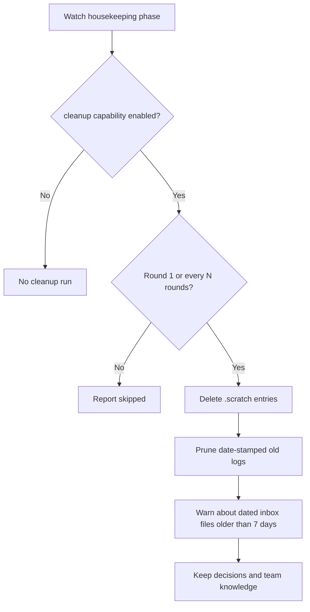
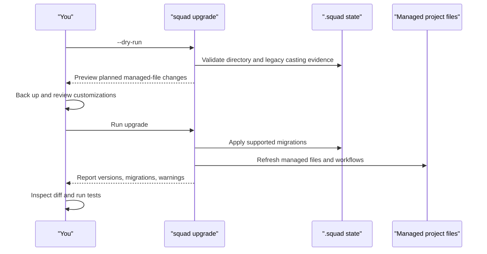

# Chapter 14: Cleanup, Upgrades, and Migration

> **Prerequisites:** Chapters 2 and 4.

## What You'll Learn

- Configure Ralph's cleanup capability and predict exactly which paths it deletes, prunes, or only warns about.
- Separate the self-upgrade of the CLI package from an upgrade of a project's Squad-managed files.
- Identify the files a project upgrade refreshes, the user-owned files it leaves alone, and the customizations that are backed up.
- Use dry-run and version checks without assuming that every upgrade-related operation is non-mutating.
- Plan a safe upgrade and migration for a working Tasktrack squad.
- Migrate an old `.ai-team/` project and recognize when a very old on-disk format requires manual recovery or reinitialization.

> **Preview (Squad 2.0):** Project upgrades can also add or refresh host projections with `squad upgrade --client <list>` (including `all`); `squad init --client <list>` selects them for a new project. To try the preview, switch the CLI to the `insider` channel, then review the project diff and migration guidance in Chapter 22 (Volume 2). See the [2.0 release notes](https://github.com/bradygaster/squad/blob/v2.0.0-preview.2/docs/src/content/docs/whatsnew.md).

## Cleanup Is a Scheduled Housekeeping Capability

Long-lived Ralph processes accumulate disposable scratch files and dated logs. The cleanup capability is intended to keep that operational debris from growing forever while leaving meaningful squad knowledge for humans to curate. Its behavior is narrow: it clears the contents of the scratch directory, removes date-stamped old orchestration and session logs, and reports old decision-inbox files without merging or deleting them.

Cleanup is a watch capability, not a standalone `squad cleanup` command. The source registers it as a `housekeeping` phase capability. As with other capabilities, the watcher only enables it if you opt in through a capability flag or config. For example:

```bash
squad watch --cleanup
```

Or enable it in the watch section of `.squad/config.json`:

```json
{
  "watch": {
    "cleanup": {
      "everyNRounds": 10,
      "maxAgeDays": 30
    }
  }
}
```

The capability checks its configuration on execution. It runs on round 1 so that enabling it gives immediate feedback, then on every configured Nth round. When the configured round interval is not reached, the capability returns a “skipped” summary and does no cleanup. The `--execute` flag enables Ralph's autonomous issue execution; it is not the switch that turns cleanup on.

The two options are positive numbers: `everyNRounds` controls cadence and `maxAgeDays` sets log age. Invalid, missing, non-finite, zero, or negative values fall back to the defaults (10 rounds and 30 days). For example, `{ "everyNRounds": 5, "maxAgeDays": 60 }` checks every fifth round and keeps dated logs for 60 days. Configuring `everyNRounds: 1` runs the capability each round after its special round-one check.

### Exact cleanup scope

| Path under squad state | Action | Rule |
|---|---|---|
| `.scratch/` | Deletes every immediate entry recursively | Scratch content is considered ephemeral; it is not age-filtered |
| `orchestration-log/` | Deletes dated entries | Filename must begin with `YYYY-MM-DD`; date must be older than `maxAgeDays` |
| `log/` | Deletes dated entries | Same filename/date rule; this is the session-log directory in the implementation |
| `decisions/inbox/` | Emits a warning summary only | Considers `.md` files whose filenames begin with a date older than seven days |
| `decisions.md`, agent histories, team/routing config | No cleanup action | These are not in the cleanup capability's target paths |

A filename that does not begin with a parseable date is not classified as old and is left in place. The code uses the date in the filename rather than filesystem modification time. If an old file is pruned, the implementation removes it; it does not move it to `logs/archive/YYYY-MM/` or another archive directory. An inbox warning is a nudge to review and merge the pending decision, not a decision merge.

> **Warning:** The cleanup feature page says old logs are archived and presents `squad logs archive` as a manual option. The v1.1.0 implementation instead deletes matching old entries, and the shipped CLI has no `squad logs archive` handler. Treat the cleanup capability as deletion, keep independent backups of logs you need, and do not infer a recoverable archive from the documentation.



The capability's configured state root can be the resolved Squad state directory, not necessarily a literal `.squad/` folder in the project root. That distinction matters for projects using external or alternate state backends. You can reason about the same target categories while remembering that state resolution determines where the root actually is.

## Two Different Upgrades

The word *upgrade* can refer to the CLI executable installed on your machine or to the Squad files inside one repository. These operations have separate commands and separate effects.

| Operation | Command | What changes |
|---|---|---|
| CLI self-upgrade | `squad upgrade --self` | Installs a newer `@bradygaster/squad-cli` package globally using npm, pnpm, or Yarn |
| Project upgrade | `squad upgrade` | Refreshes the coordinator, managed templates, selected built-in skills, workflows, and applicable migrations in the current repository |
| Preview project upgrade | `squad upgrade --dry-run` | Describes the repository upgrade without applying it (except that separately combined flags can perform work first) |

A new CLI binary does not automatically mean that every repository has been upgraded. Run `squad upgrade` from each project whose managed files should be refreshed. The v1.1.0 implementation of `--self` installs the package and asks you to restart the terminal; on successful self-upgrade it returns before running the project upgrade.

> **Note:** The assigned self-upgrade feature page says the CLI self-upgrade automatically refreshes repository templates. That is not what the v1.1.0 command dispatcher does. It prints a restart instruction and returns. Run `squad upgrade` separately from the project root when you want to update that repository. The documented `--skip-repo-upgrade` example is not an implemented flag in v1.1.0; because self-upgrade does not run a repository upgrade in the first place, there is nothing to skip.

### Self-upgrade and release channels

The package manager choice comes from the current process's `npm_execpath` or `npm_config_user_agent`. If those environment values identify pnpm or Yarn, the CLI selects that manager; otherwise it falls back to npm. This is not a detection based on a lock file in the current directory. The install targets are:

```bash
squad upgrade --self          # @bradygaster/squad-cli@latest
squad upgrade --self --insider # @bradygaster/squad-cli@insider
```

Stable is the ordinary choice. Insider is a prerelease channel for testing; use it only when you want the unreleased build and accept that it can change more rapidly. Self-upgrade runs a global add/install command and may fail if your global package directory is not writable. The CLI reports a failure and exits nonzero rather than claiming success. For permission errors, prefer fixing the package manager's global prefix or using a Node version manager over running an entire tool as root.

`--insider` by itself is not a project-upgrade channel: the CLI warns that it only applies with `--self` and ignores it for a repository upgrade. The `--force` flag bypasses the repository's already-current version shortcut; it is not an alternate package-manager mechanism. The `selfUpgradeCli` options include `force`, but the self-install implementation does not use it to change the package install command.

Do not treat `--dry-run` as a universal dry-run across every combination. The dispatcher performs `--migrate-directory` before invoking the repository dry-run path. It also invokes the self-installer whenever `--self` is present; the self-install function has no dry-run option. Use `squad upgrade --dry-run` by itself to preview the project upgrade. Don't combine it with mutating flags expecting them to be simulated.

## What a Project Upgrade Preserves and Overwrites

The upgrade implementation uses a template manifest to classify shipped files as Squad-owned or user-owned. It also has custom handling for the coordinator, workflows, and Copilot instructions. Read the actual diff; never assume that the word “upgrade” means either “replace the whole `.squad/` directory” or “preserve every edited template.”

### Files it refreshes

A normal project upgrade can refresh the following Squad-owned artifacts from the installed CLI's templates:

- `.github/agents/squad.agent.md`, the coordinator prompt, after substituting version and project-specific information.
- Files listed as managed in the template manifest, including `.squad/templates/` content and selected bundled resources.
- Manifest-listed built-in skills at `.github/skills/`.
- Squad-managed workflow YAML files under `.github/workflows/`.
- `.github/copilot-instructions.md`'s Squad-managed block when the team enables Copilot coding agent support.
- Infrastructure files and missing scaffold items handled by ensure checks.

The manifest is authoritative for the specific built-in file list. Built-in skills are refreshed and a warning is printed if a skill differs from its shipped template; the warning is not a backup. Coordinator and workflow customization receive a `.local-backup` file before replacement if the normalized content differs. The backup has a fixed name and can be overwritten by a later upgrade, so move a backup you need before upgrading again. The dry-run path checks whether the coordinator would need a backup but does not inspect customized workflows for backup warnings.

The Copilot instructions path is special: Squad merges or replaces its marked managed block while preserving user content outside that block. If the file contains only user-authored instructions and no Squad markers, the managed block is appended instead of replacing all content. Newline-only changes are normalized so a different CRLF/LF style alone does not force a rewrite.

### Files that stay yours

The project upgrade does not replace the entire team state directory. In particular, the team's roster/configuration and project knowledge—such as `team.md`, `decisions/`, agent charters, and per-agent `history.md`—are not regenerated from a blank team. User-owned manifest entries, including `routing.md`, `ceremonies.md`, `ralph-instructions.md`, and identity notes, are installed only when missing. A file already present at those destinations is left alone.

Supported legacy casting state is preflighted and migrated before the managed coordinator and template refresh. The migration validates the legacy registry/history evidence instead of guessing identities or historical assignments. If evidence is malformed or ambiguous, the upgrade should stop before overwriting managed files. Keep a backup of the entire `.squad/` state and coordinator before a major upgrade, and review the casting output separately. Do not copy a current roster over historical assignment evidence.

| Category | Typical examples | Upgrade behavior |
|---|---|---|
| User state / knowledge | `team.md`, decisions, agent charters, `history.md` | Preserved; not replaced as a package template |
| User-owned manifest templates | `routing.md`, `ceremonies.md`, `ralph-instructions.md`, identity notes | Create if missing; keep existing files |
| Squad-managed templates | `.squad/templates/*` and manifest-managed defaults | Replaced with current shipped versions |
| Built-in Squad skills | Manifest-listed `.github/skills/*/SKILL.md` | Refreshed; customized versions warned about but not automatically backed up |
| Coordinator / managed workflows | `.github/agents/squad.agent.md`, `.github/workflows/squad-*.yml` | Refreshed; local differences backed up to `.local-backup` |
| Copilot instructions | `.github/copilot-instructions.md` | Squad block updated while user-authored material is retained |

Some generated scaffolding is ensured only when missing. The important distinction is ownership plus destination, not simply whether a file lives under `.squad/`. A custom skill stored alongside Squad's built-in skills may be treated differently from a manifest-listed built-in skill. Check whether the installed version lists it as Squad-managed before making a local customization.

## A Safe Upgrade Scenario

Use the following sequence for the Tasktrack repo after you have completed the prior workflow chapters:

1. **Check the CLI version and working tree.** Record `squad --version` and run `git status --short`. Commit or stash unrelated work so that the upgrade diff is identifiable.
2. **Back up user state and important customizations.** At minimum, make a private backup of `.squad/` and the coordinator. Keep credential caches and webhook secrets outside the repository. A backup can contain private history; store it accordingly.
3. **Preview the project upgrade.** From Tasktrack's repository root, run:

   ```bash
   squad upgrade --dry-run
   ```

   Review the source version and target version, the coordinator check, and the managed-file list. The preview is not a complete custom-workflow audit; inspect edited `.github/workflows/` files yourself.

4. **Apply the CLI update only if you intend to change the global tool.** For example:

   ```bash
   squad upgrade --self
   ```

   Restart the terminal as requested, verify `squad --version`, then return to the Tasktrack root and preview again with the newly installed CLI. This step is optional; upgrading project files with the current CLI is a separate choice.

5. **Apply the repository upgrade.** Run `squad upgrade` and read every warning about local backups, casting migration, or a stale team directory. A successful command is not a substitute for checking the diff.
6. **Review and verify.** Run `git status --short`, inspect the `.squad/`, `.github/agents/`, `.github/skills/`, and `.github/workflows/` changes, confirm user state is intact, and run Tasktrack's tests:

   ```bash
   npm test
   ```

   The Tasktrack sample uses Node's built-in test runner and has no npm dependencies. This step verifies the app remains healthy; it does not validate Teams credentials or the CLI itself.

7. **Commit intentionally.** Stage only the Squad-owned updates and any deliberate user changes. Do not commit token caches, webhook secrets, or private migration archives by accident.

This workflow makes rollback manageable. A migration can change file names, configuration shape, or persistent state in addition to refreshing templates. Have a known-good commit or backup before the first live run, and do not delete the old copy until the migrated project passes its checks.

## Migrations: What They Change

A project upgrade runs version-based migrations after refreshing managed files. The v1.1.0 migration runner contains steps for older format transitions, including:

- Creating `.squad/skills/` for the older v0.2.0 step.
- Creating `.squad/plugins/` for the v0.4.0 step.
- Scrubbing email addresses from Squad state as a privacy migration at v0.5.0.
- Copying legacy `.squad/skills/<name>/` skills into `.copilot/skills/` at v0.9.0, without overwriting an existing destination.

Migrations are selected by the installed version recorded in the coordinator and the CLI's current package version. An “already up to date” project can still run missing migration or ensure logic. A migration may therefore be relevant even when the version label appears current; read the output and the source path it touched.

For supported legacy casting state, the upgrading guide describes a more careful migration than those simple directory steps. It validates old registry and history pairs, preserves original files in a content-hash archive, and refuses to synthesize missing universes, dates, or memberships. Use `squad upgrade --dry-run` as a preflight when a legacy casting migration is involved. If the validation refuses, keep both original files and request recovery based on evidence rather than editing the registry to make the validator pass.

## Migrating from `.ai-team/` and Older Releases

The state directory used to be named `.ai-team/`; current projects use `.squad/`. The v1.1.0 CLI still includes a directory migration path, and normal upgrade detects a legacy directory and prints a deprecation warning. The directory is not automatically renamed just because you installed a new CLI.

For the explicit legacy-directory migration, first back up the repository and then run:

```bash
squad upgrade --migrate-directory
```

The migration refuses if there is no `.ai-team/` directory or if `.squad/` already exists. It renames `.ai-team/` to `.squad/`, rewrites `.ai-team/` references in `.gitignore` and `.gitattributes` if those files exist, scrubs email addresses from migrated state, and moves `.ai-team-templates/` into `.squad/templates/` if present. The upgrade dispatcher then continues into the normal project refresh. Review the complete diff, because the email scrub and rename alter tracked files. The old directory name and new directory name must not both be present: the code avoids guessing which is authoritative.

The migration command also exposes the directory move as `squad migrate --from ai-team`; it performs the same operation and then tells you how to proceed with an SDK-first migration. For projects already on a compatible v0.8.x-or-later format, the published migration guide says that a package update should not require deleting and reinitializing `.squad/`. The CLI package name used by the v1.1.0 self-updater is `@bradygaster/squad-cli`.

A jump from the old v0.5.4 beta format is different. The migration guide describes that on-disk structure as incompatible with current releases. Back up the old directory, initialize a current Squad state structure, and manually bring across only the knowledge you have reviewed—team members, custom charters, decisions, routing, skills, and useful history. Do not copy obsolete templates or casting artifacts blindly into a new structure. The old guides contain examples and package aliases that span multiple releases; confirm a package name or command against your target release before using it.

For a very early `.ai-team/` project, keep the old directory as a backup until `squad doctor` or the available health checks pass on the new state. For a partially upgraded project, do not respond to a warning by deleting `.squad/` and running `squad init` unless you have an independent backup and have decided to rebuild the team state. Reinitialization is a recovery strategy of last resort, not the normal update procedure.



## Hands-On: Upgrade Tasktrack Without Losing Team State

This exercise rehearses a repository upgrade on the Tasktrack project created earlier in the book. If your checkout does not yet contain `.squad/`, initialize and cast it using Chapters 2–4 first; the exercise does not require the memory or skills work in Chapters 15–17.

1. From the Tasktrack repository root, record a clean baseline:

   ```bash
   git status --short
   squad --version
   ```

   Expected result: you know whether there are unrelated changes and which CLI version will author the upgrade.

2. Make a separate backup of `.squad/` and `.github/agents/squad.agent.md`. If either contains private team history, do not place the backup in a public repository.
3. Preview the changes:

   ```bash
   squad upgrade --dry-run
   ```

   Expected result: the CLI describes the coordinator and managed resources it would refresh. It does not show every possible customized-workflow backup, so inspect workflows separately.

4. Apply the repository upgrade:

   ```bash
   squad upgrade
   ```

   Expected result: the coordinator and managed templates are refreshed; your `team.md`, decisions, agent histories, and existing user-owned templates remain. If the CLI reports a built-in skill customization, compare it with your backup because the warning itself does not preserve that edit.

5. Verify the app and repo:

   ```bash
   git status --short
   npm test
   ```

   Expected result: the working-tree diff contains only understood upgrade changes and intentional backups; Tasktrack's Node tests still pass. If any important customization disappeared, recover it from the backup into the correct user-owned location rather than restoring an entire obsolete `.squad/` tree over the migrated one.

6. Optional cleanup configuration: add a `watch.cleanup` object with a small cadence and a conservative log age. Enable it explicitly with `squad watch --cleanup` only when you are ready for a live run. Before doing so, inspect date-stamped files in `.squad/.scratch/`, `.squad/log/`, and `.squad/orchestration-log/`; old matching logs are deleted, not archived.

## Configuration Reference

| Setting / command | Scope | Default or values | Effect |
|---|---|---|---|
| `watch.cleanup` | `.squad/config.json` | Disabled unless configured/enabled | Object-valued capability config; contains the cleanup cadence and age options |
| `watch.cleanup.everyNRounds` | `.squad/config.json` | `10` | Cleanup runs on round 1 and then each Nth round |
| `watch.cleanup.maxAgeDays` | `.squad/config.json` | `30` | Removes date-stamped log entries older than the threshold |
| `--cleanup` | `squad watch` | Opt-in | Enables the cleanup capability for that watch invocation |
| `squad upgrade --self` | CLI package | `@latest` | Installs globally via detected npm/pnpm/Yarn manager; asks you to restart |
| `--insider` | With `--self` | `@insider` | Selects the insider package tag; ignored for project upgrades |
| `--force` | `squad upgrade` | Off | Bypasses the repository's already-current shortcut and refreshes managed resources |
| `--dry-run` | `squad upgrade` | Off | Previews repository file updates and casting preflight; avoid combining with mutating flags |
| `--migrate-directory` | `squad upgrade` | Off | Renames legacy `.ai-team/` to `.squad/`, then continues regular upgrade |
| `--state-backend TYPE` | `squad upgrade` | Backend-specific | Runs project upgrade and then the requested state-backend migration |
| `SQUAD_HOME` | Process environment | Home default | Can change Squad's global data directory; it is also respected by Teams token storage |

## Under the Hood

The command dispatcher for `upgrade` is in `packages/squad-cli/src/cli-entry.ts`. It separates `--self`, `--insider`, `--migrate-directory`, `--dry-run`, and state-backend migration. It handles the directory rename first, attempts self-upgrade when requested, and returns after a successful self-only operation. This dispatch order is the decisive evidence that self-upgrade does not automatically apply a project template update and that a combined dry-run flag does not make every earlier operation harmless.

`packages/squad-cli/src/cli/core/upgrade.ts` implements the repository update. It detects the current squad directory, reads the installed coordinator version, validates legacy casting state, compares versions, and iterates `TEMPLATE_MANIFEST`. The `overwriteOnUpgrade` field documents ownership. Managed files are copied; user-owned files are created only if they do not exist. Workflow files use `writeWorkflowFile()`, which backs up custom content. The coordinator backup compares normalized content after removing the release stamp and generated team-capabilities block so generated differences alone do not look like a manual edit.

The same file contains `selfUpgradeCli()`. It chooses the package manager from process environment, constructs the global package install command, runs it, and throws on failure. `packages/squad-cli/src/cli/core/templates.ts` is the manifest source of truth. `packages/squad-cli/src/cli/core/managed-file.ts` handles newline-preserving writes and the marked merge for `.github/copilot-instructions.md`.

Cleanup is implemented in `packages/squad-cli/src/cli/commands/watch/capabilities/cleanup.ts`; the registry is created in the watch capability barrel, while `watch/index.ts` preflights enabled capabilities and runs the `housekeeping` phase. Its `safeDelete()` calls recursive `rmSync()`. The age helper parses only the date prefix of filenames; no archive move is performed. This detail is why the cleanup page's archive description should not be used as evidence of recoverability.

The legacy `.ai-team/` rename is in `packages/squad-cli/src/cli/core/migrate-directory.ts`; the `--migrate-directory` and self-upgrade control flow is in `cli-entry.ts`. Version migrations such as directory scaffolding, email scrubbing, and old skill copying live in `packages/squad-cli/src/cli/core/migrations.ts`. These are different from the rename operation and from the casting-state migration performed before a managed upgrade.

## Pitfalls and Troubleshooting

- **I upgraded the CLI but this repo still has old templates.** Self-upgrade changes the global package only. Run `squad upgrade` from the repository root as a separate step.
- **A customization vanished.** Check the `.local-backup` beside the coordinator or workflow. Built-in skill differences are warned about but not automatically backed up; use version control or your own backup to restore them.
- **The dry run says one thing but the workflow changed.** The preview does not report every workflow customization. Inspect `.github/workflows/` and local backups yourself.
- **An “already current” project still changed.** Upgrade can still run missing migrations and ensure checks and can refresh managed files even when the version stamp matches.
- **Cleanup removed a log I wanted.** The code prunes dated files rather than archiving them. Restore from version control or an independent backup, and reduce or disable cleanup until you have a retention plan.
- **Cleanup did not run.** It is opt-in. Enable the capability with `--cleanup` or configure `watch.cleanup`; `--execute` alone is not the switch.
- **A log file was not pruned despite being old.** It may lack a `YYYY-MM-DD` filename prefix, or its filename date may be newer than the age threshold. Modification time alone is not used.
- **`squad upgrade --migrate-directory` refuses.** It needs `.ai-team/` and refuses if `.squad/` already exists. Back up and resolve the two-directory state rather than renaming over either one.
- **An old casting migration is refused.** Do not invent missing IDs, universes, timestamps, or assignment membership. Preserve originals and recover evidence from the version that created them.
- **An old v0.5.4 state is not accepted.** Treat it as a format migration, not a routine in-place template update. Preserve a backup, initialize current state, and manually migrate reviewed knowledge.
- **`--dry-run` was combined with other options.** The rename and self-install paths occur before the project preview; rerun only the standalone dry-run after recovering from any accidental operation.

## Summary

- Cleanup is an opt-in Ralph housekeeping capability, with narrowly defined targets and date-based deletion rules.
- Old matching logs are pruned, not archived; stale inbox files only trigger warnings.
- `squad upgrade --self` updates the global CLI package. `squad upgrade` separately refreshes one repository.
- Project upgrades preserve team knowledge and existing user-owned files, but refresh managed templates, built-in skills, coordinator, workflows, and eligible migration artifacts.
- Coordinator and workflow customizations get fixed-path backups; customized built-in skills are warned about but not automatically backed up.
- Use a standalone dry run, back up important state, inspect the diff, test Tasktrack, and only then commit.
- Old `.ai-team/` projects need an explicit migration. Very old incompatible state should be backed up and migrated deliberately, not deleted casually.

## Exercises

1. Configure cleanup to run every four watch rounds and retain dated logs for 45 days. Where does the object belong, and which explicit capability switch enables it?
2. A developer edits a built-in skill under `.github/skills/` and runs `squad upgrade`. What protection should they expect, and what should they do before the upgrade?
3. Explain why `squad upgrade --self` and `squad upgrade` are separate operations. Which one should you run to refresh the current Tasktrack repo?
4. A log has been on disk for 90 days but is named `watch-latest.md`. Why might cleanup keep it? What happens to a dated inbox file older than seven days?
5. A project has both `.ai-team/` and `.squad/`. What does the migration command do, and what should you do before trying to resolve the conflict?

## Quiz

1. Is cleanup enabled by default for a fresh `squad watch` with no capability configuration?
2. Does cleanup archive old logs under `.squad/logs/archive/` in v1.1.0?
3. What determines whether an entry in `.squad/log/` is old enough for pruning?
4. Does successful `squad upgrade --self` also run `squad upgrade` in the current repo?
5. Which areas are refreshed by a repository upgrade: team histories or manifest-listed Squad-owned templates?
6. Are customized built-in skills backed up automatically when overwritten?
7. What two conditions make `squad upgrade --migrate-directory` refuse to rename?
8. Why is a standalone `squad upgrade --dry-run` safer than combining it with `--migrate-directory` or `--self`?

## Further Reading

- [Cleanup Watch](https://bradygaster.github.io/squad/docs/features/cleanup/)
- [Self Upgrade](https://bradygaster.github.io/squad/docs/features/self-upgrade/)
- [Migration Guide](https://bradygaster.github.io/squad/docs/get-started/migration/)
- [Upgrading Squad](https://bradygaster.github.io/squad/docs/scenarios/upgrading/)
