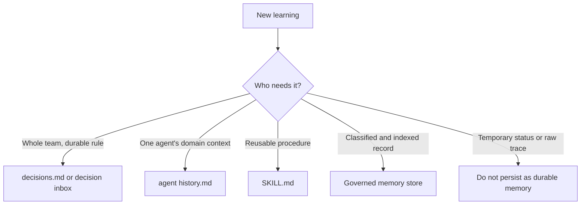
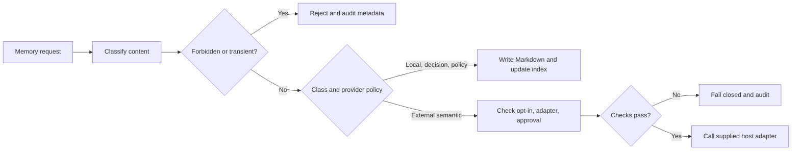

# Chapter 15: Memory and Knowledge

> **Prerequisites:** Chapter 4.

## What You'll Learn

- Separate shared decisions, agent-specific history, reusable skills, and governed memory records by purpose and audience.
- Record a decision so it survives parallel work, remains reviewable, and does not become an unstructured transcript dump.
- Interpret the proposed Squad Entry Markdown (SEM) format without mistaking it for the memory-file format that Squad v1.1.0 actually writes.
- Use the SDK's `LocalMemoryStore` concepts—classification, storage, search, promotion, deletion, and audit—without assuming that every provider is available.
- Decide what should be committed, archived, summarized, or kept out of memory entirely.

## Knowledge Is a Team Asset

A conversation is temporary working context. Team memory is the smaller set of facts that future work can rely on: a design choice, a coding convention, a known pitfall, or a constraint that would otherwise be rediscovered. The goal is not to preserve every message. It is to preserve the right lesson in a form that the right agent can find and safely act on.

Squad uses several distinct places to hold knowledge. They overlap in the broad sense that they all inform future work, but they have different owners and lifetimes:

| Artifact | Audience | Best for | Typical lifetime |
|---|---|---|---|
| `.squad/decisions.md` | The whole team | Current shared policies, architecture choices, and project conventions | Long-lived; active entries stay prominent |
| `.squad/decisions/inbox/` | Scribe or the configured merger | Candidate decisions arriving from parallel work | Until reviewed and consolidated |
| `.squad/agents/{name}/history.md` | The named agent | Domain-specific facts and learnings from work | Persistent, with older material summarized or archived |
| Skills | Any agent that needs a reusable technique | Repeatable procedures and patterns | Reusable across tasks and potentially across repositories |
| `.squad/memory/` governed records | Local memory tooling and its callers | Classified, indexed facts with audit metadata | Managed according to class and load guidance |
| Session logs and checkpoints | Workflow recovery or audit | What happened during one run | Operational, not the canonical source of policy |

A useful test is to ask, “Who needs this, and what decision will it help them make?” If all agents need an enduring rule, record a decision. If one specialist learned a file path or system quirk, record it in that agent's history. If the knowledge is a repeatable how-to, turn it into a skill. If the work needs a classified, indexed record, use governed memory. If the information is just a momentary progress update, leave it in the current workflow or log rather than making it permanent.



The layers complement rather than replace one another. A team decision can describe the “what” and “why”; an agent history can preserve the local detail needed to apply it; a skill can express a repeatable process. Do not copy the same wall of text into every file. Put the authoritative statement in one place and link to it or summarize the relevant implication elsewhere.

## The Shared Brain: `decisions.md`

The shared decision file is the team’s current source for agreements that should shape future tasks. Every agent should be able to consult it before acting. Good entries are specific enough to apply and include enough rationale to make sense after the original discussion is gone.

For Tasktrack, “use TypeScript” is too broad to be useful if the codebase already establishes that. A better decision might be: “Keep the API dependency-free and use Node’s built-in `node:test` runner, because the project deliberately demonstrates a zero-dependency service.” That statement guides later package and test choices, and its rationale explains why adding a convenience library is not a neutral change.

Parallel workers should not all rewrite the same canonical file at once. They can propose additions through the inbox, for example:

```text
.squad/decisions/inbox/backend-api-boundary.md
.squad/decisions/inbox/test-runner-choice.md
```

The merger—commonly Scribe—reviews those proposals, removes duplicate or contradictory text, and updates the canonical decisions file. The inbox is a staging area, not a second canonical policy file. A proposal should identify the decision, who is proposing it, and why; if the team has a local decision format, follow that format. Avoid inventing multiple competing edits to `decisions.md` during parallel execution.

### Decisions, directives, and facts

A decision is an agreement the team reached. A directive is a human-stated rule, often signaled by wording such as “always,” “never,” or “from now on.” A fact is information about the project that may be useful but does not itself tell the agent what to do. Distinguishing them prevents an observation from silently turning into a binding policy.

For example:

- **Fact:** Tasktrack’s API listens on port 3000 by default.
- **Decision:** Keep the API on `node:http` and avoid runtime dependencies.
- **Directive:** Never commit a real credential to a tracked file.

When a new decision supersedes an old one, make the transition explicit. Do not leave both rules active and force the next agent to guess. A concise history note or archived entry can explain what changed and when.

### Keep active decisions active

A decision file can become noisy as a project accumulates completed-sprint notes, temporary experiments, and obsolete constraints. Archive or summarize old material while preserving the active rules. An archive is useful for provenance, but it should not be treated as the current instruction set. If a reader has to read hundreds of historical paragraphs to discover today’s rule, the knowledge architecture has failed even if no information was technically lost.

The stable version’s `squad nap` can merge files from `decisions/inbox/` into `decisions.md` and archive stale entries when the decision file passes its internal threshold. Treat this as a maintenance tool, not as a substitute for review: automatic consolidation cannot decide whether a policy is still true for your product. The details of the maintenance process are in Chapter 16.

## Individual Memory: Agent History

Each agent has a history file under `.squad/agents/{name}/history.md`. This is the place for knowledge that benefits the agent in its own area: a service boundary, a tricky test setup, a location of a configuration source, or a repeated failure mode. If one Tasktrack backend specialist discovers that status validation belongs in the API layer and tests expect `400` for invalid statuses, that can help that agent implement the next endpoint correctly.

History is not a complete session transcript. Capture durable lessons, not every command, every line changed, or a status report that will be stale tomorrow. A useful note states the symptom or context, the result learned, and any verification that gives the result confidence. Preserve file paths and concrete examples where those improve actionability; omit content that cannot safely be shared with the repository.

The owner boundary matters. Personal history is not automatically a team-wide decision. It helps the named agent build continuity, but an important cross-cutting convention should be proposed for the shared decisions file or converted into a skill. Conversely, do not fill the shared decisions file with every detail known by every specialist. That increases the prompt load for all agents and obscures the decisions that matter to the whole team.

### Summaries and archive files

Long histories consume context on each spawn. The memory-and-knowledge documentation describes progressive summarization: keep recent and useful details readable, and compress older entries while preserving the important points in an archive. The actual `squad nap` implementation uses a 15 KiB history threshold and keeps the most recent five `##` sections normally, or three in deep mode, appending older sections to a sibling `history-archive.md`. This is a byte-and-section rule, not a semantic guarantee that the “best” lessons will always be selected. Review the result when the history includes important details.

This explains why you should write history notes with headings and focused units. A compacted file can preserve discrete sections more reliably than an undifferentiated narrative. See Chapter 16 for thresholds, dry runs, and recovery considerations.

## A Format Proposal Is Not a Runtime Contract

The repository includes an internal draft called **Squad Entry Markdown (SEM)**. It proposes a consistent entry envelope for decisions, memories, notes, and directives: a timestamped `###` header, structured fields such as type, author, scope, tags, summary, details, rationale, related references, and a `---` terminator. The draft also describes a legacy format, a migration strategy, validation rules, and a TypeScript parsing sketch.

Use the proposal as a design reference when authoring structured Markdown, but do not assume Squad v1.1.0 strictly parses or validates all of it. It is marked draft in `docs/_internal/specs/memory-format.md`. In particular, its `squad convert-memory` example and `.ai-team/skills/squad-memory-format/SKILL.md` reference are not confirmed as supported v1.1.0 CLI features. The stable CLI help exposes governed `squad memory` operations, but not a `convert-memory` command. The source’s governed store writes YAML-frontmatter Markdown files with a different schema; it does not call the SEM parser.

A SEM-style decision entry might look like this:

```markdown
### 2026-10-27T09:30:00-0400: decision: Keep Tasktrack's API dependency-free

**type:** decision
**timestamp:** 2026-10-27T09:30:00-0400
**author:** Backend
**scope:** team
**tags:** tasktrack, api, dependencies

**summary:** Keep the API on Node built-ins and avoid runtime dependencies.

**details:**

Use `node:http` for HTTP handling and Node's built-in test runner.

**rationale:**

The sample is intentionally zero-dependency and runs directly on Node 22.18+.

---
```

The fields are useful because they answer different questions. `type` classifies the entry. `timestamp` supports chronology and auditing. `author` makes provenance visible. `scope` distinguishes team-wide from personal or project context. `tags` improve scanability. `summary` gives the reader a fast index. `details` carries the substance; `rationale` records the why. `related`, `supersedes`, and `expires` can connect decisions and flag review dates. The draft asks for a concise summary (up to 120 characters) and an ISO-8601 timestamp with timezone. These are specification requirements of the draft, not guarantees enforced by the stable runtime.

### Practical compatibility rules

1. Follow the project’s existing format where one exists; don’t introduce SEM into a file that a tool expects in another shape without checking compatibility.
2. Keep content human-readable even when it has metadata. The metadata helps tools; clear Markdown helps people.
3. Record an explicit rationale for consequential decisions.
4. Use a timezone-bearing timestamp when you choose to use SEM.
5. Keep the entry terminator between adjacent entries if using the draft format.
6. Treat type, scope, supersession, and expiration as data that requires careful review, not decoration.

The memory-format draft says parsers should handle both SEM and a legacy format during migration and describes regexes for entry detection and field extraction. It is a useful model for defensive parsing: delimiters should be clear, unknown fields should not corrupt neighboring records, and migration should preserve ambiguous entries for human review. Again, do not mistake its sample code for shipped production implementation.

## Governed Memory in the SDK

The v1.1.0 SDK includes a governed local memory module in `packages/squad-sdk/src/memory/index.ts`, re-exported from the SDK public entry point. The `LocalMemoryStore` is distinct from the conversational files above. It classifies content before persistence, stores an index and audit record, and makes decisions about the memory’s class and load guidance.

### Classes and load guidance

The SDK defines six memory classes:

| Class | Intended use | Default load guidance | Durable write? |
|---|---|---|---|
| `LOCAL` | Project-local fact or learning | `ON-DEMAND` | Yes |
| `DECISION` | Candidate shared decision | `ALWAYS` | Yes; written to decision inbox |
| `POLICY` | Candidate rule or directive | `ALWAYS` | Yes; written to policy inbox |
| `COPILOT_MEMORY` | Explicitly opted-in external semantic memory | `ON-DEMAND` | Conditional on provider configuration and approval |
| `TRANSIENT` | Temporary state such as current CI/PR status | `NEVER` | No |
| `FORBIDDEN` | Secrets, sensitive or disallowed content | `NEVER` | No |

The other guidance labels are `ARCHIVE`, for entries that should remain in history but not be actively loaded, and `NEVER`, for material that must not be loaded or persisted. An explicit valid `loadGuidance` metadata value can override the ordinary class default in the SDK request. For example, archived content may remain addressable in an index without being active context.

Classification can be requested directly or inferred from simple text patterns. The inference is deliberately mechanical, not a semantic safety oracle: phrases that resemble CI/PR/build status map to transient; an opening “always,” “never,” “must,” or “do not” maps to policy; words such as “decision,” “adopt,” or “standardize” can map to decision; other content defaults to local. The store checks a list of forbidden patterns first, including common token/key forms, credential-like assignments, some connection-string and PII patterns, internal network ranges, raw diagnostic payloads, and certain customer-data or vulnerability phrases. A pattern matcher can miss a secret or flag a benign phrase. Use it as a guardrail, not permission to store anything that “passed.”



### Local files, index, and audit

The default local provider is `local`. It initializes `.squad/memory/config.json`, `index.json`, `audit.jsonl`, and directories for `local`, `policy-inbox`, `semantic-inbox`, and `tombstones`. `LOCAL` entries go under `.squad/memory/local/`; `DECISION` entries go to `.squad/decisions/inbox/`; `POLICY` entries go under `.squad/memory/policy-inbox/`. The `semantic-inbox` directory exists in the default structure, but do not infer an automatic approval or merge mechanism from its name.

Each generated entry has YAML frontmatter containing an id, class, load guidance, title, author, timestamp, and metadata, followed by its content. A JSON index tracks active, deleted, and superseded entries, along with paths and forward/backward replacement links. The append-only JSONL audit records operations and safe metadata—such as the action, class, title, actor, path, provider, and reason—but is configured not to store memory content. Audit rotation is bounded by the governance configuration.

`write()` classifies first. Forbidden and transient requests return `stored: false` and an explanation, rather than silently persisting. A normal local write creates a UUID, writes the Markdown file, updates the index, and audits the result. The SDK serializes index read/modify/write operations within one store instance and writes a temporary index file before renaming it into place. It does not claim a cross-process locking protocol, so do not design multiple independent writers to race on the same state directory without additional coordination.

`search(query)` is local substring matching over the title and file content, returning a short matching line as a snippet; it is not an embedding search. It also checks configured provider results and merges them, but external provider availability depends on the injected implementation. Results omit non-active entries. A search query classified as forbidden is rejected. For debugging, audit output tells you that the operation was attempted without needing to print raw memory or search text.

`promote(id, targetClass)` creates a new entry using the old content and a new classification, then marks the previous index entry `superseded` with `ARCHIVE` load guidance and a `supersededBy` link. Promotion is not an in-place class edit. The SDK’s `delete(id)` writes a tombstone before removing local content and marks the index entry deleted; this makes deletion intent recoverable if the final filesystem operation fails. Review tombstones and audit records as part of your data lifecycle, especially if state is shared or backed up.

### External provider reality check

The `COPILOT_MEMORY` class is not the same thing as a working native Copilot Memory API. The v1.1.0 implementation explicitly reports native provider `copilot` as unavailable because it has no concrete callable client in the installed tooling. It does not fake remote storage. A `hostInjectedCopilotAdapter` can wrap a client supplied by a host, but it must be enabled and, by default, memory writes require explicit approval. Without an injected client, adapter calls fail closed. Registered SDK providers can implement the provider interface for their supported classes, but they receive content only after governance classification; forbidden and transient content is filtered upstream.

This distinction matters operationally. Setting `defaultProvider` to `copilot` or mentioning “semantic memory” does not create remote persistence. Run `squad memory provider` to inspect status. Do not copy secrets into memory on the assumption that an external provider will protect them. The current local policy intentionally keeps audit content off and rejects known high-risk patterns, but local markdown still has the same repository access and backup exposure as other files.

## Hands-On: Record Tasktrack's API Decision

This exercise uses the companion project at `sample/`. Work on the copy you created in the earlier chapters, not the book repository’s baseline. The objective is to get one practical convention into shared memory and one specialist learning into agent history without pretending that the draft SEM proposal is automatically enforced.

1. Start the existing project and inspect the API behavior:

   ```bash
   cd ~/tasktrack
   npm test
   ```

   Expected result: Node’s test runner completes the Tasktrack API tests successfully. The API is TypeScript on `node:http`; no package installation is required.

2. In your Squad session, ask the coordinator to record this team decision: “Keep the Tasktrack API dependency-free; preserve `node:http` and `node:test` unless we explicitly revisit that design.” Include the rationale that the sample is intended to run on Node 22.18+ without runtime dependencies.

3. Ask the backend agent to add a concise history note about the API’s current contract: `GET /health`, `GET/POST /tasks`, and `PATCH/DELETE /tasks/:id`; invalid status values are rejected with HTTP 400. Ask it to cite or verify the source files before recording the detail.

4. Review the changed files. Confirm the shared decision is in the decisions file (or was staged in the team’s decision inbox) and the implementation detail is in the backend specialist’s own history. If Squad uses an inbox-merging workflow, allow the responsible Scribe or merger to consolidate it rather than editing the same canonical file in parallel.

5. Inspect the diff and run the test suite again:

   ```bash
   git diff -- .squad
   npm test
   ```

   Expected result: the decision and history change are narrow Markdown edits, the API files are unchanged, and tests still pass. Commit only the intentional state files your project’s team policy expects to track.

The exercise is complete when a new backend task can find both the durable team-level constraint and the agent-specific details without replaying the initial setup conversation. Tag your own checkpoint `ch15-end` if you are following the book’s companion-project convention.

> **Tip:** In a CLI project where you need structured, searchable memory instead of conversational file conventions, explore `squad memory classify`, then write a safe test record with `squad memory write`. Start with non-sensitive text and inspect `squad memory audit`; do not store credentials just to test the classifier.

## Configuration Reference

| Path or option | Purpose | v1.1.0 behavior |
|---|---|---|
| `.squad/decisions.md` | Current team-wide decisions and policies | Human-readable shared source; agents consult it |
| `.squad/decisions/inbox/` | Candidate decisions | `squad nap` merges ordinary files here into `decisions.md` |
| `.squad/agents/{name}/history.md` | Agent-specific history | Subject to `squad nap` history compression |
| `.squad/memory/config.json` | Governed memory defaults and policy | Created lazily with local provider defaults |
| `.squad/memory/index.json` | Memory metadata index | Active/deleted/superseded state; do not hand-edit casually |
| `.squad/memory/audit.jsonl` | Audit trail | Metadata only; rotated according to configured limits |
| `.squad/memory/local/` | Local entries | Default home for `LOCAL` class |
| `.squad/memory/policy-inbox/` | Policy candidates | Default home for `POLICY` class |
| `squad memory classify <text>` | Classify a candidate | Returns class, allowed state, reason, destination, load guidance |
| `squad memory write --content <text> [--class CLASS]` | Store a candidate | Supports classes such as `LOCAL`, `DECISION`, `POLICY`; denied content is not stored |
| `squad memory search --query <text>` | Search indexed records | Local substring search; returns JSON results |
| `squad memory promote <id> --class CLASS` | Promote an active record | Creates successor and archives prior entry in index |
| `squad memory delete <id>` | Delete by id | Writes a tombstone; external deletion requires the supplied adapter |
| `squad memory audit` | Read audit records | Prints JSONL records as JSON |
| `squad memory provider` | Inspect provider state | Native `copilot` is unavailable; host adapter is optional |
| `--log-level none\|error\|info\|debug`, `--verbose` | Memory diagnostics | Explicit option overrides `SQUAD_MEMORY_LOG_LEVEL`, then `.squad/config.json` `memory.logLevel`, then `none` |

The CLI help may show only the common `write`, `search`, and `provider` forms; the command implementation supports additional operations. Confirm the exact syntax in the installed release before relying on an example in automation.

## Under the Hood

The principal runtime implementation is `packages/squad-sdk/src/memory/index.ts`. The SDK’s public barrel re-exports the memory module. Its core governance types are deliberately explicit:

```ts
export type MemoryClass =
  | 'TRANSIENT' | 'LOCAL' | 'DECISION' | 'POLICY'
  | 'COPILOT_MEMORY' | 'FORBIDDEN';

export type MemoryLoadGuidance = 'ALWAYS' | 'ON-DEMAND' | 'ARCHIVE' | 'NEVER';
```

The key architectural guarantee is ordering: classify before routing to a provider. The store’s text rules are not a complete DLP system, but the code structure ensures a request classified as forbidden or transient does not proceed to a normal durable write. External semantic writes have additional gates: the selected provider must be valid, the adapter enabled, and approval present when required.

The store writes to separate destinations for decision, policy, and ordinary local classes. It tracks history in `index.json`; when it updates the index, it serializes operations within the store instance and writes to a `.tmp` sibling before rename. The `memory` CLI in `packages/squad-cli/src/cli/commands/memory.ts` provides command-line access, parses the requested class and load guidance, prints structured results, and supports diagnostic levels. Its diagnostics intentionally avoid outputting raw content or search terms.

The draft SEM format is in `docs/_internal/specs/memory-format.md`; it is a separate document from this runtime code. For shared decisions and history, templates and coordinator instructions—not a universal semantic search engine—remain the main memory path. The companion chapters on skills and context hygiene show how to organize and maintain that knowledge.

## Pitfalls and Troubleshooting

- **Putting every note in `decisions.md`:** this makes shared instructions noisy. Keep agent-local detail in history and reusable processes in skills.
- **Treating a decision inbox as permanent policy:** inbox entries are proposals until merged and checked for conflicts.
- **Writing vague histories:** “worked on API” will not help the next task. Record the observed contract, source path, and caveat.
- **Treating SEM as a shipped validator:** SEM is a draft spec. It does not mean every v1.1.0 decision file conforms or that `convert-memory` exists.
- **Assuming the text classifier understands intent:** the SDK uses patterns and defaults. Classification can be incomplete or conservative; review sensitive records yourself.
- **Persisting transient build status:** status expires quickly. The SDK classifies common CI/PR/build status text as transient and rejects durable storage.
- **Assuming search is semantic:** local search is case-insensitive substring matching, not vector retrieval.
- **Assuming `copilot` means cloud storage:** native Copilot Memory is unavailable in this release. The host-injected adapter is a separate opt-in interface.
- **Deleting files by hand but leaving the index:** the store may continue to list metadata for missing content. Use governed deletion where applicable and preserve the tombstone/audit trail.
- **Committing secrets because state is “private”:** a repository, worktree, backup, or export can expose state. Never store real credentials, customer PII, or raw sensitive diagnostics.
- **Letting two writers race:** the SDK lock protects operations within one store instance; use a coordinated write path when multiple processes share the same index.

## Summary

Durable team knowledge should be intentionally placed. `decisions.md` carries shared agreements; its inbox is a proposal channel. `history.md` gives an agent continuity in its own domain. Skills hold reusable procedures. Governed memory adds classification, indexing, auditing, and provider gates for records that need those capabilities. The SEM draft provides a useful structured Markdown design, but it is not the runtime serialization contract in Squad v1.1.0. Choose the smallest artifact that gives the next agent the right context, verify it, and keep sensitive or short-lived data out.

## Exercises

1. **Classify the knowledge.** For each item—an API style rule, a backend agent’s discovery about a status code, a repeatable release procedure, and this afternoon’s test failure—choose the best memory destination and explain why.
2. **Draft a decision.** Write a short team decision for Tasktrack that records the dependency-free API constraint. Include its rationale and identify one decision it supersedes, if applicable.
3. **Review a history note.** Rewrite “The API is weird; PATCH failed” as an actionable, evidence-based note for the backend agent. Include the relevant endpoint behavior and where to verify it.
4. **Read the SEM proposal critically.** Identify four useful SEM fields, then state why a v1.1.0 reader must not assume the runtime enforces them.
5. **Reason about governed memory.** Predict whether these requests should be persisted: a safe local fact, a user directive, a CI status line, and an API token embedded in text. Name the likely classes and outcomes.

## Quiz

1. Which file is the canonical shared location for active team decisions?
2. Why should an inbox proposal not automatically be treated as an active decision?
3. What is the principal audience of `.squad/agents/{name}/history.md`?
4. Is the SEM proposal the YAML-frontmatter format emitted by the v1.1.0 `LocalMemoryStore`?
5. What does `ON-DEMAND` mean in governed memory load guidance?
6. Does the SDK’s local search perform embedding-based semantic retrieval?
7. Can a project enable native `provider=copilot` persistence merely by setting a config value?

## Further Reading

- [Memory format proposal](https://github.com/bradygaster/squad/blob/v1.1.0/docs/_internal/specs/memory-format.md)
- [Memory and knowledge](https://bradygaster.github.io/squad/docs/concepts/memory-and-knowledge/)
- [Memory system](https://bradygaster.github.io/squad/docs/features/memory/)
