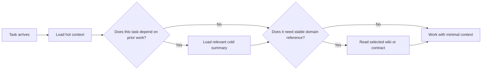
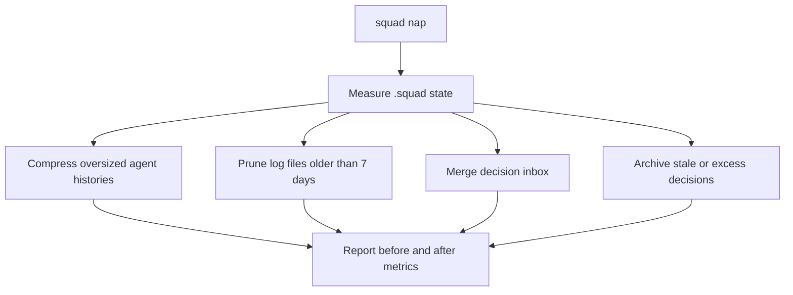

# Chapter 16: Tiered Memory, Reflect, and Context Hygiene

> **Prerequisites:** Chapter 15.

## What You'll Learn

- Use hot, cold, and wiki as a design model for deciding how much history a task should load, while recognizing that the model is advisory in Squad v1.1.0.
- Capture corrections, successes, and edge cases through `reflect` without turning every exchange into permanent policy.
- Run `squad nap` safely: preview changes, understand what is compacted or pruned, and inspect the results before committing.
- Distinguish compaction of persisted team files from loss of conversation context, and separate documented recovery intent from shipped behavior.
- Build a practical context-hygiene routine that protects important knowledge while keeping each new task focused.

## Why Context Hygiene Matters

Long-lived teams accumulate more than useful knowledge. They also accumulate repeated explanations, completed task records, obsolete experiments, stale logs, and decisions that no longer apply. If all of that is loaded every time an agent starts, useful knowledge becomes harder to find and the context budget is spent on the past instead of the task.

Context hygiene is the deliberate reduction and organization of what future work must read. It does not mean “delete anything old.” The goal is to preserve durable truths while reducing the active context. That usually means summarizing detailed history, archiving decisions that are no longer active, and only loading prior-session information when the current task depends on it.

Two different operations are often confused:

| Operation | What changes | What it does not do |
|---|---|---|
| Model context compaction | The active conversation is summarized or shortened to fit a context window | It does not automatically rewrite `.squad/` files |
| `squad nap` | Durable files under `.squad/` may be compressed, pruned, merged, or archived | It does not control the model’s context window or guarantee recovery of a lost conversation |

Closing a terminal is neither operation: it just ends the process. You need to explicitly manage persistent files, and you need a separate recovery plan for interrupted orchestration.

## Tiered Memory: A Useful Loading Policy

The tiered-memory model describes three categories of knowledge by freshness, stability, and retrieval cost. It is intended to lower the amount of irrelevant history included in each agent spawn. Use it as a decision framework even when your runtime has not automated the file layout.

### Hot: the task at hand

Hot memory is the short-lived context that should accompany every task: what the agent is doing now, immediate blockers, the last few actions, decisions already made during the current session, and who is coordinating with whom. Keep it small and current. Hot context is not a permanent transcript and should not become an ever-growing second history file.

For example, during a Tasktrack feature, hot context could state: “Add due dates to tasks. Preserve current `node:http` API structure. Backend owns `api/`; the UI agent owns `web/`. The API tests currently pass. Next: update the task store and add regression coverage.” That is enough to orient work without copying every earlier prompt.

### Cold: summarized history on demand

Cold memory is a concise summary of prior sessions: decisions already tried, recurring bugs, abandoned approaches, and unresolved items. It should be loaded when the current request depends on prior work—resuming an interrupted task, debugging a recurrence, or asking “what did we try before?”—not by default for unrelated changes.

The tiered-memory skill proposes a rolling time window (30 days in its example) and approximate size targets, but those are design guidance, not enforced v1.1.0 limits. Your team should make summaries useful before adding a timer. A short, accurate summary beats a rigid token target.

### Wiki: durable, structured reference

Wiki is a model for authoritative and relatively stable reference: architecture decision records, API contracts, platform constraints, and durable conventions. Wiki is not a session narrative. It is read selectively when the task enters the relevant domain. Its content should have a named owner and clear review/deprecation process, because an outdated reference can be more harmful than missing context.



### Status in Squad v1.1.0

The repository’s `templates/skills/tiered-memory/SKILL.md` labels tiered memory as a design proposal, not a shipped runtime. Its status note says the tier directories, Scribe promotion process, and tier-aware spawn flags are not implemented. In v1.1.0, agents still read the existing history and decision artifacts according to their normal instructions. There is no supported `--include-cold` or `--include-wiki` flag in the CLI help, and no `squad wiki list` command. The sample directory names and size targets in that skill are examples of a possible system—not a promise that `squad init` creates them.

This boundary is important: a design can be useful today without being a feature you can execute. You can manually organize notes into current files, but do not write automation that depends on tier switches until the runtime contract exists. If Squad later ships the feature, verify the paths and flags for that release and migrate intentionally.

## Reflect: Learn from Inflection Points

The `reflect` skill turns consequential feedback into a candidate learning. Its purpose is to interrupt repetition: if a user corrects a bad assumption, or if work reveals a subtle edge case, capture enough context to avoid making the same mistake later. It is not a transcript logger and it is not a license to rewrite policy files without review.

### Confidence levels and triggers

The skill sorts signals by confidence:

| Confidence | Common signal | Appropriate response |
|---|---|---|
| **HIGH** | Explicit correction, strong directive, important architectural insight, or root-cause fix | Capture promptly and preserve the user’s exact correction where relevant |
| **MEDIUM** | Repeated preference, explicit praise, or a meaningful edge case | Wait for enough evidence, then propose a durable learning |
| **LOW** | A workflow or style pattern noticed over time | Mention at a natural review point; do not promote a single weak signal into policy |

Confidence describes evidence for the learning, not the person or team. A single “perfect” might reflect the current task rather than a universal rule. A direct “no, don’t merge without approval” is clearer evidence of a rule, but you still need to route the resulting change through the appropriate persistence and approval path.

The reflect template’s process has four conceptual steps: identify the right target, inspect the conversation for an actual learning signal, propose a precise statement with its source and confidence, and persist only after the required approval. It distinguishes runtime observations from tracked behavior changes. If a runtime memory tool is available, a safe observation can be captured there. If behavior must change in an agent prompt, skill, or other tracked source, the accountable owner should update that source through a focused change. If no persistence tool exists, report the learning rather than claiming it was saved.

### Do not over-capture

The feature page warns against reflecting on every interaction. A rough ceiling of one capture per ten messages is a useful brake, not a target. Do not capture a user instruction you already followed correctly; that is logging, not learning. Do not convert an unverified guess into an “always” directive. A correction should be captured accurately and with context, while praise should be interpreted as evidence that a specific outcome worked—not necessarily that every step should be repeated.

A strong reflection might say:

```text
[HIGH] Avoid editing the shared Tasktrack decision file from parallel agents.
Source: “Please route proposals through the inbox; two direct edits conflicted.”
Target: team workflow decision, after owner review.
Evidence: the two concurrent edits conflicted in this session.
```

This says what happened, why it matters, and where the learning might belong. It does not claim that it has already been saved. The reflection skill changes across its docs and templates: the current template requires reviewing proposals and user approval before persistence and forbids using throwaway inbox files to bypass the tracked-source process. Respect the installed skill and the project’s actual approval workflow rather than assuming every mention of “reflect” should create a file.

### Budget the prompt, not just the files

Tiering is a retrieval policy, not an instruction to make every file tiny. The useful unit is the context the next task actually receives. A concise project-wide decision file can be worth loading often; a long archived transcript may be valuable once per incident. Avoid optimizing raw bytes without considering quality: deleting a short but essential contract saves little, while a targeted reference can prevent several agents from making the same costly mistake.

For a real team, write down a simple read policy before adding folders: which files every agent must inspect, which are loaded only for a named domain, how a historical summary is requested, who owns updates, and how stale reference material is deprecated. Keep this policy close to the coordinator instructions or team guide. When adding a wiki-like document, use a stable title and link it from the place where an agent will look; an unindexed folder is not discoverable merely because it exists.

A useful context audit asks three questions about each paragraph: would an agent act differently because of this, can the claim be verified in the repository, and is this the right audience? If the answer to the first is no, it may be noise. If the second is no, mark the uncertainty rather than strengthening the claim. If the third is no, move it to the narrower history or reference page. The audit is a human judgment that sits above deterministic cleanup tools.

## `squad nap`: File-Level Context Hygiene

Squad v1.1.0 provides `squad nap`, a deterministic maintenance pass over selected `.squad/` artifacts. Its CLI supports:

```bash
squad nap --dry-run
squad nap
squad nap --deep
```

The first command estimates proposed actions without changing the state files. The ordinary run performs configured default cleanup. `--deep` uses a stricter history-section retention count. The command reports bytes and an approximate token estimate; the estimate uses roughly 250 tokens per KiB and should not be treated as model billing or an exact context measurement.

The implementation’s work is specific:

| Target | Trigger / rule | Action |
|---|---|---|
| Agent `history.md` | File exceeds 15 KiB; enough `##` sections exist | Preserve the core context section and newest 5 sections normally, newest 3 in deep mode; append older sections to `history-archive.md` |
| `.squad/orchestration-log/` and `.squad/log/` | File modification time older than 7 days | Delete old files |
| `.squad/decisions/inbox/` | Non-hidden ordinary files are present | Append their contents to `decisions.md`, then remove the inbox file |
| `.squad/decisions.md` | File exceeds 20 KiB | Archive dated entries older than 30 days first; if none are old, use a size-based fallback while preserving undated entries |

The decision archival logic uses Markdown heading boundaries and is fence-aware, so a `###` heading inside a fenced example is not supposed to split an entry. It preserves undated entries because they may be foundational. Before deleting the active copy, the implementation checks whether the archive destination can be committed and verifies the archive entry count after appending. These are safeguards against silently losing an entry when an archive file would be ignored or an append failed.

`--dry-run` is the right first step because the operation is not purely a summarizer: it can remove old logs, merge inbox content, and change which decisions remain in the active file. A dry run reports intended operations but does not invoke an LLM to judge relevance. Inspect the result, check the current files, and commit or back up your state before a production cleanup.



### Nap is not an LLM summarization guarantee

The CLI’s history operation divides files by `##` headings and keeps a fixed number of the newest sections. It appends older sections as text to an archive. That is not the same as a language model producing a semantic summary of all older history. Likewise, inbox cleanup appends file contents; it is not necessarily a conflict-resolution ceremony. Review content and avoid leaving ambiguous decisions for the merge pass.

The internal `.nap-journal` marker signals a previously interrupted nap. On a subsequent run the command warns and continues; it does not claim a transactional rollback. A `finally` block removes the journal after the current attempt, but interrupted writes may still need inspection. Check both the source and archive if a nap process was terminated unexpectedly.

The v1.1.0 interactive shell exposes `/nap` with `--deep` and `--dry-run`. The context-hygiene feature page refers to `/compact` as equivalent to `squad nap`; that alias is not present in the v1.1.0 shell command list. Use the actual installed command surface rather than relying on that page’s wording. There is also no `squad reskill` CLI command in the stable help. A `reskill` skill/template can describe a review practice, but it is not the same as a built-in command that automatically validates every skill.

### Record enough recovery context to be useful

A practical checkpoint should answer a small set of factual questions: what task is active, which outputs are already durable, what exact action is next, what blockers remain, and which outside systems may already have changed. Include identifiers and file paths when they can be verified. Avoid recording assumptions as facts or duplicating a complete transcript. A checkpoint that says “continue the feature” is too vague; one that names the completed files and the unverified next step is a useful handoff.

Keep recovery notes consistent with the system of record. A checkpoint may point to a pull request or an orchestration log, but it should not become a competing source of truth for the decision itself. When a recovery note and live repository state disagree, inspect the live state and correct the note. This is the same principle as tiered memory: load the smallest context that is both relevant and trustworthy.

## Compaction Recovery: A Breadcrumb, Not a Backup

Conversation compaction can remove or summarize earlier turns. The compaction-recovery reference page describes a coordinator checkpoint at `.squad/sessions/{session-id}.json` with information such as the last completed step, next action, workflow phase, and brief context. Its intent is sound: after context loss, resume from a durable breadcrumb, verify completed work against the orchestration log, and do not replay steps that already ran.

However, the recovery reference is not corroborated by the v1.1.0 implementation. A repository search finds the described checkpoint behavior in the documentation, not a coordinator writer/reader that persists the specified file after every agent batch. The page also labels the path `.json` but shows a Markdown-shaped example, which means the representation is illustrative rather than a usable schema. Treat it as a recovery design, not as a guaranteed automatic capability of the stable release.

This distinction does not mean recovery is impossible. It means you must rely on the state that actually exists: the current task prompt, tracked files and diffs, team history/decisions, and any orchestration log or host-provided session history that is available. If you create a manual checkpoint, make it unambiguous and consistent with your project’s own contract. Do not fabricate a session id, claim a checkpoint was written, or blindly repeat issue creation, merges, deployments, or other non-idempotent operations just because the prior context is missing.

A safe manual recovery sequence is:

1. Identify what was actually persisted: branch/worktree, changed files, issue/PR ids, logs, and agent results.
2. Compare the observed state with the intended plan; do not trust a summary that lacks evidence.
3. Mark completed work as done and identify the earliest incomplete step.
4. Check whether each next action is idempotent. Verify before repeating any external side effect.
5. Reconstruct only the missing task context and continue with a concise, factual note.

An automatic model-level context compactor, if present in a host or SDK session configuration, is a different mechanism from the `.squad/sessions/` checkpoint described in that reference. A compacted prompt is not a durable recovery file, and a durable checkpoint is not a full transcript.

## Hands-On: Keep Tasktrack's Context Useful

Use your Tasktrack copy from Chapter 15. This exercise practices low-risk hygiene and validates what the stable tool actually changes.

1. Ask your Squad to add a concise, dated history section for one verified Tasktrack API lesson. Use a meaningful `##` heading and cite the source path, for example `api/src/app.ts`. Add only durable information; do not paste a full session transcript.
2. Preview the maintenance pass:

   ```bash
   cd ~/tasktrack
   squad nap --dry-run
   ```

   Expected result: a report lists potential actions for oversized histories, old logs, pending decision inbox files, or a large decisions file. If none are eligible, it reports that there is nothing to clean. No tracked memory files should change in dry-run mode.

3. Inspect the current state and run the test suite:

   ```bash
   git status --short
   npm test
   ```

   Expected result: project tests pass. If the preview identifies old logs or inbox material, make sure you understand what would be removed or appended before proceeding.

4. If the proposed actions are appropriate, perform a normal nap and inspect the result:

   ```bash
   squad nap
   git status --short
   git diff -- .squad
   ```

   Confirm that the retained history is understandable, archived content remains available where expected, and the active decisions file still contains every important current rule. Do not run `--deep` just to produce a larger byte-saving number.

5. If you do not have enough eligible files for a meaningful cleanup, do not manufacture stale logs or decisions. Record that no action was needed and continue. Tag your companion project `ch16-end` if you are tracking the chapter checkpoints.

> **Warning:** `squad nap` can delete logs older than its age threshold and move decision content into an archive. Keep a clean Git diff or backup before the first cleanup in an important project.

## Configuration Reference

| Setting / file | Stable value or behavior | Notes |
|---|---|---|
| `squad nap` | Default maintenance pass | Applies history compression, old-log pruning, inbox merge, and decision archival as applicable |
| `squad nap --dry-run` | Preview only | Reported after-metrics are estimates |
| `squad nap --deep` | Keep 3 newest history sections instead of 5 | Does not mean “perform semantic deep learning” |
| `/nap` | Interactive-shell equivalent | `/compact` is not listed as a v1.1.0 shell command |
| History threshold | 15 KiB | Based on file size; compression only proceeds if there are sections beyond the keep count |
| Decision threshold | 20 KiB | Archive dated entries older than 30 days, then use count/size fallback if necessary |
| Log age | 7 days | Applies to files under orchestration-log and log directories |
| `.nap-journal` | Interrupted-run marker | A later run warns and continues; inspect the state after interruption |
| Hot / cold / wiki | Design model only | No stable tier-aware directory/flag contract |
| `reflect` | Installed skill guidance | Not a dedicated CLI command or automatic policy editor |
| `.squad/sessions/{session-id}.json` | Documentation-described checkpoint | Not verified as an automatic v1.1.0 write/read path |

## Under the Hood

`packages/squad-cli/src/cli/core/nap.ts` implements the file operations. It gathers byte metrics, scans agent history sections, prunes files by modification time, merges inbox entries, and archives old decisions. `runNap()` and `runNapSync()` share the behavior for CLI and interactive use. The nap journal warns about interruption but is not a transaction log containing enough information to roll back every partially completed action.

An important history safeguard is the preservation of the top-level core context section and the newest configured count of Markdown sections. The behavior is structural, not semantic. The decision archiver uses a heading scanner from the SDK and checks that archive output is committable and contains the expected number of entries before trimming the active source. That is a valuable file-integrity pattern: never remove the source first and hope the archive write succeeded.

The tiered-memory and reflect templates live under `templates/skills/`. In v1.1.0, their presence makes guidance available; it does not establish that the coordinator automatically creates tier files, promotes cold entries, captures reflections, or alters source behavior without approval. The compaction-recovery reference similarly describes a checkpoint flow but has no matching checkpoint implementation found in the tag. When reading docs and source together, describe the implementation the reader can use and label proposal or documentation-only behavior honestly.

## Pitfalls and Troubleshooting

- **Treating all old material as useless:** age is a proxy, not a quality score. Keep important architecture and safety facts accessible in active files or deliberate references.
- **Assuming the wiki folders exist:** the tiered-memory skill proposes paths; `squad init` v1.1.0 does not guarantee them.
- **Loading every tier on every task:** that defeats the model’s purpose. Use cold history and reference docs selectively.
- **Overwriting recent history with a short summary:** ordinary `nap` keeps five `##` sections, but manually review that the retained sections carry enough meaning.
- **Running `--deep` by default:** the option is more aggressive; choose it only after reviewing the preview and active history.
- **Thinking `--dry-run` changes files:** it should estimate actions only. Check status and diff to verify.
- **Losing decisions when inbox items are merged:** nap appends inbox contents; it is not necessarily a full semantic conflict resolver. Review duplicate or contradictory entries.
- **Assuming context compaction triggers `nap`:** model-level conversation compaction and filesystem cleanup are separate.
- **Trusting a missing checkpoint path:** the documented session checkpoint is not verified in the v1.1.0 writer/reader code. Recover from observable state, not from an assumed file.
- **Making reflections binding too early:** proposals need evidence and approval. A single preference observation should not rewrite shared rules.
- **Using `reskill` as a command:** a skill or prompt may guide a reskill review; stable CLI help contains no `squad reskill` subcommand.

## Summary

Tiered memory teaches a valuable loading discipline: hot context for the current task, cold history when the past matters, and wiki-style reference when stable domain knowledge is needed. In v1.1.0, this remains a design-level model rather than a runtime-enforced storage system. `reflect` is a skill for noticing and proposing evidence-backed learning, not an automatic policy writer. `squad nap` is the implemented file-level hygiene tool; preview it, understand its structural rules, and inspect its output. Compaction recovery should be treated as a deliberate verification process because the cited automatic checkpoint flow is documented but not implemented in the stable source.

## Exercises

1. **Choose tiers.** For three tasks—adding a routine endpoint, resuming a failed migration, and implementing against an API contract—decide whether hot, cold, and wiki-like knowledge would be useful. Justify each choice.
2. **Write a reflection.** Create a candidate HIGH-confidence reflection from a hypothetical user correction about preserving HTTP 400 for invalid Tasktrack status values. Include the exact evidence and a proposed destination, but do not claim it was persisted.
3. **Predict a nap.** Given a 22 KiB history with eight `##` sections and a core context section, describe what ordinary nap intends to keep and where older sections go. Explain why this is not semantic summarization.
4. **Review a decision archive.** Why does the cleanup logic preserve undated decision entries? Name two checks that reduce the chance of losing archived content.
5. **Recover safely.** Context disappeared after an agent created an issue but before a plan was finalized. List the checks you would make before continuing, and explain why re-creating the issue is unsafe without verification.

## Quiz

1. What is the difference between conversation-context compaction and `squad nap`?
2. What are hot, cold, and wiki memory intended to represent?
3. Does Squad v1.1.0 automatically implement tier-aware flags such as `--include-cold`?
4. When is a reflection HIGH confidence, and why should you avoid capturing every message?
5. What does `squad nap --dry-run` do?
6. How many history sections does ordinary nap retain, and how does `--deep` differ?
7. Is the automatic session checkpoint at `.squad/sessions/{session-id}.json` verified as shipped in v1.1.0?

## Further Reading

- [Context hygiene](https://bradygaster.github.io/squad/docs/features/context-hygiene/)
- [Reflect](https://bradygaster.github.io/squad/docs/features/reflect/)
- [Tiered memory](https://bradygaster.github.io/squad/docs/features/tiered-memory/)
- [Compaction recovery](https://bradygaster.github.io/squad/docs/reference/compaction-recovery/)
