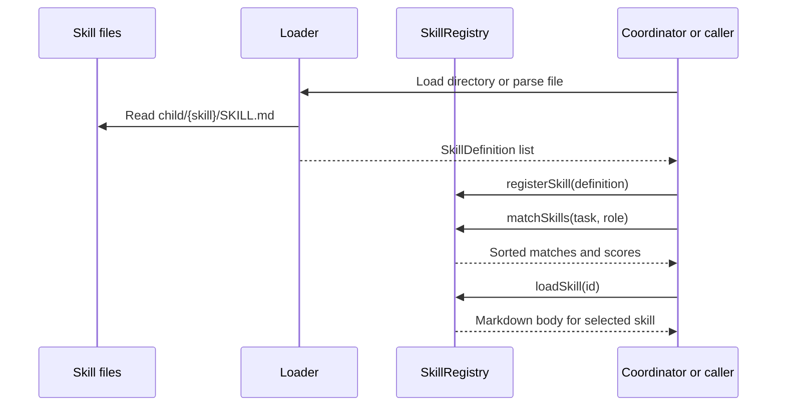
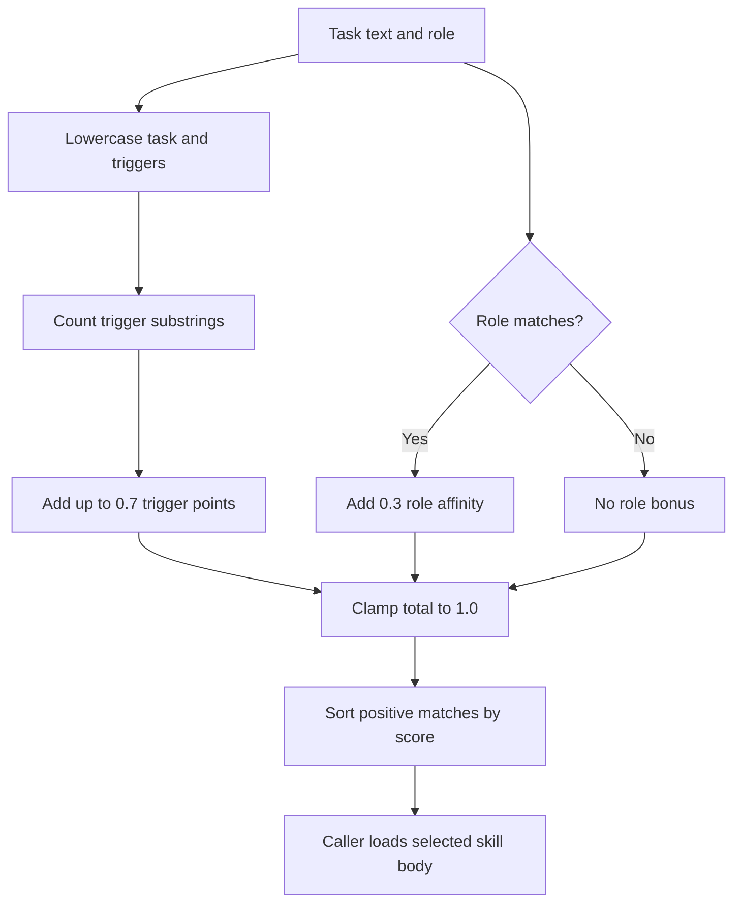

# Chapter 17: Skills

> **Prerequisites:** Chapter 15.

## What You'll Learn

- Explain how a Squad skill packages reusable knowledge and how a `SKILL.md` file is different from a decision or an agent history.
- Author a focused `tasktrack-api-conventions` skill with frontmatter and concrete examples grounded in the companion project.
- Discover and match skills through the SDK’s loader, `SkillRegistry`, and pluggable local/GitHub sources.
- Apply confidence metadata carefully and distinguish it from a confidence engine that automatically validates the skill.
- Assess the v1.1.0 skill-security and marketplace surfaces, including important gaps between documentation and shipped code.

## A Skill Is a Reusable Technique

A skill is a small, named package of knowledge that can be reused when a task enters a domain. A decision says which choice the team has made; history preserves what an agent learned; a skill explains a procedure, convention, or technique in a form another task can apply.

For Tasktrack, a decision might say “the API remains dependency-free.” A skill can go further and teach an agent how to implement a route consistently: keep handlers on `node:http`, use the existing `TaskStore`, validate status against the established values, return the existing status codes, and update `node:test` coverage. The skill is not a replacement for reading `api/src/app.ts` or the tests. It provides a compact guide to the stable patterns and points agents to the code that verifies them.

Skills are shared knowledge, so make them narrow and explicit. A skill titled “Everything About Our Repository” is hard to discover and likely to rot. Prefer one skill with a clear trigger and limited domain—API conventions, release procedure, or test setup. Include evidence and boundaries: what to reuse, where to verify, and when a specialist should ask instead of guessing.

## `SKILL.md` Format

The SDK’s `parseSkillFile()` reads a simple YAML-like frontmatter block followed by a Markdown body. In the example format used by the loader, useful fields are:

| Field | Role in discovery | Example |
|---|---|---|
| `name` | Human-readable title; defaults to directory id if absent | `Tasktrack API Conventions` |
| `domain` | Domain label; defaults to `general` | `backend-api` |
| `triggers` | Keywords that can match a task | `[api, route, task, status, node:http]` |
| `roles` | Agent roles with affinity | `[backend, developer, tester]` |
| `confidence` | Human-readable maturity convention in example skills | `low`, `medium`, `high` |
| `description` | Helpful metadata in templates and marketplace contexts | `Tasktrack API patterns` |

A minimal skill looks like this:

```markdown
---
name: Tasktrack API Conventions
domain: backend-api
triggers: [api, route, endpoint, task, status]
roles: [backend, developer, tester]
confidence: low
---

## Purpose

Use the existing Tasktrack API structure when changing routes or task behavior.
```

In the current SDK loader, the content that becomes `SkillDefinition.content` is the body after the closing `---`. It reads `name`, `domain`, `triggers`, and `roles`; additional keys such as `confidence` and `description` remain in the parsed frontmatter map but are not part of `SkillDefinition`. That means they are useful documentation conventions, but the registry does not interpret them as enforced lifecycle state or routing policy.

### Keep the frontmatter parser in mind

`parseFrontmatter()` normalizes line endings, expects opening and closing `---` delimiters, and parses the first colon on each frontmatter line. Inline arrays such as `[api, route, endpoint]` are split on commas. This is intentionally a small YAML-like parser, not a complete YAML implementation: do not rely on nested objects, multiline YAML values, quoted-comma arrays, or full YAML escaping. Keep values simple and test the file through the same loader your runtime uses.

If the frontmatter is missing, the body remains the raw content and metadata stays empty. A skill with a body can still be parsed: its id becomes the fallback name, domain becomes `general`, and triggers/roles become empty lists. A blank body returns no `SkillDefinition`. The directory loader looks for child directories containing exactly `SKILL.md`; it skips missing or malformed entries rather than failing the entire scan. Treat “skipped” as a discovery problem to investigate, not proof that the file is valid.

## Discovery and Matching

The SDK offers a small in-memory `SkillRegistry`. Load definitions, register them, and call `matchSkills(task, role)` to identify relevant material. The matching algorithm lowercases the task and checks whether each trigger string appears as a substring. Each trigger hit adds 0.5 points, capped at 0.7 total from triggers. A matching role in the skill’s `roles` list adds 0.3. The final score is capped at 1.0, matches with zero score are omitted, and results sort from highest to lowest score.

That simple algorithm has useful consequences:

- A task mentioning two trigger strings can receive a larger score than one mentioning one.
- Role affinity can boost a relevant skill even when the task wording is sparse.
- Matching is case-insensitive, but it is substring-based rather than a linguistic or token-boundary match.
- A generic trigger can match too broadly; choose specific trigger phrases that reflect real tasks.
- Ties are not given a special confidence-based ordering by the registry. Do not assume a `high` confidence skill automatically wins.
- Confidence metadata does not change the score in the shipped `SkillRegistry`.

The `samples/skill-discovery/` program demonstrates the flow end-to-end: create sample skill files, load them, register them, match example work by triggers and role, parse a newly discovered pattern, then show the low-to-medium-to-high confidence convention. Its tests verify the loader, parser, registry, matching, and confidence metadata parsing. Confidence progression is demonstrated by replacing frontmatter values; the SDK does not independently prove a pattern across sessions.





This second view emphasizes that matching produces a ranked suggestion. It does not execute the skill, confer permissions, or inspect whether the instructions are safe. Those responsibilities remain with the coordinator and the code or user policy that loads the result.

### Multiple sources

`SkillSource` defines a common async contract: list manifests, fetch one skill, and fetch its body. The SDK includes a local source and a GitHub source. The local source prefers `.copilot/skills/` if it exists and otherwise falls back to `.squad/skills/`. The GitHub source accepts an `owner/repo`, optional ref and path prefix, and a supplied `GitHubFetcher`; its default fetcher deliberately throws because the SDK does not invent a GitHub client. `SkillSourceRegistry` sorts sources by descending priority, lists across them, and finds the first matching id in priority order.

This source registry and `SkillRegistry` have different jobs. The source registry resolves where the material comes from. The skill registry holds already parsed definitions and computes simple relevance matches. Neither one is a complete cloud marketplace or an automatic organization-wide policy system.

### Paths differ across v1.1.0 integrations

Path conventions are not fully uniform in the v1.1.0 source. The docs describe `.copilot/skills/{name}/SKILL.md`; the SDK local source also prefers `.copilot/skills/`, with legacy `.squad/skills/` fallback. But the current Squad templates and upgrade migration use `.github/skills/` for Squad-owned prompt skills. The APM-oriented `squad skill` CLI reads and writes lowercase `skill.md` under `.copilot/skills/` (or `.squad/skills/` fallback). Therefore, do not assume that a file in one convention will automatically be discovered by every other integration. Follow the specific tool’s expected path and filename, and check the initialized project for its actual convention.

## Skills, Marketplace, and Safety

### Skill discovery is not authorization

A task matching a skill only says that its keywords or role suggest relevance. It does not authorize new tools, access, or side effects. Keep that distinction visible when designing skill content: explain techniques and constraints, but leave permission decisions to the coordinator and the user’s configured tool policy. A highly relevant skill from an untrusted source can still contain unsafe instructions; provenance review comes before use, not after a high match score.

The SDK’s `GitHubSkillSource` makes the trust boundary concrete. It depends on a `GitHubFetcher` interface for reading remote content, and its default implementation throws because the SDK does not silently select credentials or a network client. Applications supply the fetcher and should decide how to authenticate, pin refs, handle changed content, and review updates. A repository name alone is not a version pin. For reproducible teams, record the source and ref that were reviewed, then revalidate when the upstream skill changes.

### The skill security scanner: verify the implementation

The documentation page titled “Skill Security Scanner” describes `scripts/security-review.mjs --scope skills` and `--file` modes that scan Markdown skills for embedded secrets, download-and-execute commands, and privilege escalation. That interface and behavior are not present in the v1.1.0 source. The stable script accepts a base ref and head ref, examines changed lines in a pull request diff, and reports several general security categories; it has no `--scope skills` or `--file` option and its documented script exit behavior is informational. It does not scan every installed skill file as the docs page describes.

The SDK’s `marketplace/security.ts` is also not a skill-Markdown scanner. It validates **remote agent definitions** using seven rules: prompt-injection patterns and suspicious tool requests can block; potential PII in a charter, broad permission language, unknown source, missing charter, and excessive tools produce warnings. Its `quarantineAgent()` removes selected patterns from an agent charter and strips suspicious tool names. Those rules do not provide comprehensive skill security, and they should not be applied as if they were a validator for executable skill scripts.

A related runtime boundary is more important than a reassuring scanner name: `SkillScriptLoader` can dynamically import `.js` handlers from a backend skill’s `scripts/` directory. It enforces path containment when resolving skill paths and checks that handlers export functions, but the scripts run with the process’s filesystem and network trust. Load scripts only from sources you have reviewed. Do not put credentials in the skill’s committed configuration. The markdown skill body is instruction text; executable scripts are code and need their own review, testing, and least-privilege environment.

### Marketplace modules are SDK building blocks, not a production storefront

The marketplace feature page describes a broad ecosystem—export/import, agent repositories, versions, caching, browse/install, and security. The v1.1.0 SDK’s exported `marketplace` module is more limited and should be read as a set of types and reference utilities:

| Module | What the v1.1.0 source does | Important limit |
|---|---|---|
| `marketplace/index.ts` | Exports manifest types, browser, backend, packaging, security, and extension adapter APIs | Exporting an API does not imply a hosted service |
| `schema.ts` | Filters, sorts, paginates, and validates entries | Query is simple substring/category/tag matching |
| `browser.ts` | Uses an injected fetcher to browse, get details, and request a package | `install()` fetches a buffer and reports size; it does not unpack or write files into `targetDir` |
| `backend.ts` | In-memory reference backend for entries and package buffers | State is process-local; returned URL is illustrative, not a production API |
| `packaging.ts` | Writes `manifest.json`, collects file paths, sizes, and warnings | Returns a prospective `.squad-pkg` path; source does not create an archive at that path |
| `security.ts` | Applies remote-agent validation and quarantine helpers | Rules target agent definitions, not skills or arbitrary package files |
| `extension-adapter.ts` | Converts Squad config and extension events; returns an abstract registration result | Registration is explicitly a production API placeholder |

`MarketplaceManifest` contains name, version, description, author, repository, categories, tags, icon, screenshots, and a pricing object. Categories include productivity, development, testing, devops, documentation, security, and other. Manifest validation checks slug/version shape and required fields, with warnings for short descriptions or empty tags/screenshots. `MarketplaceBrowser.search()` delegates to schema search, where sorting can use downloads, rating, name, or recent update, and pagination is bounded to 1–100 results per page. `MarketplaceBackend.publishEntry()` rejects duplicate ids and invalid entries and stores accepted entries in memory; it does not upload to a real marketplace.

The docs mention `AgentCache`, TTL constants, and semantic-version helpers such as `parseSemVer()` and `bumpVersion()`. Those identifiers do not appear in the v1.1.0 `packages/squad-sdk/src/marketplace/` module. Similarly, examples using `browser.search({ text, category, sort: 'downloads' })` do not match the shipped query schema, which uses `query`, category, tags, sort, page, and perPage. Treat these docs as broader or newer roadmap material, not as stable release API. The actual marketplace module exports and generated types are the authority for code targeting the tag.

### Do not conflate marketplace types with CLI installation

There are multiple distribution ideas in the repository. The `squad skill` CLI provides an APM-oriented `publish`, `install`, and `list` implementation, although `squad skill --help` in v1.1.0 does not provide detailed subcommand help. It uses `apm.yml` and GitHub CLI access for repository-based installation. Its skills use lowercase `skill.md` under `.copilot/skills/` or the legacy `.squad/skills/` path. Its `publish` command emits a manifest; it does not host or publish directly to an APM registry.

The separate `squad plugin marketplace add|remove|list|browse` command registers GitHub repository sources for plugins, then browses top-level directories. That plugin marketplace registry is not the SDK’s typed `MarketplaceBrowser`, and it is not the skill-security scanner. Know which surface your task is using before assuming a skill can be installed from a marketplace with one unified command.

## Hands-On: Write `tasktrack-api-conventions`

Create a skill in your Tasktrack copy from the prior chapters. The examples below follow the `SKILL.md` capitalization used by the SDK directory loader and Squad’s current `.github/skills/` template convention. If your installed environment is configured to read `.copilot/skills/`, use that path instead; do not create duplicate copies unless you have tested which path takes precedence.

1. Verify the source facts before writing:

   ```bash
   cd ~/tasktrack
   sed -n '1,200p' api/src/app.ts
   sed -n '1,160p' api/src/tasks.ts
   sed -n '1,180p' api/test/app.test.ts
   ```

   If your copy has an extra `sample/` directory, prefix these paths with `sample/`. Confirm that the task statuses are `todo`, `doing`, and `done`; the API returns `201` when creating, `400` for invalid input, and `404` for unknown task ids.

2. Create `.github/skills/tasktrack-api-conventions/SKILL.md` with the following content:

   ```markdown
   ---
   name: Tasktrack API Conventions
   domain: backend-api
   triggers: [api, route, endpoint, task, status, node:http]
   roles: [backend, developer, tester]
   confidence: low
   ---

   # Tasktrack API Conventions

   ## Purpose
   Use this skill when changing Tasktrack API routes, task behavior, or API tests.

   ## Architecture
   - Keep the server on Node's built-in `node:http` module; the sample is intentionally zero-dependency.
   - Route handling lives in `api/src/app.ts`; in-memory task behavior lives in `api/src/tasks.ts`.
   - Verify current behavior in `api/test/app.test.ts` before changing a contract.

   ## Existing contract
   - `GET /health` returns `{ "ok": true }`.
   - `GET /tasks` returns the current task list.
   - `POST /tasks` requires a non-blank title and returns `201` with a task whose initial status is `todo`.
   - Task statuses are `todo`, `doing`, and `done`; invalid PATCH status returns `400`.
   - `PATCH /tasks/:id` and `DELETE /tasks/:id` return `404` for unknown ids.
   - Successful task deletion returns `204`.

   ## Working pattern
   - Preserve the existing `TaskStore` boundary; keep route-specific HTTP handling in `createApp()`.
   - Add or update a `node:test` regression test for every behavior change.
   - Run `npm test` from the Tasktrack project root after edits.
   - Read the source and tests when a fact in this skill appears stale; code is authoritative.

   ## Boundaries
   - Do not add a runtime package without an explicit decision to change the zero-dependency constraint.
   - Do not assume persistence across server restarts; the current store is in memory.
   ```

3. Ask the appropriate agent to verify the skill against current source and revise inaccuracies. Then inspect the exact diff and run:

   ```bash
   npm test
   git status --short
   git diff -- .github/skills/tasktrack-api-conventions/SKILL.md
   ```

   Expected result: tests still pass, the new Markdown file is the only Tasktrack change, and the skill describes the implementation rather than an aspirational API. Tag the project `ch17-end` if you are following the chapter checkpoint convention.

4. If you have the SDK built and can run the skill-discovery sample, use it to test the parser and matching behavior. The sample’s source README shows a repository-root `npx tsx samples/skill-discovery/index.ts` invocation after building the SDK. It requires the SDK package to be built and a `tsx` runner available; do not install dependencies into the Tasktrack companion merely for this optional demonstration.

> **Tip:** A `confidence: low` field is honest for a first observation. Raise it only after the convention is independently verified in multiple contexts and your team has agreed on a confidence process. In the shipped registry, confidence is descriptive metadata; it is not automatically advanced.

### From a work pattern to a maintained skill

A skill should be based on a pattern that has evidence, not merely a plausible-sounding instruction. Start with one successful or repeated task, inspect the code and tests that establish the pattern, and then write the smallest generalization that would help the next agent. Keep examples local and concrete. If the pattern is still tentative, say so in the skill and use a low confidence label where your team tracks that convention.

Before merging a new skill, check whether a suitable skill already exists; duplication gives the matcher multiple competing instructions. Verify that every trigger is useful and not overly generic, that the role names correspond to the roles your team actually routes, and that the body clearly separates hard constraints from suggestions. Include a verification command only when it is safe, available in the repository, and relevant to the task. Avoid credentials, customer data, and raw logs. Review the skill as a prompt surface: instructions can conflict with coordinator or user rules, so a skill should not attempt to override higher-priority policy.

After an architecture change, ask the relevant specialist to re-check the skill’s claims against source. This maintenance is important because stale instructions are actively misleading: they can cause an agent to keep using a removed endpoint or an obsolete test command. The confidence label should reflect the evidence gathered, not the age of the file or an aspiration to reach “high.”

## Configuration Reference

| Item | Expected structure or syntax | Notes |
|---|---|---|
| Prompt skill path in current templates | `.github/skills/{name}/SKILL.md` | Squad-owned templates and upgrade migration use this path |
| SDK local discovery path | `.copilot/skills/{name}/SKILL.md`, fallback `.squad/skills/` | `LocalSkillSource` selects `.copilot/skills/` if that directory exists |
| SDK directory loader | A directory with child folders containing `SKILL.md` | Caller supplies the directory; the loader does not enforce one fixed project path |
| APM CLI skill file | `.copilot/skills/{name}/skill.md` or `.squad/skills/{name}/skill.md` | Lowercase filename in the CLI implementation |
| Frontmatter arrays | `triggers: [api, route]` / `roles: [backend]` | Simple comma-separated inline list; no full YAML support |
| Registry trigger score | +0.5 per hit, capped at 0.7 | Case-insensitive substring matching |
| Registry role score | +0.3 on case-insensitive role match | Only if a task already has a trigger or role match |
| `confidence` | `low`, `medium`, `high` convention | No automatic progression in `SkillRegistry` |
| `SkillSourceRegistry` priority | Higher integer first | `findSkill()` returns the first source containing the id |
| `squad skill publish [name]` | Creates APM metadata | Current implementation expects lowercase `skill.md` |
| `squad skill install owner/repo[/skill]` | Requires authenticated `gh` for GitHub source | URL install is also implemented; review content before using |
| `squad plugin marketplace add <owner/repo>` | Register plugin marketplace source | Separate from skill publishing and SDK MarketplaceBackend |

## Under the Hood

`packages/squad-sdk/src/skills/skill-loader.ts` turns a skill folder into a small runtime object. Its key field contract is intentionally narrower than general frontmatter:

```ts
export interface SkillDefinition {
  id: string;
  name: string;
  domain: string;
  content: string;
  triggers: string[];
  agentRoles: string[];
}
```

`packages/squad-sdk/src/skills/index.ts` adds the `SkillRegistry`. Its matching algorithm combines trigger overlap and role affinity, clamps the total to 1.0, excludes zero-score candidates, and sorts descending. `skill-source.ts` provides local and GitHub source adapters; source priority resolves collisions. The `samples/skill-discovery/` demo and tests exercise parser and matching behavior, including skills created in memory from a newly observed pattern.

The repository also has a distinct executable skill-script mechanism. `skill-script-loader.ts` scans backend `scripts/` directories, maps filenames to `squad_*` tool names, verifies that each module exports a default function, obtains the tool schema, and wraps calls with telemetry. It optionally imports `lifecycle.js` for `init` and `dispose` hooks. Path containment checks constrain the resolved skill directory to the project or team root, but do not sandbox trusted code after it has loaded.

The marketplace implementation is exported through `packages/squad-sdk/src/marketplace/index.ts`, which re-exports `MarketplaceBrowser`, `MarketplaceBackend`, schema search/validation, package utilities, security helpers, and extension adapters. Read the implementation files when targeting v1.1.0: the fetcher and in-memory backend are extension seams, not evidence that a remote catalog or package installer is deployed.

## Pitfalls and Troubleshooting

- **Making a skill too broad:** split reusable patterns by task domain so triggers remain meaningful and the body stays maintainable.
- **Assuming the registry is an LLM matcher:** matching is deterministic keyword substring plus role affinity; ambiguous cases require better triggers or explicit loading.
- **Assuming confidence is enforced:** `confidence` can be documented in frontmatter, but the registry neither validates it nor promotes it automatically.
- **Using complex YAML:** the loader parses a small subset. Keep frontmatter simple, arrays inline, and the body non-empty.
- **Using the wrong case or path:** SDK `SKILL.md`, APM CLI `skill.md`, templates `.github/skills`, and local source `.copilot/skills` differ in v1.1.0. Test the consumer that will load the skill.
- **Assuming malformed files fail loudly:** directory scans skip unreadable/malformed files; confirm the loaded count and inspect the path.
- **Copying marketplace examples verbatim:** several documented APIs and options do not exist in the v1.1.0 marketplace source. Verify types and exports before integrating.
- **Calling `MarketplaceBrowser.install()` an installer:** it requests package bytes and reports metadata but does not deploy them.
- **Trusting a “security scanner” label:** the skill scanner docs’ flags and checks are not present in stable code. The general PR scanner and remote-agent validator are different tools with different inputs.
- **Loading executable handlers from unknown sources:** handler scripts run as code with process trust; markdown review alone is insufficient.
- **Treating a remote source as trusted because it parsed:** syntax validity does not establish provenance or safety. Review content and permissions before loading it.
- **Installing a GitHub skill without provenance:** the CLI records source metadata for repository installs, but you still need to review upstream ownership, changes, and content.

## Summary

A good skill is focused, evidence-based, and easy for the right task to discover. `SKILL.md` frontmatter gives the SDK simple triggers and role affinity; the registry scores those hints deterministically and exposes the body for loading. Confidence is a convention, not an automatic proof process. Squad v1.1.0 has several skill and marketplace integrations, but their paths and capabilities differ: template skills, SDK discovery, APM CLI files, plugin marketplace registration, and typed marketplace modules are not one interchangeable system. Validate the specific loader, review executable scripts as code, and do not rely on scanner or storefront behavior that the tagged source does not implement.

## Exercises

1. **Tighten discovery.** Choose five task phrases for the Tasktrack skill. Pick triggers that cover the task without matching unrelated conversations; explain how substring matching could create a false positive.
2. **Author a skill.** Write a new `SKILL.md` for a test-only convention. Include simple frontmatter, two role affinities, three triggers, and a body that points to the source of truth.
3. **Score a match.** Given a skill with triggers `[api, status, endpoint]` and roles `[backend, tester]`, calculate its score for task “Update the status endpoint” and role `backend` using the registry algorithm.
4. **Audit the release surface.** Identify three differences between the skills/marketplace docs and the v1.1.0 implementation. For each, state which source you would trust when writing a program.
5. **Security review.** Explain why scanning Markdown for suspicious commands does not establish that a skill’s `scripts/` directory is safe. List two review measures for executable skill handlers.

## Quiz

1. Which four frontmatter keys are used to construct the SDK’s `SkillDefinition`?
2. How is a skill’s trigger score calculated, and what is the trigger cap?
3. Does `confidence: high` cause the SDK registry to rank a skill first?
4. What filename does the APM-oriented `squad skill` implementation read: `SKILL.md` or `skill.md`?
5. Does `MarketplaceBrowser.install()` write the downloaded package to its target directory?
6. What types of content does `marketplace/security.ts` validate?
7. Can a successful parse prove that an executable skill script is safe?

## Further Reading

- [Skills system](https://bradygaster.github.io/squad/docs/features/skills/)
- [Skill security scanner](https://bradygaster.github.io/squad/docs/features/skill-security-scanner/)
- [Marketplace guide](https://bradygaster.github.io/squad/docs/features/marketplace/)
