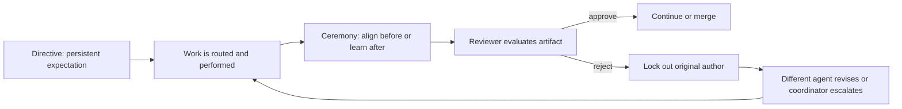
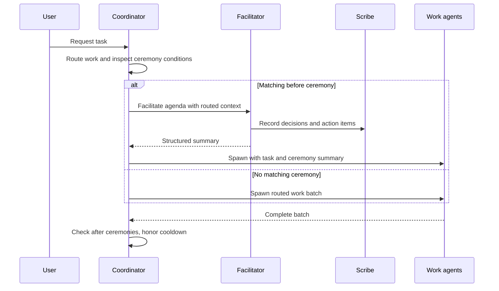
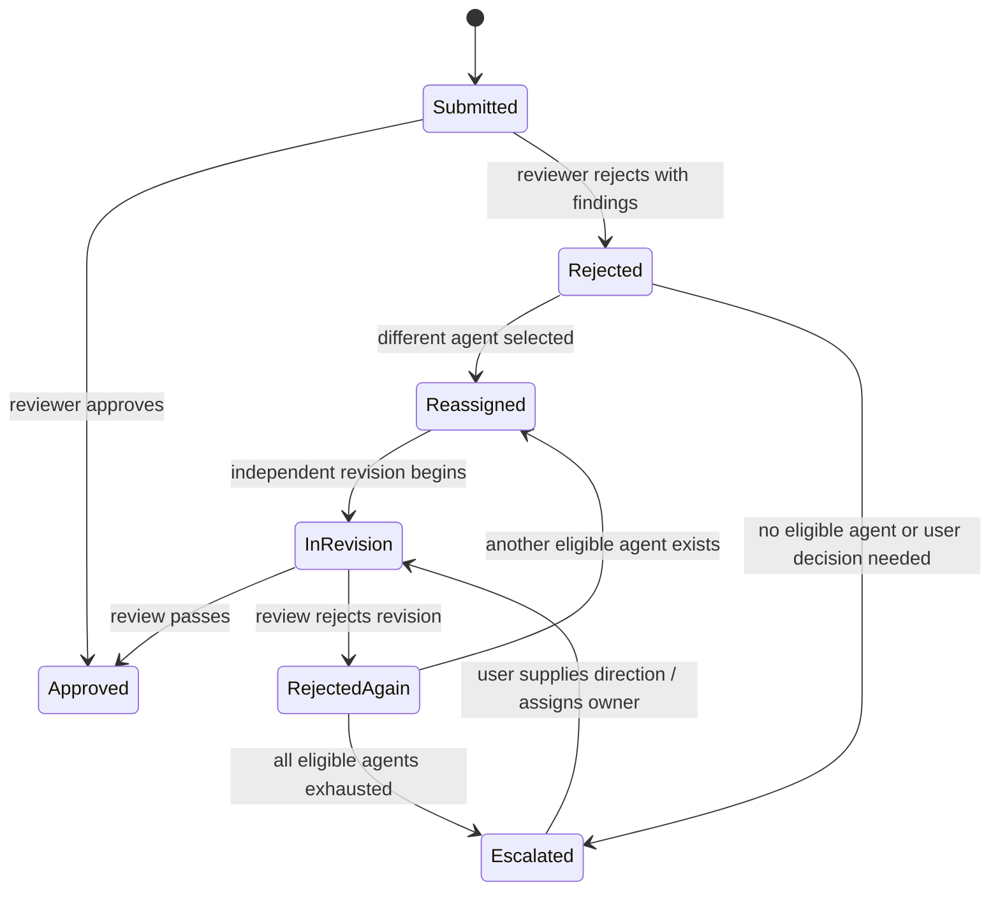

# Chapter 18: Directives, Ceremonies, and the Reviewer Protocol

> **Prerequisites:** Chapters 4 and 15.

## What You'll Learn

- Distinguish durable team rules (directives) from task requests, questions, and implementation details.
- Capture a directive so the team can find it later, while understanding the difference between runtime memory and tracked behavior.
- Configure and reason about ceremonies: their triggers, timing, participants, facilitator, agenda, enabled state, and cooldown.
- Use retrospectives to turn failures into decisions and owned follow-up work rather than a blame exercise.
- Apply strict reviewer lockout after rejection, including reassignment, escalation, artifact scope, and deadlock handling.
- Design governance as layered controls: policy, process, validation, and human authority.

## Governance Is How a Team Remembers and Decides

A Squad's memory answers what the team has learned; governance determines what the team is expected to do with that knowledge. A useful rule must be discoverable before work starts, applied to the right scope, and checked by a mechanism proportionate to its risk. A convention that exists only in one person's chat history is not yet a dependable team policy. Conversely, turning every preference into a hard gate creates friction and can make agents mistake a suggestion for an authorization boundary.

This chapter focuses on three complementary mechanisms:

| Mechanism | Main question | Typical use |
|---|---|---|
| Directive | “What should the team remember and apply across work?” | Coding conventions, tool choices, workflow constraints |
| Ceremony | “When should the team align or learn together?” | Pre-work design review, post-failure retrospective |
| Reviewer protocol | “What happens when submitted work is rejected?” | Independent revision, accountable escalation |

They operate at different times. Directives inform routing and execution; ceremonies insert structured discussion around a work batch; reviewer rules constrain who may make a revision. Together they create a feedback loop: state a policy, align around risk, review outcomes, and revise the team's knowledge.



A key principle is to distinguish **remembering** a policy from **enforcing** it. A sentence in a decision log changes agent context; it does not automatically make a compiler, branch rule, or CI check. If a rule must never be violated, choose a mechanism that can actually block violations—such as a test, linter, protected branch rule, or a programmatic hook—and make the governance instruction point to it.

## Directives: Durable Expectations, Not Work Requests

A directive is a preference, rule, or constraint intended to shape future work. “Always validate task status against the allowed values” is a directive. “Add status validation to this endpoint” is an implementation request. “How does validation work?” is a question. They might mention the same subject, but they call for different handling.

The language that often signals a directive includes “always,” “never,” “from now on,” “going forward,” “remember to,” and “make sure to.” These are clues, not a magic parser contract. A coordinator should interpret intent in context: “Never let a task sit unassigned” may be a policy; “never mind, I fixed it” is not. Scope statements and tool preferences can also express directives without signal words.

Good directives are:

1. **Specific** enough to guide a decision (“Run `npm test` before handing off API changes”) rather than “write good code.”
2. **Scoped** to a team, repository, language, or workflow so it does not overreach.
3. **Actionable** and observable. Prefer “Every endpoint change needs a success and validation test” to “make endpoints robust.”
4. **Compatible** with higher-priority safety, repository, and platform constraints.
5. **Revisable**. A directive records current intent; it is not immutable law.

### Capture, acknowledge, and implement

The coordinator's current instruction in `.github/agents/squad.agent.md` distinguishes a pure directive from a mixed message. A directive should be acknowledged briefly. When available, persist durable decisions through the configured governed memory/state tools; the coordinator prompt specifically prefers `memory.write` with class `DECISION`, with another configured state tool as a fallback. If no governed persistence tool is available, acknowledge the request without claiming that it has been saved. A message that includes both a rule and a task should capture the rule and route the task normally.

Persistence and implementation are separate. If the user says, “Going forward, reject any API change without integration tests,” recording the preference does not add a test gate. The tracked change might be a CI workflow or an explicit test policy in a governing prompt, and should be made by the accountable specialist, validated, and delivered through the repository's normal review flow. The runtime record preserves context; the tracked control changes behavior. Do not silently substitute one for the other.

> **Warning:** The historical directives documentation describes writing timestamped Markdown files into `.squad/decisions/inbox/` and having Scribe merge them into `decisions.md`. The v1.1.0 coordinator prompt now specifies governed runtime memory/state tools and explicitly prohibits creating local or gitignored Markdown proposals as a persistence fallback. Follow the governing prompt and configured backend, not an outdated example.

A usable directive should be easy to retrieve. When asking a team member to follow it, point to the governing location or control rather than relying on an old conversation. If the instruction is already represented by a tracked skill, charter, test, or configuration file, avoid creating a second contradictory copy. When updating a rule, ask whether the user intends to replace the old policy, refine it, or add an exception. Record that relationship rather than leaving two incompatible statements for agents to reconcile.

The directives feature page also describes conflict handling and maintenance: when a new rule contradicts an existing one, ask whether to replace, merge, or skip it; answer “show me the team directives” or ask about a topic to inspect current policy; and remove a rule explicitly when it is no longer wanted. Those are sensible governance operations, but the page's specific claim that Scribe automatically detects semantic overlap and performs an inbox merge should not be assumed for every v1.1.0 backend. Use the configured state interface, make the user's choice explicit, and ensure the tracked control is updated if the behavior itself must change. Avoid leaving both “always do X” and “never do X” in separate stores and expecting agents to infer which is newer.

Directive scope ranges from coding style and tool choice to workflows, scope limits, and review requirements. State the boundary in the directive: “For the Tasktrack API, use Node's built-in test runner” is easier to apply than “use this runner everywhere.” A rule that says “Lead reviews security changes” should clarify which changes are covered and whether review is advisory or a merge gate.

### Guidance versus hard constraints

Directives are commonly prompt-level guidance. An agent can overlook or misinterpret guidance; therefore, critical requirements need a corresponding check. Think in layers:

- **Remember:** decision or memory entry gives the team context.
- **Instruct:** charter, skill, or coordinator policy tells agents what to do.
- **Check:** tests, CI, branch protection, review checklist, or hooks detect violations.
- **Authorize:** a human or designated role approves actions with significant impact.

The layers are not interchangeable. An instruction to avoid committing to `main` is weaker than branch protection. A directive to scan for secrets is weaker than a secret-scanning check. Conversely, a rigid automated check should not encode an ambiguous policy before the team agrees what the policy means.

## Ceremonies: Put Alignment at the Right Moment

A ceremony is a structured team meeting attached to a point in the work lifecycle. It creates a bounded opportunity to compare assumptions, surface risks, and record decisions. It should not be a generic meeting that repeats status everyone already has.

The shipped `.squad/ceremonies.md` provides two core examples:

- **Design Review** runs before a multi-agent task involving at least two agents modifying shared systems. The lead facilitates; relevant participants agree on interfaces, contracts, risks, and action items.
- **Retrospective** runs after a build failure, test failure, or reviewer rejection. The lead facilitates a fact-focused root-cause analysis and identifies changes for the next iteration.

The companion `.squad/templates/ceremony-reference.md` describes a configurable schema. Each ceremony has a trigger (`auto` or `manual`), a timing (`before` or `after`), a natural-language condition, a facilitator, participants, a time budget (`focused` or `extended`), an enabled flag, and an agenda. Named participants let you intentionally limit the room; `all-relevant` means agents routed to the work, while `all-involved` means agents that participated in the completed batch.

| Field | What it controls | Design question |
|---|---|---|
| `Trigger` | `auto` evaluates a configured condition; `manual` requires a user request | Is this reliable enough to trigger without asking? |
| `When` | `before` or `after` the work batch | Which decision must precede or follow execution? |
| `Condition` | Context that activates an automatic ceremony | Can the coordinator recognize it consistently? |
| `Facilitator` | Lead or a named agent | Who is accountable for keeping the agenda useful? |
| `Participants` | Relevant/involved agents or named attendees | Who needs to contribute to the decision? |
| `Time budget` | `focused` or `extended` discussion | How much exploration does the risk justify? |
| `Enabled` | Whether the ceremony participates in automatic checks | Should it run by default now? |
| `Agenda` | Ordered steps | What output should the meeting produce? |

The configured fields create a compact operating contract. A design review that has no expected artifact may become an open-ended chat; add concrete outputs such as agreed API shape, ownership boundaries, and unresolved questions. A retrospective should separate observations (“the test failed on an empty body”) from interpretations (“we assumed every request contained JSON”) and from actions (“add malformed-body coverage, owner: API specialist”).

### Execution order and cooldown

For an automatic **before** ceremony, the coordinator first routes the work, then checks the ceremony condition, runs the facilitator, and includes the resulting summary in the work-batch prompts. This ordering matters: the set of relevant agents depends on routing. For an **after** ceremony, all agents in the batch must have completed before the meeting starts. Manual ceremonies run only on an explicit user request. A cooldown skips automatic ceremony checks for the immediately following step so a ceremony cannot trigger another ceremony in a loop.

The reference also describes a facilitator spawn template, Scribe recording, structured output, and a failure rule: if a facilitator fails or times out, log a warning and let work proceed rather than allowing a meeting to block the pipeline indefinitely. That is graceful failure of process, not permission to discard the underlying risk. If the meeting cannot run, the coordinator should preserve the reason and surface any decision that still needs a human.



Use a ceremony only when coordination has real leverage. Two independent documentation edits may not need a design review; two agents changing a shared API probably do. A retrospective after every small success can create meeting fatigue; the default example targets failures and rejection because those events reveal a process gap worth learning from. Manual triggers are useful for a high-risk change that does not match an automatic condition, or for reviewing an incident after the immediate task is complete.

A user can request a meeting manually, ask Squad to add a ceremony, disable an existing ceremony, or skip one occurrence. In the file model, disabling leaves its definition available but excludes it from automatic checks; skipping once should not change the durable enabled setting. These natural-language examples are coordinator requests, not standalone `squad ceremony` subcommands. A custom ceremony should have a distinct name, an explicit condition, a facilitator and attendees, and an agenda that fits the meeting's purpose. Prefer changing the Markdown definition directly only when you understand how the coordinator interprets it.

### Retrospectives and action ownership

A retrospective is not a verdict on an agent's character. Ask what happened, what evidence supports the explanation, and what process or product change reduces recurrence. Review the timeline; distinguish direct cause from contributing conditions; identify what went well; and create a small number of actionable changes. A useful action includes an owner, a completion condition, and a place to track it.

The ceremonies template also contains a “Retrospective with Enforcement” example: weekly scheduling if no log exists during the previous seven days, with action items turned into GitHub Issues labeled `retro-action`. Treat this as a proposed stronger operating pattern, not assume a hidden enforcement runtime. The template names a `retro-enforcement` skill and a `Test-RetroOverdue` check, but no corresponding skill was present in the inspected v1.1.0 source. The stable CLI does expose opt-in `triage --retro` and configuration-driven retro capability; that is an operational path separate from automatic meeting behavior in the coordinator prompt. Verify the exact installed configuration before promising enforcement.

## Reviewer Protocol: Make Rejection Change the Process

Review is a quality boundary, not a debate over who gets the final word. A designated reviewer evaluates an artifact against requirements, applicable directives, correctness, tests, and risk. A rejection must produce a specific reason and a clear next owner. The reviewer protocol makes independence part of that handoff.

When a reviewer rejects work, the original author is locked out from producing the next revision of that artifact. The coordinator must select a different eligible agent, or escalate when the expertise is unavailable or the team is deadlocked. The author cannot be quietly retained as an advisor, pair, or co-author; that would bypass the purpose of independent revision. A reviewer who suggests the original author must fix the issue should be asked to name another owner.

The lockout is **artifact-specific**, not a general ban. If agent A's change to the task API is rejected, A can still work on an unrelated UI task. It persists for the current revision cycle. If a new revision is rejected, its author is locked out in turn; that next cycle must use another eligible agent. If no eligible reviser remains, the coordinator escalates to the user rather than quietly clearing a lockout.

| Reviewer outcome | Original author | Next step |
|---|---|---|
| Approve | Not locked out by this protocol | Continue through normal delivery flow |
| Reject; another qualified agent exists | Locked out for this artifact's revision | Reassign to a different agent and preserve review feedback |
| Reject; no appropriate agent exists | Locked out | Escalate for a specialist or human direction |
| Revision is rejected again | Revision author also locked out | Select a third eligible agent or escalate |
| All eligible agents are locked out | Remain locked out | Escalate; do not make an exception implicitly |

A good rejection is actionable: state the failing criterion, evidence, and expected correction. “Not good enough” creates an unbounded loop. “PATCH `/tasks/:id` accepts `status: null`; return 400 and add a test covering null and unknown values” lets a new agent proceed independently. Keep the review focused on the artifact, not the person.

### Choose an appropriate human-review level

The reviewer-protocol page describes three possible oversight postures for Squad-created pull requests. **Full review** is the default: a human approves every PR and is appropriate for team repositories, public packages, and shared code. **Selective review** delegates routine changes to agent review while reserving human attention for specified paths or domains; it fits a personal project with established patterns, but increases the chance that a risky change escapes immediate human attention. **Self-managing** allows Squad to create, review, approve, and merge its PRs, with the human stepping in when explicitly flagged. The page limits this to solo personal projects and warns that risk is higher; retrospective monitoring and notifications do not make an unsafe merge safe.

Treat those as human-oversight choices, not as changes to reviewer lockout. “Self-managing” does not authorize an agent to revise its own rejected artifact or make strict lockout optional. Nor is it a stable CLI flag verified by this chapter. Configure repository protections and permissions deliberately; use the least autonomous level that satisfies the project's risk tolerance.

| Oversight posture | Human gate | Intended context | Relative risk |
|---|---|---|---|
| Full review | Every PR | Team repos, shared code, public packages | Lowest of the three; human sees each change before merge |
| Selective review | Only selected paths/domains or flagged work | Personal repos with mature patterns | Medium; some work bypasses pre-merge human review |
| Self-managing | No routine pre-merge human gate | Solo personal experimentation | Highest; requires active monitoring and retrospective review |

> **Note:** Review authority should be explicit. The coordinator protocol gives reviewer-role agents authority over work they review and says the user is the final arbiter. The separate feature page's broader PR trust-level discussion describes possible degrees of human oversight, but trust level must not be confused with permission to bypass strict lockout on a rejected artifact.

### Lockout mechanics and persistence boundaries

The reviewer skill and coordinator prompt define the strict process policy. The SDK also contains a `ReviewerLockoutHook` that can enforce write restrictions in a configured hook pipeline. These are related but distinct implementations. In v1.1.0, the hook maintains an in-memory map from artifact identifiers to agent names; it does not by itself provide the documentation page's claimed durable orchestration-log persistence, issue workflow, user command to unlock a named agent, or approval-driven lifecycle. The hook blocks certain write-tool calls when the path matches an artifact identifier using a simple string-inclusion heuristic. Treat the hook as a programmatic guard available to SDK consumers, not proof that every Squad session automatically installs persistent PR lockouts.

The feature page describes lockout as session-persistent in `.squad/orchestration-log/` and clearable by a user prompt such as “Unlock Fenster for issue #42.” The current coordinator skill instead defines strict lockout through the revision cycle and escalation when eligible agents are exhausted; the inspected SDK hook itself has no durable orchestration-log persistence or user-facing unlock command. Do not promise those persistence or unlock details unless the active environment supplies and verifies them. In particular, process-local hook state cannot establish a durable lockout across a session restart.



## Governance as a Layered System

A mature team does not rely on one large instruction file to solve every problem. Use each layer for what it does best:

- **Team memory** records the accepted decision and why it exists.
- **Coordinator and agent instructions** help agents interpret the decision consistently.
- **Ceremonies** make time for alignment, evidence gathering, and learning.
- **Reviewers** judge artifacts and enforce an independent revision path.
- **Tests and automation** detect violations repeatably.
- **Human owners** resolve trade-offs, approve risk, and handle deadlock.

Governance should be proportionate. A formatting preference can be advisory with a formatter in CI. A data-loss safeguard needs technical checks and careful human review. Keep policy small enough to be usable; periodically remove stale directives, disable ceremonies that no longer serve a purpose, and ensure the person accountable for each control knows how it is enforced. Chapters 15–17 cover related memory, context, and skills; Chapter 7 applies the same governance ideas to issue-driven work.

## Hands-On: Add a Tasktrack Review Gate

Start from your Tasktrack repository at the end of Chapter 17 (`ch17-start` if you are following the tags). This exercise asks your Squad to establish a review policy and a retrospective that will be useful when the team later adds endpoints.

1. In the Tasktrack repo, open a Squad session and state this as a directive: “For every Tasktrack API change, require a test for a successful request and at least one invalid-input or missing-resource case. Do not merge a rejected artifact by having its original author revise it.” Confirm the coordinator distinguishes the policy from the work request and tells you where it was persisted. If no governed memory tool is available, do not claim durable capture; add the policy to the tracked governing source through the appropriate review process.
2. Ask the coordinator to inspect `.squad/ceremonies.md` and configure a before-work design review for changes where multiple agents modify `api/src/app.ts` or its request/response contract. Keep the agenda short: identify the contract, identify error cases, assign tests. Use the ceremony format in `.squad/templates/ceremony-reference.md` and avoid inventing a CLI ceremony command.
3. Request an after-work retrospective after the next test failure or rejected review. Ask the facilitator to separate facts, root cause, and follow-up actions. Each follow-up should have an owner and a testable completion criterion.
4. Run `npm test` from the Tasktrack root. The current baseline should pass. Then ask Squad to propose (not silently apply) a narrowly scoped test addition for malformed JSON or a missing task. Review the change yourself and check it against the directive.
5. Have a reviewer inspect the resulting artifact. If it is rejected, record which different agent will own the revision. Verify the original author is not assigned as co-author or advisor. If no independent agent fits, escalate rather than weakening the lockout.

Expected result: a discoverable directive, one appropriately scoped ceremony definition, and a reviewer handoff policy that can be followed without inventing undocumented commands. You should also be able to explain which safeguards are instructions and which are enforced by tests or hooks.

## Configuration Reference

| Item | Location or value | Notes |
|---|---|---|
| Directive persistence | Configured governed memory/state bridge; prefer `memory.write` with class `DECISION` where available | Do not assume `.squad/decisions/inbox/` is the current fallback |
| Team ceremony definitions | `.squad/ceremonies.md` | Shipped template includes Design Review and Retrospective examples |
| Ceremony format/execution rules | `.squad/templates/ceremony-reference.md` | Trigger, timing, condition, facilitator, participants, time budget, enabled, agenda |
| `Trigger` | `auto` or `manual` | Manual requires explicit user request |
| `When` | `before` or `after` | Relative to work batch |
| `Participants` | `all-relevant`, `all-involved`, or names | Resolve against routed/completed batch |
| `Time budget` | `focused` or `extended` | A process guideline, not an execution timeout guarantee |
| Reviewer lockout skill | `templates/skills/reviewer-protocol/SKILL.md` in source distribution | Strict independent revision and escalation policy |
| SDK hook config | `PolicyConfig.reviewerLockout` | Optional boolean; false unless configured by consumer |
| Hook artifact state | `ReviewerLockoutHook` in `packages/squad-sdk/src/hooks/index.ts` | In-memory map; not documented persistent orchestration storage |
| Stable CLI ceremony command | None verified | Trigger ceremonies in coordinator interaction; CLI `triage --retro` is a separate capability |

## Under the Hood

Governance in v1.1.0 is a composition of prompt policy, shipped templates, and optional SDK enforcement—not one universal database-backed state machine. The main coordinator prompt tells the model when to capture directives, how to check for ceremonies, and what to do after a reviewer rejection. The user-facing ceremony config is Markdown, so its interpretation is driven by the coordinator and the ceremony reference rather than a CLI parser that guarantees all fields are valid.

The current directive rules emphasize governed tools and a no-fake-persistence boundary. The coordinator prefers the `memory.write` path with `DECISION` classification; when tools are absent, it requires honest acknowledgement rather than an invented local write. This is materially different from older docs that assume a Scribe merges inbox Markdown. The repository's source-of-truth hierarchy and state-backend rules in the coordinator prompt explain why the distinction matters: runtime-managed state must be changed through its configured bridge, while tracked behavior changes need an accountable source edit.

The ceremony reference supplies the facilitator prompt, participant resolution, summary shape, Scribe integration, cooldown, and failure handling. The coordinator core logic in `.github/agents/squad.agent.md` says to run matching before ceremonies after routing and before agent spawn, and after ceremonies when the batch completes. That arrangement lets a ceremony summary influence downstream prompts while avoiding a blocked pipeline if a meeting fails.

The following excerpt shows the SDK hook's deliberately small state surface:

```ts
export class ReviewerLockoutHook {
  private lockoutRegistry: Map<string, Set<string>> = new Map();

  lockout(artifactId: string, agentName: string): void {
    if (!this.lockoutRegistry.has(artifactId)) {
      this.lockoutRegistry.set(artifactId, new Set());
    }
    this.lockoutRegistry.get(artifactId)!.add(agentName);
  }

  isLockedOut(artifactId: string, agentName: string): boolean {
    const lockedAgents = this.lockoutRegistry.get(artifactId);
    return lockedAgents ? lockedAgents.has(agentName) : false;
  }
}
```

The hook is activated only when a consumer configures `reviewerLockout`. Its pre-tool hook checks write tools such as `edit`, `create`, `write_file`, and `create_file`; it then compares the requested path with locked artifact IDs. That is a useful primitive for enforcing independent revision in an SDK application, but the registry is process memory, and path matching is intentionally simple. The orchestration contract remains the coordinator policy: record the rejection, bar the original author from the specific revision, choose a different owner, and escalate if that cannot be done.

The shipped ceremony template includes a recurring weekly “Retrospective with Enforcement” proposal, but its custom enforcement-skill reference is not present in the inspected v1.1.0 templates. The CLI's `triage --retro` option should not be confused with the prompt-level ceremony mechanism. This distinction—what a document proposes, what a prompt instructs, and what executable code guarantees—is a governance habit in its own right.

## Pitfalls and Troubleshooting

- **Treating a work request as a directive:** Separate the future rule from the task to implement it; capture both parts appropriately.
- **Assuming persistence:** Ask which configured state bridge is available. If there is none, acknowledge without falsely claiming a save.
- **Relying on advisory text for a hard guarantee:** Add a test, protected branch rule, validator, or hook appropriate to the risk.
- **Over-triggering ceremonies:** Keep conditions concrete and time budgets proportionate. Use manual ceremonies for one-off cases.
- **Allowing a ceremony to block delivery forever:** Follow the reference's failure behavior: warn and proceed where safe; surface unresolved decisions.
- **Using retro as blame:** Focus on evidence, system causes, and owned actions.
- **Reassigning rejected work to the original author:** Lockout prohibits all contribution to that revision, not merely final edits.
- **Clearing lockout too early or applying it globally:** Scope is one artifact and one revision cycle; another rejection locks out that cycle's author too.
- **Believing a sample log proves durable enforcement:** Verify runtime persistence and hook activation in the actual deployment.
- **Confusing CLI retro triage with automatic ceremony execution:** These are different pathways; validate the version and configuration before describing behavior as automatic.

## Summary

Directives express durable expectations, but capture is not implementation and advice is not enforcement. Use configured governed memory honestly, and change tracked instructions or code when repository behavior must change. Ceremonies create bounded alignment before work or learning after it; configure their trigger, timing, facilitator, participants, agenda, and expected output deliberately. Reviewer rejection requires a different revision owner, artifact-scoped lockout, and escalation when eligible agents are exhausted. Finally, match each governance risk to the layer capable of controlling it: memory, instructions, process, executable checks, or human approval.

## Exercises

1. Classify each message as a directive, work request, question, or mixed message: “Always test malformed JSON,” “Add malformed-JSON tests today,” and “Why does malformed JSON return 400?” Explain what the coordinator should do with each.
2. Draft a ceremony definition for a pre-work review of changes to a shared Tasktrack endpoint. Include every field from the ceremony reference and a four-item agenda.
3. A reviewer rejects a change by agent Ada and says “Ada should fix the null handling.” Describe the coordinator's correct response. What changes if the next independent revision is also rejected?
4. Compare a prompt-level rule, a test, a hook, and branch protection for enforcing “do not merge API changes without tests.” Which combination would you choose and why?
5. Find the “Retrospective with Enforcement” proposal in the ceremony template. Identify what it proposes, which related implementation could not be verified in the v1.1.0 source, and what you should say before claiming weekly enforcement is live.

## Quiz

1. What distinguishes a directive from a work request?
2. If governed memory tools are unavailable, what should the coordinator not do as a persistence fallback?
3. When does a before ceremony run relative to routing and agent spawn?
4. Which participant selectors are defined by the ceremony reference?
5. After reviewer rejection, may the original author advise the new revision agent?
6. What happens when every eligible revision agent is locked out?
7. Why is the SDK reviewer-lockout hook not by itself proof of cross-session persistence?

## Further Reading

- [Directives](https://bradygaster.github.io/squad/docs/features/directives/)
- [Ceremonies](https://bradygaster.github.io/squad/docs/features/ceremonies/)
- [Reviewer Rejection Protocol](https://bradygaster.github.io/squad/docs/features/reviewer-protocol/)
- [Ceremony configuration reference](https://github.com/bradygaster/squad/blob/v1.1.0/templates/ceremony-reference.md)
- [Ceremony template](https://github.com/bradygaster/squad/blob/v1.1.0/templates/ceremonies.md)
- [Reviewer protocol skill](https://github.com/bradygaster/squad/blob/v1.1.0/templates/skills/reviewer-protocol/SKILL.md)
- [Coordinator prompt](https://github.com/bradygaster/squad/blob/v1.1.0/.github/agents/squad.agent.md)
- [SDK hook pipeline](https://github.com/bradygaster/squad/blob/v1.1.0/packages/squad-sdk/src/hooks/index.ts)
