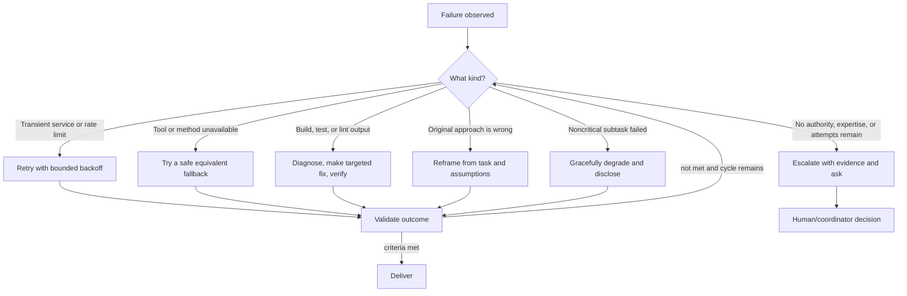
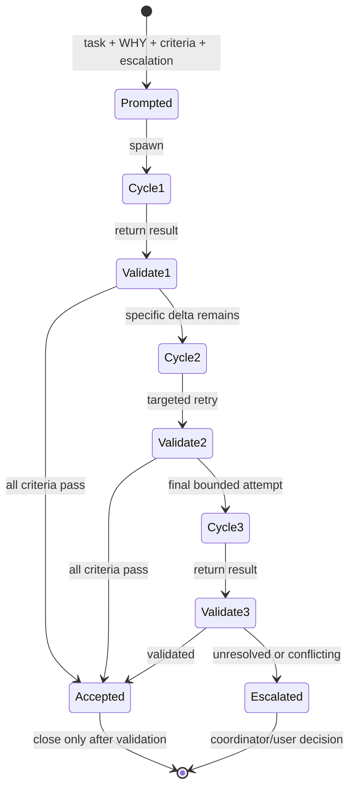
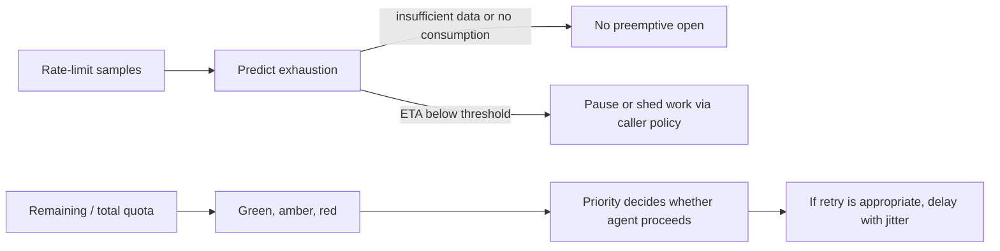

# Chapter 19: Error Recovery and Iterative Retrieval

> **Prerequisites:** Chapter 18.

## What You'll Learn

- Classify a failure before choosing a recovery action, so retries do not worsen deterministic errors.
- Apply the five patterns in the `error-recovery` skill: retry with backoff, fallback, diagnose-and-fix, escalate with context, and graceful degradation.
- Structure delegated work with a concrete task, WHY, success criteria, and escalation path.
- Use the three-cycle iterative retrieval limit and validate every result before accepting it.
- Preserve reviewer lockout during recovery instead of allowing an author to self-revise rejected work.
- Distinguish Ralph's work-monitor loop and the SDK's predictive rate-limit controls from an illustrative model-fallback circuit breaker template.

## Failure Is Information

A failed command, test, tool call, or review is evidence. It is not automatically an instruction to retry. The important first question is: **what kind of failure is this, and what evidence would make another attempt likely to succeed?** A timeout may be transient. A missing executable may call for a different tool or an environment fix. A test failure may identify a bug in the change. A user correction may invalidate the approach itself. A permission error may require a human who can grant access. Treating every failure as “try again” wastes time and can create risk; treating every failure as terminal leaves recoverable work unfinished.

Squad ships an `error-recovery` skill that teaches agents to adapt rather than merely report failure. It offers five reusable patterns. These are decision guides, not a requirement to execute every pattern in sequence. For example, a deterministic type error calls for diagnosis, not a timed retry; a safety-sensitive push blocked by branch protection must never be bypassed with a force push.



## The Five Recovery Patterns

### 1. Retry with backoff

Use this for transient failures such as API timeouts, rate limits, intermittent network errors, or a temporary service outage. The shipped skill's simple example begins at two seconds and doubles the wait for each retry, with a maximum of three retries before escalation. Record the attempt and the actual error; otherwise the next person cannot tell whether the failure is recurring or changing.

The point of backoff is to reduce pressure on a recovering service, not to disguise an error. Respect a server-provided retry time when available, use jitter where concurrent clients may retry together, and stop after the bounded limit. Do not retry validation errors, invalid user input, or a confirmed authorization denial as if they were transient. Correct the input or escalate for access instead.

### 2. Fallback alternatives

Use a fallback when the primary tool or approach is unavailable but another safe method can satisfy the same intent. A CLI command might have a documented API alternative; a missing optional formatter might be replaced by the repository's existing formatter. Preserve intent and security properties. Document the fallback and why you used it so reviewers can assess whether the change is equivalent.

A fallback is not permission to bypass a safeguard. If a protected push is rejected, `git push --force` is not an acceptable “alternative.” If an authenticated command fails because the credentials lack access, switching to an unrelated account or writing state manually is not equivalent. For operations that change external state, confirm that the alternative has the same target, scope, and audit trail.

### 3. Diagnose-and-fix

Use this for structured failures such as build, test, type-check, or lint errors. Read the full output, locate the originating error, and identify the smallest plausible cause. Make a targeted change, rerun the relevant check, and inspect whether the failure moved, disappeared, or exposed another issue. The skill caps this at three fix-and-retry cycles before escalation.

Avoid “fixing” test output without understanding it. If a test fails because behavior is wrong, correct the implementation; do not weaken the assertion merely to turn the build green. If the failure is pre-existing, establish that with evidence and report whether your change could have contributed. Validation should use the smallest reliable check first and broaden only when necessary.

### 4. Escalate with context

Escalation is the appropriate recovery when bounded attempts are exhausted, the issue needs human judgment or authority, or a fix would conflict with a team decision. A helpful escalation tells the coordinator what happened, what you tried, the exact error, the likely root cause, what remains uncertain, and what decision or access is needed. “It failed” transfers no useful work. “The integration test still returns 500 for an empty JSON body after the parser guard; malformed JSON now returns 400. Need the API owner to decide whether empty bodies should mean `{}` or be rejected” is actionable.

Do not create endless retries to avoid admitting uncertainty. Nor should a delegated agent manufacture a team policy or expand scope to unblock itself. Escalation can ask for a human decision, a specialist, permission, a dependency change, or a corrected requirement. Name the ask.

### 5. Graceful degradation

Use graceful degradation when a noncritical subtask fails but useful work can still be delivered. Identify which requirement is blocked, which remains satisfied, and what consequence the omission has. Label partial results explicitly and offer the smallest next step to restore the missing piece. This pattern is not appropriate when the missing part is essential to safety, correctness, or the user's stated acceptance criteria.

A report with an unavailable optional chart may be delivered without the chart if it clearly says so. A payment flow without its authorization check may not be described as “mostly complete.” Decide criticality against the task's success criteria, not convenience.

| Failure class | First response | Bound | Do not |
|---|---|---|---|
| Transient network/API | Backoff and retry | Three retries; record errors | Hammer repeatedly without delay |
| Missing tool/approach | Safe equivalent fallback | Same intent and permissions | Silently weaken safeguards |
| Build/test/lint | Diagnose and target fix | Three fix cycles | Delete/loosen a failing assertion blindly |
| User says approach is wrong | Reframe from original request | Compare alternatives before choosing | Continue implementing stale assumptions |
| Permission/unclear requirement | Escalate with context | Pause until authorized/decided | Guess credentials or policy |
| Noncritical optional input | Degrade transparently | State impact and omission | Claim full completion |

## Reframe When the Approach Is Wrong

The current error-recovery documentation lists retry, fallback, diagnose-and-fix, escalation, and graceful degradation. A “reframe-and-retry” sequence appears in the mapped feature page as an additional pattern: stop the wrong approach, reread the task, identify the mistaken assumption, and consider alternatives before proceeding. The shipped `templates/skills/error-recovery/SKILL.md` does not include that named section. In practice, treat it as sound guidance but do not claim it is a separate implemented runtime mode.

Reframing is different from debugging. If the code has a typo, diagnose-and-fix it. If the architecture assumes the wrong database or the user's correction says “that won't work because…”, stop, restate the real constraint, and compare at least two plausible approaches. When the cost of another wrong choice is high, ask for a decision before implementing. Preserve any work that remains useful, but do not let sunk cost dictate the next step.

## Iterative Retrieval: Bounded Delegation With Validation

Delegation can fail even when the agent is capable: the task may be vague, the why may be missing, acceptance criteria may be implicit, or no one checks whether the result is complete. The `iterative-retrieval` skill addresses this with a structured spawn prompt and a maximum of three cycles. “Retrieval” here means obtaining scoped work from a sub-agent, then checking and, only if needed, requesting a targeted correction; it is not permission to endlessly regenerate the same request.

Every spawn prompt should include four parts:

```markdown
## Task
{Concrete, bounded deliverable}

## WHY this matters
{Motivation, user goal, and what breaks if skipped}

## Success criteria
- [ ] {Observable acceptance condition}
- [ ] {Validation or output condition}

## Escalation path
{What to do when blocked, uncertain, or out of scope}
```

The **WHY** provides decision context. An agent told only “add a test” may choose an irrelevant test; an agent told “this prevents empty task titles from creating records and protects the create endpoint contract” can prioritize the right edge cases. Success criteria are observable and testable, not impressions such as “make it good.” The escalation path prevents the agent from guessing when requirements are ambiguous, a dependency is blocked, or authority is missing.

| Cycle | Coordinator action | When to stop |
|---|---|---|
| 1 — initial attempt | Compare result with explicit success criteria | Accept if complete; otherwise identify the remaining delta |
| 2 — targeted correction | Forward what was tried and the exact missing items | Accept if complete; otherwise describe the final gap |
| 3 — final attempt | Send all relevant context from cycles 1 and 2 | Accept if validated, otherwise escalate; no cycle 4 |

The coordinator validates each result before accepting it or starting another cycle. Check that criteria are met, no requested work was silently skipped, obvious regressions were not introduced, and reported uncertainty is either resolved or escalated. For code work, verify the expected artifact and run the narrowest appropriate tests. The skill's checklist also calls out PR existence/description where relevant. A polished answer is not proof of completed work.

A cycle-two prompt must include a delta, not merely repeat the original prompt: “Cycle 1 added an invalid-status test, but omitted the nonexistent-ID case and did not rerun `npm test`; add that case and report the full test result.” Cycle three carries forward the complete history of attempts and remaining criteria. If three attempts do not converge, the problem may be unclear requirements, a missing dependency, a mistaken decomposition, or a capability gap. Escalate with the evidence rather than spawning cycle four.



### Retry or escalate?

Retry when the output is close and the gap is concrete: a missing file, an omitted test, or a partial result whose missing part is well understood. Escalate when requirements are fundamentally unclear, cycles are exhausted, different attempts conflict, external permissions are required, or a dependency is incomplete. If a delegated research task has no implementation follow-up, the skill requires a concrete next action before closing the cycle—for example a decision, issue, PR, or an explicitly approved reason that no action is warranted. This keeps investigation connected to outcomes.

Before creating a new issue, the skill requires a duplicate check using representative title keywords, for example:

```bash
gh issue list --search "task status validation" --state open
```

If an open issue already covers the same problem, contribute to it rather than creating a duplicate. This check is part of the skill's issue-dedup rule, not a substitute for repository-specific issue conventions.

## Reviewer Rejection Is a Governance Boundary

Recovery must respect the reviewer protocol from Chapter 18. If a reviewer rejects an artifact, do not ask its original author to “try one more time” as the next revision. The author is locked out for that artifact's revision; a different agent must own the next attempt, or the coordinator escalates if no eligible agent remains. The recovery patterns still apply to the new revision owner: diagnose the finding, use a safe fallback, validate, and escalate if stuck. The reviewer restriction governs **who** may revise; recovery governs **how** the new owner works.

This avoids a common false choice between resilient behavior and quality control. Resilience is not persistence at all costs. It is selecting the response most likely to make progress while preserving safety, independence, and clear responsibility.

## Ralph, Rate Limits, and the Circuit-Breaker Analogy

Ralph is Squad's work monitor/issue-processing capability, not a magic retry policy for every agent error. The CLI offers `squad triage`, which can scan for work and optionally execute it; in v1.1.0 its help describes opt-in capabilities such as `--two-pass`, `--wave-dispatch`, and `--retro`, plus `--max-concurrent` and `--timeout`. Ralph's normal operational loop should skip blocked work and surface blockers rather than repeatedly attempting the same impossible task. Chapter 9 covers the work loop in detail.

The repository contains a `templates/ralph-circuit-breaker.md` describing model-rate-limit fallback: CLOSED, OPEN, and HALF-OPEN states; a preferred model; a fallback chain; and a cooldown. It includes a PowerShell integration example and a suggested `.squad/ralph-circuit-breaker.json` state file. This is a template document, not evidence that the v1.1.0 CLI automatically runs that model-selection workflow. No corresponding model-fallback implementation or state file schema was found in the stable runtime.

There is, however, an actual SDK rate-limiting module at `packages/squad-sdk/src/ralph/rate-limiting.ts`. It offers a different design: `getTrafficLight` marks more than 20% quota remaining green, more than 5% amber, and 5% or less red (a zero limit is red); `shouldProceed` permits every priority in green, only priority 0 in amber, and none in red. `getRetryDelay` calculates an exponential delay with jitter inside priority-specific windows. `PredictiveCircuitBreaker` stores a bounded series of samples and predicts time to exhaustion, opening preemptively when the predicted time is below its warning threshold. The module also exposes a cooperative rate pool: known agents may proceed while `used < allocated`, consuming quota increments their usage, and an expired lease from another agent can have its unused allocation reclaimed. An unknown agent is permitted by `canUseQuota` and has no allocation incremented by `consumeQuota`, a permissive behavior worth considering when wiring the API. These are SDK APIs for consumers to wire into a system; they do not imply that Ralph automatically switches between named models.



The circuit-breaker concept is useful beyond rate limits: fail fast when a dependency is unhealthy, avoid piling on requests, and test recovery after a cooldown. But always distinguish **analogy**, **template proposal**, and **implemented API**. A circuit breaker is not identical to backoff: backoff schedules a retry, while an open circuit temporarily prevents requests from proceeding. Nor does an SDK predictor itself decide which lower-cost model to use; the calling integration must define the action.

## Resilient Habits for Human and Agent Teams

A resilient team makes every failure easier to handle next time:

- Preserve the exact command, error, and relevant environment details; redact secrets.
- Keep an explicit attempt count and change one variable at a time when diagnosing.
- Make retries idempotent where possible. Before repeating an external write, check whether the first attempt actually succeeded.
- Prefer narrow validation early, then broaden to integration or full-suite tests when risk warrants it.
- State what is known, what is inferred, and what remains uncertain.
- Keep recovery bounded. Timeouts, retry limits, and cycle caps prevent a hung agent from consuming the work budget.
- Treat user corrections as new evidence about intent. Re-read the original request rather than defending the first implementation.
- Convert repeated failures into a concrete improvement—test, directive, skill, runbook, issue, or tracked code change—after approval where required.
- Never conceal partial success. Explain what passed, what did not, and the consequence.

These habits make a good handoff reusable. A new agent can start from the evidence instead of repeating failed experiments. The coordinator can choose between another targeted attempt and a human decision. The user can distinguish a true blocker from a task that merely needs a more precise prompt.

## Hands-On: Practice a Bounded Recovery on Tasktrack

Use the Tasktrack repo at its current checkpoint. The baseline uses Node's built-in test runner and Node 22.18+ type stripping; no extra packages are needed.

1. Run the existing suite from the Tasktrack root:

   ```bash
   npm test
   ```

   Expected result: all baseline tests pass.

2. In your Squad session, submit a bounded task prompt: “Add an integration test proving `PATCH /tasks/:id` rejects a null status with 400. WHY: malformed or absent status must not mutate task state. Success criteria: test exists, it fails against the old behavior if the old behavior is actually present, it passes after a targeted fix, and `npm test` passes. If current code already rejects null, report that and propose the smallest meaningful adjacent edge case instead of changing working behavior. If the contract is unclear, stop and ask.” This practices the four-section iterative-retrieval prompt without manufacturing a known failure.
3. Validate the returned change yourself. Review `api/src/app.ts` and `api/test/app.test.ts`, run `npm test`, and check the response status and state semantics. If an assertion fails, diagnose its full output; do not simply ask the same agent to “try again.” Give one cycle-two delta and state what remains.
4. If review rejects the artifact, follow Chapter 18's lockout: assign the revision to a different agent and pass the exact finding. Do not let the original author pair on the fix. If all eligible agents are exhausted, escalate.
5. Add a short error-handling section to the Tasktrack API conventions skill: expected errors, validation response, and the test command. Keep it focused and tracked through your normal review process.

Expected result: a verified API contract change only if the existing implementation needs it, and a documented recovery history that ends in acceptance or a clear escalation. A test that passes without checking the contract or a prompt that hides uncertainty is not successful completion.

## Configuration Reference

| Item | Default or values | Meaning |
|---|---|---|
| Retry with backoff | Start at 2 seconds; double each retry; max 3 retries in skill example | For transient failures only |
| Diagnose-and-fix | Max 3 fix/retry cycles | Read full output; targeted change; rerun validation |
| Fallback | No universal command | Preserve operation intent and safety properties; document alternative |
| Iterative retrieval cycles | 1–3; cycle 3 is final | Coordinator validates after each cycle; never cycle 4 |
| Spawn prompt sections | `Task`, `WHY this matters`, `Success criteria`, `Escalation path` | All four appear in skill template |
| Issue duplicate check | `gh issue list --search "<keywords>" --state open` | Search before creating a new issue |
| Ralph issue triage | `squad triage [--execute]` | `--execute` enables work execution; scanning alone is not the same as coding |
| Triage concurrency/timeout | `--max-concurrent N`, `--timeout N` | Help documents defaults as 1 concurrent issue and 30 minutes per issue |
| Triage optional recovery-related capability | `--retro` | Retrospective enforcement capability; separate from coordinator ceremonies |
| SDK retry delay | Priority-specific windows in `rate-limiting.ts` | P0: 500 ms–5 s; P1: 2–30 s; P2: 5–60 s, plus up to 50% jitter |
| SDK quota traffic light | Green above 20%; amber above 5%; red at 5% or below; zero limit is red | Amber only permits priority 0; red pauses all priorities |
| SDK rate pool | `.squad/rate-pool.json` under team root, then `~/.squad/rate-pool.json` | Unknown agents are allowed by `canUseQuota`; consumers must decide whether that fail-open behavior suits them |
| SDK predictor defaults | `maxSamples: 10`, warning threshold `120` seconds | Actual SDK `PredictiveCircuitBreaker` options |
| Model fallback template | Preferred/fallback model settings in `templates/ralph-circuit-breaker.md` | Illustrative template; no stable automatic model-failover runtime verified |
| Recovery state path | None universal | Do not invent a `.squad` file or persistence behavior; follow configured backend |

## Under the Hood

The `error-recovery` and `iterative-retrieval` features are shipped as skills in `templates/skills/`. They guide agent behavior through instruction text. They do not create a command named `squad recover`, nor does the CLI enforce a universal retry counter for every shell action. The coordinator and agent need to honor the skill, and acceptance still depends on validation.

The iterative-retrieval template is explicit about bounds: each spawn includes Task, WHY, success criteria, and escalation path; after each cycle the coordinator checks the result; cycle 2 and 3 include the objective delta; cycle 3 either completes or escalates. The skill additionally requires issue dedup before issue creation and an actionable outcome for research work. These are governance requirements, not hidden CLI flags.

The SDK rate-limiting functions implement mechanisms that can support resilience. The excerpt below shows how delay is derived: an exponential base capped within the priority window, plus jitter. The function returns a duration; it does not sleep or retry the request itself.

```ts
export function getRetryDelay(priority: AgentPriority, attempt: number): number {
  const [min, max] = RETRY_WINDOWS[priority] ?? RETRY_WINDOWS[2];
  const base = Math.min(min * Math.pow(2, attempt), max);
  const jitter = Math.random() * base * 0.5;
  return Math.round(base + jitter);
}
```

The predictive breaker keeps at most a configured number of recent samples. It needs at least three, returns `null` when elapsed time is zero or the first-to-last sample shows no positive consumption, and compares its predicted exhaustion time to a threshold. Its source comment mentions regression, but the implementation calculates a first-to-last consumption delta, not a least-squares regression. That implementation detail is a doc/code mismatch worth preserving accurately. The rate-pool loader checks the supplied team root's `.squad/rate-pool.json` before the user's `~/.squad/rate-pool.json`; it returns `null` if neither contains parseable state. This is cooperative quota accounting, distinct from the template's `.squad/ralph-circuit-breaker.json` model-fallback state. The module's traffic-light gates and rate pool provide quota controls; orchestration decides how they are wired into real work.

The PowerShell model fallback template proposes a separate stateful pattern. Its open/closed/half-open transitions describe a common resilience design, but v1.1.0's checked-in SDK implementation is predictive rate protection rather than automatic model fallback. If you adopt the template operationally, own the script, verify the model IDs and billing behavior for your environment, and test state transitions. Do not describe that workflow as a built-in Squad CLI feature.

Ralph itself is wired through CLI capabilities and work-monitor instructions. The triage executor's behavior around blocked issues and escalation is related to resilience: it avoids repeatedly selecting work explicitly marked blocked, and moves on while preserving the blocker. That is a work-queue policy, not iterative retrieval's three attempts and not the SDK circuit breaker's predictive quota analysis.

## Pitfalls and Troubleshooting

- **Retrying deterministic errors:** Fix invalid input or code; do not add delay to a 400 response or type error.
- **Unbounded retries:** Respect the pattern's three-retry/fix-cycle limit and the retrieval protocol's three cycles total.
- **Changing too much at once:** Target one likely cause and rerun the smallest relevant test.
- **Blind fallback:** Ensure the alternative preserves permission boundaries, target, idempotency, and audit trail.
- **Repeated external writes:** Check whether the prior attempt succeeded before issuing a duplicate write.
- **Vague delegation:** Include WHY, acceptance criteria, and escalation. “Do the rest” is not enough.
- **Cycle-two repetition:** Send the exact delta from cycle one; do not reset the conversation context.
- **Accepting without validation:** Completion claims do not replace checking files, tests, and unresolved uncertainty.
- **Cycle four:** Stop and escalate. Lack of convergence often signals unclear requirements or a missing dependency.
- **Over-degrading:** If a failed step is critical to safety or acceptance, stop rather than shipping partial output.
- **Breaking reviewer lockout:** A recovery retry cannot reassign rejected work to its original author.
- **Mislabeling circuit-breaker behavior:** The Ralph model-fallback template and SDK predictive breaker are different. Neither proves the CLI automatically switches models.
- **Mistaking sample snippets for verified commands:** Use `squad --help` and source for exact flags; for the stable triage command, `--retro` is documented as an opt-in capability.

## Summary

Reliable recovery begins with classification, not repetition. Use bounded backoff for transient faults, a safe fallback for missing tools, diagnose-and-fix for actionable test output, escalation for unresolved judgment or authority, and graceful degradation only for noncritical omissions. Delegated work needs a concrete task, WHY, success criteria, and escalation path, followed by validation after each of at most three cycles. Reviewer lockout remains in force throughout recovery. Ralph's queue behavior, the SDK's rate-limit controls, and a template's model-fallback circuit breaker are related ideas, not interchangeable product claims.

## Exercises

1. Choose a recovery pattern for each case and explain the stop condition: an intermittent 503, a deterministic test assertion failure, an unavailable optional report section, and a push blocked by branch protection.
2. Rewrite this weak delegation prompt into the four-section format: “Make the Tasktrack API work and tell me when it's done.”
3. Cycle 1 adds a test for invalid status but misses unknown task IDs. Write a cycle-two prompt that carries forward the objective delta. Then state what cycle three should contain if the second attempt still omits validation.
4. A reviewer rejects a patch authored by Nova. The tests then fail again while a different agent revises it. Explain how recovery proceeds without violating lockout.
5. Compare the circuit-breaker template's model fallback with the SDK's `PredictiveCircuitBreaker`. Identify two claims you must not make about v1.1.0's built-in runtime.

## Quiz

1. Which class of failure is a good candidate for retry with backoff?
2. What information should a useful escalation contain?
3. Name the four required iterative-retrieval spawn-prompt sections.
4. How many retrieval cycles are permitted, and what happens after the final unsuccessful cycle?
5. Why must the coordinator validate an agent's output before closing the issue?
6. May the original author revise a rejected artifact if the next agent is struggling?
7. What is the distinction between backoff and an open circuit?
8. Does the SDK predictive breaker automatically select a lower-cost model?

## Further Reading

- [Error Recovery — Standard Failure Patterns](https://bradygaster.github.io/squad/docs/features/error-recovery/)
- [Error recovery skill](https://github.com/bradygaster/squad/blob/v1.1.0/templates/skills/error-recovery/SKILL.md)
- [Iterative retrieval skill](https://github.com/bradygaster/squad/blob/v1.1.0/templates/skills/iterative-retrieval/SKILL.md)
- [Reviewer protocol skill](https://github.com/bradygaster/squad/blob/v1.1.0/templates/skills/reviewer-protocol/SKILL.md)
- [Ralph circuit-breaker template](https://github.com/bradygaster/squad/blob/v1.1.0/templates/ralph-circuit-breaker.md)
- [SDK rate-limiting module](https://github.com/bradygaster/squad/blob/v1.1.0/packages/squad-sdk/src/ralph/rate-limiting.ts)
- [CLI triage command help/source](https://github.com/bradygaster/squad/blob/v1.1.0/packages/squad-cli/src/cli/commands/watch/index.ts)
- [Coordinator prompt](https://github.com/bradygaster/squad/blob/v1.1.0/.github/agents/squad.agent.md)
