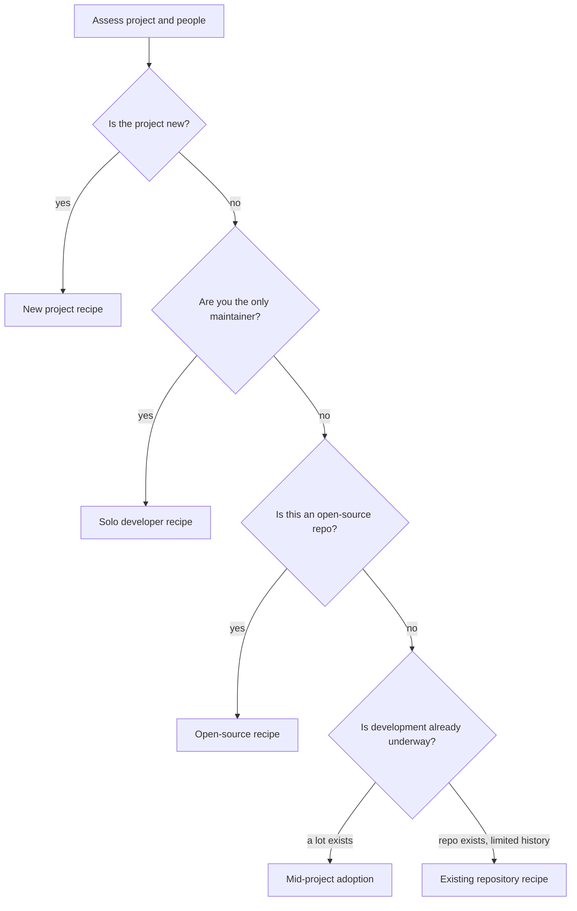
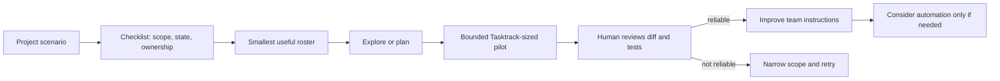

# Chapter 20: Scenario Playbook A: Solo, New, Existing, Mid-Project, Open Source

> **Prerequisites:** Chapter 4.

## What You'll Learn

- Select a Squad setup based on repository maturity, team size, risk, and collaboration model.
- Apply a decision checklist before casting agents or enabling automation.
- Follow a repeatable, staged recipe for solo development, a new project, an existing repository, mid-project adoption, and open source.
- Adapt every recipe to Tasktrack without letting example prompts substitute for tests, code review, or deployment planning.
- Avoid overbuilding a roster, leaking private state, or trusting automation before its permissions and scope are understood.

## Choose a Scenario Before You Cast a Team

The same Squad runtime can support very different ways of working. A solo maintainer usually needs a small group of complementary reviewers; a greenfield project needs help decomposing an uncertain design; an established codebase needs careful exploration before edits; mid-project adoption needs the team to learn existing conventions; and an open-source repository needs contributor safety and public-facing governance.

Do not start by asking “How many agents can I create?” Begin with the constraints that shape safe delegation: what code exists, who owns decisions, what the agent may change, how work is reviewed, where durable team state belongs, and what the team must never expose. Then choose the smallest roster and workflow that covers those responsibilities.



A scenario is a starting point, not a rigid team template. The roster, routing rules, and response modes should change when your architecture, contributor base, or workload changes. Chapter 21 covers other project shapes such as large codebases, monorepos, and human teams.

## Scenario 1: Solo Developer

A solo developer lacks a second reviewer, a testing partner, and a dependable sounding board. Squad can help provide those functions, but it does not remove your responsibility for architecture, credentials, data handling, or final approval. In practice, one person still owns the code and the merge decision; agents are task-specific assistants, not a substitute for an accountable maintainer.

### Decision checklist

Before casting the team, answer:

- Which parts of the stack do you actually touch? If the project is API-only, a dedicated frontend specialist may be wasted context.
- What is the highest-risk recurring gap—tests, code review, backend knowledge, documentation, or deployment?
- Which decisions remain yours, and what evidence should the Lead require before accepting work?
- Can you parallelize independent tasks, or will one agent's changes block the others?
- What state is safe to keep in version control, and which environment-specific notes or secrets must stay out?
- Is the project small enough that a two- or three-specialist team plus the built-in roles is clearer than a large roster?

### Step-by-step recipe

1. **Initialize the repository and Squad.** In an existing Git repository, run the v1.1.0 setup flow and inspect the generated files before committing:
   ```bash
   git status --short
   squad init
   git status --short
   ```
   Confirm the actual state path is `.squad/`, then review the team and agent instructions.
2. **Describe your project and constraints.** Tell the coordinator the stack, the parts you own, what should not change, and the kind of help you need. For example: “I maintain a small Go API alone. I want a backend specialist and a testing/review focus. Keep changes scoped, add tests, and ask before changing persistence or authentication.”
3. **Choose a minimal roster.** Start with the roles that map to distinct work. Do not add a nominal specialist when you have no task for them. The built-in roles and coordinator support remain governed by the installed version and project instructions.
4. **Ask for a codebase map before a feature.** Request a short architecture summary: entry points, tests, persistence, error handling, and risky areas. Correct mistaken assumptions and record only stable conventions in the appropriate state files.
5. **Give one bounded task.** Include behavior, files or subsystem, acceptance criteria, test command, and a constraint against unrelated refactoring. Ask the Lead/reviewer to inspect the diff and tests, then personally verify both.
6. **Keep memory useful.** Promote a lesson into a skill or decision only when it is reusable. Avoid encoding temporary implementation guesses as permanent project law.
7. **Review and commit.** Inspect `git diff`, run the project tests, and commit code and intended team state deliberately. A solo operator is the final reviewer.

Use the Lead as a sounding board rather than an unquestioned authority. Ask for the strongest counterargument, alternatives, assumptions, and failure modes. If the recommendation affects architecture, decide and record the choice explicitly.

### Tasktrack variation

Tasktrack is small enough that one person does not need five agents. Ask for a compact team centered on the `api/` backend and tests; add frontend specialization only when changing `web/`. First request a map of `api/src/app.ts`, `api/src/tasks.ts`, and `api/test/app.test.ts`. Then assign one bounded improvement such as rejecting non-string task titles, requiring the agent to add a `node:test` case, preserve existing HTTP status codes, and run `npm test`. Have a separate reviewer inspect the resulting diff. Because the sample store is in-memory, do not mistake a process restart for a Squad-state failure or promise persistent tasks.

## Scenario 2: New Project

A new project has little code to discover but many choices to make. Squad can accelerate scaffolding, but early decisions have long tails. The right goal is not to generate the largest possible codebase; it is to make the first structure coherent, testable, and easy to change.

### Decision checklist

- What is the product's first valuable behavior, and what is deliberately out of scope?
- Which runtime, framework, persistence layer, and deployment target are fixed versus still open?
- What minimal acceptance tests prove the initial vertical slice works?
- Which decisions need human approval—security model, data retention, payments, infrastructure, public API?
- Is parallel work independent enough to justify multiple agents, or should one agent establish interfaces first?
- What generated files belong in Git, and what should be local-only?
- Which dependencies are permitted, and how will upgrades and reproducible setup be handled?

### Step-by-step recipe

1. **Create and initialize the repository.** For example:
   ```bash
   mkdir my-app && cd my-app
   git init
   squad init
   ```
   Make sure you are at the repository root. Run `squad init` only after deciding that the repository should contain Squad's project configuration.
2. **Describe the minimum viable slice.** Give the coordinator the users, core behavior, chosen stack, non-goals, testing requirements, and deployment constraints. Ask it to propose the team and plan before implementing broad scaffolding.
3. **Review the proposal.** Remove overlapping roles and challenge assumptions. A new project needs people who can define a stable interface and test it—not a specialist for every technology mentioned in a future roadmap.
4. **Establish boundaries and acceptance criteria.** Ask the team to propose a directory layout, test strategy, and first vertical slice. Keep unresolved architectural decisions explicit; do not let an agent silently choose a security-sensitive default.
5. **Build a thin slice.** Assign the interface or simplest end-to-end feature. Require tests and a run command. Add parallel work only after interfaces are agreed and files can be owned independently.
6. **Inspect generated project and Squad artifacts.** Check dependency manifests, scripts, `.squad/` guidance, and Git diff. Remove secrets and machine-specific state. Confirm instructions match the actual code.
7. **Run from a clean checkout.** Follow the documented setup commands, tests, and application start procedure. Then commit the foundation and its deliberate team decisions.

### Tasktrack variation

The book's starter is the “new project” context for this chapter's exercise: copy the sample, initialize Git, run `npm test`, and start the API with `npm start`. The app has no package dependencies and needs Node.js 22.18+ for direct TypeScript type stripping. Ask Squad to propose a team for this existing starter, but keep the first task to one vertical slice—such as adding a task priority field through `Task`, `TaskStore`, API behavior, and tests. Require compatibility notes for the current endpoints and a full `npm test` run. Do not add a database just because a future production version might need one.

## Scenario 3: Existing Repository

An existing repository contains conventions that may be documented only in code, tests, commit history, or maintainers' habits. The priority is to discover before editing. Treat the first session as a reconnaissance and alignment phase; the quickest path to an implementation is often the path that creates the most cleanup when agents guess incorrectly.

### Decision checklist

- Is this the intended repository root and default branch? Is the worktree clean or are there user changes to preserve?
- What languages, frameworks, build commands, test suites, and code owners are present?
- Which directories are generated, vendored, sensitive, or unsafe for autonomous edits?
- Which conventions are visible in code, and which must be explained by maintainers?
- Does `.gitattributes` already have rules that must be preserved when Squad adds its own?
- Where does team state live: tracked `.squad/`, an external root, or another supported backend?
- What is the smallest low-risk task that can validate the team’s understanding?

### Step-by-step recipe

1. **Preserve the current worktree.** Run `git status --short` and do not stage or overwrite changes you did not make. Check the branch and repository root.
2. **Initialize Squad, then inspect the diff.** Run `squad init` from the repository root and review all created or updated files. Keep existing Git attributes and project instructions intact; reconcile conflicts rather than replacing them wholesale.
3. **Ask agents to explore without changing code.** Request a map of architecture, tests, build commands, data flows, and risky areas. Ask for claims to be tied to paths and examples, not just inferred from package names.
4. **Validate findings with a maintainer.** Correct errors and supply hidden norms such as backward-compatibility expectations, release constraints, or fragile integrations.
5. **Capture durable conventions.** Put stable rules in the appropriate instructions, routing, skills, or decisions. Keep security-sensitive values and personal information out of committed state.
6. **Choose a small pilot task.** Select an isolated improvement with clear acceptance criteria. Require an initial plan, tests, and a reviewer pass. Confirm the agent stays inside the approved file scope.
7. **Evaluate fit.** After a few sessions, inspect whether the team follows the repo's style, whether memories are helpful, and whether parallelism saves time. Adjust charters and routing before expanding scope.

### Tasktrack variation

Treat Tasktrack as an existing repository, even though it is deliberately small. First ask Squad to inspect `api/src/`, `api/test/`, and `web/` without edits. Ask it to distinguish facts from assumptions—for example, the server uses an in-memory `TaskStore`, which means current task data is process-local. Then choose a low-risk task such as an additional `PATCH /tasks/:id` validation test. Confirm the existing `node:test` style and preserve `GET /health`'s response. Run `npm test` and review `git diff` before accepting the agent's conclusion.

## Scenario 4: Mid-Project Adoption

Adding Squad months into development does not require a rewrite. It does require a reliable snapshot of where the project stands. Agents cannot infer why a choice was made solely from the current code, and an incomplete feature may not be obvious from a directory name. Your role is to provide current reality, not the original roadmap.

### Decision checklist

- What has shipped, what is in progress, and what has been abandoned?
- Which branch or release is the source of truth for the next task?
- Which modules are stable contracts and which are actively changing?
- What code is fragile, security-sensitive, or owned by another group?
- What existing tests, release checks, and review requirements must remain mandatory?
- Which historical decisions are still valid, and which must be explicitly superseded?
- Can the first Squad tasks be limited to a subsystem with a known owner and clear tests?

### Step-by-step recipe

1. **Establish a safe baseline.** Confirm the branch, worktree status, latest commit, and test/build commands. Do not add Squad while user changes are unreviewed or in the wrong checkout.
2. **Initialize and review generated configuration.** Run `squad init`, inspect `.squad/` and any other generated files, and decide intentionally which should be tracked according to the project's state strategy.
3. **Explain today's system.** Describe current architecture, completed features, active work, known defects, backlog priorities, and non-goals. Do not describe the project only as it was intended to be at kickoff.
4. **Run an exploration-only session.** Ask the team to identify module boundaries, data flow, test coverage, and unfinished work. Request paths and evidence. Have a human compare the result with current project knowledge.
5. **Feed in missing rationale.** Record established conventions and decisions only after distinguishing them from proposals. Note any superseded decision clearly so agents do not follow both.
6. **Start with a low-risk audit or test gap.** Avoid beginning with a half-finished payment integration, database migration, or broad refactor. Use a bounded task to calibrate the team against real review standards.
7. **Build a backlog bridge.** Map discovered work to the repository's existing issue tracker and label conventions. Do not duplicate open issues or create a new workflow without the maintainers' approval.
8. **Review after two or three sessions.** Check whether the team reduced repeated explanations and followed repo conventions; update instructions when you find a recurring misunderstanding.

### Tasktrack variation

Imagine Tasktrack has been in use for three months and another contributor built a persistence adapter. Ask the team to inspect the API, tests, and web client; identify which behavior is complete and which assumptions remain unverified. Explicitly mention that the current sample `TaskStore` is in memory so agents should not infer durability from the UI. Tell Squad the established API compatibility and test requirements. Begin by asking for missing tests around a known behavior, then have the backend agent implement only after the reviewer agrees the codebase map is correct. If your real repository diverges from the sample, document its actual structure instead of copying this scenario literally.

## Scenario 5: Open-Source Project

In an open-source repository, Squad output can affect contributors, public issues, maintainer workload, and project reputation. Transparency and restraint matter as much as speed. The maintainer owns labels, triage policy, permissions, and merge decisions. An issue label should not accidentally be a permission grant for broad code changes.

### Decision checklist

- What work may be automated safely, and what requires a maintainer's explicit approval?
- Can triage add labels only, or is an integration allowed to assign issues, create branches, or open PRs?
- Are contributor data, security reports, embargoed issues, and private vulnerability disclosures excluded?
- Does the workflow have least-privilege permissions, clear triggers, and a bounded runtime?
- Can the community see how automation works and how to opt out or request a human response?
- Are good-first-issue and agent-routing labels defined and reviewed by maintainers?
- Is a human required to inspect every change and approve every merge?

### Step-by-step recipe

1. **Start with governance, not automation.** Write down triage rules, project code of conduct, response expectations, and categories that must never be handled by public automation.
2. **Initialize Squad on a protected working branch.** Run `squad init` and inspect the changes. Decide which charters, skills, and decisions are appropriate to publish. Do not commit credentials, private incident notes, or contributor personal data.
3. **Document contributor conventions.** Ask the team to map tests, style, issue templates, supported versions, and PR expectations. Verify every generated instruction with maintainers.
4. **Pilot assistive triage manually.** Have agents summarize or suggest labels for a small batch, but require a maintainer to apply decisions. Record common issue categories and uncertain cases.
5. **Review workflow files before enabling automation.** Check triggers, write permissions, secrets, branch selection, network access, and who can label or assign work. Do not copy a heartbeat or auto-assign workflow from an older example until it is verified against the current CLI and repository policy.
6. **Gate autonomous changes.** If the project later enables an issue-to-PR workflow, restrict eligible labels, require clear acceptance criteria, use least privilege, run tests and checks, and keep human approval before merge.
7. **Communicate transparently.** Explain in CONTRIBUTING or an automation notice what Squad can do, what it cannot do, how maintainers review output, and where to report mistakes.
8. **Measure and revise.** Track time-to-first-response, duplicate/incorrect labels, maintainer correction rate, and PR review burden. Disable or narrow automation if it creates noise or unsafe outcomes.

### Tasktrack variation

Use Tasktrack as a public demo repository. First add clear contributor instructions: supported Node version, `npm test`, `npm start`, and areas that need maintainer review. Ask Squad to suggest labels for a few fictional or consented sample issues, but have a maintainer apply them. Define `good-first-issue` only for tasks with isolated files and testable acceptance criteria. If you evaluate an issue-to-PR workflow, use a test fork or branch, inspect its exact GitHub Actions permissions, require a human review, and do not give it access to production credentials. Avoid publishing private contributor details in `.squad/` memories.

## Comparing the Five Paths

| Scenario | First best investment | Initial roster bias | First task | Main risk to guard against |
|---|---|---|---|---|
| Solo developer | Review and test discipline | Small, complementary roles | Isolated feature plus tests | Treating generated output as approved code |
| New project | Clear slice and constraints | Interface, implementation, test coverage | Thin vertical slice | Premature architecture and dependency sprawl |
| Existing repository | Evidence-based exploration | Match current architecture | Low-risk test or bug fix | Guessing conventions and overwriting local work |
| Mid-project adoption | Current-state map and decisions | Specialists for active subsystems | Audit/test gap | Confusing intended design with shipped behavior |
| Open source | Governance and permissions | Triage/review/documentation roles | Manual triage pilot | Automation acting on untrusted public input |

A mature workflow usually progresses from manual, reviewable assistance to automation only after repeated success. That does not mean every project should automate. A small or sensitive project may remain fully interactive indefinitely. Use response modes, issue workflows, and scheduling features from the relevant chapters only when their particular permissions and behavior are understood.



## Hands-On: Choose and Run a Scenario

Pick the scenario closest to your work and use its checklist before issuing a code-changing prompt. Record the repository root, branch, state backend, owner, test command, permitted files, and human review gate. Then follow the matching recipe through one pilot task. This chapter's Tasktrack variations supply safe examples; substitute actual project behavior and constraints when working in your own repository.

A useful pilot request has five parts: **role**, **objective**, **scope**, **acceptance criteria**, and **verification**. For Tasktrack, an example is: “Backend agent, add one test for a missing task ID on `PATCH /tasks/:id`. Keep the existing status codes and response shape. Change only the API and test files. Run `npm test` and report the changed files and test output. Do not commit.” This prompt makes the requested work observable and reversible.

After the run:

1. Inspect `git status --short` to find every changed file.
2. Read the full diff and verify that it addresses the intended behavior.
3. Run `npm test` yourself; do not substitute an agent's “tests passed” summary for the command result.
4. Ask a reviewer to challenge edge cases, not just summarize the diff.
5. Decide whether the result warrants an enduring skill, decision, or routing rule.
6. Commit only changes you intend to retain.

Compare your work to the described `ch20-start` and `ch20-end` tags when those tags are available in your own Tasktrack history. They are book checkpoints, not tags created by this exercise automatically.

## Configuration Reference

| Artifact or command | Role in a scenario | Decision to make |
|---|---|---|
| `squad init` | Initializes Squad project files from repository root | Review generated files and resulting Git diff before committing |
| `.squad/team.md` | Team roster and shared project context | Keep roles aligned to real work rather than hypothetical future needs |
| `.squad/agents/` | Agent charters and role-specific instructions | State scope boundaries and review expectations clearly |
| `.squad/routing.md` | Describes routing rules used by the team | Align rules with actual repository paths and issue labels |
| `.squad/decisions.md` | Durable record of decisions and directives | Write rationale, owner, date, and superseding decisions clearly |
| `.squad/skills/` | Reusable project procedures and conventions | Add stable, reviewed patterns; do not store secrets or private notes |
| `.github/agents/squad.agent.md` | Copilot-facing Squad agent definition | Confirm it matches the intended branch and version |
| `.github/workflows/` | Optional automation | Review triggers, tokens, permissions, and human gates before enabling |
| `git status --short` / `git diff` | Local safety and review | Preserve user changes and inspect all code/state modifications |
| `npm test` (Tasktrack) | Runs Tasktrack's Node test suite | Requires Node.js 22.18+; expected command is `node --test api/test/` |
| `npm start` (Tasktrack) | Starts Tasktrack API at configured port (default 3000) | Test health and stop process cleanly; task data is in-memory |

Do not infer that a filename, workflow trigger, label, or feature exists simply because a scenario example mentions it. Inspect the repository and v1.1.0 behavior first. GitHub automation is optional; the core scenario recipes work interactively with a human in the loop.

## Under the Hood

Squad's coordinator reads the project instructions, team roster, agent charters, routing rules, and relevant memory before dispatching work. The scenario recipes deliberately begin with context and scope because those inputs shape dispatch quality. A team definition does not itself run CI, select arbitrary remote branches, or guarantee an issue automation. Those behaviors depend on separate CLI, GitHub workflow, and host integrations described elsewhere in the book.

The repository is the durable boundary for much of the team context. `.squad/team.md` identifies the team; agent charters define role behavior; routing connects tasks to expertise; decisions and skills capture reusable project knowledge. The selected storage backend may move some state outside the repository, so the “commit `.squad/`” advice is not universal; see Chapter 2 (Volume 2) for backend selection. Scenarios should state which state model applies rather than assume tracked files are the only source of truth.

The five paths also differ in what counts as a good first task. A greenfield project benefits from a thin vertical slice; an existing codebase from an evidence-based test or bug fix; mid-project adoption from an audit of current state; open source from a manual triage pilot; solo work from delegated review and tests. This is a risk reduction sequence: establish quality and fit before broadening autonomy.

## Pitfalls and Troubleshooting

- **Don't pick roles by technology buzzword.** Pick responsibilities that match near-term, separable work.
- **Do not begin with a large refactor.** Use a bounded pilot to find mistaken assumptions first.
- **Do not confuse code-discoverable facts with unwritten rationale.** Tell the team constraints that are absent from tests and source.
- **Protect local changes.** Inspect Git status before initialization, upgrades, restores, and agent work.
- **Don't overstate automation.** Labels and workflow filenames are not proof that a supported automation is installed or safe.
- **Treat public issues as untrusted input.** Restrict workflow permissions and require human review.
- **Avoid stale path and CLI examples.** Confirm `.squad/` paths and current command behavior against the installed v1.1.0 release.
- **Do not commit sensitive context.** Public project memory must not contain credentials, private vulnerability details, or personal data.
- **Remember Tasktrack's limits.** The current task store is in-memory, the API is small, and a health response is not a production readiness guarantee.

## Summary

Choose the scenario by assessing ownership, maturity, risk, state, and automation boundaries. Use a small roster and an evidence-based exploration or pilot before expanding the team. Make every Tasktrack variation testable, preserve human review, and keep decisions and public repository memory appropriate to their audience.

## Exercises

1. Choose one of the five scenarios for your project. Complete its decision checklist and explain why the other four are poorer starting points.
2. Write a step-by-step first-session recipe for your scenario. Include a bounded first task, file scope, acceptance criteria, test command, and reviewer.
3. Adapt the Tasktrack variation for a change that touches both `api/` and `web/`. Identify which tasks can run in parallel and what shared interface must be agreed first.
4. For an open-source repository, draft an automation permission checklist that would prevent a public issue from gaining broad write access or bypassing human review.
5. After a successful pilot, name one fact that belongs in a decision, one pattern that belongs in a skill, and one temporary observation that should not be persisted.

## Quiz

1. Why should an existing repository be explored before an agent edits code?
2. What is the purpose of a bounded pilot task?
3. Which scenario has the strongest need to define public-input and workflow permission boundaries before automation?
4. Does `squad init` by itself prove a repository's issue workflows are safe or active?
5. What must a Tasktrack agent do to substantiate a claim that its change passed tests?
6. Why should a solo developer remain the final reviewer?
7. What should you verify before restoring team state from a repository backup?

## Further Reading

- [Solo Developer](https://bradygaster.github.io/squad/docs/scenarios/solo-dev/)
- [New Project](https://bradygaster.github.io/squad/docs/scenarios/new-project/)
- [Existing Repository](https://bradygaster.github.io/squad/docs/scenarios/existing-repo/)
- [Mid-Project Adoption](https://bradygaster.github.io/squad/docs/scenarios/mid-project/)
- [Open Source](https://bradygaster.github.io/squad/docs/scenarios/open-source/)
