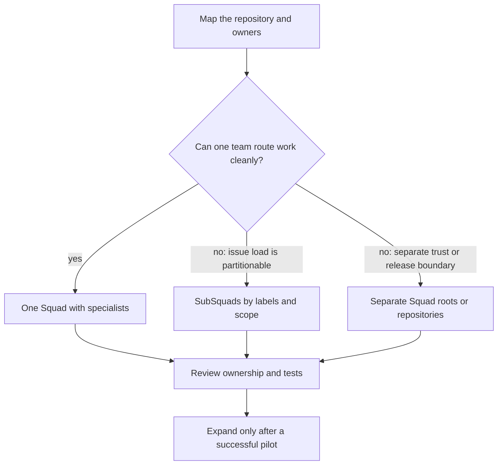
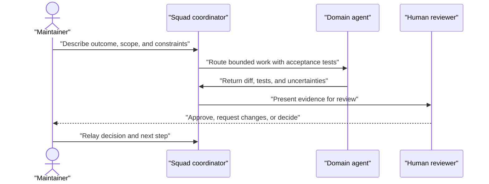

# Chapter 21: Scenario Playbook B: Large Codebases, Monorepos, and Human Teams

> **Prerequisites:** Chapter 4.

## What You'll Learn

- Scale Squad by narrowing the work each agent sees, not by asking every agent to inspect every directory.
- Decide when one team with specialists is enough, when to partition issue streams into SubSquads, and when genuinely separate repositories deserve separate teams.
- Design a monorepo roster, route work to service owners, and handle shared-library changes without pretending folder scopes are access controls.
- Put human decision-makers and reviewers into the collaboration process while keeping approval authority explicit.
- Apply a checklist and a repeatable recipe to each of four project shapes, then rehearse the choices with Tasktrack.

## Start with Boundaries, Not Headcount

A large codebase is not a request for a large agent roster. A monorepo with a dozen services may be navigable with a small group of agents and precise routing; a compact repository may need multiple independent workstreams when its issue volume or operating hours demand parallelism. Start by identifying boundaries that matter: ownership, interface contracts, test commands, change risk, and who can approve a decision. Add agents or partitions only when those boundaries create work that can be performed independently.

The first useful instruction on a large repository is usually an exploration request, not an implementation request. Ask the coordinator to identify entry points, module relationships, test locations, build commands, generated or vendored directories, and uncertain assumptions. Have it cite paths. Then choose one bounded task. A concise, evidence-based map will prevent more waste than a broad demand to “understand everything.”

> **Warning:** Context capacity is not a guarantee that an agent will inspect the right files or understand every dependency. Model context windows vary, and relevant context still has to be found and supplied. Do not rely on fixed token-count claims as a scaling plan.



This decision is not merely about directory count. A shared product, common release process, and frequent cross-service changes usually favor one team with domain specialists. Independent teams with different permissions, review policies, or state ownership may need stronger separation. SubSquads sit between those choices: they let multiple Squad instances divide issue intake for one project, but they do not create a security boundary or lock agents to a path.

## Scenario 1: Large Codebase

Large repositories impose three related costs: finding the relevant code, carrying its conventions into a task, and verifying that a change did not break distant consumers. The solution is selective exploration with explicit acceptance criteria. Give the agent a subsystem, a reason for that scope, and a way to prove the result. Let it expand scope only when it finds a dependency that requires it, and require it to report that expansion.

### Decision checklist

Before assigning work, check:

- **What is the smallest code boundary that contains the behavior?** Name a service, package, directory, entry point, or API rather than saying “the whole repo.”
- **What evidence should discovery produce?** Ask for paths, call chains, test names, and a build/test command. Separate observed facts from likely explanations.
- **Which files should not be read or changed casually?** Identify generated output, vendor trees, migrations, secrets, deployment manifests, and areas with a separate owner.
- **What upstream and downstream contracts matter?** A change in one package may affect imports, wire formats, generated clients, or consumers outside the initial directory.
- **What must remain stable?** State compatibility requirements, data shape, public API behavior, and error semantics.
- **What is the verification envelope?** List the narrow test first, then the broader suites or integration checks that the risk warrants.
- **Which knowledge is durable?** Put stable conventions into a skill or team instruction after a human verifies them; do not turn one investigation's guesses into permanent rules.

### Step-by-step recipe

1. **Orient Squad to the actual repository.** Run `git status --short`, confirm the repository root, and inspect the existing `.squad/` guidance. Preserve uncommitted changes. If Squad has not been initialized and this repository should track a team, initialize from the repository root and review the diff before committing it.
2. **Ask for read-only reconnaissance.** Request a short architecture map for the target domain: the entry point, important data types, consumers, tests, and commands. Ask the agent to stop before modifying files.
3. **Validate the map.** Check representative paths yourself or ask a domain owner to correct it. Confirm whether generated artifacts, APIs, or shared dependencies are involved.
4. **Route by responsibility.** Give the implementation to the agent closest to the subsystem. Give integration or cross-cutting work to a coordinator or lead who can decompose it. Route tests to an explicit tester when that is a distinct review step, not merely a title in the roster.
5. **Bound the change.** State the target behavior, permitted directories, acceptance cases, expected tests, and what should not be refactored. Ask the agent to request permission before materially expanding its scope.
6. **Review the evidence, not just the summary.** Inspect the diff, tests, and any files touched outside the expected boundary. Run the stated test command and a broader suite if the change crosses module boundaries.
7. **Promote only reusable lessons.** If the same module contract or test procedure is likely to recur, add a verified skill or routing rule. Remove stale instructions when the architecture changes.

### Tasktrack variation

Tasktrack is small, but use the large-repository discipline as a rehearsal. Ask Squad to inspect only `api/src/` and `api/test/`, map `GET /tasks` through the request handler and `TaskStore`, and identify the existing `node:test` cases. Then ask for one bounded API change, such as a validation case for `PATCH /tasks/:id`; require it to preserve current response behavior and run `npm test`. Do not ask the API specialist to inspect `web/` unless the change crosses the client contract. This simple boundary lets you see whether routing improves focus before scaling the same approach to hundreds of packages.

## Scenario 2: Monorepo

A monorepo is usually one product repository with multiple domains—not a rule that every service needs its own Squad. If agents share conventions, decisions, and release context, begin with a single `.squad/` at the Git repository root and add specialists for the meaningful domains. In a microservices monorepo, that might mean an API specialist, an identity specialist, a payments specialist, a frontend specialist, and a tester. If that list feels too large, combine related domains and let routing distinguish them.

The monorepo needs two kinds of routing. **Local routing** sends a change in one service to an owner. **Cross-cutting routing** sends shared-library changes, API contract changes, migrations, and integration tests to someone responsible for coordinating the affected consumers. A specialist should not be treated as the only person who can understand a service; instead, the route communicates a default owner and a useful starting point.

### Decision checklist

- Do the services share one product direction, review culture, and decision log? If yes, start with one Squad.
- Do service teams need distinct access, state retention, or approval authority? If yes, evaluate separate team roots or repositories rather than relying on folder names.
- Which service has a clear human or AI owner? Avoid a specialist per directory when work is sparse or responsibilities overlap.
- Where is shared code? Define who coordinates changes to `shared/`, generated types, schemas, API clients, and common deployment tooling.
- Which changes require multi-service integration tests, and who owns them?
- Is `.github/agents/squad.agent.md` expected at the repository root even when `.squad/` is nested? The v1.1.0 initializer has an `agentFileRoot` option for that monorepo layout decision.
- Are folder scopes guidance or access control? Treat `folderScope` as focus guidance; it is not an enforced filesystem sandbox.

### Step-by-step recipe

1. **Choose the team root.** For a repository-wide monorepo team, keep `.squad/` at the Git root so shared knowledge and routing apply across services. If using a nested state root, decide where the Copilot agent file must live; v1.1.0 initialization supports a separate agent-file root for discovery.
2. **Create a domain map.** List services, owners, public interfaces, tests, and shared packages. Highlight which changes must be coordinated across two or more domains.
3. **Cast a compact team.** Start with a coordinator/lead, a few domain specialists, and a test or review role where useful. Prefer a specialist who can own several related services over a long roster with overlapping scopes.
4. **Write routing rules with concrete work descriptions.** Match payment API changes to the payments owner, web UI changes to the frontend owner, and shared schema changes to a coordinating lead. Keep cross-service tests visible instead of routing them to an arbitrary service owner.
5. **Describe shared-code protocol.** Require the agent to search for consumers, state compatibility assumptions, update tests for affected packages, and identify any migrations or versioning. Routing by itself does not reveal the full dependency graph.
6. **Pilot a local change.** Select an isolated improvement in one service. Check whether the routed agent stays focused and whether the tests identify the right boundary.
7. **Pilot a cross-service change.** Choose a small interface-level task. Have the lead identify consumers and sequence the work; let specialists take independent implementations only after the interface is agreed.
8. **Adjust based on real workload.** If a service has little independent work, merge it into a broader role. If teams need their own permissions or lifecycles, evaluate stronger isolation rather than adding more text to routing rules.

> **Tip:** In the monorepo initializer, `agentFileRoot` can point at the Git root while `.squad/` remains in a subfolder. This solves agent-file discoverability; it does not automatically make every file path an enforced agent boundary.

### Tasktrack variation

Tasktrack already has two useful domains: `api/` and `web/`. Keep one team and begin with a backend/API specialist and a frontend specialist. Route `api/src/` and `api/test/` work to the API owner, `web/` changes to the frontend owner, and changes to the task JSON contract or cross-layer behavior to a coordinator who asks both owners to agree on the shape. Run `npm test` for API regressions and manually exercise `web/index.html` for the browser-facing behavior. If you expand Tasktrack into a monorepo with a worker, persistence package, or shared client, add roles only when those boundaries produce independent recurring work.

## Scenario 3: Scaling Workstreams with SubSquads

When issue volume, geography, or parallel operating hours create a bottleneck, the problem may be more than routing inside one team. Squad v1.1.0 supports SubSquads: multiple Squad instances can use labels to divide issue intake and can be given folder scopes and workflow modes. This is horizontal partitioning of work, not a way to run several agents against the same change safely. Work should be labeled deliberately and conflicts still need coordination.

The v1.1.0 SDK resolver reads `.squad/workstreams.json` with a top-level `defaultWorkflow` and a `workstreams` array. Each entry has a `name` and `labelFilter`; it may also have `folderScope`, `workflow`, and `description`. The accepted workflows are `branch-per-issue` and `direct`. When no entry-specific workflow is set, the top-level default is applied. The source also accepts the deprecated CLI aliases `squad workstreams` and `squad streams`, but prefer the current `squad subsquads` name.

### Decision checklist

- Is there enough independently labeled issue work to justify multiple active instances?
- Can every eligible issue be assigned to one clear team label? What happens to issues with no label or multiple team labels?
- Do teams have distinct domains, folder scopes, or operating schedules?
- Will all instances share the same repository state and decision records? If so, how will they avoid conflicting work?
- Is the default workflow `branch-per-issue` or `direct`, and has that choice been reviewed for the repository's branch protections?
- Do you understand that `folderScope` is advisory and does not block writes outside the listed paths?
- Do humans know how to transfer or relabel work when a SubSquad's scope changes?

### Step-by-step recipe

1. **Partition by issue ownership.** Choose a small number of teams with clear label names, such as `team:api` and `team:web`. Do not make a SubSquad for every package if issues routinely cross those packages.
2. **Write the canonical config.** Create `.squad/workstreams.json` with a default workflow and one entry per partition. Keep label strings exact and easy to apply consistently.
3. **Label a pilot batch.** Add the team label to a few representative issues. Keep cross-cutting work unassigned or route it through a coordinator until you have a clear ownership rule.
4. **Activate one instance.** Use `squad subsquads activate api` for a local selection or set `SQUAD_TEAM=api` in an environment such as a Codespace. The resolver checks `SQUAD_TEAM`, then `.squad-workstream`, then auto-selects only when exactly one SubSquad is configured; otherwise it falls back to single-Squad mode.
5. **Inspect status before enabling loops.** Run `squad subsquads list` and `squad subsquads status`; make sure the active label, workflow, and folder description are right. The CLI status is operational visibility, not proof that issue ownership or file boundaries are correct.
6. **Test issue filtering.** Verify that a labeled issue is offered to the intended partition and that an issue for another team is not. Use a test issue or controlled environment before enabling recurring automation.
7. **Coordinate shared files.** Define a handoff for shared package changes, overlapping labels, urgent defects, and work that moves between teams. Use branches and PR review when parallel changes can conflict.
8. **Review the partition.** After a small pilot, compare issue throughput, duplicate work, cross-team handoffs, and abandoned labels. Merge partitions that add overhead without real independence.

> **Note:** The scenario guide describes `.squad/streams.json`; v1.1.0 code resolves `.squad/workstreams.json`. Use the source-verified path in this recipe. The `workstreams` JSON property remains the field name even though the public CLI calls these partitions SubSquads.

### Tasktrack variation

For a Tasktrack deployment that uses GitHub issues, add two partitions: `api` for `api/` with `team:api`, and `web` for `web/` with `team:web`. Label issues consistently, then activate one partition at a time with `squad subsquads activate api` or `squad subsquads activate web`. Tasktrack's starter is local and has no issue-tracking integration configured by this chapter; without configured issue intake and labels, this file does not create two active workers or filter local `npm test` runs. The value of the exercise is to make ownership and cross-layer handoffs explicit before turning on automation.

## Scenario 4: A Team of Human Developers

A human–AI team should preserve the authority and review practices that already make the project safe. Humans may supply domain knowledge, make policy choices, approve architecture, or review a pull request; agents can help investigate, implement, test, and prepare evidence. A roster entry or routing instruction does not create a human account, send a notification, enforce approval, or guarantee that the coordinator will pause. Treat the human handoff as an explicit conversational workflow that you control.

The Squad initialization skills describe a “Human Team Members” section in `.squad/team.md`, and the coordinator prompt includes human routing concepts. The SDK's `TeamDefinition.members`, however, is a list of string references, not a special human-member type with a tool-backed lifecycle. Humans do not get model sessions, agent charters, or agent histories. Keep their names and roles in team context only when that is appropriate for the repository and its privacy policy.

### Decision checklist

- Which decisions are human-only: security exceptions, data retention, payments, public API changes, release approval, or incident response?
- Who is accountable for each decision, and how will that person receive the question?
- What implementation work may proceed only after an explicit decision is recorded?
- Who reviews generated code and approves merges? Do branch protections enforce the intended policy?
- Which project or personal details should not be copied into committed `.squad/` files?
- How will agents be asked to summarize trade-offs rather than silently choose among high-impact alternatives?
- If a human is unavailable, should work stop, continue on a safe independent task, or escalate to another named owner?

### Step-by-step recipe

1. **State human responsibilities.** Add a concise, non-sensitive roster section in `.squad/team.md` naming roles and areas of ownership. Avoid contact details or private personnel information.
2. **Write routing guidance.** Use `.squad/routing.md` to identify which changes need human review and which specialists may implement them. State that an unresolved human decision is a blocker, not permission to guess.
3. **Create a decision request.** Ask the coordinator to present the question, options, trade-offs, evidence, and a named decision owner. Do not ask an agent to invent the human's answer.
4. **Pause deliberately.** A person must actually relay the decision or approval in the current workflow. If the coordinator continues automatically, stop it and clarify the gate; routing text is guidance, not a transactional approval system.
5. **Record the result.** Put durable project decisions in the decisions log with who decided, what was chosen, and why. Keep temporary review comments in the issue or pull request.
6. **Delegate the implementation after the decision.** Give the agent the recorded decision, scope, acceptance criteria, tests, and review owner. Keep its change small enough to review.
7. **Review with repository controls.** Use code owners, protected branches, required checks, and human PR approval where the project's policy requires them. Never assume that the presence of a “reviewer” agent satisfies a human approval rule.
8. **Close the loop.** Ask the agent to report the tests, remaining uncertainty, and any scope expansion. The human reviewer makes the final accept/reject decision.

### Tasktrack variation

Add human owners to the Tasktrack team notes—for example, a maintainer who decides changes to task persistence and a product owner who approves API behavior changes. Route routine API tests to the API specialist, but require the maintainer to decide before replacing the in-memory store or adding dependencies. Ask Squad to prepare the alternatives and migration risks, then stop until the person supplies a decision. Afterward, give the implementation a clear test and human-review requirement. Because Tasktrack is an exercise and has no external ticket/approval integration by default, this handoff is mediated by the person using the conversation.

## Choosing the Right Scaling Shape

| Situation | Begin with | Add complexity when | Do not mistake it for |
|---|---|---|---|
| Many files, but shared owners and product | One Squad with scoped exploration and specialists | Work repeatedly crosses clear domain boundaries | A reason to load every file or create one agent per folder |
| Multiple services with common decisions | One root-level monorepo Squad | Distinct recurring service work needs default owners | Independent permission boundaries |
| High issue volume with separable ownership | SubSquads and consistent issue labels | A pilot proves work can be partitioned with few handoffs | A filesystem sandbox or conflict-free parallel editing |
| Human decisions and AI execution | Human roles plus explicit routing and review gates | The team needs formal notifications or approval automation | A first-class human agent/session or guaranteed pause |

A reliable scaling progression is **discover → bound → route → verify → remember**. Discover the architecture with paths and evidence. Bound each change. Route it to the person or agent with the right context. Verify the resulting behavior and diff. Remember stable lessons, not every temporary detail. This sequence scales more safely than increasing the agent count or enabling more automation at the outset.



## Hands-On: Partition Tasktrack by Ownership

This exercise converts Tasktrack's existing `api/` and `web/` layout into a small, explicit ownership map. It does not add a new service, make folder scopes enforceable, or enable unattended automation. Start from the Tasktrack checkout you have been building in earlier chapters. If it does not yet have a Squad team, initialize it once and review the changes.

1. From the Tasktrack repository root, verify your worktree and team directory:
   ```bash
   git status --short
   test -d .squad || squad init
   ```
2. Update `.squad/routing.md` so the table contains these rules. Preserve any project-specific rules that are still valid:
   ```markdown
   ## Routing Table

   | Work Type | Route To | Examples |
   |-----------|----------|----------|
   | api | backend | api/src, tasks, HTTP handlers |
   | web | frontend | web/index.html, browser behavior |
   | cross-layer | coordinator | API contract, end-to-end task flow |
   | tests | tester | node:test, regression coverage |
   ```
3. For an issue-driven Tasktrack setup, create `.squad/workstreams.json` with two issue partitions:
   ```json
   {
     "defaultWorkflow": "branch-per-issue",
     "workstreams": [
       { "name": "api", "labelFilter": "team:api", "folderScope": ["api/"], "description": "Tasktrack API and tests" },
       { "name": "web", "labelFilter": "team:web", "folderScope": ["web/"], "description": "Tasktrack browser client" }
     ]
   }
   ```
4. Inspect the files and ask the team to explain how a change spanning both folders should be handed off. If GitHub issue intake is configured, label one test issue for each partition and confirm the intended owner before enabling any scheduled loop.
5. Run the existing application tests and inspect the final diff:
   ```bash
   npm test
   git diff -- .squad/routing.md .squad/workstreams.json
   ```

Expected result: the routing table names separate API and frontend responsibilities plus a cross-layer route. The JSON defines two SubSquads with distinct labels and folder guidance. `npm test` still passes because these are Squad instructions, not application-code changes. The routing file helps the coordinator choose an owner; `folderScope` is descriptive guidance, not a write barrier. Keep the two SubSquads inactive until the repository actually uses label-based issue intake and you have tested its workflow.

## Configuration Reference

| Item | Purpose | v1.1.0 behavior and caveats |
|---|---|---|
| `.squad/team.md` | Team roster, context, and human-member notes | Human names can be documented here; this does not create human sessions or notifications. |
| `.squad/routing.md` | Routing instructions | Keep rules concrete and evidence-based. Markdown can guide routing but is not a file permission policy. |
| `.squad/workstreams.json` | SubSquad configuration | Canonical config location used by the SDK resolver; top-level `workstreams` is a list of partitions. |
| `workstreams[].name` | Partition identifier | Used to select a SubSquad by name. |
| `workstreams[].labelFilter` | Required matching issue label name | Compared case-insensitively by the filter helper; e.g., `team:api`. |
| `workstreams[].folderScope` | Directory focus | Optional string array; advisory, not a hard access control. |
| `workstreams[].workflow` | Per-partition mode | `branch-per-issue` or `direct`; omitted entries inherit `defaultWorkflow`. |
| `workstreams[].description` | Human-readable domain summary | Optional context for operators. |
| `defaultWorkflow` | Default SubSquad workflow | `branch-per-issue` or `direct`; v1.1.0 resolver falls back to `branch-per-issue` for an invalid/missing value. |
| `SQUAD_TEAM` | Select active SubSquad by name | Takes precedence over `.squad-workstream`; an unknown name can resolve to a synthesized `team:<name>` label. |
| `.squad-workstream` | Local active SubSquad selection | Used when `SQUAD_TEAM` is unset; intended as a local selection file. |
| `squad subsquads list` / `status` / `activate <name>` | Inspect or activate partitions | Verified v1.1.0 command family. `workstreams` and `streams` are deprecated aliases. |
| `agentFileRoot` initialization option | Agent-file discoverability in monorepos | May place `.github/agents/squad.agent.md` at Git root while team state is nested; choose intentionally. |

## Under the Hood

The scenario recommendations rest on a few concrete v1.1.0 behaviors. The source docs for large codebases, monorepos, and human teams are useful patterns, but examples should be reconciled with the checked-out release before copying them.

### Repository resolution and state boundaries

`packages/squad-sdk/src/resolution.ts` implements `resolveSquad()` as a walk upward from a starting directory. It checks `.squad/`, stops at the repository's `.git` directory boundary, and includes a path for a Git worktree to find the main checkout's `.squad/`. The public return value in source is `string | null`; it does not create a team directory. Resolution is cached briefly, with explicit invalidation and an environment switch to disable caching. This is why a script should check the result rather than assume a squad exists.

The `packages/squad-sdk/src/streams/` module implements SubSquad configuration, selection, and issue filtering. `loadSubSquadsConfig()` reads `.squad/workstreams.json`; `resolveSubSquad()` applies the precedence `SQUAD_TEAM` → `.squad-workstream` → auto-select when exactly one definition exists → no active SubSquad. `filterIssuesBySubSquad()` compares the issue labels to `labelFilter`. These modules filter issue candidates; `folderScope` appears in the definition as scope metadata and should not be described as filesystem enforcement.

### Routing and team instructions

Squad's routing instructions are consumed by its coordinator, while the SDK also has typed configuration and routing helpers. A routing rule is a default assignment, not a cryptographic identity, capability grant, or operating-system sandbox. The team still needs explicit boundaries, tests, Git review, and branch protections. Human routing likewise depends on instructions and the user's handoff; the SDK's agent lifecycle operates on AI sessions, not human accounts.

### Monorepo initialization

The initialization code in `packages/squad-sdk/src/config/init.ts` includes an `agentFileRoot` option: its comment explicitly calls out monorepos where `.squad/` lives below the repository root but Copilot must discover the agent file at the root. This is a placement concern distinct from routing and folder scope. Use the root when the workspace layout requires it, then inspect generated paths rather than moving files by guesswork.

## Pitfalls and Troubleshooting

- **An agent reads too much.** Start with exploration of a named subsystem, ask for a path-backed map, then assign a bounded task. Do not put an impossible “read everything” mandate in the charter.
- **An agent misses a shared consumer.** Have it search imports or API consumers, name them in its plan, and run tests that cover the contract. Routing is not dependency analysis.
- **Too many specialists slow down work.** Combine low-volume domains and route by task. Grow the roster only when repeated work proves ownership separation is useful.
- **A SubSquad appears not to filter issues.** Verify `.squad/workstreams.json`, the exact active name, the `team:*` label on test issues, and the active selection source. The root `workstreams` key is not a typo: it is the source-compatible property.
- **The instructions mention `.squad/streams.json`.** That path differs from v1.1.0 source. Use `.squad/workstreams.json` and confirm behavior with `squad subsquads list`.
- **The `folderScope` list seems protective.** It is guidance. Use least privilege, sandboxing, branch protections, and review gates for actual controls.
- **A human owner is “routed” but never notified.** A routing line cannot contact a person. Send the question through the team's real channel and relay the answer in the active work session.
- **The coordinator proceeds before human approval.** Stop or redirect it. Add a clear gate in team instructions, but enforce actual merge approval with repository policy.
- **Several SubSquads edit shared files.** Coordinate a common owner and branch/PR workflow; issue labels do not prevent merge conflicts.
- **A large-team memory becomes stale.** Ask the owner to refresh the module map after an architectural refactor. Do not keep obsolete directory names or historical implementation details as current facts.

## Summary

Large codebases reward selective discovery and explicit verification. Monorepos usually benefit from one shared team with meaningful service owners and a named route for shared code. SubSquads help divide issue intake when labels can partition independent work, but folder scope remains advisory and parallel work still needs coordination. Human-team workflows should preserve decision authority, pause deliberately, and rely on real review controls rather than implying a roster or routing rule can enforce approval. Choose the simplest model that fits the project's ownership and trust boundaries, then expand only after a pilot demonstrates value.

**Next steps:** This chapter closes Volume 1. Volume 2 begins with its Part I, Advanced Coordination, which covers Chapters 1–5 (Volume 2), and continues through production operations, internals, the Squad 2.0 preview, and mastery. Use the reading paths in the Volume 1 Preface to choose a starting part: operators can continue with Volume 2, Parts I–II; builders with Volume 2, Part III; and Squad 2.0 evaluators with Volume 2, Part IV.

## Exercises

1. **Repository boundary map:** Choose a large repository and draft a one-page map containing one entry point, two module boundaries, their tests, one shared dependency, and a test command. Write a prompt that asks for read-only discovery and requires path evidence.
2. **Monorepo route design:** For a repository with `services/auth`, `services/billing`, `web`, and `shared/contracts`, propose three or four agent roles and a routing table. Explain how a `shared/contracts` change is reviewed by affected services.
3. **SubSquad partition review:** Design two SubSquads for a repository with a web UI and API. List the label, folder scope, workflow, and at least two types of cross-cutting issues that should not be automatically assigned to only one partition.
4. **Human decision gate:** Write a prompt for an agent to evaluate three database migration options while requiring a named human decision before implementation. Specify how the selected option is recorded and what test evidence the human reviewer should inspect.
5. **Capability boundary audit:** For one of your recipes, classify every restriction as instruction, issue filter, Git branch policy, or operating-system access control. Identify any place where the team mistakenly treats advice as enforcement.

## Quiz

1. Why should a large-codebase task begin with scoped discovery rather than a blanket request to inspect every file?
2. When is a single Squad with specialists generally a better starting point than one Squad per service?
3. What issue property does a SubSquad `labelFilter` partition, and what does `folderScope` not guarantee?
4. What is the v1.1.0 configuration filename and top-level array key for SubSquads?
5. Name the active SubSquad resolution order.
6. Does documenting a human in `.squad/team.md` give that person an agent session or guarantee a notification?
7. Name two repository controls that can enforce human review more reliably than routing prose.

## Further Reading

- [Squad on Large Codebases](https://bradygaster.github.io/squad/docs/scenarios/large-codebase/)
- [Squad in Monorepos](https://bradygaster.github.io/squad/docs/scenarios/monorepo/)
- [Scaling with SubSquads](https://bradygaster.github.io/squad/docs/scenarios/scaling-workstreams/)
- [Squad Alongside a Team of Human Developers](https://bradygaster.github.io/squad/docs/scenarios/team-of-humans/)
- [SDK stream types](https://github.com/bradygaster/squad/blob/v1.1.0/packages/squad-sdk/src/streams/types.ts)
- [SDK SubSquad resolver](https://github.com/bradygaster/squad/blob/v1.1.0/packages/squad-sdk/src/streams/resolver.ts)
- [SDK SubSquad issue filter](https://github.com/bradygaster/squad/blob/v1.1.0/packages/squad-sdk/src/streams/filter.ts)
- [Squad initialization options](https://github.com/bradygaster/squad/blob/v1.1.0/packages/squad-sdk/src/config/init.ts)
