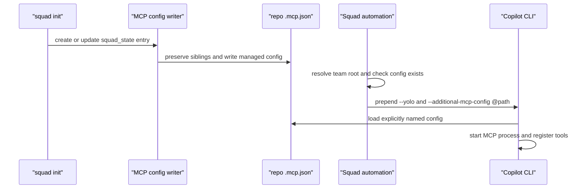

# Chapter 1: MCP in Depth

> **Prerequisites:** Volume 1 (or equivalent Squad experience); Chapter 4 (Volume 1), Chapter 17 (Volume 1).

Welcome to Volume 2, *Operating and Extending Squad*. The next ten chapters move from integration and state foundations through coordination, portability, and production operations before turning to Squad’s internals in Chapter 11. This chapter starts with MCP, the boundary between a host and external tools.

## What You'll Learn

- Explain how MCP servers turn external capabilities into tools available to a Squad agent, and distinguish MCP configuration from Squad routing and memory.
- Locate the MCP configuration locations that matter in Squad v1.1.0, especially the generated repository-root `.mcp.json` used by `squad_state`.
- Configure a server without committing credentials, preserve user-managed entries, and reason about the security boundary created by loading executable server definitions.
- Understand agent frontmatter MCP declarations and the limits of `squad init --mcp-frontmatter` across harnesses.
- Diagnose the Copilot CLI folder-trust behavior that can hide workspace MCP configuration in non-interactive sessions.
- Trace the configuration path from `squad init` through the MCP writer and into a spawned Copilot CLI process.

> **Preview (Squad 2.0):** MCP configuration is host-specific, and the state server has a defined boundary between mutable runtime state and static team files. See Chapters 19–21 and the [multi-client scenario](https://bradygaster.github.io/squad/docs/scenarios/using-squad-across-clients/).

## MCP Is a Tool Boundary, Not a Squad Agent

The Model Context Protocol (MCP) is a host-to-server contract. A server advertises tools and, depending on its implementation, other resources or prompts. Copilot is the MCP client in the workflow described here: it starts or connects to configured servers, discovers their available tools, and exposes suitable tools to the model. Squad defines the team context—coordinator, agents, charters, routing, and task lifecycle—but it does not turn every MCP server into a Squad agent.

That distinction prevents a common design mistake. Adding a GitHub server does not create a “GitHub agent.” It adds a set of operations that the active Copilot session may call. The coordinator can assign a task to an agent, and that agent may use an MCP tool when relevant, but the tool server does not own the task, remember Squad decisions, or route work by itself.

A useful mental model is a chain of capabilities:


The host is the policy and protocol boundary. It reads MCP configuration and starts clients; the model sees the tool schema and can request calls; the server executes the implementation and returns structured output. An unavailable server, a denied permission, or a stale credential breaks this chain even if Squad’s routing is correct.

MCP also differs from Skills. A skill is reusable guidance and procedures that an agent reads; an MCP server is executable integration code that exposes operations. A skill may tell an agent when to use a tool and how to interpret it, but the skill does not create the tool. Conversely, a tool can be technically available without the agent having a reliable workflow for using it. Pair them deliberately: the integration establishes what can be done, while instructions constrain when and how it should be done.

## Configuration Locations and Precedence

MCP configuration is host-specific. Copilot CLI, VS Code, and custom harnesses do not necessarily read the same file or use identical schema conventions. Treat file location and JSON shape as part of the client contract, not as a universal Squad setting.

Squad v1.1.0’s initialization path deserves special attention. It writes the `squad_state` server into the repository-root `.mcp.json`, preserving other `mcpServers` entries, and removes stale Squad-owned entries from the older `.copilot/mcp-config.json` location. This is the configuration path used by the CLI’s own state bridge. A legacy `.copilot/mcp-config.json` may remain for unrelated servers; its existence does not make it the current source of truth for Squad’s state server.

A simplified generated entry for a published v1.1.0 CLI installation looks like this:

```json
{
  "mcpServers": {
    "squad_state": {
      "command": "npx",
      "args": ["-y", "@bradygaster/squad-cli@1.1.0", "state-mcp"],
      "env": {},
      "tools": ["*"]
    }
  }
}
```

The exact launch command is resolved by the CLI’s MCP-spec helper: a published version can use a pinned `npx` package; an unpublished version can use `@insider`; a standalone installation can use the portable `squad` executable. The illustration assumes the pinned release is published, a fact to check for your installed build. Do not copy an illustrative `command` blindly into another project. Inspect the generated `.mcp.json` after initialization and retain its Squad-managed launch command. If you add your own server, add a separate key under `mcpServers` rather than replacing the object.

For user-managed server configuration, a generic stdio entry can be represented as:

```json
{
  "mcpServers": {
    "tasktrack-tools": {
      "command": "node",
      "args": ["./tools/tasktrack-mcp-server.js"],
      "env": {
        "SERVICE_TOKEN": "provided-by-the-host-environment"
      }
    }
  }
}
```

This is a shape example, not a promise that every host expands environment placeholders the same way. Copilot CLI and VS Code have their own configuration and variable-substitution rules; use the documentation for the exact client version you run. Never paste a real token into a committed project config. Prefer a secret store, environment injection, or host-managed credential flow. Also inspect whether the server process inherits its parent environment: passing a secret through `env` is still giving it to that executable.

The repository-level config creates a collaboration trade-off. A committed `.mcp.json` can make a shared server definition consistent for a team, but it also asks each collaborator’s host to consider launching that executable. Keep configuration reviewable, pin package versions where appropriate, use trusted publishers, and avoid broad credentials. A tool allowlist such as `tools: ["*"]` makes every tool advertised by that server potentially available; narrow it where the host/server supports that policy and your workflow benefits from it.

## The Squad State MCP Server

Squad’s built-in `state-mcp` command is an adapter between Copilot tool calls and the active Squad state backend. It is not a second database. Its purpose is to let the agent read or change permitted Squad state through tools while the state backend remains the storage authority.

This creates two layers to keep separate:

1. **Connection configuration:** the host must load the server entry and start `squad state-mcp`.
2. **State semantics:** the server exposes the allowed tools, and the SDK decides where those operations persist (local files, orphan branch, or two-layer state, depending on configuration).

If a state tool is absent, changing the team charter will not fix the client not loading `.mcp.json`. Check configuration discovery and server startup first. Conversely, seeing the tool name proves only registration; it does not prove that the correct repository or backend is being addressed.

The current state bridge is also narrower than an unrestricted filesystem API. State operations should be scoped to Squad keys and validate their path and operation. That is an important security design: an MCP server with arbitrary shell or filesystem access would be a much larger trust grant than a state server constrained to `.squad` concepts.

## Agent Frontmatter as an Alternative

Some harnesses read MCP declarations from an agent file’s YAML frontmatter. Squad’s SDK initializer supports an `agent-frontmatter` MCP mode; the CLI recognizes `--mcp-frontmatter` and passes that choice into initialization. In that mode, the agent declaration can contain a mapping similar to:

```yaml
---
name: squad
description: Squad coordinator
tools: ["*"]
mcpServers:
  squad_state:
    command: squad
    args: ["state-mcp"]
    tools: ["*"]
---
```

Use this only when the target harness explicitly consumes MCP configuration from agent frontmatter. The field’s name and accepted server schema are host conventions; YAML parses successfully even when the host ignores the key. Test discovery in the actual harness before standardizing it.

Frontmatter mode can make an agent artifact more self-contained, but it narrows portability in another way: the agent definition is now carrying a client-specific integration declaration. A different harness might use another key or no frontmatter support. It also makes review of executable launch configuration part of agent-file review.

> **Note:** The docs describe `squad init --mcp-frontmatter`, and the v1.1.0 CLI source parser recognizes that flag. However, the installed `squad init --help` output does not list it. Treat the option as undocumented/poorly surfaced in this build; validate on a throwaway repo before relying on it in automation.

There is a second nuance in the CLI implementation: after the SDK initialization call, the CLI’s normal path also ensures the repository-root `.mcp.json` state entry. Therefore, do not assume frontmatter mode guarantees that no standalone `.mcp.json` is written in every path. The current docs’ promise that no separate configuration file is written is broader than the inspected CLI behavior. If a truly single-file bundle is required, inspect both the agent frontmatter and `.mcp.json` produced by the exact installed version.

Upgrades should preserve project configuration rather than casually replacing unrelated MCP entries. The MCP writer refuses to overwrite malformed JSON, updates Squad’s managed launch command and arguments, retains valid user environment/tool settings, and semantically preserves sibling server entries. This is why editing generated config by replacing the entire file is risky: you may silently remove tools owned by your project or IDE.


## Threat-Modeling an MCP Integration

An MCP configuration is a small program-launch policy. Before enabling a server, identify the principals and the authority they receive: who maintains the executable, which process starts it, what environment it inherits, what network destinations it can reach, which tools it advertises, and which user or service identity those tools use. A server that can write issues or change deployments has a materially different impact from one that only searches public documentation.

A practical review separates three trust decisions:

| Boundary | Questions to ask | Safer default |
|---|---|---|
| **Code provenance** | Is the package/launcher official, maintained, pinned, and obtained from a trusted source? Can it run arbitrary install scripts? | Use a known publisher and deliberate version-update policy. Avoid silently pulling `latest` in a high-trust automation path. |
| **Credential scope** | Which token or cloud identity enters the child process? Is it read-only, repo-scoped, or organization-wide? Can the server forward it? | Give the least privilege needed; prefer short-lived or host-managed credentials. |
| **Tool authority** | Can tools read private data, write records, trigger releases, or execute code? Are all advertised tools exposed? | Limit tool availability where supported; require human confirmation for consequential actions. |

The repository file itself has a dual audience: your team reviews it as code, while the host may interpret it as instructions to launch a process. Code review should check the operational effect of `command`, `args`, `env`, tool filters, and package version rather than treating JSON as harmless metadata. A change to a package name or argument can alter the code that runs even if the `mcpServers` key stays the same.

For unattended use, define a bounded identity and failure policy. Do not copy a developer’s broad personal token into CI. Use a CI secret store or federated identity, constrain the server’s repository permissions, and make writes auditable. Decide whether the automation should fail closed when the server is absent, whether it can continue with a reduced capability set, and how the failure is surfaced. “The agent can probably work around it” is not a suitable policy when a workflow is expected to update external systems.

Also consider data flow in both directions. Tool responses may contain source code, issue descriptions, customer data, or deployment metadata that enters model context. Prompt injection can arrive inside a fetched issue or document; the model must treat returned content as untrusted data rather than instructions that override the user or system. The server’s output schema does not make the returned prose trustworthy. Limit what the server can fetch and teach the agent to verify high-impact actions against authoritative sources.

Finally, keep a rollback path. Record which server version and config revision were deployed, keep the previous reviewed config, and know how to remove the entry and revoke its token. If a server is compromised, removing it from the JSON stops new launches but does not revoke credentials already exposed; rotate those independently.

## Copilot CLI Trust and Non-Interactive Sessions

Copilot CLI treats workspace MCP configuration as executable configuration. In interactive use it may ask whether to trust the workspace before loading its `.mcp.json`. This protects you from a repository silently launching arbitrary binaries. In a non-interactive `copilot -p` process, there is no prompt UI to complete that trust decision, so the workspace file may be skipped. `--yolo` alone is not the same as explicitly loading a particular MCP config.

The v1.1.0 Squad code includes a targeted workaround for subprocesses it controls. If the command is the bare `copilot` executable and the project has `.mcp.json`, Squad prepends:

```bash
--yolo --additional-mcp-config @/absolute/path/to/.mcp.json
```

The `@path` argument explicitly names the project file. `--yolo` suppresses tool-consent prompts that otherwise could block automation; it is a significant consent change, not a generic convenience switch. Squad only injects this pair on its own relevant subprocess path. If you launch a custom command, use a different harness, invoke Copilot outside the project root, or replace `copilot` with a wrapper, verify that your process still loads the intended config. The helper deliberately does not inject flags for a custom agent command.

A diagnostic sequence:

```bash
# From the project root
cat .mcp.json
squad health

# Confirm the host's supported flags on the installed client
copilot --help
```

Then distinguish these failure modes:

| Symptom | Likely layer | First check |
|---|---|---|
| `squad_state_*` tools missing in Squad automation | MCP config not loaded | Is `.mcp.json` present at the resolved team root? Is this a bare Copilot subprocess? |
| Server entry exists, but startup fails | Command/runtime | Does the command resolve in the process environment? Check stderr and version compatibility. |
| Tool appears but operation fails | Server/backend/auth | Inspect tool error, state backend health, permissions, repository context. |
| Tools disappear after changing host | Client schema/location | Does this host read `.mcp.json`, VS Code workspace config, or frontmatter? |
| Other custom servers vanished after init | Config editing | Compare `mcpServers` before/after; current writer should preserve siblings, but malformed input is refused. |

Do not “fix” a trust failure by weakening a global security setting without understanding its scope. Prefer an explicit config path for a controlled non-interactive workflow, limit the executable and tools, and keep machine-specific credentials out of tracked files.


### What happens when a tool is called

Configuration is only the first half of the integration. At session startup, the host resolves its config locations and starts servers; each server completes the MCP handshake and advertises tool metadata. The host then presents selected tool names, descriptions, and input schemas to the model. When the model requests a call, the host validates and dispatches the request to that server, waits for a result, and returns it to the conversation. The model—not the server—decides whether a tool looks relevant, but the host controls which tools are actually available and any confirmation policy.

This lifecycle explains why “MCP is configured” is not a single health state. A process can launch and fail its handshake; the handshake can succeed while the server advertises no tools; tools can register but reject a particular argument; or a valid operation can fail at the external service. Good diagnostics report these stages separately. For a state bridge, a test should first confirm the server process starts, then list the expected state tools, then perform a harmless read in the intended project. For a write-capable integration, use a low-risk test record and remove it only through the supported service path.

Tool descriptions are part of the model-facing interface, so keep them precise and avoid creating multiple servers with ambiguous duplicate operations. A broad tool inventory increases selection ambiguity and context overhead. Separate servers or tool allowlists can reduce that surface, but only when the host really enforces the filtering. Do not rely on a filename or role charter alone to hide a tool from the underlying session.

## Diagram: Config Resolution and Invocation



## Hands-On: Add an MCP Integration Safely

Continue with your Tasktrack checkout created from `sample/`. This exercise validates the Squad bridge and gives you a safe place to add a vetted integration definition without introducing a real secret.

1. From the Tasktrack repo root, inspect the generated config:

   ```bash
   cat .mcp.json
   ```

   Expected: valid JSON with `mcpServers` and a `squad_state` entry after you initialized Squad in an earlier chapter. If your project is not initialized, run `squad init` and inspect again.

2. Validate the JSON without printing any credential values to a shared log:

   ```bash
   node -e "JSON.parse(require('node:fs').readFileSync('.mcp.json', 'utf8')); console.log('valid .mcp.json')"
   ```

   Expected: `valid .mcp.json`.

3. Add a separate, vetted server entry using your editor. Keep the existing `squad_state` key unchanged. Use the server publisher’s verified command, arguments, permissions, and host-supported secret mechanism. Do not use the literal example token from a tutorial as a credential.

4. Restart the host or session if its MCP client does not hot-reload configuration. Ask the coordinator to identify available tools and report which server supplied each one.

5. Use `git diff -- .mcp.json` to review the change. Remove any secret before committing. For team-shared config, document the executable and expected permissions in your team’s review process.

Expected result: the existing Squad state tool remains available, the additional server’s tools appear only after the client loads the updated config, and no secret is present in the diff.

## Configuration Reference

| Item | Location or value | Notes |
|---|---|---|
| Squad’s current project MCP config | Repository-root `.mcp.json` | CLI init writes/updates `mcpServers.squad_state`; sibling entries are retained. |
| Legacy project MCP config | `.copilot/mcp-config.json` | Older generated Squad entry is tombstoned; unrelated entries may remain. |
| Server map | `mcpServers` | Top-level host configuration mapping server names to launch specs. |
| `command` | Executable path or command name | Must resolve in the host process environment. Avoid machine-specific paths in shared config. |
| `args` | String array | Passed to the server command. The exact launcher is client-specific. |
| `env` | String map | Treat values as sensitive if they contain credentials; expansion syntax varies by client. |
| `tools` | String array, often `["*"]` | Host/server allowlist convention; do not assume all clients enforce it identically. |
| Frontmatter mode | `squad init --mcp-frontmatter` | Recognized by source parser; missing from installed command help. Validate exact output. |
| Non-interactive config override | `--additional-mcp-config @<path>` | Explicitly supplies a config file to Copilot CLI. Verify current CLI syntax with `copilot --help`. |
| Non-interactive consent flag | `--yolo` | Suppresses per-tool consent in the code path Squad manages; it expands trust. |

## Under the Hood

`templates/mcp-config.md` is an explanatory template, not the authoritative output of the v1.1.0 CLI. It describes repository-level `.copilot/mcp-config.json`, workspace `.vscode/mcp.json`, user-level config, and CLI overrides, while current CLI init writes the Squad state MCP entry to repository-root `.mcp.json`. Likewise, some examples in that file use third-party package names that should be verified before running; the file itself cannot prove a package is maintained, safe, or compatible.

The relevant call path is in `packages/squad-cli/src/cli/core/init.ts`, `packages/squad-cli/src/cli/core/mcp-root.ts`, and `packages/squad-cli/src/cli/core/copilot-invocation.ts`. The init options select `copilot-file` or `agent-frontmatter` for the SDK scaffolder. The CLI then manages the root state-server entry. The writer refuses malformed JSON instead of overwriting it, preserves non-Squad keys, and keeps environment/tool customization when it can safely parse them. The invocation helper checks for `.mcp.json` and returns no injected arguments when the command is not bare `copilot` or no project root is available.

A short source excerpt captures the central behavior:

```ts
const configPath = path.join(teamRoot, '.mcp.json');
if (!existsSync(configPath)) {
  console.warn('[squad] .mcp.json not found ...');
  return [];
}
return ['--yolo', '--additional-mcp-config', `@${configPath}`];
```

This is not a blanket flag injection into every process. It depends on Squad knowing both the executable and team root. For custom subprocesses, inspect the generated argument vector and set up config explicitly rather than assuming this helper runs.


### Reading the MCP template critically

The repository’s `templates/mcp-config.md` is useful as a catalog of familiar server-spec fields and sample integrations, but it contains historical guidance that does not match the current generated path. It describes `.copilot/mcp-config.json` as the CLI location, lists VS Code’s older `copilot.mcp.servers` settings shape, and claims that GitHub MCP is already preconfigured. In the inspected v1.1.0 code, initialization writes the Squad state server to root `.mcp.json`; the SDK can create a sample in `.copilot/mcp-config.json`, but the CLI then moves its authoritative Squad entry to root `.mcp.json` and tombstones the older Squad key.

The template’s examples also refer to packages and command lines that are not validated by the template itself. A displayed package name is not proof that the package is published, maintained, or the official integration for a service. Check the source’s current official instructions, required permissions, and package provenance before executing it. Treat the VS Code example as illustrative rather than guaranteed current UI terminology.

When documentation and generated files disagree, inspect the output produced by the version you actually run and validate it with the target client. Do not “repair” a config by copying an old template over it; this can remove the managed `squad_state` server or erase custom entries. This audit pattern generalizes: docs explain the intended concepts, but the CLI and host define the executable behavior.

## Pitfalls and Troubleshooting

- **Treating a checked-in MCP config as harmless metadata:** it can launch code. Review command, package source, version strategy, permissions, and environment exposure like executable build configuration.
- **Replacing `mcpServers` wholesale:** this can remove Squad’s `squad_state` entry or another integration. Merge by key and review the diff.
- **Hard-coding a token:** secrets in `.mcp.json` can leak through Git, logs, backups, or support bundles. Rotate an exposed credential; deleting the line from a later commit does not erase the earlier commit.
- **Assuming `$TOKEN` expands automatically:** host-specific expansion semantics vary. Confirm the selected host’s contract with a non-sensitive test value.
- **Assuming `--yolo` loads MCP:** the trust docs’ empirical matrix shows that consent suppression does not itself bypass workspace-config discovery. The explicit `--additional-mcp-config` path matters.
- **Frontmatter silently ignored:** YAML validity does not prove harness support. Test in each target IDE/client and inspect available tools.
- **A config exists but tools are absent:** verify the running process’s working directory/team root, whether the host reread the file, the command’s stderr, and host policy. Check the actual invocation rather than only the file on disk.
- **Broad server exposure:** a server can expose more tools than a particular role needs. Narrow tool access where supported, and avoid putting high-impact operations into an unattended session.

## Summary

MCP extends a Copilot session with external operations, but the host—not Squad’s routing engine—owns configuration loading and server lifecycle. In Squad v1.1.0, the CLI’s state bridge is written into project-root `.mcp.json`; non-interactive subprocesses controlled by Squad explicitly pass that file along with the required consent behavior. Frontmatter mode is an alternative for compatible harnesses, but its CLI help and output behavior should be checked because the published guidance and observed code path are not perfectly aligned. Keep credentials external, review server executables, and diagnose MCP at the host boundary before changing Squad team instructions.

## Exercises

1. Compare `.mcp.json` with `.copilot/mcp-config.json` in an initialized project. Identify which `squad_state` entry is authoritative in the current CLI and what happens to a stale legacy entry.
2. Write a review checklist for a proposed MCP server that will be committed to a team repository. Include command provenance, version pinning, credentials, tool scope, and host compatibility.
3. Explain why adding `--yolo` alone is insufficient to guarantee that a non-interactive Copilot CLI process loads workspace MCP configuration.
4. Test `squad init --mcp-frontmatter` in a disposable repository. Compare the resulting agent frontmatter and root `.mcp.json` with the help text and document the exact installed version and observed behavior.

## Quiz

1. What role does the MCP host play between an agent and an external service?
2. Does configuring a GitHub MCP server create a new Squad agent? Why or why not?
3. In the current Squad CLI flow, which file contains the generated `squad_state` server entry?
4. What two flags does Squad prepend for its managed non-interactive Copilot subprocess, and what distinct problem does each address?
5. Why should an MCP configuration’s executable and environment be reviewed as security-sensitive?
6. What must be verified before choosing agent-frontmatter MCP configuration?
7. A tool name is visible but calls fail. Name two layers to inspect beyond MCP config discovery.

## Further Reading

- [MCP Setup Guide for Squad](https://bradygaster.github.io/squad/docs/features/mcp/)
- [MCP Frontmatter](https://bradygaster.github.io/squad/docs/features/mcp-frontmatter/)
- [Copilot CLI Non-Interactive MCP Trust Gate](https://bradygaster.github.io/squad/docs/features/copilot-mcp-trust/)
- [`templates/mcp-config.md`](https://github.com/bradygaster/squad/blob/v1.1.0/templates/mcp-config.md)
