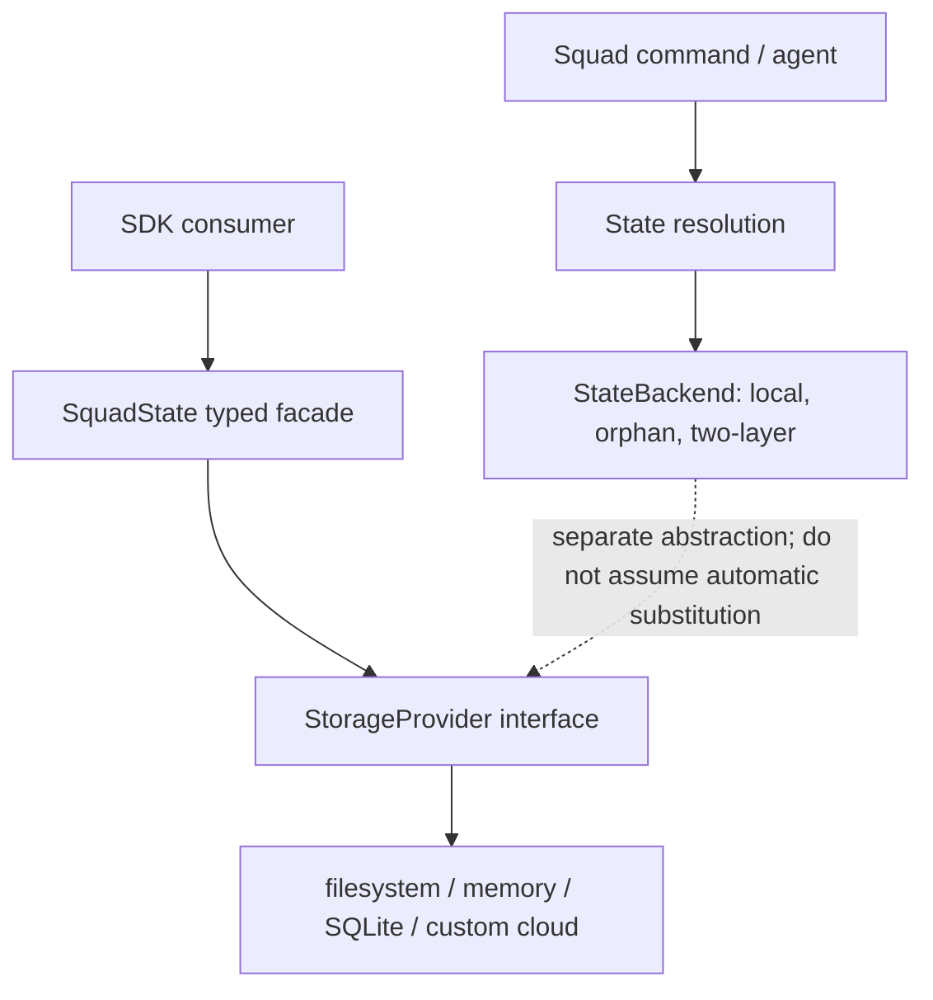
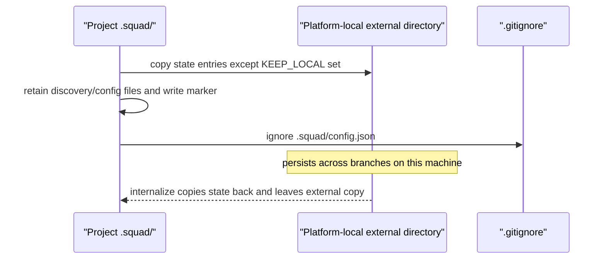

# Chapter 2: State Backends and Storage Providers

> **Prerequisites:** Volume 1 (or equivalent Squad experience); Chapter 1.

## What You'll Learn

- Separate Squad’s Git-native `StateBackend` from the SDK’s pluggable file-oriented `StorageProvider` and typed `SquadState` facade.
- Choose among the local, orphan-branch, and two-layer state backends based on collaboration shape, durability, and concurrency.
- Understand what `squad externalize` moves, where it stores data, and why that feature is not the same as an external cloud backend.
- Evaluate the filesystem, in-memory, SQLite, and custom Azure Blob storage providers, including their async contracts and concurrency limits.
- Design result persistence so agent output survives session/context loss without confusing orchestration logs with permanent memory.
- Recognize current limitations and documentation/code mismatches before designing a multi-replica deployment.

> **Preview (Squad 2.0):** Squad 2.0 introduces a separate backend boundary and experimental MCP tools. See Chapter 21 and the [2.0 release notes](https://github.com/bradygaster/squad/blob/v2.0.0-preview.2/docs/src/content/docs/whatsnew.md) for the preview contract.

## State Is Not One Thing

“Where is Squad state stored?” sounds like a single question, but the SDK has multiple layers with different contracts. A useful architecture separates three concerns:

1. **State selection:** `StateBackend` decides how Squad’s mutable state is persisted in the project context. In v1.1.0, the primary choices are local files, a Git orphan branch, or a two-layer combination.
2. **Storage mechanics:** `StorageProvider` is a generic I/O interface for reading, writing, listing, renaming, and deleting file-like keys. It can be backed by a filesystem, memory, SQLite, or a custom remote object store.
3. **State domain model:** `SquadState` groups typed collections—agents, decisions, routing, team, skills, templates, logs—on top of a `StorageProvider`.

These are related, not interchangeable. `StateBackend` is a synchronous, Git-aware abstraction used for mutable Squad state. `StorageProvider` is an asynchronous, provider-neutral I/O API. A `StorageProvider` implementation does not automatically become the CLI’s selected state backend, and a Git backend does not make arbitrary application data cloud-backed.



This distinction is especially important when reading the source tree. The `state/` and `storage/` modules implement an SDK-level state API, while `state-backend.ts` contains the Git-native backend selection contract. Their shared vocabulary (“state,” “storage,” “provider”) can obscure the fact that their callers and consistency models differ.

## Choosing a Git-Native State Backend

The default is `local`. You can select a backend during initialization or migration:

```bash
squad init --state-backend local
squad init --state-backend orphan
squad init --state-backend two-layer

# On an existing project
squad upgrade --state-backend two-layer
```

The choice is persisted as `stateBackend` in `.squad/config.json`; later Squad commands resolve it automatically. If the key is absent, `local` is selected. The CLI currently supports `local`, `orphan`, and `two-layer` as the user-facing values. Legacy `worktree` normalizes to `local`; legacy `git-notes` normalizes to `two-layer`. `external` is accepted only as a legacy alias to the unimplemented `external-stub`, which warns and falls back to local. It is not a cloud state store.

### Local

Local state is ordinary content under `.squad/` in the working tree. It is easiest to inspect and edit, works without Git plumbing, and is suitable for a solo developer or a team that deliberately versions Squad state alongside code. Its risks are ordinary Git risks: an uncommitted state file can disappear when changing branches, commits can mix state changes into application PRs, and multiple contributors can conflict on the same Markdown file.

### Orphan branch

The orphan backend stores keys in a dedicated `squad-state` branch that has no shared commit history with the code branches. It does not check out that branch to mutate files. Instead, it uses Git plumbing to read blobs, construct trees and commits, and update the branch reference. This keeps mutable state out of feature branch diffs while preserving a Git history for inspection and recovery.

Orphan storage is not a distributed database. Concurrent writers can race to update the same ref; a compare-and-swap loop retries by rereading the latest tree, but network pushes from independent clones can still reject non-fast-forward updates. A single active writer or coordinated sync is safer than treating orphan as a multi-replica transactional store.

### Two-layer

The two-layer backend combines the orphan branch as the durable state store with Git notes for commit-scoped annotations. It can write durable content to the orphan layer and attach “why” context to commits in notes namespaces. Notes can be promoted or archived according to flags such as `promote_to_permanent` and `archive_on_close`. The ordinary `read` and `list` view remains backed by the orphan store; notes are not a transparent replacement for all state.

Two-layer offers a lifecycle distinction—temporary context can be attached to a commit, and selected knowledge can be promoted into durable state. But do not infer that it eliminates all concurrency risk. The reference selection guide explicitly says built-in filesystem and branch-backed designs are single-writer choices for multi-pod deployments. Notes are also Git refs that need fetch/push configuration and careful lifecycle handling. Use an actual transactional shared store for simultaneous writers across replicas.

> **Warning:** The broad state-backend page calls two-layer “team-safe” and says per-file Git mergeability protects concurrent writers. The container selection page is more conservative and says `local`, `orphan`, and `two-layer` are not safe for concurrent multi-pod writes. Treat two-layer as a good collaboration pattern for multiple Git clones with synchronization—not as a lock-free multi-process database.

### Fallback and health

`resolveStateBackend()` reads `.squad/config.json`, applies an optional override, normalizes legacy names, and attempts to construct the backend. On construction failure it warns and falls back to local so a backend configuration problem does not necessarily block startup. This behavior protects availability but has a dangerous operational implication: the process may continue using a different location than expected. After seeing a fallback warning, stop and inspect before continuing to write; otherwise you can create divergent state in the working tree.

The SDK also exports `verifyStateBackend()`, a read-only check. For `TwoLayerBackend`, it probes both layers and reports a notes-layer failure separately. Health checks should run before an automation loop, and operators should treat a green check as evidence of accessibility—not proof of cross-replica transaction safety.

### State selection matrix

| Situation | Appropriate direction | Caveat |
|---|---|---|
| Solo local checkout; state should be reviewable | `local` | Commit intentionally; branch-local changes can be lost. |
| Single developer wants clean code diffs but Git history | `orphan` | Push/fetch the state branch; concurrent remote pushes can conflict. |
| Team wants persistent state plus commit annotations | `two-layer` | More moving pieces; do not run as shared multi-pod storage. |
| One container replica, state must survive restart | Local backend plus a persistent volume, or a Git-backed option | A volume persists bytes but does not add locking. |
| Several simultaneous replicas writing same project | External transactional store supplied by a real provider / service | The docs describe future external-state work; current `external-stub` is not implemented. |
| Ephemeral unit tests | In-memory `StorageProvider` | No durability across process lifetime. |

## Externalize Is Local Relocation, Not Cloud Storage

`squad externalize` moves most `.squad/` content out of the repository’s working tree into a platform-specific directory on the same user/machine. It is useful when branch switches or PR noise are the problem, but it does not provide synchronization across developers or machines.

Typical roots are:

| Platform | Root |
|---|---|
| Windows | `%APPDATA%/squad/projects/` |
| macOS | `~/Library/Application Support/squad/projects/` |
| Linux | `$XDG_CONFIG_HOME/squad/projects/` (normally `~/.config/squad/projects/`) |

The project key defaults from the repository directory name but can be overridden with `--key`. A small `.squad/config.json` marker remains in the project with `stateLocation: "external"`, `projectKey`, and `teamRoot`. Squad also adds that marker to `.gitignore`, because its value is machine-specific. The external directory is per project key; it is not pushed to the remote.

Externalization intentionally leaves a set of discovery/config files in the repository: `config.json`, `manifest.json`, `workstreams.json`, `upstream.json`, `squad-registry.json`, and `_upstream_repos`. Those are consumed by code paths that still need to find local project configuration. Other entries are copied out and removed from the working tree. `squad internalize` copies state back but leaves the external copy in place; it removes external-location fields from the marker and deletes the marker only when no other settings remain.



There are sharp operational edges. If `git clean -fdx` removes the ignored marker, the state directory still exists but the resolver may no longer know which external project key to use until you restore or regenerate the marker. Back up the external directory separately. If two clones have the same derived project key, verify the key choice rather than assuming their state is isolated. Externalize and state backend selection also solve different problems: one relocates working-tree contents; the other selects a backend implementation.

## The StorageProvider Contract

The SDK `StorageProvider` provides 12 asynchronous methods: `createIfAbsent`, `read`, `write`, `append`, `exists`, `list`, `delete`, `deleteDir`, `isDirectory`, `mkdir`, `rename`, `copy`, and `stat`—counted carefully, that is 13 if `createIfAbsent` is included with the 12 shown? In v1.1.0 source, the method list is 13 total: `createIfAbsent` plus `read`, `write`, `append`, `exists`, `list`, `delete`, `deleteDir`, `isDirectory`, `mkdir`, `rename`, `copy`, `stat` (12 named after it). It also requires 12 synchronous compatibility methods, for 25 required methods in the interface.

> **Note:** The assigned StorageProvider page calls the interface “13 core async methods” and “24 methods total.” The source has 13 async methods and 12 sync methods (25); use the interface file as the precise inventory.

The contract is file-like, but backends may model directories differently. `list(dir)` returns direct entry names and an empty array when the directory is absent; `read(path)` returns `undefined` when absent; `delete` is a no-op on a missing file; `deleteDir` recursively deletes a tree. `stat()` returns size, modification time, and whether the path represents a directory. `write()` overwrites, `append()` creates if missing, and `copy()` overwrites the destination.

`exists()` is not a safe guard for a later operation. The interface explicitly calls out the time-of-check/time-of-use race: a path can change between the check and the read or write. Prefer to call `read()` and handle `undefined`. For “create only if nobody else has created this key,” use `createIfAbsent()` rather than `if (!exists()) write()`.

### Atomic creation and errors

`createIfAbsent(key, data)` must never overwrite. Its successful result means this caller created the key. An already-present key produces `StateKeyConflictError`; a failure where the backend cannot say whether the key exists or is durable produces `StateBackendUncertaintyError`. These are intentionally different: a conflict is a known outcome, uncertainty requires inspection before retrying.

The filesystem implementation uses exclusive file creation (`open(..., 'wx')`) to avoid a read-then-write race. SQLite uses `INSERT OR IGNORE` and checks whether a row was inserted, then persists the database file; a persistence failure after the in-memory insert becomes uncertainty. A cloud implementation should use a native conditional primitive such as an `If-None-Match: *` write, not a read followed by a normal PUT. Even with atomic create, unconditional `write()` and read-modify-write `append()` are not globally serialized unless the provider guarantees it.

The SDK retains synchronous methods for compatibility, but they are deprecated and planned for removal in a later migration wave. A remote provider cannot honestly implement a network write synchronously; the Azure sample throws for those methods. New code should use `await` throughout instead of building new dependence on the sync surface.

## Built-In Providers and Their Trade-offs

### `FSStorageProvider`

The filesystem provider maps keys to disk paths and optionally accepts a `rootDir` that confines operations beneath a resolved directory. With a root set, it checks path traversal and symlink escape, while acknowledging the remaining user-space TOCTOU limitation. Reads return `undefined` on `ENOENT`; most OS failures are wrapped as `StorageError` with operation and code fields. The wrapper avoids putting the full absolute path in its message, though the underlying cause remains available to programmatic callers.

If you construct it without `rootDir`, paths are not confined by that provider. Do not treat the class name alone as a sandbox. The `rootDir` parameter is a defense-in-depth boundary, not a replacement for OS-level isolation when an untrusted process can alter filesystem paths concurrently.

### `InMemoryStorageProvider`

This provider stores normalized POSIX-style paths in a `Map`, with timestamps in a second map. It performs no filesystem I/O and is ideal for deterministic tests and dependency injection. Directories are implicit from key prefixes; `mkdir()` is effectively a no-op. It is process-local and ephemeral. It cannot provide cross-process coordination, and its “atomic” create semantics only apply to its single in-memory map.

### `SQLiteStorageProvider`

The SQLite provider uses `sql.js` (SQLite compiled to WebAssembly) and stores entries in a `files(path, content, updated_at)` table. You must call `await provider.init()` before operations. Its DB defaults to `.squad/squad.db`, although callers can provide another path. On writes it exports the in-memory database and persists through a temporary sibling file and rename.

This is portable and convenient for a self-contained application, but its implementation loads the database into memory and persists the whole database after writes. The source explicitly describes it as single-process access: multiple processes writing one DB file can corrupt state. The SQL-backed provider is therefore not a magical multi-replica shared store merely because SQLite supports transactions in other configurations.

### Custom providers: Azure Blob example

The Azure sample maps keys to blob names in a container. Directories are virtual prefixes. `read()` translates a 404 to `undefined`; listing uses hierarchy to return direct children. Append is a read-modify-write because a block blob has no native text append; rename is copy-then-delete because Blob Storage has no atomic rename. Both patterns introduce windows where concurrent operations can lose or duplicate data. The sample calls out using Append Blobs for log-heavy workloads or leases for coordinated mutation.

The sample supports Azure credentials and Azurite for local experiments, but it is an example provider—not a built-in `StateBackend` option that the stock CLI selects through `stateBackend` in config. To use it in an SDK application, inject it into the SDK object that consumes `StorageProvider`; the CLI must be explicitly integrated with that provider before it becomes its state backend.

## Typed State Facade and Result Persistence

`SquadState` wraps collection facades around a `StorageProvider`. `SquadState.create(storage, rootDir)` asynchronously checks for `rootDir/.squad` and throws `NotFoundError` if absent; `SquadState.fromStorage()` skips that validation for an already-initialized internal caller. Collections expose domain-specific methods rather than forcing each caller to construct raw file paths. This makes tests easier to isolate and allows SDK consumers to swap storage without rewriting domain logic.

Agent results are another distinct persistence concern. A `read_agent` response or model answer may disappear when a session ends or context compacts. The result-persistence guidance prescribes an orchestration log entry after collecting each result: timestamped file under `.squad/orchestration-log/`, including agent identity/spawn ID, original task, summary, changed files, status, and complete response. Persistence must happen before doing follow-up work that might lose the in-memory result.

That protocol is a durability rule for the coordinator/Scribe, not a different backend. The orchestration log still needs to be written through whatever state path is active and synced appropriately. A durable file on one developer’s disk is not team-shared until the relevant local/orphan/two-layer workflow publishes it. Also distinguish transient result archives from curated knowledge: a full response is evidence of what happened; a decision or reusable skill is a smaller, intentionally promoted artifact. Copying all agent output into permanent memory increases noise and can preserve irrelevant or sensitive context.

## Team and Container State Storage

For team workflows, make the consistency requirement explicit before selecting storage:

- **Local + normal Git:** simplest, but `.squad/` participates in regular branch merges.
- **Orphan/two-layer:** Git-based sharing with a separate state ref; sync remains a Git operation and simultaneous writers need coordination.
- **Externalize:** per-machine relocation, not team sync.
- **Custom cloud `StorageProvider`:** can centralize data, but its primitives determine concurrency correctness. Verify atomic create, append behavior, retry/idempotency, and consistency guarantees.

For a single container, a mounted persistent volume can preserve local files across restarts. It does not add process coordination. With more than one live replica against the same directory, two writers can race and corrupt or overwrite state. A read-write-many volume makes a directory mount available; it does not turn operations into transactions. The container selection reference warns that current local/orphan/two-layer backends should not be treated as safe multi-pod storage. The external state provider described there is tracked as future work and not a GA stock CLI backend.

The assigned state-backend-selection page describes an open root-directory issue in `resolveSquadState()` (#1555). The v1.1.0 source inspected for this chapter now constructs `new FSStorageProvider(paths.teamSquadDir)` for the local backend and documents that root as the path-confinement boundary. That is a documentation/code discrepancy: do not repeat the page’s “no configuration-level workaround” warning as current behavior without rechecking the exact release and issue status. Still test path resolution in the project context you deploy, especially for nested squads and worktrees.

## Hands-On: Move Tasktrack State to a Git Backend

This exercise changes your Tasktrack setup to use a backend intended for versioned team state. Make a clean checkpoint first; the migration changes where mutable state is stored.

1. Confirm the repository is initialized and inspect the current config:

   ```bash
   git status --short
   cat .squad/config.json
   ```

2. Choose a backend. For a team scenario with Git-based sharing, use:

   ```bash
   squad upgrade --state-backend two-layer
   ```

   If this is a solo learning repo and you want to avoid extra Git refs/hooks, keep `local` and skip migration.

3. Inspect the result:

   ```bash
   cat .squad/config.json
   git branch --list squad-state
   git status --short
   ```

   Expected: `stateBackend` is `two-layer`; the `squad-state` branch is created or already present; hooks are installed or chained without replacing existing hooks. The exact working-tree state can vary during migration.

4. Add and commit only Tasktrack code as you normally would. Inspect state independently with `git log --oneline squad-state` and `git ls-tree --name-only -r squad-state` rather than expecting mutable state to appear in the application branch diff.

5. If you also want the state to survive branch changes without storing it in the repository, compare that goal to `squad externalize`. Do not enable both mechanisms experimentally without recording which path the resolver considers authoritative.

Expected result: you can identify the selected backend from config and find its state in the intended storage location. No multi-pod safety is implied by this single-repository exercise.

## Configuration Reference

| Name | Accepted value or default | Meaning |
|---|---|---|
| `.squad/config.json` → `stateBackend` | absent / `local` | Filesystem state under project `.squad/`. |
| `stateBackend` | `orphan` | Git orphan ref, by default `squad-state`. |
| `stateBackend` | `two-layer` | Orphan durable state plus Git-notes annotations. |
| Legacy `worktree` | normalizes to `local` | Compatibility alias. |
| Legacy `git-notes` | normalizes to `two-layer` | Warns and migrates behavior. |
| Legacy `external` / `external-stub` | falls back to `local` | Placeholder, not an implemented cloud provider. |
| `squad init --state-backend <type>` | `local\|orphan\|two-layer` | Set backend on initialization. |
| `squad upgrade --state-backend <type>` | `orphan\|two-layer` | Migrate existing state. |
| `squad externalize --key <name>` | derived project key | Relocate local working-tree state to platform-local storage. |
| `StorageProvider.createIfAbsent()` | no overwrite | Atomic creation contract; throws conflict or uncertainty. |
| `SQLiteStorageProvider` DB path | `.squad/squad.db` | Can be overridden in constructor; call `init()` first. |
| `FSStorageProvider` `rootDir` | optional | Constrains file operations to a resolved tree when supplied. |
| `SQUAD_SYNC_ACTIVE` | unset normally | Internal recursion guard for Git hooks; bypassing hooks routinely defeats safeguards. |

## Under the Hood

`packages/squad-sdk/src/state-backend.ts` defines the synchronous Git-aware `StateBackend` interface and backend constructors. `resolveStateBackend()` applies config and override precedence, normalizes aliases, and warns/falls back to `WorktreeBackend` (the implementation named `local`) when construction fails. `OrphanBranchBackend` performs Git plumbing and compare-and-swap ref updates. `TwoLayerBackend` routes ordinary state reads to orphan storage and uses notes as an auxiliary layer; note-write failures are logged in ordinary writes, while atomic `createIfAbsent` has a fail-closed disagreement contract.

`packages/squad-sdk/src/storage/storage-provider.ts` defines the async file I/O contract and deprecated sync compatibility surface. `storage/fs-storage-provider.ts`, `in-memory-storage-provider.ts`, and `sqlite-storage-provider.ts` implement different path and durability models. `state/squad-state.ts` composes collection facades and checks initialization. The custom Azure sample demonstrates the additional engineering needed when a remote API lacks native append or rename.

A small code excerpt shows how backend precedence is chosen:

```ts
const chosen = normalizeBackendType(cliOverride ?? configBackend ?? 'local');
try {
  return createBackend(chosen, squadDir, repoRoot);
} catch (err) {
  console.warn(`Warning: State backend '${chosen}' failed ... Falling back to 'local'.`);
  return new WorktreeBackend(squadDir);
}
```

This code makes fallback visible but not necessarily harmless. Production automation should surface the warning and stop or alert rather than silently accepting a new persistence location.

## Pitfalls and Troubleshooting

- **Calling `externalize` “cloud state”:** its path is local OS application data. Back it up locally; use a different sync mechanism to share it.
- **Selecting `external` in config as if it were Azure:** the current backend type is a stub and falls back to local.
- **Confusing SDK storage with CLI backend selection:** implementing a provider does not make CLI state use it automatically.
- **Assuming Git hooks make simultaneous replicas safe:** hooks synchronize around Git operations; they are not distributed locks or a transaction coordinator.
- **Using SQLite from multiple processes:** the sample’s sql.js implementation loads and rewrites the database and documents single-process use.
- **Using `exists()` before `write()`:** this is a TOCTOU race; choose `createIfAbsent()` for one-writer-wins behavior.
- **Retrying `StateBackendUncertaintyError` as if it were a conflict:** inspect first. The operation may have partially succeeded.
- **Ignoring fallback warnings:** you can fork state into `local` unexpectedly. Stop writes and inspect the actual config, Git repository, permissions, and backend health.
- **Assuming every Scribe result is curated memory:** preserve evidence in the orchestration log, then promote only useful reusable conclusions.
- **Running multi-pod on shared files:** persistence volumes provide durability, not safe concurrent mutation.

## Summary

The correct storage design starts by naming the requirement: branch persistence, clean PRs, per-machine continuity, unit-test isolation, or simultaneous shared writes. Squad’s Git-native `StateBackend`, SDK `StorageProvider`, and typed `SquadState` facade address different layers. `externalize` is a local relocation; `external-stub` is not a cloud backend; and a cloud sample is not automatically wired into the stock CLI. Build persistence around the provider’s real consistency guarantees, archive agent results promptly, and do not claim multi-replica safety without a transactional coordination mechanism.

## Exercises

1. For a solo laptop workflow, a GitHub team with two developers, and a Kubernetes deployment with three simultaneous replicas, select a storage strategy for each and state the unresolved risks.
2. Write a minimal custom provider design for blob storage. Explain the atomic primitive for `createIfAbsent`, the consistency plan for `append`, and recovery behavior after a timeout.
3. Explain why `squad externalize`, `stateBackend: "orphan"`, and an Azure `StorageProvider` are three different mechanisms.
4. Design an orchestration-log record that makes a completed agent task recoverable after context compaction. Which fields are essential, and what should not automatically be promoted into permanent memory?
5. Read the `StorageProvider` interface and count its async and sync methods. Explain how you handle a missing key, a conflict, an uncertain create outcome, and a provider operation failure.

## Quiz

1. Which abstraction is selected by `stateBackend` in `.squad/config.json`?
2. What is the default backend when the config omits `stateBackend`?
3. Why is externalization not a solution for state shared across machines?
4. What is the semantic difference between `StateKeyConflictError` and `StateBackendUncertaintyError`?
5. Why does the SDK `exists()` method carry a TOCTOU warning?
6. Which storage providers are described in the SDK, and what is SQLite’s primary concurrency limitation?
7. What must a custom cloud provider guarantee for `createIfAbsent()`?
8. What is the purpose of the orchestration log, and why is it not the same as durable curated memory?

## Further Reading

- [External State Storage](https://bradygaster.github.io/squad/docs/features/external-state/)
- [State Backends](https://bradygaster.github.io/squad/docs/features/state-backends/)
- [StorageProvider](https://bradygaster.github.io/squad/docs/features/storage-provider/)
- [Result Persistence](https://bradygaster.github.io/squad/docs/reference/result-persistence/)
- [State Backend Selection](https://bradygaster.github.io/squad/docs/reference/state-backend-selection/)
- [Team State Storage](https://bradygaster.github.io/squad/docs/scenarios/team-state-storage/)
- [`packages/squad-sdk/src/state-backend.ts`](https://github.com/bradygaster/squad/blob/v1.1.0/packages/squad-sdk/src/state-backend.ts)
- [`packages/squad-sdk/src/state/`](https://github.com/bradygaster/squad/tree/v1.1.0/packages/squad-sdk/src/state)
- [`packages/squad-sdk/src/storage/`](https://github.com/bradygaster/squad/tree/v1.1.0/packages/squad-sdk/src/storage)
- [`samples/storage-provider-sqlite/`](https://github.com/bradygaster/squad/tree/v1.1.0/samples/storage-provider-sqlite)
- [`samples/storage-provider-azure/`](https://github.com/bradygaster/squad/tree/v1.1.0/samples/storage-provider-azure)
