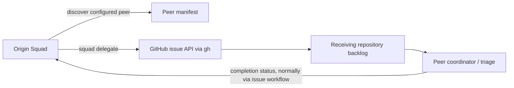
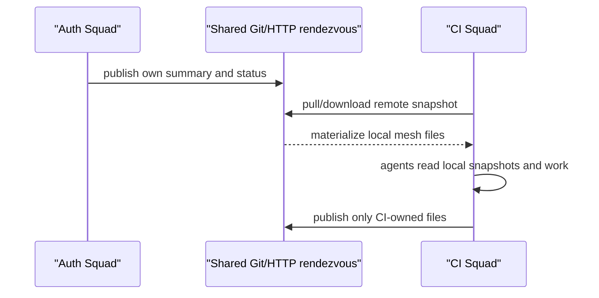

# Chapter 3: Cross-Squad Orchestration

> **Prerequisites:** Volume 1 (or equivalent Squad experience); Chapters 1 and 2.

## What You'll Learn

- Distinguish peer-squad discovery and issue delegation from upstream inheritance, SubSquads, personal multi-squad selection, and export/import.
- Publish a valid `.squad/manifest.json` and register local peers with `squad registry`.
- Trace `squad discover` and `squad delegate` through the SDK’s manifest functions to GitHub issue creation.
- Design cross-squad boundaries around an explicit work contract, ownership, authentication, and completion feedback.
- Understand the distributed-mesh skill’s pull-based model and the limits of Git/HTTP synchronization.
- Use SubSquads to partition work within one project without mistaking a label filter for an independent Squad.

> **Preview (Squad 2.0):** Personal squads and global mode were removed. Squad now resolves the project `.squad/` tree (or an explicitly supplied team root); it no longer discovers or reads a personal/global profile squad. Copy any still-needed material into a project team manually. See Chapter 18 and the [2.0 release notes](https://github.com/bradygaster/squad/blob/v2.0.0-preview.2/docs/src/content/docs/whatsnew.md).

## Why Coordinate at the Squad Boundary?

A Squad is usually scoped to one repository and one working agreement: the coordinator, the team’s charters, routing, skills, decisions, and state. Organizations often have neighboring Squads with different expertise or ownership. The useful unit of handoff is not “ask some other agents to work on this”; it is a contract between two project owners.

That contract needs at least four things:

1. **A discoverable identity:** what the peer is called and what repository it represents.
2. **A capability description:** terms that help a human or coordinator decide whether the peer is a good destination.
3. **An acceptance boundary:** what kind of request the peer agrees to receive.
4. **A durable handoff artifact:** an issue or other tracked record with context and acceptance criteria.

In v1.1.0, the core cross-squad CLI flow is intentionally modest: publish a manifest, discover configured peers, and create a labeled GitHub issue in a target repository. This is asynchronous work intake—not remote agent execution, shared memory, or a distributed RPC protocol.



## The Manifest Is the Peer Contract

Place a manifest at `.squad/manifest.json` in the peer repository. A current-shape example is:

```json
{
  "name": "tasktrack-web",
  "version": "1.0.0",
  "description": "Owns the Tasktrack browser interface and accessibility",
  "capabilities": ["web-ui", "javascript", "accessibility", "task-workflows"],
  "contact": {
    "repo": "your-org/tasktrack",
    "labels": ["cross-squad", "area:web"]
  },
  "accepts": ["issues"],
  "skills": ["tasktrack-ui-conventions", "accessibility-review"]
}
```

The manifest separates the name used by `squad delegate` from the repository where the issue is created. `contact.repo` must be a GitHub `owner/repo` string; custom labels identify the incoming work for triage. `accepts` is an explicit statement of supported work types. `skills` is descriptive metadata; it does not transfer or load those skills into the caller’s Squad.

The SDK’s runtime validator checks that `name` is a nonempty string, `capabilities` and `accepts` are arrays, `contact.repo` is nonempty, and every acceptance value is `issues` or `prs`. It does not enforce a rich JSON schema for every field. Keep the manifest conservative and validate it in your own review/CI if you need stronger guarantees, such as a controlled set of capability tags or a required issue label.

A manifest is public-facing metadata. Do not put credentials, internal endpoint secrets, or private agent history in it. The fields describe where a request goes and what the squad claims to do; they do not prove the peer has permission or capacity to take the work.

## Discover Peers: Upstreams and Registry

The CLI exposes three relevant commands:

```bash
squad registry add <name> <path>
squad registry list
squad registry remove <name>
squad discover
```

A registry entry is stored in the caller’s `.squad/squad-registry.json` as a name and filesystem path. `registry add` resolves the path, accepts either a repository root or its `.squad` directory, and refuses to add it unless a valid manifest can be read. Duplicate registry names are rejected. This local-path mechanism is useful for a monorepo or several sibling checkouts on one machine; it does not fetch arbitrary remote repositories by itself.

The SDK also reads `.squad/upstream.json`. For upstreams of type `local`, it reads the given path; for type `git`, it checks a previously cloned cache under `.squad/_upstream_repos/<name>`. Discovery checks upstream sources first, then registry entries, and deduplicates by manifest name with the upstream result winning. The returned `source` and `sourceRef` values provide provenance for the listing.

A central limitation follows from that implementation: discovery is configuration-driven, not a global crawl. A remote peer needs to be represented by an available local path/cache or other supported source before `squad discover` can see its manifest. Registry paths are local filesystem paths, so the registry file is not a portable enterprise directory of remote GitHub repositories. Coordinate how each clone refreshes its upstream cache, and do not assume one developer’s absolute path will work on a teammate’s computer.

The documented discovery command prints the manifest’s name, repository, up to five capability tags, accepted work types, source, and optional description. It does not currently filter by a capability string or rank peers for you. The caller still selects a target by exact name.

## Delegate Work as an Issue

A typical handoff is:

```bash
squad discover
squad delegate tasktrack-web "Add accessible keyboard navigation to task filters"
```

The command discovers the peer again, finds the exact manifest name, requires that its `accepts` array include `issues`, then invokes `gh issue create` with the target repository, a title prefixed `[cross-squad]`, the generated request body, the peer’s declared labels, and the required `squad:cross-squad` label. The caller needs GitHub CLI installed and authenticated with permission to create issues in that repository.

The issue is a handoff, not an instruction tunnel. The receiving Squad should treat its own repository policy, issue triage, and human governance as authoritative. The originating coordinator cannot force the peer to accept or complete the request. Include scope, constraints, repository-independent context, test expectations, and a definition of done. Avoid relying on undocumented knowledge that exists only in the origin’s agent history.

A robust request body says:

- **Why:** the user or product outcome that motivates the work.
- **What:** a bounded change that belongs to the destination team.
- **Acceptance criteria:** observable outcomes and validation.
- **Context links:** relevant issues, API contracts, design docs, or PRs.
- **Dependencies:** what the origin will provide and what the destination may assume.
- **Return path:** how the origin learns the issue was completed or blocked.

Labels should support receiving-side triage rather than encode every detail. Prefer a small stable contract, for example `squad:cross-squad`, `area:web`, and `needs-triage`, then let the peer’s own workflow apply its internal labels.

The SDK exports helpers for constructing `gh` arguments and parsing issue status, but the inspected CLI command currently implements issue creation only. A manifest can declare `prs` as an accepted type, yet `squad delegate` rejects targets that do not accept `issues` and always uses `gh issue create`. Do not advertise PR delegation as active just because the schema can list `prs`.

> **Note:** The assigned cross-squad guides mention `squad delegate remove`, `--file` delegation, PR creation, automatic completion notification, capability-based routing, and a local discovery cache. Those details are not implemented by the v1.1.0 `cross-squad.ts` command path inspected here. The verified CLI accepts a squad name and description and creates a GitHub issue.


## Ownership, Feedback, and Failure Handling

A cross-squad issue crosses an organizational boundary, so use the same rigor you would apply to an API contract. Decide who owns each stage: the origin owns the request and its context; the peer owns acceptance and implementation; the peer’s maintainer owns its local priority and review policy; and the origin owns integration of the delivered result. The `From` and `To` labels in a generated body are useful orientation, but in current CLI output the origin is described generically as “this repository.” If auditability matters, include the originating repository URL and source issue explicitly in the user-provided description or follow-up process.

The request lifecycle should be modeled as more than “open, then done.” A practical operating agreement can distinguish **requested**, **accepted**, **blocked**, **delivered**, and **integrated**. The first is represented by issue creation; later transitions belong to the receiving team’s workflow and the originating team’s integration checks. The SDK has helpers to build a `gh issue view` status query and parse open/closed state, but the current CLI command does not provide a complete callback or monitor loop. A closed issue is not proof that the origin has integrated the change, and an open issue does not tell you whether it has been triaged.

For high-stakes dependencies, make the handoff observable: retain the issue URL, link it to an origin issue or project, agree on a response expectation, and poll through an explicit automation or normal GitHub notifications. Avoid creating duplicate issues on retries; store the returned URL after creation and reconcile by that identifier. If the `gh` call fails, distinguish authentication, repository permission, invalid label, network outage, and API validation errors before retrying. Repeated blind issue creation can create duplicates and confuse both teams.

Security boundaries matter here too. A peer manifest is input, not a credential grant. Before creating an issue, the CLI trusts the manifest’s destination and label values, while `gh` uses the caller’s credentials. Review the resolved repository and labels, especially when discovery can read local paths outside the current repo. Do not pass sensitive incident details to a peer merely because its capability tag sounds relevant; use an authorized channel and minimize the issue body.

Capability design should be concrete and maintainable. A term such as `backend` tells little; tags such as `postgres-query-tuning`, `api-contracts`, or `terraform-aks` are more useful to people reading discovery output. Avoid building a taxonomy that no one curates. Since the current command does not filter or rank on capabilities, these tags support human selection now and future automation only if a later implementation adopts them. The canonical source of truth should remain the destination team’s own repo, not a copy of the peer’s roster or history in every caller.

## Cross-Squad Orchestration Versus Other Sharing Models

“Multiple squads” can mean several different architectures. Choose intentionally:

| Need | Mechanism | What it shares | What it does not do |
|---|---|---|---|
| Ask a peer repository to take bounded work | Manifest + discover/delegate | Issue contract and routing labels | Does not run the peer’s agent or share live memory. |
| Reuse organization policy downward | Upstream module | Skills, policy, selected knowledge as read-only inheritance | Does not create a peer work request. |
| Partition issue work inside one repository | SubSquads | Label/folder/workflow scope | Does not create fully separate team state or repo ownership. |
| Select among personal squads on one machine | SDK multi-squad module | Which global personal `.squad/` directory is active | Not cross-repository discovery or remote delegation. |
| Transfer trained knowledge once | Export/import or manual skill cherry-pick | Snapshot of configuration/knowledge | Not continuous synchronization. |
| Coordinate current status across repositories/machines | Distributed-mesh skill pattern | Published summaries/state files after sync | Not real-time messaging, RPC, or transactional shared state. |

### Personal multiple squads

`packages/squad-sdk/src/multi-squad.ts` implements a global registry of named personal squads. It keeps `squads.json` under the platform-specific global Squad root and stores squad directories under `squads/<name>/`. The resolution order is explicit function argument, `SQUAD_NAME`, the `active` field, then `default`; legacy `~/.squad` is registered as `default` when migration is needed. The module provides `createSquad`, `listSquads`, `switchSquad`, `deleteSquad`, and path resolution.

This mechanism is about a user’s personal Squad configuration, not the peer manifest network. It is also important to distinguish implementation from supported public surface: the inspected `packages/squad-sdk/src/index.ts` does not re-export `multi-squad.ts`, and the CLI help does not expose a matching `squad multi-squad` command. Treat it as internal SDK implementation unless your application imports the module through a supported package subpath or a later release documents it.

### Export/import is a snapshot

Export/import transfers selected team knowledge as a one-time snapshot, not as a peer-delegation channel or live synchronization. Review and curate project-specific material before transfer; Chapter 4 covers snapshot export/import and upstream inheritance in detail.

## Distributed Mesh: A Pull-Based Pattern

The distributed-mesh material describes a separate pattern for squads on different machines. The memorable principle is: remote state is materialized locally before agents read it. A mesh can use local paths for nearby workspaces, Git for trusted repositories, and HTTPS downloads for remote-opaque summaries. Each participating Squad publishes a small set of files—such as a `SUMMARY.md` billboard—and consumers sync before starting a task.



The method is intentionally eventual and pull-based. It does not require persistent agents, a broker, or real-time event delivery. Each squad owns its own directory; that write partitioning is the main conflict-avoidance mechanism. A reader should treat synced summaries as potentially stale, include timestamps or revision identifiers, and confirm critical dependencies with the peer’s canonical system.

In v1.1.0, the distributed mesh appears as an installable skill with bundled Bash and PowerShell sync scripts. It is a recipe for producing `mesh.json` and configuring Git/HTTP synchronization, not the same thing as the core cross-squad CLI protocol. Bash prerequisites include Git and `jq`; the PowerShell script is described as requiring Git. Cross-organization HTTP sources should be public or otherwise accessible to the sync process; the skill does not create authentication, authorization, or a federation service for you.

Use the mesh only for data that is safe and useful to publish. Do not mirror full agent transcripts or secrets into a shared state repo. Keep the state summary deliberately small: current work, decisions that affect peers, interface changes, known blockers, timestamps, and links to canonical issues. A mesh state repository is a rendezvous store, not necessarily a Squad project or an authoritative data model.

## SubSquads: One Repository, Scoped Work

A SubSquad is a named work partition inside one project. It can filter GitHub issues by label, optionally scope folders, and select `branch-per-issue` or `direct` workflow behavior. It is useful when one repository hosts areas such as `api/` and `web/`, or when separate Codespaces should work on different labeled queues.

The SDK resolver reads `.squad/workstreams.json` (the older name persists in types and aliases), then determines the active SubSquad in this order:

1. `SQUAD_TEAM` environment variable, if it matches configured data; otherwise it synthesizes a minimal definition with `team:<name>` label.
2. `.squad-workstream`, a local activation file.
3. Automatic selection if exactly one SubSquad is configured.
4. No active SubSquad.

A configuration can look like:

```json
{
  "defaultWorkflow": "branch-per-issue",
  "workstreams": [
    {
      "name": "web",
      "labelFilter": "team:web",
      "folderScope": ["web"],
      "workflow": "branch-per-issue",
      "description": "Tasktrack browser client"
    },
    {
      "name": "api",
      "labelFilter": "team:api",
      "folderScope": ["api"],
      "workflow": "branch-per-issue"
    }
  ]
}
```

The command `squad subsquads list` shows the configured entries and active source; `squad subsquads status` attempts to list PRs and branches using `gh` and `git`; `squad subsquads activate web` writes `.squad-workstream`. Activation is local and the file is gitignored. An unknown name warns but is still written, after which the resolver can synthesize a default filter. Validate names in your own automation if a typo should be fatal.

A SubSquad is not necessarily an independent Squad: it does not, by itself, create a second `.squad/` tree, separate team charter, separate state backend, or peer manifest. `folderScope` is metadata for scoped workflows; it should not be mistaken for a filesystem sandbox. Use separate repositories or deliberately separate nested roots when independent ownership and governance are required.

The naming history is visible in the API: `streams` and `workstreams` names remain in the source as deprecated aliases, while the CLI’s current user-facing term is `subsquads`. This is a migration/compatibility detail, not a reason to create a file at an assumed path. The current resolver’s filename is `.squad/workstreams.json`; inspect your installed version rather than following an older message that says `streams.json`.

## Hands-On: Register a Web Peer for Tasktrack

This exercise creates a peer manifest for Tasktrack’s `web/` area and discovers it from the root Squad. It practices a local registry path, so it does not require remote GitHub access. If you already built a separate nested Squad for `web/`, use that directory; otherwise create the peer contract in `web/.squad/`.

1. Ensure the web peer directory exists and create its manifest. Use your actual repository slug where possible; the placeholder is adequate for local discovery but not for delegation.

   ```bash
   mkdir -p web/.squad
   cat > web/.squad/manifest.json <<'JSON'
   {
     "name": "tasktrack-web",
     "description": "Owns the Tasktrack browser interface",
     "capabilities": ["web-ui", "accessibility", "task-workflows"],
     "contact": {
       "repo": "your-org/tasktrack",
       "labels": ["cross-squad", "area:web"]
     },
     "accepts": ["issues"],
     "skills": ["tasktrack-ui-conventions"]
   }
   JSON
   ```

2. Register the peer from the repository root:

   ```bash
   squad registry add tasktrack-web ./web
   squad registry list
   ```

   Expected: `tasktrack-web` is listed with a resolved local path. Registration validates the manifest before writing the registry.

3. Discover it:

   ```bash
   squad discover
   ```

   Expected: the output includes the name, repository, capabilities, accepted work, and source provenance. If it is missing, verify you ran the command from the root Squad directory and that the manifest is valid JSON under `web/.squad/manifest.json`.

4. Practice an acceptance test without creating a real issue: remove `issues` from `accepts`, run discovery, then restore it. Do not run `squad delegate` with the placeholder repository. When ready to test delegation, use a real authorized repository and a narrowly scoped issue request.

5. Optionally compare this peer-contract design with a SubSquad config for `team:web`. Use a SubSquad when the work shares one repository’s overall ownership; use a peer manifest when the receiving unit has its own backlog and accountability.

Expected result: the root Squad can discover the web capability while retaining a distinct contract about where issues belong. Discovery alone does not share the peer’s history or execute its agents.

## Configuration Reference

| File/setting | Purpose | Important detail |
|---|---|---|
| `.squad/manifest.json` | Public peer contract | `name`, `capabilities`, `contact.repo`, `accepts` are central fields. |
| `.squad/squad-registry.json` | Local peer registry | Array of `{name, path}`; path resolves to local repo root or `.squad`. |
| `.squad/upstream.json` | Upstream definitions | `local` source paths and cached `git` upstreams feed discovery. |
| `contact.repo` | GitHub destination | `owner/repo`; caller needs `gh` auth and issue-create permission. |
| `contact.labels` | Receiving backlog labels | `squad:cross-squad` is added if not already present. |
| `accepts` | Accepted request types | Validator allows `issues` and `prs`; current CLI delegate only creates issues. |
| `squad discover` | List configured peers | No capability filter or global directory. |
| `squad delegate <name> <description>` | Create peer issue | Exact manifest name; requires accepted `issues` and working `gh`. |
| `.squad/workstreams.json` | SubSquad config | `workstreams`, `defaultWorkflow`; each entry needs `name`, `labelFilter`. |
| `SQUAD_TEAM` | Select active SubSquad | Takes precedence over `.squad-workstream`. |
| `.squad-workstream` | Local SubSquad selector | Gitignored activation marker written by `squad subsquads activate`. |
| Global `squads.json` | Named personal Squads | Used by SDK `multi-squad.ts`; distinct from repo peer registry. |
| `mesh.json` | Distributed-mesh skill output | Skill pattern and scripts, not core cross-squad CLI config. |

## Under the Hood

`packages/squad-sdk/src/runtime/cross-squad.ts` validates and reads manifests, discovers from upstream and registry sources, deduplicates by name, formats the table, and builds `gh issue create` argument arrays. `packages/squad-cli/src/cli/commands/cross-squad.ts` handles user-facing validation and executes `gh` with `execFile`, so the issue body and title are passed as arguments rather than interpolated into a shell command string. The operation still trusts manifest content and current process credentials; inspect the destination and request before delegating.

`packages/squad-sdk/src/multi-squad.ts` is a different facility for global named personal squads. `packages/squad-sdk/src/sharing/` contains snapshot-oriented export/import and related sharing utilities; those do not establish continuous peer sync. `packages/squad-sdk/src/streams/` resolves SubSquad selection from configuration and local/environment selectors. Meanwhile, the mesh skill lives under `packages/squad-sdk/templates/skills/distributed-mesh/` with prebuilt sync scripts.

The manifest registry is intentionally small. The SDK’s `buildDelegationArgs()` adds a standard label if missing and appends each custom label as a separate `--label` option. The CLI then requires `accepts` to contain `issues` before invoking GitHub CLI. A capability field is descriptive today: it is displayed but not used to auto-select a target.

## Pitfalls and Troubleshooting

- **Discovery returns no peers:** check the current `.squad` location, JSON validity, upstream cache path, local registry path, and manifest’s required fields. The resolver silently ignores malformed/missing manifests in some discovery paths.
- **Registry path works only on one laptop:** absolute paths are local. Prefer a documented per-checkout registration/bootstrap process or an upstream clone mechanism.
- **Delegation fails at authentication:** authenticate `gh` for the target repository and confirm the token has issue-creation permission. A manifest is not authorization.
- **Target refuses delegated work:** `accepts` documents intended intake, but the peer retains its own triage and capacity policy. Coordinate ownership and priority separately.
- **PR acceptance field misleads:** `accepts: ["prs"]` passes manifest validation but does not make the current `delegate` CLI create a PR.
- **Capability tags imply routing:** the current CLI displays tags but requires an exact squad name. Choose the destination deliberately.
- **Duplicate names:** discovery deduplicates by manifest name; upstream entries win over registry entries. Give peers stable unique names.
- **SubSquad mistaken for isolation:** a label filter and optional folder scope do not enforce security boundaries or separate durable state.
- **Mesh data is stale:** add timestamps/revision IDs, sync before the task, and confirm high-impact assumptions through the peer’s canonical issue or repository.
- **Too much history copied:** snapshot skills and carefully selected decisions, not entire unrelated histories by default.

## Summary

Cross-squad collaboration works best when every handoff has a clear destination, acceptance contract, bounded scope, and return path. Squad v1.1.0’s manifest + registry + `discover`/`delegate` flow supports discovery and GitHub issue creation; it does not remotely execute another Squad or automatically share its memory. SubSquads divide work within one project, named personal Squads select local state, export/import moves snapshots, and the distributed-mesh skill publishes summaries across machines. These mechanisms complement one another but solve distinct problems—choose the smallest one that matches the required ownership and consistency model.

## Exercises

1. Design a manifest for a platform Squad that accepts only issues about Kubernetes and observability. Identify which facts the current CLI validates and which require your own policy checks.
2. Trace the exact steps from `squad delegate` to a new GitHub issue. List the local, remote, and authentication preconditions.
3. For each of these needs, choose peer delegation, upstream inheritance, SubSquads, personal multi-squad selection, export/import, or mesh: (a) a one-time transfer of a testing skill; (b) a cross-repo service request; (c) two issue queues in one monorepo; (d) current CI status visible to a squad in another org.
4. Explain why a mesh should publish a small summary rather than complete agent histories. Include consistency and information exposure in your answer.
5. Create a SubSquad definition for the Tasktrack `api/` and `web/` folders. State how `SQUAD_TEAM`, `.squad-workstream`, and the one-entry auto-selection rule affect which partition is active.

## Quiz

1. Which four manifest fields define the main discovery and delegation contract?
2. What local file does `squad registry` update, and what type of path does an entry store?
3. Does `squad discover` globally search GitHub for all Squad repos?
4. What external command does the current CLI use to create cross-squad work?
5. Why does `accepts: ["prs"]` not guarantee that a pull request can be delegated?
6. How is a SubSquad different from a separate peer Squad?
7. What does the distributed-mesh skill add, and what consistency model should readers expect?
8. What does `multi-squad.ts` manage, and why should you not confuse it with peer discovery?

## Further Reading

- [Cross-Squad Orchestration](https://github.com/bradygaster/squad/blob/v1.1.0/docs/features/cross-squad-orchestration.md)
- [Cross-Squad Discover & Delegate](https://bradygaster.github.io/squad/docs/features/cross-squad-discover/)
- [Distributed Mesh](https://bradygaster.github.io/squad/docs/features/distributed-mesh/)
- [Multiple Squads Scenario](https://bradygaster.github.io/squad/docs/scenarios/multiple-squads/)
- [`packages/squad-sdk/src/runtime/cross-squad.ts`](https://github.com/bradygaster/squad/blob/v1.1.0/packages/squad-sdk/src/runtime/cross-squad.ts)
- [`packages/squad-sdk/src/multi-squad.ts`](https://github.com/bradygaster/squad/blob/v1.1.0/packages/squad-sdk/src/multi-squad.ts)
- [`packages/squad-sdk/src/sharing/`](https://github.com/bradygaster/squad/tree/v1.1.0/packages/squad-sdk/src/sharing)
- [`packages/squad-sdk/src/streams/`](https://github.com/bradygaster/squad/tree/v1.1.0/packages/squad-sdk/src/streams)
- [`packages/squad-sdk/templates/skills/distributed-mesh/`](https://github.com/bradygaster/squad/tree/v1.1.0/packages/squad-sdk/templates/skills/distributed-mesh)
