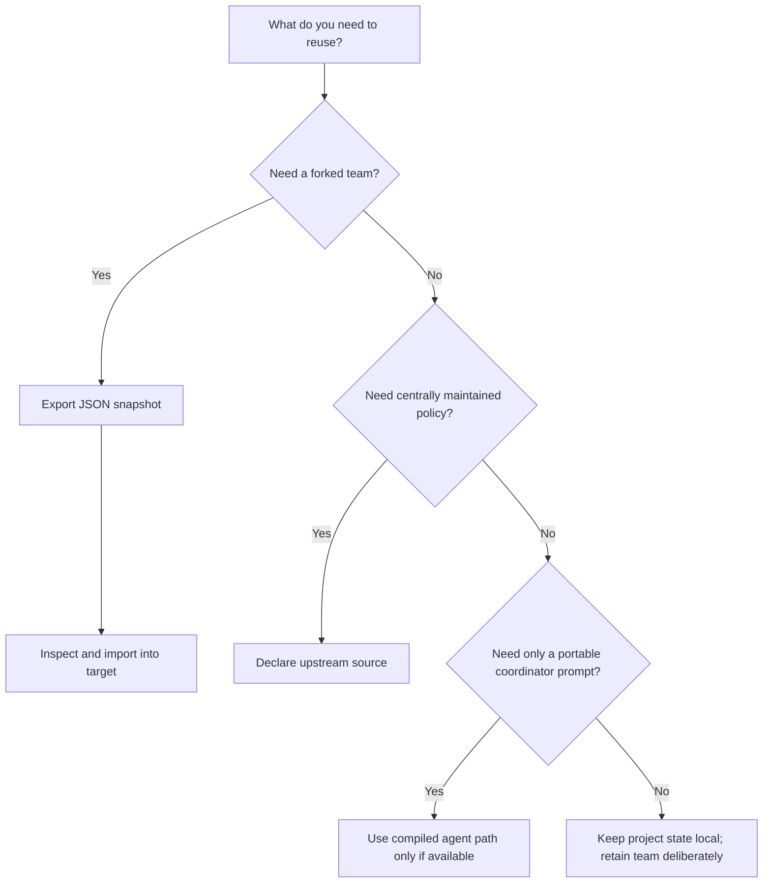
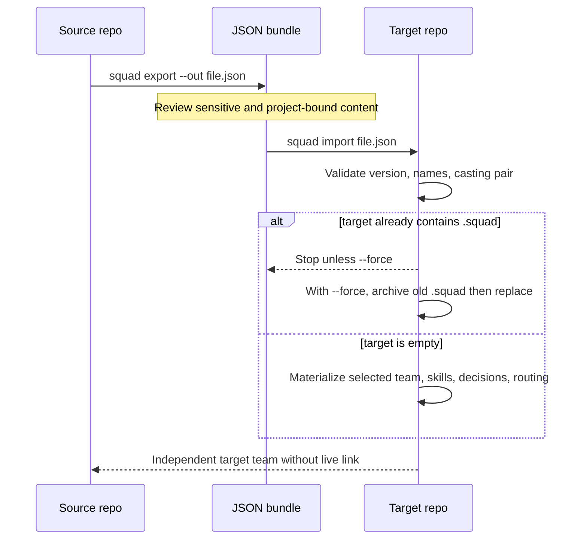
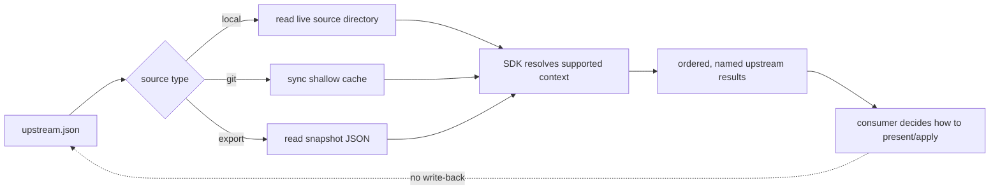

# Chapter 4: Portability, Export/Import, and Inheritance

> **Prerequisites:** Volume 1 (or equivalent Squad experience); Chapters 2 and 3.

## What You'll Learn

- Separate a portable team snapshot from shared live policy, a personal squad, and a compiled coordinator agent.
- Export and import a Squad snapshot safely, including the actual v1.1.0 manifest fields, collision behavior, and history review.
- Use upstream sources as a controlled mechanism for consuming reusable skills and policy without copying files into every project.
- Understand what `keep-my-squad` means operationally: preserve the team already in the repo, not magically transplant every project fact.
- Decide when to share a whole team, inherit a subset, keep project-specific state local, or generate a client-native coordinator artifact.
- Spot mismatches between the portability documentation and the v1.1.0 CLI/SDK before designing a transfer workflow around them.

> **Preview (Squad 2.0):** Upstream resolution and personal-squad behavior change in 2.0. See Chapters 18 and 21 and the [2.0 release notes](https://github.com/bradygaster/squad/blob/v2.0.0-preview.2/docs/src/content/docs/whatsnew.md) for details.

## Portability Is About Boundaries, Not Just Copying Files

A Squad's accumulated value is distributed across several artifacts, and they have different owners and lifetimes. A charter describes an agent's stable responsibility; a skill expresses repeatable know-how; `decisions.md` records choices whose rationale may or may not apply to a new codebase; routing maps task shapes to the local roster; histories can mix reusable lessons with project-specific facts; casting records which agent identities were selected; and repository source files describe the product itself. Treating all of these as one undifferentiated “team” is how project-specific assumptions leak into the next repo.

Portability is therefore a design problem with at least four distinct transfer patterns:

| Pattern | What moves | Typical relationship | What does not happen automatically |
|---|---|---|---|
| Snapshot export/import | Team files serialized to a JSON bundle, then materialized into another repo | One-time copy, then independent evolution | No ongoing synchronization or conflict-aware merge |
| Upstream inheritance | Selected shared context read from another source | Consumer reads a shared source at its own session boundary | No write-back; no general-purpose overlay/merge contract |
| Personal/kept team | An existing personal or repository team is retained while starting work elsewhere | Reuse identity and conventions | Not a clean-room team and not an import of every old project's state |
| Coordinator-as-agent export | A generated client-native prompt assembled from team configuration | Versioned compiled artifact | Not a live Squad runtime, state store, or full feature port |

A useful rule is: **copy what should fork, inherit what should stay centrally governed, and keep project facts attached to the project that established them.** If the goal is to take a proven team and evolve it for another product, use a snapshot and explicitly review the result. If the goal is organization-wide standards that should keep changing centrally, consider an upstream. If collaborators only need a portable prompt, a compiled custom agent is a different delivery mechanism and has important stable-version caveats discussed below.

> **Warning:** An export is a data package, not automatically a sanitized package. The v1.1.0 CLI warns that histories, decisions, and team content may contain project details. Read the actual JSON before publishing it or sending it outside your organization.

### A Transfer Decision Flow



## Snapshot Export: What the CLI Actually Captures

The stable command is intentionally straightforward:

```bash
squad export
squad export --out ./backups/tasktrack-team.json
```

With no `--out`, the CLI writes `squad-export.json` in the current repository. The command checks for the active team's `team.md`; if it cannot find one, it reports that no Squad exists and asks you to initialize first. Its output is a pretty-printed JSON manifest with a trailing newline. The manifest has version `1.0`, export timestamp and CLI version metadata, optional copies of team, decisions, and routing Markdown, casting data, a name-keyed agent map, and an array of skill documents. The implementation currently writes aliases `team`/`team_md` and `decisions`/`decisions_md` for compatibility, plus `routing_md`; each agent can have `charter` and `history` text. Casting includes the registry/history pair and, when parseable, the casting policy.

This content inventory matters more than a generic promise that “everything” travels. The implementation reads the effective Squad state directory, gathers agents below `agents/`, and searches skill locations in this order: `.copilot/skills/`, `<effective squad dir>/skills/`, and legacy `.ai-team/skills/`. For nested skill locations it reads each directory's `SKILL.md`; for the legacy flat layout it reads Markdown files directly. The first existing candidate directory is used; this is not a union across all three. An incomplete or unconventional skill tree may therefore export less than you expect. Inspect the JSON and compare it with the source tree before relying on it as your sole backup.

The installed help is incomplete: `squad export --help` documents only `--out <path>`, but `cli-entry.ts` also parses `--repo` and `--branch` and dispatches to the GitHub Contents API helper. The code checks that `gh` is installed and authenticated; the target repository must already exist. These flags are executable in the inspected v1.1.0 code even though the help output omits them. There is a subtler path mismatch: the repository-export branch does not pass the parsed `--out` value into `exportToRepo`, so it writes the helper's default `squad-export.json` path even though the docs say `--out` selects a filename in the remote repository. Test the exact artifact path before automating repository export.

### Export Is Not an Automatic Privacy Filter

The written histories are included as raw text by the v1.1.0 CLI exporter. Its warning is an instruction to review, not a promise that content has been automatically split or scrubbed. The import path runs history splitting and adds an “Imported from …” preamble, but that is not equivalent to a dependable privacy classifier. Treat file paths, issue references, internal architecture, names, credentials accidentally pasted into notes, and secrets in all text fields as potentially present. The separate `scrub-emails` command may help with one type of cleanup, but should not be mistaken for general secret detection or anonymization.

Before sharing a bundle, inspect it locally:

```bash
squad export --out ./review/team.json
python3 -m json.tool ./review/team.json | less
```

Look specifically at `agents.*.history`, `agents.*.charter`, `decisions_md`, `team_md`, and `skills`. Redact the source state first when practical, then regenerate and inspect the new artifact. Keep access controls and retention in mind: a private Git repository is still a distribution boundary, not a guarantee that every reader should see every lesson.

## Import: New Target, Existing Team, and Archive Semantics

A local import takes a file path:

```bash
squad import ../backups/tasktrack-team.json
```

The v1.1.0 importer parses JSON, checks manifest version `1.0`, validates key object/array fields, validates that casting registry and history are a consistent pair, and rejects unsafe agent names before it writes agent paths. It builds the target `.squad/` structure, writes team, decisions and optional routing, materializes casting through its lock/commit protocol, and writes imported skills under `.copilot/skills/<skill-name>/SKILL.md`. It creates additional local runtime directories such as `decisions/inbox`, `orchestration-log`, and `log` as needed. The importer does not simply unzip a directory tree byte-for-byte; it translates selected manifest fields into the current layout.

If a team already exists, ordinary import stops. With `--force`, it renames the current team directory to an archive with a timestamped suffix, then applies the incoming bundle. “Force” means **archive then replace**, not merge the two rosters. Inspect the archive and incoming snapshot before deciding which becomes authoritative. A rollback is possible by restoring the archive as `.squad/` after carefully moving the imported state aside; avoid deleting either copy until the imported state is verified.

Imported histories receive a provenance preamble and pass through the importer’s `splitHistory` routine, which separates portable knowledge from project learnings according to that routine’s patterns. This is a useful context boundary, not a guarantee that every project-specific statement is recognized. Decisions are imported as text from the snapshot; they are not automatically re-evaluated for relevance. The receiving team should review both its new `decisions.md` and imported histories, then record target-project decisions independently.

The import help documents `squad import <file> [--force]`, but `cli-entry.ts` also accepts `--repo <owner/repo>` and `--branch <name>` to fetch the default bundle path from a GitHub repository. The import implementation checks for authenticated `gh` access before downloading. The CLI parser does not read an `--out` option on import, so the docs' examples for selecting a remote filename are not wired through the normal command path. Unlike some narrative examples in older portability docs, `--merge` and `--dry-run` are not part of this stable CLI command. If a target already has a team, choose deliberately between retaining it, archiving it in favor of the import, or manually composing files under version control. Do not assume a bidirectional merge.

### Import Lifecycle



## Keep-My-Squad: Preserve Identity, Re-Scope Knowledge

“Keep my squad” is a user intent, not a CLI flag that disables all initialization. The practical instruction is to retain the team you already have instead of casting a replacement team for the new work. It helps preserve agent names, role relationships, charters and reusable skills. It does **not** make an old project's source tree, unresolved issues, old decisions, or assumptions applicable to a second project.

A disciplined transition starts by treating the next repository as a new context:

1. Identify where the team actually lives. In v1.1.0, local project state is usually `.squad/`; personal or externalized state can change the effective directory. Use `squad status` and the repo's configuration rather than guessing.
2. Protect the current state in Git or create a reviewed snapshot. If the team belongs to a personal directory, keep that scope explicit; do not accidentally commit private state into a public project.
3. Carry over stable responsibilities and general skills. Reconsider routing patterns, issue conventions, build/test assumptions, and the repository's own `decisions.md`.
4. Orient the agents to the new codebase. State the language, test commands, architecture, constraints, and any known boundaries; have them inspect files instead of reusing old paths from memory.
5. Keep old-project learning labeled as historical. A previous decision is evidence and rationale, not a binding rule for a product with different constraints.

This is the difference between continuity and contamination. Stable team identities can be useful across projects because responsibilities and working relationships persist; project-specific conclusions must be revalidated. When changing organizations or privacy boundaries, inspect the histories rather than carrying all remembered text on trust.

### Team Portability Is Not the Same as Project Portability

A team can be portable while the *team state backend* is not. A committed `.squad/` directory travels with a Git clone; a local-only, externalized, or machine-specific state directory may not. The export path packages selected content into a file so it can cross those boundaries, but secrets, external systems, MCP credentials, CLI login, local tools, and deployment configuration should not be assumed to travel. After import, validate the team's on-disk files, available tools and authentication separately.

The coordinator-as-agent format is another boundary: it compiles behavior for client discovery but deliberately omits histories, decisions, and skills as separate live resources. Do not treat it as a substitute for an archival export when the objective is to preserve accumulated state.

## Upstream Inheritance: Central Source, Read-Only Consumer

Upstreams are designed for reusable context that should be authored in one place and consumed by multiple squads. The CLI supports four management operations:

```bash
squad upstream add ../org-squad/.squad --name org-practices
squad upstream list
squad upstream sync org-practices
squad upstream remove org-practices
```

The configuration is `.squad/upstream.json`. An entry includes a name, type (`local`, `git`, or `export`), source, optional Git ref, and added/sync timestamps. A local path is stored resolved to an absolute path; use a stable shared path if teammates need to use the same declaration. Git sources default to ref `main` unless `--ref` is supplied. Names are unique and limited to alphanumeric characters, dots, underscores and hyphens. Git refs are restricted to alphanumeric characters, dots, underscores, slashes and hyphens.

- **Local** sources are read from a live local directory. The CLI's `sync` validates their path and updates the timestamp; it does not copy files. Relative paths resolve on the machine that ran `add`, so portability across machines requires a deliberately shared layout or a Git source instead.
- **Git** sources are shallow-cloned for the configured ref into `.squad/_upstream_repos/<name>`. Squad adds that cache directory to `.gitignore`; syncing performs a fast-forward-only pull or reclones if needed. Commit `upstream.json`, not the cache as if it were the policy source. A clone failure leaves a declared entry and provides a retry path, so check `list`/`sync` and the local clone before assuming the source is available.
- **Export** sources point to a JSON file and are read from that path. `sync` validates file existence; it does not update the snapshot. To use a newer snapshot, update the file itself or change the configured path.

The SDK resolver in `packages/squad-sdk/src/upstream/resolver.ts` can read `.squad/` or legacy `.ai-team/` source directories. For repository sources it reads skills, `decisions.md`, `identity/wisdom.md`, `casting/policy.json`, and `routing.md`. For JSON export sources it currently extracts skills and the casting policy; it does not extract the decisions, routing, or wisdom fields from a normal export manifest. A useful deployment pattern is therefore to point at a policy repository when you need the full supported set, and to treat a JSON snapshot upstream as a narrower input.

> **Warning:** The upstream guide describes precedence as “later entries override earlier ones” and says local `.squad/` always wins. The v1.1.0 resolver returns an ordered list of separately named `ResolvedUpstream` objects and `buildInheritedContextBlock` emits a summary; it does not perform that merge or local override algorithm. Resolve this as a documentation-versus-implementation discrepancy, not an ordering guarantee. Review how a consuming coordinator actually uses resolved content before relying on a conflict policy.

Likewise, source inspection found resolver functions and CLI commands but no call site in the v1.1.0 CLI coordinator that automatically injects resolved content into each session. The docs describe session-start inheritance, and an upstream skill describes that intent, but do not assume configuration alone causes all shells/clients to consume it in the same way. Verify the running path or explicitly present inherited content to the team. Inheritance is not a substitute for tests that prove policy is actually applied.

### Inheritance Lifecycle and Failure Modes



This sequence highlights an important operations distinction: `sync` fetches or validates source availability; it is not itself a merge, an agent invocation, a team update, or a proof that the coordinator consumed the new data. Restarting a session may be needed for new context, but first verify the host and integration actually invoke the resolver.

For shared policy, prefer small, explicit upstream artifacts. Put organization-wide secure coding or domain conventions in a maintained source repository; put project ownership and product architecture in the receiving project's own files. Give Git refs intentional release semantics (a stable branch for continuously updated policy, or a tag/branch strategy if repeatable builds matter). Reordering with remove/add changes ordering in the JSON file but, in the current resolver, does not by itself create conflict resolution.

## Coordinator-as-Agent Export: A Different Kind of Portability

The coordinator-as-agent article describes `squad export agent`, which would compile `.squad/team.md`, routing, ceremonies, configuration and charters into `.github/agents/squad.md`. It describes `--check`, `--watch`, `--dry-run`, and `--compact`, token-budget modes, ownership-marker safety, drift checks and use of Copilot's native task tool. Conceptually, this is a compiled delivery artifact: it packages coordinator instructions for clients that can discover custom agents, but does not embed live Squad runtime state. The exported coordinator cannot provide the complete runtime's Scribe, Ralph, MCP state tools, or state services merely by being a Markdown prompt.

However, **the `squad export agent` feature is not verified as available in the v1.1.0 stable CLI**. The installed v1.1.0 help exposes `squad export` for JSON snapshots only and lists no `agent` subcommand; a source search found the feature documentation but no matching CLI implementation or SDK `repo-native` export entrypoint. Treat this capability and the listed flags as preview/documented intent, not executable v1.1.0 commands. The documented output name `.github/agents/squad.md` also differs from the classic installed coordinator path `.github/agents/squad.agent.md`; do not overwrite either file based on assumptions.

When a future stable exporter is available, check generated-file markers, user-owned file protections, budget mode, actual omitted state, and drift detection semantics before wiring it to CI. A generated prompt should be regenerated from its source of truth; manual edits will otherwise be overwritten or drift. Build an independent snapshot backup if preserving decisions and histories is the goal.

## Hands-On: Take Tasktrack's Team to a Second Repo

Use the Tasktrack repo you have developed in earlier chapters. This exercise makes a copy that can evolve independently; it does not set up a live upstream.

From the Tasktrack repository, export the current team to a path beside the repo, inspect the file, and then import it into a fresh target repository:

```bash
cd ~/tasktrack
git status --short
squad export --out ../tasktrack-team.json
python3 -m json.tool ../tasktrack-team.json | less
mkdir ../tasktrack-web && cd ../tasktrack-web
git init
squad import ../tasktrack-team.json
squad status
```

Expected results: export reports a JSON file written; the bundle has manifest version `1.0`, an agent object, skills array and casting pair; import reports the number of agents and skills, preserves the casting universe when policy includes one, and creates a target `.squad/`. The `squad status` output should identify the target's active team. Read imported histories before asking agents to work on Tasktrack's separate `web/` application; explain what belongs to the new scope and what remains a prior-project note.

Now test collision behavior in a disposable **project directory you control** where a `.squad/` exists. Run `squad import ../tasktrack-team.json` and confirm it refuses to replace the target. Then run with `--force` only if you intend to archive the existing team; inspect both the timestamped archive and imported state. Do not test this by overwriting your only project team.

To compare inheritance rather than snapshot import, use a separate repo whose `.squad/` holds reusable policy, then register it with `squad upstream add <path> --name tasktrack-guidance`. Run `squad upstream list` and `squad upstream sync tasktrack-guidance`. Check `.squad/upstream.json` and any Git cache. The test should confirm declaration and resolution inputs exist; it should **not** claim that policy was applied until you observe it in the actual client/coordinator's prompt or behavior.

## Configuration Reference

| Item | Purpose and stable behavior | Important limits |
|---|---|---|
| `squad export` | Writes `squad-export.json` in current repo by default | Requires a team `team.md`; local snapshot only in the documented CLI surface |
| `squad export --out <path>` | Writes the JSON snapshot to a chosen path | Verify parent directory exists and review content before sharing |
| `squad export --repo <owner/repo> [--branch <name>]` | Uploads a snapshot through authenticated `gh` | Parsed by v1.1.0 despite omission from help; remote `--out` filename is not passed to the SDK helper |
| `squad import --repo <owner/repo> [--branch <name>] [--force]` | Downloads the default bundle path from GitHub and imports it | Parsed by v1.1.0 despite omission from help; no CLI `--out` filename parsing |
| `squad import <file>` | Parses a v1.0 export manifest and creates team state | Existing `.squad/` blocks import; no merge flag in stable help |
| `squad import <file> --force` | Archives existing team directory, then replaces it | Archive is a backup, not a merged team; verify both copies |
| `.squad/upstream.json` | Declares named upstream sources | Commit only if source paths/URLs are appropriate for all collaborators |
| `upstream add <source> [--name <n>] [--ref <branch>]` | Adds a local path, Git source or existing JSON export | Git ref applies only to Git; omitted ref defaults to `main` |
| `upstream list` | Shows type, source, ref and last synced date | A listed source may still be unreachable or not consumed by a runtime |
| `upstream sync [name]` | Updates git clone or validates local/export path | It does not merge data or refresh an export snapshot |
| `upstream remove <name>` | Removes declaration and deletes named cached Git clone | Does not delete the original upstream source |
| `.squad/_upstream_repos/<name>/` | Local shallow clone cache for Git upstream | Auto-ignored; regenerate with sync if missing |
| `SQUAD_HOME` | Changes the global Squad home used for personal state and capability fallback | Not an export/import privacy boundary by itself |

## Under the Hood

The CLI export path in `packages/squad-cli/src/cli/commands/export.ts` builds its own manifest from `effectiveSquadDir(dest)`, checks the active `team.md`, serializes version `1.0`, and writes through `FSStorageProvider`. It reads agent charters and histories as text, reads the casting registry/history pair through casting helpers, and optionally parses the policy JSON. Errors reading some optional content are reported as warnings rather than invalidating the entire snapshot. This is why a successful export still deserves a content audit.

The importer in `packages/squad-cli/src/cli/commands/import.ts` has a more defensive apply stage. Before writing, it validates casting registry/history consistency and a positive safe-integer revision, removes transaction bookkeeping from cloned pair objects, checks safe agent-name slugs, and asserts generated agent/skill paths stay under their expected directories. If `--force` is used, it renames existing `.squad/` first. The authoritative casting pair is committed via the lock-aware casting protocol rather than two unrelated writes. Agent histories pass through `splitHistory`; skills are named from their frontmatter and sanitized before being written below `.copilot/skills/`.

The SDK's `packages/squad-sdk/src/sharing/export.ts` is not identical to the CLI path. It exposes lower-level `exportSquadConfig` options such as `includeHistory`, `includeSkills`, `format`, and `anonymize`, and describes an `ExportBundle` with agent arrays and routing rules. Its companion importer supports a merge-like operation and dry-run, but this SDK bundle structure is distinct from the stable CLI's `version: '1.0'` manifest. Do not assume a JSON produced by one API is interchangeable with the other without validating schema and version. The package's `./sharing` public export provides APIs, but the ordinary CLI command's actual behavior is the authoritative reference for command usage.

The upstream SDK types (`packages/squad-sdk/src/upstream/types.ts`) model a source with `name`, `type`, `source`, `ref`, `added_at`, and `last_synced`; the resolver (`resolver.ts`) separately reads files and returns `UpstreamResolution`. The current resolver gracefully yields empty content when a source cannot be found, which prevents a missing source from throwing but makes user-visible validation essential. `buildInheritedContextBlock` and `buildSessionDisplay` summarize content and availability; they do not themselves implement an override policy. The management commands live in `packages/squad-cli/src/cli/commands/upstream.ts`, where the git clone/pull behavior and safe Git ref/name checks are implemented.

## Pitfalls and Troubleshooting

- **“Exported successfully” but a skill is missing:** inspect the actual source layout. The exporter uses the first existing skill root, expects nested `SKILL.md` files in modern layouts, and reads only one candidate directory.
- **Import reports an invalid bundle:** confirm JSON is syntactically valid, manifest version is `1.0`, `agents`, `casting.registry`, `casting.history`, and `skills` have expected shapes, and the casting pair is consistent. Don't hand-edit registry revisions casually.
- **Import refuses to proceed:** a current `.squad/` exists. Back it up and choose either ordinary empty-target import or deliberate `--force` archive-and-replace.
- **Old file names appear in prose:** some assigned docs use `.ai-team/` and older example histories. v1.1.0 primarily uses `.squad/`, with selective compatibility readers; verify each path against current code.
- **Git upstream clone fails:** validate URL, authentication, ref existence and network. `add` records the source before clone success; retry `squad upstream sync <name>` and check `.squad/_upstream_repos/`.
- **Local upstream works only for you:** stored absolute path points to your machine. Use a shared Git repository or ensure collaborators have the same relative layout.
- **Updated upstream seems stale:** sync Git upstreams and start a fresh consumer session; then confirm the resolver and prompt integration are actually active.
- **Conflicting policies:** do not rely on the docs' later-wins/local-wins claim without runtime confirmation. Current resolver presents separate ordered results; compose policy explicitly in the consumer until a merge contract is verified.
- **A supposedly exported coordinator command fails:** it is not in the v1.1.0 stable CLI help. The documentation describes an export-agent feature not verified in the tag; do not invent a workaround by hand-renaming generated prompts.

## Summary

Portability means preserving the right knowledge while respecting the boundary between reusable practice and project history. Use `squad export --out` and `squad import` for a deliberate snapshot fork, review archives and histories, and never assume the bundle is scrubbed. Use upstreams when a centrally maintained source should inform several projects, while verifying both resolution precedence and actual coordinator consumption. “Keep my squad” preserves useful identity; it does not remove the need to re-orient agents. Finally, coordinator-as-agent export is conceptually distinct from a full snapshot and is documented but not verified in the v1.1.0 stable CLI.

## Exercises

1. **Portability inventory.** In your Tasktrack repo, classify `team.md`, one skill, a routing rule, a decision, an agent history note, and the source tree as either a good general transfer candidate, a candidate requiring review, or project-local context. Explain why.
2. **Safe fork.** Export a team and import it into a fresh repo. Record the manifest version, number of agents and skills, casting policy presence, and one example of a history transformation. What would `--force` do if the destination had an existing team?
3. **Upstream threat model.** Design an upstream for your engineering organization's common security rules. Choose local, Git or export type; specify ownership, update cadence, ref strategy, outage behavior and how you would verify consumption. Explain why the source should be read-only for a consuming project.
4. **Conflict semantics.** Two upstreams define different rules for the same behavior and the local `routing.md` says a third thing. Based on the v1.1.0 resolver, what order does it return and what can you safely claim about precedence? Propose a test or explicit composition approach.
5. **Export review checklist.** Write a short checklist for approving a team snapshot for a partner organization. Include content review, access control, schema compatibility and post-import validation.

## Quiz

1. Which workflow creates an independently evolving team: snapshot import or upstream inheritance?
2. What does `squad import <file> --force` do to an existing `.squad/` directory?
3. Does the v1.1.0 CLI automatically scrub project-specific history before export?
4. What source types does `squad upstream add` support, and what does `sync` do for each?
5. Does the current SDK resolver itself implement a documented “later upstream wins, local always wins” merge?
6. Why is `squad export agent` not a safe stable-v1.1.0 assumption?
7. Can a coordinator-agent prompt export substitute for preserving the live team histories and decisions?

## Further Reading

- [Portability](https://bradygaster.github.io/squad/docs/concepts/portability/)
- [Export and Import](https://bradygaster.github.io/squad/docs/features/export-import/)
- [Upstream Inheritance](https://bradygaster.github.io/squad/docs/features/upstream-inheritance/)
- [Keep My Squad](https://bradygaster.github.io/squad/docs/scenarios/keep-my-squad/)
- [Team Portability](https://bradygaster.github.io/squad/docs/scenarios/team-portability/)
- [Coordinator-as-Agent Export](https://bradygaster.github.io/squad/docs/features/coordinator-as-agent-export/)
