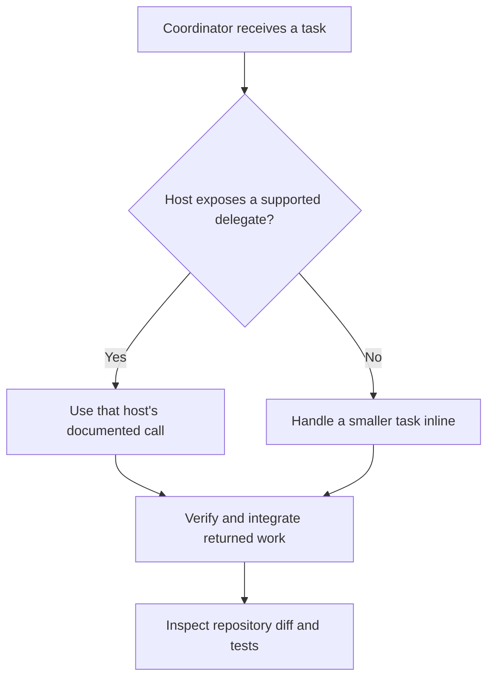
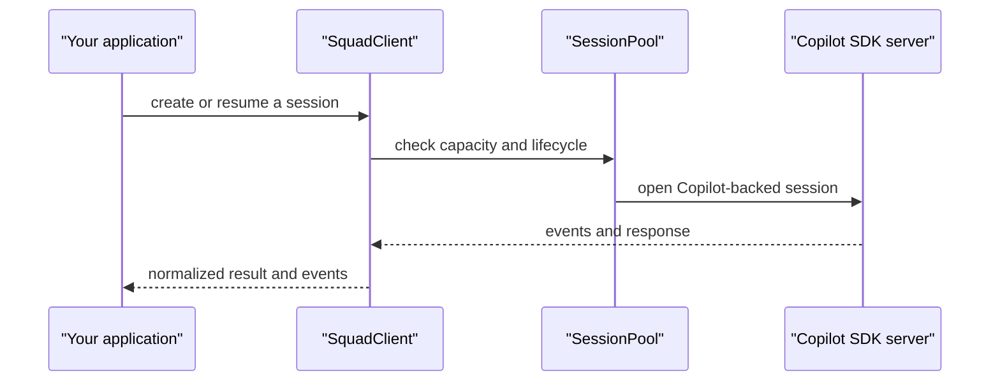

# Chapter 5: Clients, Hosts, and Programmatic Sessions

> **Prerequisites:** Volume 1 (or equivalent Squad experience).

## What You'll Learn

- Explain why the client running Squad affects available tools, delegation, permissions, and result handling.
- Compare the documented Copilot CLI and VS Code workflows without assuming feature parity.
- Design a portable workflow with an inline fallback when delegation is unavailable.
- Distinguish shared repository team files from client-specific instructions and local runtime behavior.
- Identify what the v1.1.0 SDK adapter and `SquadClient` provide to programmatic callers.
- Find the Squad 2.0 multi-client projection model in Chapters 19–20.

## A Client Is a Capability Boundary

A Squad coordinator is prompt-driven, but its available tools depend on the client that hosts it. A useful design treats delegation as an optional capability rather than a universal assumption. Shared repository files can provide team instructions, charters, routing, and skills; they do not make every host expose the same tool calls, background execution, model controls, filesystem access, or approval flow.

The v1.1.0 client-compatibility reference compares Copilot CLI and VS Code. In the CLI, the documented `task` tool can start agents with parameters such as agent type, model, and background execution; `read_agent` collects results later. VS Code's documented `runSubagent` behavior returns results with the call, and multiple calls issued together may run concurrently. Those are different interaction contracts, not merely alternate spellings for the same API. The reference does not establish equivalent behavior for every Copilot surface or version, so verify your exact extension, workspace mode, tools, policies, and agent definitions.

| Capability | Copilot CLI | VS Code Copilot | How to make a workflow resilient |
|---|---|---|---|
| Agent delegation | The reference documents the `task` tool | The reference describes `runSubagent` or named agent selection, depending on the surface | Check the actual tools injected by the host before delegating |
| Parallel work | Background task calls can be launched together | Multiple calls in one turn are described as concurrent | Split only independent tasks and integrate their results deliberately |
| Result collection | `read_agent` can collect a background result | Results arrive with the completed subagent call | Do not assume CLI-style polling exists in an IDE |
| Per-agent model/type | The CLI reference documents parameters | Tool and agent selection are more constrained by the surface | Prefer static, configured behavior where dynamic controls are absent |
| Operational state | The reference environment includes SQL utilities | SQL is not available in the described VS Code environment | Keep durable state in repository files or supported project services |
| Fallback | Work inline when delegation is unavailable | The coordinator can continue inline | Be explicit that the task is being handled without a child agent |

The reference also treats JetBrains and GitHub.com as unclear or limited rather than proving parity. Their availability can change independently of Squad's repository files. A feature matrix is therefore a test plan, not a certification. Confirm coordinator discovery, delegation, file writes, MCP access, and result handling on the exact client release your team intends to use.

## Shared Files, Different Runtime Behavior

A portable workflow preserves intent while adapting invocation details. Ask the coordinator to classify work, identify independent parts, and choose a host-supported path. If the client exposes delegation, use its documented call and check the returned result. If not, handle a smaller unit inline instead of pretending a child process started. Avoid putting state that must survive across hosts into a client-specific SQL tool or transient session memory.

The shared `.squad/` directory can hold team-wide policy and agent definitions, but it does not make concurrent edits safe. Two clients pointed at the same checkout can overwrite each other's changes. Agree on a branch and working-tree discipline, keep personal credentials out of shared configuration, and use Git status and diffs as the common audit layer. When clients use separate clones, they still need a clear integration path for branches and pull requests.

Treat file-write and MCP permissions as host-specific. A successful tool call in one client is not evidence that another client has the same access. Likewise, a coordinator's report is not durable proof of a change: inspect the diff, run the relevant test, and confirm the intended branch before merging work.

### Squad 2.0 looks across more hosts

Squad 1.1's compatibility discussion focuses on Copilot interaction surfaces and their differing tools. Squad 2.0 introduces generated, native host projections for multiple AI clients. That newer model is covered in Part IV, especially Chapters 19–20; those chapters are the home for the 2.0 setup flow and host-adapter behavior. Do not mix the 2.0 projection commands with the v1.1.0 workflows in this chapter.

## Programmatic Sessions Through the SDK

The SDK's `adapter` layer is a boundary around `@github/copilot-sdk`. In v1.1.0, `adapter/types.ts` defines Squad's session configuration, tool, hook, event, model, and response types, so consumers can work with Squad's contract rather than depending on upstream type names throughout their code. `adapter/client.ts` wraps the Copilot client, normalizes tool names for the upstream wire format, adapts session methods and events, and manages connection lifecycle.

For example, Squad permits canonical dotted tool names such as `memory.classify`, while the Copilot external-tool wire format allows a narrower character set. The adapter normalizes dots to underscores before the call and maps hook names back for the caller. It detects collisions so that two canonical names cannot silently become the same wire name.

The higher-level `client` module re-exports selected adapter types and combines `SquadClient` with a `SessionPool` and `EventBus` in `SquadClientWithPool`. The pool enforces a concurrency limit and tracks session lifecycle; source defaults include ten concurrent sessions, a five-minute idle timeout, and a 30-second health-check interval. The event bus lets code subscribe to session-created, destroyed, status, and error events, as well as routing and milestone events.

This is a programmatic API for applications building on the Copilot SDK. It is not a setting that gives VS Code or GitHub.com the CLI's agent-spawning semantics, and it does not adapt an arbitrary editor subagent into a CLI-compatible session. See Chapter 14 for the SDK's broader module layout and API details.

## Hands-On: Compare Two Client Workflows

Use the Tasktrack repository in a clean working tree. This exercise compares client behavior; do not make a change to shared team policy merely to force two clients to behave alike.

1. In Copilot CLI, open the repository and ask the coordinator for a read-only review of one small Tasktrack area. Ask it to list relevant files and the test command before doing any work.
2. If the client exposes the documented delegation tool, request a short, bounded test review. Record how the child starts and how its result is collected. If no such tool is available, have the coordinator do the review inline.
3. Open the same repository in VS Code with Copilot enabled and the workspace trusted. Repeat the read-only review. If the surface offers a subagent call, check whether results return synchronously; otherwise use the inline fallback.
4. Compare coordinator discovery, available tools, write approval, MCP access, and result handling. Inspect `git status` and `git diff` even if both clients report that the repository is unchanged.
5. Record only version-specific observations in a local note. Keep any credentials or personal-client settings out of committed `.squad/` files.

**Expected result:** a small compatibility checklist that distinguishes verified behavior from unknowns. No client should be described as equivalent based solely on a successful run in another host.

## Configuration Reference

| Setting / API | Meaning | Default or boundary | Notes |
|---|---|---|---|
| `templates/client-compatibility-reference.md` | Guidance for adapting orchestration to the active client | Host-dependent | Treat tool names as examples; follow tools actually provided by the runtime |
| `@bradygaster/squad-sdk/adapter` | Copilot SDK session adapter and types | Requires the Copilot SDK connection | Normalizes Squad's session/tool boundary |
| `@bradygaster/squad-sdk/client` | Higher-level `SquadClient`, pool, and event bus | Pool defaults: 10 concurrent sessions, 300,000 ms idle timeout, 30,000 ms health checks | Programmatic API, not an IDE compatibility switch |
| `SquadClientWithPoolConfig.pool` | Overrides session-pool limits and timeouts | Uses source defaults if omitted | Configure for the application workload |
| `.squad/` team files | Shared instructions, charters, routing, and skills | Repository-scoped | Do not store credentials or assume shared files make parallel writes safe |

## Under the Hood

The Copilot client boundary is implemented by `packages/squad-sdk/src/adapter/client.ts` and typed in `adapter/types.ts`. `CopilotSessionAdapter` maps Squad's session operations and short event names onto the Copilot SDK's methods and events. `normalizeToolsInConfig()` copies configuration and normalizes tool names, allow/deny lists, and custom-agent tool lists, while wrapping pre/post-tool hooks to restore canonical names.

`packages/squad-sdk/src/client/index.ts` re-exports core types and adds `SquadClientWithPool`; `session-pool.ts` holds session capacity and cleanup behavior, and `event-bus.ts` provides asynchronous event subscriptions. The coordinator's own client-specific instructions are a separate layer: they teach the active host how to invoke tools but do not change this SDK's Copilot-backed session transport.

## Pitfalls and Troubleshooting

- **A delegation call works in CLI but not VS Code:** expected if the host exposes a different tool contract. Inspect the active client's tools and use inline work as a fallback.
- **A background result never appears in VS Code:** the described VS Code call returns with the subagent result rather than using CLI-style `read_agent` polling.
- **The coordinator tries to use SQL for portable state:** move durable state into repository files or another service available in the intended clients.
- **Two clients overwrite a shared checkout:** separate their branches/worktrees or serialize writes; common files do not provide locking.
- **An IDE is assumed to use `SquadClientWithPool`:** that is an SDK application API connected to the Copilot CLI server, not a client-neutral editor spawn abstraction.
- **A client is called supported based on another host's test:** validate the exact client version, permissions, workspace mode, and tools before relying on it.

## Summary

In Squad 1.1, the client is a capability boundary: repository-level team files can be shared, but delegation, result collection, model controls, SQL, file permissions, and MCP access depend on the host. Design portable work around explicit capability checks and an honest inline fallback, then verify every change through Git and tests. The SDK's `adapter` and `client` modules support programmatic Copilot sessions; they do not make every editor behave like Copilot CLI. Squad 2.0 multi-client projections are covered separately in Chapters 19–20.

## Exercises

1. **Client acceptance test.** Draft a test matrix for Copilot CLI and VS Code that checks coordinator discovery, delegation, result collection, write approval, MCP access, and inline fallback. Mark untested behavior as unknown.
2. **Portable workflow.** Write a short coordinator instruction that describes task triage without hard-coding one host's delegation tool. Include a rule for what to do when delegation is unavailable.
3. **Programmatic API boundaries.** For an application that needs to open Copilot sessions, cap concurrency, and subscribe to lifecycle events, identify the relevant SDK abstractions. Explain why those APIs do not prove an IDE supports the same tools.
4. **Shared-checkout policy.** Propose a branch/worktree rule for two clients that may edit the same repository. Include a verification step before integrating changes.

## Quiz

1. Why should a Squad workflow treat delegation as a client capability rather than a universal assumption?
2. In the compatibility reference, how does the described CLI result-collection flow differ from VS Code's subagent flow?
3. What is the correct fallback when a host does not expose a supported subagent tool?
4. Which SDK abstraction provides programmatic Copilot sessions with pooled concurrency and event subscriptions?
5. Do shared `.squad/` files prevent concurrent clients from overwriting one another's work?
6. Where should readers go for Squad 2.0's multi-client projection model?

## Further Reading

- [Client Compatibility Scenario](https://bradygaster.github.io/squad/docs/scenarios/client-compatibility/)
- [Client Compatibility Reference Template](https://github.com/bradygaster/squad/blob/v1.1.0/templates/client-compatibility-reference.md)
