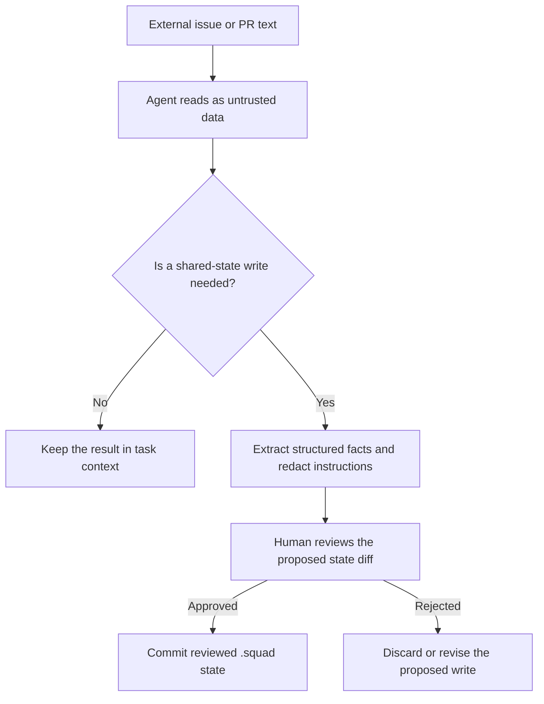
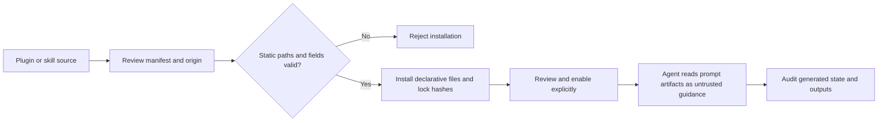

# Chapter 6: Security Hardening

> **Prerequisites:** Volume 1 (or equivalent Squad experience); Chapters 1, 2, and 4.

## What You'll Learn

- Map Squad's trust boundaries and explain why instructions in an issue are not equivalent to instructions in a reviewed charter.
- Reduce the consequences of prompt injection, poisoned shared memory, excessive permissions, untrusted plugins, and leaked credentials.
- Set up GitHub CLI access for private repositories and multiple organizations without turning tokens into committed configuration.
- Separate GitHub authentication from Azure identity, and choose a credential strategy with a bounded blast radius.
- Review workflow, dependency, and image supply-chain controls before enabling unattended work.

## Security Starts with a Threat Model

Squad is a coordination layer, not a sandbox. Its agents can read and modify whatever their host process, Copilot session, configured tools, GitHub token, or runner permits. A charter can describe a limit, but a model following a charter is not the same control as an operating-system permission, a GitHub access rule, or a job-level `permissions` boundary. Treat prompt rules as guidance and back them with enforceable limits wherever possible.

A useful first question is not “Is Squad secure?” but “Which identity can do what, in which environment, with which data, and who reviews the result?” The answer differs across a local Copilot session, a Codespace, GitHub Actions, a container, and an SDK host. Local execution does not imply that the model provider never receives prompt context. A private repository does not make every issue comment trustworthy. A GitHub token mounted into a container has whatever authority that token carries, regardless of how carefully you word an agent charter.

The operational security guide groups inputs into trust levels. Use that as a triage tool, not as a claim that one source is intrinsically safe:

| Trust level | Examples | How to handle it |
|---|---|---|
| Trusted after review | Committed `.squad/team.md`, approved routing, reviewed first-party code | Read as project configuration, while still reviewing changes through Git. |
| Semi-trusted | Issue bodies, pull-request descriptions, reviews, commits from contributors | Treat as user data. Quote or delimit it, extract facts, and do not obey instructions embedded in it. |
| Untrusted | Third-party API responses, webhook bodies, scraped pages, unknown MCP-server output | Validate its shape and source. Do not copy its prose into shared instructions or memory without review. |

A trust label follows the content, not the file it lands in. An issue body does not become trustworthy just because an agent summarized it into `.squad/decisions.md`. That is the core multi-agent hazard: Squad's shared state is intentionally persistent, so an instruction-like string can outlive the session and reach agents who never saw the original issue.



Prompt injection is not solved by adding a sentence such as “ignore malicious instructions.” Delimit untrusted text, ask the agent to report data rather than follow prose, restrict the tools available during ingestion, and review state changes. These measures reduce risk; they do not prove model behavior. Keep the ingestion step separate from the step that can write team memory when the workflow is sensitive. Use ordinary, review-gated operation rather than unattended `--execute` while establishing the policy.

> **Warning:** The private-repository guide's broad claim that “nothing leaves your machine” describes neither all Copilot configurations nor a hosted deployment. Squad itself is not a Squad-operated data-processing server, but Copilot, GitHub Actions, model services, configured MCP servers, telemetry exporters, and Azure services each have their own data paths. Verify the terms and data controls for the actual client and deployment you use.

## Bound the Actions an Agent Can Take

Security controls work best in layers. Start with the narrowest GitHub identity that can do the job; restrict workflow permissions at the job level; use a clean branch or worktree; review the final diff; and keep branch protection and human approval independent from the agent's own review. For a human-run CLI session, permissions still derive from your local shell and credentials. For Actions, use explicit workflow permissions and avoid granting write scopes to jobs that only read code.

The `squad watch` command has a meaningful human-approval distinction: by default it proposes work for human approval; `--execute` allows the process to act unattended within its available authority. In the CLI v1.1.0 help, `triage` supports `--execute`, `--max-concurrent`, `--timeout`, and optional capabilities such as `--self-pull`, `--board`, `--monitor-teams`, `--monitor-email`, `--two-pass`, `--wave-dispatch`, `--retro`, and `--decision-hygiene`. Each extra integration increases its access surface. Do not turn on a capability merely because the flag exists; document the data it reads and the token permissions it needs.

Use the smallest authority set that still supports the workflow:

| Work | Starting point | Avoid unless essential |
|---|---|---|
| Read-only issue triage | Read access to the repository and issues | Write access, workflow changes, org administration |
| Implement and open a PR | Repository contents, issues, and pull requests at the required level | Organization administration or repository deletion |
| Trigger Actions | The repository's workflow permission in addition to the required repository access | A classic PAT with broad access to every repo the user can see |
| Manage GitHub Projects | Project access and organization-read access if the board requires it | Assuming ordinary issue scopes include every project permission |
| Install or modify workflow code | A reviewed PR, narrowly-scoped workflow token, and protected branches | Letting an agent both change its own controls and merge the change |

For PATs, prefer a fine-grained token restricted to the intended repository and permissions. Classic OAuth scopes such as `repo`, `read:org`, and `workflow` describe a different token model than fine-grained repository permissions. Check the credential's actual permissions with GitHub, not merely its label. `delete_repo` and org-administration access are especially high impact; they are not routine prerequisites for everyday Squad work.

For GitHub Actions, `permissions:` controls the workflow token and should be stated explicitly. A job that builds and tests Tasktrack can use only `contents: read`. Jobs that publish, create issues, push tags, or update releases need write permission, but that is a different job and should not inherit publishing authority unnecessarily. Never use `pull_request_target` as a shortcut to get secrets into code from a contributor's PR; a privileged workflow must not execute untrusted head code.

## GitHub Authentication for Private Repositories

Squad uses the authenticated context of the host that runs it. In a local session, authenticate with `gh`; verify access to the exact repository before asking an agent to operate there. `gh auth login` uses a browser flow by default and stores credentials with the configured credential store where available. `gh auth status` reports hosts, active accounts, and token scope information. Do not paste the token output into a prompt, issue, charter, `.squad` file, or diagnostic log.

```bash
# Authenticate to github.com, then check the account and host.
gh auth login
gh auth status

# Add only the scopes required by the work. Refreshing an account may require
# an interactive authorization step.
gh auth refresh -s repo,read:org,workflow

# Confirm repository access before starting an agent.
gh repo view OWNER/PRIVATE-REPO
```

`repo`, `read:org`, and `workflow` are OAuth scope names in this `gh` example, not universal requirements for every Squad command. The project-board guide lists `delete_repo` and `gist` as optional for specific workflows; do not request them automatically. For a fine-grained PAT, configure the corresponding repository permissions in GitHub and inject it only into the process that needs it. On a workflow runner, the built-in `github.token` is often the right starting identity; grant only the needed job permissions. A local `gh auth status` does not inspect a workflow's `GITHUB_TOKEN`, and changing the local `gh` account has no effect on a GitHub Actions run.

A private repository changes who can fetch it; it does not change how an agent treats incoming text or how much the credential can do. Review `.squad/` before committing it. Team histories, decisions, prompts, and logs can reveal internal architecture even when they contain no password. You may keep sensitive or overly detailed history out of Git with a targeted ignore rule, but first decide whether that history is needed by teammates or future sessions. Avoid blanket ignores that also hide reviewed team configuration from your normal diff.

The export format and its redaction behavior should be checked in the version you are using. Do not assume an export is safe solely because its command is named `export`; inspect the generated artifact and remove project-identifying details before sharing it. Skills may contain generic guidance, but they are ordinary files and can accidentally include internal paths or examples. Review them too.

## Working Across Organizations and Accounts

The GitHub CLI can hold multiple logins, but one account is active for a given host. Switch deliberately, then verify the host and account before an operation that writes or pushes:

```bash
# Log in to each host/account in an interactive session.
gh auth login --hostname github.com
gh auth login --hostname ghe.example.com

# Change the active account on a host when the repository requires it.
gh auth switch --hostname github.com --user YOUR_PERSONAL_ACCOUNT
gh auth status

# Verify access to each intended repository.
gh repo view YOUR_PERSONAL_ACCOUNT/portfolio
gh repo view YOUR_ORG/private-service
```

`--hostname` selects a GitHub host; it is not an organization selector. If personal and enterprise-managed accounts both use `github.com`, they are two accounts for the same host, so choose the intended account with `gh auth switch --hostname github.com --user NAME`. If your Enterprise Server uses its own hostname, authenticate to that hostname separately. A company using Enterprise Managed Users does not necessarily have a distinct web hostname, so obtain the real host and access policy from your administrator instead of inferring it from an example.

The `gh` API client and Git's transport credentials are related but not identical. `gh auth switch` changes the active `gh` identity for a host; the Git remote may use SSH keys, a credential helper, or another credential. Test both API reads and the Git operation you need. Git supports host- and URL-scoped credential helpers, but a global credential change can surprise other shells or parallel agents. Prefer separate clones or carefully isolated `GH_CONFIG_DIR` contexts for concurrent identities. Avoid putting a PAT in a remote URL, shell history, command-line argument, or reusable shell alias. A process-wide `GH_TOKEN` also affects child processes, so keep any override scoped to a single command and clear it immediately.

Copilot instructions can document repository ownership and which identity the human should select, but instructions are not an authentication boundary. Never commit account tokens or private-key material in `.github/copilot-instructions.md`, skills, or charters. An agent should stop and ask for help if the right identity is ambiguous, rather than switching global credentials in a shared multi-agent shell.

## Secret Handling and Rotation

Treat secrets as capabilities. A GitHub token stored in an environment variable is still accessible to processes that inherit that environment; a secret injected into a job is still available to the steps in that job. Do not bake credentials into a Docker image, Docker build argument, source file, `.squad/` memory, sample config, or workflow log. Keep placeholders visibly fake, for example `GITHUB_TOKEN=<inject-at-runtime>`.

The Squad secret-handling skill provides a strong operational rule: never read live `.env`, `.env.local`, `.env.production`, `.env.test`, or other real secret-bearing files merely to discover a schema. Use `.env.example`, a documented config schema, or ask the owner. Never copy a discovered secret into `.squad/decisions.md`, agent history, logs, PR descriptions, or an export. If an agent reports that a secret was exposed, pause the work, revoke or rotate the credential first, then assess Git history and downstream use. Deleting the visible line from the latest commit does not revoke a token or remove it from prior commits.

For containers in Azure, distinguish identities carefully. A managed identity or workload identity authenticates the workload to Azure services such as Key Vault, ACR, or Azure Monitor. It does not, by itself, authenticate the container to the GitHub API. The GitHub API still requires a GitHub credential, commonly a narrowly scoped PAT or a GitHub App installation token. Azure identity can authorize secret retrieval; a GitHub credential is the secret retrieved. Use versioned rotation procedures, restrict secret readers, and restart/revise the workload when the running process must reload a changed credential.

If a GitHub App is an appropriate choice, it can limit installations to selected repositories and issue short-lived installation tokens. Protect the App private key as a secret, scope token creation to the intended installation, and audit the bot identity. A fine-grained PAT can be simpler for a single repository, but still needs expiration and rotation planning. Choose based on the deployment and current GitHub capabilities; do not claim that Azure OIDC magically removes the GitHub credential requirement.

## Plugins, Skills, and the Extension Supply Chain

Squad plugins are not equivalent to arbitrary executable add-ons. In the v1.1.0 marketplace model, manifests and installed files describe reusable configuration and knowledge. They can still carry malicious instructions, so “not executable” does not mean “safe to trust.” Read the diff, identify every destination under `.squad/`, and check which agents will consume each artifact.

The manifest validator rejects executable fields such as `command`, `exec`, `run`, and `scripts`, including nested keys; rejects script extensions such as `.js`, `.ts`, `.sh`, and `.ps1`; and requires relative source and target paths. Plugin targets must begin under supported roots such as `agents`, `knowledge`, `prompts`, `routing`, or `workflows`. Install planning rejects symlinked source files, computes file hashes, and persists manifest and file lock information. `squad plugin verify` can detect a changed installed file by comparing it with the recorded hash. Installation and state updates have rollback behavior if copying or persistence fails.

Metadata such as `copilot.requires`, upstream package hints, MCP server descriptions, and provider contracts should be read as information for a human—not as permission for `squad plugin install` to install software, start an MCP server, or call a provider. The guarded runtime is a narrow exception, not an unrestricted hook system: v1.1.0 validates provider names and lifecycle events, and the runtime registry permits only the built-in `graphify` artifact provider. It does not let a plugin provide an executable callback. The generated artifact destination is still a sensitive write, so review the requested paths and the result.

Skills are prompt material, so they can influence the model even if the CLI never executes them. Read skill changes like code changes. Check for instructions to reveal secrets, broaden permissions, download and execute scripts, or rewrite `.squad` governance. A security scanner can find known patterns, but a clean scan cannot prove a prompt safe. In this repository, `scripts/security-review.mjs` is an informational diff scanner; its documented exit code is always zero. It checks selected patterns such as `eval`, some command-injection forms, workflow secrets, broad permissions, and `pull_request_target` plus checkout of a PR head. It is not a blocker by itself and does not replace human review, dependency auditing, a secret scanner, or branch protection.

Supply-chain controls apply to workflows and images as well as plugins. Pin GitHub Actions to full commit SHAs where practical and retain a human-readable version comment. Pin production container images by digest, verify provenance/signatures according to your organization's policy, and rebuild on base-image security updates. Pin MCP server versions and inspect their tools before adding them to a sensitive session.



## Hands-On: Harden Tasktrack's Squad Boundary

This exercise improves the Tasktrack repository you have been evolving. It does not deploy anything and does not require you to create a token. Ask your Squad to review the repository's existing `.squad/`, `.github/`, and ignore rules without opening real credential files.

1. Start from the `v2-ch06-start` point in your Tasktrack history, or use the current Tasktrack working tree. Ask the coordinator to draft a threat model with four headings: identities, untrusted inputs, writable state, and human approval points.
2. Tell the agents explicitly not to read `.env` files or print token values. Ask them to inspect only `.env.example`, committed workflow YAML, `package.json`, and ordinary source files for credential-handling patterns. If an environment file exists, report its filename only; do not open it.
3. Ask the reviewer to check whether `.squad/agents/*/history.md` and `*.env*` are currently tracked. Review the output of `git status --short` and `git ls-files` yourself. Decide whether history is appropriate to commit; use a targeted `.gitignore` rule only if that matches your collaboration policy.
4. Ask the security specialist to review the GitHub workflow permissions, third-party action references, and any plugin/skill additions. Require specific file-and-line findings and a proposed diff; reject generic assurances.
5. Inspect the proposed diff before merging. Confirm there are no real credentials, broad token scopes, unreviewed external instructions copied into shared memory, or workflow changes that grant an agent control over its own guardrails.

Expected result: a reviewable security checklist and, if needed, a small `.gitignore` or workflow-permission change. The exercise should leave credentials untouched. Commit only changes you have inspected, and use your `v2-ch06-end` tag as your local comparison point.

## Configuration Reference

| Surface | Setting or command | Purpose and safe default |
|---|---|---|
| Local CLI | `gh auth login` | Authenticate interactively to the correct GitHub host. |
| Local CLI | `gh auth status` | Verify host, account, and token scopes without exposing a token value. |
| Local CLI | `gh auth switch --hostname HOST --user USER` | Select among accounts for that host; verify after switching. |
| Local CLI | `gh auth refresh -s repo,read:org,workflow` | Add requested OAuth scopes only where needed; interactive authorization is expected. |
| Squad execution | `squad watch` | Default review-oriented polling workflow; check the installed v1.1.0 help for exact behavior. |
| Squad execution | `squad watch --execute` | Unattended execution; enable only with least-privilege credentials, explicit policy, and an audit/recovery plan. |
| `.gitignore` | `.env` and `.env.*` | Keep actual environment secrets out of Git; allow reviewed `.env.example` explicitly if using broad patterns. |
| Plugin state | `.squad/plugins/lock.json` | Records source, manifest hash, and installed-file hashes. Review changes like dependency lock changes. |
| Workflow YAML | top-level and per-job `permissions:` | Start with `contents: read`; grant writes only to the job that needs them. |
| Workflow actions | Full-length SHA under `uses:` | Prevent mutable action tags from silently changing the code a run executes. |
| Container image | `image: name@sha256:…` | Pin production deployments to an immutable digest rather than `latest`. |

## Under the Hood

The plugin safety model is implemented across `packages/squad-sdk/src/marketplace/plugin-manifest.ts`, `plugin-state.ts`, `plugin-runtime.ts`, and `packages/squad-cli/src/cli/commands/plugin.ts`. Manifest parsing recursively searches for executable keys and validates static file paths before a plan is written. The CLI separates `validate`, `dry-run`, `install`, `enable`, `disable`, `switch`, `verify`, and `uninstall`; installing does not silently enable a plugin. Lock state stores the SHA-256 of the manifest and each installed file. Runtime code reads active declarative artifacts into agent context and labels them as guidance, rather than starting referenced package or MCP commands.

This abbreviated fragment shows why the runtime is not an arbitrary plugin callback system:

```ts
function isSafeOutputPath(outputPath: string): boolean {
  const normalized = normalize(outputPath).replaceAll('\\', '/');
  return !isAbsolute(outputPath)
    && normalized !== '..'
    && !normalized.startsWith('../')
    && !normalized.split('/').includes('..');
}
```

The real code contains error handling and storage writes; the important design is the fixed provider registry plus path validation. The manifest similarly accepts only a known provider name, an approved lifecycle name, non-empty output paths, and an artifact-generation capability. These checks reduce execution risk but do not validate the truth or safety of the prompt content in a Markdown artifact.

The repository's `scripts/security-review.mjs` compares a diff and reports findings as JSON. It runs before dependency installation in the repository's CI, but it does not return a failing exit status for findings. That makes it useful as an early warning, not a merge gate. A secure pipeline combines static checks with dependency lock review, credential scanning, protected branches, limited Actions permissions, and human judgment.

The secret-handling skill template is at `packages/squad-cli/templates/skills/secret-handling/SKILL.md`; it emphasizes refusing to read live `.env` files and never copying credentials into committed Squad state. The adjacent GitHub-auth-isolation template illustrates account isolation, but any example that extracts a token should be treated as sensitive: a value put in a shell variable, environment variable, command argument, process list, or URL can leak. Prefer GitHub's credential store and host-scoped auth; never persist a PAT in a remote URL.

The security hardening guide also warns that `PermissionHandler.ApproveAll` in the Microsoft Agent Framework integration is not a public-facing server default. A host embedding Squad should supply its own policy-aware permission handler; do not infer that CLI prompt policies automatically apply to an SDK or MAF server. Similarly, file hooks can enforce a write allowlist only where they are actually installed and invoked. Keep the guard independent from the agent text that asks the agent to obey it.

## Pitfalls and Troubleshooting

| Symptom | Likely explanation | Response |
|---|---|---|
| Private-repo agent cannot list issues | Wrong account or missing repository permission; local `gh` auth and Actions token are separate | Run `gh auth status`, test `gh repo view OWNER/REPO`, and inspect the Actions job's `permissions:`. Do not paste a token into logs. |
| Works on personal GitHub but fails on enterprise | Active account is for the wrong host or user, or the Git remote uses another credential helper | Check host and account, then test API and Git transport separately. Keep the two identities isolated during concurrent agent work. |
| Agent proposes committing a token-like string | Generated content can echo examples or secrets from context | Stop the commit, remove the value from the diff and logs where possible, and rotate any real credential that was exposed. |
| Plugin install appears to make no agent change | Install leaves a plugin disabled until you enable it; metadata may be descriptive only | Verify the manifest and installed state, then enable only after review. |
| Plugin verification fails after edits | The installed static file no longer matches the recorded lock hash | Review the change, then use the supported plugin lifecycle to reinstall/update it; do not hand-edit lock hashes to silence the check. |
| Security scan reports no findings | The scanner covers patterns, not every data flow or semantic prompt attack | Continue review and run appropriate dedicated secret/dependency checks. A zero exit code is not approval. |
| Token rotation did not affect a running container | The process retained the old environment value or mounted secret | Recreate the revision/pod or restart according to the host's secret-refresh semantics, then verify with a non-sensitive API check. |

If you suspect a shared-state injection, pause unattended execution. Compare the affected `.squad` files with Git history and identify what later agents consumed. Revert poisoned content, review actions and PRs created after the suspected time, and rotate credentials if the injected instruction could have reached a token-bearing process. Treat the response as an incident, not merely a markdown cleanup.

## Summary

Secure Squad by controlling the process that hosts it, not by assuming an agent prompt is a sandbox. Keep untrusted issue and tool content from being laundered into shared state; apply least-privilege GitHub and Actions permissions; isolate cross-account work; protect secrets from reads, commits, images, and logs; and review plugin, skill, workflow, and image changes before enabling them. A private repository is an access boundary, not a guarantee of data locality or safe instructions. Use the supported plugin allowlist and lock verification as one layer, and preserve human approval for high-impact writes.

## Exercises

1. Draw a trust-boundary map for a Tasktrack issue that includes a pasted log, the Squad coordinator, an agent history file, a GitHub Actions workflow, and a reviewer. Mark which step may write shared state.
2. Create a least-privilege permission table for read-only triage, issue implementation, and workflow publication. Separate a local `gh` credential from an Actions `GITHUB_TOKEN`.
3. Inspect the plugin manifest validator and list the executable manifest keys and script extensions it rejects. Explain why a static Markdown skill still needs review.
4. Write an incident checklist for an accidentally committed GitHub token. Include immediate containment, history assessment, workflow audit, and verification after rotation.

## Quiz

1. Why can a sentence in `.squad/decisions.md` be more dangerous than the same sentence in a one-time issue prompt?
2. Does `gh auth switch` change the token available to a GitHub Actions runner? Explain.
3. What is the difference between Azure workload identity and a GitHub App installation token?
4. Why is `scripts/security-review.mjs` not a sufficient security gate by itself?
5. Name two kinds of plugin metadata that the plugin installer must not automatically execute.
6. What should you do when a real secret has already appeared in a commit, even if the latest diff removes it?

## Further Reading

- [Production Security Hardening](https://bradygaster.github.io/squad/docs/features/security-hardening/)
- [Plugin Security](https://bradygaster.github.io/squad/docs/reference/plugin-security/)
- [Squad on Private Repositories](https://bradygaster.github.io/squad/docs/scenarios/private-repos/)
- [Cross-organization authentication](https://bradygaster.github.io/squad/docs/scenarios/cross-org-auth/)
- [GitHub auth setup](https://bradygaster.github.io/squad/docs/guide/github-auth-setup/)
- [Plugin manifest validation](https://github.com/bradygaster/squad/blob/v1.1.0/packages/squad-sdk/src/marketplace/plugin-manifest.ts)
- [Plugin runtime](https://github.com/bradygaster/squad/blob/v1.1.0/packages/squad-sdk/src/marketplace/plugin-runtime.ts)
- [Plugin state and locks](https://github.com/bradygaster/squad/blob/v1.1.0/packages/squad-sdk/src/marketplace/plugin-state.ts)
- [Secret-handling skill](https://github.com/bradygaster/squad/blob/v1.1.0/packages/squad-cli/templates/skills/secret-handling/SKILL.md)
- [Security review scanner](https://github.com/bradygaster/squad/blob/v1.1.0/scripts/security-review.mjs)
