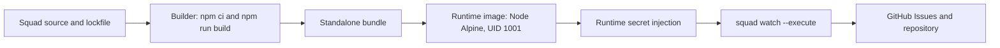
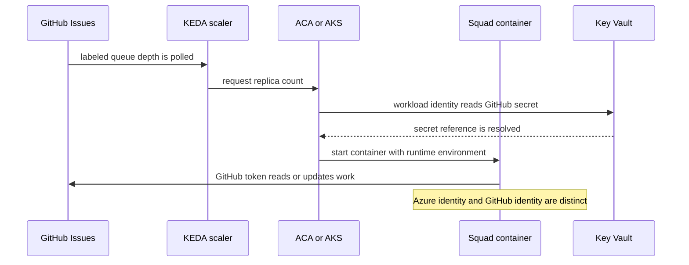
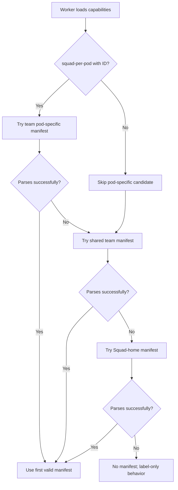

# Chapter 7: Containers, Cloud Hosting, and Deployment Modes

> **Prerequisites:** Volume 1 (or equivalent Squad experience); Chapter 6.

## What You'll Learn

- Explain what the v1.1.0 Squad Dockerfile puts in an image, how it differs from a reference npm-install Dockerfile, and which environment variables the container contract expects.
- Distinguish agent-per-node and squad-per-pod capability lookup, including manifest fallback and the external coordination each mode still needs.
- Choose between a single container, Azure Container Apps (ACA), and Azure Kubernetes Service (AKS) based on control, operational burden, and scaling needs.
- Separate Azure workload identity from GitHub authentication and design a safe secret injection path.
- Describe how KEDA turns labeled issue-queue depth into replica counts, including polling, cooldown, cold starts, and scaling limits.
- Recognize why ephemeral local state and concurrent multi-replica writes require deliberate backend and deployment choices.
- Use multiple Codespaces and the Azure Function sample without mistaking workload separation or mock code for a security sandbox or production service.

## Start with the Process, Not the Cloud

A Squad container packages an agent runtime; it does not make the agent's authority disappear. The container still needs access to a GitHub repository, a Copilot-capable runtime, and persistent state appropriate to the deployment. If the process is started as `squad watch --execute`, the container is configured for unattended work. A production design must therefore answer four separate questions: where does code run, which identity does it use, where does durable state live, and how does an operator stop or update it?

The repository's root `Dockerfile` is the canonical v1.1.0 image in this chapter. It creates a standalone bundle in a builder stage, then copies the bundle into a smaller Node Alpine runtime image. The final image runs as UID 1001, sets `SQUAD_STANDALONE_HOME`, and starts `squad watch --execute`. The token is not baked into the image; it must be injected when the container runs. The runtime still needs the token because Azure identity is not a GitHub API credential.

That Dockerfile is intentionally different from the container reference page's example that runs `npm install -g @bradygaster/squad-cli`. The repo build creates the standalone app bundle, including the CLI, SDK, templates, and Copilot CLI platform binary. It avoids requiring the npm registry at runtime. The published image's build should use reviewed source and be pinned to a digest at deployment; `node:22-alpine` is a moving base-image tag and should be digest-pinned in a hardened production build.



A container does not imply a web server. The Squad watcher polls GitHub and does not expose an HTTP endpoint. The v1.1.0 contract has no `/healthz`, `/readyz`, or Squad health port. A Kubernetes HTTP probe will fail because nothing is listening. Container restart policies are the primary liveness mechanism. If local policy insists on a probe, a shallow process-existence check is possible, but it does not prove that the token works, a queue is being read, or an agent is making progress.

On shutdown, Squad is expected to receive `SIGTERM`, stop accepting new work, drain the active turn, flush state, and exit. Give the pod a termination grace period—60 seconds is the runbook's baseline—and verify the behavior in the actual release before relying on it for long-running work. A forced termination during a turn can still interrupt work; a restart is not a transaction.

## Choosing a Hosting Shape

Use the least complex deployment that meets your availability and throughput goals. A local process is easiest to inspect and manually stop. A single container on a managed app platform reduces host administration. AKS gives you Kubernetes-level control over scheduling, policies, and extensions, but also gives you Kubernetes-level operational responsibility. Neither platform makes agent behavior deterministic or eliminates model/data governance responsibilities.

| Shape | Good fit | Costs and obligations |
|---|---|---|
| Local CLI or single container | One developer, controlled experiments, or a low-volume private queue | Local credentials and state need care; host must remain available. |
| Azure Container Apps | Managed container runtime, simpler scale rules, Key Vault references, minimal cluster operations | Platform revisions, secret rotation, queue scaler wiring, and state durability remain your concerns. |
| AKS | Existing Kubernetes platform, custom policies, node pools, CSI integration, and advanced scheduling | Cluster upgrades, identities, KEDA, network policy, storage, and observability must be operated. |
| Multiple Codespaces | Independent workstreams operated by people in separate development environments | Separate processes do not coordinate writes automatically; shared labels and issue boundaries must be designed. |
| Azure Function sample | Demonstrating a serverless HTTP integration shape for SDK code | The sample handlers are mocks and the trigger is anonymous; it is not a production endpoint. |

A basic deployment flow makes the trust boundaries visible:



The diagram abstracts provider-specific mechanics. For ACA, Key Vault references are native to the platform; AKS commonly uses the Secrets Store CSI driver and a workload-identity-enabled service account. In both cases, the Azure identity authorizes access to Azure resources. The GitHub token remains a GitHub-issued PAT or App installation token. Never treat an Azure managed identity token as if GitHub accepts it as `GITHUB_TOKEN`.

## The Container Contract and State

The image's default command is an operational choice, not a harmless demo. `squad watch --execute` polls and can run work without a person approving each action. Use least privilege, issue labels or other queue gates, branch protection, an audit trail, and a tested pause procedure before running that command with a production token.

The container contract documents these variables:

| Variable | Meaning | Operational note |
|---|---|---|
| `GITHUB_TOKEN` | GitHub PAT or GitHub App token used for the API | Inject at runtime. Scope it to the repositories and operations needed. Azure identity does not replace it. |
| `SQUAD_DEPLOYMENT_MODE` | Topology mode; default `agent-per-node`, or `squad-per-pod` for concurrent pod instances | Confirm the mode is supported by the exact v1.1.0 code path and choose it deliberately. |
| `SQUAD_POD_ID` | Unique pod identifier when using `squad-per-pod` | In Kubernetes, `metadata.name` is a useful unique value. It is not a GitHub identity. |
| `OTEL_EXPORTER_OTLP_ENDPOINT` | Optional telemetry collector endpoint | Treat exporter connectivity and payload retention as another data path. |
| `OTEL_SERVICE_NAME` | Optional reported service name, default `squad-agent` | Use stable, non-secret names for dashboards. |
| `OTEL_RESOURCE_ATTRIBUTES` | Optional comma-delimited resource attributes | Never put tokens, internal connection strings, or personal data here. |

The app root and default `.squad` path are `/app` and `/app/.squad`. You can bake reviewed configuration into an immutable image or mount configuration at runtime. Baking provides a coherent, versioned artifact; changing it requires a rebuild. A mount enables independent updates but creates questions about file ownership, mount path, and state-write location. Set `rootDir` explicitly in `.squad/config.json` when a mounted state directory is used; the reference documents a path-resolution issue when that field is omitted.

The default local state backend writes to the container filesystem. That filesystem may disappear on restart or rescheduling. It is also not a safe shared-write mechanism for multiple replicas. Scaling to three pods against a shared local file directory is not a durable coordination design. Use a supported external state strategy such as `orphan` or `two-layer`, or deliberately keep a single replica. A shared Azure Files mount solves persistence but does not, by itself, make concurrent writes safe.

The deployment-mode variables select how a worker looks up machine capabilities; they do not select a cloud provider, make state durable, or provide issue-level locking. In `agent-per-node` mode, a worker checks the shared team manifest and then the Squad-home manifest. In `squad-per-pod` mode, `SQUAD_POD_ID` adds a pod-specific candidate before those shared fallbacks. A complete pod manifest can advertise `gpu`, for example, while a CPU-only pod's manifest omits it. Ralph can use `needs:gpu` labels to decide whether that worker is eligible.

The lookup returns the first existing manifest that parses. It does not overlay a pod file on top of a shared base, enumerate pods, publish capabilities centrally, or distribute work. A malformed candidate is skipped and lookup continues. If pod mode is enabled without an ID, the pod-specific candidate is omitted and shared or home-level files can still be selected; the SDK helper does not fail closed. If per-pod identity is operationally required, enforce it in the deployment configuration and test the loaded manifest.



Capability filtering is a local eligibility decision. Kubernetes, KEDA, a queue, or another scheduler still has to ensure that work reaches an eligible worker and that workers do not claim the same issue. A `needs:gpu` label alone is not a scheduler. Replicas may observe the same ready issue close together; queue scaling must not be interpreted as exactly-once execution. Make tasks idempotent where possible, use branch-per-issue and human review, and monitor for duplicate work.

## Azure Container Apps

ACA is a managed container hosting option with integrated KEDA scaling and first-party Key Vault secret references. It is often the lower-operations Azure path when you need a poller that wakes up for issue work but do not need to operate a Kubernetes cluster. The agent generally needs outbound access to GitHub and model services; it does not need public inbound ingress just to poll issues. Do not expose a public endpoint simply because the hosting product supports ingress.

At a design level, an ACA deployment needs a registry image, a user-assigned or system-assigned identity for Azure-side access, a Key Vault secret for the GitHub token, and a container app revision whose environment references that secret. A versionless Key Vault URI can resolve the latest active secret version when a revision is created, but a running revision does not imply that a changed secret has already replaced the process environment. Plan a controlled revision/restart and verify the loaded credential without printing it.

ACA offers built-in HTTP scaling for HTTP request volume. That is not equivalent to scaling a background GitHub issue poller. For queue-depth scaling, the Squad documentation describes an external KEDA scaler that counts issues with selected labels. This usually means a separate scaler service plus a custom scale rule, and it introduces another GitHub API caller and therefore another credential, rate limit, and rotation path. Set minimum replicas according to cold-start tolerance: zero reduces idle capacity but adds a startup delay; one warm replica spends more while idle but can reduce pickup latency.

A one-shot Azure Container Apps Job is a different execution model from a long-running watcher. It can suit event-triggered single tasks, but v1.1.0 does not provide the future `squad --remote` webhook dispatch feature described in the cloud pages. Do not assume the documented future flag is runnable. A Job still needs an authenticated trigger, a bounded task input, token delivery, state strategy, and idempotent retry handling.

## AKS and Kubernetes Controls

AKS is appropriate when your organization already operates Kubernetes or needs its policies and scheduling features. The documented pattern enables the cluster OIDC issuer and workload identity, associates a Kubernetes service account with an Azure managed identity, grants that identity Key Vault read permission, and mounts the GitHub token through the Secrets Store CSI driver. Attach ACR to the cluster or otherwise configure a private image-pull identity. Keep the token secret out of the Deployment YAML itself.

The container should run as the image's UID 1001, use a restrictive pod security context, drop Linux capabilities, and disallow privilege escalation. Add CPU and memory requests/limits so the scheduler can place pods and OOM behavior is observable. A read-only root filesystem is not a drop-in setting if Squad must write local state; instead, mount explicit writable paths or move state to a supported backend. Never solve a file-permission issue by running the container as root without assessing the consequences.

A Deployment owns the agent containers; a ScaledObject points at the Deployment; TriggerAuthentication provides scaler credentials. Check the names across those resources. One AKS runbook sample uses a `scaleTargetRef.name` that differs from its Deployment's `metadata.name`, so readers should fix the reference to match their actual resource instead of copying the typo. Similarly, the CSI mounted file and a Kubernetes Secret synchronized from it are separate representations. If you inject the secret as an environment variable, confirm the `secretObjects` sync and the application's refresh behavior. Kubernetes does not rewrite an existing process's environment when a Secret changes.

Before scaling out, decide where `.squad` configuration and mutable state live. A ConfigMap is appropriate for static files such as `team.md`, `routing.md`, and `config.json`, not concurrent history or decision writes. A ReadWriteOnce Azure Disk is usually one-writer storage; an Azure Files ReadWriteMany mount permits multiple mounts but does not turn the local backend into a safe concurrent database. Kubernetes readiness and liveness probes should reflect real health. Until Squad exposes HTTP readiness endpoints, the sample PID check is shallow; it can show that PID 1 exists while the process is unable to reach GitHub.

## KEDA: Queue Depth Is a Signal, Not a Guarantee

KEDA is a Kubernetes autoscaler that derives replica counts from event-driven metrics. Squad's KEDA guidance uses an external scaler because GitHub issues are not a built-in KEDA trigger. A scaler polls a repository for issues matching configured labels, reports queue length, and KEDA adjusts a Deployment toward a configured target. `minReplicaCount`, `maxReplicaCount`, polling interval, cooldown, labels, and queue target together define the policy.

If a target queue length is five issues per replica and ten issues match, a simplified scaling intuition is roughly two replicas, bounded by the minimum and maximum. Exact decisions depend on KEDA's scaler metric semantics, cooldown, polling, HPA behavior, and whether issues are claimed or removed from the queue. Tune against real task duration and API quotas. More replicas can increase parallel throughput but also increase GitHub API calls, model costs, duplicate-dispatch risk, and write conflicts.

The file `templates/keda-scaler.md` is deployment guidance for a separate, community-maintained `keda-copilot-scaler` project. It is not an executable KEDA deployment manifest shipped in the CLI and does not mean Squad runs a scaler server itself. The template's Helm example takes `github.token` as a command-line value; do not copy that production-insecure pattern into shell history or an observable process list. Use an appropriate secret mechanism and independently review the third-party scaler's code and release artifacts. The template's gRPC port and `threshold` option also differ from the `scalerAddress`/`targetQueueLength` examples in other documentation. Verify the protocol, metadata keys, port, authentication parameters, deployment name, and version against the specific scaler release before integrating it.

KEDA authentication can involve two distinct tokens: the scaler's read-only queue-polling credential and the Squad agent's write-capable GitHub credential. A scaler should usually need only issue/label read access; it does not need to create PRs. Rotate these identities independently. Rate limits matter: a short polling interval across many scaler instances can consume API quota even if every pod is idle.

> **Warning:** The runbook refers to `templates/keda/scaler-deployment.yaml`, but the v1.1.0 repository contains `templates/keda-scaler.md` rather than that manifest. Treat that path as a documentation mismatch. The current checked-in template describes an external project, so you must supply and validate the scaler deployment yourself.

## Multiple Codespaces and Azure Function Sample

A Codespace is an isolated development environment, not a distributed lock. The multi-Codespace guide describes a shared GitHub repository with separate SubSquads and issue labels: for example, `team:ui`, `team:backend`, and `team:infra`. Each process sets `SQUAD_TEAM` to select its team. In v1.1.0 the resolver reads `.squad/workstreams.json` (older guide examples may call it `.squad/streams.json`), and the CLI exposes `squad subsquads list`, `status`, and `activate`.

Give each SubSquad a narrow issue label and a realistic folder scope. Separate branch-per-issue work reduces collisions; shared files such as package manifests and workflows still need human coordination. `folderScope` and a queue label organize work, but they are not a kernel sandbox or a permission barrier. A process with write access to the whole clone can still modify other files. If strict isolation is required, use repository/branch permissions, separate clones, or a stronger host-level boundary.

The repository also includes `samples/azure-function-squad`, an SDK-oriented HTTP trigger example. The trigger validates JSON and runs three specialist review functions, but `src/squad/handlers.ts` explicitly contains deterministic mock logic; it does not invoke live LLM-backed agents. The function is registered at `authLevel: 'anonymous'`. The README's expected review JSON illustrates the shape, not a guarantee of actual model output or production behavior. Treat it as a sample for composition and request/response wiring, not a deploy-ready public API. A production version needs authentication, request-size limits, rate limits, data-retention decisions, real execution and timeout handling, observability, and a cost/abuse policy.


### Network, resource, and rollback boundaries

A background agent does not need public inbound access merely because its host can create a public endpoint. Prefer private or disabled ingress unless a separately reviewed webhook/API design requires it. Egress is different: the runtime needs to reach GitHub and any model/provider endpoints its workflow uses. The security guide notes that Squad has no built-in network egress sandbox, so the cluster or container host policy is the enforcement point. A `network.allowed` policy in a GH-AW workflow is also distinct from network controls in a long-running ACA/AKS pod.

Set CPU and memory requests/limits from observed behavior rather than choosing an unbounded allocation. Large repositories, parallel tool calls, or several active turns can increase memory use. If a pod is OOM-killed, scaling the replica count upward may multiply the same failure. Capture container exit codes, resource usage, GitHub API errors, and dispatch outcomes; telemetry should avoid issue bodies, prompts, and secrets unless there is an explicit retention basis.

Keep the image, configuration, and state lifecycle separate. A new immutable image version rolls out code and bundled templates; a mounted `.squad` directory changes policy/configuration; an external state backend preserves mutable team history. If all three are updated at once, a failure is harder to attribute and rollback. Roll back to a known image digest and compatible configuration, then verify the active state backend before re-enabling `watch --execute`. A container restart can fix a failed process, but it does not undo a PR, issue edit, or credential use that already occurred.

For the sample Tasktrack API, the same distinction is simpler but visible: its Docker image contains API code, no GitHub token, and no persistence layer. It can be restarted freely for the exercise because tasks are ephemeral. A real production Tasktrack deployment would need a database, authentication and authorization on the API, validation and request limits, and a migration/backup plan. Merely moving a process from a laptop to ACA does not supply those properties.

## Hands-On: Map a Safe Container Topology

This lab is design-only: do not create an Azure resource, deploy an image, run `az` or `kubectl` against a live subscription, or store a production token. You will make the Tasktrack container work in Chapter 8; here you use Squad to prepare the deployment review.

1. In Tasktrack, ask the coordinator to identify the process entry point, port, writable paths, data persistence needs, and expected shutdown behavior. Confirm from `sample/package.json` that it starts with `node api/src/server.ts` and that the in-memory `TaskStore` loses tasks on restart.
2. Ask the security specialist to write a comparison of local container, ACA, and AKS for this small API. Require it to separate the application from the Squad agent runtime; Tasktrack's API container is not the Squad container.
3. Have the reviewer create a no-deploy checklist covering image provenance, non-root identity, secret injection, health checks, persistent data, network exposure, resource limits, and rollback. Ensure the checklist does not contain real tokens or cloud identifiers.
4. Review the Squad output against the repository. Add any necessary corrections to `.squad/decisions.md` only after review, such as “Tasktrack's in-memory task data is intentionally disposable in this learning sample.”

Expected result: a small architecture decision and deployment checklist, with no cloud resources created. The Tasktrack API remains in-memory, so a Docker restart will reset its sample tasks. Record the review at your `v2-ch07-end` point.

## Configuration Reference

| File or field | Default/example | What to verify |
|---|---|---|
| Root `Dockerfile` | Node 22 Alpine builder and runtime; standalone bundle in `/opt/squad` | Review the base digest, build provenance, and copied files. |
| `WORKDIR` | `/app` | Default runtime project root; mounted `.squad` paths must align. |
| `USER` | UID 1001, `squad` | Keep non-root; ensure mounted writable paths have compatible ownership. |
| `SQUAD_STANDALONE_HOME` | `/opt/squad` | Lets the CLI resolve the bundled standalone install when initializing. |
| `CMD` | `squad watch --execute` | Unattended execution; do not run without an explicit policy and token review. |
| `STOPSIGNAL` | `SIGTERM` | Host should allow time for draining before forced termination. |
| `SQUAD_DEPLOYMENT_MODE` | `agent-per-node`; optionally `squad-per-pod` | Select topology only when its deployment behavior is understood. |
| `SQUAD_POD_ID` | No default | Must be unique when the selected deployment mode requires a pod identity. |
| `OTEL_EXPORTER_OTLP_ENDPOINT` | Unset | Optional; configure only to a trusted collector. |
| ACA min/max replicas | Example range 0–5 | Balance cost, latency, throughput, and API/model quotas. |
| KEDA poll/cooldown/target | Example 30 seconds / 300 seconds / 5 issues | Confirm scaler semantics and avoid excessive polling. |
| AKS `terminationGracePeriodSeconds` | Example 60 seconds | Allow graceful shutdown; validate the real workload duration. |
| `.squad/workstreams.json` | Optional SubSquad definitions | `SQUAD_TEAM` selects a configured SubSquad; labels route queue work. |

## Under the Hood

The actual repository `Dockerfile` calls `npm ci`, builds the workspace, and invokes `scripts/build-standalone.mjs` with Linux x64, `--skip-runtime`, and `--include-optional`. It then copies `/out/squad-linux-x64` to `/opt/squad` in the runtime stage. `PATH` includes the launcher and bundled CLI executable; `SQUAD_STANDALONE_HOME` points the CLI at its bundle. The final command is exec-form JSON, so the process receives container signals directly. No `GITHUB_TOKEN` appears in the Dockerfile.

A second important boundary is in `packages/squad-sdk/src/ralph/capabilities.ts`: `SQUAD_DEPLOYMENT_MODE` and `SQUAD_POD_ID` are read from the process environment and influence deployment capabilities. They are not cryptographic identity, authorization, a queue lock, or persistent state. Use them as runtime topology metadata only. The exact defaulting behavior is short enough to inspect directly:

```ts
export function getDeploymentMode(): DeploymentMode {
  const raw = process.env.SQUAD_DEPLOYMENT_MODE;
  if (raw === 'squad-per-pod') return 'squad-per-pod';
  return 'agent-per-node';
}

export function getPodId(): string | undefined {
  return process.env.SQUAD_POD_ID || undefined;
}
```

This means an arbitrary environment value does not select a third deployment mode: anything other than the exact string `squad-per-pod` falls back to `agent-per-node`. The pod identifier is an optional string at this helper boundary. A deployment that relies on per-pod capability files must supply a stable, unique value and test how restarts change that value. Do not copy it into issue text or use it as a secret.

The SubSquad resolver in `packages/squad-sdk/src/streams/resolver.ts` loads `.squad/workstreams.json`, resolves `SQUAD_TEAM`, and selects matching workstream definitions. `packages/squad-sdk/src/streams/filter.ts` filters GitHub issues by the workstream label. This explains why labels and folders help divide work, while also showing that the mechanism is routing/filtering rather than operating-system file isolation.

The Azure Function sample's `squad-prompt.ts` checks that the request is POST, parses the JSON body, and rejects an empty prompt. It then invokes `runContentReview`. That handler runs simple regular expressions and scoring rules over the prompt; it is not a remote agent session. Because the function sets `authLevel: 'anonymous'`, exposure requires additional authentication and abuse controls outside the sample.

## Pitfalls and Troubleshooting

| Symptom | Likely cause | What to check |
|---|---|---|
| Container exits or restarts during a task | Grace period is too short, process failed, or host restarted it | Inspect exit status and logs; increase graceful-shutdown allowance and make work recoverable. |
| HTTP health probe fails | Squad watcher exposes no HTTP health listener | Remove HTTP probes or use a deliberately shallow process check until a real endpoint exists. |
| Secret rotation seems ineffective | A running process still has the old environment value | Roll a new ACA revision or restart the AKS pod after rotation. Never print the token to verify it. |
| Replicas overwrite state or handle an issue twice | Local state is ephemeral or concurrently written; queue claim isn't exactly-once | Reduce to one replica or use a supported external state backend and investigate dispatch idempotency. |
| KEDA does not scale | Scaler protocol or metadata mismatch, bad labels, auth error, wrong scale target name | Inspect scaler logs/status, exact scaler version, KEDA events, trigger authentication, and resource names. |
| Scaler has GitHub 401s | Scaler token is missing, expired, or scoped too narrowly | Rotate the scaler credential independently of the agent's token. |
| `SQUAD_TEAM` has no effect | The selected name is absent from workstream config or config file is at the wrong path | Verify `.squad/workstreams.json`, exact team name, and process environment. |
| Azure Function returns confident reviews in demo | The mock handler makes deterministic heuristic judgments | Replace the mock with a real, authenticated, bounded implementation before any production use. |

## Summary

Containerizing Squad packages the CLI and its runtime; it does not remove its credentials, data flow, or write authority. The repo image is non-root and token-free at build time, but starts unattended `watch --execute` and therefore requires a deliberate policy. ACA reduces cluster operations; AKS offers more control at higher operational cost. Both need a real GitHub token, durable state strategy, safe scaling semantics, and reviewed secret rotation. KEDA's scaler is external guidance, not a CLI feature, and multiple Codespaces provide work partitioning rather than a security sandbox. The Azure Function sample demonstrates shape, not live model execution or production readiness.

## Exercises

1. Explain the difference between the v1.1.0 repo Dockerfile and the container reference page's npm-install example. List one benefit and one trade-off of the standalone bundle.
2. Draw the credential flow for an AKS pod that reads a GitHub token from Key Vault and then calls GitHub. Label which identity authenticates to each service.
3. A two-pod worker pool has one GPU node and one CPU-only node. Choose a deployment mode, sketch the two complete capability manifests, explain how `needs:gpu` affects local eligibility, and state how an external scheduler must prevent duplicate claims. Then describe the lookup order when the pod manifest is malformed and when `SQUAD_POD_ID` is unset.
4. For a queue of 17 issues, a scaler target of 5 issues per pod, minimum 0, and maximum 3, estimate the intended replica count. List at least three reasons the observed count might differ.
5. Audit the KEDA docs for inconsistent deployment name, port, or metadata fields. State which exact artifact you would verify before deployment and why.
6. Review the Azure Function sample and list the changes required before exposing it beyond localhost. Identify the mock behavior and its anonymous auth setting.

## Quiz

1. Does a container image need to contain `GITHUB_TOKEN` to run Squad? When should the token be supplied?
2. What does `SQUAD_POD_ID` represent, and what does it not guarantee?
3. What deployment mode is used when `SQUAD_DEPLOYMENT_MODE` is unset or unrecognized?
4. Is CLI-versus-VS-Code the meaning of the `agent-per-node` and `squad-per-pod` deployment modes?
5. Does an Azure managed identity authenticate to GitHub's API?
6. Why does an Azure Files mount not automatically make local state safe for several Squad replicas?
7. Are pod-specific and shared capability manifests merged, and what happens if the pod ID is missing?
8. Does capability filtering itself schedule eligible workers or prevent two workers from claiming the same issue?

## Further Reading

- [KEDA Autoscaling](https://bradygaster.github.io/squad/docs/features/keda-scaling/)
- [Container Image — Environment Variable Contract](https://bradygaster.github.io/squad/docs/reference/container-image/)
- [AKS Deployment Runbook](https://bradygaster.github.io/squad/docs/scenarios/aks-deployment/)
- [Azure Container Apps Deployment](https://bradygaster.github.io/squad/docs/scenarios/azure-container-apps/)
- [Multi-Codespace Setup](https://bradygaster.github.io/squad/docs/scenarios/multi-codespace/)
- [Repository Dockerfile](https://github.com/bradygaster/squad/blob/v1.1.0/Dockerfile)
- [KEDA scaler guidance template](https://github.com/bradygaster/squad/blob/v1.1.0/templates/keda-scaler.md)
- [Azure Function sample](https://github.com/bradygaster/squad/tree/v1.1.0/samples/azure-function-squad)
- [SubSquad resolver](https://github.com/bradygaster/squad/blob/v1.1.0/packages/squad-sdk/src/streams/resolver.ts)
- [Deployment capability resolution](https://github.com/bradygaster/squad/blob/v1.1.0/packages/squad-sdk/src/ralph/capabilities.ts)
- [Dual-Mode Deployment](https://bradygaster.github.io/squad/docs/features/dual-mode-deployment/)
