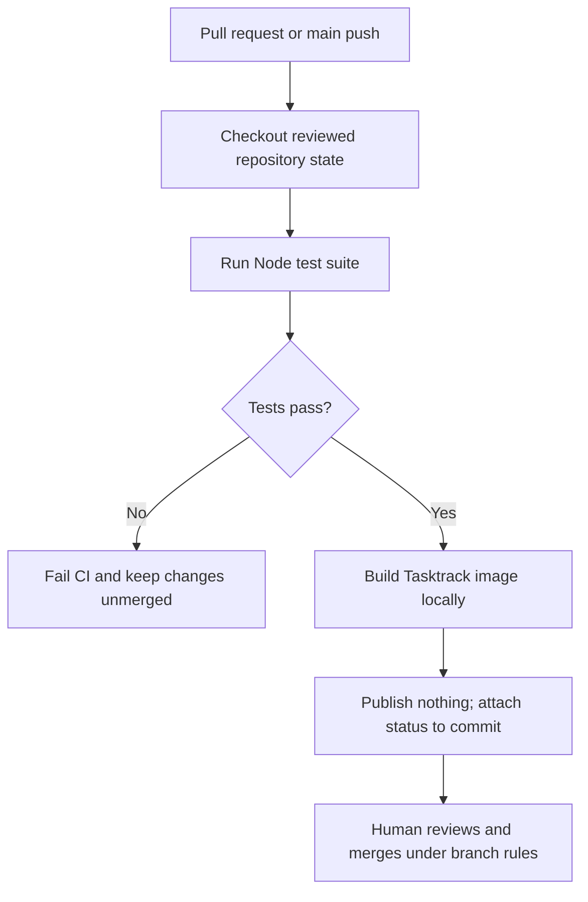
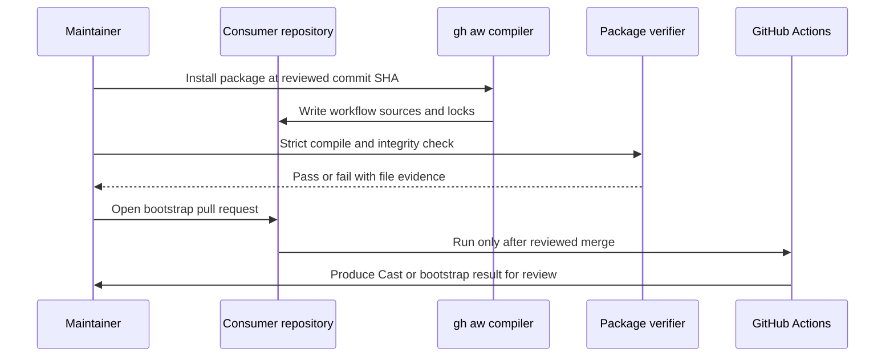

# Chapter 8: CI/CD and Release

> **Prerequisites:** Volume 1 (or equivalent Squad experience); Chapters 6 and 7.

## What You'll Learn

- Build a pull-request CI workflow with read-only permissions, deterministic tests, and an image build that does not publish an artifact.
- Explain how Squad's ordinary `.github/workflows/` templates differ from GitHub Agentic Workflows (`gh aw`) under the repository's `workflows/` package.
- Install and validate the GH-AW package at an immutable Squad revision, then let a human review the bootstrap PR before activation.
- Read the v1.1.0 release flow across `dev`, `main`, prereleases, stable tags, npm packages, standalone bundles, Homebrew, and WinGet.
- Prevent common workflow risks: untrusted pull-request code with secrets, broad `GITHUB_TOKEN` permissions, mutable action references, and a mistaken assumption that a token-created push will trigger another workflow.

## CI and CD Are Different Trust Decisions

Continuous integration (CI) answers: “Does this proposed change pass the checks we require?” Continuous delivery or deployment (CD) answers: “May this artifact be published or installed somewhere?” Keep those decisions separate. A pull request should be able to run tests and build a container without receiving credentials that can publish an image, push a release, or change the default branch.

For Tasktrack, the test suite uses Node's built-in `node:test` and the API starts directly from TypeScript on Node 22.18 or newer. There are no npm dependencies to install. A safe initial workflow therefore checks out the pull request, installs the requested Node runtime, runs `npm test`, and builds a Docker image without pushing it. Its token only needs to read repository contents. The same test applies to a pull request and a push to `main`.

A minimal pipeline is not a weak pipeline if it tests the behavior that matters and avoids unnecessary secrets. Start with a clear trigger, a narrow `permissions:` block, pinned actions, and explicit commands. Do not interpolate a pull request's title, body, branch name, or comment into a shell script. GitHub expressions that contain user-controlled text can become shell input; pass values through environment variables and validate them before use.



A Docker image build in CI is still a supply-chain operation. It parses the Dockerfile and its build context, and it may access package registries if the build requests them. Use a `.dockerignore` file to exclude `.git`, `.squad`, `.env*`, `node_modules`, and other irrelevant or sensitive files from the build context. The sample Dockerfile copies only the package manifest and API source, but Docker still prepares the context before applying those `COPY` instructions.

## The Two Workflow Families in the Squad Repository

The repository contains conventional GitHub Actions workflows in `.github/workflows/`, reusable starter workflow templates in `templates/workflows/`, and a separate GH-AW package under `workflows/`. They solve different problems:

| Surface | Typical file | Purpose |
|---|---|---|
| Squad's installed Actions templates | `templates/workflows/squad-ci.yml`, `squad-heartbeat.yml`, `squad-triage.yml` | Conventional YAML workflows copied into a consumer repository during initialization. |
| Squad maintainer automation | `.github/workflows/squad-ci.yml`, `squad-release.yml`, `squad-promote.yml` | Test and publish Squad itself. These are not all installed into every user repo. |
| GitHub Agentic Workflows package | `workflows/aw.yml` plus `workflows/package/*.md` | Reusable GH-AW sources for issue-comment slash commands, planning, implementation, review, and related workflows. |
| Generated consumer artifacts | `.github/workflows/*.lock.yml` in a consuming repository | Compiled GH-AW workflow lock files that must be reviewed and committed with their source. |

Do not confuse Squad's CLI `squad` with the GitHub CLI extension `gh aw`. GH-AW takes Markdown files with workflow frontmatter and agent instructions, compiles them into GitHub Actions YAML, and emits locked generated output. The Squad source package registers its bundle in `workflows/aw.yml`; the generated lock files are part of the trust chain. Editing a compiled lock file by hand is not a durable fix: change the source, run the supported compiler, review the result, and verify integrity.

Squad also ships regular workflow templates such as the heartbeat workflow. They can triage or label work between Copilot sessions, but that is not identical to running an agentic GH-AW implementation worker. A heartbeat using GitHub API calls does not mean a live Copilot agent can be launched inside any arbitrary Action. Understand which runtime is doing the work before granting permissions or promising unattended behavior.

The repository's native GH-AW package contains eight main workflow sources: the dispatcher, implementation worker, reviewer, dependency worker, retrospective workflow, improvement worker, bootstrap workflow, and command router. It also packages shared validation/runtime assets. The release manifest is the source of truth for the exact file set and hashes. Pin one coherent source revision, compile all workflows together, verify the manifest and lock files, then open a PR. Do not mix source files from different Squad commits.

## Installing GH-AW as a Reviewed Integration

`gh aw` is an extension to GitHub CLI, not an ordinary `squad` subcommand. The v1.1.0 GH-AW guide specifies a compiler version and an install protocol. For the documented supported path, install the exact supported compiler version, authenticate `gh`, ensure GitHub Issues are enabled, and use one explicit 40-character Squad commit SHA. A branch name such as `dev` is mutable; a commit SHA gives reviewers a stable install identity.

```bash
# Verify the GH CLI account and use the exact compiler version in the guide.
gh auth status
gh aw --version

# Install the native package from one reviewed immutable Squad commit.
SQUAD_SHA="<40-character-reviewed-commit-sha>"
gh aw add "bradygaster/squad/workflows@${SQUAD_SHA}"

# Review the update report, then compile and verify every package-owned file.
gh aw compile --strict
node .github/workflows/shared/squad-install-verifier.mjs \
  --verify-install \
  --source-revision "${SQUAD_SHA}" \
  --strict-compile
```

This is a recipe, not a command sequence to run against Tasktrack as part of this chapter. The GH-AW package changes workflow sources and adds generated files; only install it in a repository where the owner explicitly intends to enable those issue-driven automations. For a first installation, follow the versioned guide's exact safe-update review, staged-file verifier, permissions profile, and bootstrap pull-request flow. Stop if the compiler produces an unexpected warning or an unrecognized action/secret request. A successful strict compile proves that the compiler accepted the sources; it does not mean the human has approved the integration's authority.

The reviewed bootstrap PR is a trust boundary. The first PR introduces workflows that can act on the repository, so the PR must not be trusted merely because its new workflow says it passed. A human reviews the generated lock files, guards, job permissions, and source revision before merging. After merge, the workflow may create a Cast PR or a fallback issue depending on the Actions setting. Review that activation canary too; keep independent human approval and branch protection in place.

The GH-AW reference describes two Actions pull-request settings profiles. The recommended profile leaves “Allow GitHub Actions to create and approve pull requests” disabled, reducing a repository-wide self-approval capability. Under this profile, some automated PR-creation paths may require a human to open the PR from a pushed branch. Enabling the toggle allows `GITHUB_TOKEN` to create and approve PRs across the repository; job-level permission entries do not split that combined setting into separate create and approve switches. If choosing the alternative, explicitly accept the wider blast radius and still require an independent human approval.

GH-AW also separates activation from the agent job. The activation stage checks out trusted workflow code, initializes/validates Squad, and prepares state. The agent job runs with a restricted network policy and uses guarded outputs such as comments, issues, or pull requests rather than receiving unrestricted write authority. The PR reviewer uses base-controlled workflow code and reads the PR through the GitHub API rather than checking out and executing PR-head files. `pull_request_target` is powerful and risky in general; in the described reviewer design, it must remain coupled to the exact safeguards in the pinned package. Do not copy just the event name into a custom workflow and assume it is safe.

A conventional `GITHUB_TOKEN` push generally does not trigger a new workflow run. If a release or promotion job pushes a commit and needs a follow-on workflow, the release process explicitly dispatches it. If CI must run on a PR created by a workflow token, the GH-AW guide describes an optional CI trigger token; adding that token is an authorization change. Use a narrowly scoped PAT only if the behavior is truly required, and keep it out of generic pull-request jobs.



## The Squad Release Process

Squad itself has three distribution channels: insider snapshots, preview prereleases, and stable releases. They have different version forms and npm dist-tags. The branch layout is important: `dev` is the development source, `main` is the stable release source, and “preview” refers to a prerelease channel, not a required staging branch in the v1.1.0 process.

| Channel | Example version | npm dist-tag | Entry point |
|---|---|---|---|
| Insider | `X.Y.Z-insider.N` | `insider` | Manual insider workflow dispatch from `dev`. |
| Preview | `X.Y.Z-preview.N` | `preview` | Manual release workflow dispatch from `dev`. |
| Stable | `X.Y.Z` | `latest` | Reviewed promotion of a sanitized `dev` tree to `main`, then stable release. |

Release preparation starts with a normal PR targeting `dev`. Keep the root, SDK, and CLI package versions in lockstep; update the CLI's SDK dependency floor and the lockfile; add the exact changelog heading; and validate build/tests before merging. Never change a published preview into a stable release in place. `1.2.0-preview.1` and `1.2.0` are distinct versions with distinct tags and npm channels.

A preview release is explicitly dispatched from `dev` with a confirmation tag matching the package version. The release workflow checks SemVer, branch/channel compatibility, version consistency, tests, and the changelog before creating an immutable tag and GitHub prerelease. It then delegates to publication workflows for npm and standalone archives. The insider workflow similarly computes an insider version and publishes packages and release assets. The stable route first validates a sanitized promotion from `dev` to `main`; the release workflow on `main` publishes the stable version.

Stable promotion is especially sensitive because it writes the release branch and may publish packages. The documented process runs the promotion validator in dry-run mode first, then a human triggers the live promotion. The promotion workflow strips internal paths such as `.squad/`, `.ai-team/`, internal templates, and proposals from the release tree, validates package/changelog versions, builds and tests the result, and pushes `main`. A GitHub Actions-token push does not automatically start another workflow, so the promotion explicitly dispatches `squad-release.yml` after the push. Review both the sanitized tree and the dispatch inputs; do not treat “dry run passed” as the live publication approval.

Publication should be recoverable without rewriting history. If a publication job fails after a tag or GitHub Release exists, do not recreate or move the immutable tag. Rerun the failed job or dispatch the relevant publishing workflow from the existing tag/source reference according to the runbook. Verify npm dist-tags, release assets, checksum files, Homebrew updates, and WinGet PRs. After stable publication, open a follow-up PR on `dev` to set the next development prerelease version.

The repository's release workflows are examples of a mature pipeline, not commands you should execute for Tasktrack. They use write permissions and publication credentials that Tasktrack does not need. Keep examples and hands-on tasks local and non-publishing.


### A staged release is a chain of evidence

A useful release review traces identity from source commit to every published artifact. First, the package manifests and lockfile agree on the version. Second, the changelog contains that version. Third, the release workflow resolves whether the version is stable or prerelease and checks that the current branch/event matches. Fourth, the tag identifies the source revision. Finally, the publication jobs produce assets and package updates that can be independently checked. A green run is one evidence item; the release should still be matched to the expected source, tag, dist-tag, checksums, and package-manager records.

Use a unique version for each publication. A prerelease tag does not become stable by changing an npm label; stable `1.2.0` and preview `1.2.0-preview.1` have different content identities. The stable promotion's sanitation step matters because a development tree may contain internal team files and proposals that should not enter the public release tree. Inspect the resulting diff and tests after that removal rather than assuming a clean build guarantees the right files were included.

Keep credentials scoped to individual publishing jobs. The built-in `GITHUB_TOKEN` may create a GitHub Release or push a tag when the job has the required `contents: write` permission; npm publication requires a separate npm credential or trusted publishing configuration. Package-manager update jobs can require credentials to open PRs in other repositories. These privileges should not be available to a test job or to every workflow in the repository. Rotate any publisher credential that was exposed, and consider short-lived identity-based publication where your package registry and organization support it.

The GH-AW package deserves the same lifecycle discipline as an application dependency. A complete update includes workflow source Markdown, compiled locks, shared runtime resources, the integrity manifest, and the enlistment skill. Validate the installed package against the selected commit SHA and include the verifier's result in the PR review. If the compiler upgrade changes warnings, permissions, lock bytes, or action pins, stop and investigate instead of accepting a compile simply because it returned success. The package's review path is intentionally conservative because the workflows can create issues and pull requests using repository authority.

## Hands-On: Add CI and a Local Tasktrack Container

The Tasktrack project is dependency-free. The following two files add a CI workflow and a Dockerfile, but the workflow never pushes an image and the exercise does not deploy to cloud infrastructure. If your default branch is not named `main`, adjust the branch filters to match it.

Create `.github/workflows/ci.yml`:

```yaml
name: Tasktrack CI

on:
  pull_request:
    branches: [main]
  push:
    branches: [main]

permissions:
  contents: read

concurrency:
  group: tasktrack-ci-${{ github.ref }}
  cancel-in-progress: true

jobs:
  test-and-build:
    runs-on: ubuntu-latest
    steps:
      - uses: actions/checkout@34e114876b0b11c390a56381ad16ebd13914f8d5 # v4

      - uses: actions/setup-node@49933ea5288caeca8642d1e84afbd3f7d6820020 # v4
        with:
          node-version: 22.18.0

      - name: Run tests
        run: npm test

      - name: Build container image without publishing
        run: docker build --tag tasktrack:${{ github.sha }} .
```

Create `Dockerfile` at the Tasktrack repository root:

```dockerfile
FROM node:22-alpine

ENV NODE_ENV=production \
    PORT=3000

WORKDIR /app

# Tasktrack has no production npm dependencies. Copy only runtime source.
COPY --chown=node:node package.json ./package.json
COPY --chown=node:node api/src/ ./api/src/

USER node

EXPOSE 3000

HEALTHCHECK --interval=30s --timeout=3s --start-period=5s --retries=3 \
  CMD ["node", "-e", "fetch('http://127.0.0.1:3000/health').then(r => process.exit(r.ok ? 0 : 1)).catch(() => process.exit(1))"]

CMD ["node", "api/src/server.ts"]
```

Add a `.dockerignore` file as a companion hardening measure so the build context does not include credentials or development-only files:

```text
.git
.squad
.ai-team
node_modules
.env
.env.*
!.env.example
```

The Dockerfile copies only the manifest and `api/src`, runs as the non-root `node` user, and declares a health check against Tasktrack's existing `/health` endpoint. It does not install dependencies, add the static web client to the API process, or preserve task data across restarts. The image tag `node:22-alpine` tracks the Node 22 line; verify its runtime is at least 22.18 for type stripping. For production, select and maintain a digest-pinned base image rather than relying on a floating tag. No token, password, `ARG`, or cloud credential is required.

From the Tasktrack root, test and build locally:

```bash
npm test
docker build -t tasktrack:local .
docker run --rm -d --name tasktrack-local -p 127.0.0.1:3000:3000 tasktrack:local
curl --fail http://127.0.0.1:3000/health
docker stop tasktrack-local
```

Expected results: `npm test` reports five passing tests; `docker build` completes without an npm install step; the API logs `tasktrack api listening on :3000`; and `curl` returns `{"ok":true}`. Stop the local container after the check. The CI job does the first two checks on pull requests and pushes to `main`, but it neither runs nor pushes a cloud image. The application's in-memory tasks disappear when the container stops; that is expected for this learning sample.

Ask your Squad to review the workflow and Dockerfile as a pull request. The reviewer should confirm the workflow has only `contents: read`, that action refs are full SHA pins, that no action runs on a privileged `pull_request_target` event, that no secrets are present, that the Dockerfile uses a non-root account, and that the API's data-loss behavior is documented. Create your own `v2-ch08-end` tag after the reviewed change; the book does not create tags for you.

## Configuration Reference

| File or setting | Role | Safe starting value |
|---|---|---|
| `.github/workflows/ci.yml` | Tasktrack tests and local image build | `contents: read`; PR and default-branch push only; no secrets or publish step. |
| `Dockerfile` | Tasktrack API image | Node 22+, API source only, non-root `node`, port 3000, no credentials. |
| `.dockerignore` | Build context filter | Exclude `.git`, `.squad`, `.env*`, dependencies, and local outputs. |
| `node-version` | CI Node runtime | `22.18.0`, matching the Tasktrack type-stripping requirement. |
| `docker build --tag` | Local/CI image creation | Build only; do not add `docker push` until a separate reviewed publishing workflow exists. |
| `actions/checkout` and `actions/setup-node` | Workflow actions | Full-length SHA pin plus version comment; verify pins before changing them. |
| GH-AW compiler | `gh aw compile --strict` | Use the exact version supported by the selected GH-AW package revision. |
| Squad package ref | `bradygaster/squad/workflows@<SHA>` | Full 40-character commit SHA, one coherent package revision. |
| Release confirmation | `confirm_tag` | Must exactly match the version-derived tag; release workflow validates branch and version. |
| Promotion dry run | `dry_run=true` | Validation only; a human approval is still required for live promotion. |
| Optional GH-AW CI trigger | `GH_AW_CI_TRIGGER_TOKEN` | Only if workflow-created PRs must trigger CI and a narrowly scoped token is approved. |

## Under the Hood

`templates/workflows/squad-ci.yml` is a starter template, not the complete maintainer pipeline. In v1.1.0 it uses SHA-pinned checkout and setup-node actions, limits repository contents permission to read, and runs Node tests. `packages/squad-cli/src/cli/core/workflows.ts` installs built-in workflow templates when the user initializes Squad. The set copied by `squad init` should not be confused with every workflow in the Squad repository's `.github/workflows/` folder.

The maintainer `.github/workflows/squad-ci.yml` is more extensive: it runs build and test work, validates documentation and package integrity, and has targeted jobs for the repository's SDK, workflows, and samples. The `workflows/aw.yml` manifest registers GH-AW sources; `workflows/squad-workflows.manifest.json` records the package's complete workflow/resource inventory and content hashes. The GH-AW verifier is designed to reject stale locks, mixed revisions, missing runtime assets, and changed package-owned bytes. Treat these generated artifacts as release inputs, not disposable caches. The starter CI's low-privilege intent is explicit in the template:

```yaml
permissions:
  contents: read

jobs:
  test:
    runs-on: ubuntu-latest
    steps:
      - uses: actions/checkout@34e114876b0b11c390a56381ad16ebd13914f8d5 #v4
```

This excerpt is from `templates/workflows/squad-ci.yml`; the full template also pins `actions/setup-node`, selects Node 22, and runs its configured tests. The important property is not the exact job name but that permissions are declared before any step executes. Add write permission only in a dedicated job that needs to publish, and bind that job to an appropriate event or approval environment.

The release workflow checks that the package version is strict SemVer, that the branch and event match the chosen channel, that root/SDK/CLI versions and lock entries agree, and that a matching changelog heading exists. It checks for an existing tag before attempting creation. Subsequent reusable workflows publish npm packages and standalone archives; channel-specific automation handles package-manager updates. The stable promotion path strips internal-only content from the release tree before building and tests that sanitized tree, then explicitly dispatches the release because the token-authenticated push would not automatically trigger another workflow.

The Tasktrack workflow is deliberately much smaller than the maintainer pipeline: it does not publish packages, use environment secrets, or run agent tasks. Its highest privilege is read access to repository contents. If you later add an image push, split that into a separate workflow or protected job with scoped registry credentials, immutable version tags, provenance, and a human-reviewed release condition. Do not grant the test job `packages: write` simply because a future job may need it.

## Pitfalls and Troubleshooting

| Symptom | Likely cause | Response |
|---|---|---|
| Node reports unsupported TypeScript syntax | Runtime is older than Tasktrack's 22.18 minimum | Pin `actions/setup-node` to a supported version and verify the image's `node --version`. |
| CI cannot find `Dockerfile` | Workflow ran from a subdirectory or Dockerfile is misplaced | Keep it at the repo root or set an explicit build context and Dockerfile path. |
| Build context includes private files | `.dockerignore` is missing or incomplete | Exclude `.env*`, `.squad`, `.git`, and unneeded local files before building. |
| `curl` cannot reach the local container | Container did not start, port mapping is wrong, or another process owns port 3000 | Check `docker ps` and logs; use a different local port mapping if needed. |
| Tests pass but the image fails | CI tested source but not the container runtime | Build the image in CI and, when needed, add a local-container health smoke test without publishing. |
| Action pin is a tag such as `@v4` | Mutable tag reference | Replace it with a verified full commit SHA and keep a version comment. |
| Workflow-created PR does not trigger another workflow | Events caused by the default `GITHUB_TOKEN` are suppressed in common cases | Decide whether an explicit dispatch or narrowly-scoped trigger token is needed; do not add one casually. |
| GH-AW compile passes but review is still required | Compile validates workflow syntax/locks, not policy acceptance | Inspect permissions, source revision, runtime guards, generated diff, and branch protections before merge. |
| Release tag exists but npm publish failed | Publication is a downstream step after immutable tag creation | Rerun the failed publishing workflow from the existing tag; do not move or recreate the tag. |

A good CI signal means the tested revision passed the defined checks. It does not prove that the reviewer read the diff, that the image is reproducible, that credentials are safe, or that a release is authorized. Keep those decision points explicit.

## Summary

Use CI to prove changes and build artifacts with read-only authority; use a separate, reviewed release path to publish. Squad's conventional workflow templates, maintainer workflows, and GH-AW Markdown package are distinct artifacts with separate trust boundaries. GH-AW should be installed at an immutable revision, strictly compiled, integrity-checked, and merged only after a human has reviewed its generated locks and permissions. Squad releases flow through insider, preview, and stable channels with immutable tags and validation before publication. Tasktrack's CI and Dockerfile add a no-publish, no-cloud baseline: tests, a local image build, a non-root runtime, and no embedded secrets.

## Exercises

1. Add the provided Tasktrack workflow and Dockerfile to a copy of the companion project. Run the tests and local health check; record what happens to tasks after stopping and restarting the container.
2. Propose a separate image-publishing job for a container registry. List its trigger, permissions, credentials, tag format, provenance checks, and human approval boundary without implementing or running it.
3. Draw the GH-AW bootstrap trust chain from package SHA selection through generated locks, verification, reviewed PR, merge, and activation canary. Identify where human approval remains mandatory.
4. Compare the insider, preview, and stable channels. For each, list its source branch, version suffix, npm tag, and verification signals.
5. A maintainer says a release publish failed after the tag was created. Write a recovery plan that preserves tag immutability and checks all distribution outputs.

## Quiz

1. Why should a Tasktrack test workflow normally use `contents: read` rather than `contents: write`?
2. What is the difference between `.github/workflows/squad-ci.yml` and the `workflows/` package?
3. Why is a full 40-character SHA used when installing the GH-AW package?
4. Why does GH-AW strict compilation not replace a human review of its bootstrap PR?
5. What can happen when an Action uses the default `GITHUB_TOKEN` to push a change that is expected to trigger another workflow?
6. How should a failed npm publication be recovered after an immutable release tag exists?
7. Does the Tasktrack CI example publish an image or deploy to a cloud platform?

## Further Reading

- [Squad in CI/CD Pipelines](https://bradygaster.github.io/squad/docs/scenarios/ci-cd-integration/)
- [Release Process for Squad Maintainers](https://bradygaster.github.io/squad/docs/scenarios/release-process/)
- [GitHub Agentic Workflows integration](https://bradygaster.github.io/squad/docs/guide/gh-aw/)
- [Squad GH-AW package manifest](https://github.com/bradygaster/squad/blob/v1.1.0/workflows/aw.yml)
- [GH-AW integrity manifest](https://github.com/bradygaster/squad/blob/v1.1.0/workflows/squad-workflows.manifest.json)
- [Squad CI workflow template](https://github.com/bradygaster/squad/blob/v1.1.0/templates/workflows/squad-ci.yml)
- [Maintainer CI workflow](https://github.com/bradygaster/squad/blob/v1.1.0/.github/workflows/squad-ci.yml)
- [Release workflow](https://github.com/bradygaster/squad/blob/v1.1.0/.github/workflows/squad-release.yml)
- [Promotion workflow](https://github.com/bradygaster/squad/blob/v1.1.0/.github/workflows/squad-promote.yml)
- [npm publication workflow](https://github.com/bradygaster/squad/blob/v1.1.0/.github/workflows/squad-npm-publish.yml)
