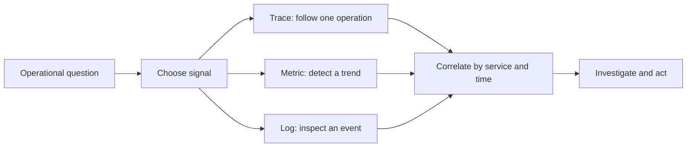
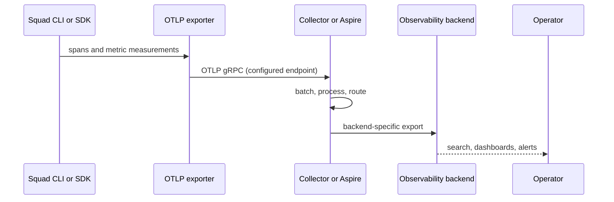

# Chapter 9: Observability

> **Prerequisites:** Volume 1 (or equivalent Squad experience); Chapters 7 and 8.

## What You'll Learn

- Distinguish traces, metrics, and logs, and choose a signal for the question you need to answer.
- Configure Squad v1.1.0's OpenTelemetry (OTel) export without confusing a dashboard with a collector.
- Run the Aspire dashboard locally and understand what `squad aspire` does—and does not do.
- Interpret Squad's actual SDK traces, metrics, resource attributes, and telemetry lifecycle.
- Design a production OTLP path that can be secured, sampled, monitored, and operated independently of local development tooling.
- Add an observability exercise to Tasktrack without turning measurements into a substitute for tests or incident response.

## Observability Is a Question, Not a Dashboard

You have an agent task that took eight minutes. The team says it completed, but a user reports that the expected change is missing. “The dashboard is green” is not an answer. You need to ask specific questions: Did a session start? Which operation was slow? Was a tool call unsuccessful? Did the application emit an error? Did the model return fewer tokens than expected? Did the agent finish without a test proving the result?

Observability is the practice of instrumenting software so its internal behavior can be inferred from its external outputs. Three signals work together:

| Signal | Shape | Best first question | Squad example |
|---|---|---|---|
| **Trace** | A time-ordered tree of spans for a request or operation | Where did this operation spend time, and where did it fail? | `squad.session.message`, `squad.agent.spawn`, `squad.client.connect` |
| **Metric** | A numeric measurement aggregated over time | Is this behavior getting more frequent, slower, or more expensive? | `squad.agent.errors`, `squad.tokens.input`, `squad.response.ttft` |
| **Log** | A discrete event with context and a message | What did the process report at this moment? | CLI output, container stdout, collector errors |

A trace gives you a path through operations; a metric summarizes a population; a log gives event details. They complement one another. A p95 response-duration chart can reveal a regression, a trace can isolate its slow span, and a log can explain the associated failure. None of the three proves that the generated code is correct. Keep tests, human review, and Git history as independent evidence.



OpenTelemetry is a vendor-neutral set of APIs, SDKs, semantic conventions, and wire formats. Squad's instrumentation creates spans and measurements; an OTLP exporter sends data to a receiver. That receiver might be Aspire during local development or an OpenTelemetry Collector in a production network. The collector can batch, retry, filter, enrich, and route data to one or more backends. The backend stores, queries, visualizes, and alerts on it.



> **Note:** OpenTelemetry defines the telemetry plumbing, not the Squad task model. A collector receiving spans does not mean every task outcome is correct, and a missing trace does not by itself mean the task did not run.

## Squad's OTel Contract in v1.1.0

The SDK's provider initialization is in `packages/squad-sdk/src/runtime/otel.ts`. It resolves an explicit `endpoint` in configuration first, then `OTEL_EXPORTER_OTLP_ENDPOINT`. If neither exists, provider initialization returns inactive and instrumentation uses the OpenTelemetry API's no-op behavior. This is opt-in: setting an endpoint is the condition that turns on export. SDK packages for the Node OTel SDK and OTLP/gRPC exporters are loaded lazily; if they are absent, Squad leaves telemetry disabled rather than crashing the application. In debug mode, missing dependencies and startup or shutdown errors are reported to stderr.

Squad configures OTLP exporters for traces and metrics, with a periodic metric reader exporting every 30,000 milliseconds. The exporter is OTLP/gRPC. The default local Aspire path is `http://localhost:4317`; it is not the dashboard web port. Squad's SDK defaults the service name to `squad-sdk`; the CLI explicitly initializes it as `squad-cli` and uses mode `cli`. The resource includes `service.name`, `squad.version`, and, when passed, `squad.mode`.

The high-level SDK entry point is `initSquadTelemetry(options)`. It creates or accepts an `EventBus`, attaches a `CostTracker`, initializes both providers, bridges events to spans, and—unless `installTransport: false` is passed—sets an OTel-backed transport for `TelemetryCollector`. It returns `tracing`, `metrics`, `eventBus`, `costTracker`, and an async `shutdown()` handle. Call shutdown as part of application cleanup so the event bridge is removed and provider buffers are flushed. A standalone instrumentation example is:

```ts
import { initSquadTelemetry } from '@bradygaster/squad-sdk';

const telemetry = initSquadTelemetry({
  endpoint: process.env.OTEL_EXPORTER_OTLP_ENDPOINT,
  serviceName: 'tasktrack-squad',
  mode: 'cli',
});

try {
  console.log('tracing active:', telemetry.tracing);
  console.log('metrics active:', telemetry.metrics);
  // Start and use the SDK client/coordinator here.
} finally {
  await telemetry.shutdown();
}
```

The SDK's event-bus bridge emits a span named `squad.${event.type}` with `event.type` and, when present, `session.id` and `agent.name`. It ends each event span immediately; it is an event record, not a long-lived parent span for the whole work session. Other instrumentation in SDK modules creates spans for operations such as client connect/disconnect, session create/resume/message/stream/close, coordinator message handling, observer lifecycle, and agent lifecycle. Exception paths record exceptions and error status in relevant spans. Treat names as implementation instrumentation, not a stable public analytics schema unless your own deployment pins and verifies the version.

### Metrics actually defined by the SDK

The SDK metric instruments live in `packages/squad-sdk/src/runtime/otel-metrics.ts`. The following table describes instruments as implemented, rather than a promise that every run will populate every series:

| Instrument | OTel instrument | Meaning / common attributes |
|---|---|---|
| `squad.tokens.input`, `squad.tokens.output` | Counter | Input/output token totals, with `agent.name` and `model` attributes |
| `squad.tokens.cost` | Counter | Estimated cost in USD, with the same attributes |
| `squad.tokens.total` | Up/down counter | Running input plus output total |
| `squad.agent.spawns` | Counter | Spawn count; `agent.name`, `mode` |
| `squad.agent.duration` | Histogram, ms | Recorded agent duration; `agent.name`, `status` |
| `squad.agent.errors` | Counter | Error count; `agent.name`, `error.type` |
| `squad.agent.active` | Up/down counter | Active agent sessions; increment/decrement on spawn/destroy |
| `squad.sessions.active`, `squad.sessions.idle` | Up/down counters | Active and idle session pool changes |
| `squad.sessions.created`, `squad.sessions.closed`, `squad.sessions.errors` | Counters | Session lifecycle totals and errors |
| `squad.response.ttft`, `squad.response.duration` | Histograms, ms | Time to first token and total response duration |
| `squad.response.tokens_per_second` | Gauge | Streaming throughput |
| `squad.context.utilization` | Gauge | Fraction of a session context window occupied |
| `squad.rework.rate` | Gauge, % | Per-PR or aggregate rework rate |
| `squad.rework.cycles` | Histogram | Review cycles per PR or aggregate average |
| `squad.rework.rejection_rate` | Gauge, % | Aggregate percentage of PRs with changes requested |
| `squad.rework.time_ms` | Histogram, ms | Per-PR or aggregate time spent in rework |

Rework metrics need particular care in interpretation. The SDK provides helpers for recording individual PR-analysis results and aggregate summaries; those instruments do not mean every CLI session continuously measures PR quality. Per-PR observations carry attributes including PR number and author, while aggregate observations use a `scope=summary` attribute. Review privacy, access, and cardinality before exporting those labels, and make sure the PR-analysis path is actually invoked. The rejection-rate gauge is updated from an aggregate summary, not from each per-PR result helper.

The CLI shell adds a separate opt-in shell metric group in `packages/squad-cli/src/cli/shell/shell-metrics.ts`: session duration, response latency to the first visible token, shell error count, and shell session count. These metrics activate when an OTel endpoint is configured or when `SQUAD_TELEMETRY=1` is set. That flag enables shell metrics; it does not itself configure an OTLP destination. In the CLI shell, `initSquadTelemetry` runs with `service.name=squad-cli` and mode `cli`; shutdown is called during normal cleanup.

> **Under the hood:** The SDK also contains `TelemetryCollector`, a separate event queue with its own consent switch and a 500-event FIFO cap. It defaults to disabled and uses a no-op transport until a consumer sets one. Do not confuse that collector's queue with the OTel metric reader or assume that a queue event corresponds one-to-one with every trace.

### Resource attributes and sensitive data

Resource attributes identify the emitting service and deployment. Use distinct service names for distinct applications or environments, and add environment/cluster labels in your collector or backend if the SDK's resource configuration does not expose a setting you need. Do not invent SDK configuration keys. Attributes can have privacy and cardinality consequences: a unique session identifier on every measurement creates many time series; usernames, issue titles, prompts, source snippets, access tokens, and raw exception payloads can expose confidential data. Before exporting to a shared system, inspect actual spans and attributes with representative, non-sensitive work. Apply data minimization, access control, retention, and redaction at collection and storage boundaries.

The OTel instrumentation should not be described as content-free without checking the particular span: the EventBus bridge only maps the event type and optional session/agent names, while other spans can contain implementation-specific attributes or exception details. Metrics add agent/model labels and session/context labels in some instruments. Set a privacy review gate before enabling production export.

## Local Aspire and Production Observability

Aspire gives you a quick way to inspect OTLP locally. It is not a production storage system, a cluster collector, or an authentication design. The deployment shape changes when Squad runs in containers:

| Environment | Sender | Receiver | Backend |
|---|---|---|---|
| Local interactive development | Squad CLI process | Aspire on host, host port `4317` | Aspire UI at `http://localhost:18888` |
| Kubernetes or container platform | Squad process in a pod/container | In-network Collector service/sidecar, usually OTLP gRPC `4317` or HTTP `4318` depending on configured exporter | Azure Monitor, a Grafana/Prometheus pipeline, or another supported backend |

A pod's `localhost` refers to that pod, not the developer workstation. Set `OTEL_EXPORTER_OTLP_ENDPOINT` to a reachable in-cluster collector endpoint. Squad v1.1.0's implementation uses the OTLP gRPC exporter, so do not assume that changing a URL to port `4318` switches it to an HTTP exporter. The source does not configure protocol negotiation through a separate Squad option. Match the receiver and client implementation; test a real export before promoting the manifest.

A useful dashboard begins with an explicit operator question, not a catalog of every instrument. A small initial set might include agent duration percentiles, agent/session error counts, token and estimated-cost totals, context utilization, and telemetry exporter health. Separate views by service and environment only when those attributes are actually present. Record a baseline over representative work before setting alert thresholds: a one-agent test run is not a meaningful p95 baseline for a fleet. Alert on sustained symptoms and missing-data conditions, not a single noisy observation. For example, an alert that says “no data” should distinguish an idle service from a broken exporter; pair it with workload or heartbeat evidence where available.

For a histogram, aggregate buckets or use the backend's native histogram functions; never average per-instance percentiles and call the result a global percentile. For counters, use a rate over a defined time window rather than raw lifetime totals. For up/down counters, interpret the point as a changeable population rather than a monotonic count. When a collector maps OTLP metrics into a different backend model, verify the transformed name, unit, temporality, and label set from a real sample before publishing a dashboard. If a counter series is absent, it may mean no event occurred, that the provider was never active, or that export failed—the query alone cannot distinguish those cases. Dashboard availability, collector health, and application health should therefore be monitored independently.

For production, place the Collector or vendor-supported receiver between the application and storage where possible. Use TLS and receiver authentication for cross-trust-boundary traffic; protect backend credentials as secrets; set explicit network policies; choose retention and sampling with the data owner; check collector queue/drop/export-failure metrics; and alert on telemetry pipeline health separately from Squad workload health. A successful `kubectl exec ... env` only confirms that a variable is set, not that it is correct or that data reached storage.

For Azure Monitor/Application Insights, confirm the current endpoint and authentication contract in Microsoft's documentation before configuring direct export. Prefer Collector-mediated export when you need batching, retries, filtering, or multiple destinations. For Grafana, verify the full pipeline: SDK emits OTLP; Collector receives it; a supported processor/exporter converts or forwards the metrics; the backend accepts them; the dashboard queries the actual stored series. Do not assume the names in a sample PromQL panel are guaranteed until you inspect the emitted data.

Observability also depends on application lifecycle. Kubernetes may send `SIGTERM` during rollout or scale-down. Allow a realistic termination grace period for in-flight work, but do not assume Squad checkpoints interrupted work: the production docs state that in-progress tasks are not checkpointed before shutdown. Build recovery around durable work inputs, Git history, repeatable issue state, and idempotent task design—not around a trace exporter.

## Hands-On: Observe Tasktrack's Squad Session

This exercise starts with Tasktrack at the Chapter 8 end state, where your Squad has already introduced CI. The sample app itself is still intentionally zero-dependency: its REST API is `node:http`, and its tests use `node:test`. Do not add tracing middleware to the product API merely to observe the agent session. First observe the tool doing the work; application instrumentation is a separate, optional design decision.

### Start the local receiver

The Aspire dashboard is a local receiver and viewer. From a terminal where the Squad CLI is available, run:

```bash
squad aspire --docker
```

In v1.1.0, the Docker path starts the image `mcr.microsoft.com/dotnet/aspire-dashboard:latest`, maps host port `18888` to dashboard port `18888`, and maps `4317` to container OTLP/gRPC port `18889`. The command runs in the foreground; press `Ctrl+C` to stop it. Open `http://localhost:18888` in a browser.

> **Warning:** The Aspire container is configured with both UI and OTLP authentication set to `Unsecured`. This is a local-development convenience only. Keep the listener bound to a trusted machine/network; never expose this dashboard or unauthenticated receiver publicly.

Open a second terminal. The `squad aspire` process cannot set environment variables in its parent shell, so export the endpoint in the terminal where you will run Squad:

```bash
export OTEL_EXPORTER_OTLP_ENDPOINT="http://localhost:4317"
```

Now start Copilot in your Tasktrack checkout, select Squad, and ask for a small, low-risk change such as: “Backend agent, add a test that verifies `GET /tasks` returns an empty list in a fresh store. Run the tests and summarize the result.” You should see CLI output as usual; in Aspire, look for Squad traces and exported metric series after the work runs. This validates connectivity and instrumentation, not code quality: inspect the diff and run Tasktrack's tests yourself.

The dashboard usually shows data after export; traces and metrics have different flush patterns. Squad's metric reader is configured for a 30-second periodic export, so a short exercise may finish before the next metric interval. The SDK's `shutdown()` flushes on clean shutdown, but a forcibly killed process can lose buffered data. Leave the app running briefly or end it cleanly before deciding metrics are missing.

### Optional exercise: decide whether the API needs its own telemetry

If you later instrument Tasktrack's `node:http` API, define a bounded question first—for example, “How many requests return a server error, and what is the p95 handler latency?” Pick an OTel Node SDK and HTTP instrumentation package that matches the exact Node version and deployment. Add it as an intentional dependency, configure it separately from Squad's instrumentation, exclude health-check noise where appropriate, avoid labels containing task IDs or titles, and test shutdown/export. Do not mix the API service identity with the CLI `squad-cli` service identity. The chapter's core Tasktrack step is complete without modifying `sample/`.


## Configuration Reference

| Setting | v1.1.0 behavior | Practical use |
|---|---|---|
| `OTEL_EXPORTER_OTLP_ENDPOINT` | Environment variable read by the SDK when no explicit `endpoint` is supplied; enables initialization when set | Set to a reachable OTLP/gRPC receiver, e.g. local Aspire `http://localhost:4317` |
| `endpoint` in `initSquadTelemetry()` | Explicit SDK option takes precedence over the environment variable | Useful for an embedding app with per-service configuration |
| `serviceName` in `initSquadTelemetry()` | Sets the `service.name` resource attribute; SDK default is `squad-sdk` | Use a stable, environment-meaningful service identity |
| `mode` in `initSquadTelemetry()` | Adds the `squad.mode` resource attribute when supplied | Distinguish execution surfaces such as `cli` and `copilot-agent` |
| `debug` in SDK OTel options | Enables diagnostic logging; `SQUAD_DEBUG=1` also enables debug behavior | Use temporarily to diagnose optional exporter load/start failures; avoid noisy long-term use |
| `installTransport` in `initSquadTelemetry()` | Defaults to `true`; can be set false to avoid installing the collector bridge transport | Keep integration behavior explicit in embedded applications |
| `SQUAD_TELEMETRY=1` | Enables CLI shell metrics with or without an OTel endpoint; does not initialize an exporter endpoint | Use it only when shell measurements are intended; an endpoint is still needed for OTLP export |
| `squad aspire --docker` | Forces Docker dashboard launch | Use when Docker is available and the local Aspire Dashboard should run in a container |
| `squad aspire --port <n>` | Exposed as the dashboard port option in CLI help | **Verify before relying on it:** v1.1.0 implementation uses a fixed Docker port mapping despite accepting/printing the supplied port |
| `squad aspire --stop` | Not a v1.1.0 option | Stop the foreground process with `Ctrl+C`; do not rely on a nonexistent stop flag |
| `OTEL_METRIC_EXPORT_INTERVAL_MILLIS` | Not read by this v1.1.0 provider implementation | The SDK metric reader interval is fixed at 30 seconds in the source; do not expect this variable to shorten it |

There is no verified v1.1.0 support in this code path for an `OTEL_SERVICE_NAME` or `OTEL_RESOURCE_ATTRIBUTES` environment variable. The production scenario page lists those as consumed, but the SDK's provider builder only reads its explicit `serviceName`/`mode` options and version. Do not put unsupported variables in deployment manifests expecting them to change Squad's resource metadata. Likewise, do not claim a custom headers option unless the installed version's verified exporter implementation supports it.

## Under the Hood

At shell startup, `packages/squad-cli/src/cli/shell/index.ts` calls `initSquadTelemetry({ serviceName: 'squad-cli', mode: 'cli', eventBus })`. If either subsystem reports active, it writes a debug message. The shell's cleanup path closes sessions and disconnects the client before invoking `telemetry.shutdown()`; shell metrics are a separate layer with their own enable check.

`packages/squad-sdk/src/runtime/otel.ts` does the provider work. Its core activation is deliberately small:

```ts
function resolveEndpoint(config?: OTelConfig): string | undefined {
  return config?.endpoint ?? process.env['OTEL_EXPORTER_OTLP_ENDPOINT'] ?? undefined;
}
```

When active, it dynamically loads `@opentelemetry/sdk-node` plus gRPC trace and metric exporters, builds a service resource, registers a periodic metric reader with a 30-second interval, then starts the Node SDK. One subtlety matters in diagnostics: the helper can return `tracing: true` or `metrics: true` after seeing an endpoint even when optional packages failed to load; that boolean is not a health check for the exporter or receiver. Lazy loading lets the SDK retain no-op behavior when optional telemetry packages are unavailable. `otel-api.ts` similarly wraps the API import with no-op fallbacks. These choices favor availability: a telemetry dependency problem should not prevent the core runtime from starting, but it means “process started” does not guarantee “telemetry exported.”

`otel-init.ts` composes provider setup, `EventBus` subscription, `CostTracker` wiring, and `TelemetryCollector` transport setup. The handle's shutdown method unwires the cost tracker, unsubscribes the bridge, and calls `shutdownOTel()`. Because all these are process lifecycle concerns, an embedding application should put initialization after configuration is validated and shutdown in a `finally`/signal-safe cleanup path.

`otel-metrics.ts` centralizes instruments and helpers such as `recordTokenUsage`, `recordAgentSpawn`, `recordAgentDuration`, `recordAgentError`, and `recordSessionCreated`. Call sites in the agent, adapter, and streaming modules emit observations where work occurs. The shell metrics module uses the separate meter name `squad-shell`. This source layout lets an operator trace a conceptual path from a token event or session action to its meter helper, but instrument names and semantic meanings should be rechecked when upgrading the SDK.

## Pitfalls and Troubleshooting

### The dashboard opens but shows nothing

1. Confirm the sender process—not merely the Aspire launcher—has `OTEL_EXPORTER_OTLP_ENDPOINT=http://localhost:4317` in its environment.
2. Confirm you are using the CLI/SDK path with OTel initialization. Do not infer direct instrumentation in every Copilot host or embedded runtime.
3. Confirm `4317` is the receiver endpoint and `18888` is only the dashboard UI. Verify Docker port mapping and container logs.
4. Check whether the installed runtime loaded the optional OTel SDK/exporter packages. Temporarily set `SQUAD_DEBUG=1` and inspect stderr.
5. Allow export time; metrics export every 30 seconds. Close cleanly so the SDK can flush.
6. Verify receiver auth. The local `squad aspire` Docker launch sets its dashboard auth modes to unsecured; a manually launched dashboard may not.
7. On a shared production network, inspect collector reachability, DNS, NetworkPolicy, TLS, credentials, and exporter failures.

### You see a connection/protocol error

Check the endpoint scheme, host, port, and receiver protocol against the actual exporter. Squad's code creates gRPC exporters. Do not copy an OTLP/HTTP URL or port from a generic collector example without confirming the client can use it. If Aspire reports authentication errors, check its OTLP auth mode as well as frontend access; they are independent settings.

### The trace exists but does not tell the whole story

A bus event span is emitted and ended immediately. It is not an all-encompassing trace of the model's internal reasoning or every external GitHub API operation. Use correlation keys only where they are emitted, combine traces with logs/metrics, and gather missing details through a deliberate, privacy-safe instrumentation change.

### Metrics do not match an example dashboard

Inspect actual names, temporality, units, and attributes in the receiving collector/backend. In particular, OTel names may be normalized during conversion to Prometheus. Some metrics are histograms, some are counters or up/down counters, and certain series are only recorded on particular lifecycle events. Build alerts from verified data, then test both the firing condition and the no-data condition.

### You have no data after a forced stop

SDK shutdown is the normal flush path. A process kill, crash, pod eviction, or timeout may interrupt export; telemetry is not a durable queue. Retain the issue/task inputs and code state independently, and investigate exporter health separately from task recovery.

## Summary

- Use traces for a single operation, metrics for trends, and logs for event details; correlate them rather than expecting any one signal to tell the whole story.
- Squad v1.1.0 enables SDK OTel when an endpoint is configured, exports via OTLP/gRPC, and allows no-op fallback if optional SDK packages are missing.
- `squad aspire` launches a local receiver/dashboard; it does not propagate an endpoint into a different shell or act as a production collector.
- The SDK defines concrete agent, session, token, latency, context, and shell metrics. Confirm actual exports before building alerts.
- Production needs secure network paths, deliberate retention/privacy, collector health monitoring, and an independent plan for interrupted work.

## Exercises

1. **Signal selection:** For “agents are getting slower,” define one metric alert, one trace investigation, and one log query that could help explain it. State the limitation of each signal.
2. **Resource identity:** Propose a `serviceName` and `mode` for the CLI and an embedded test harness. Explain how you would prevent development and production series from being confused without relying on unsupported environment variables.
3. **Endpoint test:** On Tasktrack, run Aspire in one terminal and the CLI in another. Record the endpoint visible in each process, the first span you find, and whether metrics arrive immediately or after a delay. Explain the result.
4. **Privacy review:** Review the metric attributes listed in this chapter. Identify a high-cardinality or sensitive attribute and propose a collection, storage, and retention safeguard.

## Quiz

1. Which signal is best suited to compare agent failure rates over a week: a trace, a metric, or a log?
2. Which environment variable activates the SDK exporter when no explicit endpoint is passed?
3. What OTLP protocol do Squad's v1.1.0 SDK exporters use?
4. Why does starting `squad aspire` not automatically configure a separate terminal's environment?
5. What is the default periodic metric export interval in the provider implementation?
6. Does `SQUAD_TELEMETRY=1` by itself configure an OTLP endpoint?
7. Is a span from the EventBus bridge a long-running trace of the complete agent task?

## Further Reading

- [Aspire Dashboard](https://bradygaster.github.io/squad/docs/scenarios/aspire-dashboard/)
- [Production Observability](https://bradygaster.github.io/squad/docs/scenarios/production-observability/)
