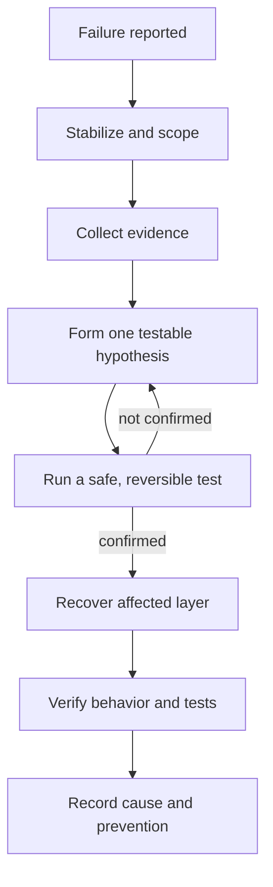
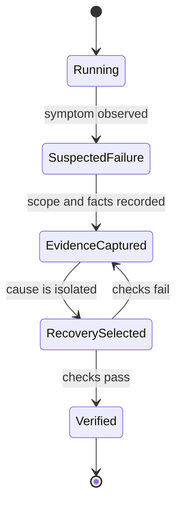

# Chapter 10: Troubleshooting and Disaster Recovery

> **Prerequisites:** Volume 1 (or equivalent Squad experience); Chapters 2, 7, and 9.

## What You'll Learn

- Use a repeatable evidence-first process to isolate a Squad failure rather than changing several settings at once.
- Troubleshoot the local CLI, GitHub authentication, VS Code resource pressure, and production containers in the right order.
- Distinguish a state-loss incident from a code regression, stale agent context, or a broken telemetry pipeline.
- Recover project state from Git and conduct a disaster-recovery drill that proves the backups can be restored.
- Use remote issue and chat paths for QA while understanding their branch, permissions, and workflow limits.

## Troubleshooting Starts with Evidence

When something breaks, resist the urge to reinitialize or upgrade immediately. Those actions can destroy clues or modify state before you know what failed. A useful incident note captures the observable symptom, the time it began, the affected version, what changed, the exact command or action, the first relevant error, and what has already been tried. Then change one thing at a time.

Use a simple loop:

1. **Stabilize:** stop repeated writes or automatic retries if they could corrupt state or amplify impact.
2. **Scope:** determine whether the failure affects one agent, one session, one repository, one machine, or all deployments.
3. **Observe:** gather logs, Git status, command output, environment names (not secret values), and service status.
4. **Hypothesize:** rank plausible causes based on the evidence.
5. **Test safely:** make the smallest reversible change that distinguishes hypotheses.
6. **Recover:** restore only the damaged layer—process, configuration, state, or code.
7. **Verify:** rerun the failing operation and the relevant tests; then record the cause and prevention step.





### Local first checks

Use `squad --version` to establish the installed CLI version, then check whether the problem is in the current repository or CLI environment. In a repository, check `git status --short`, `git branch --show-current`, and the existence of `.squad/team.md` when a team is expected. If `squad` is not found, verify installation and `PATH`; don't respond by deleting state. If there is no `.squad/` directory, confirm you are in the intended Git working tree before considering `git init` or `squad init`.

A quick symptom map:

| Symptom | First evidence to collect | First safe check |
|---|---|---|
| `squad: command not found` | `command -v squad`, `squad --version`, shell `PATH` | Run the installed CLI through the original install channel; avoid mixing installations |
| No `.squad/` found | `pwd`, `git rev-parse --show-toplevel`, `ls -la` | Confirm repository root and whether the project was initialized |
| Agent not found | `.squad/team.md`, `.squad/agents/` | Check roster spelling and agent charter location; do not assume a prompt name creates an agent |
| GitHub API errors | `gh auth status`, relevant scopes and repo access | Reauthenticate or switch to the correct account; don't paste a token into logs |
| Unexpected agent behavior | active branch, relevant decisions/skills/history, recent prompt | Inspect the relevant state file and diff before deleting or “resetting” the team |
| Upgrade appears ineffective | CLI version, template version in `.github/agents/squad.agent.md`, install channel | Confirm CLI is upgraded through its package manager, then re-run `squad upgrade` if appropriate |

Squad's general troubleshooting reference lists stale GitHub installation instructions, old Node engines, and `.ai-team` paths among historic scenarios. For the v1.1.0 workflow used in this book, prefer current `.squad/` state, `squad init`, and installation guidance from Chapter 2 (Volume 1). Do not copy a recovery command from an old article without checking its paths and effects against your installed version.

## Troubleshooting GitHub Access and State

A GitHub failure can resemble a Squad failure: issue lookup, PR operations, or a remote workflow may fail while local code and team state remain healthy. Check the right account and repository. `gh auth status` confirms which account is active; `gh auth switch --user <username>` can select another configured account. When working with GitHub Projects, the `project` scope may be required: `gh auth refresh -s project`. Cross-org repositories may require different account access, SSO authorization, or host-specific Git credential configuration. Never include a raw PAT or GitHub App token in a support artifact.

State problems deserve extra caution. The `.squad/` directory contains durable team knowledge such as team roster, agent charters, decisions, histories, skills, and routing. Before cleaning state, capture `git status`, check whether state files are tracked or externalized, and review the project's state-backend configuration. A state backend may store some state outside the ordinary worktree; a working-tree backup is not necessarily a complete backup of external state. If using a two-layer state backend, the branch model determines where state belongs; don't force state files into the product branch to bypass the hook. See Chapters 2 and 4 for backend and portability details.

When a pre-commit hook refuses to commit state from a two-layer or orphan backend, read the message and determine which files are meant to be written through the state backend. Unstage unintended state-file changes, confirm whether the corresponding state branch already contains them, and use the supported Squad memory/sync operations for any new state. Do not bypass sync hooks with `SQUAD_SYNC_ACTIVE=1` as a user workaround: the troubleshooting docs identify it as an internal recursion guard, and bypassing it can place state in the wrong branch and leak it into a product PR.

## Production Troubleshooting Runbook

Production diagnosis starts with the process and proceeds outward. For Kubernetes, use the actual namespace and deployment names in your environment; examples below use `squad`.

### 1. Is the pod alive and running Squad?

```bash
kubectl get pods -n squad
kubectl describe pod -n squad <pod>
kubectl logs -n squad <pod>
kubectl exec -n squad <pod> -- squad --version
```

If the pod exits immediately, check the last logs, image entrypoint, working directory, installed CLI, and Node compatibility. An image that invokes `squad init` instead of the long-running worker command can exit successfully without doing the expected work. A missing `.squad/` may mean it was neither copied into the image nor mounted at the intended path. Consult Chapter 7's image contract rather than improvising a new container command.

If it runs but never picks up work, test each boundary in order: qualifying GitHub issue exists; its labels match `.squad/routing.md`; the process is watching; GitHub credentials are present and authorized; the state backend can be read/written; and the deployment's scaler can reach its external scaler. A `kubectl get pods` success proves only that Kubernetes started a process, not that it authenticated or is ready for work.

### 2. Authentication and rate limits

401 errors generally point to a missing, empty, expired, or unauthorized token. 403 errors may be missing scopes or organization SSO authorization. Validate the secret's presence without printing its value; use a trusted, access-controlled check rather than `env | grep GITHUB_TOKEN` in logs or a pasted support bundle. If multiple replicas share a GitHub token, they share the token's API quota. Monitor rate-limit headers and reduce unnecessary concurrent polling before increasing replicas.

### 3. State backend and branch conflicts

A PVC not mounted where the process expects it leaves data in the container's ephemeral filesystem; a restart can then look like unexplained memory loss. Inspect pod volumes and mounts. If a branch-backed backend rejects a push as non-fast-forward, concurrent writers may have raced. Do not resolve by force-pushing over state. Stop the competing writers, preserve both revisions, and follow the backend's documented synchronization/restore process. Multi-replica deployments need a state backend designed for concurrent writes; do not assume a local filesystem or branch backend provides that guarantee.

### 4. Telemetry and collector path

If no trace reaches the backend, check sender endpoint, pod-to-collector DNS and network reachability, actual gRPC receiver protocol, auth/TLS, collector logs, exporter failure metrics, and backend ingestion. For production telemetry, compare the code-supported environment variables and transport in Chapter 9 with the collector configuration. A failure to export should not stop you from collecting ordinary process logs or preserving work inputs.

### 5. Scaling, image pulls, and memory

A KEDA `ScaledObject` that is not ready may point to a scaler service or address mismatch. If it is ready but does not scale, inspect queue length and threshold settings. `ImagePullBackOff` usually points to a bad image reference, missing registry credentials, or unavailable tag. `OOMKilled` means the process exceeded its memory limit; correlate restarts and memory consumption with work bursts, session size, and plugin behavior before merely raising limits. A `minReplicaCount` of zero may be intentional idle behavior rather than an error.

### 6. Readiness is not the same as process health

The production sources document that Squad v1.1.0 does not expose a built-in `/healthz` or `/readyz` HTTP endpoint for checking GitHub authentication/readiness. Do not invent a health port or configure a probe against a nonexistent route. Kubernetes can restart a crashed process, but an alive process with broken credentials may continue failing. Alert on authentication errors and use an external readiness test designed for your deployment. Track the issue for endpoint status before revisiting this assumption.

For incident escalation, collect a time-bounded log window, pod description, relevant Kubernetes events, image/version, redacted state configuration, backend/scaler condition details, and a trace sample if available. Remove tokens, connection strings, user data, issue text, and private code excerpts unless your organization has approved sharing them. Keep copies in a controlled incident system rather than committing raw diagnostic bundles to the repository.

## VS Code Troubleshooting

An editor closing during a long Squad session is alarming, but it does not prove that Squad crashed. The VS Code troubleshooting source analyzes resource pressure from long-lived sessions. It identifies capped FIFO collections for SDK usage history (1,000 entries) and the separate telemetry event queue (500), watcher filtering for high-churn `.squad/orchestration-log/` and `.git/` areas, and an existing stream-buffer/message trimming limit. Those guardrails reduce certain growth paths; they do not guarantee that every extension, model client, renderer, or workspace is memory-bounded.

If VS Code closes or hangs:

1. Check whether the CLI or child processes remain alive in the OS process viewer; save work before restarting them.
2. Reopen the workspace and inspect logs/terminal output, Git status, and recent state changes.
3. Compare VS Code Stable with Insiders/Nightly; update only after preserving the current version and reproducer.
4. Monitor memory and CPU during an isolated session. Close unused terminals and extensions before repeating.
5. On large workspaces, exclude generated/high-churn areas using `.vscode/settings.json` only if you understand which files that excludes from editor search/watch features.
6. On Linux, inspect inotify limits if watcher exhaustion is indicated. The source's example command is Linux-specific; `/proc/sys/fs/inotify/max_user_watches` is not a macOS path. Do not blindly run Linux `sysctl` examples on macOS.
7. Disable terminal GPU acceleration only if the symptom is rendering flicker and the editor setting is supported by your VS Code version.

```json
{
  "files.watcherExclude": {
    "**/.squad/orchestration-log/**": true
  },
  "terminal.integrated.gpuAcceleration": "off"
}
```

Treat the two settings independently. The watcher exclusion can be useful on a large workspace; GPU acceleration is a separate display workaround, not a memory fix. If memory grows steadily, prepare a minimal reproduction, editor and extension versions, operating system, process/resource measurements, and relevant logs with secrets redacted.

## Disaster Recovery: Recover the Right Layer

Disaster recovery is not “delete `.squad/` and try again.” Decide which layer is damaged:

| Damage | Restore from | Avoid |
|---|---|---|
| Product code regression | Git commit/branch, tests, known-good release | Reinitializing Squad state to fix application code |
| Deleted or corrupted tracked `.squad/` files | Git history, reviewed backup, or verified export | Restoring an old state over newer decisions without comparing changes |
| Lost external state backend | Backend snapshot/versioned backup and validated export | Assuming the product repository contains the external copy |
| Wrong agent context or stale skill | Edit/archive the specific state artifact with a reviewed change | Wiping all memories because one note is wrong |
| Broken CLI template/upgrade | Known-good CLI release and tracked project config | Assuming upgrades never affect any project-owned file |
| Lost uncommitted changes | Editor/OS recovery or backup, if available | Claiming Git can restore changes it never recorded |

The durable principle is to version-control and back up the parts of `.squad/` that your chosen backend expects to persist, and to test how those artifacts are restored. Before restoring, compare the target backup to current state; make a branch or copy; and preserve any newer work as a separate patch. Git can restore committed files, but it cannot reconstruct uncommitted changes that were never copied elsewhere.

When a coding agent introduced bad code, use Git to inspect the diff and revert or repair the code in a branch; keep the team state unless it is itself implicated. When an agent decision is obsolete, add a clear new decision that supersedes it and update affected skills or routing; avoid silently editing history in a way that makes the audit trail misleading. When one session left stale context, correct only the affected history or skill after reviewing its contents. “Reset context” is not equivalent to deleting all of `.squad/`.

## Remote QA Without a Local Clone

Remote access is useful when you want an architectural explanation, issue triage, or a review from a browser or mobile device. Choose the surface based on the kind of work:

| Need | Possible path | Important limitation |
|---|---|---|
| Ask a quick project question | Copilot Chat in GitHub.com for a repository with the relevant agent instructions | The source describes default-branch context; don't assume it sees a feature branch or private local state |
| Investigate or change code | Create a GitHub issue and assign it to `@copilot` where the repository has a configured, approved coding-agent workflow | Work runs against workflow-selected context, commonly default branch; it is a task workflow, not an unrestricted chat channel |
| Route a work item | Use repository labels and a configured Squad triage/issue workflow | Labels only have meaning if your repository workflow and routing rules implement them |

Treat remote QA as a path that needs configuration, not an automatic capability created by the presence of a Squad team file. Inspect the repository's workflow YAML, triggers, permissions, allowed write paths, and default branch before enabling automation. Require human review before merge, keep tokens least-privileged, and avoid using untrusted issue text as executable instructions. For branch-specific investigation, make the branch explicit and confirm the remote agent actually checked it out. If the remote path only reads the default branch, a question about unreleased code can receive a plausible but stale answer.

A careful remote QA request names the repository, branch or commit, subsystem, expected evidence, and output format. For example: “Review the Tasktrack API at commit `<sha>`; inspect the route implementation and test suite; do not modify files; report missing boundary tests with file and line references.” A change request should be an issue with acceptance criteria and an explicit human-review gate, not a vague instruction embedded in an untrusted pull request comment.

## Hands-On: Tasktrack Disaster-Recovery Drill

Run this drill on a disposable working branch, not on your only copy. It proves recovery from a known-good Git commit and exercises recovery of team state while retaining evidence of changes made since the backup.

1. **Prepare a recovery point.** From your Tasktrack checkout, ensure tests pass and inspect the state:
   ```bash
   npm test
   git status --short
   git add .squad/ api/ web/ .github/ .gitattributes
   git commit -m "Checkpoint Tasktrack before DR drill"
   git tag v2-ch10-dr-baseline
   ```
   If a path is absent, stage only paths that exist. If your state backend intentionally keeps state outside the worktree, separately create and verify a backup using that backend's documented procedure.

2. **Create a disposable drill branch and record state.**
   ```bash
   git switch -c dr-drill
   git status --short
   ```
   In your selected editor, make a small harmless edit to a Tasktrack file and a clearly marked, non-sensitive note in a relevant Squad decision or skill. Commit the change so the drill has a known post-backup state. Do not put credentials, personal information, or fabricated operational data in the note.

3. **Simulate loss of a tracked project file.** On this drill branch only, move or remove one noncritical tracked file—for example, a test fixture or a short local-only test change—then observe the changed status. Do not delete the whole `.squad/` directory or your only team source. The objective is to test restoration, not create irrecoverable damage.

4. **Restore from the checkpoint.** Restore the chosen file from the tagged baseline using Git, then compare the result and status:
   ```bash
   git restore --source=v2-ch10-dr-baseline -- path/to/file
   git diff -- path/to/file
   git status --short
   ```
   Replace `path/to/file` with the exact file you selected. Verify that only intended content changed; a restore can overwrite newer edits to that same file.

5. **Prove the app still works.**
   ```bash
   npm test
   ```
   Start the API with `npm start` in another terminal, confirm `GET /health` responds with `{"ok":true}`, then stop it cleanly. The baseline API exposes `/health`, `/tasks`, and task mutations; it does not persist in-memory tasks across process restarts. Do not confuse expected task-data volatility with loss of Squad team state.

6. **Prove the knowledge is still present.** Inspect `.squad/team.md`, the edited decision/skill, and the repository's state-backend configuration. Check Git history for the checkpoint and drill commits. If external state was used, restore a test copy to a separate project key/root and confirm its content before considering the procedure reliable.

7. **Close the drill.** Record what was recoverable, what was not, elapsed recovery time, and any missing backup. Retain the branch if needed for review; otherwise return to your original branch and remove the drill branch only after confirming its commits and work are no longer needed:
   ```bash
   git switch <original-branch>
   ```
   Do not tag the drill as `v2-ch10-end` until your full chapter progression is verified.

Before declaring an incident resolved, write a short timeline: first observed symptom, last known-good state, containment action, recovery point, verification, and owner for follow-up. This makes later debugging faster and helps separate a symptom that reappears from a new failure. Keep the incident record factual; mark hypotheses as hypotheses until evidence confirms them. Record timestamps in one consistent timezone and retain the smallest diagnostic sample that can establish the sequence. A collector outage can precede a workload incident, while an agent error can happen even when all dashboards are healthy; chronology helps avoid treating correlation as causation.


A successful drill means more than “the command exited zero.” You must demonstrate that the intended artifact is restored, newer work is accounted for, tests pass, and the recovery instructions make sense to someone who did not perform the original setup.


## Configuration Reference

| Item | Purpose | Recovery/troubleshooting note |
|---|---|---|
| `squad --version` | Establish installed CLI version | Record before comparing behavior or filing an issue |
| `gh auth status` | Check active GitHub CLI identity | Does not reveal whether every org/SSO permission is sufficient |
| `gh auth refresh -s project` | Add Project scope when needed | Ask for only necessary access; do not expose credentials |
| `gh auth switch --user <username>` | Switch among configured accounts | Confirm the account can access the target repository |
| `.squad/team.md` | Team roster and shared project context | Confirm the actual state root/backend before restoring |
| `.squad/routing.md` | Route work according to repository conventions | Labels have effect only when the workflow/agent uses those rules |
| `.vscode/settings.json` | Optional workspace watcher and terminal settings | Keep exclusions narrow; settings are not a recovery mechanism |
| `kubectl logs`, `describe`, `get events` | Production evidence | Redact secrets and minimize retention/sharing |
| `terminationGracePeriodSeconds` | Kubernetes process shutdown window | Longer time is not a guarantee of task checkpointing |
| `/health` | Tasktrack app health endpoint | Confirms HTTP server response; not Squad readiness or GitHub auth |

## Under the Hood

The v1.1.0 troubleshooting sources separate local CLI problems from production container failures. Production diagnosis follows the runtime chain—pod startup, GitHub auth, state backend, KEDA scaler, image, memory, and OTLP export—rather than treating every “no issues picked up” report as a routing problem. It also records two important operational limits: the documented SDK path has no built-in HTTP liveness/readiness endpoint, and the runtime does not checkpoint in-flight tasks before a pod termination.

The VS Code source discusses finite in-memory caps and watcher filtering. In `packages/squad-sdk/src/runtime/streaming.ts`, usage history is limited to 1,000 events using FIFO eviction. `packages/squad-sdk/src/runtime/telemetry.ts` separately caps queued collector events at 500. These are bounded collections, not a global memory ceiling. `packages/squad-sdk/src/runtime/squad-observer.ts` watches state changes and filters high-churn directories at the callback level. The responsible operator still checks system/editor behavior because extensions, open files, large contexts, and other processes affect memory too.

Disaster recovery is mostly a systems property, not a single Squad command. Git supplies versioned recovery for committed project state; a state backend may have a separate durability and conflict model; the app's in-memory task store has yet another lifecycle. Test each boundary explicitly. A restore procedure should preserve evidence, use a copy or branch, verify the target file, and run tests after recovery.

## Pitfalls and Troubleshooting

- **Do not `rm -rf .squad/` as a first diagnostic.** It may erase the very state needed to understand what happened.
- **A healthy pod is not a ready Squad.** Confirm auth, routing labels, state access, and scaler state independently.
- **Don't paste secrets in incident bundles.** Environment variable names can be useful; values are often credentials.
- **Do not treat an uncommitted file as backed up.** Git restore only recovers content present in a commit/index or another backup.
- **Don't overgeneralize Linux commands.** Inotify instructions do not apply to macOS as written.
- **Avoid remote branch assumptions.** Confirm the actual checkout/commit used by browser or issue automation.
- **Don't trust old `.ai-team/` examples as current paths.** Verify state layout, flags, and commands against v1.1.0.
- **A long grace period is not a checkpoint.** Use repeatable tasks and durable inputs to recover interrupted work.

## Summary

Troubleshoot from evidence, isolate the broken layer, and choose a reversible repair. In production, inspect process, auth, routing, state, scaler, image, resources, and telemetry separately. Back up the correct persistence layer and prove restoration with a drill. Remote QA can save a local clone, but only when branch context, workflow permissions, and human review are explicit.

## Exercises

1. A Squad pod is running but issues are not being processed. Write the ordered six checks you would make before changing the deployment.
2. On Tasktrack, run the DR drill on a disposable branch. Submit a checklist of artifact restored, test results, what was not backed up, and one improvement to the runbook.
3. A VS Code session closes while a CLI process remains alive. List the evidence you would collect before deciding whether Squad or the editor caused the failure.
4. Draft a remote QA request for a branch-specific review. Include the commit/branch, scope, evidence, and no-write/human-review constraints.

## Quiz

1. Can Git restore a file that was never committed or backed up elsewhere?
2. What is the distinction between a running Kubernetes pod and a ready Squad worker?
3. Which SDK limitation prevents the documented Kubernetes HTTP readiness probe from checking Squad's GitHub authentication?
4. Does a longer Kubernetes termination grace period guarantee an in-flight agent task is checkpointed?
5. What are the FIFO limits documented for the streaming usage history and telemetry collector queue?
6. Why should a remote QA request name the target commit or branch?
7. Why is deleting `.squad/` a poor first troubleshooting step?

## Further Reading

- [Troubleshooting](https://bradygaster.github.io/squad/docs/scenarios/troubleshooting/)
- [Production Troubleshooting Runbook](https://bradygaster.github.io/squad/docs/scenarios/production-troubleshooting/)
- [VS Code Troubleshooting](https://bradygaster.github.io/squad/docs/reference/vscode-troubleshooting/)
- [Disaster Recovery](https://bradygaster.github.io/squad/docs/scenarios/disaster-recovery/)
- [Remote QA](https://bradygaster.github.io/squad/docs/scenarios/remote-qa/)
