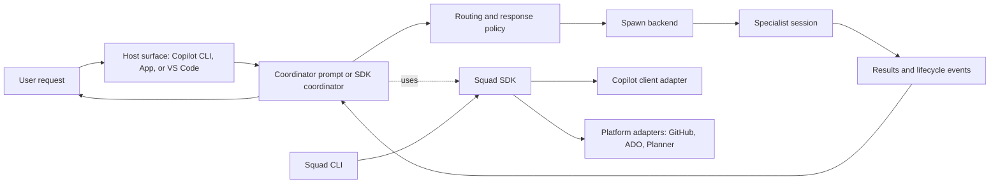
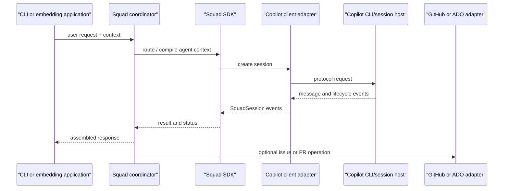

# Chapter 11: Squad Architecture

> **Prerequisites:** Volume 1 (or equivalent Squad experience).

Now that you have used Squad to coordinate work and operated it across real workflows, this chapter steps behind the interface. We will map the CLI, coordinator, SDK, clients, and adapters so you can explain which layer is responsible for a behavior before extending or troubleshooting it.

## What You'll Learn

- Distinguish the `@bradygaster/squad-cli` package from the `@bradygaster/squad-sdk` library and understand how they cooperate.
- Trace the route from a user message through the coordinator to a spawned agent and back.
- Separate the Copilot client adapter, the Squad runtime, and external work-platform adapters.
- Recognize which behavior is implemented in TypeScript and which is expressed as instructions in `squad.agent.md`.
- Read the available architecture evidence accurately without turning a proposal or missing document into a shipped feature.

> **Preview (Squad 2.0):** The architecture separates host-specific client projections from the shared team and backend contract. A repository can generate one coordinator artifact per selected host; each uses the same `.squad/` team and charters rather than creating seven independent Squads. Chapters 18 and 20 explain the three-plane model and host adapters; see the [2.0 architecture](https://bradygaster.github.io/squad/docs/concepts/squad-2-0-architecture/).

## Start with the layers, not the command

When you operate Squad, `squad` is the visible entry point; the behavior you experience also comes from distinct packages and integration seams in the v1.1.0 monorepo. The CLI provides commands, initialization, and an interactive shell. The SDK provides reusable types and services for sessions, configuration, state, routing, platforms, and coordination. The coordinator prompt describes how an AI host should behave when it acts as Squad. Copilot is the model-and-tools environment in which that prompt executes.

These are related, but they are not interchangeable. The SDK does not magically turn every application that imports it into the exact behavior of the installed Copilot agent. Conversely, an agent prompt is not a replacement for the SDK's session adapter or a GitHub issues client. A useful first question is therefore not “Where is Squad's coordinator?” but “Which coordinator path am I looking at?”



The diagram shows logical relationships, not a guarantee that every install uses every box. A prompt-driven host can dispatch through host tools; an SDK consumer can wire its own `SquadCoordinator` dependencies; a CLI command can use SDK services without invoking the interactive coordinator at all.

## CLI and SDK: two packages, two jobs

The `@bradygaster/squad-cli` package installs the `squad` executable (and aliases such as `squad-cli`). It owns user-facing command parsing and terminal interaction: for example, `squad init`, `squad consult`, `squad extract`, and the default shell. The CLI also packages some shell-specific components, such as input parsing, display, sessions, and a coordinator prompt builder. Its package manifest depends on the SDK, so common operations can be implemented once and reused.

The `@bradygaster/squad-sdk` package is a programmable library. It exposes public entry points such as `@bradygaster/squad-sdk/client`, `/coordinator`, `/platform`, `/storage`, `/sharing`, and `/state`. Its root entry point explicitly avoids CLI startup side effects; importing it is intended to be safe inside another program. A consumer can create a `SquadClient`, create a session, listen for session events, or use higher-level services without running the interactive `squad` shell.

| Package | Primary responsibility | Typical caller | What it is not |
|---|---|---|---|
| `@bradygaster/squad-cli` | Commands, terminal UI, project setup, shell flow | A person or script invoking `squad` | The whole runtime abstraction |
| `@bradygaster/squad-sdk` | Reusable TypeScript APIs and orchestration building blocks | CLI, plugins, or another application | A promise that a complete chat host is included |
| Copilot SDK, behind Squad's adapter | Launching and communicating with Copilot CLI sessions | Squad SDK | Squad's work tracking or team governance model |
| Platform adapter | Normalizing external issue/PR operations | SDK service or Ralph workflow | A substitute for the Copilot client |

A quick way to verify this separation in a checkout is to compare `packages/squad-cli/package.json` with `packages/squad-sdk/package.json`. The CLI's `bin` field points at its command entry point; the SDK publishes typed subpath exports. Both are versioned together in the v1.1.0 workspace, but their public contracts differ.

> **Note:** “SDK” here means the Squad SDK. It wraps or composes upstream Copilot SDK facilities; it is not the upstream SDK itself.

## The runtime and the client/control boundary

The **runtime** is the part that gives reusable behavior a stable shape: configuration and validation, session lifecycle, event delivery, agent and skill loading, state, coordination helpers, and model selection. An SDK consumer supplies the environment-specific dependencies—such as the session factory, storage provider, and optional event bus—rather than relying on one global process.

The Copilot-facing adapter is a boundary around upstream client and session types. `SquadSessionConfig` names Squad-level options such as model, tools, hooks, MCP servers, skills, working directory, and streaming. `SquadSession` offers a stable interface for sending messages, listening for events, optionally waiting or aborting, and closing. `SquadClient` manages the connection to Copilot CLI, including connection state and reconnection behavior. The adapter translates event names and tool names where wire formats differ. That is why code elsewhere in Squad can use its own types rather than depending directly on Copilot SDK types at every call site.

A **platform adapter** is a separate boundary. It models business work systems, not model sessions. `PlatformAdapter` normalizes work-item and pull-request operations, such as listing issues, getting an item, tagging, assigning, commenting, creating branches, opening a pull request, and merging. v1.1.0 exports GitHub and Azure DevOps adapters (and a Planner mapping); communication adapters are another interface for posting updates and polling replies. A repository can therefore use one boundary to talk to a model host and another to talk to an issue tracker.



The final line is conditional: a request that does not involve a work item should not call the platform adapter. Similarly, the SDK may expose an adapter without using it in a particular code path.

> **Under the hood:** `adapter/types.ts` describes Squad-owned contracts. `adapter/client.ts` is an implementation of the Copilot boundary. `platform/types.ts` describes work-system contracts, while `platform/index.ts` selects a provider based on explicit configuration or repository remotes.

## Why the boundaries matter in day-to-day use

The package split is valuable when you have to change or embed Squad. If you only need a command such as `squad status`, the CLI is the product surface. If you are building an automation that creates sessions or reacts to events, importing the SDK is the narrower choice. If you are writing a new user interface, you can build around the SDK's stable session and event types while deciding independently whether to use its coordinator helpers. These choices reduce accidental coupling: a consumer does not need to launch a terminal UI to get session lifecycle management, and a CLI command does not need to duplicate all storage and platform logic.

The layers also clarify failure ownership. If Copilot cannot start, look at client connection options, executable discovery, authentication, and protocol negotiation. If a valid message reaches the coordinator but no suitable specialist is found, examine the roster and routing input. If issue operations fail after an agent session begins, look at the work-platform adapter, credentials, repository remote, and API error. One visible symptom—“nothing happened”—can occur at any of these boundaries, but each has different logs, inputs, and recovery steps.

A useful mental model divides Squad into three axes:

| Axis | Main question | Example surface |
|---|---|---|
| Interaction | How does a person or host provide a request and see the answer? | CLI shell, Copilot agent, VS Code integration |
| Orchestration | Who should work, how should sessions be started, and how is progress observed? | Coordinator, routing, spawn backend, event bus |
| External effects | Which repository, work board, or storage system is changed? | GitHub/ADO adapter, storage/state provider |

A deployment can use all three, but it may substitute a host or omit an external effect. This is why the SDK exposes capabilities as composable pieces rather than forcing each consumer through a single command-line process.

## State and events as connective tissue

Team configuration and agent decisions are not ordinary application data. They are inputs that influence future dispatches, so the system distinguishes static configuration from mutable state. A roster, routing table, and charter describe the team; histories and decisions accumulate over time. Some installations keep mutable files in the local `.squad/` tree, while configured backends can redirect state persistence. State ownership rules are necessary precisely because the physical file layout is not always the persistence contract.

Events make a different kind of connection. The SDK event bus lets a coordinator, monitor, or UI observe session lifecycle and operational milestones without owning the session implementation. Events carry a type, optional session and agent IDs, a payload, and a timestamp. Subscribers can attach to one event or all events; handler failures are isolated so one observer does not break other listeners. The event bus is not a durable decision ledger and should not be confused with the memory system: a lifecycle event can say a session was created, while an accepted decision belongs in governed state.

Consider the difference between three records:

- A `session:created` event describes an observed runtime occurrence.
- An entry in an agent's history captures that agent's durable learning.
- An accepted item in `decisions.md` records a decision that the team should use as shared authority.

The first can be ephemeral or diagnostic; the second is scoped to an owner; the third changes shared policy. Treating them as one generic “log” creates unclear ownership and makes later handoffs less reliable.

## Two coordinator paths in v1.1.0

The phrase “the coordinator” refers to at least two related mechanisms in this release.

1. **Prompt coordinator.** `.github/agents/squad.agent.md` is an instruction document for an AI agent host. It lays out the role, state resolution, routing, spawn protocol, modes, governance, and related workflows. The installed file can be version-stamped and customized by lifecycle commands; its content is not simply a TypeScript function.
2. **SDK coordinator.** `packages/squad-sdk/src/coordinator/` contains TypeScript classes and helpers. `SquadCoordinator.handleMessage()` checks a direct-response handler, matches routing rules, chooses a spawn strategy from the number of matched agents, and can call an injected fan-out service. `response-tiers.ts` separately exports a tier-selection helper.
3. **CLI shell coordinator.** The CLI shell has its own parser and prompt builder. It reads team and routing files, builds a compact coordinator prompt, and parses structured responses such as `DIRECT:`, `ROUTE:`, and `MULTI:`. The shell's parser recognizes slash commands and direct-agent addressing before handing ordinary text to the coordinator.

This split matters when you debug behavior. A response-mode rule in the large agent prompt may not be executed by the SDK class. A routing helper in TypeScript may not control what a host model decides from a different prompt. Always identify the code path and its caller before treating a function as system-wide policy.

## Contracts, implementations, and host responsibilities

A boundary is useful only when you can tell what it promises. Squad's adapter types define contracts; classes implement those contracts; a host decides when to instantiate them. For example, `PlatformAdapter` promises normalized work-item and pull-request operations, while `GitHubAdapter` and `AzureDevOpsAdapter` supply platform-specific calls. `createPlatformAdapter()` can use `.squad/config.json` to select an explicit GitHub repository or infer the provider from the `origin` remote. If the remote is missing or malformed, construction fails rather than guessing. The caller must handle that failure and must not assume a work-tracking provider exists for every repository.

The Copilot client has a similar separation. `SquadClientOptions` lets a caller provide an executable path and arguments, a working directory, stdio/TCP settings, or a URI for an existing server. It can choose whether to start and reconnect automatically, select logging, pass environment variables, and choose authentication behavior. When no explicit client path or remote URL is used, it builds the upstream runtime connection according to its defaults. The default transport is stdio. Reconnection is enabled, with up to three attempts and a one-second initial delay. These are client lifecycle settings; they do not tell the coordinator which agent to choose.

The `SquadSession` contract is deliberately smaller than all of the possibilities behind a host. Sending a message, registering and removing event handlers, and closing the session are core operations. Waiting for completion, aborting, and retrieving past messages are optional methods. Optional methods matter to embedders: an application should test for their presence rather than assume every session backend supports them. Likewise, `SpawnBackend` returns a handle and reports availability, but a separate layer must decide which agent to spawn and when to release the handle.

The layers give you a practical debugging matrix:

| Symptom | First boundary to inspect | Evidence to collect |
|---|---|---|
| Cannot open a Copilot session | Client adapter / host connection | Connection state, transport, executable or server URL, authentication, protocol status |
| Request reaches coordinator but selects no useful owner | Coordinator / routing configuration | Active team root, roster entries, routing file, input parse result |
| Agent starts but issue lookup fails | Platform adapter / credentials | Detected platform, origin URL, explicit provider config, auth status |
| UI never reflects agent progress | Session events / event aggregation | Event type, subscription path, session ID, listener errors |
| A durable decision disappears | State backend / ownership | Configured backend, bridge health, designated writer, write result |

This matrix keeps a failure in the layer that owns its contract. It also suggests the next experiment: test the smallest interface boundary first instead of changing several unrelated modules.

## Control is policy plus mechanism

A practical control boundary separates **policy**—who may do what and when—from **mechanism**—how sessions, files, events, or API calls are physically performed. In Squad, the coordinator prompt is a policy surface for the host. SDK interfaces and host tools provide mechanisms. Project state files supply local policy inputs such as a roster and routing table. Platform adapters provide external-system mechanisms.

That separation is real as an architectural reading, but be careful not to attribute a formal versioned design decision to it without a document. The v1.1.0 checkout contains `docs/specification/` working-draft profiles, but the requested `docs/specification/adr-001*` files are absent, and a repository-wide search found no ADR-001 or explicit “Squad 2.0” statement. No concrete Squad 2.0 migration contract can therefore be verified from this tag. The remaining chapters describe observable v1.1.0 boundaries; they do not claim that a future 2.0 architecture has been adopted.

> **Warning:** The absence of an ADR is not evidence that a specific redesign is planned. Do not infer a future API, client/control split, or compatibility guarantee from a directory name or a conversation about “2.0.”

## A request's path through the system

Imagine asking the coordinator to add a due date to Tasktrack. In a prompt-driven session, the host reads the user message and the coordinator instructions. It resolves which team state applies, identifies an accountable specialist from the routing policy, chooses a response mode, and dispatches through the available platform tool. The specialist receives the task and applicable project context, does its work, and reports back. The coordinator handles the handoff and presents the result.

In the SDK coordinator pipeline, the analogous stages are explicit function calls: emit a routing-start event; test for a direct answer; call `matchRoute`; determine `fallback`, `single`, or `multi`; build agent spawn inputs; call `spawnParallel` if dependencies exist; and emit a completion event. `spawnParallel` compiles the agent charter, resolves a model and optional reasoning/context settings, creates a session through a backend or injected factory, sends the task, registers the session in a pool, and returns success or failure for each requested agent. The SDK reports orchestration outcomes; it does not turn every result into an approved product change or silently decide how a human review must work.

This yields a useful diagnostic sequence:

1. Did the input reach the intended host or CLI shell?
2. Which coordinator path handled it?
3. Which state root and routing data did that path load?
4. Did the policy choose direct response, one owner, or multiple agents?
5. Which spawn mechanism was available, and did it succeed?
6. Did the resulting session emit events and return a handoff?
7. Was any issue-tracker operation actually required?

If you skip these questions and jump straight to “the model routed it wrong,” you can miss a stale roster, a missing team root, a tool capability mismatch, a fallback, or a parser boundary.

## What the boundary does not promise

An abstraction can stabilize internal code without making every underlying host interchangeable. The adapter exposes common operations, but capabilities such as aborting, retrieving messages, model selection, streaming, or creating nested sessions depend on what the host supports. Platform APIs also differ in what “assignment,” “tag,” or “merge” means; normalization makes a common interface possible, not identical remote behavior. Check the adapter type and implementation together when a workflow relies on a less-common operation.

This also explains why Squad exposes configuration and injected dependencies. An embedding app can provide its own session factory or event bus rather than adopting the CLI shell wholesale. A test can substitute a direct-response handler or a compiled router. A deployment can pick a different state backend. Those seams make integration testable, but they place responsibility on the caller to configure and connect the pieces. If the `fanOutDeps` object is absent, `SquadCoordinator` can still classify the message but does not perform its fan-out. A configured interface is not automatically an executed workflow.

## Hands-On: Draw Tasktrack's architecture boundary

Use the Tasktrack checkout you have been operating throughout the book. This read-only exercise maps the application and Squad boundaries you have already worked with; it does not introduce routing or ask you to rebuild the team.

```bash
cd ~/tasktrack
npm test
```

Expected result: Node's test runner reports five passing subtests and no failures. Then ask your Squad:

> Trace a request to add a Tasktrack task from the browser form through the API. Identify which files belong to the web client, which files implement the API, and which Squad layer would decide who works on each part. Do not edit files. Cite paths from the repository.

A useful answer names `web/index.html`, `api/src/app.ts`, and `api/src/tasks.ts`; it should distinguish application architecture from Squad's routing architecture. If the answer says “the SDK automatically handles the request,” ask it which SDK call does so. The point is to make the boundary explicit before you add routing rules in Chapter 5 (Volume 1).

## Configuration Reference

| Surface | Relevant setting or path | Meaning / default |
|---|---|---|
| CLI package | `squad` executable | Starts the interactive shell with no command; commands such as `init`, `consult`, and `extract` have separate handlers. |
| SDK package | `@bradygaster/squad-sdk` subpath exports | Lets applications import client, coordinator, platform, state, or sharing APIs without the CLI entry point. |
| Session adapter | `SquadSessionConfig.model` | Optional model identifier; platform default applies when not set. |
| Session adapter | `workingDirectory` | Directory used as the session's tool-operation context. |
| Session adapter | `streaming` | Defaults to `false` in the interface documentation. |
| Client connection | `SquadClientOptions.useStdio` | Defaults to `true`; can instead connect using a URL or TCP configuration. |
| Client lifecycle | `autoStart`, `autoReconnect` | Both default to `true`; reconnection attempts default to 3 with a 1,000 ms initial delay. |
| Platform adapter | `.squad/config.json` `github.owner`, `github.repo` | Optional explicit GitHub target; otherwise the adapter detects a platform from the Git remote. |
| Platform adapter | `.squad/config.json` `ado` | Optional Azure DevOps work-item configuration. |
| Coordinator state | `.squad/config.json` `stateLocation`, `teamRoot` | Can redirect team state to an external location; absent means local behavior. |

The table is a map, not a promise that every command reads every key. Specific command behavior is covered in its own chapter.

## Under the Hood

The SDK's public `SquadSession` interface is the seam that prevents application code from having to depend on the upstream session's concrete class. The adapter implementation handles the actual translation. One compact example is tool-name normalization: Squad uses dotted tool names such as `memory.classify`, whereas the upstream external-tool wire format accepts a narrower name grammar.

```ts
export function normalizeToolNameForCopilot(name: string): string {
  return name.replace(/\./g, '_');
}
```

The SDK also detects collisions when distinct canonical names normalize to the same wire name, then maps names back for hook callbacks. This is more than renaming for style: without collision detection, the adapter could expose one tool under an ambiguous wire identifier.

On the work-platform side, `createPlatformAdapter(repoRoot)` checks for an explicit GitHub override, then examines the Git remote and creates a GitHub or Azure DevOps implementation. It throws a clear error if there is no usable `origin` or if the URL cannot be parsed. This adapter does not host agent sessions; its interface is about normalized work items and pull requests.

The SDK coordinator also illustrates the distinction between *routing* and *spawning*. `matchRoute()` produces agent names, confidence, and a reason. `determineStrategy()` labels zero, one, or multiple matches as fallback, single, or multi. The fan-out layer then handles concurrency and per-agent failure isolation. If a single spawn fails, the coordinator returns a fallback result; in multi-spawn work one failure is represented alongside successful peers rather than erasing the other outcomes.

Relevant source paths for this chapter include `packages/squad-cli/package.json`, `packages/squad-sdk/package.json`, `packages/squad-sdk/src/index.ts`, `packages/squad-sdk/src/adapter/types.ts`, `packages/squad-sdk/src/adapter/client.ts`, `packages/squad-sdk/src/runtime/event-bus.ts`, `packages/squad-sdk/src/platform/types.ts`, and `packages/squad-sdk/src/platform/index.ts`.

## Pitfalls and Troubleshooting

- **Treating a package name as an implementation boundary.** CLI commands often delegate to the SDK; inspect both before concluding where behavior lives.
- **Assuming the prompt and SDK coordinator are one engine.** They are separate surfaces with overlapping concepts. Confirm the runtime path first.
- **Confusing Copilot session adapters with GitHub/ADO adapters.** One communicates with the model host; the other communicates with the work system.
- **Assuming every component is active in every session.** A platform adapter is optional for purely local work, and the coordinator receives optional dependencies.
- **Treating an informative or working-draft specification as a shipping guarantee.** The specification README calls the suite an unpublished working draft and identifies only limited claimable evidence. Check maturity and implementation status.
- **Looking for an ADR that is not in this tag.** `docs/specification/adr-001*` is not present at v1.1.0. Use only verifiable architecture evidence, and record this as an open research gap rather than manufacturing a design decision.
- **Assuming more architecture is always better.** Tasktrack is small on purpose. The right outcome is a short map of responsibilities, not a distributed-services diagram for a six-file application.

## Summary

Squad v1.1.0 combines a command-line product, a reusable SDK, host-specific coordinator instructions, and adapters for model sessions and work platforms. The SDK makes boundaries explicit through stable interfaces; the CLI adds command and shell behavior; the prompt directs an AI host. Their overlap is useful, but it makes path-specific reasoning essential. A control boundary can be described from what the code does, while future-facing Squad 2.0 plans must remain unclaimed when the referenced ADRs are missing.

## Exercises

1. **Name the boundary.** For each operation—create an agent session, list GitHub issues, display a CLI prompt, parse `@Backend` addressing—identify the most likely package or adapter layer. Explain one reason for each choice.
2. **Trace two paths.** Draw the prompt-driven path and the SDK-driven path for the same “fix Tasktrack validation” request. Mark where their implementations differ.
3. **Audit a claim.** Find one statement about Squad architecture in the documentation and locate the corresponding source interface or implementation. State whether the claim is a package responsibility, a runtime behavior, or a host instruction.
4. **Boundary review.** Write two sentences that explain why “the coordinator” is not a sufficient bug report. Include the minimum facts you would collect before filing an issue.

## Quiz

1. Which package supplies the `squad` executable: the CLI or the SDK?
2. What is the principal purpose of Squad's Copilot client adapter?
3. What kinds of operations belong to a `PlatformAdapter`?
4. Is the SDK's `selectResponseTier()` function automatically invoked by every coordinator path? Explain.
5. What can the v1.1.0 source establish about a planned Squad 2.0 design based on `docs/specification/adr-001*`?
6. Why can a plugin or embedding application import the SDK without launching the CLI shell?

## Further Reading

- [Squad Docs project README](https://github.com/bradygaster/squad/blob/v1.1.0/docs/README.md)
- [Architecture](https://bradygaster.github.io/squad/docs/concepts/architecture/)
- [Specification registry and maturity notes](https://github.com/bradygaster/squad/blob/v1.1.0/docs/specification/README.md)
