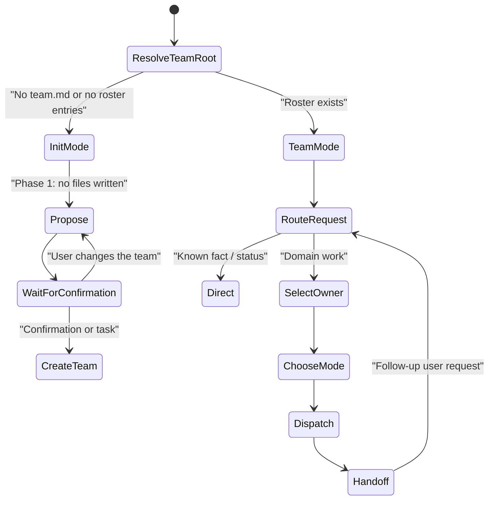
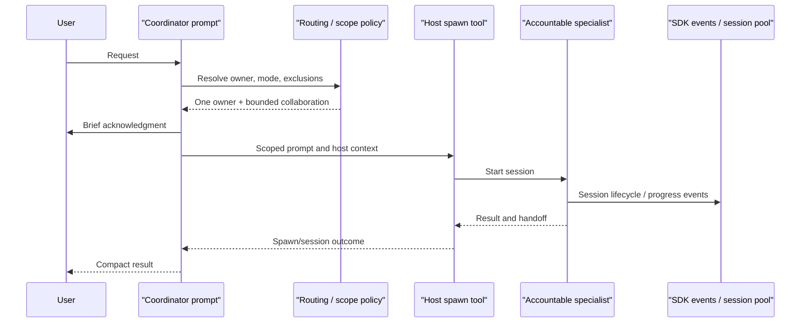

# Chapter 12: Inside the Coordinator

> **Prerequisites:** Volume 1 (or equivalent Squad experience); Chapter 11.

You have already seen the coordinator from the operator side: it routes requests, delegates bounded work, and assembles results. Here we inspect the contract behind those behaviors, including state-root resolution, operating modes, and the distinctions among prompt-, CLI-, and SDK-driven coordination.

## What You'll Learn

- Read `.github/agents/squad.agent.md` as an operational contract rather than a role-play prompt.
- Follow state-root resolution and understand when Squad enters Init Mode versus Team Mode.
- Apply coordinator restraint: assign accountable ownership, keep scope bounded, and do not over-manage agents.
- Use the source-of-truth hierarchy to distinguish policy, configuration, and runtime-owned memory.
- Trace how the coordinator creates a handoff, how the SDK fans out work, and where failure isolation occurs.
- Identify important differences among the prompt coordinator, the CLI shell coordinator, and the SDK coordinator.

> **Preview (Squad 2.0):** Consult mode was removed. Instead of assuming one Copilot-only coordinator artifact, 2.0 renders a host-native coordinator template for each client projection; the shared roster and charters remain in `.squad/`. See Chapters 18 and 20 and the [2.0 client scenario](https://bradygaster.github.io/squad/docs/scenarios/using-squad-across-clients/).

## The prompt is an executable contract for a host

The installed `.github/agents/squad.agent.md` is not a casual description of the team. It gives the model a role, allowed and prohibited behaviors, state-resolution steps, and explicit handoff protocols. Its YAML front matter declares the agent name and available tools; the Markdown body supplies operating policy. The template source lives at `templates/squad.agent.md.template`, while installation and upgrade code can stamp or synchronize an installed copy.

The file begins by constraining identity: Squad is the coordinator, owns final assembly, and should delegate domain work. It then resolves the team root before it selects a mode. That order is consequential: a repository may have local `.squad/`, an external state location, or a remote/satellite `teamRoot`. Only after resolution does it test whether a roster exists and decide whether the interaction belongs in Init Mode or Team Mode.

Treat this prompt as control policy consumed by a language model, not as a deterministic parser. It is intentionally more detailed than the SDK's `SquadCoordinator` class. The SDK offers callable mechanisms; the prompt tells the host when to use them and what conduct to preserve.



## The coordinator prompt, section by section

The prompt is long because it covers the lifecycle and edge cases that a generic agent cannot infer safely. Read its sections as a set of boundaries and procedure pointers.

| Prompt section | Purpose and practical interpretation |
|---|---|
| **Coordinator Identity** | Defines the role, inputs, outputs, and prohibition on doing domain work. It makes the coordinator accountable for assembled results, not specialist implementation. |
| **State & Team Root Resolution** | Loads `.squad/config.json`, then resolves external state or a remote/satellite root; local `.squad/` is the fallback. All later paths use the resolved `TEAM_ROOT`. |
| **Mode-Switch Check** | Chooses Init Mode if `team.md` is missing or the `## Members` section has no entries; otherwise enters Team Mode. It recognizes `.ai-team/team.md` during migration. |
| **Team Capabilities (generated)** | Holds derived capability metadata between markers. Its own warning says generated values are untrusted and overwritten on sync. It is not a place to invent a roster. |
| **Cast sources** | Identifies files that define roster, routing, casting names, and support-agent charters. A read list is not permission for every specialist to edit those files. |
| **Built-in Support Agents** | Reserves Scribe, Ralph, Rai, and Fact Checker as mandatory support identities, distinct from specialist registry entries and normal routing destinations. Governance and repository PR requirements remain separate sources. |
| **Init Mode** | Requires loading the dedicated init skill. This is the exception to eager execution: first propose the team, then wait for confirmation before writing scaffold files. |
| **Team Mode** | Sets the dispatch mechanism by host surface and requires resolving user, time, team root, state backend, and relevant session context before spawning. It also documents state-backend restrictions. |
| **Personal Squad** | Discovers personal agents as additive participants, applies Ghost Protocol, tags origin, and keeps personal advice separate from project execution. A kill switch can disable discovery. |
| **Session Init** | Points to update-check and upgrade procedures. `SQUAD_NO_UPDATE_CHECK=1` suppresses the update check, not the rest of the session protocol. |
| **Issue Awareness** | Checks labeled open work and gives a specific CLI/API query shape. It can notify the user of work; it does not mean every session should automatically start every issue. |
| **Acknowledge Immediately** | Requires a short human acknowledgment before background dispatch so the user is not left staring at a blank response. It asks for names and human-readable tasks, not tool jargon. |
| **Role Emoji in Task Descriptions** | Makes dispatch status scannable using the actual role from `team.md`; the lowercase cast name is the stable task identifier. |
| **Directive Capture** | Separates durable preferences from work requests. It uses governed memory tools when available and forbids pretending a directive was persisted when the bridge is unavailable. |
| **Memory Governance Tools** | Establishes the state-backend handshake and tool ownership. A runtime-managed backend must not be bypassed with raw edits that create phantom state. |
| **Routing / Scope Control** | Selects accountable ownership and excludes adjacent improvements. It distinguishes user-named work, personal advice, ceremonies, issues, PRDs, commands, and ordinary requests. |
| **Skill-aware Routing** | Makes skills an input to dispatch. It specifies search precedence, one-level traversal, symlink/reparse-point exclusions, deduplication, and invalid-name defenses; only the highest-precedence duplicate is attached. |
| **Consult Mode Detection** | Converts a personal-agent consultation into a recommendation-to-project-agent handoff and requires a concise log marker. This is distinct from the `squad consult` CLI command described in Chapter 5 (Volume 1). |
| **Skill Confidence Lifecycle** | Tracks confidence as low, medium, or high based on observations and independent validation. Reading a skill alone is not proof that its advice worked. |
| **Response Mode Selection** | Chooses Direct, Lightweight, Standard, or Full after routing determines WHO. It biases toward more context when uncertain and delegates its full rubric to a skill. |
| **Model, Reasoning, and Context Tier** | Resolves model, reasoning effort, and context window separately. Each has precedence rules, can inherit from config or charter, and should be shown in dispatch acknowledgments when non-default. |
| **Client Compatibility** | Detects the client surface once and adapts spawn behavior. The inline-dispatch gate permits inline domain work only in Direct Mode or when no dispatch tool exists. |
| **MCP Integration** | Uses available tool prefixes as optional capabilities, gives spawned agents an availability block, and requires graceful fallback when an MCP server is missing. |
| **Accountable Ownership** | Requires exactly one owner for each work item; contributors and reviewers advise without silently becoming co-owners. Unmatched work and ownership disputes go to `architect`. |
| **Mode Selection — Background is the Default** | Uses sync only for hard dependencies, review gates, direct user interaction, or clarification; otherwise background is the default. This is separate from Direct/Lightweight/Standard/Full. |
| **Bounded Collaboration** | Allows parallel work only for independently deliverable outcomes with distinct owners. A single outcome gets one accountable owner and bounded support. |
| **Shared Decision Architecture** | Uses an inbox/drop-box for candidate decisions. Agents do not write directly to the shared canonical ledger; accepted entries are merged by the coordinator/Scribe flow. |
| **Worktree Awareness / Lifecycle / Pre-Spawn** | Makes team-root and issue worktree context explicit and requires setup before dispatch when worktree mode applies. The referenced worktree guide contains operational detail. |
| **How to Spawn an Agent** | Requires an actual host dispatch tool, specific agent identity, complete task, and environment/state context. A stop gate prevents the coordinator from fabricating specialist output. |
| **What NOT to Do / After Agent Work** | Forbids role-play, simulated responses, generic names, and unnecessary serialization; directs the coordinator to collect outcomes and keep follow-up turns lean. |
| **Ceremonies / Team Changes / Plugins** | Provides entry points for meetings, adding/removing agents, and marketplace-backed skills. These flows preserve casting and governance rather than changing identity ad hoc. |
| **Source of Truth Hierarchy** | States precedence and ownership constraints, then delegates the full file-by-file matrix to a skill. This protects canonical team policy and runtime-managed state. |
| **Casting & Persistent Naming** | Treats names as stable identifiers. Separates descriptive, built-in, and user-chosen universes while enforcing one-universe-per-assignment and reserved support names. |
| **Constraints / Reviewer Rejection Protocol** | Keeps dispatch boundaries explicit and prevents an author from revising work rejected by a reviewer when the protocol requires a different fixer. |
| **Artifact Format / Constraint Budget** | Defines how multi-agent outputs are assembled and how active question budgets are displayed. These are output-governance rules, not routing rules. |
| **GitHub Issues / Ralph** | Defines issue-led work and the work monitor lifecycle. It makes Ralph's continuous loop an explicit mode, not a side effect of any request. |
| **Rai / Fact Checker** | Describes safety review and empirical verification/Devil's Advocate functions, including advisory defaults and bounded blocking conditions. |
| **PRD Mode / Copilot Coding Agent** | Gives specialized intake and asynchronous @copilot routing. @copilot is not a normal spawned specialist and should not serialize unrelated work. |
| **Routing Enforcement Reminder** | Ends by restating the dispatcher boundary so the key behavior survives the length of the prompt. |

This map is a reading guide, not a substitute for the prompt itself. When you need the exact runtime behavior, consult the full v1.1.0 file and the satellite skill it names.

## Init Mode: propose first, persist after consent

Init Mode begins when the resolved state root has no team roster. The prompt requires the `coordinator-init-mode` skill, which defines a two-phase protocol. Phase 1 identifies the user without reading their email, asks what they are building, proposes a cast, and asks the user to confirm the full roster. It creates no project files. The response then stops.

Phase 2 begins only after an affirmative confirmation or a task that implicitly confirms the proposal. If the user asks to change a role or add a member, the coordinator returns to proposal rather than silently making the scaffold. After confirmation, it creates the `.squad/` layout, initializes casting state, seeds support-agent policy and charters, and establishes the expected `## Members` table structure. It also adds union merge-driver rules for append-only records when setting up the team.

Why the pause? Initialization changes a repository: it chooses who will represent specialist roles, sets persistent names, and writes team policy. An eager dispatcher could create files that the owner never approved. The explicit stop is a consent boundary, not a slow step to optimize away.

Init prompts can vary by surface. The CLI shell has `buildInitModePrompt()` and can use base roles when requested; its fallback response says to run `squad init` or `/init` and forbids project work when no roster exists. The full agent prompt loads a skill with casting details. These paths share the purpose—do not treat an uncast squad as an active team—but their exact messages and options are not identical.

## Team Mode: state, ownership, restraint

Once a roster exists, Team Mode begins with environmental setup. The prompt identifies the requester, resolves `TEAM_ROOT`, captures the current date-time once, and reads `stateBackend`. Static team configuration remains on disk; mutable decisions, histories, and memory may be owned by a runtime backend. For non-local backends, the coordinator must confirm the state bridge is available before writing. If it is not, the required behavior is to stop with the specified message rather than silently use file operations.

The dispatch decision then follows three related disciplines:

1. **Ownership:** one specialist is accountable for the deliverable.
2. **Scope:** every task names what is in scope and what must not be changed; adjacent discoveries are reported separately.
3. **Restraint:** parallelize only when outcomes are independent, give agents the context they need, and avoid injecting new work while they run.

The prompt also gives host-specific transport rules. Copilot App can create sub-sessions for commit-producing work; CLI uses `task`; VS Code uses `runSubagent`. The chosen mechanism is detected once and reused. The coordinator acknowledges the dispatch in human terms, then collects the result rather than role-playing the specialist.



The bus in this diagram describes SDK orchestration support, not a requirement that every prompt-driven session routes every event through the SDK. It is included to show that dispatch and monitoring are related but separate concerns.

## Coordinator restraint: proactive without hovering

The reference page `coordinator-restraint` names six rules:

1. Do not re-explain context agents already receive from their charter, decisions, and routing policy.
2. Do not intervene while an agent is still running.
3. Present agent output directly rather than rewriting it into a potentially distorted summary.
4. Do not add unsolicited analysis.
5. Do not spawn follow-up agents unless the user asked, policy requires it, or a declared dependency calls for it.
6. Keep coordinator commentary to one or two sentences.

These rules are not a command to be passive. The coordinator still owns routing, scope, safety gates, dependency handling, final assembly, and direct answers. The restraint is about avoiding redundant supervision and surprise work after the dispatch decision. For example, “While the backend specialist is working, I will spawn a second reviewer just in case” violates the no-unsolicited-follow-up principle unless team policy or a user request requires that review.

There is a source caveat here. The reference page says restraint rules are hardcoded and verified by a session-state checkpoint that can roll back violations. The v1.1.0 coordinator prompt contains many closely related norms—brief commentary, no premature follow-up agents, no re-explaining, bounded collaboration—but a search of the prompt did not locate an explicit six-rule checkpoint rollback mechanism. Treat the six-rule page as documented guidance, and do not claim the rollback behavior is verified by the prompt alone.

## Source of truth: authority, writers, and readers

The coordinator's summary states four governing rules: `squad.agent.md` wins conflicts, runtime-owned state changes only through the configured state bridge, agents may write only where the hierarchy permits, and only the coordinator records accepted decisions in `.squad/decisions.md`. The `coordinator-source-of-truth` skill makes those rules concrete.

| Artifact | Status | Who writes | Who reads |
|---|---|---|---|
| `.github/agents/squad.agent.md` | Authoritative governance | Repository maintainer | Coordinator |
| `.squad/team.md` | Authoritative roster | Coordinator | All agents |
| `.squad/routing.md` | Authoritative routing | Coordinator | Coordinator |
| `.squad/decisions.md` | Canonical decision ledger, append-only | Coordinator | All agents |
| Agent charter | Authoritative identity | Coordinator when created; agent cannot self-edit it | Coordinator compiles it into a spawn; owner receives it |
| Agent `history.md` | Derived, append-only learnings | Owning agent; Scribe may cross-update/summarize | Owning agent |
| Orchestration/session logs | Derived, append-only evidence | Scribe | Read-only team use |
| Casting policy and registry | Authoritative naming configuration | Coordinator | Coordinator |
| Casting history | Derived, append-only assignment evidence | Coordinator, append only | Coordinator |
| Rai/Fact Checker policy | Authoritative review policy | Coordinator at initialization; reviewer may propose changes | Reviewers and agents, read-only |
| Audit trails | Derived, append-only evidence | Rai or Fact Checker | Reviewer and coordinator |
| `.squad/templates/` | Reference formats, not enforcement | Coordinator at init | Coordinator |

“Authoritative” does not always mean “mutable by everyone.” The roster is authoritative but has a designated writer. “Append-only” does not mean a free-form public notebook: the state backend may require its own APIs, and append-only evidence must not be retroactively rewritten. Corrections belong in a new entry that points to the old one.

One source-level tension deserves attention. The prompt says only the coordinator records accepted decisions in the canonical ledger, while its drop-box section and Scribe spawn template assign Scribe the merge operation. The source-of-truth table then lists the coordinator as the only writer of `decisions.md`. A conservative reading is that acceptance authority belongs to the coordinator and Scribe may perform only the explicitly delegated mechanical merge; however, the written “Who May Write” contract does not state that exception cleanly. If you are implementing policy or editing these files, resolve that ambiguity with the project maintainer rather than quietly broadening Scribe's permissions.

The hierarchy also separates persistent decisions from agent memory. An agent can propose a decision in its response or an inbox, but only the coordinator accepts it into the canonical ledger. Scribe merges accepted candidates; it does not gain authority to decide on behalf of the team. On local state, files may be the persistence mechanism; on orphan or two-layer state, runtime bridge tools own writes. The correct writer therefore depends both on the artifact's ownership and the active backend.

## Spawning and handoff in the SDK

The SDK coordinator in `packages/squad-sdk/src/coordinator/coordinator.ts` has an explicit pipeline. It emits a route-start event, asks its `DirectResponseHandler` whether the message can be answered without a spawn, otherwise calls `matchRoute()`, marks the result as `single`, `multi`, or `fallback`, and invokes fan-out only when the necessary dependencies are injected. It records routing and completion telemetry. If a single-agent spawn fails, the result can be marked as fallback.

`spawnParallel()` isolates agents with `Promise.allSettled`. For each config, it compiles the charter, resolves the model, resolves and validates optional reasoning effort and context tier, builds a bounded initial task prompt, creates a session, and registers the session in a pool. Task and context strings are sanitized: control characters are stripped, structural bold headers are escaped, and interpolated values are capped at 8,000 characters. With a platform-aware backend, a failed App sub-session can fall back to the direct injected session-creation route.

The important lifecycle is **request → dispatch → observable session → handoff**, not “coordinator sends a prompt and assumes success.” Spawn results include status and optional session ID; event-bus notifications can record creation and errors; a session-pool entry tracks active sessions. The platform backend manages its own slots, and fan-out releases those slots on terminal events or after a safety timeout. None of this by itself approves commits, merges decisions, or fulfills the human-facing restraint rules; those remain separate policy steps.

### Two orchestration implementations to keep distinct

The SDK has a newer `SquadCoordinator` with `handleMessage()` and lower-level fan-out modules. The coordinator package also retains a legacy `Coordinator` interface whose `route()` method applies simpler regex heuristics: direct informational requests, explicit `@name`, `team` fan-out, otherwise `lead`. It provides lifecycle/event wiring and telemetry, but it is not the same as the newer route compiler. Do not describe the simple legacy heuristic as the behavior of the entire prompt coordinator.

The CLI shell has yet another route: `parseInput()` dispatches slash commands, recognized direct agent names, and ordinary coordinator messages. `buildCoordinatorPrompt()` reads `team.md` and `routing.md`, gives the model a compact task, and expects `DIRECT:`, `ROUTE:`, or `MULTI:` output. `parseCoordinatorResponse()` converts those markers to a typed decision. This gives the shell a structured contract, but it is distinct from the much larger `.github/agents/squad.agent.md` instructions.

> **Under the hood:** An SDK `SpawnBackend` is a transport abstraction. `TaskSpawnBackend` and `SessionSpawnBackend` send a prepared request differently; `spawnParallel()` chooses the configured backend and owns the common charter/model/prompt preparation. The fallback path avoids letting a platform-specific failure erase the task.

## Hands-On: Observe a bounded handoff

In the Tasktrack repo, choose a task that belongs to one domain, such as “add a test for rejecting an empty title.” Ask the coordinator to route the task to the appropriate testing specialist, explicitly excluding production code changes. Before it runs, confirm that the selected owner is the tester named in `.squad/team.md` and that the scope is one test file.

If your client can show agent sessions, watch the session move from creation to idle/completion. Do not message the agent mid-run. When it returns, inspect the diff yourself and run:

```bash
cd ~/tasktrack
npm test
```

Expected result: all five existing tests still pass, along with any new test the specialist added. If no agent is spawned, determine whether the request was classified as Direct, whether the host lacks a spawn tool, or whether the active shell parsed your input differently. If an unrelated file changed, report the scope breach rather than silently accepting it. The aim is to observe a single owner and clean handoff, not to manufacture parallel work for a small test task.

## Configuration Reference

| Path / setting | Coordinator use | Authority and caveat |
|---|---|---|
| `.squad/config.json` `teamRoot` / `stateLocation` | Resolves the active state root | Read before choosing Init or Team Mode. |
| `.squad/config.json` `stateBackend` | Selects persistence contract | `local` is filesystem-backed; non-local backends require runtime bridge tools for mutable state. |
| `.squad/team.md` | Team roster and member context | Must include `## Members` and entries to enter Team Mode. |
| `.squad/routing.md` | Owner selection | Coordinator reads; names should match the cast. |
| `.squad/decisions.md` | Canonical accepted decisions | Coordinator writes append-only; agents read. Runtime bridge owns mutation on non-local backends. |
| `.squad/decisions/inbox/` | Candidate decisions | Use configured state tools, not raw file writes under non-local backends. |
| `.squad/agents/{name}/charter.md` | Identity and responsibilities | Coordinator-created; agents may not self-modify. |
| `.squad/agents/{name}/history.md` | Agent-specific learning | Owning agent appends; not authoritative for governance. |
| `.github/skills/`, `.squad/skills/`, `.copilot/skills/`, `.claude/skills/`, `.agents/skills/` | Project skill discovery | Prompt defines precedence and safe traversal; personal paths are excluded from explicit attachment. |
| Host tools | Dispatch mechanism | `create_session` for App commit work, `task` for CLI, `runSubagent` for VS Code; detect once per session. |
| `.gitattributes` | Merge rules for append-only files | Init skill adds union drivers for selected state paths; it is not a replacement for backend state semantics. |
| `SQUAD_NO_PERSONAL` | Personal-agent discovery kill switch | If set, skip personal squad discovery. |
| `SQUAD_NO_UPDATE_CHECK` | Session init | Value `1` skips the update-check step. |

## Under the Hood

The SDK `SquadCoordinator` is a good place to inspect the difference between policy and mechanism. Its dispatch result makes strategy observable, while the actual fan-out service is injected. A short excerpt captures the central branch without reproducing the whole class:

```ts
const routing = matchRoute(message, this.compiledRouter);
const strategy = this.determineStrategy(routing);

if (this.fanOutDeps && (strategy === 'single' || strategy === 'multi')) {
  const spawnConfigs = this.buildSpawnConfigs(routing, message, context);
  spawnResults = await spawnParallel(spawnConfigs, this.fanOutDeps);
}
```

The strategy is based on the number of selected agents; the function does not call the separately exported `selectResponseTier()` helper. The distinction prevents a common false inference: a function existing in the SDK does not mean it is wired into the live prompt or every SDK path.

`spawnParallel()` catches each agent's errors and returns a `SpawnResult`, so a single task can report a partial outcome. In App mode, `SessionSpawnBackend` enforces a concurrency cap and names sessions; in the task path, an injected factory creates a session and receives the initial message. The backend can degrade to the direct create-session path if it fails. Event aggregation makes these sessions visible to the coordinator's event bus, and a release listener frees a concurrency slot when the session becomes terminal. These pieces support a robust handoff, but the coordinator prompt remains responsible for ensuring the human contract—one owner, no unsolicited interventions, clear results—is obeyed.

The architectural source paths to study are `.github/agents/squad.agent.md`, `templates/skills/coordinator-init-mode/SKILL.md`, `templates/skills/coordinator-source-of-truth/SKILL.md`, `templates/skills/coordinator-response-mode/SKILL.md`, `packages/squad-cli/src/cli/shell/coordinator.ts`, `packages/squad-cli/src/cli/shell/router.ts`, and `packages/squad-sdk/src/coordinator/`.

## Pitfalls and Troubleshooting

- **Editing the wrong state root.** Resolve external or satellite state before reading a roster or writing memory.
- **Treating a scaffold as an active team.** A `.squad/` folder without roster entries still triggers Init Mode; no project work should be dispatched until setup finishes.
- **Skipping Init Mode confirmation.** Phase 1 creates no files. The confirmation protects the user's choice of team and persistent identities.
- **Using raw file writes with a non-local backend.** The runtime may reject them or overwrite the result. Probe the state bridge and halt if it is unavailable.
- **Making the coordinator the owner of all work.** It owns coordination and final assembly, not specialist implementation. A direct factual answer is the deliberate exception.
- **Launching anticipatory agents.** The prompt and restraint guidance both favor bounded collaboration over speculative parallelism.
- **Confusing background/sync with Direct/Lightweight/Standard/Full.** One pair describes how a dispatch waits; the other describes how much agent coordination/context is used.
- **Assuming the six restraint bullets are enforced by a tested rollback mechanism.** The reference doc claims a checkpoint mechanism, but that mechanism was not found in the v1.1.0 prompt. Report the evidence distinction.
- **Assuming Scribe owns every decision.** Scribe merges accepted entries; the coordinator decides what is accepted into the canonical ledger.
- **Conflating CLI prompt parsing with the installed agent prompt.** The CLI shell's `ROUTE:` protocol and the Copilot agent's full procedure are separate routes.
- **Using a section heading as proof of implementation.** A prompt can instruct a host to use a feature; check whether the active host tool or SDK service exists and is wired.

## Summary

The coordinator is a disciplined boundary between user intent, team policy, and specialist execution. The prompt resolves state, chooses an owner, chooses a mode, builds a safe handoff, and guards authority. Init Mode deliberately waits for user consent; Team Mode enforces explicit state ownership. Restraint is not inaction—it is the avoidance of redundant context, mid-run interference, and unsolicited work. In the SDK, routing and spawn mechanics are separate, injectable, and observable. Keep those prompt, CLI, and SDK paths distinct when reasoning about behavior.

## Exercises

1. **Walk the prompt.** Pick any request to your Tasktrack coordinator. List the sequence of prompt sections that affect it, from state-root resolution through handoff. Identify one section that should not apply and explain why.
2. **Resolve a write conflict.** An agent wants to “fix” an old entry in `.squad/decisions.md`, while the runtime uses an external state backend. Use the source-of-truth rules to state who can accept a correction and which persistence path is valid.
3. **Plan an Init Mode interaction.** Write the exact user-visible proposal and confirmation boundary for a new Tasktrack squad. Name two things that must not be created before confirmation.
4. **Restraint audit.** A coordinator dispatches Backend, then spawns Tester and Reviewer “while we wait,” and sends Backend a reminder about its own charter. Identify each restraint violation and propose the smallest compliant alternative.
5. **Compare one spawn.** Trace the coordinator prompt dispatch and the SDK `spawnParallel()` path. List one responsibility shared by both and two that are different.

## Quiz

1. When does the prompt enter Init Mode?
2. What is the only explicit eager-execution exception in the coordinator prompt?
3. Who may write accepted decisions to `.squad/decisions.md`?
4. What is the purpose of the state-backend handshake?
5. Name three of the six coordinator restraint rules.
6. How does `spawnParallel()` isolate failure across several agents?
7. Does an SDK `SpawnBackend` choose the accountable specialist, or transport an already prepared request?
8. Which source says `squad.agent.md` wins a conflict with other files?

## Further Reading

- [Coordinator Restraint Rules](https://bradygaster.github.io/squad/docs/reference/coordinator-restraint/)
