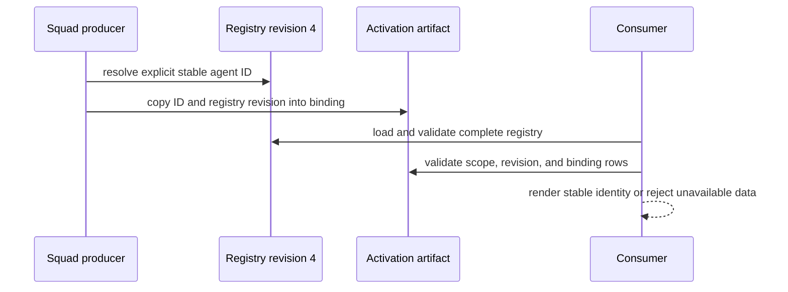
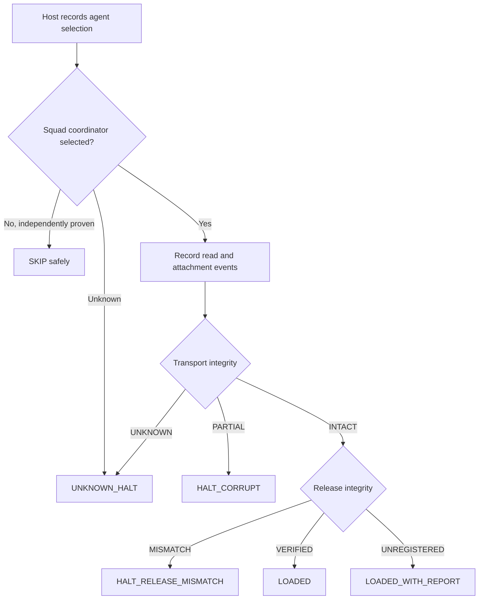

# Chapter 13: Agent Identity and Provenance

> **Prerequisites:** Volume 1 (or equivalent Squad experience); Chapters 11 and 12.

After operating Squad across teams and workflows, you have seen names, roles, assignments, and authorship appear in different places. This chapter looks inside those records and explains how stable identity and evidence-based provenance keep those labels from being mistaken for one another.

## What You'll Learn

- Distinguish an agent's stable identity from its current display name, role, owner, issue assignment, and Git author.
- Read the versioned identity registry and explain how stable IDs survive renames, retirement, and reactivation.
- Understand how Squad binds planned work to agents without guessing from incidental metadata.
- Recognize what the coordinator canary proves—and what it cannot prove when both markers are missing.
- Explain the proposed runtime identity beacon and why it must be supplied by the host rather than the prompt.
- Use Squad's `.squad/identity/` templates as team context without confusing them with the provenance registry.

## Identity Is a Contract, Not a Name

A Squad team gives agents names because names make collaboration readable. A roster might say that Kepler is the Runtime Engineer, or that a team member is assigned to a particular issue. Those are useful working labels, but labels are not a durable identity system. Names can change. Roles may be displayed in different ways. Work artifacts can be reassigned, copied, or written by a person other than the agent that did the work. GitHub usernames, branch names, PR authors, and issue assignees are separate pieces of metadata with separate meanings.

If a dashboard needs to answer “which agent is this?” it must not infer the answer from whichever label happens to be nearby. Squad's provenance contract makes that rule explicit: the stable key is the agent ID in `.squad/casting/registry.json`. The display name is presentation. A task assignment is a separate binding that can refer to that stable ID. A Git commit author is Git authorship metadata. Treating those as interchangeable creates false attribution and makes historical records unstable.

Think in layers:

| Layer | Example | What it answers |
|---|---|---|
| Stable identity | `runtime-engineer` | Which logical agent is this, across renames? |
| Presentation | `Kepler` | What name should a person see now? |
| Capability / role | `Runtime Engineer` | What kind of work is this agent suited to do? |
| Work binding | Task `1` → `runtime-engineer` | Which registered agent was assigned in this artifact? |
| Git authorship | `git log` author fields | Which author identity was recorded in the commit? |
| Runtime selection | Copilot's selected custom agent | Which agent definition did the host select for this session? |

These layers may be related, but one does not prove another. A roster row saying “Kepler” does not prove that the agent selected for a past session was the same logical agent. A commit by a human maintainer does not prove the maintainer wrote every line. A PR authored by a bot does not prove which Squad agent implemented it. Provenance is the explicit link between records, not a story reconstructed from nearby labels.

### Stable ID and mutable display name

The v1 registry has root schema `squad-agent-provenance/v1` and `schema_version: 1`. Its `agents` object is keyed by immutable canonical IDs: lowercase alphanumeric segments separated by single hyphens, such as `runtime-engineer`. Each record includes `display_name`, a compatibility alias `persistent_name`, `role`, `universe`, `status`, timestamps, and an optional avatar reference.

`persistent_name` is a historical compatibility field, not the stable key. It must equal `display_name`; new readers should key by the `agents` object key and display `display_name`. This is a useful example of why “persistent” in a field name does not override the schema's actual identity rule.

```json
{
  "schema": "squad-agent-provenance/v1",
  "schema_version": 1,
  "revision": 4,
  "generated_at": "2026-09-21T20:00:00.000Z",
  "agents": {
    "runtime-engineer": {
      "display_name": "Kepler",
      "persistent_name": "Kepler",
      "role": "Runtime Engineer",
      "universe": "descriptive",
      "status": "active",
      "created_at": "2026-09-20T20:00:00.000Z",
      "updated_at": "2026-09-21T20:00:00.000Z"
    }
  }
}
```

A stable ID has a lifecycle. A rename or recast supplies the existing ID directly, preserves `created_at` and the immutable role, updates the display fields and universe, and advances `updated_at`. The producer does not search by name, role, label, file path, or roster row to guess which identity was intended. When an agent leaves, keep the record as a tombstone (`status: "retired"` plus `retired_at`) rather than deleting it. Never reuse that ID for a different agent. A returning logical agent can be reactivated with its original ID, but not reassigned to a different role.

That lifecycle protects the past. If “Kepler” becomes “Kestrel,” an old task still identifies `runtime-engineer`; the name shown today can change without rewriting historical attribution. If an agent is retired, historical work still resolves to its record. Retirement does not transfer old assignments to the replacement.

### Validation is deliberately strict

The SDK parser validates the registry root and each record. Unsupported schema roots fail closed. An invalid individual record is omitted from the parsed registry and produces diagnostics, so the result is marked `partial`. A consumer may show valid metadata while also making incompleteness visible; it must not silently present that partial result as authoritative. Duplicate canonical IDs are impossible as object keys, and case-folded display-name collisions are rejected from the parsed result.

A legacy registry can be migrated only when every record can be validated: IDs must be canonical, names and lifecycle fields valid, universe and timestamps present, and retired entries must have a retirement timestamp. A malformed legacy record rejects the producer update instead of being quietly dropped. Likewise, a missing or malformed registry means identity provenance is unavailable. Do not repair the gap by substituting the issue owner, PR author, actor, branch, or a roster display name.

Avatars are optional and intentionally constrained. A repository-path avatar must remain under the exact, case-sensitive `.squad/agents/{id}/` directory for the owning ID. If absent, stale, inaccessible, or malformed, render no avatar. Do not generate initials, fetch a GitHub actor's avatar, or invent an image from a name. On recast, omitting an avatar operation preserves the existing reference; an explicit clear removes it.

## Work Provenance: From Agent to Task

The registry says who an agent is. It does not say which agent owns a particular task. That relationship is recorded separately in activation artifacts as a non-empty JSON array using `squad-work-agent-binding/v1`. Each row includes repository and origin issue scope, task and issue identifiers, epic and parent issue identifiers, the registry schema and revision, and `agent_id`.

A compact example:



```json
[
  {
    "binding_schema": "squad-work-agent-binding/v1",
    "binding_version": 1,
    "producer": "squad",
    "repository": "owner/tasktrack",
    "origin_issue": 45,
    "artifact": "activated",
    "registry_schema": "squad-agent-provenance/v1",
    "registry_revision": 4,
    "task": "1",
    "issue": "#2066",
    "epic": "1.1",
    "epic_issue": "#2065",
    "agent_id": "runtime-engineer",
    "epic_agent_ids": ["runtime-engineer"]
  }
]
```

The producer copies the ID from the committed registry revision into the accepted plan and then the activation record. It does not derive the assignment from an issue assignee or author. This is a key trust boundary: the binding states what the plan assigned; the registry defines what the ID means. Display names can change without invalidating the binding.

The schema is more careful than a simple `task → agent` map because plans evolve. Every row in a binding document must use the same registry revision. Each epic identifier must map to exactly one epic issue, and vice versa. All rows for an epic carry the same sorted `epic_agent_ids` set. If one task has no registered agent ID for a documented reason, the row can use `agent_id: null` with an `identity_omission_reason` such as `external-agent`, `non-roster`, or `legacy-plan-missing-id`. If any epic member is omitted, the epic rows carry `epic_identity_omission_reason: "partial"` and list only the known IDs. The marker must appear consistently on all rows for that epic.

These fields let consumers distinguish “this task has no registered agent by design” from “the identity record is missing or malformed.” The first is an explicit exception; the second is a provenance failure. If a binding revision is newer than the registry available to a consumer, it is stale and cannot be resolved. If the current registry is newer, the stable ID can still resolve historically, including through a retirement tombstone.

The parser rejects the binding array as a whole if it is empty, unsupported, malformed, partially valid, scoped to the wrong repository or origin issue, uses an unknown ID or future registry revision, or contains duplicate/conflicting task, issue, epic, revision, identity-set, or omission-marker data. It does not salvage the rows that look plausible. A partial registry may be enough to render ordinary profile cards, but not enough to validate work bindings authoritatively.

> **Under the hood:** The SDK separates parsing, reconciliation, and selection. `parseAgentProvenanceRegistry` checks the root and records; `reconcileAgentProvenanceRegistry` takes explicit candidate IDs and preserves omitted prior identities as tombstones when requested; work-binding parsers validate the assignment artifact against the full registry. Reading a file is not the same as authenticating who published it—the verifier and repository API establish that outer trust boundary.

### Registry and history must move together

Managed casting state includes both `casting/registry.json` and `casting/history.json`. The registry revision is identity metadata; the history preserves casting-related records. A reader that needs a consistent pair must use the SDK pair reader rather than fetch two files independently and assume they were written together.

The durable publisher uses a shared directory lock, transaction journal, and commit manifest. It prepares payload files, flushes them, makes the journal durable, rolls the pair forward, and publishes a manifest containing transaction ID, registry revision, and SHA-256 digests for the registry and history. Pair readers accept either a complete legacy pair or a stable manifest-backed pair. If they observe an in-progress transaction, they retry a bounded number of times and then reject the read rather than return a torn pair. After a durable journal is published, recovery is roll-forward: the old mixed state is not declared authoritative just because the process stopped mid-write.

This is process-crash consistency on local filesystems with atomic same-filesystem rename. Power-loss durability depends on successful file and directory `fsync` calls and on the operating system, device, and filesystem honoring their guarantees. Some network filesystems do not provide the required rename semantics. Stale-lock handling prioritizes safety: automatic removal is limited to an old lock on the same host whose PID is definitively dead. Unknown remote owners or indeterminate PIDs are not guessed away.

> **Note:** `transaction_id` is additive publication metadata in managed registry/history pairs. It is not an agent ID and does not establish a task assignment. Use the pair reader when consistency matters; a simple registry-only consumer may read `registry.json` directly.

### Identity is not Git authorship

Keep Git's author and committer fields separate from Squad provenance. Git records a configured name and email at commit creation; a commit can contain changes from an agent session while still naming the human developer who reviewed and committed them. Nothing in the provenance registry changes `git config`, and a work binding does not rewrite a commit's author field. Nor should a commit's author field be treated as proof of which Squad agent owned the task.

For responsible attribution, describe the actual workflow in commit messages, PR descriptions, or review notes according to your repository policy. If your team chooses to add a co-author trailer, do so explicitly and use a real, authorized identity; do not fabricate an agent email or assume Squad inserts a trailer. The distinction is especially important when a human coordinates several agent contributions: the human remains the Git committer, the registry maps IDs to agent identities, and the task binding documents which agent was assigned. Those statements can coexist without pretending they are the same fact.

The coordinator template asks the runtime to inspect `git config user.name` at session start and pass the current user's name into spawn prompts and the Scribe log. That instruction provides request context. It is not a custom Git commit-author mechanism and does not prove that the configured user personally authored every generated line.

## The Coordinator Canary and the Zero-Marker Problem

Squad's coordinator agent template contains two markers: a HEAD canary near the beginning and an EOF canary near the end. When both are visible, the model has evidence that it received the full marker-bearing instruction payload. When HEAD is present but EOF is absent, the payload appears truncated after its beginning, so the coordinator should halt rather than continue under incomplete governance instructions.

This is a two-state payload-integrity detector *inside a session already known to be the Squad coordinator*. It is not a universal identity test. If both markers are absent, there are two indistinguishable possibilities from inside the prompt:

1. Copilot selected Squad's coordinator but failed to inject the whole custom-agent payload.
2. The selected agent is a proven non-Squad agent, which should not receive Squad's coordinator prompt.

The missing payload cannot contain instructions that reliably detect its own absence. Treating “no HEAD marker” as a safe skip can silently turn the first case into a governance bypass. The canary matrix therefore describes the marker observations as follows:

| HEAD | EOF | Interpretation inside a proven coordinator session |
|---|---|---|
| Present | Present | Payload appears fully loaded; proceed with normal governance checks. |
| Present | Absent | Payload is present but truncated; halt. |
| Absent | Absent | Ambiguous: coordinator injection failure or non-Squad session. No safe conclusion from the markers alone. |

A safe skip is justified only when an independent signal proves the selected session is not the Squad coordinator. File presence on disk is not sufficient: an unrelated coding agent can run in a repo that contains `.github/agents/squad.agent.md`. Likewise, the presence of `.mcp.json` or Squad MCP tools can prove that some Squad runtime context is wired, but spawned agents can receive those tools too; their presence does not prove this is the root coordinator. Prompt self-description is circular because it disappears with the payload.

## Runtime Identity Beacon: A Host-Owned Future Capability

The canary's ambiguity is a host boundary, not something Squad can patch solely by adding another marker. The Copilot CLI selects an agent, reads its `.agent.md` file, and assembles the prompt. Squad's CLI installs and points to `.github/agents/squad.agent.md`, but the repository does not implement Copilot's resolver or instruction assembly. A reliable beacon must therefore be captured by the host at the agent-selection step, before reading or attaching the agent file.

The proposed beacon is a host-owned, ordered record—not a user-editable prompt claim. It begins with the selected identity, such as the custom-agent name and file, role, agent/template version, client ID and version, and a timestamp or monotonic order. Then the host records what happened during file read and prompt attachment. This ordering matters: if identity is recorded only after the prompt is assembled, it disappears in exactly the failure case it is supposed to diagnose.

The design keeps separate axes rather than reducing everything to a single “good/bad” value:

| Axis | Values | Question | Safety effect |
|---|---|---|---|
| `payload_read_status` | `LOADED`, `TRUNCATED`, `EMPTY`, `ABSENT` | What did the host read from the selected file? | Input to transport assessment. |
| `prompt_attach_status` | `ATTACHED_FULL`, `ATTACHED_PARTIAL`, `NOT_ATTACHED` | What reached the assembled prompt? | Input to transport assessment. |
| `transport_integrity` | `INTACT`, `PARTIAL`, `UNKNOWN` | Is the selected payload complete and faithfully attached? | `PARTIAL` halts as corruption; `UNKNOWN` halts because evidence is insufficient. |
| `release_integrity` | `VERIFIED`, `MISMATCH`, `UNREGISTERED` | Does the read source match trusted release provenance? | Mismatch halts; unregistered alone reports but does not halt. |
| `inventory_drift` | `NONE`, `EXPECTED_VARIANT`, `INVALIDATING` | Did the execution environment's tool inventory change? | Can invalidate telemetry for affected turns without implying payload corruption. |

For transport, compare the source hash after reading with the host-computed attached hash, but do not rely on equal hashes alone. The host also needs independent evidence of source completeness—such as an observed EOF/boundary or expected byte count—and confirmation that required head and tail boundaries reached the attachment. A partial read can match a partial attachment; matching hashes in that situation do not establish completeness.

Release provenance is separate. A trusted host-side manifest may map `(agent_version, client_id, client_version)` to an expected source SHA. A mismatch against a known entry is evidence of a wrong or modified release. A missing entry is `UNREGISTERED`, not a mismatch: a legitimate local customization or newly updated artifact should not be false-halted because it has not yet been registered. Never use the assembled bytes as a fallback source of expected release truth.

The host inventory also belongs to the measured execution envelope. Tools may appear lazily or change with authentication and MCP availability, so the proposal snapshots a canonical, non-secret inventory before the first turn and before each measured turn, with manifest hash, canonicalizer/serializer versions, and a before/after diff. A declared variant is labeled separately. Missing instrumentation or removal of a required tool invalidates that turn's measurement. Undeclared captured drift is quarantined as exploratory, not silently pooled with the primary test group.

Here is the proposed decision logic in compact form:



The beacon and behavioral tests are a design requirement for Copilot CLI, not a feature Squad v1.1.0 can supply by itself. The current artifacts can test a fully visible prompt and a deliberately truncated prompt, but cases 3 and 4 need host support to distinguish “selected then missing” from “not selected.” Do not claim that a file check, MCP tool, or model self-report closes that gap.

> **Preview:** The runtime identity beacon, signed/registered release manifest, ordered host events, and per-turn tool-inventory evidence described here are proposed upstream Copilot CLI capabilities. They are not an in-prompt Squad API shipped by v1.1.0. The issue brief's acceptance matrix explicitly says the host-level tests cannot pass until the pre-ingestion state machine exists.

## Team Context Templates: `.squad/identity/`

Squad also initializes `.squad/identity/now.md` and `.squad/identity/wisdom.md`. Despite the directory name, these files are not the agent provenance registry. They are user-owned, human-readable team context files:

- `now.md` records the focus area, update timestamp, active issues, and a short current-focus narrative. The coordinator checks it at session start and updates it when focus changes.
- `wisdom.md` stores distilled reusable patterns and anti-patterns—not a session transcript. It is intended for team knowledge that can improve future work.

Both templates are installed if absent and marked user-owned, so an upgrade does not overwrite your edits. They are committed team context unless your repository uses a state backend or policy that moves particular mutable state elsewhere. Do not put credentials, private tokens, or generated secrets in either file. Keep identity facts and work assignment records in their authoritative structured artifacts; use `now.md` and `wisdom.md` to explain what the team is currently doing and what it has learned.

## Hands-On: Inspect Tasktrack's Agent Attribution

This chapter does not add application behavior. It gives you a quick audit you can perform in the Tasktrack repo you initialized earlier.

1. Start at the Tasktrack repository root and inspect the active user identity Git will record:

   ```bash
   git config user.name
   git config user.email
   ```

   These values describe Git's configured author/committer identity. They are not the Squad agent ID.

2. Inspect the team identity sources, if casting has been initialized:

   ```bash
   cat .squad/casting/registry.json
   cat .squad/casting/history.json
   cat .squad/identity/now.md
   cat .squad/identity/wisdom.md
   ```

   Identify one `agents` object key, its mutable `display_name`, role, and status. If the registry and history carry transaction metadata, do not edit one file by hand; validate the pair with the CLI's health check or the SDK pair reader.

3. Ask the coordinator to explain the current agent-to-task assignment using stable IDs and the source artifact revision—not a guess based on a GitHub issue assignee or a display name. If no activation binding exists yet, record that provenance is unavailable rather than inventing one.

4. Make a tiny documented change through the team workflow, then inspect `git diff` and `git log -1 --format=fuller`. Notice which fields describe the human author/committer and which Squad artifacts describe the agent assignment. Do not add a made-up co-author identity.

Expected result: you can name the separate sources for logical agent identity, task assignment, current team focus, and Git authorship. If one source is missing, you know not to substitute an incidental label.

## Configuration Reference

| Path / field | Purpose | Important rules |
|---|---|---|
| `.squad/casting/registry.json` | Authoritative stable agent IDs and metadata | Root `schema` is `squad-agent-provenance/v1`; keys are canonical IDs; revision is monotonic. |
| `agents.{id}.display_name` | Current presentation name | Mutable; unique after case-folding. |
| `agents.{id}.persistent_name` | Older-reader compatibility alias | Required by v1 records and equal to `display_name`; not the stable key. |
| `agents.{id}.role` | Agent role identity | Immutable for an existing stable ID. |
| `agents.{id}.universe` | Name universe / source context | Updated on recast; not an identity key. |
| `agents.{id}.status` | `active`, `inactive`, or `retired` | Retired entries remain as tombstones with `retired_at`; IDs are never reassigned. |
| `agents.{id}.avatar` | Optional `repository-path` reference | Must stay inside exact `.squad/agents/{id}/`; malformed or missing references render no avatar. |
| `.squad/casting/history.json` | Casting history paired with the registry | Managed pair carries matching transaction metadata and registry revision. |
| Activation `bindings` | Task / issue / epic to stable ID map | Uses `squad-work-agent-binding/v1`; one artifact uses one registry revision. |
| `.squad/identity/now.md` | Current focus and active issues | User-owned template; preserved on upgrade. |
| `.squad/identity/wisdom.md` | Reusable patterns and anti-patterns | User-owned template; write concise learnings, not transcripts. |
| `.github/agents/squad.agent.md` | Copilot custom-agent instructions | Host-selected prompt; canary markers only detect visible payload integrity. |
| `.gitignore` | Runtime-state exclusions | Init ignores logs, inbox, sessions, cache, and `.squad/.scratch/`; casting identity is intentionally not ignored. |
| `git config user.name`, `git config user.email` | Git commit author / committer configuration | Independent of Squad IDs and task bindings. No default automatic agent co-author field. |

## Under the Hood

The SDK defines typed structures for both registry records and work bindings in `packages/squad-sdk/src/casting/agent-provenance.ts`. The parser returns either a complete or partial registry with diagnostics. Reconciliation requires explicit candidate IDs, detects name and role collisions, preserves creation time, and can tombstone missing agents. Work-binding validation rejects mixed registry revisions and inconsistent epic identity sets rather than trying to infer a correction.

Managed pair publication is implemented in `packages/squad-sdk/src/casting/durable-registry.ts`. The core transaction creates a UUID, records a journal and manifest, and publishes replacement registry/history payloads. Its comments document the decisive boundary: after the journal rename and parent-directory fsync complete, recovery must roll forward. The pair reader checks manifest hashes and transaction/revision agreement before returning a snapshot.

A short excerpt of the contract's stable key and mutable display fields:

```ts
export interface AgentProvenanceRecord {
  display_name: string;
  /** Compatibility alias for older Squad consumers. */
  persistent_name: string;
  role: string;
  universe: string;
  status: AgentProvenanceStatus;
  created_at: string;
  updated_at: string;
  retired_at?: string;
}
```

The current-focus and wisdom files are different. `packages/squad-sdk/src/config/init.ts` creates their initial contents, while `packages/squad-cli/src/cli/core/templates.ts` marks each as user-owned with `overwriteOnUpgrade: false`. Init also places casting state on the main branch and adds `.squad/.scratch/` to `.gitignore`; those choices reflect that canonical identity metadata is committed while ephemeral runtime files are not.

The canary boundaries are in `templates/squad.agent.md.template`: HEAD is near the beginning and EOF near the end. `docs/canary-identity-matrix.md` and `docs/open-issue-runtime-identity-beacon.md` document the limitation and the proposed host-owned state machine. Squad controls installation and invocation advice, but Copilot CLI controls selection and prompt assembly. That division of ownership is why no amount of extra prompt text can guarantee the missing-payload case.

## Pitfalls and Troubleshooting

- **Using a display name as a key:** Names change and are not unique across history. Store and resolve the stable object ID.
- **Treating a compatibility field as authoritative:** `persistent_name` must match `display_name`; it is not the immutable ID.
- **Deleting retired agents:** Keep tombstones so old task bindings remain resolvable. Never give an old ID to a different role.
- **Inferring ownership from GitHub metadata:** Assignees, authors, reviewers, workflow actors, and branches are not fallback identity sources.
- **Reading registry and history independently:** A transaction can be in progress. Use the pair reader or `squad health` where available.
- **Silently accepting partial parsing:** Surface the diagnostics and mark identity incomplete. Do not treat the surviving rows as complete truth.
- **Calling a commit “agent-authored” because an agent worked on it:** Git authorship and Squad assignment are distinct. Describe the actual process and follow repository policy.
- **Treating no canary as proof of a non-Squad session:** The same observation could mean the selected coordinator prompt failed to load. Only independent host selection evidence can safely classify it.
- **Trusting a hash comparison without completeness evidence:** Matching hashes do not prove the source was read completely; confirm expected length or boundary/EOF evidence.
- **False-halting an unregistered local prompt:** `UNREGISTERED` is a provenance report, not a release mismatch. Only a known manifest mismatch has that meaning.
- **Confusing `now.md` with the registry:** The template records team focus, not authoritative agent identities or task bindings.

## Summary

An agent's durable identity is its explicit canonical ID in `.squad/casting/registry.json`; names and roles are useful metadata but not substitute keys. Work bindings separately connect task artifacts to those IDs and are validated against a single registry revision. Registry/history updates are transactionally paired, and incomplete or conflicting data fails closed instead of being guessed into place. Git's author fields remain a separate attribution layer. Finally, the coordinator's two canaries can show complete or truncated visible instructions, but zero markers are ambiguous until Copilot supplies a host-owned selection beacon. The `identity/now.md` and `identity/wisdom.md` templates provide team context, not identity proof. Chapter 14 builds on these boundaries at the SDK layer, where identity-bearing data must remain explicit as sessions and tools are composed.

## Exercises

1. **Trace the identity layers.** In your Tasktrack checkout, record the configured Git author, one registry ID and display name, and one explicit work-binding row if one exists. Explain what each value does and does not prove.
2. **Plan a rename safely.** Write down the fields that change when `runtime-engineer` is renamed from Kepler to Kestrel. Which fields remain unchanged? Why is creating a new ID from the new display name unsafe?
3. **Diagnose an incomplete registry.** A parser reports one invalid record but returns two valid records. What can a dashboard display? What must it not claim about work bindings?
4. **Classify canary observations.** For each pair `(HEAD, EOF)`, state whether to proceed, halt for truncation, or require independent host evidence: `(present,present)`, `(present,absent)`, `(absent,absent)`.
5. **Design a safe attribution note.** Draft a commit/PR note for work implemented by a Squad agent and committed by a human. Keep Git author, agent ID, and task assignment distinct. Do not invent an email address.

## Quiz

1. What identifies an agent across a display-name change: `display_name`, `persistent_name`, or the registry object key?
2. Why should a retired ID remain in the registry?
3. If one work-binding row has a future `registry_revision`, may the consumer keep the other valid-looking rows?
4. What do HEAD-present / EOF-absent canaries indicate?
5. Why can't an MCP identity tool inside the coordinator prompt solve the wholly-absent-prompt case?
6. Does Squad's registry change the Git commit author field?
7. What does `UNREGISTERED` mean in the proposed runtime release-integrity axis, and should it halt an otherwise intact session?

## Further Reading

- [Agent identity provenance](https://bradygaster.github.io/squad/docs/concepts/agent-identity-provenance/)
- [Canary identity matrix](https://github.com/bradygaster/squad/blob/v1.1.0/docs/canary-identity-matrix.md)
- [Runtime identity beacon for coordinator canary cases 3 & 4](https://github.com/bradygaster/squad/blob/v1.1.0/docs/open-issue-runtime-identity-beacon.md)
