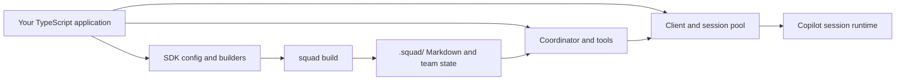
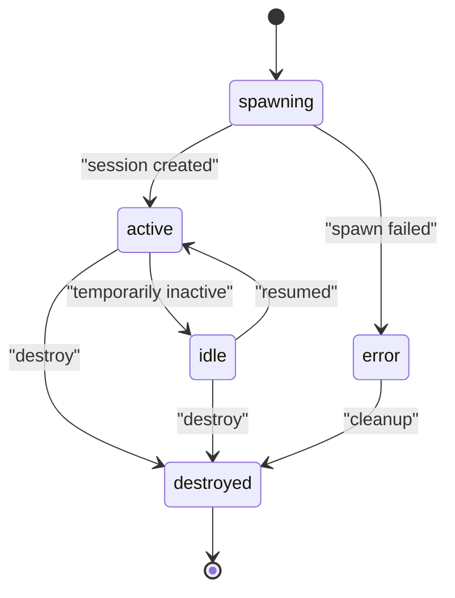

# Chapter 14: The SDK in Depth

> **Prerequisites:** Volume 1 (or equivalent Squad experience); Chapter 11.

## What You'll Learn

- Understand where `@bradygaster/squad-sdk` fits: typed configuration and reusable runtime APIs alongside the interactive `squad` CLI.
- Navigate the root barrel and package subpaths without importing internal source files.
- Distinguish the `defineConfig` schema, SDK-first builder model, and runtime loader contract in v1.1.0.
- Build teams and routing rules with typed builders, resolve the `.squad/` directory, and inspect lifecycle, session, and streaming primitives.
- Choose an appropriate API from the client, coordinator, tools, hooks, storage, state, telemetry, and platform modules.
- Use the SDK samples as executable design patterns and build a Tasktrack script that prints its team and routing table.

> **Preview (Squad 2.0):** Two new public surfaces frame the multi-host work: `/client` now also exports host projection and adapter contracts, and `/backend` contains the experimental backend and harness SPI. `/clients` is a deprecated alias for the new host-adapter exports. The prior `/client` APIs such as `SquadClient` and `SquadClientWithPool` remain; the path's meaning has expanded rather than simply moving them. The 2.0 SDK also removes the personal-agent exports available in v1.1.0. See Chapters 18, 20, and 21 and the [2.0 release notes](https://github.com/bradygaster/squad/blob/v2.0.0-preview.2/docs/src/content/docs/whatsnew.md).

## What the SDK Is For

The `@bradygaster/squad-sdk` package exposes parts of Squad as TypeScript APIs. You can define a team in code, resolve Squad state, compile agents from charters, manage Copilot sessions, stream events, integrate hooks, and connect supporting services. The CLI remains the user-facing path for installing and operating a conventional team; the SDK is useful when your application needs to compose or observe Squad programmatically.

That distinction prevents a common design mistake: using the SDK as though every command-line feature were a direct function call. The package does not export a single “run the entire Squad” function from its root. Instead, it exposes modules with different responsibilities. A script that builds `.squad/` artifacts, an application that manages live sessions, and a process that reads an existing config have different setup and lifecycle requirements.

The published package is ESM and v1.1.0 declares Node.js `>=22.5.0`. Tasktrack itself asks for Node.js `>=22.18`, which is sufficient for its baseline TypeScript execution through Node's built-in type stripping. Many examples that import `squad.config.ts` directly should be run on the Tasktrack runtime or another toolchain that supports TypeScript ESM imports. Install the SDK into the project where the script runs; do not assume the Tasktrack starter already has it as a dependency.

> **Tip:** Start with the narrowest public surface that solves the task. Use the root package for shared APIs and builders; use a declared subpath such as `/client` or `/coordinator` for focused runtime components. Avoid importing from `packages/squad-sdk/src/` in application code because those files are package internals, not the package's compatibility contract.



The diagram shows two complementary modes. SDK-first configuration can generate the files Squad's repository workflow consumes. Live client APIs connect to session infrastructure. You may use one without the other: a typed config inspector need not connect to a model, and a session client can be created without first defining a `squad.config.ts` file.

## Package Entry Points

The package's `exports` map in `packages/squad-sdk/package.json` identifies the public import paths. Use those paths instead of guessing at files. The root barrel in `packages/squad-sdk/src/index.ts` re-exports common APIs and also assembles larger supporting modules. Focused subpaths keep the import intent clear and expose public types alongside classes and functions.

| Import | Use it for | Examples |
|---|---|---|
| `@bradygaster/squad-sdk` | Shared types, config, builders, resolution, casting, roles, storage, state, telemetry, memory, and other root APIs | `defineSquad`, `defineConfig`, `resolveSquad`, `MODELS`, `CastingEngine` |
| `@bradygaster/squad-sdk/config` | Config schema and configuration helpers | `defineConfig`, routing parsers, model registry |
| `@bradygaster/squad-sdk/builders` | Typed SDK-first builders | `defineTeam`, `defineAgent`, `defineRouting`, `defineSquad` |
| `@bradygaster/squad-sdk/client` | Copilot connection, sessions, pool, and client events | `SquadClient`, `SquadClientWithPool`, `SessionPool` |
| `@bradygaster/squad-sdk/coordinator` | Direct-response handling, route decisions, and fan-out | `SquadCoordinator`, `spawnParallel`, `selectResponseTier` |
| `@bradygaster/squad-sdk/tools` | Typed tool definitions and built-in tool registry | `defineTool`, `ToolRegistry` |
| `@bradygaster/squad-sdk/hooks` | Pre/post tool and policy hooks | `HookPipeline`, `HookAction` |
| `@bradygaster/squad-sdk/agents` | Charter compilation, validation, lifecycle, and model selection | `AgentLifecycleManager`, `compileCharter` |
| `@bradygaster/squad-sdk/casting` | Team casting and casting history | `CastingEngine`, `CastingHistory` |
| `@bradygaster/squad-sdk/skills` | Skill parsing and discovery | `loadSkillsFromDirectory`, `SkillRegistry` |
| `@bradygaster/squad-sdk/state` | Typed state collections and handles | `SquadState`, `AgentsCollection`, `DecisionsCollection` |
| `@bradygaster/squad-sdk/storage` | Pluggable storage providers | filesystem and in-memory providers |
| `@bradygaster/squad-sdk/platform` | GitHub, Azure DevOps, and communication adapters | issue and communication abstractions |
| `@bradygaster/squad-sdk/runtime` | Runtime config loader | `loadConfig`, `loadConfigSync` |
| `@bradygaster/squad-sdk/runtime/streaming` | Streaming pipeline and event types | `StreamingPipeline`, `StreamDelta`, `UsageEvent` |
| `@bradygaster/squad-sdk/streams` | SubSquad configuration and resolution | `loadSubSquadsConfig`, `resolveSubSquad` |
| Other declared subpaths | Marketplace, build, sharing, Ralph, presets, remote, upstream, roles, adapter, parsers, types, and telemetry components | Select based on the package export map |

Subpaths are not all interchangeable with root exports. For example, the root barrel exports `selectResponseTier` and `getTier`, while `SquadCoordinator` is exported from the coordinator subpath. Likewise, `SquadClientWithPool` is under `/client`, and `ToolRegistry`/`defineTool` are under `/tools`. Importing from the intended entry point gives TypeScript the matching declarations and makes architectural boundaries clearer.

## Two Ways to Define Configuration

The v1.1.0 package has both a schema helper called `defineConfig()` and the SDK-first builder family centered on `defineSquad()`. They are related configuration surfaces, but they are not aliases and their types are not identical. You should select one based on the consumer.

### `defineConfig`: the public schema helper

`defineConfig()` is exported by the config module and root. It accepts a partial `SquadConfig`, fills the defined defaults, and gives TypeScript a stable shape. The public schema includes:

| Section | Important fields | Meaning |
|---|---|---|
| `version` | string | Schema version supplied by the caller. |
| `team` | `name`, `description`, `projectContext`, optional `issueSource` | Team identity and project context. `issueSource` can identify a repository and optional filters. |
| `agents` | array of named agent configs | Each can include `role`, `displayName`, `charter`, `model`, `reasoningEffort`, `contextTier`, `tools`, and `status` (`active`, `inactive`, or `retired`). |
| `routing` | `rules`, optional `defaultAgent`, `fallbackBehavior` | Each rule has a string `pattern`, agent list, optional response `tier`, and optional numeric `priority`. Fallback behavior is `ask`, `default-agent`, or `coordinator`. |
| `models` | `default`, `defaultTier`, `tiers` | Public schema model default, one of the `premium`/`standard`/`fast` default tiers, and model lists by tier. It can also carry agent overrides, task mappings, context/reasoning overrides, and a `costPolicy`. |
| `hooks` | `allowedWritePaths`, `blockedCommands`, `maxAskUserPerSession`, `scrubPii`, `reviewerLockout` | Optional policy settings. A field in configuration is not by itself proof that every host enforces the policy. |
| `ceremonies` | `name`, schedule, participants, agenda, enabled | Optional recurring or event-driven team routines. |
| `plugins` | `enabled`, optional `config` | Plugin names and extension-specific settings. |

`defineConfig()` supplies defaults for the top-level configuration and for the `team`, `routing`, and `models` objects. It replaces the `agents` array when provided and uses the default routing rules or model tiers when those arrays/maps are omitted. It is not a deep merge of every arbitrary nested value. Its `validateConfig()` helper checks a small number of basic structural properties; do not mistake that type guard for exhaustive validation of every nested option.

### `defineSquad`: typed SDK-first builders

The builder family is intended for code-first definitions that `squad build` can turn into markdown files. Each helper checks values at runtime and returns the input value with its type preserved. The top-level `SquadSDKConfig` contains `team` and `agents`, with optional `defaults`, `routing`, `ceremonies`, `hooks`, `casting`, `telemetry`, and `skills`.

```typescript
import { defineAgent, defineRouting, defineSquad, defineTeam } from '@bradygaster/squad-sdk';

const backend = defineAgent({ name: 'backend', role: 'API Engineer', tools: ['view', 'edit'] });
export default defineSquad({
  version: '1.0.0',
  team: defineTeam({ name: 'Tasktrack', members: ['backend'] }),
  agents: [backend],
  routing: defineRouting({ rules: [{ pattern: 'api', agents: ['backend'], tier: 'standard' }] }),
});
```

The output remains a plain typed JavaScript object, not a running team. `squad build` reads that object and generates a file plan: team roster, routing markdown, agent charters, and optional ceremony and skill files. Generated files may later be edited as markdown, but remember that another build can regenerate them from the code. Review `squad build --dry-run` before generation when you are uncertain which files it will write, and use `squad build --check` to detect drift where appropriate.

### Builder-by-builder reference

| Builder | Required core | Validation highlights |
|---|---|---|
| `defineTeam` | `name`, `members` | Name and every member reference must be non-empty strings; description and project context are optional strings. |
| `defineAgent` | `name`, `role` | Validates optional model preference, reasoning effort, context tier, budget, tools, capabilities, and status. Capabilities have a name and a level: `expert`, `proficient`, or `basic`. Status is `active`, `inactive`, or `retired`. |
| `defineBudget` | None required | `perAgentSpawn` and `perSession` must be finite positive numbers; `warnAt` must be a finite fraction between 0 and 1. |
| `defineDefaults` | None required | Optional model, reasoning effort, context tier, and budget defaults are checked. Model can be a string or `{ preferred, rationale?, fallback? }`. |
| `defineRouting` | `rules` array | Pattern and agent refs must be non-empty strings. Tier is `direct`, `lightweight`, `standard`, or `full`; priority is numeric; fallback is `ask`, `default-agent`, or `coordinator`. |
| `defineCeremony` | `name` | Optional trigger, schedule, participants, agenda, and hook names are type-checked. |
| `defineHooks` | None required | Optional path patterns, blocked command strings, maximum ask-user count, PII scrubbing, and reviewer lockout are type-checked. |
| `defineCasting` | None required | Optional universe allowlist, overflow strategy (`reject`, `generic`, `rotate`), and non-negative capacities are checked. |
| `defineTelemetry` | None required | Optional enabled flag, endpoint, service name, sample rate from 0 to 1, and Aspire defaults are checked. |
| `defineSkill` | `name`, `description`, `domain`, `content` | Confidence is `low`/`medium`/`high`; source is `manual`/`observed`/`earned`/`extracted`; each tool hint needs name, description, and when-to-use text. |
| `defineSquad` | `team`, `agents` | Runs the nested builders for supplied sections and returns the combined object. It does not write files or start sessions. |

The builders are hand-written validators rather than a schema-library wrapper. Their checks prevent common mistakes but should not be treated as a security validator or a complete schema migration system. The implementation uses arrays and object checks for many values, but some optional arrays are validated by container shape rather than deeply validating every element. Keep configs small, use TypeScript declarations, and add tests for any contract your application relies on.

## Typed Routing: Rules Are Data Until a Coordinator Applies Them

A routing definition states which agent names correspond to a pattern and optional response tier. It helps keep team policy maintainable and can be compiled into `.squad/routing.md` by the SDK-first build command. Routing text does not spawn anything by itself. A runtime coordinator still needs a compatible configuration, session-creation dependencies, and a caller that sends it work.

In the builder types, `pattern` is documented as a glob or regex-like pattern, `agents` is a list of names, `tier` controls ceremony, and optional `priority` orders matches. The runtime routing model is a distinct older/internal shape: its `RoutingRule` uses `workType`, `agents`, optional examples, and confidence; the runtime config models use `defaultModel` and `fallbackChains`. `SquadCoordinator` compiles this runtime routing configuration and calls route matching, direct response handling, then fan-out when the relevant spawn dependencies exist. If no dependency set is provided, a routing decision does not magically create sessions.

This distinction matters when adapting examples. A typed builder rule like `{ pattern: 'api', agents: ['backend'] }` is not the same TypeScript type as a runtime rule `{ workType: 'api', agents: ['backend'] }`. The `SquadCoordinator` API reference example that passes public `defineConfig()` output directly to the runtime coordinator should be checked against the actual declarations in the pinned package version. Treat the typed builder as an input to `squad build`; do not assume it is a drop-in argument to every runtime routing API.

The response tiers are `direct`, `lightweight`, `standard`, and `full`. They describe the amount of orchestration and ceremony, not a model-cost guarantee. Model tier and billing category are separate choices. `selectResponseTier()` and `getTier()` are public helper APIs; the coordinator subpath adds direct-response handling, `spawnParallel`, spawn backends, and `SquadCoordinator`.

## Configuration Loading and Path Resolution

### `loadConfig()` and `loadConfigSync()`

The runtime loader is asynchronous by default:

```typescript
import { loadConfig } from '@bradygaster/squad-sdk';

const result = await loadConfig(process.cwd());
console.log(result.source ?? '(default configuration)');
console.log(result.config.models.defaultModel);
```

In source, `ConfigLoadResult` has `config`, optional `source`, and `isDefault`. The async loader checks `squad.config.ts`, `squad.config.js`, `squad.config.json`, and `.squad/config.json` in the supplied directory, then searches upward, then falls back to `DEFAULT_CONFIG`. TypeScript and JavaScript configs must export a default value or a named `squadConfig`. JSON is parsed and validated. `loadConfigSync()` is narrower: it checks only `squad.config.json` in the supplied directory and falls back to defaults; it does not synchronously import TS/JS or perform the same upward discovery.

> **Warning:** The published reference pages and source do not line up perfectly in v1.1.0. The runtime `loadConfig()` types in `packages/squad-sdk/src/runtime/config.ts` describe `models.defaultModel`, `fallbackChains`, and `routing.rules[].workType`; that runtime `SquadConfig` has no `team` or `agents` property. The separate public schema in `config/schema.ts` and SDK-first builders do have `team`, `agents`, `models.default`, `models.tiers`, and `routing.rules[].pattern`. The `loadConfig()` result type also does not contain `errors` or `warnings` fields. Choose the config surface intentionally, and verify any bridge against the installed package declarations rather than mixing examples.

The loader source expects a working directory as its argument, although the reference describes `squadPath` in some signatures. Pass the project root for the intended local lookup. A `squad.config.ts` intended for SDK-first `squad build` should be imported and passed through that build path; it is not automatically equivalent to the runtime loader's legacy config shape.

### `resolveSquad()` and related helpers

`resolveSquad(startDir?)` returns the absolute `.squad/` path or `null`. It walks upward, stops at a repository boundary, and has logic to consult the main checkout when the starting path is a Git worktree. A short in-process cache avoids repeating the filesystem walk; `clearResolveSquadCache()` invalidates the cache, and `SQUAD_NO_RESOLVE_CACHE=1` disables it. The API reference says `resolveSquad()` throws if nothing is found; the v1.1.0 implementation instead returns `null`. Check the value before joining a path.

Other path helpers have separate jobs:

| Helper | Responsibility |
|---|---|
| `resolveGlobalSquadPath()` | Resolve and create the platform's global Squad config directory (`%APPDATA%/squad`, macOS Application Support, or `$XDG_CONFIG_HOME/squad`/`~/.config/squad`). |
| `resolvePersonalSquadDir()` | Find an existing personal team directory, or return `null`; honors `SQUAD_NO_PERSONAL` and `SQUAD_PERSONAL_DIR`. |
| `ensurePersonalSquadDir()` | Create the expected personal Squad directory structure. |
| `ensureSquadPath(filePath, squadRoot)` | Validate a path is inside a Squad directory or the system temp directory; despite the name, this is a path guard, not a `.squad` directory creator. |
| `scratchDir(squadRoot)` / `scratchFile(...)` | Create or name ephemeral files inside `.squad/.scratch/`. |
| `deriveProjectKey(projectDir)` | Produce a normalized project key from a path basename. |
| `resolveExternalStateDir(...)`, `resolveSquadHome(...)`, `resolveSquadState(...)` | Support external state and broader project/team/personal state resolution. |
| `loadDirConfig(...)`, `ensureSquadPathTriple(...)` | Load directory metadata or validate paths against multiple approved roots. |

Do not confuse `resolveGlobalSquadPath()` (the global config directory) with the personal squad itself. Do not treat a path guard as a feature sandbox. The approved-root checks constrain SDK-managed state writes in code paths that call them; they do not prevent arbitrary tools or processes from writing elsewhere.

## Agent Lifecycle: From Charter to Session

An agent definition and a running agent are different things. The lifecycle module converts a charter and configuration into a usable session and tracks what happens to that session. The `@bradygaster/squad-sdk/agents` entry point exposes charter compilation and validation, model resolution, onboarding, and the lifecycle manager. The lifecycle's core state values are `spawning`, `active`, `idle`, `error`, and `destroyed`.

A typical flow is:

1. **Resolve a team root and agent identity.** Find the `.squad/` directory and the agent's charter. Keep identity data separate from transient session state.
2. **Compile and validate the charter.** `compileCharter`/`compileCharterFull` parse markdown into agent configuration; validator APIs can return conformance diagnostics. Invalid or incomplete instructions should be fixed before launching a session.
3. **Resolve model preferences.** Model selection accounts for configuration and overrides. The model selector exports functions such as `resolveModel`, `resolveAgentModel`, `inferTierFromModel`, and fallback helpers. Prefer explicit policy when cost, capability, or context matters.
4. **Spawn through the lifecycle manager or client.** The lifecycle manager wires charter, model choice, client/session creation, and state. A handle includes the session identifier, agent identity, current status, message operation, and destroy operation.
5. **Send work and observe events.** `sendMessage()` directs prompts to the session. Events, streaming deltas, usage, errors, and lifecycle changes are separate data channels; subscribe only to what the application needs.
6. **Mark idle or destroy deliberately.** A reusable session may be idle; shutdown should close owned sessions and clients. Persist durable learnings through the appropriate history/state APIs, not by treating an in-memory handle as long-term memory.

`onboardAgent()` is a simpler file-oriented lifecycle API: it creates an agent directory, charter, and history based on its options and reports created paths. It does not start a Copilot session. `CastingEngine` can produce role/persona assignments; `CastingHistory` records and queries cast records. Casting and onboarding are independent from live session management.



## Client, Session Pool, and Coordinator

### Client APIs

`SquadClient` manages connection and session operations. `SquadClientWithPool` wraps it with a `SessionPool` and an event bus. Its commonly used methods include `connect`, `createSession`, `resumeSession`, `deleteSession`, `listSessions`, `getStatus`, `getAuthStatus`, and `shutdown`. `SessionPool` tracks capacity and session state and publishes pool events. Use the pool when your application needs limits and lifecycle coordination across several sessions; do not create an unbounded session for every request.

The client subpath also exports the underlying session and permission types. This is the natural layer when you want to send messages to Copilot sessions, own your routing policy, or build a chat interface. The streaming-chat example shows a small manual router above the client rather than treating every API call as a built-in Squad routing rule.

### Coordinator APIs

`SquadCoordinator` is a higher-level orchestration object from `/coordinator`. Its `handleMessage(message, context)` flow checks for a direct response, matches routing rules, chooses a single/multi/fallback strategy, and optionally invokes `spawnParallel`. It can emit coordination events and return a `CoordinatorResult` containing strategy, routing information, spawn results, and elapsed time. The coordinator requires compatible config and, to actually spawn, the fan-out dependencies that create sessions and compile agent data.

`spawnParallel()` is the fan-out primitive. `FanOutDependencies` describes the services needed to prepare and create agent work. The coordinator exposes its compiled router for testing and inspection and can update its configuration. This separation is useful in tests: inspect a route result or inject spawn functions without connecting to a live model service.

### Tools and hooks

`defineTool<TArgs>()` combines a name, description, JSON-schema-style parameter declaration, and a typed handler. The handler returns a tool result, which includes text for the model plus a result type and optional telemetry. `ToolRegistry` manages built-in Squad tools such as route, decision, memory, status, and skill operations. Some tools depend on runtime services; for example, `squad_route` needs fan-out dependencies to launch sessions. A tool name being listed does not mean every registry instance can execute it without those dependencies.

`HookPipeline` is a policy and lifecycle extension point. Pre-tool hooks can allow, block, or modify tool calls; post-tool hooks can inspect outcomes, and session/error hooks add further integration points. Policies may express allowed write paths, blocked commands, PII scrubbing, and reviewer lockout. Hooks are code-level controls that must be registered in the executing host; merely defining a `hooks` object in configuration does not install or activate a hook implementation.

## Runtime Events, Streaming, and Observability

The runtime is not one giant event handler. It provides typed components that can be assembled by a host:

| Module family | Purpose |
|---|---|
| `runtime/event-bus` | Publish and subscribe to lifecycle and operational events. The root re-exports this as `RuntimeEventBus` to avoid colliding with the client event bus. |
| `runtime/streaming` | Dispatch message deltas, reasoning deltas, usage records, and exact context-usage samples to handlers. |
| `runtime/context-utilization` | Track context occupancy, compare it with a warning threshold, and prefer exact runtime samples to estimates when available. |
| `runtime/usage-ledger`, `runtime/cost-tracker` | Aggregate token use and estimated cost by agent/session; a cost estimate can be zero when pricing is unavailable. |
| `runtime/telemetry`, `runtime/otel`, `runtime/otel-init`, `runtime/otel-metrics` | Collect events, create OpenTelemetry providers, bridge metrics, and offer one-call setup/shutdown handles. |
| `runtime/offline` | Model connectivity state and pending operations for an application's offline-aware behavior. |
| `runtime/i18n` | Manage message catalogs and report accessibility-oriented findings. |
| `runtime/benchmarks` | Measure repeated operations and format timing reports. |
| `runtime/rework` | Calculate PR rework metrics from review and commit information. |
| `runtime/constants` | Provide model chains, timeouts, and a small set of role identifiers. |

`StreamingPipeline` accepts handlers for deltas, usage, context utilization, and reasoning. Attach session identifiers, mark the start of a message when measuring latency, and feed events to the pipeline. It can aggregate token totals and estimated cost and can use a model-to-context-window resolver to estimate utilization when exact context accounting is unavailable. Exact `context_usage` samples take precedence over estimates for a session. The package caps stored usage-event history to avoid unbounded growth.

The constants are live source values, not the values shown in every generated page. In v1.1.0 `MODELS.DEFAULT` is environment-overridable with `SQUAD_DEFAULT_MODEL`; fallback chains are tier-specific and `NUCLEAR_FALLBACK` is `claude-haiku-4.5`. `TIMEOUTS` includes health-check, Git clone, plugin-fetch, and session-response limits, with environment overrides for several values. The exported `AGENT_ROLES` constant is a small role union (`lead`, `developer`, `tester`, `designer`, `scribe`, `coordinator`); it is distinct from the fuller role catalog exported through `roles`.

For OpenTelemetry, use `initializeOTel()` and `shutdownOTel()` for explicit control, `getTracer()`/`getMeter()` for instrumentation, and `initSquadTelemetry()` when a convenience handle is sufficient. The root barrel exports telemetry initialization and metric helpers; the lower-level event-bus bridge lives behind the declared `@bradygaster/squad-sdk/runtime/otel-bridge` subpath. Optional OpenTelemetry dependencies are declared as optional dependencies, so deployers should verify the intended exporter is installed and configured rather than assume a local collector exists.

## Root Barrel: A Module-by-Module Map

`packages/squad-sdk/src/index.ts` is the canonical source for the package root's re-exports. Its groups are useful as a map of the SDK's surface area:

| Root export group | Main module | What it provides |
|---|---|---|
| `VERSION` | package metadata | Package version string loaded from the package manifest. |
| Resolution and state paths | `resolution.ts` | Project, personal, global, external, scratch, and cache helpers plus path/state types. |
| Config | `config/index.ts` | Schema, config sources, routing, models, initialization, migrations, docs sync, feature audits, and state gitignore helpers. |
| Agent onboarding/personal agents | `agents/onboarding.ts`, `agents/personal.ts` | Onboard new agent files, resolve personal agents, and merge session cast information. |
| Casting | `casting/index.ts` | Casting engine/history, provenance records, durable registry operations, and legacy casting types. |
| Skills | `skills/index.ts` | Skill loading, parsing, source adapters, registry, matching, and skill types. |
| Response tiers | `coordinator/response-tiers.ts` | `selectResponseTier`, `getTier`, and related types. |
| Runtime configuration/constants | `runtime/config.ts`, `runtime/constants.ts` | `loadConfig`, `loadConfigSync`, model constants, timeout constants, and role IDs. |
| Streaming and accounting | `runtime/streaming.ts`, `usage-ledger.ts`, `context-utilization.ts`, `cost-tracker.ts` | Stream handlers, token/cost aggregation, and context metrics. |
| Telemetry and operations | `runtime/telemetry.ts`, `offline.ts`, `i18n.ts`, `benchmarks.ts`, `otel-init.ts`, `otel-metrics.ts`, `rework.ts`, `otel.ts` | OTel, telemetry collection, offline state, translations, benchmarking, and PR rework measurement. |
| Event bus | `runtime/event-bus.ts` | Re-exported under the name `RuntimeEventBus`. |
| Cross-Squad | `runtime/cross-squad.ts` | Manifest validation, discovery, registry operations, delegation/status arguments, and issue status parsing. |
| Marketplace/build/sharing/upstream/remote/streams | corresponding `index.ts` files | Extensions and marketplace content, SDK file generation support, import/export/sharing, inherited context, remote bridges, and SubSquads. |
| SDK-first builders | `builders/index.ts` | `defineTeam`, `defineAgent`, `defineBudget`, `defineRouting`, `defineCeremony`, `defineHooks`, `defineCasting`, `defineTelemetry`, `defineDefaults`, `defineSkill`, `defineSquad`, and public builder types. |
| Roles, platform, storage, memory | each module index | Base role catalog, platform adapters, persistence providers, and memory services. |
| Git-native state backend and ignore markers | `state-backend.ts`, `config/gitignore-state.ts` | Worktree, Git notes, orphan branch, two-layer backend, circuit breaker, key validation, adapter APIs, and managed `.gitignore` blocks. |
| State facade | `state/index.ts` | Collection-level typed read/write interfaces for agents, config, decisions, logs, routing, skills, team, and templates. |
| Archival integrity and utility | `state/io/index.ts`, `utils/safe-timestamp.ts` | Archive entries, verify tracked destinations, prepare inbox merges, report archival results, and provide safe timestamp formatting. |

The root barrel also selectively exports helper types and constants to avoid name collisions. For example, the builder routing type is exported as `BuilderRoutingRule`, and a skill definition is exported as `BuilderSkillDefinition`; the root runtime EventBus is renamed. When TypeScript reports an ambiguous or missing name, inspect the package entrypoint's declared exports and import from the focused subpath instead of reaching into private modules.

## Samples: Learn from Small, Testable Applications

The repository's `samples/` catalog includes progressive examples. They are more useful as demonstrations of a single SDK responsibility than as one universal starter architecture.

| Sample | What it demonstrates | What to notice |
|---|---|---|
| `hello-squad` | `resolveSquad`, casting, `onboardAgent`, and `CastingHistory` | It creates a demo directory explicitly before calling `resolveSquad`; the resolver itself returns `null` when no team is found. It also shows repeated casting and persistent identity records. |
| `knock-knock` | Simple agents and streamed interaction | A compact way to begin exploring session streams after the local casting/onboarding example. |
| `streaming-chat` | `SquadClientWithPool`, session-per-agent setup, `EventBus`, `StreamingPipeline`, and message routing | A hand-written keyword router selects an agent; it has a demo mode that simulates responses and a live mode that connects to sessions. The example is interactive chat, not a production policy engine. |
| `cost-aware-router` | Response-tier selection and cost tracking | Useful for separating task complexity and cost observations from simple name-based routing. Check its tests before copying model-policy assumptions. |
| `hook-governance` | Hook pipeline, file guards, scrubbing, and reviewer rules | Demonstrates that a hook must be wired into a running application. Review each policy's actual behavior before treating it as an enforcement boundary. |
| `skill-discovery` | Loading and sharing skills | Shows reusable knowledge patterns that can be found and promoted rather than re-injected as large prompt text every time. |
| `autonomous-pipeline` | Combined casting, policy, costs, streaming, and monitoring | An advanced showcase; its breadth is useful, but a production application should still make its own failure, approval, and persistence guarantees explicit. |
| `azure-function-squad` | SDK-first builders in a serverless request handler | A concrete pattern for defining the team as configuration and returning structured output from a host. |
| `rock-paper-scissors` | Multi-session competition, event flow, and learning | Shows how separate sessions can collaborate or compete under an application-owned loop. |
| `plugin-knowledge-*`, `plugin-memory-*` | Declarative plugin packaging examples | These are plugin manifests and knowledge instructions, not direct examples of every SDK API. |

The sample documentation is not always perfectly aligned with code. For instance, `hello-squad`'s README may describe a convenience behavior, while its source creates a demo `.squad/` path explicitly. Use the sample entry point and tests as the executable truth for the version being read.

## Hands-On: Inspect Tasktrack's SDK Configuration

This exercise creates an SDK-first team definition for Tasktrack and a small script that prints the team and routing table. The script imports the typed config directly. That choice is deliberate: v1.1.0's runtime `loadConfig()` shape does not include the `team` and builder-style `pattern` fields used by an SDK-first config. Do not pass one schema into an API expecting the other without a conversion step.

1. From Tasktrack's repository root, install the package in the project where you will run the script. Tasktrack's ordinary API remains zero-dependency until you choose to add this SDK tool:
   ```bash
   npm install @bradygaster/squad-sdk@1.1.0
   mkdir -p scripts
   ```
2. Create `squad.config.ts` at the Tasktrack root. The builders validate the names and routing objects as the module loads:
   ```typescript
   import { defineAgent, defineRouting, defineSquad, defineTeam } from '@bradygaster/squad-sdk';

   const backend = defineAgent({ name: 'backend', role: 'Tasktrack API Engineer' });
   const frontend = defineAgent({ name: 'frontend', role: 'Tasktrack UI Engineer' });
   export default defineSquad({
     version: '1.0.0',
     team: defineTeam({ name: 'Tasktrack', description: 'API and browser app', members: ['backend', 'frontend'] }),
     agents: [backend, frontend],
     routing: defineRouting({ rules: [
       { pattern: 'api|tasks|HTTP', agents: ['backend'], tier: 'standard' },
       { pattern: 'web|browser|UI', agents: ['frontend'], tier: 'standard' },
       { pattern: 'contract|cross-layer', agents: ['backend', 'frontend'], tier: 'full' },
     ], fallback: 'coordinator' }),
   });
   ```
3. Create `scripts/show-squad.ts`:
   ```typescript
   import config from '../squad.config.ts';

   console.log(`Team: ${config.team.name}`);
   console.log(`Members: ${config.team.members.join(', ')}`);
   console.log('\nRouting:');
   for (const rule of config.routing?.rules ?? []) {
     console.log(`  ${rule.pattern} -> ${rule.agents.join(', ')} [${rule.tier ?? 'default'}]`);
   }
   ```
4. Run it with the Node version required by Tasktrack:
   ```bash
   node scripts/show-squad.ts
   ```
5. Optional: generate the markdown team files and inspect the planned changes first:
   ```bash
   squad build --dry-run
   squad build
   ```

Expected script output:

```text
Team: Tasktrack
Members: backend, frontend

Routing:
  api|tasks|HTTP -> backend [standard]
  web|browser|UI -> frontend [standard]
  contract|cross-layer -> backend, frontend [full]
```

The script is intentionally read-only: it imports the config module and prints its typed values. The builder functions are executed during import, so malformed required fields throw before output. `squad build` is a separate step that writes generated `.squad/` files. Review that command's output and your Git diff before committing. The script itself does not connect to Copilot, dispatch an agent, or exercise the runtime `loadConfig()` schema.

## Configuration Reference

| Name | Import | Main contract | Notes |
|---|---|---|---|
| `defineConfig(config)` | root or `/config` | Public config schema with `team`, `agents`, `routing.pattern`, and `models.default` | Merges public defaults; not the same type as runtime `loadConfig()`'s config. |
| `defineTeam(config)` | root or `/builders` | Team name, description, project context, member refs | `members` is required; the builder does not create human or AI sessions. |
| `defineAgent(config)` | root or `/builders` | Agent identity, role, model, tools, capability and lifecycle status | Name and role required; values remain plain config data. |
| `defineBudget(config)` | root or `/builders` | Per-agent/session token budgets and warning fraction | Budgets express limits; the host must actually apply them. |
| `defineDefaults(config)` | root or `/builders` | Model, reasoning, context, and budget defaults | Agent-specific preferences may override them. |
| `defineRouting(config)` | root or `/builders` | Pattern-to-agent rules, optional tier, priority and fallback | A description of routing, not itself the dispatch operation. |
| `defineCeremony(config)` | root or `/builders` | Ceremony name and optional trigger/schedule/participants/agenda/hooks | Schedule strings are represented as strings; an executor must implement them. |
| `defineHooks(config)` | root or `/builders` | Governance-oriented hook configuration | Hook implementations must be registered in the host. |
| `defineCasting(config)` | root or `/builders` | Universe allowlist, overflow strategy, capacities | Overflow: `reject`, `generic`, or `rotate`. |
| `defineTelemetry(config)` | root or `/builders` | OTel enabled/endpoint/service/sample rate | Sample rate must fall between zero and one. |
| `defineSkill(config)` | root or `/builders` | Knowledge content, domain, confidence, source, tool hints | Content required; suitable for durable reusable patterns. |
| `defineSquad(config)` | root or `/builders` | Compose builder outputs into `SquadSDKConfig` | Validates nested sections; does not write or run the squad. |
| `loadConfig(path?)` | root or `/runtime` | Async runtime config result: `config`, `source?`, `isDefault` | Reads supported config files; runtime schema does not expose team/agent roster fields. |
| `loadConfigSync(path?)` | root or `/runtime` | Sync runtime config result | Reads only `squad.config.json` in the given directory, then defaults. |
| `resolveSquad(startDir?)` | root or `/resolution` | `.squad/` path or `null` | Does not create `.squad/`; caches briefly. |
| `MODELS`, `TIMEOUTS`, `AGENT_ROLES` | root or `/runtime/constants` | Model defaults/chains, standard limits, role IDs | `SQUAD_DEFAULT_MODEL` changes the default model. |
| `SquadClientWithPool` | `/client` | Copilot connection plus managed session pool and events | Requires a compatible runtime/auth setup; call `shutdown()` when done. |
| `SquadCoordinator` | `/coordinator` | Direct handling, route matching, and optional fan-out | Requires compatible runtime config and spawn dependencies to start agents. |
| `StreamingPipeline` | root or `/runtime/streaming` | Stream/usage/context event handlers | Add handlers before feeding events and detach/clean up sessions. |
| `HookPipeline` | `/hooks` | Pre/post-tool and lifecycle policy hooks | Register hooks; merely defining config does not activate them. |
| `defineTool`, `ToolRegistry` | `/tools` | Typed custom tools and built-in tools | Built-ins may require injected runtime dependencies. |

## Under the Hood

### Root barrel and side effects

The header in `packages/squad-sdk/src/index.ts` calls the root module a public API barrel and says it is safe to import as a library; the CLI has its own entry point in `src/cli-entry.ts`. The barrel exports `VERSION`, resolution helpers, config and lifecycle APIs, then composes runtime, marketplace, build, sharing, upstream, remote, stream, builder, role, platform, storage, memory, state, and archival APIs. That list is more useful than trying to memorize every symbol. Before depending on one API, check whether it is part of the root export, a declared subpath, or an internal-only file.

A brief root excerpt shows the separation between widely shared APIs and focused exports:

```typescript
export { resolveSquad, resolveGlobalSquadPath, ensurePersonalSquadDir,
  ensureSquadPath, scratchDir, deriveProjectKey, resolveSquadState,
  clearResolveSquadCache } from './resolution.js';
export * from './config/index.js';
export * from './agents/onboarding.js';
export { resolvePersonalAgents, mergeSessionCast } from './agents/personal.js';
export * from './casting/index.js';
export * from './skills/index.js';
export { selectResponseTier, getTier } from './coordinator/response-tiers.js';
export { loadConfig, loadConfigSync } from './runtime/config.js';
export { MODELS, TIMEOUTS, AGENT_ROLES } from './runtime/constants.js';
export * from './runtime/streaming.js';
export * from './runtime/usage-ledger.js';
export * from './runtime/context-utilization.js';
export * from './runtime/cost-tracker.js';
```

The actual barrel continues with telemetry, offline behavior, i18n, benchmarks, OTel helpers, event bus aliases, cross-Squad functions, and the remaining module groups. Avoid copying this excerpt into application code as a substitute for named imports; it is here to show how the public surface is organized.

### Runtime configuration versus SDK-first build configuration

There are three source files to keep distinct:

- `packages/squad-sdk/src/config/schema.ts` defines the public config schema and `defineConfig()` defaults.
- `packages/squad-sdk/src/builders/types.ts` and `builders/index.ts` define the SDK-first builder contract and runtime validation functions.
- `packages/squad-sdk/src/runtime/config.ts` defines the runtime loader's config shape, default values, upward file discovery, and validation.

The SDK-first CLI build path is separate from the runtime loader: `packages/squad-cli/src/cli/commands/build.ts` loads a `SquadSDKConfig`, plans `.squad/team.md`, `.squad/routing.md`, and agent charter outputs, then writes them or reports drift/dry-run results. This is how the hands-on builder config becomes the markdown that the coordinator can consume. It is not evidence that the builder and runtime loader share one normalized schema.

The different contracts explain why an example that tries to read `result.config.team.name` after calling runtime `loadConfig()` can fail at compile time or be undefined at runtime. The builder object has the team identity. The runtime loader result is oriented around model selection and routing. A host that needs both should define and test an explicit conversion layer rather than cast one shape to another.

### Typed routing and dispatch

`config/routing.ts` parses markdown routing tables into runtime routing structures, compiles work types and examples to patterns, sorts rules by calculated specificity, and matches a task. The coordinator then checks direct-response handling, asks the compiled router for a match, selects a spawn strategy, and invokes fan-out only when dependencies are available. The builder `defineRouting()` validates typed rule fields but leaves interpretation and dispatch to the consumer/build path. The current CLI coordinator may also use its own prompt-driven flow; do not infer that every runtime module is the only route used by the CLI.

The `@coordinator` or `@agent` references in markdown and builder examples are names that routing data can carry. A runtime still needs the target identity to exist and a spawn backend to be wired. The tools registry applies additional checks for its route tool, including agent-name validation and, when state is injected, roster validation. A readable rule table is a policy input—not proof that a session was created or that a route was authorized.

### Agent lifecycle and session ownership

`agents/lifecycle.ts` defines `AgentLifecycleManager`, state types, spawn options, and agent handles. It uses charter compilation/validation, a client with session pool support, model selection, storage/state, event hooks, and OTel metrics. A handle represents an AI session, so it has runtime identity and cleanup obligations. `onboardAgent()` creates files; `AgentLifecycleManager.spawnAgent()` creates session state. Keep those verbs separate in designs and tests.

The session pool bounds concurrency and emits pool events. The coordinator's `spawnParallel()` manages parallel fan-out through injected dependencies. These layers allow an application to test orchestration with fake clients and use live Copilot sessions only in integration tests. They also mean that session creation can fail independently of route matching, so callers should handle partial spawn results and clean up clients even after errors.

### API reference accuracy

`docs/src/content/docs/reference/api-reference.md` is a curated reference page, but its examples are not all aligned with v1.1.0 source. The root barrel and package export map are authoritative for import locations and installed declarations. In this tag:

- `resolveSquad()` returns `string | null` rather than throwing when it finds no directory.
- `SquadCoordinator` is exported from `/coordinator`; it is not among the root exports in `src/index.ts`.
- Lower-level `bridgeEventBusToOTel()` and `createOTelTransport()` live in the declared `/runtime/otel-bridge` subpath, not as direct root-barrel exports. The root does export the higher-level `initSquadTelemetry()` helper.
- The API page shows `TIMEOUTS.agentInitMs`, `agentExecuteMs`, and `coordinatorRouteMs`; source `runtime/constants.ts` defines health-check, Git clone, plugin-fetch, and session-response timeout fields instead.
- The API page describes `createReadableStream()`; a source search of the v1.1.0 SDK does not find that export.
- Runtime `ConfigLoadResult` exposes `config`, `source?`, and `isDefault`, not `errors` and `warnings`.

Use the docs as a navigation aid, then verify signatures in the pinned package declarations or source for the version you deploy. This is especially important when examples cross the config schema and runtime coordinator boundary.

## Pitfalls and Troubleshooting

- **Import works in development but not in production.** Check the package's declared `exports` map, ESM mode, Node engine, and emitted JavaScript. Avoid deep imports into `src/`.
- **A config has `team` but `loadConfig()` returns no team.** You used the public or builder schema with the separate runtime loader shape. Import the SDK-first config for inspection or convert it explicitly.
- **`loadConfigSync()` misses a TypeScript file.** The synchronous loader only reads `squad.config.json` in the given directory. Use async loading for its supported TS/JS path or use the build loader for SDK-first config.
- **No squad path is found.** `resolveSquad()` can return `null`; initialize the team or handle the missing result. `resolveGlobalSquadPath()` may create the global config directory, but that is not the same as creating project `.squad/` state.
- **A tool never spawns another agent.** Check that `ToolRegistry` received its fan-out dependencies and that the target agent is valid. Listing `squad_route` in a tool set is not enough.
- **A coordinator produces a decision but no sessions.** Route matching and spawning are separate. Confirm the coordinator has `fanOutDeps` and a compatible configured session creator.
- **A hook is present but has no effect.** Ensure the running host constructs/registers the `HookPipeline` and applies it to tool calls. Configuration does not execute hooks on its own.
- **A sample requires network credentials.** Start with its documented demo mode or tests, then configure the supported authentication flow. Never paste tokens into source, logs, or committed Squad memory.
- **Streaming appears duplicated or stalls.** Attach each session once, register listeners before sending, detach them in `finally`, and shut down the client. Handle session-specific event names and payload shape.
- **Costs appear as zero.** `estimatedCost` may be zero when pricing data is unavailable. Keep token counts and model identifiers as evidence; do not report an estimate as a bill.
- **Generated markdown and TypeScript diverge.** Treat the SDK config as the source for files generated by `squad build`; run the drift check, inspect protected or hand-edited files, and decide which representation is authoritative before rebuilding.
- **An API docs example does not type-check.** Pin the SDK version and inspect its generated declarations. In v1.1.0 some docs use stale root imports or older runtime fields.

## Summary

The Squad SDK is a set of composable APIs, not a single monolithic runtime call. `defineConfig()` and SDK-first builders represent distinct configuration contracts; `squad build` turns builder config into markdown, while runtime `loadConfig()` reads a different runtime-oriented shape. The root barrel organizes resolution, config, agents, casting, skills, runtime, telemetry, state, and builder APIs; focused subpaths expose clients, coordinators, tools, and hooks. Routing data only becomes work when a compatible runtime and spawn dependencies apply it. The samples show isolated patterns—from casting and onboarding to streaming chat, governance, and cost tracking. Pin versions, inspect public declarations, test lifecycle cleanup, and keep human approval and access-control guarantees explicit.

## Exercises

1. **Entrypoint audit:** Pick five SDK symbols used in an application and list their public import paths from `package.json`. Identify any deep import that should be replaced with a public entry point.
2. **Config contract comparison:** Write two small type sketches: one for `defineSquad()` with a `team`, `agents`, and pattern-based routing, and one for the runtime loader's `models.defaultModel` and `routing.rules[].workType`. Explain why one cannot be passed to the other without conversion.
3. **Lifecycle test:** Design a test around `AgentLifecycleManager` that simulates a session-creation failure after a route match. State which resources must be cleaned up and what result your caller should report.
4. **Sample selection:** Choose between `hello-squad`, `streaming-chat`, `hook-governance`, and `cost-aware-router` for a new SDK task. Identify the sample's reusable component, one behavior you would not copy blindly, and one test you would add.
5. **Tasktrack config inspector:** Extend the hands-on script to print each agent's role, the fallback behavior, and whether a cross-layer rule routes to both specialists. Keep it read-only and add a test for a config with no optional routing block.

## Quiz

1. What are the two major TypeScript config surfaces discussed in this chapter, and what is each used for?
2. What does `resolveSquad()` return when it cannot find `.squad/` in v1.1.0?
3. Which package subpath exports `SquadClientWithPool`? Which exports `SquadCoordinator`?
4. What must be injected for the built-in `squad_route` tool to spawn work?
5. What does `squad build` do with an SDK-first config?
6. Does a typed routing rule by itself create or authenticate a Copilot session?
7. Why is it unsafe to assume `loadConfig()` returns `team` or validation `warnings` based on a documentation example?
8. Name two cleanup steps an application should perform after using live sessions.

## Further Reading

- [SDK Reference](https://bradygaster.github.io/squad/docs/reference/sdk/)
- [SDK API Reference](https://bradygaster.github.io/squad/docs/reference/api-reference/)
- [Configuration Reference](https://bradygaster.github.io/squad/docs/reference/config/)
- [SDK root export barrel](https://github.com/bradygaster/squad/blob/v1.1.0/packages/squad-sdk/src/index.ts)
- [SDK package exports](https://github.com/bradygaster/squad/blob/v1.1.0/packages/squad-sdk/package.json)
- [Config schema](https://github.com/bradygaster/squad/blob/v1.1.0/packages/squad-sdk/src/config/schema.ts)
- [Runtime config loader](https://github.com/bradygaster/squad/blob/v1.1.0/packages/squad-sdk/src/runtime/config.ts)
- [SDK-first builder types](https://github.com/bradygaster/squad/blob/v1.1.0/packages/squad-sdk/src/builders/types.ts)
- [SDK-first builders](https://github.com/bradygaster/squad/blob/v1.1.0/packages/squad-sdk/src/builders/index.ts)
- [SDK path resolution](https://github.com/bradygaster/squad/blob/v1.1.0/packages/squad-sdk/src/resolution.ts)
- [Agent lifecycle manager](https://github.com/bradygaster/squad/blob/v1.1.0/packages/squad-sdk/src/agents/lifecycle.ts)
- [Client entry point](https://github.com/bradygaster/squad/blob/v1.1.0/packages/squad-sdk/src/client/index.ts)
- [Coordinator entry point](https://github.com/bradygaster/squad/blob/v1.1.0/packages/squad-sdk/src/coordinator/index.ts)
- [Streaming chat sample](https://github.com/bradygaster/squad/tree/v1.1.0/samples/streaming-chat)
- [Hello Squad sample](https://github.com/bradygaster/squad/tree/v1.1.0/samples/hello-squad)
