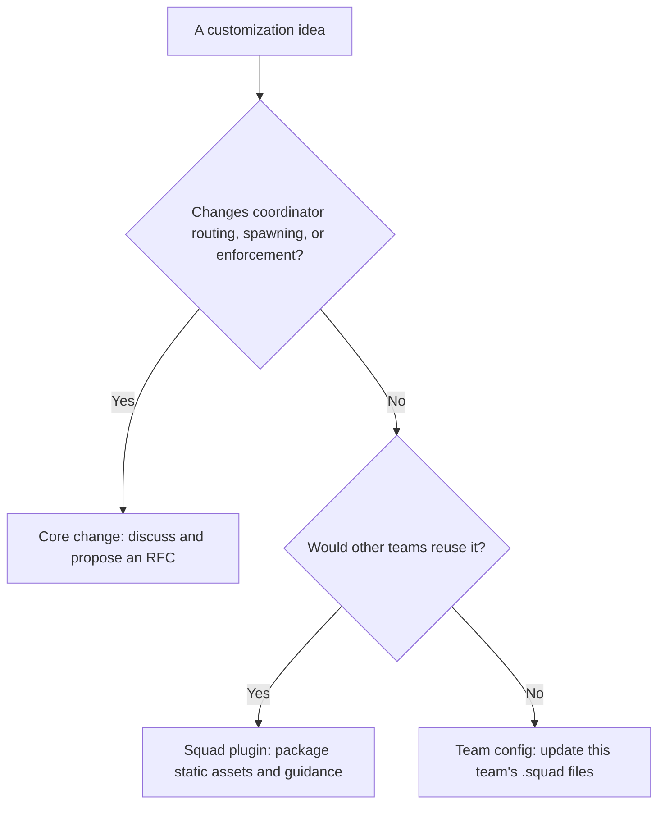
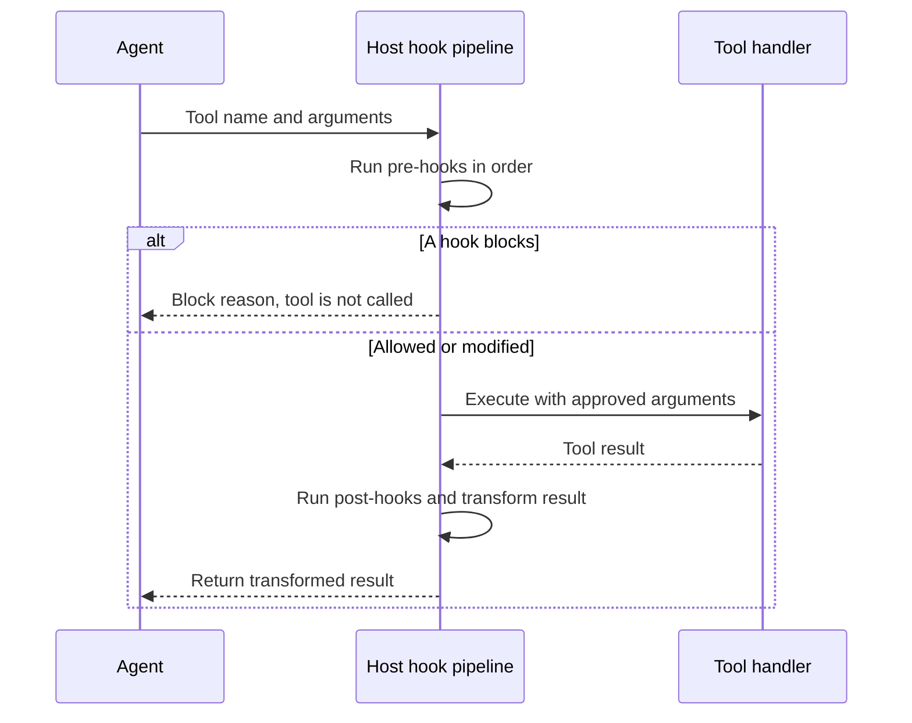

# Chapter 15: Plugins, Extensions, Tools, and Hooks

> **Prerequisites:** Volume 1 (or equivalent Squad experience); Chapter 14.

## What You'll Learn

- Decide whether a Squad customization belongs in core, a reusable plugin, or a team's own `.squad/` configuration.
- Understand what the v1.1.0 plugin lifecycle actually installs, activates, verifies, and removes.
- Author a declarative plugin manifest and read the Graphify, Index Server, and MemPalace examples without confusing metadata with execution.
- Add a typed SDK tool and understand why a `squad_route` tool needs host-provided fan-out dependencies.
- Apply pre-tool and post-tool hooks, and distinguish the SDK's hook pipeline from hooks passed to a live session.
- Identify the boundaries between Squad plugins, Copilot plugins, skills, MCP servers, and marketplace discovery.

## Choose the Right Extension Layer

Squad is deliberately layered. A new capability does not automatically require a new CLI feature. Start by asking what the customization changes and who should own it.

| Layer | Appropriate for | Owner and distribution |
|---|---|---|
| Squad core | Coordinator routing, spawning, or enforcement behavior that must apply to every team | Squad maintainers; released with the CLI/SDK |
| Squad plugin | A reusable collection of guidance and team assets that other teams can opt into | Plugin author; distributed as a local plugin directory in v1.1.0 |
| Team configuration | Local decisions, standards, workflows, and knowledge that only this team needs | Team; kept in its `.squad/` state |

A useful diagnostic is to translate “Squad should do this” into either “our team should do this” or “teams using this domain should do this.” The first usually belongs in the team's files; the second is a strong plugin candidate. Only a capability that changes the coordinator's fundamental behavior is likely to require core work and an RFC.

For example, a set of client-delivery checklists, evidence-gathering guidance, and approval ceremonies can be composed from existing assets. It does not need a new coordinator mode merely because the workflow is sophisticated. Azure-specific deployment advice is reusable knowledge; your own branch naming standard is team configuration. New global routing logic, by contrast, changes the product's behavior and should be proposed to maintainers.



This decision is not irrevocable. Begin with team config, watch for repetition, and promote the stable reusable pieces into a plugin. If multiple plugin authors repeatedly need a capability that manifests cannot express, that repeated limit is evidence for a core extension point.

## What a Squad Plugin Is—and Is Not

In v1.1.0, a plugin is a declarative package of static files plus metadata. It can describe agents, ceremonies, decisions, instructions, knowledge, memory, routing, templates, workflows, hooks, and adapters. It can also describe external repository, package, MCP, or Copilot-plugin dependencies. Installation copies files to approved `.squad/` locations, records hashes and state, and leaves the plugin disabled until you enable it.

A plugin manifest does **not** make every field executable. In particular:

- A `copilot.requires` entry documents a Copilot-owned plugin dependency; Squad does not install or run Copilot plugin commands.
- `upstream.installCommand` and `mcp.installCommand` are explanatory hints for a human. Squad does not run them.
- A provider contract describes type, access mode, protocol, artifact, and capability labels. It does not give a plugin permission to start its MCP server or call a remote provider.
- A plugin-supplied script, shell command, or executable file is not an allowed extension point. The validator rejects executable declaration keys and script-like file extensions.
- A lifecycle declaration is not arbitrary plugin code. Only an allowlisted Squad-owned provider operation can produce generated static artifacts.

> **Warning:** “Install” here means copy declared static files into `.squad/`; it does not mean install an npm/PyPI package, start an MCP server, or execute a plugin. Treat metadata that contains a shell command as a note for the human operator, never as an instruction to paste blindly into a production environment.

The layers complement rather than replace each other. A skill is a focused unit of agent guidance; a plugin can distribute one or more guidance files and other static assets. Copilot plugins belong to Copilot's own extension mechanism. MCP servers are separately configured tools. A Squad plugin can document those integrations, but it does not silently own their installation or trust boundary.

## Author and Install a Declarative Plugin

A minimal plugin directory contains a manifest, at least one static source file, and optionally a README for humans:

```text
my-tasktrack-plugin/
├── plugin.manifest.json
├── knowledge/
│   └── tasktrack-review.md
└── README.md
```

A manifest needs an ID, display name, semantic version, and one or more file deployments. Its `components` declare the kinds of Squad capability it offers; each file item maps a path inside the plugin directory to a target under `.squad/`.

```json
{
  "id": "tasktrack-review",
  "name": "Tasktrack Review Guidance",
  "version": "1.0.0",
  "description": "Review conventions for the Tasktrack API.",
  "authors": ["Tasktrack team"],
  "license": "MIT",
  "squad": ">=1.1.0",
  "components": {
    "knowledge": ["tasktrack-review"]
  },
  "files": [
    {
      "source": "knowledge/tasktrack-review.md",
      "target": "knowledge/tasktrack-review/review.md",
      "type": "knowledge"
    }
  ]
}
```

For stable authored plugins, use `plugin.manifest.json`. The validator also accepts the legacy names `squad-plugin.json`, `squad-plugin.yaml`, `squad-plugin.yml`, `plugin.json`, `plugin.yaml`, and `plugin.yml`. JSON and declarative YAML content are accepted. IDs must be lowercase alphanumeric with hyphens; versions are checked against a SemVer-shaped pattern. Supported component names are `agents`, `ceremonies`, `decisions`, `instructions`, `knowledge`, `memory`, `routing`, `templates`, `workflows`, `hooks`, and `adapters`. Unknown component keys are errors, not ignored extension points.

The `files` list is required and cannot be empty. Source and target paths must be relative and cannot escape their root. Targets must begin with one of these approved `.squad/` directories: `agents/`, `ceremonies/`, `decisions/`, `instructions/`, `knowledge/`, `memory/`, `plugins/`, `prompts/`, `routing/`, `templates/`, or `workflows/`. The validator rejects script-like extensions including `.bat`, `.cmd`, `.com`, `.cjs`, `.exe`, `.js`, `.mjs`, `.ps1`, `.sh`, `.ts`, and `.tsx`. Omit a file `type` only if you accept a warning; supported types include `agent`, `asset`, `doc`, `instruction`, `knowledge`, `prompt`, `template`, and `workflow`.

Run the lifecycle as separate, reviewable steps:

```bash
squad plugin validate ./my-tasktrack-plugin
squad plugin dry-run ./my-tasktrack-plugin
squad plugin install ./my-tasktrack-plugin
squad plugin list
squad plugin enable tasktrack-review
squad plugin switch knowledge tasktrack-review
squad plugin verify
```

`validate` checks the manifest and reports structured problems. `dry-run` prints a deployment plan but writes no plugin files. `install` validates and copies static files, hashes the manifest and deployed files, records the installation, and deliberately leaves it disabled. `enable` activates the roles declared in the manifest. `switch` binds one declared role to a chosen plugin. If another plugin already owns a role, enabling a second one can fail with a role conflict; disable or switch intentionally rather than assuming that providers merge. `verify` re-hashes deployed files and reports missing files or checksum mismatches.

`list --json` is useful to scripts that need machine-readable installed and active state. `disable` deactivates the plugin while retaining its installed files. `uninstall` removes files tracked for the plugin and its registration. Review shared target paths before uninstalling: a plugin's ownership record does not make overlapping file targets a safe composition strategy.

### Lifecycle metadata and generated artifacts

The plugin runtime has six known lifecycle event names: `onInstall`, `onEnable`, `onDisable`, `onBeforeSpawn`, `onAfterTask`, and `onMemoryRefresh`. In the current implementation, declaring an event does not execute plugin code. A capability must pass through the built-in provider registry and capability-type checks. The currently approved provider name is `graphify`, and the implemented operation is bounded artifact generation into safe relative paths under the Squad directory.

`refresh` is shorthand for the `onMemoryRefresh` event. `run-lifecycle` accepts a plugin ID and an event name. Both require the plugin to be installed, enabled, and to declare runtime capabilities. An unsupported event, provider, or capability type is rejected or reported as blocked, and the decision is captured in the plugin audit state. Do not equate this narrow allowlisted mechanism with general-purpose plugin hooks.

The Graphify example illustrates why the distinction matters. Its manifest describes a real upstream tool, `graphifyy`, and static guidance; the CLI does not install or run that package. The v1.1.0 built-in provider writes fixed, illustrative graph nodes and a Markdown report from its implementation rather than analyzing the repository with the external Graphify tool. Treat those artifacts as a demonstration of the governed generation seam, not a live graph of your code.

## Marketplace Discovery and the Marketplace Template

Squad has two related but distinct features that share the word “plugin.” The CLI marketplace registry stores GitHub repository sources in `.squad/plugins/marketplaces.json`. The shipped `templates/plugin-marketplace.md` is an on-demand coordinator reference: it tells the coordinator how to check registered marketplaces while adding team members, offer a matching item, and gracefully continue when no source or match exists. The coordinator prompt points to this template. It is guidance for the coordinator, not executable marketplace code.

The marketplace commands are:

```bash
squad plugin marketplace add owner/repository
squad plugin marketplace list
squad plugin marketplace browse repository
squad plugin marketplace remove repository
```

`add` records the source and derives its marketplace name from the last path segment. `list` displays registrations. `browse` requires the GitHub CLI (`gh`) to be installed and authenticated, then lists top-level directories from the registered GitHub repository. `remove` deletes a registration by its name. The help output describes the marketplace subcommands; the CLI implementation also contains local plugin lifecycle commands such as `validate`, `install`, and `enable`.

Do not infer a remote installer from marketplace browsing. In v1.1.0, the lifecycle installer accepts a **local plugin directory**. Browsing lists a repository's directories; it does not fetch, validate, or install a selected remote folder. The template describes a coordinator flow that reads marketplace content and copies a skill into `.squad/skills/` or merges charter guidance after the user agrees. That described manual copy flow is distinct from `squad plugin install`, which deploys the manifest's declared files from a local directory.

> **Note:** A legacy marketplace guide describes richer package, cache, version pinning, and `@squad/sdk` APIs. Those names and workflows are not the v1.1.0 local plugin lifecycle. Use the actual v1.1.0 CLI and `@bradygaster/squad-sdk` exports for reproducible examples.

## Build SDK Tools Around Explicit Contracts

The SDK publishes dedicated `@bradygaster/squad-sdk/tools` and `@bradygaster/squad-sdk/hooks` entry points. If you have not yet worked through the SDK object model, review Chapter 14 first. A tool is a name, description, JSON-schema-like `parameters` object, and handler. The handler returns the adapter's tool result shape, such as `textResultForLlm` and `resultType`; the old `success`/`data` shape in some guide examples is not the current SDK contract.

```typescript
import { defineTool } from '@bradygaster/squad-sdk/tools';

interface TaskLookupArgs {
  taskId: string;
}

const lookupTask = defineTool<TaskLookupArgs>({
  name: 'tasktrack_lookup',
  description: 'Read one Tasktrack task by its identifier.',
  parameters: {
    type: 'object',
    properties: {
      taskId: { type: 'string', description: 'Task identifier' },
    },
    required: ['taskId'],
  },
  handler: async ({ taskId }) => {
    const response = await fetch(`http://localhost:3000/tasks/${encodeURIComponent(taskId)}`);
    if (!response.ok) {
      return { resultType: 'failure', textResultForLlm: `Task lookup failed (${response.status}).` };
    }
    return { resultType: 'success', textResultForLlm: await response.text() };
  },
});
```

This example illustrates a tool's boundary, not a standalone CLI invocation: the host must register the tool with the session or adapter that runs the model. A custom handler should validate inputs, bound response size and latency, avoid exposing secrets, and return a clear failure result rather than claiming success after an upstream failure.

`ToolRegistry` is the SDK's registry of Squad coordination and state tools. In v1.1.0 its built-ins include `squad_route`, `squad_decide`, `squad_memory`, `squad_status`, `squad_skill`, the `squad_state_*` read/write/append/delete/list/create-if-absent/health operations, and the `memory.*` classify/write/search/promote/delete/audit operations. The exact tool list can evolve, so discover it through `getTools()` rather than hard-coding an assumed count. `getTool(name)` fetches one tool; `getToolsForAgent(allowedTools)` filters by an allowlist; `applySkillHandlers()` replaces handlers for names that already exist. That method deliberately ignores unknown names: skill scripts cannot add arbitrary tools through it.

`defineTool()` provides the wrapper for a custom typed tool and instruments calls with an OpenTelemetry span. Argument fields with names that look like content, query, token, secret, password, key, or auth are redacted from span arguments; the serialized argument summary is capped. Still design your own telemetry and result payloads to avoid secrets—redacting argument attributes does not make every tool result or thrown error safe to log.

A special case is `squad_route`. It needs fan-out dependencies from its host, including the session pool, model client, Squad root, and config getter. If `ToolRegistry` is constructed without a usable `fanOutDepsGetter`, `squad_route` returns an honest `fan-out-deps-unavailable` failure; it must not be represented to an agent as a successful spawn. A host that needs to control routing can also intercept the tool through a session pre-tool hook.

## Hooks: Policy Before and Transformation After

The SDK exposes both a convenience `HookPipeline` and typed session-hook callbacks. They are related ideas, not interchangeable APIs.

`HookPipeline` accepts a policy configuration and provides ordered pre-tool and post-tool hook lists. Pre-hooks can allow, block, or modify arguments; the first block ends the chain. Modifications are fed into the next hook. Post-hooks receive the result as transformed by earlier post-hooks, so redaction can be composed. Users can register custom callbacks with `addPreToolHook()` and `addPostToolHook()`.

| `PolicyConfig` option | Behavior in the SDK module |
|---|---|
| `allowedWritePaths` | Gate recognized write-tool names against `path` or `file_path` using simple glob-like matching |
| `blockedCommands` | Block substring matches in `command` or `cmd` for recognized shell-tool names; defaults include `rm -rf`, `git push --force`, `git rebase`, and `git reset --hard` |
| `maxAskUserPerSession` | Count `ask_user` calls by session ID and block once the limit is reached |
| `reviewerLockout` | Enable a registry that prevents a locked-out agent from writing a matching artifact path |
| `scrubPii` | Enable a post-tool scrubber for email-like strings in string, array, and object results |

The module's guard is intentionally understandable, but it is not a complete sandbox. It recognizes only specific tool names, uses simple pattern matching, and treats missing paths or commands as allowed. The email scrubber detects email-like strings, not all personal information. A `HookPipeline` instance enforces rules only where your host calls it; declaring it in an unrelated `squad.config.ts` does not automatically attach it to every CLI session.

`SquadSessionHooks`, exposed through the adapter's session configuration, are the lower-level integration seam for a live SDK session. The adapter types define callbacks such as `onPreToolUse`, `onPostToolUse`, `onUserPromptSubmitted`, `onSessionStart`, `onSessionEnd`, and `onErrorOccurred`. A pre-tool callback can return `permissionDecision` (`allow`, `deny`, or `ask`), `modifiedArgs`, additional context, and output-suppression instructions. A post-tool callback can return a modified result or additional context. The callback input carries session/tool context. Wire this interface into the actual `SquadSessionConfig` passed to the SDK; it is not the same return type as `HookPipeline`'s `action` result.



A robust policy hook should make its failure behavior explicit. If policy evaluation fails, a permission decision is ambiguous, or the handler cannot parse a path, decide whether to fail closed, request approval, or allow—and test that contract. For high-assurance controls, enforce filesystem and process restrictions outside the model-facing hook too. Hooks improve deterministic application policy; they do not replace operating-system permissions, container isolation, or human review.

## Hands-On: Add a Tasktrack Plugin and Governance Hook

Use the Tasktrack checkout that your Squad has already created. This exercise adds reusable review guidance and a testable hook rule without pretending the plugin manifest can execute TypeScript.

1. In Tasktrack, create `plugins/tasktrack-review/knowledge/review.md`. Ask your Squad to write concise API review guidance for `api/`: validate task IDs, preserve existing status behavior, return appropriate errors, and add tests for edge cases.
2. Create `plugins/tasktrack-review/plugin.manifest.json` using the JSON example above. Set `id` to `tasktrack-review`, and map the guidance file to `knowledge/tasktrack-review/review.md`. Keep only static files in `files`.
3. Run these commands from the Tasktrack root:

   ```bash
   squad plugin validate ./plugins/tasktrack-review
   squad plugin dry-run ./plugins/tasktrack-review
   squad plugin install ./plugins/tasktrack-review
   squad plugin list --json
   squad plugin enable tasktrack-review
   squad plugin switch knowledge tasktrack-review
   squad plugin verify
   ```

   Expected result: validation succeeds; dry-run shows the one guidance target and says that no files were written; installation reports the plugin as disabled; enabling and switching make the `knowledge` role active; verification passes. The deployed file should appear beneath `.squad/knowledge/tasktrack-review/`.
4. Separately add `api/tasktrack-hooks.ts` to Tasktrack. Build a `HookPipeline` with an allowed write path such as `api/**/*.ts` and `scrubPii: true`. In `npm test`, exercise one pre-hook with a permitted API file, one with an out-of-scope path, and one post-hook that redacts an email in a nested object. Use the `@bradygaster/squad-sdk/hooks` subpath import; do not put executable hook code in the plugin manifest.
5. Have a tester agent review both the manifest and hook tests. Check that the README describes the external dependencies as metadata and that the hook test proves the expected behavior rather than only testing a helper's return value.

This completes the Part III companion milestone: Tasktrack now has one reusable plugin package and one deterministic governance policy in application code. It does not imply that the Tasktrack production server automatically invokes that policy; a real host must call the hooks at the corresponding tool/session boundary.

## Configuration Reference

| Item | Location or signature | Default / constraint |
|---|---|---|
| Plugin manifest | `plugin.manifest.json` | Local directory; legacy JSON/YAML names are accepted |
| Required manifest keys | `id`, `name`, `version`, `files` | At least one static file deployment |
| Component keys | `components` | agents, ceremonies, decisions, instructions, knowledge, memory, routing, templates, workflows, hooks, adapters |
| Static plugin targets | `.squad/<target>` | Must use an approved root; no absolute or traversal paths |
| Local lifecycle | `squad plugin validate|dry-run|install|list|enable|switch|disable|verify|uninstall` | `install` leaves plugin disabled |
| Lifecycle generation | `squad plugin refresh <id>` or `run-lifecycle <id> <event>` | Requires enabled plugin and capability; `refresh` means `onMemoryRefresh` |
| Marketplace | `squad plugin marketplace add|remove|list|browse` | Registry in `.squad/plugins/marketplaces.json`; browse needs authenticated `gh` |
| SDK tools | `@bradygaster/squad-sdk/tools` | `defineTool()` uses `parameters` and adapter `SquadToolResult` |
| SDK hook pipeline | `@bradygaster/squad-sdk/hooks` | `HookPipeline` config is code; it is not a CLI config key |
| Live SDK hooks | `SquadSessionHooks` in adapter session config | Typed callbacks; host must wire them into the session |

## Under the Hood

The marketplace and plugin systems live in different paths. `templates/plugin-marketplace.md` is a coordinator prompt reference. The CLI plugin command registers marketplace URLs under `plugins/marketplaces.json` and uses `gh api` to list remote repository directories; local plugin validation and installation are implemented separately in `packages/squad-cli/src/cli/commands/plugin.ts`.

The manifest parser and validator in `packages/squad-sdk/src/marketplace/plugin-manifest.ts` normalize JSON/YAML, derive declared roles, reject unsupported component names, block executable declaration keys, validate file paths and extensions, and create an install plan. The CLI then checks that each source is a regular non-symlink file, copies it under the Squad root, records hashes and lifecycle state, and rolls back copied files if installation fails. The key distinction is that manifest metadata is not dispatched as a shell command.

The plugin runtime is an allowlist, not a plugin interpreter. `plugin-runtime.ts` maps approved provider names to Squad-owned functions, filters capabilities by lifecycle event, verifies the `artifact-generation` capability type, validates output paths, and appends audit events. The graphify function writes generated files through the configured storage provider. Because its current source contains fixed example nodes and edges, its generated graph is a demonstration artifact rather than an analysis of source files.

The SDK tool module uses `ToolRegistry` to construct the built-in Squad tools and exposes `defineTool()` to instrument typed handlers. One bounded excerpt shows the deliberately honest no-fan-out result:

```typescript
if (!fanOutDeps) {
  return {
    textResultForLlm:
      `Cannot route to ${targetAgent}: fan-out dependencies are not configured. ` +
      `Wire a fanOutDepsGetter into ToolRegistry, or intercept squad_route via SquadSessionHooks.onPreToolUse.`,
    resultType: 'failure',
    error: 'fan-out-deps-unavailable',
    toolTelemetry: { routeRequest },
  };
}
```

The hook implementation in `packages/squad-sdk/src/hooks/index.ts` is an independent ordered pipeline with local policy state (including per-session `ask_user` counts and a reviewer lockout map). The adapter defines another set of session hook callbacks in `packages/squad-sdk/src/adapter/types.ts`; the adapter passes or normalizes those callbacks at the SDK boundary. Read the actual seam that your host invokes before relying on a policy in production.

## Pitfalls and Troubleshooting

- **Plugin installed but agents do not see its material:** installation intentionally leaves it disabled. Enable it and, for a specific role, switch that role to the plugin.
- **Cannot activate a role:** another plugin may already be active for that component. Inspect `squad plugin list --json`, then intentionally disable or switch the existing binding.
- **`refresh` reports no capabilities:** ordinary declarative knowledge files need no refresh. Refresh only applies to an enabled plugin with a supported runtime capability.
- **A marketplace item cannot be installed by ID:** browse is discovery, not remote installation. Obtain a local plugin directory and run the local lifecycle commands.
- **Marketplace browse fails:** ensure `gh` is installed, authenticated, and permitted to read the repository.
- **Plugin metadata says “MCP available”:** this is a description, not a running server. Configure and secure the MCP server through the supported client separately.
- **A custom hook appears to do nothing:** confirm the host passes it into the session or calls `runPreToolHooks()` / `runPostToolHooks()` around actual work.
- **A policy passes a path you expected to reject:** check the exact recognized tool name and argument field. The helper is deliberately simple; test boundary cases and add an independent filesystem-level control.
- **A route tool claims it spawned an agent:** inspect the returned result. Without configured fan-out dependencies, the SDK returns failure instead of silently reporting success.
- **A generated Graphify report is not a real code map:** v1.1.0's built-in provider is a static governed example; it does not install or execute Graphify.

## Summary

- Use core only for product-wide coordinator behavior; use plugins for reusable static capabilities and `.squad/` for team-local choices.
- A v1.1.0 plugin is declarative: it copies approved static files, records state and hashes, and activates only when enabled.
- Marketplace browsing and local plugin installation are separate operations; the remote marketplace flow does not download and install a plugin directory.
- External package, MCP, and Copilot integration fields are metadata; only allowlisted Squad-owned artifact generation runs during a plugin lifecycle.
- Tools need explicit schemas, bounded handlers, and actual host wiring. `squad_route` requires real fan-out dependencies.
- Hooks are deterministic only at the integration point that invokes them, and they complement rather than replace OS-level isolation.

## Exercises

1. Classify five changes for a new team: a code-review rubric, a company-wide routing mode, a repository-specific branch convention, a reusable Azure deployment knowledge pack, and a new reviewer-enforcement rule. State the owner and distribution layer for each.
2. Author a plugin manifest with one knowledge file and one ceremony file. Include `components`, `files`, a repository URL, and an optional Copilot dependency. Explain which fields Squad acts on and which it only reports.
3. Extend the Tasktrack tool from the hands-on section with input validation, a timeout, and bounded output. Specify what the model should receive for a missing task versus an API outage.
4. Add a pre-tool hook that modifies a command argument, then add a second hook that blocks a prohibited command. Show that modifications flow in order and that the first block ends the chain.
5. Design a test matrix for path-guard behavior. Include write tool names, read-only tools, `path` versus `file_path`, missing path values, nested glob matches, Windows separators, and absolute paths. Identify which cases need OS-level controls beyond the SDK helper.

## Quiz

1. Which layer should own a new capability that changes the coordinator's global routing algorithm?
2. Does `squad plugin install` execute the `upstream.installCommand` field?
3. What is the difference between marketplace `browse` and plugin lifecycle `install` in v1.1.0?
4. Name two conditions needed before a plugin's lifecycle operation can generate an artifact.
5. Why can `squad_route` return `fan-out-deps-unavailable`?
6. How do a `HookPipeline` result and a `SquadSessionHooks.onPreToolUse` result differ?
7. Why is the built-in email scrubber not a complete privacy control?

## Further Reading

- [Plugin marketplace guide](https://bradygaster.github.io/squad/docs/features/plugins/)
- [Marketplace guide](https://bradygaster.github.io/squad/docs/features/marketplace/)
- [Building extensions](https://bradygaster.github.io/squad/docs/guide/building-extensions/)
- [Extensibility guide](https://bradygaster.github.io/squad/docs/guide/extensibility/)
- [Custom tools and hooks reference](https://bradygaster.github.io/squad/docs/reference/tools-and-hooks/)
- [`templates/plugin-marketplace.md`](https://github.com/bradygaster/squad/blob/v1.1.0/templates/plugin-marketplace.md)
- [`packages/squad-sdk/src/marketplace/plugin-manifest.ts`](https://github.com/bradygaster/squad/blob/v1.1.0/packages/squad-sdk/src/marketplace/plugin-manifest.ts)
- [`packages/squad-sdk/src/marketplace/plugin-runtime.ts`](https://github.com/bradygaster/squad/blob/v1.1.0/packages/squad-sdk/src/marketplace/plugin-runtime.ts)
- [`packages/squad-sdk/src/tools/index.ts`](https://github.com/bradygaster/squad/blob/v1.1.0/packages/squad-sdk/src/tools/index.ts)
- [`packages/squad-sdk/src/hooks/index.ts`](https://github.com/bradygaster/squad/blob/v1.1.0/packages/squad-sdk/src/hooks/index.ts)
- [`samples/hook-governance/`](https://github.com/bradygaster/squad/tree/v1.1.0/samples/hook-governance)
- [`samples/plugin-knowledge-graphify/`](https://github.com/bradygaster/squad/tree/v1.1.0/samples/plugin-knowledge-graphify)
- [`samples/plugin-knowledge-index-server/`](https://github.com/bradygaster/squad/tree/v1.1.0/samples/plugin-knowledge-index-server)
- [`samples/plugin-memory-mempalace/`](https://github.com/bradygaster/squad/tree/v1.1.0/samples/plugin-memory-mempalace)
