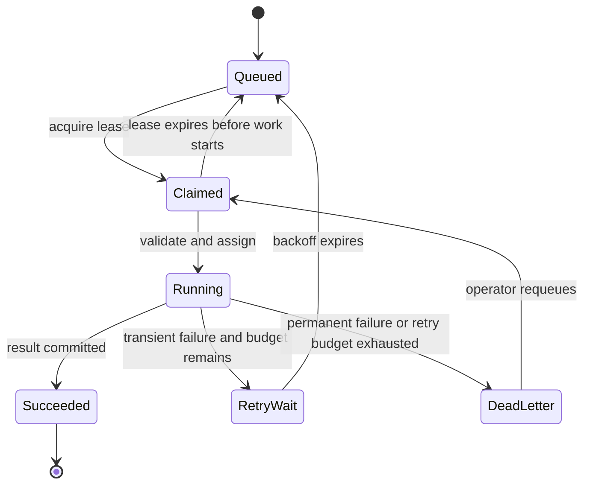
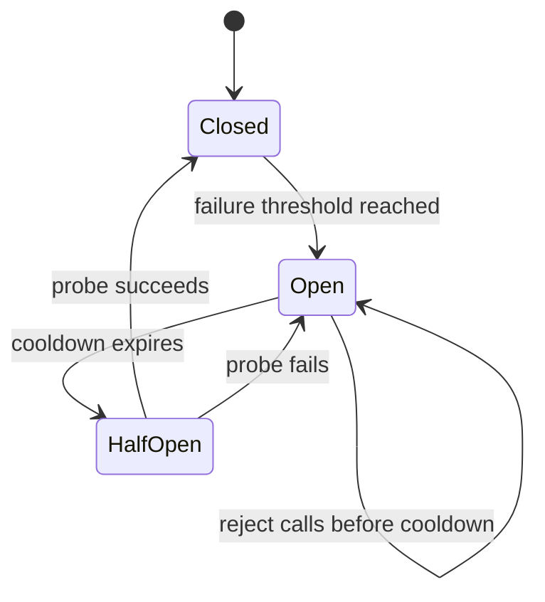

# Chapter 16: Building Autonomous and Resilient Agents

> **Prerequisites:** Volume 1 (or equivalent Squad experience); Chapter 14.

## What You'll Learn

- Design an autonomous worker as a bounded task loop with explicit assignment, execution, coordination, reporting, and shutdown behavior.
- Tell a deterministic SDK demonstration from an agent that actually invokes a model and changes files.
- Make long-running work recoverable through durable task state, idempotency, leases, budgets, timeouts, and observable failure paths.
- Understand what resilience primitives ship in Squad v1.1.0 and what the separate resilient-agent guide describes but the code does not implement.
- Embed a Squad team as a Microsoft Agent Framework `AIAgent` through the repository's `Squad.Agents.AI` .NET integration.
- Choose between the CLI, TypeScript SDK, and .NET adapter based on the host application's requirements.

## Autonomy Is a Controlled Loop, Not an Infinite Prompt

An autonomous agent receives work from a defined source—a queue, scheduled run, CLI invocation, or workflow—and continues without waiting for a person after every step. That does not mean “let the model keep trying until something works.” Reliable autonomy is a small system around the model: a task contract, an assignment policy, a bounded execution attempt, durable progress, a policy boundary, and a way to report success or failure.

A useful lifecycle is:

1. **Acquire:** claim one eligible task and record who owns it and until when.
2. **Validate:** check the request, permissions, deadline, retry budget, and duplicate-work key.
3. **Assign:** match the job to a role or capability and create the right Squad session.
4. **Execute:** invoke the agent with the task and only the relevant context and tools.
5. **Observe:** capture status, tool activity, costs, and errors without logging secrets.
6. **Commit:** persist a result or checkpoint before releasing the task.
7. **Recover or finish:** mark success, schedule a bounded retry, or route a terminal failure for review.



The queue owns task status; a conversation transcript is not a durable job ledger. A worker should be able to restart and discover which task it claimed, what it completed, and whether a previous side effect already happened. This is especially important when the action is non-idempotent, such as sending a message, creating a paid resource, or publishing a release.

A minimal loop therefore has more than `while (tasks remain)`. It defines which tasks are eligible, what happens when no agent matches, how a failed task changes state, when the process stops, and how the queue prevents two workers from doing the same operation. Put hard limits around wall-clock time, token or monetary budget, number of tasks, and concurrent sessions. Use a cancellation signal and dispose clients, sessions, event subscriptions, streams, and telemetry exporters in a `finally` path.

## Use the Autonomous Pipeline Sample as a Teaching Aid

The repository's `samples/autonomous-pipeline` brings several SDK pieces together: `CastingEngine`, `SkillRegistry`, `selectResponseTier`, `StreamingPipeline`, `CostTracker`, `TelemetryCollector`, and OpenTelemetry metrics. It casts four role-bearing members, creates a queue of ten example tasks, adds domain skills, picks tasks by matching the member's role, streams simulated deltas, and produces a cost and activity report. `OTEL_EXPORTER_OTLP_ENDPOINT` optionally enables export.

The sample is a terminal demonstration, not an unattended coding agent. Its `WORK_OUTPUTS` table contains canned results. It sleeps to imitate execution latency, randomizes estimated tokens and cost, logs `squad_route`-like events, appends in-memory decision and memory records, and marks tasks done in the process. It does not call an LLM for each task, invoke the actual `squad_route`/`squad_decide`/`squad_memory` SDK tools, or durably store its queue. The task loop awaits work inside the agent iteration, so its work simulation is sequential; an `AgentState` marked `working` does not itself create parallel execution.

That distinction makes the sample useful: it demonstrates how the surrounding components fit together without requiring model credentials or making network calls. It also exposes what production work still needs. Replace the canned execution path with a real session call; make the queue durable; commit task results; handle cancellation and failure; persist decisions and memory through the corresponding SDK tools or state API; and ensure telemetry is flushed even if a task fails.

The sample's `findNextTask()` returns no task when a queued item's role is not represented by a member. Since the outer loop waits while any task is not done, a queue with a permanently unmatched role can wait forever. A production scheduler should detect that condition and mark the task unassignable, escalate it, or stop with a useful diagnostic. A lost session or an exception also needs a defined state transition rather than leaving a task marked `in-progress` indefinitely.

> **Note:** The Tasktrack companion starts as a dependency-free API. You can prototype the control plane with its `GET`/`POST /tasks` and `PATCH`/`DELETE /tasks/:id` endpoints, then let Squad help build an agent runner. Keep model work, queue persistence, and external side effects explicit; the SDK showcase itself uses dependencies and is not the Tasktrack starter.

## Make an Agent Resilient by Design

A resilient agent treats failures as expected states. For each dependency, classify errors before retrying:

| Failure class | Typical response |
|---|---|
| Invalid task or permission denial | Fail without retry; report what needs correction |
| Network timeout or temporary service error | Retry with bounded exponential delay and jitter if operation is safe to repeat |
| Rate limit | Respect the provider's reset information and shared quota policy; do not launch a retry storm |
| Concurrent update or lease conflict | Re-read authoritative state and retry the conditional update a limited number of times |
| Process crash | Let a lease expire or restore from a checkpoint; make side effects idempotent |
| Repeated downstream failure | Open a circuit for that dependency, fail fast, and probe recovery later |
| Unknown or malformed response | Preserve evidence, stop the unsafe action, and route for diagnosis |

### Retry with limits and idempotency

Retry only when the error is plausibly transient and the operation is safe to repeat. A retry limit bounds the work; exponential backoff prevents synchronized clients from hammering a service; random jitter spreads the retry times. A request ID or idempotency key lets the downstream system recognize a repeated attempt. Record each attempt against the original job, not as a new independent task.

A timeout must cancel the underlying request where possible. If the operation may have completed remotely before the timeout, query its outcome before repeating it. Avoid retrying every error: invalid arguments, authentication failures, policy blocks, and deterministic validation errors will not become successful just because the agent asks again.

### Circuit breakers and queues

A circuit breaker protects one dependency from repeated calls during failure. In its common form it passes requests while closed, rejects quickly while open, and allows a limited probe after a cooldown in half-open state. Keep the breaker scoped to the dependency and operation it measures; a failed telemetry exporter should not disable task execution, and a git state backend breaker says nothing about an unrelated Tasktrack API.



Queues also need their own resilience. Claim work with a lease or atomic transition, persist an attempt count, and use compare-and-swap or transactions to prevent conflicting updates. Separate transient retry from terminal failure. A dead-letter state preserves the task and last error for human inspection rather than silently dropping it. When a job has multiple side effects, persist a checkpoint after each verified boundary or use an outbox/compensation design appropriate to the external system.

### Budgets, shutdown, and observability

Use both per-task and per-run budgets. Cap the number of tasks, concurrent agents, retries, model turns, elapsed time, and estimated spend. A loop should stop when it exhausts a budget and report the unfinished work rather than reinterpret exhaustion as task completion. Handle SIGINT/SIGTERM by stopping new claims, giving in-flight work a bounded drain period, persisting its state, and releasing resources.

Track structured events with task ID, agent identity, attempt, duration, result class, model, token use, and estimated cost. Keep sensitive task content and credentials out of metric labels. Traces help connect a queue claim to an agent dispatch and a tool call; metrics show rates and queue health over time; logs preserve diagnostics. A successful response is not proof that the intended specialist actually ran—observe dispatch events or spans as well as output.

## What “Resilience” Means in Squad v1.1.0

The guide named “Building resilient agents” describes a generic breaker with `failureThreshold`, `successThreshold`, `timeWindow`, `initialBackoff`, and `maxBackoff`, including persistence across process restarts and an import from `@squad/resilience`. Those claims do not match the v1.1.0 source. The repository has no `@squad/resilience` package, no corresponding `resilience.circuitBreaker` config, and no generic persisted service breaker with that option set. Do not copy the JSON or import statement as if it were a supported v1.1.0 API.

There are real, narrower resilience mechanisms in the repository:

- The SDK's `CircuitBreaker` in `state-backend.ts` wraps Git operations inside Git-backed state backends. Its defaults are five consecutive failures and a 30-second cooldown. It is an in-memory synchronous breaker for those operations, not a general application API breaker and not persisted across restarts.
- Git helpers retry classified transient Git failures up to three retries after the initial attempt, with exponential delays based on 100 ms and capped at two seconds. This does not turn permission or repository-corruption errors into retryable failures.
- Git-backed state updates also use bounded optimistic concurrency retries for compare-and-swap conflicts. Exhaustion surfaces an error instead of pretending that the write succeeded.
- `PredictiveCircuitBreaker` and related quota helpers in the Ralph rate-limiting module are a separate rate-limit forecasting/scheduling feature. The predictor uses the first and latest samples to estimate depletion; despite some comments and guide wording, it is not a general linear-regression breaker for arbitrary downstream calls.
- `SquadClient` and session-management components provide connection/session lifecycle behavior covered in Chapter 14; apply their documented boundaries rather than assuming they make your whole worker durable.

The reliable v1.1.0 guidance is therefore architectural: add application-level retry, state, timeout, circuit-breaker, and queue policy where your worker needs it; use SDK mechanisms only for the specific state or rate-limit scope they implement.

> **Preview:** The generic persisted circuit-breaker configuration and `@squad/resilience` example in the guide are not available in the v1.1.0 source. Treat them as unverified/forward-looking documentation, not stable API. Verify the package and API in a later tagged source before adopting them.

## Integrate a Squad Team with Microsoft Agent Framework

The repository includes `src/Squad.Agents.AI`, a .NET library that wraps the Copilot-backed Squad CLI agent as a Microsoft Agent Framework `AIAgent`. It is useful when your host is a .NET application or when you want to compose a Squad team into framework workflows. It is an adapter to the Squad coordinator, not a replacement for the TypeScript SDK and not a new orchestration engine.

The class `SquadAgent` derives from `DelegatingAIAgent` and delegates sessions, runs, and streaming to an inner agent created by the GitHub Copilot SDK. The service collection extensions register both `SquadAgent` and `AIAgent`, with scoped lifetime by default. Keyed registration lets one host resolve multiple Squad team roots. The session config enables config discovery under the `.squad/` directory, so the CLI can discover team agents, skills, instructions, and MCP configuration.

A minimal host registration and call look like this:

```csharp
var builder = Host.CreateApplicationBuilder(args);
builder.Services.AddSquadAgent(o =>
{
    o.SquadFolderPath = "/teams/tasktrack";
});
using var host = builder.Build();
var agent = host.Services.GetRequiredService<AIAgent>();
var session = await agent.CreateSessionAsync();
var response = await agent.RunAsync("Summarize the Tasktrack API team.", session);
Console.WriteLine(response.Text);
```

Use the same session object across turns to retain its conversational state; create a fresh session to start a new conversation. `RunStreamingAsync()` emits response updates incrementally. A durable workflow's checkpoint and restore behavior belongs to Microsoft Agent Framework's base mechanisms; the Squad adapter does not invent its own serialization protocol.

For multiple teams, `AddKeyedSquadAgent("research", ...)` and `AddKeyedSquadAgent("platform", ...)` bind each key to its own team root. Registrations can be keyed or unkeyed and accept a `ServiceLifetime` override. The connection-string path can use `ConnectionStrings:squad` for the default team; named registration tries the literal connection-string key before the legacy `squad-{name}` form. A PATH-form connection string maps the team root and current working directory. A `squad://` URI can carry `teamRoot`, `cliPath`, `cwd`, semicolon-separated `cliArgs`, and semicolon-separated `env` pairs.

The adapter launches the Copilot CLI as a subprocess. The CLI must be installed or its bundled native runtime must be available; the process needs a valid Copilot sign-in or another supported credential configuration. Set `CliPath` for a known binary location in a container. Verify path, runtime architecture, authentication, team root, and environment in the deployment image rather than relying on a developer workstation.

### Permission configuration is a production decision

The current `SquadAgent` config uses `PermissionHandler.ApproveAll` for the Copilot SDK permission request and passes `--allow-all` to the CLI unless the host already supplied one of the explicit permission-opening flags. The `ConfigureSession` callback can replace the SDK permission handler and other session settings. This behavior is convenient for local demos and trusted automated pipelines, but it is a broad grant of shell, filesystem, and URL permissions.

> **Warning:** Do not expose the default `ApproveAll` setup to an untrusted tenant or public endpoint. In production, decide which tools, paths, and URLs are needed; supply a restrictive `OnPermissionRequest` policy through `ConfigureSession`, review CLI permission flags, and run the process with operating-system privileges limited to the intended workspace. The session callback cannot undo a CLI-level permission grant by itself.

The adapter's `ConfigureCopilotClient` callback is another customization seam, intended for SDK environment, token, or logger configuration. The source guards routing-critical connection/working-directory properties and restores changes, but that is not a substitute for validating the team's path and credentials. Avoid hard-coded tokens; use the signed-in user for development or a host-owned token provider/secure store for production.

For observability, `Squad.Agents.AI` can emit one OpenTelemetry activity per subagent dispatch. Subscribe to `SquadAgentDiagnostics.ActivitySourceName`. `EmitSubagentActivities` controls built-in spans; `OnSubagentTrace` is an additional callback for typed dispatch, tool, or message events. The trace callback is independent of built-in span emission, and exceptions thrown by a consumer callback are swallowed so they do not break the event loop. Ensure your telemetry backend and retention policy are appropriate for reply previews and task metadata.

## Hands-On: Turn Tasktrack Tasks into Recoverable Agent Jobs

In the Tasktrack companion repository, extend rather than replace the existing HTTP API. The goal is a small worker that can be interrupted and resumed; the worker's first iteration can use deterministic “agent work” so you can test the queue before connecting a model.

1. Ask your Squad to inspect the existing task data model and tests. Agree on a task status contract and define a stable idempotency key for each agent action. Add only the fields needed to represent a claim/lease, attempt count, and last failure.
2. Add an `api/agent-runner.ts` entry point that takes a bounded number of tasks per run. It should fetch eligible tasks, claim one before work, reject tasks with unknown roles, and write a checkpoint or final result before marking a task complete. Never leave “no matching agent” as an infinite wait condition.
3. Add a fake execution adapter that can return success, a permanent validation failure, or a simulated transient failure. The transient path should schedule no more than a small configured number of retries with a bounded delay; the permanent path should be recorded for review. Make the fake adapter deterministic in tests.
4. Add tests for duplicate delivery, expired leases, a restart between claim and commit, retry exhaustion, cancellation during a task, and a task whose required role is missing. Assert both the response and persisted status.
5. Run the existing tests and the runner with a tiny batch:

   ```bash
   npm test
   node api/agent-runner.ts --limit 2
   ```

   Tasktrack's documented start command runs on Node 22.18+ with type stripping; follow `sample/README.md` if your runtime's type-stripping defaults differ. Expected result: at most two eligible jobs are considered, the state transitions are visible, retries are bounded, and the runner exits with a summary even if one job fails.
6. In a separate branch, replace the fake adapter with a real SDK-backed session call and add a run-level cost limit. Use a task-specific prompt and a least-privilege tool set. Do not let a model update the queue state directly unless the host enforces the same claim/commit invariants.

Compare your work with the companion tags `v2-ch16-start` and `v2-ch16-end` when available. Run with the smallest possible batch and a test credential policy before enabling any scheduled or unattended execution.

## Configuration Reference

| Concern | v1.1.0 source or pattern | Scope and caveat |
|---|---|---|
| Task and queue states | Application-owned model | Persist status, attempt count, claim/lease, and checkpoint in the queue, not only in a prompt |
| Task/agent loop | `CastingEngine`, routing helpers, or your own worker | The autonomous sample is simulated and sequential |
| Tool registration | `ToolRegistry`, `defineTool()` | Routing requires host fan-out dependencies; validate before side effects |
| Streaming and costs | `StreamingPipeline`, `CostTracker` | Sample records simulated usage; do not confuse estimates with invoices |
| Telemetry | `TelemetryCollector`; `initSquadTelemetry()` when configured | Respect consent, data minimization, and exporter shutdown |
| Git backend retry | SDK `state-backend.ts` | Three retries after the initial try; 100 ms exponential base, 2 s cap |
| Git state circuit breaker | SDK `CircuitBreaker` | Five consecutive failures; 30 s cooldown; in-memory and scoped to Git operations |
| General downstream breaker | Application-owned unless a later release documents it | The guide's `@squad/resilience` import/config is not present in v1.1.0 |
| .NET target frameworks | `Squad.Agents.AI.csproj` | `net8.0`, `net9.0`, and `net10.0`; source version is `1.0.0` |
| Default .NET DI lifetime | `AddSquadAgent()` | Scoped; overloads accept another `ServiceLifetime` |
| .NET team root | `SquadAgentOptions.SquadFolderPath` | Required when resolving the agent; configure explicitly or through connection string |
| .NET process | `CliPath`, `CliArgs`, `Cwd`, `Environment` | Copilot CLI subprocess; check image runtime, environment, credentials, and permissions |
| .NET permission callback | `ConfigureSession` | Override the default permission handler; also review CLI-side `--allow-all` behavior |
| .NET observability | `EmitSubagentActivities`, `OnSubagentTrace` | Built-in activities default on; custom callback is independent |

## Under the Hood

The autonomous demo is driven by application-owned `PipelineTask` and `AgentState` objects. For each member, the sample makes a session ID and attaches it to the streaming pipeline. The core operation is intentionally simple: find a queued task with the member's role, mark it in progress, run a simulated workload, record usage, and mark it done. This is a useful shape to adapt, but its in-memory mutation is not a recovery protocol.

The SDK's Git state backends have their own resilience logic in `packages/squad-sdk/src/state-backend.ts`: retry for classified transient Git errors, a circuit breaker around Git operations, and optimistic concurrency handling for reference updates. These protections help the backend maintain its own state; they do not wrap arbitrary `fetch()` calls or persist a worker's job state.

The .NET adapter's `SquadAgent` builds a `SessionConfig` with `.squad/` configuration discovery, then calls the Copilot SDK to create the inner MAF agent. `SquadServiceCollectionExtensions` binds options and registers concrete and base agent services. `SquadAgentOptions` collects the team root, CLI path and arguments, environment and credential settings, tracing, session customization, subagent callbacks, and telemetry controls. The adapter owns and disposes its Copilot client and inner agent; applications should still scope their DI host and sessions correctly.

The source warns about two significant defaults. `OnPermissionRequest = ApproveAll` satisfies the SDK protocol, while `--allow-all` opens the CLI's separate tool, path, and URL gates. Also, the adapter's default `AgentFileName` is `squad`: it adds `--agent squad` only when the expected `.github/agents/squad.agent.md` file exists and the host has not supplied an explicit agent flag. An uninitialized root degrades to the CLI default rather than failing on a missing file. These are concrete behaviors to validate when testing an integration, not assumptions to infer from a type name.

A short source excerpt captures the service-registration contract:

```csharp
public static IServiceCollection AddSquadAgent(
    this IServiceCollection services,
    Action<SquadAgentOptions>? configure = null)
    => AddSquadAgentCore(services, name: null, ServiceLifetime.Scoped, configure);
```

## Pitfalls and Troubleshooting

- **Worker never exits:** look for queued work no agent can take, a task left in progress after an exception, or a retry loop without a maximum attempt count.
- **A task is done but its side effect is missing:** persist the side effect's outcome before committing task completion; do not report success based only on a model response.
- **Duplicate action after restart:** use an idempotency key, a transaction, or a deduplication record at the side-effect boundary.
- **Retries make an outage worse:** classify errors, set a retry ceiling, use jitter, and open a dependency-specific circuit when repeated calls are failing.
- **The agent claims it delegated work:** inspect actual spawn events or trace spans. The autonomous sample only logs some route examples; it does not call the route tool.
- **Cost output looks precise:** the sample generates synthetic token counts and costs with `Math.random()`. Treat its report as demonstration data.
- **`@squad/resilience` cannot be resolved:** that package/API is not present in the v1.1.0 source. Do not add a dependency based on the guide; use documented SDK features or implement application-specific controls.
- **NuGet package cannot be restored:** the repository source declares package version `1.0.0`, but source versioning is not proof that the package is published or reachable in your feed. Follow the repository's local pack instructions or verify the actual NuGet feed.
- **Copilot CLI runtime is not found:** check CLI installation/PATH, package version, RID-specific native artifacts, and the container's architecture. Use `CliPath` when the executable location is known.
- **Authentication fails:** sign in to the Copilot CLI for local development or use a secure supported token provider. Never embed credentials in the sample or image.
- **Unintended access in a hosted service:** replace `ApproveAll`, remove broad CLI permission flags, restrict OS/container permissions, and scope the team root to the service's job.
- **Tracing appears empty:** subscribe to `SquadAgentDiagnostics.ActivitySourceName`, verify exporter configuration, and confirm the coordinator actually spawned specialists.

## Summary

- Autonomy requires explicit task state, finite budgets, and safe recovery behavior—not just a loop.
- The SDK autonomous-pipeline sample is a deterministic demonstration of casting, matching, streaming, cost, and telemetry; it does not perform live model work or durable queue orchestration.
- Resilience requires idempotency, bounded retries, timeouts, leases, checkpoints, and terminal failure handling around your actual side effects.
- v1.1.0 has retry and a circuit breaker for Git-backed state operations, but not the generic persisted `@squad/resilience` API described by one guide.
- `Squad.Agents.AI` bridges a Squad team into Microsoft Agent Framework's `AIAgent`; MAF owns its durable workflow checkpoint semantics.
- Review permission defaults carefully: the current .NET adapter opens broad CLI permissions unless you deliberately override them.

## Exercises

1. Sketch a task state machine for a Tasktrack worker. Include duplicate delivery, expired claim, transient error, permanent error, successful checkpoint, cancellation, and manual requeue.
2. Convert one task in `samples/autonomous-pipeline` from simulated output to an actual SDK session. List the credential, tool, state, timeout, and budget boundaries you must supply.
3. The sample queue includes a task role that no agent can handle. Write a test that proves your worker exits or escalates rather than spinning. Add a second test for an agent failure after claim but before completion.
4. Compare the generic breaker options in the resilient-agent guide with `packages/squad-sdk/src/state-backend.ts`. Mark each option as implemented, absent, or different in scope. Explain why the state-backend breaker should not guard an unrelated API.
5. Review the .NET adapter's default permissions. Propose a production configuration that narrows SDK and CLI permissions, stores credentials safely, limits the team root, and records subagent activity without leaking sensitive content.

## Quiz

1. Why is a task queue a better source of truth for autonomous job completion than the agent transcript alone?
2. What makes a retry safe, and what should the worker do when a timed-out side effect may already have completed?
3. Does the autonomous-pipeline sample execute real LLM calls for its tasks?
4. What two default parameters describe the v1.1.0 state-backend circuit breaker, and what is its scope?
5. Where does durable workflow checkpoint/restore behavior come from in the `Squad.Agents.AI` integration?
6. What broad permission behavior should a production .NET host override or independently constrain?
7. How do you verify that a specialist was truly dispatched rather than merely mentioned in output?

## Further Reading

- [Build an autonomous agent](https://bradygaster.github.io/squad/docs/guide/build-autonomous-agent/)
- [Building resilient agents](https://bradygaster.github.io/squad/docs/guide/building-resilient-agents/)
- [Microsoft Agent Framework integration](https://bradygaster.github.io/squad/docs/guide/agent-framework-integration/)
- [SDK integration reference](https://bradygaster.github.io/squad/docs/reference/integration/)
- [`samples/autonomous-pipeline/`](https://github.com/bradygaster/squad/tree/v1.1.0/samples/autonomous-pipeline)
- [`packages/squad-sdk/src/state-backend.ts`](https://github.com/bradygaster/squad/blob/v1.1.0/packages/squad-sdk/src/state-backend.ts)
- [`packages/squad-sdk/src/ralph/rate-limiting.ts`](https://github.com/bradygaster/squad/blob/v1.1.0/packages/squad-sdk/src/ralph/rate-limiting.ts)
- [`src/Squad.Agents.AI/README.md`](https://github.com/bradygaster/squad/blob/v1.1.0/src/Squad.Agents.AI/README.md)
- [`src/Squad.Agents.AI/SquadAgent.cs`](https://github.com/bradygaster/squad/blob/v1.1.0/src/Squad.Agents.AI/SquadAgent.cs)
- [`src/Squad.Agents.AI/SquadAgentOptions.cs`](https://github.com/bradygaster/squad/blob/v1.1.0/src/Squad.Agents.AI/SquadAgentOptions.cs)
- [`src/Squad.Agents.AI/SquadServiceCollectionExtensions.cs`](https://github.com/bradygaster/squad/blob/v1.1.0/src/Squad.Agents.AI/SquadServiceCollectionExtensions.cs)
