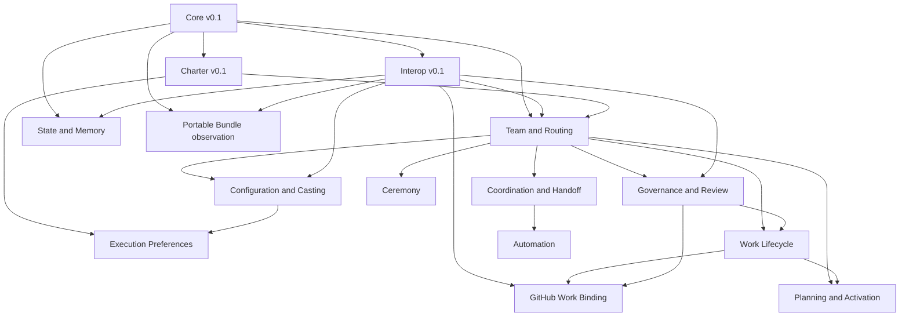
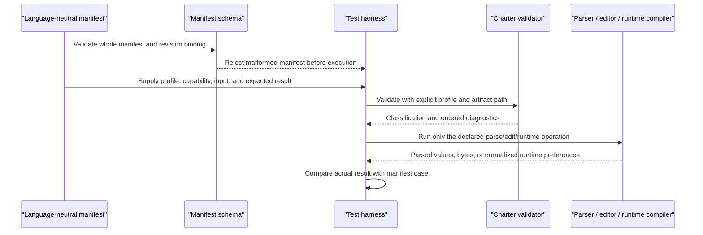

# Chapter 17: The Squad Specification

> **Prerequisites:** Volume 1 (or equivalent Squad experience); Chapters 11 and 14.

## What You'll Learn

- Distinguish a specification profile, an implementation, and an evidence-backed conformance claim.
- Read the v0.1 suite registry, maturity labels, dependency graph, version rules, and the Charter profile's executable manifest.
- Compare the normative Charter and Core contracts with the less mature routing, lifecycle, governance, automation, state, and provider requirements.
- Trace what Squad v1.1.0 actually implements in the CLI, SDK, workflows, templates, and tests—and identify where those behaviors are only analogous to a draft requirement.
- Audit a Tasktrack Squad without confusing “the code has a feature” with “the implementation conforms to a portable profile.”

## A specification describes a boundary, not a feature list

Squad's specification directory is not a second CLI manual, nor a promise that every product surface already has a portable contract. It is a working suite of contracts at different maturity levels. The important distinction is between *behavior existing in this repository* and *behavior having an executable, profile-specific conformance test*.

A product can implement something useful without being interoperable with another implementation. For example, two schedulers may both accept cron expressions but disagree about time zones, daylight-saving gaps, retries, or duplicate delivery. “Both have a scheduler” does not establish that one schedule manifest can safely move between them. The specifications make those differences explicit and provide a route from observed behavior toward portable contracts.

The suite is also deliberately narrower than “everything Squad does.” Its core focuses on artifacts and behavior inside one selected Squad root. Templates, shell interactions, prompts, plugins, cross-Squad delegation, a particular GitHub transport, and backend details are not automatically portable just because the repository contains them. Some appear in the inventory as implementation surfaces or future work, not as requirements that every Squad must satisfy.

### Profile, capability, and claim

A *profile* specifies a bounded artifact or operation. It has an identifier such as `squad-charter/v0.1`. A *capability* names one operation of that profile: `squad-charter/v0.1/validate`, for example. A *conformance claim* says that a particular implementation version passed specified evidence for particular capabilities, under a named conformance class and immutable revisions. These are separate concepts: implementing one operation is not evidence for every operation, and depending on a profile does not grant its capabilities transitively.

The suite uses five maturity labels:

| Maturity | Meaning in practice | Can it make a suite claim? |
|---|---|---|
| `executable-normative-draft` | Normative rules, a schema, a manifest, and executable cases exist, but the profile can still be an unpublished draft. | Yes, for the operations and cases it actually declares. |
| `experimental-normative-draft` | Normative rules exist and another profile exercises some of them, but the profile lacks a standalone manifest. | No standalone claim. |
| `experimental-schema` | A schema or fixture is machine-checkable, but there is no complete conformance manifest. | No. |
| `requirements-draft` | The behavior is described as requirements awaiting portable cases. | No. |
| `informative-draft` | An inventory, observation, or volatile set of requirements. | No. |

Only Charter v0.1 is registered as an executable normative draft in the v0.1 suite. That does **not** make it a published standard: the index says `working-draft`, with null publication revision and digest. A working-draft Charter claim is reproducible because the Charter profile and its manifest bind exact content digests; publication status and claimability are independent. Core is an experimental normative draft with no standalone manifest. Interoperability has a reference evidence schema and no manifest. Most other entries are requirements-only, and state/memory is informative.

> **Note:** “Requirements draft” is not a euphemism for “implemented incorrectly.” It means the document states a proposed contract without portable evidence sufficient to test it across implementations. The source inventory records known deviations where they are known; otherwise, treat the gap as *unproved*, not automatically as a defect.

### How to read normative words

Core imports BCP 14, the convention behind the familiar RFC requirement words. **MUST**, **MUST NOT**, **SHOULD**, and **MAY** have their standards meaning only when they appear in all capitals. A “should” in ordinary explanatory prose is not automatically a conformance requirement. For the normative Core and Charter documents, the capitalized words define obligations. The routing, automation, lifecycle, and similar drafts label themselves non-normative requirements; their lowercase “must” statements express design expectations, but they do not create a claimable v0.1 capability today. The state-and-memory document is explicitly informative.

This distinction matters when you review a code path. Ask four questions:

1. What behavior is the document actually requiring, and what is merely rationale or an example?
2. What exact artifact, profile version, or operation is in scope?
3. What executable case would fail if this requirement were broken?
4. Does the implementation pass that case, or does it only have a feature with a similar name?

## The shared foundation: Core and interoperability

### Core v0.1: common rules, not a universal Squad profile

`core-v0.1.md` defines the vocabulary and invariants that other profiles can reuse. It deliberately does not define prompts, commands, storage algorithms, telemetry, GitHub workflow behavior, or a claim that an entire Squad is conformant.

The most consequential Core rules are about *interpretation boundaries*:

- An implementation resolves exactly one Squad root before resolving profile paths. Repository-local paths are beneath `.squad/`, while an implementation may select an external or remote root through configuration. Profile paths themselves are relative to the root and omit `.squad/`.
- A consumer rejects a path that escapes the selected root after normalization. Where a profile prohibits traversal, symlinks and other reparse points are not followed.
- Each profile classifies its artifacts as `required`, `optional`, `generated`, `runtime-state`, or `implementation-private`. A known artifact is not automatically required in every installation.
- Profile association is explicit. A portable-conformance API requires a profile ID; omission is an error, not negotiation. Unsupported versions fail closed rather than being treated as the nearest version.
- Core version, profile version, implementation version, and mutable state revision are independent. Conformance claims bind immutable specification **and** evidence revisions; branch names, PR numbers, and nullable publication fields are not revision identifiers.
- Text is UTF-8; producers should emit LF and consumers accept CRLF unless a profile says otherwise. Required timestamps use RFC 3339. Path-segment identifiers exclude separators, controls, `.` and `..`.
- Extensible editors preserve unknown namespaced content and relative ordering; validators return deterministic diagnostics with stable typed codes, severity, and one-based source locations. Canonical and migration-compatible documents are not conflated.
- Artifacts are untrusted input. Their prose does not authorize commands, imports, links, tools, or secrets.

Core's examples are not all implemented as a shared library. In v1.1.0, Charter exercises several of these ideas: it accepts explicit profile selection through `validateCharterConformance`, has stable diagnostics, checks a path ID against the charter ID, and validates before applying runtime preferences. `packages/squad-sdk/src/agents/charter-validator.ts` and `charter-compiler.ts` are the most useful implementation entry points. `test/specification-suite.test.ts` validates the suite's local links, heading anchors, and indexed artifact paths. But there is no separate Core manifest that exercises root containment, generic path normalization, all artifact classes, or every Core rule. Charter's path check is not evidence that every Squad consumer implements the full root and symlink model.

### Interoperability Conventions: reusable vocabulary for future contracts

The Interoperability draft (`squad-interop/v0.1`) collects requirements that would otherwise be repeated in every profile: discovery, capabilities, stable identity, authority evidence, event envelopes, replay, version negotiation, extension ownership, and privacy. Its shared evidence shape contains specification and schema identifiers, event identity/type/source/subject/time, actor UID, correlation and causation, idempotency/replay keys, resource and revision data, payload digest, redaction declaration, extensions, and typed data.

The draft's requirements are important even though they are not claimable. It separates immutable actor identity from display name, path ID, role, casting persona, or provider login. It expects exact version negotiation and fail-closed behavior for unknown mandatory capabilities. It proposes at-least-once delivery with duplicate suppression, expected-revision checks for mutation, and explicit handling when an idempotency key is reused with a different payload. Sensitive material should be referenced by an access-controlled URI and digest rather than copied into portable evidence. Unknown advisory extensions should round-trip; unknown mandatory extensions fail closed.

The v1.1.0 repository has `test-fixtures/spec/suite-v0.1/evidence.schema.json`, the suite index/schema, and TypeScript tests that check selected envelope and registry structure. The registry enforces capability grammar and blocks entries without manifests from advertising claimable capabilities. That gives the suite a useful reference shape, not an interoperable runtime protocol: there is no published discovery API, no complete relational-invariant catalog, no portable replay or authority test suite, and no cross-implementation evidence corpus. Schema-valid JSON only proves shape, not that an actor was actually authorized or that a mutation was atomic.

### Cross-spec dependency map

The suite README's dependency graph is a reading order, not a capability inheritance graph. Core sits underneath the profiles. Interop is a conventions dependency. Charter is the one independently claimable profile. The other tracks build on these foundations and on one another as shown below.



This graph is useful for dependency tracing, not for deciding what an implementation “inherits.” For example, a GitHub lifecycle binding depends on the neutral lifecycle and governance requirements; it does not become evidence that either neutral profile is implemented. Nor does an implementation of Charter automatically claim all of Core: the registry explicitly says Core has no standalone manifest.

## The one executable normative profile: Charter

The Charter profile is the suite's clearest example of a contract becoming testable. It identifies the required artifact at `agents/{id}/charter.md` relative to the Squad root (shown in a repository as `.squad/agents/{id}/charter.md`) and uses the path's `{id}` as the charter identity when path context is available. The profile version is selected by the API or manifest; v0.1 does not add an in-document version marker.

A canonical charter has one H1 in `Display Name — Role` form, followed by `Identity`, `Accountable Responsibilities`, `Non-Responsibilities`, `Collaboration and Review Authority`, and optional `Model`, in that order. Identity needs a kebab-case ID and one-line nonempty purpose. Model preferences can include a model identifier or `auto`, rationale, reasoning effort, and context tier. The portable reasoning values are `auto`, `low`, `medium`, `high`, `xhigh`, and `max`; context values are `auto`, `default`, and `long_context`. `auto` means defer selection; it must not become a literal model/tier passed through as a user override.

Charter's parser is deliberately a deterministic Markdown subset, rather than a requirement to embed a full CommonMark parser. It recognizes only column-one ATX H1/H2 headings as structural; ignores structural-looking text inside fences, indented code, blockquotes, and HTML comments; and treats the first `X-` H2 and following extension sections as an opaque tail. Compatibility input such as `What I Own`, `Boundaries`, `Collaboration`, and legacy identity/model fields can be accepted but is classified as noncanonical-compatible and produces warnings. An editor preserves unknown extension blocks byte-for-byte, in relative order, including on known-field edits; a canonical no-op returns the original bytes.

The profile specifies five separate operations: `/parse`, `/validate`, `/edit`, `/legacy-consume`, and `/runtime`. A portable conformance API requires an explicit profile. A validator returns ordered diagnostics and distinct `accepted` and `conforms` booleans: a legacy document may be accepted without being canonical. Invalid behavior fields are rejected before runtime preferences are applied. Charter prose never authorizes tools, filesystem, network, or provider access; runtime policy must enforce those independently.

The implementation is unusually concrete for this suite. `packages/squad-sdk/src/agents/charter-markdown.ts` scans the deterministic subset; `charter-validator.ts` defines diagnostic codes `SQC001`–`SQC015` and `SQC101`–`SQC108`, explicit-profile validation, section aliases, ordering, ID/path checks, and extension collisions. `charter-compiler.ts` validates before parsing behavior and composing the prompt, then resolves config overrides above charter preferences. The portable manifest and schema live in `test-fixtures/spec/charter-v0.1/`; `test/charter-spec.test.ts` validates the manifest before exercising its cases, while `test/charter-compiler.test.ts` covers compiler behavior. The manifest binds the exact Markdown spec bytes and its evidence projection with SHA-256; the latter is canonicalized with RFC 8785. The index says there are no registered Charter deviations, though the profile remains an unpublished working draft.

The boundary to remember is that the TypeScript compiler has conveniences the portable profile does not require: its convenience validator/compiler can default to v0.1, and omitted charter content can synthesize a neutral compatibility charter. Those behaviors are implementation-specific and are not portable-profile negotiation. If you reuse the SDK, you can rely on its tests; if you are evaluating another runtime, you need to test the manifest-level contract rather than assume this implementation's defaults.

## The wider suite, profile by profile

The next sections treat each available file as its own document. A profile's `MUST`/`SHOULD` language is summarized as written; where the header says non-normative or informative, these are requirements under consideration—not current conformance obligations. Each implementation pointer is evidence of an existing mechanism, not proof of profile conformance unless the suite registry says so.

### `team-routing-v0.1.md` — roster identity and route selection

**Purpose and requirements.** This requirements draft defines two artifacts: `team.md` for roster membership and accountable roles, and `routing.md` for work-type ownership. A roster must map each active member to exactly one existing charter whose identity matches the member ID. A route must name one active accountable member; a support identity is not a route destination unless ownership is explicitly granted. Its deterministic resolution proposal is: authorized explicit assignment first, then the highest-priority matching route; equal-priority matches are ambiguous and fail rather than being resolved by file order; absent a match uses a declared fallback; without a fallback, the result is `route-unresolved` and needs coordinator or human disposition. Evidence should say which rule matched, which input revision was read, confidence, and whether fallback was used. Membership and routing do not grant credentials, tools, model entitlement, or repository write access. Roster and route promotion are intentionally independent.

**v1.1.0 implementation.** `packages/squad-sdk/src/config/init.ts` creates the initial team artifacts. `config/routing.ts` parses Markdown routing tables and compiles patterns, examples, priorities, and fallback behavior; `config/schema.ts` also provides typed routing configuration with rule priority and fallback settings. `test/routing.test.ts`, `test/coordinator-routing.test.ts`, and `test/template-routing.test.ts` exercise real routing behavior.

**Gap.** The current routing representation is not the profile's contract: its parser can represent multiple agents per row, uses generated regex/heuristic specificity, and has `@coordinator` as its no-match behavior in `matchRoute`; it does not fail on tied top matches as the draft prescribes or attach a portable evidence record with rule/input revision. Team roster and routing still have multiple shapes; no manifest covers roster parsing/mutation, joins, ambiguity, stale writes, and resolution. A `routing.md` that routes correctly for one coordinator is not a v0.1 conformance claim.

### `coordination-handoff-v0.1.md` — dispatch and continuity across sessions

**Purpose and requirements.** This draft specifies a message envelope for `dispatch`, `acknowledgement`, `progress`, `result`, `handoff`, `escalation`, and `cancellation`. The record should identify sender and recipient/route, correlation and causation, task reference, input revisions, timestamps and expiry, idempotency key, and payload digest. Session IDs remain opaque provider references; their syntax must not imply identity, ordering, or authorization. The proposed lifecycle is `pending → accepted → running → succeeded|failed|cancelled|expired`. Delivery is at least once unless a binding proves stronger behavior; consumers deduplicate by message and operation IDs, and order by causation rather than arrival time. Handoff creates a successor linked to the predecessor; it does not overwrite the old result. Lost sessions may be replaced while retaining portable task identity. Secrets and hidden prompts do not belong in envelopes.

**v1.1.0 implementation.** Session and agent lifecycle code exists (`packages/squad-sdk/src/agents/lifecycle.ts`), along with event buses in `packages/squad-sdk/src/runtime/event-bus.ts` and `packages/squad-sdk/src/client/event-bus.ts`. These provide event publication and subscription, while provider/session integration supplies the actual session reference. The inventory describes session and handoff mechanisms as existing but provider-specific.

**Gap.** The event bus is not the shared message envelope: its event type union and `payload: unknown` do not encode all required fields, expiry, a portable idempotency key, digest, or replay disposition. The suite documents no deterministic traces for duplicates, reordering, stale input, cancellation races, expiry, or session loss/recovery. Be precise: event emission is an implementation seam; it is not proof of portable delivery semantics.

### `work-lifecycle-v0.1.md` — provider-neutral work state

**Purpose and requirements.** This draft supplies a finite, provider-neutral set of work resources—work item, dependency, assignment, workspace, change, check, review, integration, and closure—and the states `untriaged`, `assigned`, `in-progress`, `needs-review`, `changes-requested`, `checks-failed`, `ready`, `integrated`, `done`, `cancelled`, and `blocked`. Only the transition-table edges are valid. In particular, `blocked` preserves the previous nonterminal state as `resumeState`; it is not a wildcard state. `done` and `cancelled` are terminal. Every resource includes stable identity, provider-qualified reference, observed revision, and authority source. Mutations need operation IDs and expected revisions; retries return the same mapping, and partial provider effects must not look like complete success. The proposal does not require Git, GitHub, a branch naming rule, a merge strategy, or auto-merge.

**v1.1.0 implementation.** Work is represented through platform adapters and issue/PR workflows, including `packages/squad-sdk/src/platform/types.ts`, `platform/github.ts`, `platform/azure-devops.ts`, and the issue-lifecycle templates. The repo also has worktree support and a Ralph monitor (`packages/squad-sdk/src/runtime/rework.ts`). These components provide usable lifecycle pieces.

**Gap.** The suite explicitly says the state vocabulary is a design, not an executable transition contract. Providers do not emit one shared revision, recovery, cancellation, or blocker-resume record. There is no full positive/negative trace corpus for the table and no requirement to run the same neutral traces against GitHub and a second provider. Use the table as a way to reason about work state, not as a guarantee that every adapter follows these transitions.

### `github-work-lifecycle-binding-v0.1.md` — mapping the neutral lifecycle to GitHub

**Purpose and requirements.** This binding maps neutral resources to issues, labels, branches/worktrees, pull requests, checks, reviews, merge results, and issue closure. Ownership is a single `squad:{member-id}` label; a GitHub assignee is authorization/notification rather than portable ownership. State derives from one provider snapshot using a declared precedence: merged state, cancellation, blockers, blocking review, failed check, approval plus passing checks, open non-draft PR, draft/claimed workspace, owner label, and finally untriaged. Simultaneous evidence is retained; multiple distinct owner labels are a conflict, not “first label wins.” Mutations use a canonical snapshot digest and idempotency key, re-read before mutation, and stop on stale snapshots. Rate limits, partial failures, temporary references, and provider drift are explicit outcomes. GitHub API assumptions are versioned separately from this binding.

**v1.1.0 implementation.** The repository has GitHub platform support (`packages/squad-sdk/src/platform/github.ts`), CLI/workflow paths, issue labels, and PR-based workflows, including `.github/workflows/squad-issue-assign.yml` and the reusable workflows under `workflows/`. Those are concrete provider adapters and automation.

**Gap.** The draft identifies the missing evidence: there is no sanitized, versioned provider transcript corpus. API-version evidence, canonical snapshot tokens, CAS re-read behavior, complete multi-label conflict mapping, partial-failure records, and provider-drift records are not emitted uniformly. The implementation uses installed `gh` behavior in places and does not provide deterministic, portable proof of the binding's precedence table. GitHub support therefore should not be described as conformance to `squad-work-github/v0.1`.

### `governance-review-v0.1.md` — accountability, review, and lockout

**Purpose and requirements.** This is a requirements draft with informative overview, vocabulary, evidence shape, state machine, and promotion expectations. The proposed states distinguish draft/submission/review/approval/completion, rejection and reassignment, and escalation/disposition. Completion means accepted review and external checks, not necessarily provider merge. A blocking verdict should identify the exact subject, violated invariant, reproducible evidence, and minimum clearing condition; preference-only feedback remains advisory. On rejection, the current revision author enters a review-subject-specific lockout set and cannot author, co-author, pair on, or direct the next revision. The reviewer cannot become successor author. If no eligible successor exists, the coordinator records a deadlocked escalation rather than silently making the locked-out author eligible. Approval must name the exact revision and cannot be self-approval. Governance evidence does not grant provider permissions.

**v1.1.0 implementation.** The repo has reviewer/rework mechanisms, including `packages/squad-sdk/src/runtime/rework.ts`, governance/reviewer guidance, and the review guard in `workflows/shared/squad-review-guard.mjs`. `test-fixtures/spec/suite-v0.1/governance-rejection.example.json` and `evidence.schema.json` show a reference record shape; tests check selected implementation relationships.

**Gap.** The spec says its schema and TypeScript checks are not portable conformance evidence. It lacks language-neutral relational invariants and a full transition manifest. The inventory flags a concrete policy incompatibility: it reports that `.squad/governance.md` permits the accountable owner to prepare the next revision, while the draft proposes a different author under lockout. That governance file is absent from the v1.1.0 checkout examined for this chapter, so this is an inventory-reported discrepancy rather than a directly re-read source fact. These are competing draft/product policies—not grounds to claim the product passed or failed a published standard.

### `state-memory-requirements-v0.1.md` — authority and classification are separate

**Purpose and requirements.** This document is explicitly informative and is not a conformance profile. It surveys file, orphan-ref, two-layer, external, and memory providers and states what a future authority contract would need: one selected backend per collection; stable IDs; durability/visibility guarantees; compare-and-swap and conflict behavior; append/replace/delete/archive/tombstone semantics; startup verification and recovery; migration/rollback without split-brain; trust boundaries; and privacy/retention. Memory needs its own stable classes, classification before durable writes, provider/search provenance, deletion and retention rules, and a way to prevent forbidden/transient material from reaching durable storage. State-authority conformance does not imply memory conformance, or vice versa.

**v1.1.0 implementation.** `packages/squad-sdk/src/state-backend.ts` defines a common state-backend interface and local/orphan/two-layer/external-stub implementations. Storage providers include `storage/fs-storage-provider.ts`, `sqlite-storage-provider.ts`, and an in-memory provider. `packages/squad-sdk/src/memory/index.ts` and the memory CLI implement provider-specific memory surfaces. The state backend contains retry, circuit-breaker, startup verification, and explicit uncertainty/conflict errors.

**Gap.** The informative document says there is no backend-neutral CAS, recovery, migration, privacy, retention, deletion, or cross-tenant fixture corpus. Interface similarity is not equivalent to identical atomicity or authority. Promotion requires common tests across several providers, independent state and memory profiles, and a security review. Do not treat “the state backend interface has `write`” as proof that an external and local store agree on durability, CAS, privacy, or rollback.

### `automation-v0.1.md` — schedule declarations and execution evidence

**Purpose and requirements.** This requirements draft proposes `schedule.json` with ID, name, enabled state, trigger, task reference, provider set, retry policy, and optional concurrency key. Triggers are cron, interval, event, or startup; task classes include workflow, script, agent, and webhook. Task references are inert data until authorization and provider policy allow execution. Runs and attempts have explicit states and share the evidence envelope. Cron must declare time zone and daylight-saving behavior; intervals use elapsed duration; events need stable IDs; startup execution is idempotent per startup ID. Claims use compare-and-swap, retries have attempt/backoff evidence, generation is reproducible from the manifest and generator version, and script/webhook boundaries require authorization and secret-safe logs.

**v1.1.0 implementation.** The SDK scheduler at `packages/squad-sdk/src/runtime/scheduler.ts` defines a manifest, validates trigger/task/retry data, evaluates due work, executes retries, persists run state, and exposes `LocalPollingProvider` and `GitHubActionsProvider`. The CLI is `packages/squad-cli/src/cli/commands/schedule.ts`.

**Gap.** The implementation is a real scheduler, but not the draft's entire portable envelope: its `RunRecord` is compact (`lastRun`, `nextDue`, status, optional error); it does not carry the full shared actor/revision/idempotency evidence. There are also visible model differences: the draft names the task class `agent` and an optional concurrency key, while the SDK uses `copilot` in its task-type union and `ScheduleEntry` has no concurrency-key field. The draft's time-zone and daylight-saving semantics, stable event-ID deduplication, CAS claim race, startup executor ID, provider drift, and secret-safe result corpus remain promotion requirements. In particular, a cron string alone does not establish portable wall-clock behavior.

### `ceremony-v0.1.md` — definitions, triggers, and run records

**Purpose and requirements.** This requirements draft separates a ceremony definition from shared scheduling and from one execution record. A definition identifies a ceremony, enabled flag, trigger, timing, condition reference, facilitator, participant selectors, cooldown, inputs, and output requirements. Trigger modes normalize to `manual`, `schedule`, or `event:<name>`; legacy bare names are compatible input, while legacy `auto` is ambiguous. Participant selectors must resolve to an exact set. A run records trigger and input revisions, facilitator, participants, start/end, decisions/actions and next eligible time. The proposed lifecycle is eligible/claimed/running/terminal; cooldown starts at terminal completion and overlapping executions are suppressed. Blocking and advisory failures differ. Ceremony prose and hooks do not grant permission or execute merely because they appear in a definition.

**v1.1.0 implementation.** `defineCeremony()` in `packages/squad-sdk/src/builders/index.ts` validates basic object/string/array shapes and returns the definition; `builders/types.ts` describes its shape. `config/schema.ts`, `.squad-templates/ceremonies.md`, and `.squad-templates/ceremony-reference.md` are distinct representations. The shared scheduler is in `runtime/scheduler.ts` and its CLI.

**Gap.** The draft calls out that arbitrary trigger strings and schedule text are preserved, but this does not prove trigger normalization, cooldown enforcement, participant resolution, or a run record. Event names such as `pr-merged` and `auto` are unstable/ambiguous inputs. There is no manifest with injected-clock cooldown and duplicate-claim cases, and mapping between builder, config, Markdown, plugins/hooks, and scheduler is incomplete. Ceremony and Automation are related but should not grow duplicate cron/retry engines.

### `configuration-casting-v0.1.md` — authored intent, persistent names, and provenance

**Purpose and requirements.** This requirements draft splits configuration selection, cast identity, and provenance into separate promotion units. It names `config.json`, `casting/registry.json`, `casting/policy.json`, and append-only `casting/history.json`. The registry should carry schema/version, monotonic revision, generation time, and an agent map keyed by stable member ID; each entry records display and persistent names, accountable role, naming source, status, and timestamps. History records operation, prior/result revisions, actor, time, and identity joins, and does not override the registry. Precedence is explicit operation input, session intent, repository config, charter preference, then runtime automatic policy; `auto` is a delegation request, not a concrete value. Recasting may change display names but preserves IDs absent an explicit migration. Mutations are idempotent, revision-checked, and fail closed on stale writes; theme/persona text never grants access.

**v1.1.0 implementation.** Config types and defaults live in `packages/squad-sdk/src/config/schema.ts`; config loading and setup are in `config/init.ts`. The cast engine and durable registry are under `packages/squad-sdk/src/casting/` (`casting-engine.ts`, `durable-registry.ts`, `casting-history.ts`, and `agent-provenance.ts`). The config schema includes model and ceremony fields beyond the proposed portable set, reflecting runtime needs.

**Gap.** The document says these files do not share one portable manifest. Legacy registry shapes and runtime-only keys are accepted; the implementation is not shown to provide the proposed complete provenance, revision/CAS, replay, and roster-join semantics. `CastingHistory`'s current records and serialized format, for example, are not themselves proof of the draft's append-only operation IDs and prior/result revision protocol. Configuration preference intent should not be mistaken for authorization or a stable cross-runtime config schema.

### `planning-activation-v0.1.md` — from intent to provider work

**Purpose and requirements.** The planning requirements draft models intent intake, research, triage, program planning, implementation decomposition, validation, acceptance, and activation. Records should have profile/kind/schema, intent and record IDs, revision/predecessors, producer/time, content digest, and idempotency key. A change to evaluated intent content creates a new revision and invalidates dependent acceptance. The proposed chain does not activate until scope and implementation acceptance and passing validation refer to the same dependency closure. Implementation tasks need stable IDs, acceptance criteria, dependency IDs, accountable route, and activation disposition. Model output or a validator passing is not itself human acceptance. Activation maps accepted tasks to provider work items, records partial progress, and avoids duplicate creation under retries. Input text is untrusted; links, commands, and embedded prompts are not executed just because they are in a PRD.

**v1.1.0 implementation.** gh-aw planning flows and observable planning records live in `workflows/shared/squad-planning-ontology.md`, `squad-planning-policy.md`, `workflows/shared/squad-activation.mjs`, and the package workflows such as `workflows/package/squad-bootstrap.md`, `squad-implement-worker.md`, and `squad-review.md`. The implementation uses provider safe-output mechanisms and workflow-local records.

**Gap.** The draft identifies safe-output envelopes, comment lookup, and activation limits as provider-specific. No portable manifest fixes record schema, content digest, dependency closure, authority acceptance, partial activation boundary, or replay behavior across providers. A workflow with planning stages is not proof that its fast path and detailed path produce equivalent records.

### `execution-preferences-v0.1.md` — request is not entitlement

**Purpose and requirements.** This draft defines portable intent for model, model class, reasoning effort, context tier, fallback, and source. Absence, `auto`, and a concrete identifier differ. Precedence is explicit operation input, session directive, repository config, charter, task-aware automatic policy, and platform default. Resolution should report requested and selected values, source, fallback attempt, availability, authorization, and policy disposition. These are separate checks: a model can be addressable but unauthorized or policy-denied. Fallback must not exceed the authored boundary (`none`, same-provider, same-class, or platform-default), every attempt is recorded, and exhaustion is explicit. No preference grants data, tool, provider, or spending access.

**v1.1.0 implementation.** `packages/squad-sdk/src/agents/model-selector.ts` exports `resolveModel()` and records precedence among user override, config, session, charter, task-auto, and default. It includes availability checks, fallback chains, selection profiles, and cost-policy processing. `charter-compiler.ts` also normalizes `auto` and applies config over charter fields.

**Gap.** The product resolver is richer and product-specific: vendor catalogs, model IDs, fallback chains, preview model handling, and cost controls are runtime policy. The portable draft's distinct availability/authorization/policy outcomes and constraint-bounded fallback evidence are not interchangeable with selecting the next model from a product catalog. The exact precedence details of the draft and implementation are not identical, so explain them separately rather than collapsing both into one table.

### `artifact-inventory.md` — traceability and maturity audit

**Purpose and requirements.** This file is informative; it inventories surfaces, artifacts, source pointers, spec status, what exists, and what is still missing. It is not a normative profile. It makes several boundaries explicit: presets are not portable bundle snapshots; workstream SubSquads differ from independent peer Squads; upstream inheritance differs from discovery-only registration; cross-Squad delegation is not made portable merely by being implemented; and spawning a second Squad has no dedicated profile. Skills, telemetry, communications, external tools, generated capabilities, and prompts are either deferred or implementation guidance.

The inventory is especially useful for its known-deviation register: current governance permits owner revision where the draft proposes lockout; model catalogs/fallback lists are product policy; natural-language ceremony conditions are compatible rather than deterministic; state backends lack common recovery/migration tests; GitHub adapters lack API-version evidence; and cast names cannot stand in for authority. It also distinguishes a tested `squad-portable-bundle/v1.0` implementation from a published portable profile: no published schema or manifest exists, and exported histories, decisions, skills, casting, and policies can contain sensitive material.

**v1.1.0 implementation and gap.** The inventory itself points to the code: charter compiler/validator, initialization/routing, scheduler, export/import, preset, stream, upstream, and cross-Squad modules. There is no separate executable inventory contract; its job is research and traceability. Treat its audit date and known gaps as a versioned snapshot, not a timeless list. Recheck the relevant v1.1.0 source before describing any implementation detail as a requirement.

### `README.md` — the registry and suite guide

**Purpose and requirements.** The README is an informative registry/navigation index. It records each profile's identifier, document class, maturity, dependencies, capabilities, manifest/schema, implementation status, known deviations, and suggested reading path. It defines exact maturity and document-class vocabularies, capability IDs of the form `squad-<profile>/v<major>.<minor>/<operation>`, conformance classes (`canonical`, `compatible`, `legacy`, `runtime`), and implementation roles (`producer`, `consumer`, `editor`, `validator`, `executor`). Roles are not claims. A registry entry without a manifest cannot advertise claimable capabilities/classes. It states that only Charter currently has a manifest and immutable claim revision. The README also gives the dependency DAG, reference/version policy, external normative references, and publication distinction.

The registry's draft publication fields (`publication.revision` and `.digest`) remain null. A future release artifact can attach an immutable reviewed source revision and artifact digest without committing a self-referential digest back onto the same commit. This publication record is separate from Charter's per-claim immutable `revision` object. Draft corrections are new immutable commits; a published normative change requires a new profile version (for v0.x, increment minor; from v1.0, compatible additions increment minor and behavior changes increment major).

**v1.1.0 implementation.** `test-fixtures/spec/suite-v0.1/index.json` and `index.schema.json` encode the registry. `test/specification-suite.test.ts` checks relative links, heading anchors, and indexed file paths offline. Charter's manifest/schema and spec digest bind the one executable profile. **Gap.** The README warns that external URL availability is not checked by the offline suite test. More importantly, the registry is a current working-draft map; it is not a product-level discovery endpoint, and the capability taxonomy does not imply complete runtime negotiation.

### Requested documents absent from the v1.1.0 source tree

The assignment names `client-harness-adapters`, `client-backend-decoupling`, and `ADR-001` alongside the suite's existing documents. Those exact files are **not present** in `docs/specification/` at tag `v1.1.0`; there are no corresponding entries in the chapter's `research/coverage.csv`, nor matching paths in the source tree searched for this chapter. The actual directory contains 16 Markdown files: the README, the artifact inventory, and the 14 named v0.1 specifications summarized above. Since no contents, stable identifiers, or normative keywords exist for those three requested titles in this checkout, this chapter does not invent their purpose, MUST/SHOULD clauses, implementation mapping, or gaps. They may refer to another branch/version or to planned documents. If they are later supplied, treat them as new source material and update the chapter's coverage mapping rather than silently attributing requirements to v1.1.0.

### Squad 2.0 preview specifications

The preview adds three documents beyond the v1.1.0 suite. **ADR-001, Client, Control, and Execution Boundary**, records the three-plane architecture and treats MCP as a bridge rather than the conversation protocol ([source](https://github.com/bradygaster/squad/blob/v2.0.0-preview.2/docs/specification/adr-001-client-control-execution-boundary.md)); Chapter 18 gives the architectural context. **Client and Harness Adapter Profile v0.2** is a working, non-normative, non-claimable draft that separates workspace projection, client adaptation, and execution-harness responsibilities ([source](https://github.com/bradygaster/squad/blob/v2.0.0-preview.2/docs/specification/client-harness-adapters-v0.2.md)); see Chapter 20. **Client and Backend Decoupling v0.2** is also a working requirements draft; it describes the shared conversation/backend contract independently of host and execution choices ([source](https://github.com/bradygaster/squad/blob/v2.0.0-preview.2/docs/specification/client-backend-decoupling-v0.2.md)); see Chapter 21. These preview documents do not retroactively change what the v1.1.0 chapters establish.

## Conformance is evidence, not resemblance

A reliable assessment follows a short chain:

1. **Name the profile and exact version.** “Supports charter files” is too broad; say whether the implementation claims the `parse`, `validate`, `edit`, `legacy-consume`, or `runtime` operation of `squad-charter/v0.1`.
2. **Select the source revision.** Profile identifiers do not encode the implementation's version or mutable state revision. A claim names immutable spec and evidence revisions.
3. **Run the profile's manifest.** The suite rejects an invalid manifest before partially executing it. Each test case states its profile, input source/path, capability, and expected validation/runtime behavior.
4. **Report classification honestly.** `accepted` can be true while `conforms` is false. A compatible legacy document should not be reported as canonical.
5. **Keep authority and execution separate.** A charter can request a model; config can override it; the host still decides whether that model is available and authorized. A route can assign work; it does not grant GitHub permissions.
6. **Describe evidence limits.** TypeScript unit tests, a schema, a workflow, a passing example, and a published conformance manifest are different evidence levels.

Charter illustrates the difference between *manifest* and *harness*. The JSON manifest is language-neutral: it defines inputs, expected parsed semantics, diagnostics, serialized outputs, and runtime results. `manifest.schema.json` checks the manifest's shape. The TypeScript test harness loads and validates the manifest, reads fixtures, invokes parser/validator/editor/compiler operations, and compares outputs. A future Rust, Python, or other implementation could execute the same cases without adopting the TypeScript test runner. Conversely, another TypeScript implementation should not pass by duplicating an internal helper; it must match observable results.

Core and the requirements drafts have promotion criteria for this reason. Team/routing asks for distinct roster and routing cases, including ambiguity, fallback, stale revision, and evidence. Governance needs relational and transition cases. Work lifecycle calls for traces against GitHub and a non-GitHub binding. GitHub asks for sanitized transcripts. State asks for common CAS, recovery, migration, and split-brain behavior. A profile gets stronger by making its cases falsifiable, not by adding more implementation-specific prose.

### A second view: the Charter conformance pipeline



This flow is specific to the Charter evidence harness. Do not assume the same executable pipeline exists for every `requirements-draft` row in the registry.

## Hands-On: Audit Tasktrack against one profile

This exercise uses the Tasktrack companion project you have grown in earlier chapters. It is an audit, not a request to modify Squad internals. A prior chapter should already have initialized and cast a Squad in `~/tasktrack`; if your checkout is elsewhere, substitute its path. Keep the application tests passing while you inspect its Squad artifacts.

```bash
cd ~/tasktrack
npm test
printf '\nSquad artifacts:\n'
find .squad -maxdepth 3 -type f | sort | sed -n '1,30p'
printf '\nTeam and routing files:\n'
for file in .squad/team.md .squad/routing.md .squad/config.json; do
  if test -f "$file"; then printf 'present: %s\n' "$file"; else printf 'absent:  %s\n' "$file"; fi
done
```

**Expected result:** the Tasktrack tests pass; the `find` output lists the artifacts created by your earlier Squad setup; and the presence check reports which roster, routing, and configuration files actually exist. The exact agent roster depends on your earlier choices, so do not compare it to a made-up canonical list.

Now choose one API-owner charter (often `.squad/agents/backend/charter.md`; use your actual filename) and inspect it alongside the route and roster. Create a small audit table in your notes, not in the application's runtime data:

| Question | Record what you observe |
|---|---|
| Which profile/artifact would govern this file? | For a charter, identify `squad-charter/v0.1` and the root-relative `agents/{id}/charter.md` path. |
| Does the charter have a canonical ID and purpose? | Check the `Identity` fields and whether the ID matches the directory name. |
| Is it canonical, compatible, or unknown? | Look at the required section names/order and legacy aliases. Do not call it conformant based on visual resemblance alone. |
| How does its route connect to the roster? | Find the accountable member and see whether the routing destination has a matching charter. |
| What evidence would make this portable? | For Charter, point to the manifest case; for routing, list the missing ambiguity/fallback/join cases. |
| What is outside the profile? | Tool permissions, provider credentials, and runtime authorization remain separate. |

Finally, record a two-sentence conclusion: one sentence about the evidence you have (for example, “the local charter appears canonical by inspection”), and one about the evidence you do **not** have (for example, “the local CLI has not run the Charter v0.1 manifest”). Do not invent a `squad validate-spec` command: v1.1.0 does not expose a generic profile conformance CLI. Preserve application behavior by running `npm test` again if you edit any Tasktrack files; this chapter's audit needs no application change.

## Configuration Reference

This chapter is mostly about specification artifacts, not flags. The table below separates normative format identifiers from the product's actual v1.1.0 surfaces; a similarly named config key is not proof of matching a portable profile.

| Surface | Relevant name or value | What it means | v1.1.0 caveat |
|---|---|---|---|
| Profile identifier | `squad-core/v0.1`, `squad-charter/v0.1`, etc. | Exact profile/version selection; major/minor only. | Only Charter has an executable manifest in the suite. |
| Charter path | Root-relative `agents/{id}/charter.md`; repository path `.squad/agents/{id}/charter.md` | Profile association and optional identity/path join. | The reference validator recognizes these forms; this does not implement every Core containment rule. |
| Charter capabilities | `parse`, `validate`, `edit`, `legacy-consume`, `runtime` | Separate operations, each independently evidenced. | A validation result reports validation; it does not claim parse/edit/runtime by implication. |
| Charter model preference | `Preferred`, `Reasoning Effort`, `Context Tier` | Portable intent with explicit vocabularies and `auto`. | Actual model catalogs and fallback chains are runtime policy. |
| Charter extensions | `## X-<namespace>-<name>` | Opaque, namespaced extension blocks; `squad` is reserved. | Unknown extensions must be preserved by a conforming editor; don't assume all tools edit them losslessly. |
| Config schema | `version`, `team`, `routing`, `models`, `agents`, optional `hooks`, `ceremonies`, `plugins` | Typed SDK configuration in `packages/squad-sdk/src/config/schema.ts`. | Product config has runtime-specific keys and is not the portable Configuration/Casting manifest. |
| Schedule manifest | `.squad/schedule.json` | Product scheduler supports `cron`, `interval`, `event`, `startup`; tasks include `workflow`, `script`, `copilot`, `webhook`. | The portable Automation draft proposes a broader evidence lifecycle and stricter time semantics. |
| Schedule retry | `maxRetries`, `backoffSeconds` | SDK task retry options. | Not a substitute for portable claim/CAS/run/attempt evidence. |
| Casting records | `casting/registry.json`, `casting/policy.json`, `casting/history.json` | Existing identity and naming surfaces. | Profile fields/revisions are still requirements, not a shared portable schema. |
| Work state names | `untriaged`, `assigned`, `in-progress`, … | Neutral lifecycle draft vocabulary. | No generic v1.1.0 CLI contract promises those exact transitions. |
| Conformance index | `test-fixtures/spec/suite-v0.1/index.json` | Machine-readable registry and maturity data. | It is a source/test artifact, not a runtime discovery endpoint. |

No environment variable is defined by the assigned specification suite as a portable conformance control. Provider credentials and host authorization belong to the runtime/provider boundary, not to charter prose, team routes, a schedule task reference, or casting persona metadata.

## Under the Hood

The source has three distinct layers. First, Markdown/config/template surfaces make Squad usable. Second, SDK modules implement product-specific parsing, scheduling, routing, storage, and provider integration. Third, fixtures and tests provide evidence for specific behavior. The specification suite's purpose is to define which parts of those layers can become portable claims.

| Concern | v1.1.0 implementation entry points | How to interpret them |
|---|---|---|
| Suite registry and links | `test-fixtures/spec/suite-v0.1/index.json`, `index.schema.json`, `test/specification-suite.test.ts` | Offline structural consistency for the registry and docs; not an external URL checker or runtime capability discovery API. |
| Charter | `packages/squad-sdk/src/agents/charter-markdown.ts`, `charter-validator.ts`, `charter-compiler.ts`; `test-fixtures/spec/charter-v0.1/manifest.json`; `test/charter-spec.test.ts` | The only profile whose manifest supplies exact, language-neutral operational evidence. |
| Team and routes | `packages/squad-sdk/src/config/init.ts`, `config/routing.ts`, `config/schema.ts`; `test/routing.test.ts` | Current product routing is heuristic/implementation-specific; it is not the deterministic draft resolver. |
| Configuration and cast | `config/schema.ts`; `casting/casting-engine.ts`, `durable-registry.ts`, `casting-history.ts`, `agent-provenance.ts` | Current config and casting structures exist; the portable registry/history revision model is unclaimed. |
| Session events and coordination | `packages/squad-sdk/src/runtime/event-bus.ts`, `client/event-bus.ts`, `agents/lifecycle.ts` | Useful event/session seams but no portable message-envelope or replay guarantee. |
| Work and providers | `packages/squad-sdk/src/platform/types.ts`, `platform/github.ts`, `platform/azure-devops.ts`, `runtime/rework.ts`; issue-lifecycle templates | Provider-specific work processes; no neutral transition manifest or deterministic provider transcript set. |
| Review governance | `workflows/shared/squad-review-guard.mjs`, `runtime/rework.ts`, reviewer guidance, `test-fixtures/spec/suite-v0.1/governance-rejection.example.json` | Reference checks and a fixture exist, but the file itself disclaims portable governance conformance. The inventory-referenced `.squad/governance.md` is not present in this checkout. |
| State and memory | `packages/squad-sdk/src/state-backend.ts`, `state/`, `storage/`, `memory/index.ts` | Multiple backends and memory providers, with provider-specific guarantees. |
| Scheduling and ceremonies | `packages/squad-sdk/src/runtime/scheduler.ts`, `packages/squad-cli/src/cli/commands/schedule.ts`, `packages/squad-sdk/src/builders/index.ts`, `.squad-templates/ceremonies.md` | Scheduler has manifest validation/execution; ceremony builder validates basic shapes but does not establish full ceremony lifecycle/cooldown conformance. |
| Planning and provider workflows | `workflows/shared/squad-planning-ontology.md`, `squad-planning-policy.md`, `squad-activation.mjs`, `workflows/package/` | gh-aw provides real planning/activation automation, but safe-output and evidence contracts are provider-specific. |
| Portable bundle and composition | `packages/squad-cli/src/cli/commands/export.ts`, `import.ts`, SDK preset/streams/upstream/cross-squad modules | Observed product surfaces; the inventory says they have no dedicated portable profile or claim. |

One particularly useful code-level distinction appears in Charter. The portable validator requires an explicit profile for a conformance call; the convenience TypeScript validator can default to the current Charter profile. The compiler then validates before applying preference fields and resolves `auto` as no concrete override. This is a good implementation of a deliberately bounded profile. It is not permission to assume that all profiles share that behavior or that the compiler's internal defaults are portable.

Another distinction appears in state and scheduling. `state-backend.ts` includes real retry/backoff, circuit-breaker, and uncertainty handling, while `scheduler.ts` validates triggers and executes retries. These are stronger product mechanisms than the requirements drafts' existence statements. Still, the drafts require evidence models that those APIs don't necessarily expose: expected and result revisions, actor identity, stable operation IDs, provider/time semantics, redaction, and replay outcomes. A robust internal algorithm can remain non-portable if other implementations cannot observe or reproduce its contract.

## Pitfalls and Troubleshooting

| Symptom or mistaken conclusion | Better interpretation / next step |
|---|---|
| “The README says Charter is claimable, so Squad v1.1.0 is a published standard.” | It says Charter is an executable *working draft* with immutable claim bindings; publication status remains `working-draft`. Name the exact capability and evidence revision. |
| “All specs use MUST with the same authority.” | Core and Charter are normative unless noted; most other files are explicitly non-normative requirements drafts; state/memory and inventory are informative. Read each header and section status. |
| “The tool accepts this old charter, therefore it conforms.” | Acceptance can include legacy forms. Check canonical `conforms` separately, plus diagnostics and profile selection. |
| “The SDK's default profile is automatic negotiation.” | It is an implementation convenience; portable conformance requires an explicit profile identifier. |
| “We have routing, therefore the route profile is implemented.” | The proposed ambiguity, fallback, evidence, roster join, and stale-write rules are not all implemented or tested portably. |
| “GitHub labels make the GitHub binding conformant.” | The binding requires versioned snapshots, deterministic precedence, idempotency, CAS, sanitized transcripts, partial failure, and drift. Labels alone prove none of those. |
| “A valid JSON evidence record proves authorization.” | A schema proves shape. Authentication, authority, and policy must be checked by the executor and represented by suitable evidence. |
| “A state interface with `read` and `write` makes backends equivalent.” | Durability, CAS, atomicity, recovery, migration, retention, deletion, and tenant boundaries differ. Use per-backend tests and don't infer them from method names. |
| “The assignment's client-harness or ADR files must exist because they are named.” | They are absent from this v1.1.0 source checkout. Don't fabricate their normative content. Verify the branch/tag before incorporating them. |
| “External links all passed in CI because the spec test passed.” | `test/specification-suite.test.ts` is intentionally offline; it checks local targets and anchors, not remote availability. |
| “A newer profile can safely be treated as the nearest version.” | Core says unsupported versions fail closed. Preserve bytes for display if useful, but do not interpret them as a different contract. |

When a gap is unclear, record which of three situations applies: (1) implementation behavior contradicts a stated requirement; (2) no test/evidence establishes the requirement; or (3) the behavior is out of scope or deliberately implementation-specific. That classification makes an issue actionable without turning every missing fixture into a code bug.

## Summary

- The suite is a maturity map, not a promise that all Squad features have portable semantics.
- Core provides cross-profile rules for roots, paths, versions, diagnostics, extensions, revisions, and trust; it has no standalone manifest.
- Charter v0.1 is the only profile in the registry with executable normative cases and independently claimable operations, and it remains an unpublished working draft.
- Routing, coordination, lifecycle, governance, GitHub binding, configuration/casting, planning, ceremonies, automation, and execution preferences are requirements drafts; state/memory and the artifact inventory are informative.
- Product modules for those capabilities exist in v1.1.0, but requirements such as portable revisions, CAS/replay evidence, precise ambiguity handling, time zones, privacy, and deterministic transcripts remain gaps.
- The requested client-harness adapter, client/backend decoupling, and ADR-001 documents are absent from the v1.1.0 specification tree; don't invent a specification from their titles.

## Exercises

1. **Classify a claim.** The SDK parses a canonical charter and the test suite validates a manifest with five capabilities. Explain why a claim for `/validate` does not automatically establish `/edit` or `/runtime`, and why the claim is not the same as a published standard.
2. **Find a routing mismatch.** Compare `team-routing-v0.1.md` with `packages/squad-sdk/src/config/routing.ts`. Identify two observable differences between proposed resolution and v1.1.0 behavior, then propose one fixture for each difference.
3. **Trace state to provider.** Choose the `ready → integrated` transition from Work Lifecycle. Describe the evidence the neutral profile expects, then list which provider-specific facts the GitHub binding adds. Name at least two failure cases that a portable transcript should cover.
4. **Separate preference from permission.** A charter requests `Preferred: auto`, `Reasoning Effort: high`, and a model that the current host cannot access. Explain how Charter treats the authored request, what the execution-preferences draft would report, and why neither charter nor route grants access.
5. **Audit the absent documents.** Write a brief note explaining how you would respond to a review request that cites `client-backend-decoupling-v0.1` or `ADR-001` but cannot supply the source file. Include the exact validation steps you would take before treating it as part of the v1.1.0 suite.

## Quiz

1. What is the difference between a profile and a capability identifier?
2. Which maturity class is the only one with a claimable v0.1 profile in the suite, and does “claimable” mean “published”?
3. True or false: a registry dependency automatically grants the dependent implementation every capability of the dependency.
4. What is the difference between `accepted` and `conforms` in the Charter validator?
5. Name two requirements in the GitHub binding that cannot be demonstrated merely by showing a `squad:<member-id>` label on an issue.
6. Why does the Interoperability evidence schema not prove the actor represented in a record was authorized?
7. Which of the assigned specifications is informative rather than a claimable conformance profile, and what two independent promotion tracks does it separate?
8. Name the three requested specification titles that are absent from the `v1.1.0` checkout.

## Further Reading

- Squad Specification suite README: https://github.com/bradygaster/squad/blob/v1.1.0/docs/specification/README.md
- Squad Artifact Inventory: https://github.com/bradygaster/squad/blob/v1.1.0/docs/specification/artifact-inventory.md
- Automation Profile v0.1: https://github.com/bradygaster/squad/blob/v1.1.0/docs/specification/automation-v0.1.md
- Ceremony Profile v0.1: https://github.com/bradygaster/squad/blob/v1.1.0/docs/specification/ceremony-v0.1.md
- Charter Profile v0.1: https://github.com/bradygaster/squad/blob/v1.1.0/docs/specification/charter-v0.1.md
- Configuration and Casting Profile v0.1: https://github.com/bradygaster/squad/blob/v1.1.0/docs/specification/configuration-casting-v0.1.md
- Coordination and Handoff Profile v0.1: https://github.com/bradygaster/squad/blob/v1.1.0/docs/specification/coordination-handoff-v0.1.md
- Core v0.1: https://github.com/bradygaster/squad/blob/v1.1.0/docs/specification/core-v0.1.md
- Execution Preferences Profile v0.1: https://github.com/bradygaster/squad/blob/v1.1.0/docs/specification/execution-preferences-v0.1.md
- GitHub Work Lifecycle Binding v0.1: https://github.com/bradygaster/squad/blob/v1.1.0/docs/specification/github-work-lifecycle-binding-v0.1.md
- Governance and Review Profile v0.1: https://github.com/bradygaster/squad/blob/v1.1.0/docs/specification/governance-review-v0.1.md
- Interoperability Conventions v0.1: https://github.com/bradygaster/squad/blob/v1.1.0/docs/specification/interoperability-conventions-v0.1.md
- Planning and Activation Profile v0.1: https://github.com/bradygaster/squad/blob/v1.1.0/docs/specification/planning-activation-v0.1.md
- State and Memory Requirements v0.1: https://github.com/bradygaster/squad/blob/v1.1.0/docs/specification/state-memory-requirements-v0.1.md
- Team and Routing Profile v0.1: https://github.com/bradygaster/squad/blob/v1.1.0/docs/specification/team-routing-v0.1.md
- Work Lifecycle Profile v0.1: https://github.com/bradygaster/squad/blob/v1.1.0/docs/specification/work-lifecycle-v0.1.md
