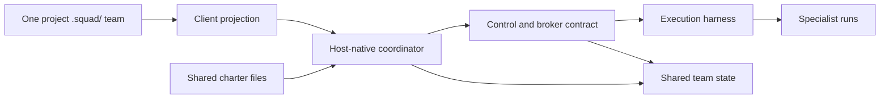
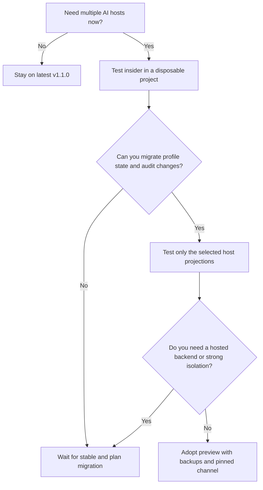

# Chapter 18: Squad 2.0: What Changed and Why

> **Prerequisites:** Volume 1 (or equivalent Squad experience); Chapter 5.

> **Preview:** This chapter describes Squad 2.0 at `v2.0.0-preview.2`, distributed through the npm `insider` channel. It is a preview release; names, interfaces, generated files, and migration behavior may change before 2.0.0 becomes stable. The `latest` npm tag remains on v1.1.0.

Part IV turns from the v1.1 operations and internals you have just studied to Squad 2.0, a preview that changes how one project team can work across AI hosts. The chapters in this part separate the motivation and architecture from client setup, state boundaries, and migration; keep the preview status in view as you evaluate it.

## What You'll Learn

- Explain why Squad 2.0 projects one repository-owned `.squad/` team into seven AI hosts rather than maintaining a separate team per host.
- Describe the client, control/broker, and execution planes, and how shared charters let a host-native coordinator dispatch specialists.
- Summarize ADR-001's boundary and the alternatives it rejects without confusing the experimental backend contract with a shipped remote service.
- Migrate the important v1.x differences: SDK import paths, backend exports and opt-in, mutable versus static state, removed personal features, project-only resolution, and upstream precedence.
- Distinguish the security and isolation proposal's implemented safeguards from design goals that are not yet shipped.
- Try the insider CLI in an isolated Tasktrack copy, inspect a Copilot-only initialization, and explicitly opt an optional built-in into the roster.

## Why Squad 2.0 Exists: One Team, Many Hosts

Squad 1.x made the team model tangible in the repository: `.squad/team.md` names its members, `.squad/agents/<member>/charter.md` describes specialist identity and boundaries, and shared files preserve routing, decisions, and other team knowledge. But interaction depended heavily on the host. A team designed around one host's configuration and subagent API could not simply be assumed to behave natively in another host. Recreating the team for each editor or CLI would duplicate the roster and memory, then let those copies drift.

Squad 2.0 changes the integration seam. You still own one project team in `.squad/`; the CLI projects the coordinator and state-MCP connection into whichever host configurations you explicitly choose. The preview recognizes seven canonical client IDs:

| Client ID | Host | Example projection |
|---|---|---|
| `copilot` | GitHub Copilot CLI / VS Code | `.github/agents/squad.agent.md` and `.mcp.json` |
| `claude` | Claude Code | `.claude/agents/squad.md`, a managed `CLAUDE.md` block, and `.mcp.json` |
| `kiro` | Kiro | `.kiro/steering/squad.md`, `.kiro/agents/squad.json`, and `.kiro/settings/mcp.json` |
| `opencode` | OpenCode | `.opencode/agent/squad.md` and `opencode.json` / `opencode.jsonc` |
| `cursor` | Cursor | `.cursor/agents/squad.md`, `.cursor/rules/squad.mdc`, and `.cursor/mcp.json` |
| `codex` | OpenAI Codex | `.codex/agents/squad.toml`, an `AGENTS.md` pointer, and `.codex/config.toml` |
| `antigravity` | Google Antigravity | `.agents/agents/squad.md` and a `GEMINI.md` pointer |

These are projections, not seven independently maintained squads. The `.squad/` charters remain the source text for specialist roles. Each host gets a coordinator expressed in its own conventions; the coordinator dispatches specialists as generic subagents, with the selected specialist's charter inlined into the spawn context. This is the portability trick: host-specific syntax at the edge, shared team identity and work guidance in the repository. Chapter 19 walks through using each client; Chapter 20 examines the projection and adapter machinery.

The `--client` selection is strict opt-in for additional host projections. A default Copilot initialization remains a Copilot setup: it does not silently add Claude, Cursor, Kiro, Codex, OpenCode, or Antigravity files. An explicit selection such as `--client claude,cursor`, or `--client all`, makes the choice visible and records portable client IDs in `.squad/config.json` under `clients[]`. That distinction matters for a committed repository: generated host files are part of the project's integration surface, so Squad does not guess which other tools you use.

## The Squad 2.0 Architecture

Squad 2.0 names three planes to keep related but distinct responsibilities from collapsing into a single adapter. Think of these as architectural responsibilities, not necessarily separate machines or processes.



### Client plane: speak the host's language

The client plane owns host bootstrap, projected files, host-specific event and tool adaptation, declared capabilities, and the mapping from Squad's coordinator to a host's dispatch primitive. The SDK's `@bradygaster/squad-sdk/client` entry point contains client-side projections and adapters. The older `@bradygaster/squad-sdk/clients` entry point remains as a deprecated alias in this preview, not the preferred import.

A client adapter makes the same conceptual coordinator legible to different tools. Copilot, Claude Code, Kiro, OpenCode, Cursor, Codex, and Antigravity each have their own conventions for agent definition, rules, MCP setup, and subagent spawning. Projection translates into those conventions while keeping team identity shared. Some host files include pointers to shared instructions; some embed a host-specific coordinator prompt. The specifics belong in Chapter 20, not in a second source of truth for agent behavior.

### Control and broker plane: keep conversation meaning portable

The control/broker plane is the contract for conversation identity, ordering, capability negotiation, approval state, cancellation, and durable event history. Its job is to ensure that changing the user interface or transport does not redefine what a conversation means. The SDK's experimental `@bradygaster/squad-sdk/backend` subpath contains `SquadBackend` contracts and implementations such as the local backend and the outbound Durable HTTP client.

At a high level, the contract uses stable `runId` values for a run, monotonic sequence numbers for ordered events, and opaque cursors for reconnect. It also defines how a pending approval becomes a decided approval and how cancellation addresses a run rather than a host's local turn. The core capability rule is an intersection:

> Effective capabilities are the capabilities allowed by the client **and** supported by the backend **and** permitted by policy: `client ∩ backend ∩ policy`.

This is deliberately not a union. If a host can render an approval but the backend cannot preserve it, or a policy disables the capability, the system must not claim that the full feature is available. The project config's `clients[]` selects which host files to generate; it does not grant authorization or widen runtime capabilities. Chapter 21 covers this boundary and the experimental backend in detail.

### Execution plane: run work without changing the team contract

The execution plane is the Harness Adapter interface for workers that execute tasks, invoke tools, stream results, checkpoint, and respond to approvals. A host may provide a subagent mechanism, or an integrator may supply a custom harness. This separation allows execution implementations to evolve without changing `.squad/` or the broker's conversation semantics.

The 2.0 preview does **not** bundle a remote DurableSquad server or a ready-made execution harness behind the MCP bridge. `squad state-mcp` can expose the local state surface; its experimental `squad_backend_*` tools are gated and, without a registered harness, do not magically execute turns. An API shape, a local bridge, and a production hosted service are three different deliverables. Keep that distinction in mind whenever you see the word “backend.”

## ADR-001: A Boundary Between Client, Control, and Execution

ADR-001 is the accepted draft baseline for the boundary, paired with the `squad-protocol-v2.0-rc1` protocol fixture. It assigns local UX, authentication bootstrap, host event parsing, rendering, and transport adaptation to the client plane. The control/broker plane owns conversation identity, event sequencing, capability rules, approvals, routing, cancellation, durable history, and compatibility policy. The execution plane owns task workers, tool execution, checkpoints, retries, and transient telemetry.

The central decision is about ownership: a host can adapt how a person and coordinator interact, but it should not be the authority that invents durable conversation semantics. The same work may be observed through a host today and resumed or inspected through a different transport tomorrow. A versioned contract gives all those views a common basis. MCP remains useful for local host integration and tool exposure, but it is a bridge—not the canonical conversation wire protocol.

The ADR rejects two tempting shortcuts. First, it rejects putting conversation sequencing, replay, approvals, and cancellation rules inside every host adapter. That would make each adapter a subtly different protocol implementation, and host-specific quirks would leak into semantics. Second, it rejects treating MCP itself as the long-lived conversation protocol. MCP is an integration transport; it does not by itself establish the durable ordering, reconnect, approval, and cancellation contract Squad needs. The alternative chosen is a portable backend contract with clients and execution harnesses on either side.

The ADR also makes an important governance point: code is the source of truth when an architectural note and the implementation differ. Its conformance gates include stable run IDs, monotonic ordering, versioned approvals, negotiated capabilities, cursor recovery, run-scoped cancellation, health checks outside protocol resources, unknown-event tolerance, and frozen fixtures. These gates are not a promise that every desired property is complete. For example, the ADR records that unknown event kinds are not yet projected loss-tolerantly, cursors are unsigned, and approval hashes are opaque harness-supplied values rather than broker-computed canonical payload digests. Read “gate” as a compatibility target or test boundary, not as a blanket production-security certification.

## What Changed in 2.0.0

The release notes describe a multi-host client release plus an experimental backend contract. The highlights are easiest to assess as changes to your team's workflow, and each has a different migration implication.

### Seven host projections, selected explicitly

`init` and `upgrade` accept `--client <list>` for one or more canonical host IDs, or `all`. The selected projections are stored as `clients[]` in `.squad/config.json`; later upgrades can refresh the configured hosts. This is the feature most users will notice: the roster and charter can travel with the repository, while host-native instructions and MCP wiring appear only where requested.

**Migration note:** Existing repositories remain Copilot-only unless you opt in. Decide which host files your project should commit, then add only those IDs with `squad upgrade --client <list>`. Review the diff before committing, especially in shared JSON, TOML, Markdown, and ignore files. See Chapter 19 for host-by-host setup.

### One coordinator pattern and shared charters

Each projection describes the same team, not a bespoke roster. A host runs its coordinator using native dispatch support; specialists are generic subagents whose shared `.squad/agents/<member>/charter.md` text is included when they are spawned. This preserves one team identity across hosts even when their user interfaces and execution APIs differ.

**Migration note:** Do not copy agent charters into one host directory and then edit them independently. Keep role, boundaries, and specialist guidance in `.squad/agents/`; treat generated host files as derived integration artifacts and let the CLI refresh them.

### Transactional casting repair and roster backfill

The preview's upgrade path repairs legacy handwritten `.squad/casting/registry.json` data record by record. It preserves retired and inactive members and unknown metadata where it can prove their identity, can backfill an empty registry from `team.md` using the `.squad/agents/<id>/charter.md` folder ID, and writes pre-repair originals to a hash-named `handwritten-archive-<sha256>/` location. If it cannot establish that an entry is safe to preserve, it fails closed and reports a `dropped` list instead of silently inventing or discarding a mapping. This repair is separate from changing `team.md` membership.

**Migration note:** Back up or commit `.squad/` before upgrading. Inspect any `dropped` list and archive before accepting the result; don't “fix” a registry by hand while the migration is in progress. Chapter 22 treats upgrade and rollback procedures in depth.

### Experimental backend and harness SPI

The SDK adds an experimental backend subpath, the `SquadBackend` interface, a local state backend, a Durable HTTP client, state-backend store support, and harness registry/interfaces. The 11 `squad_backend_*` tools are exposed by `squad state-mcp` only when explicitly enabled. `squad-protocol-v2.0-rc1` fixtures test protocol behaviors, but a conformance fixture is not the same as a hosted DurableSquad deployment.

**Migration note:** Existing users do not need to turn on these tools. If you are experimenting with them, enable them intentionally and read Chapter 21 before connecting a service. `SQUAD_BACKEND_URL` by itself does not switch on the tools or make the CLI's SDK instantiate a remote server.

### Strict opt-in and reversible projection

A normal Copilot-only repo gains no extra non-Copilot files and no client-specific ignore entries unless you pass `--client` for those hosts. When you do opt in, JSON/TOML config is merged additively, and marked regions in shared text files are designed to preserve unrelated user content. The projection system also has an uninstall path intended to restore recorded shared-file content byte-for-byte.

**Migration note:** Treat opting in as a reviewable repository change, not as an invisible user preference. Inspect the changes in the host's files and shared config. If you remove a client later, use the CLI's client removal/uninstall behavior rather than manually deleting a managed marker from the middle of a shared file.

### Upstream inheritance is resolved at runtime

Squad 2.0 exposes `squad_state_upstreams` and resolves `.squad/upstream.json` from locally synced snapshots when a session requests upstream data. It does not fetch remote Git repositories at session start. Resolution gives the project's local `.squad/` precedence, then follows configured upstreams in declared order, depth-first, with a depth limit and cycle detection. Inherited items carry provenance such as `upstream:<name>@<ref>`. Missing, stale, or unavailable sources are soft failures rather than reasons to destroy local team state.

**Migration note:** Run `squad upstream sync` after upgrade to refresh Git snapshots. If you depended on the v1.x later-entry-wins behavior, reorder the list because earlier configured entries now win conflicts. The local project team's values continue to win over inherited values.

### Bridge and compatibility fixes

The preview also improves state bridge reporting: `squad_state_health` identifies the backend (`local`, `orphan`, or `two-layer`), and a root-level `squad_state_list` call can list the root for git-backed backends. Claude Code's declared runtime capabilities include `background-runs` in this preview. These improvements make host bridges more observable; they do not mean every host has identical runtime behavior.

**Migration note:** Most users should simply refresh configured projections with `squad upgrade`; diagnose a backend by its health response rather than inferring it from a host's config file. For detailed differences in host capability tokens and adapter limits, see Chapter 20.

## Breaking and Behavior Changes: Plan the Migration

The release notes call out eight changes. They range from mechanical import edits to removed concepts. Do not treat them as one automatic migration: some are CLI-only, some affect SDK consumers, and some require a human decision about where old personal state belongs.

| Area | 2.0 behavior | Migration |
|---|---|---|
| Client SDK import path | `@bradygaster/squad-sdk/client` is canonical; `@bradygaster/squad-sdk/clients` is a deprecated alias. | Change imports to `@bradygaster/squad-sdk/client`; the alias offers transition time but should not be the destination. |
| Backend exports | `@bradygaster/squad-sdk/backend` is exported only through the `./backend` package subpath, not the root barrel. | Import `SquadBackend`, `HarnessAdapter`, and related backend types from `@bradygaster/squad-sdk/backend`; update package consumers and build checks. |
| `squad_backend_*` gating | `squad state-mcp` does not expose experimental conversation tools unless `--experimental-backend` or `SQUAD_EXPERIMENTAL_BACKEND=1` is set. `SQUAD_BACKEND_URL` alone is not the gate. | Add the explicit flag to the MCP server invocation or set the opt-in environment variable only in the intended environment. Don't mistake URL configuration for consent to expose experimental tools. |
| Durable HTTP `baseUrl` | `DurableHttpSquadBackend` requires explicit `baseUrl`; SDK code does not read `SQUAD_BACKEND_URL`. HTTPS is required except loopback HTTP. | Pass `baseUrl` (and, if needed, a token) to `createSquadBackend` or `DurableHttpSquadBackend`. Use `https://` for non-local endpoints and keep credentials out of the URL. |
| Static config vs mutable state | State-MCP writes reject static team files such as `team.md`, `routing.md`, `config.json`, and `charter.md`; `.squad/casting/` is not a hand-edit surface. | Edit static files in the workspace. Use `squad cast --name <Name> --role "<Role>"` for ordinary roster additions; use `squad roster add` for optional built-ins. Let supported state tools write mutable runtime state. |
| Removed personal-squad features | Personal squads, consult mode, and the `--global` squad option are removed. Former personal-squad and global team directories in the user profile are no longer read or written as teams. | There is no automatic conversion. Copy wanted knowledge into the appropriate project's `.squad/` by hand, preserving provenance and avoiding accidental cross-project exposure. Remove old data only after reviewing it. |
| Project-only resolution | Squad resolution walks from the current directory to its parents, respecting repository/worktree boundaries; it no longer falls back to a user-profile team. Outside a project it reports `No squad in this directory`. | Run `squad init` in the repository. For a tool intentionally operating on a different team root, use `--team-root <path>` where supported; do not rely on ambient profile state. |
| Upstream precedence | Earlier `upstream.json` entries now win conflicts, whereas older 1.x documentation described later entries winning. Git upstreams are read from the local clone created by `squad upstream sync`. | Sync after upgrading and reorder entries to express your intended precedence. Keep project-local values local; they override inherited content. |

The removal of `--global` can be confusing because `--team-root` still exists. They are not equivalent. `--global` selected a profile-owned team; `--team-root` is an explicit path override for resolving a team in a command context. Similarly, a profile-level Squad home may still exist for machine-independent presets and configuration, and externalized project state has its own support. Neither makes a personal squad a valid fallback for project resolution.

## What the 2.0 Docs Add or Correct

The docs mapped to this chapter tell a coherent story, but each page changes a different piece of the migration picture.

- **`whatsnew`** is the most complete migration summary: it names all seven hosts, preview channels, the changes table, opt-in projections, upstream precedence, and experimental backend caveats. Use it as a checklist, not as a substitute for reading migration-specific pages.
- **`your-team`** adds the optional charter `## Examples` section. It can provide sample requests and expected behavior, and structured charter edits preserve it. It is prompt-visible guidance—not a test suite, permission system, or proof that a specialist passes an evaluation. The page itself remains mostly the v1 team explanation; the architectural shared-charter/client model is introduced in the dedicated 2.0 architecture page.
- **`portability`** corrects upstream conflict order. The repository's own `.squad/` comes first, then earlier upstream entries outrank later ones for a conflict. Nested upstreams resolve depth-first; remote Git sources are snapshots that must be synced, not live fetched during a session. This reverses an earlier-wins statement in the v1.1.0 guide, so check existing `upstream.json` ordering.
- **`guide`** removes `squad init --global` from its quick reference. It remains a broad, Copilot-centric product guide rather than a full multi-host 2.0 tutorial. Do not infer the full architecture or every breaking change from the guide alone; use the architecture and release notes pages as the authoritative context for this preview.

One detail worth carrying forward from the code: the historical name `resolveGlobalSquadPath()` still appears in the SDK, but its continued existence does not restore global squads. In 2.0 that path supports Squad's platform configuration/externalized-state concerns; project-team discovery rejects profile-owned locations. This is a distinction between a remaining path utility and a removed product behavior.

## The Security and Isolation Proposal: What Is Shipped?

The proposal is explicitly marked “partially implemented.” Its threat model is useful because host-generated files and client requests are untrusted inputs; the local broker is a trusted process for correctness, but runs in the same process or user account and is not a privilege boundary. A remote backend relies on TLS and its bearer token. Those statements describe the limits of the trust model, not an assurance that every listed hardening item is complete.

| Area | Shipped in the preview | Proposed, incomplete, or not shipped |
|---|---|---|
| Client projection files | Additive, scoped MCP merges preserve unrelated servers and existing environment/custom fields; malformed JSON or invalid roots fail without overwrite. Path guards reject traversal and symlinked projection paths. | Validation of MCP `command`, `args`, and URL contents is absent; client merge writes are not uniformly temp-file-and-rename atomic; no general secret scrubber covers all logs and projections. |
| Local state | File-state paths are confined to their root and guarded against symlinks; conversation IDs are validated; mutations use lock-protected read/modify/write. Duplicate `(runId, seq)` messages are idempotent and changed payloads conflict. | The local control boundary is not a security wall against a malicious same-user process. |
| Approval and cancellation | Approvals are single-use; the broker checks that a response echoes the harness-supplied opaque hash. Cancellation uses a stable `runId`; late events for a cancelled run are ignored. | The broker does not compute a canonical payload hash or enforce expiration/version proof in the stronger proposed form. |
| Epochs and cursors | Lower stale epochs are rejected; cursors are validated and report resumability. | Epochs are client-asserted cooperative fencing, with no broker-issued lease identity or expiry. Cursors are unsigned/opaque, not cryptographic authorization tokens. |
| Event projection and execution | Golden fixtures cover protocol traces; the experimental MCP backend tools are opt-in. The bridge reports when execution is unavailable. | Unknown durable events are not yet universally projected loss-tolerantly; a separate telemetry channel is not shipped; the MCP bridge includes no bundled execution harness. |

There is a specific status mismatch across the 2.0 references: the architecture page lists G8 as a proof that projections tolerate unknown durable events, while ADR-001 and the security proposal say unknown event kinds are not yet projected loss-tolerantly. Treat that capability as unfinished in this preview; the stronger architecture-table wording is a target, not evidence that the implementation already meets it.

The practical consequence is cautious use. Avoid treating an experimental backend interface as a remotely hosted, isolated, adversarially secure execution service. Do not put secrets in generated host configuration. Keep backups before upgrade, inspect host-file diffs, and use only backends and harnesses whose trust assumptions you understand. Chapter 21 is the right place for deeper treatment of the `DurableHttpSquadBackend`, state MCP, and harness status.

## Preview Channels and Optional Built-Ins

The 2.0 preview notes are easy to miss if you assume semantic version and npm channel move together. For these previews, `insider` is canonical, `preview` is an alias, and `latest` stays on v1.1.0. The official 2.0 install example is `npm install -g @bradygaster/squad-cli@insider`; the self-upgrade route is `squad upgrade --self --insider`. These target the insider line; they are not a promise that the `latest` tag has switched.

Preview.1 was the first 2.0 insider build. The release notes direct existing teams to the 2.0 upgrade guide and tested upgrade paths before upgrading. Preview.2 focused on dogfood fixes: content-aware/idempotent upgrades with verified backups, dry-run and downgrade safety for self-upgrade, better state bridge lifecycle/root handling, backwards compatibility for older charters and routing with fail-closed routing validation, safer optional built-in roster handling, migration/client command fixes, optional charter Examples support, and improved skill frontmatter parsing. Those details are preview-specific and should be rechecked against the stable migration guide when 2.0 ships.

Rai and Fact Checker may be installed as available built-in charters without being members in `team.md`. Health reports these as an INFO condition—“available but not configured”—rather than silently adding them to a team's roster. This is intentional consent behavior: installing a charter does not change who the team says it is. To opt in, run `squad roster add rai`, `squad roster add fact-checker`, or `squad roster add all`. The upgrade command preserves `team.md`; it does not implicitly opt you into these members.

The roster command is itself conservative. It checks that the requested charter exists, shows the exact proposed diff, saves the original `team.md` bytes as a verifiable backup, and records precisely which lines it added. `--dry-run` prints the diff and does not write. If you later remove an entry, the command removes only rows it can prove it added; when all recorded additions remain unchanged, it can restore the original bytes. If a row has been edited or the backup/provenance is invalid, it refuses rather than guessing. The source for this workflow is `packages/squad-cli/src/cli/commands/roster.ts`.

## Should I Adopt 2.0 Now?

The right answer depends less on the host list than on your appetite for preview migration risk.

| Adopt the preview now if… | Wait for stable if… |
|---|---|
| You need the same `.squad/` team in more than one host today and can test generated files in a disposable copy. | Your team depends on personal squads, consult mode, or `--global`, and you cannot schedule a deliberate migration of that knowledge. |
| You can pin the insider channel, commit or back up `.squad/`, and inspect the resulting diff before sharing it. | You require stable dependency/API contracts, guaranteed data migrations, or a supported hosted DurableSquad service. |
| You are willing to adapt SDK imports and explicitly gate experimental backend tools. | Your workflow relies on the old upstream later-wins order and you cannot audit or reorder inherited sources. |
| You can roll back by restoring a known-good repo state and keep secrets outside projected files. | You cannot test the actual target hosts, MCP configs, or the consequences of profile-to-project resolution changes. |

For many individual developers, a sensible middle path is to explore the insider CLI in a throwaway clone and keep production repositories on v1.1.0. If you adopt, make the project team the source of truth, migrate profile-only knowledge intentionally, and first test the specific host projections you plan to commit. Do not upgrade solely because “2.0” sounds like a routine patch; it includes real breaking behavior and an experimental backend contract.



## Hands-On: Try 2.0 Without Replacing Your Stable CLI

This lab uses a copy of Tasktrack, not your working book repo. It keeps the insider CLI in a separate npm prefix so the `squad` executable on your ordinary `PATH` can remain at v1.1.0. Use a disposable directory and discard it after inspection. The host-specific additional projections are opt-in; this exercise asks for only Copilot.

```bash
npm install --prefix "$HOME/.local/share/squad-insider" @bradygaster/squad-cli@insider
export PATH="$HOME/.local/share/squad-insider/node_modules/.bin:$PATH"
squad --version
```

Confirm the version string is a `2.0.0-preview.2` build, not `1.1.0`. If the install resolves a different preview version, note that the insider channel has moved since this chapter was written; check the version before applying anything to a valuable repository.

Now copy the companion app into a scratch project and initialize Git so the CLI sees a project context. This keeps generated files and `.squad/` data out of your main Tasktrack starter:

```bash
cp -R ~/Projects/squad-book/sample ~/tasktrack-v2-ch18
cd ~/tasktrack-v2-ch18
git init
git add .
git -c user.name="Tasktrack Learner" -c user.email="learner@example.invalid" commit -m "Tasktrack Volume 2 chapter 18 baseline"
squad init --client copilot
```

During initialization, confirm the normal team setup requested by the CLI. The explicit `copilot` selection is deliberate. Inspect the projection and the repo status:

```bash
find .squad .github -type f | sort
git status --short
```

Expect the project's shared `.squad/` files and Copilot integration, including `.github/agents/squad.agent.md` and `.mcp.json`. You should not see `.claude/`, `.kiro/`, `.opencode/`, `.cursor/`, `.codex/`, or `.agents/` projections from this Copilot-only setup. If you initialize a clean second copy with plain `squad init` and no `--client`, the default Copilot bootstrap remains, but additional host projections are still absent. To add another host later, make that choice explicit with `squad upgrade --client claude` or another supported client list, then review the diff.

Finally inspect the optional built-ins and explicitly add them. First ask Squad to check its project state; the CLI's health check can report that installed built-ins are available but not configured. Then add one or both using the roster command. The first call previews the insertion; the second applies it:

```bash
squad doctor
squad roster add all --dry-run
squad roster add all
git diff -- .squad/team.md .squad/.roster-provenance.json .squad/team.md.roster-backup
```

The `--dry-run` result should show a diff and state that no files were written. The real add should report which built-ins were added and identify the backup. If it says a requested charter is unavailable, run `squad upgrade` in this disposable project to refresh Squad-owned assets, inspect its changes, and retry. The rows appear in `team.md` only after the explicit add; merely finding a charter under `.squad/agents/` is not the same as opting the agent into the team. The provenance and byte backup let you later remove only the rows this command can verify.

When you finish, compare the scratch project's files with the original starter. Keep or delete the scratch project according to your local practice. Do not copy generated host configs into your production repo until you have checked what they contain and who should maintain them.

## Configuration Reference

| Item | Purpose / default | Notes |
|---|---|---|
| `.squad/` | Shared project team, charters, memory, routing, and config | Primary source of team identity across hosts. |
| `.squad/config.json` → `clients[]` | Canonical host slugs selected for projection | Populated by `--client`; it is projection configuration, not authorization. |
| `squad init --client <list>` | Project selected host projections during initialization | Supports canonical client IDs and `all`; omitting the flag does not project extra non-Copilot hosts. |
| `squad upgrade [--dry-run] --client <list>` | Project or refresh selected hosts during upgrade | Existing configured clients may be refreshed; use dry-run and inspect the resulting diff where appropriate. |
| `squad roster add <rai|fact-checker|all> [--dry-run]` | Explicitly add optional built-ins to `team.md` | Requires installed charter files. Upgrade alone preserves roster membership. |
| `squad state-mcp --experimental-backend` | Opt into experimental `squad_backend_*` tools | Equivalent opt-in is `SQUAD_EXPERIMENTAL_BACKEND=1`; `SQUAD_BACKEND_URL` alone is not. |
| `@bradygaster/squad-sdk/client` | Canonical SDK import for projections and client adapters | `@bradygaster/squad-sdk/clients` is a deprecated alias. |
| `@bradygaster/squad-sdk/backend` | Experimental SDK subpath for backend/harness APIs | Not exported from the root barrel. |
| `DurableHttpSquadBackend` `baseUrl` | Explicit endpoint for the HTTP backend client | HTTPS required except loopback; SDK does not implicitly read `SQUAD_BACKEND_URL`. |
| `--team-root <path>` | Explicit team root override for commands that support it | Not a return of personal/global-squad resolution. |
| Upstream sources | Inherited from locally available upstream snapshots | Project-local content wins; then earlier entries win; synchronize Git sources with `squad upstream sync`. |

The table is deliberately a working reference, not a replacement for Chapters 19–22. Host-specific settings and actual capability matrices are version-sensitive, and backend options deserve their own chapter.

## Under the Hood

### The command table shows the product shift

In v2.0.0-preview.2, `packages/squad-cli/src/cli-entry.ts` changes its top-level help from a global-team mode toward explicit projections and roster consent. The table adds `--client <list>` to `init` and `upgrade`, introduces `client` and `roster`, and removes `personal`, `consult`, `extract`, and the `--global` help entry. The entry point rejects `--global` rather than silently treating it as project initialization. The command dispatch uses lazy imports for the new client and roster commands.

A small excerpt from the current CLI help construction illustrates the opt-in surface:

```ts
console.log(`                    --client <list> (client hosts to project, or "all")`);
console.log(`  ${BOLD}client${RESET}     Manage client host projections (Copilot, Claude, Kiro, …)`);
console.log(`  ${BOLD}roster${RESET}     Explicitly opt optional built-ins into team.md`);
```

This is more than a list of new flags: the old command table exposed profile-level personal-team operations; the new table names client projections and explicit roster operations instead. The source-level deletions are concrete: `packages/squad-sdk/src/agents/personal.ts`, `packages/squad-sdk/src/sharing/consult.ts`, `packages/squad-sdk/src/multi-squad.ts`, `packages/squad-cli/src/cli/commands/personal.ts`, `packages/squad-cli/src/cli/commands/consult.ts`, and `packages/squad-cli/src/cli/commands/extract.ts` are removed in the v1.1.0-to-preview.2 diff. Treat their removal as feature removal, not as proof that their data was automatically migrated.

### Resolution no longer searches the profile for a team

`packages/squad-sdk/src/resolution.ts` tightens the project resolver. `resolveSquad()` walks from the start directory upward, respects repository and worktree boundaries, and stops before turning the home directory, platform config directory, or `SQUAD_HOME` into a project squad. In the 2.0 path, if no project `.squad/` is found, the resolver returns `null`; command-level guards surface the “No squad in this directory” message. A project config that still points to a retired profile root is not followed as a team root.

The function name `resolveGlobalSquadPath()` remains in the SDK, which can mislead readers scanning only symbol names. The implementation and comments now distinguish a platform config path from a global team. The profile path can still support roaming presets or externalized project data; project squad discovery does not fall back to it. `--team-root` is a deliberate override for supported commands, not automatic profile discovery.

### Roster opt-in is auditable

The literal file `packages/squad-cli/src/cli/commands/roster.ts` implements `squad roster add|remove`. It validates the target (`rai`, `fact-checker`, or `all`), checks that each requested charter is present, and computes the insertion against `team.md`. Before editing, it stores the original bytes in `.squad/team.md.roster-backup` and writes `.squad/.roster-provenance.json` with hashes and exact inserted rows. A later remove operation verifies both before deleting only command-owned lines. If the record is missing, malformed, or no longer matches, the command refuses to infer ownership.

The dispatcher calls it with the project start directory and the remaining CLI arguments:

```ts
if (cmd === 'roster') {
  const { runRosterCommand } = await import('./cli/commands/roster.js');
  const exitCode = await runRosterCommand(getSquadStartDir(), args.slice(1));
  process.exitCode = exitCode;
  return;
}
```

This helps explain why the optional built-ins are informational until you opt in: shipping a charter makes it available; changing `team.md` is a separate, provenance-tracked action.

### Read source changes as preview contracts

The architecture, ADR, and proposal are useful design references, but their status labels matter. The architecture says the backend contract is experimental and that server-side DurableSquad Phase 2 work is pending. ADR-001 itself says code wins when it differs from the specification. The proposal marks many projection and state protections as implemented, but also enumerates unimplemented safeguards. The correct reading is not “all of 2.0 is secure and production-ready”; it is “the preview has a new boundary and some tested safeguards, with an explicit list of remaining work.”

## Pitfalls and Troubleshooting

- **Installing the wrong channel:** `npm install -g @bradygaster/squad-cli` may still give you the `latest` v1.1.0 release. Use the `insider` tag for this preview and verify with `squad --version` before testing. `preview` is an alias, but `insider` is canonical.
- **Assuming preview.2 is stable:** a preview version is not a stable API contract. Keep a clean Git baseline and inspect all changes before sharing them with a team.
- **Expecting 2.0 features in v1.1.0:** the stable installed CLI does not understand new flags or the new roster command. Run the insider binary, not a stable binary with the same executable name.
- **Expecting `--client` to install every host:** it installs only the host projections you select. Conversely, plain init does not add other client files behind your back.
- **Confusing config with capability:** `.squad/config.json` `clients[]` records which host files to generate. It is not a permission grant and does not widen negotiated runtime capabilities.
- **Turning on experimental tools accidentally:** `SQUAD_BACKEND_URL` is not an opt-in. The experimental tools require the explicit backend flag or environment variable. Conversely, enabling the tools does not provide a bundled remote server or execution harness.
- **Writing static files through MCP:** update static team definitions in the repository. Use state tools for mutable runtime state; use CLI commands for supported roster changes.
- **Looking for an old personal team:** `--global` and personal-squad resolution are gone. Find the old directory, review what belongs to which project, and copy selected knowledge manually. Do not expect `squad status` or `doctor` to discover it.
- **Surprised by upstream conflicts:** the first configured upstream now wins over later upstreams, after local project data. Reorder entries if the old later-wins order encoded an intentional priority, and sync Git upstreams before relying on them.
- **Rai or Fact Checker appears only as INFO:** that is expected. Check that the charter is installed, then run `squad roster add rai`, `squad roster add fact-checker`, or `squad roster add all` to make the member part of `team.md`.
- **Roster add refuses to write:** confirm `team.md` contains a recognized Members or Built-in Support Agents table and that the optional charter exists. Do not hand-edit or delete the backup/provenance to bypass a refusal; preserve it and inspect the specific mismatch.
- **Treating a concurrency token as authentication:** cooperative epochs and unsigned cursors help with replay/recovery and stale-worker correctness, not with hostile callers. Use a properly secured service boundary for adversarial multi-tenant scenarios.

## Summary

Squad 2.0 previews one shared `.squad/` team projected into seven host environments. It separates client adaptation, conversation control, and work execution so that host-native integrations can vary without forking the team model. A coordinator for each host reads shared charters and dispatches specialist subagents; capability negotiation is an intersection among client, backend, and policy, not an automatic union of what the host can do.

The release is also a migration. It introduces explicit host opt-in and a new SDK import structure, gates experimental backend tools, requires explicit Durable HTTP endpoints, separates static team config from mutable runtime writes, removes personal squads/consult/global behavior, changes squad resolution to project context, and reverses upstream conflict order. Preview.2 adds upgrade and roster safeguards, but the backend/server and several security goals remain incomplete. Test it on a copy, verify the CLI version, migrate personal knowledge deliberately, and review generated files before adopting it.

## Exercises

1. **Map the planes.** Choose one operation your team performs (for example, ask a specialist to update a Tasktrack API route). Write down which parts belong to the client, control/broker, and execution planes. Name one behavior that should stay the same if you switch hosts.
2. **Plan a two-host projection.** For Tasktrack, decide whether to add Claude Code, Cursor, or another host. List which host-specific files you expect from the table in this chapter, and explain why those files are projections rather than separate teams.
3. **Write a migration checklist.** For a hypothetical SDK consumer importing from `@bradygaster/squad-sdk`, identify the changes needed for client and backend imports, backend opt-in, explicit `baseUrl`, and static configuration writes. Include a verification step for each.
4. **Audit the security proposal.** Select three items from the proposal's “not implemented” column. For each, describe a failure mode it is meant to address and why the shipped preview behavior does not yet prove that risk is eliminated.
5. **Resolve upstream order.** Suppose a project defines a local routing rule, then upstreams `org`, `team`, and `legacy` in that order. State which source wins a conflict in 2.0 and how the outcome would differ under the old later-wins documentation. Recommend one safe way to migrate.
6. **Try the preview safely.** Complete the Hands-On in a disposable Tasktrack copy. Save the output of `squad --version`, record the files created by Copilot-only init, and inspect the `team.md` diff before and after `squad roster add all`.

## Quiz

1. What is the fundamental portability goal of the Squad 2.0 client projections?
2. Name the three planes in the 2.0 architecture and give one responsibility of each.
3. Why is `client ∩ backend ∩ policy` an intersection rather than a union?
4. Does the experimental `squad_backend_*` MCP surface include a ready-to-use execution harness? What enables the tools?
5. A team sees `No squad in this directory` while outside the repository. What changed, and what are two supported next steps?
6. What is the new upstream precedence order, and what should a team do after upgrading?
7. How do you add Rai to the team without making upgrades silently change the roster?
8. The security proposal says epochs are implemented. Does that mean they authenticate an exclusive lease holder? Explain.

## Further Reading

- [Squad 2.0 Overview](https://github.com/bradygaster/squad/blob/v2.0.0-preview.2/docs/SQUAD-2.0-OVERVIEW.md)
- [Squad 2.0 architecture](https://bradygaster.github.io/squad/docs/concepts/squad-2-0-architecture/)
- [ADR-001: Client, Control, and Execution Boundary](https://github.com/bradygaster/squad/blob/v2.0.0-preview.2/docs/specification/adr-001-client-control-execution-boundary.md)
- [Squad 2.0 Security, Threat Model & Isolation proposal](https://github.com/bradygaster/squad/blob/v2.0.0-preview.2/docs/proposals/squad-2.0-security-and-isolation.md)
- [What's New](https://bradygaster.github.io/squad/docs/whatsnew/)
- [Your Team](https://bradygaster.github.io/squad/docs/concepts/your-team/)
- [Portability & Extensions](https://bradygaster.github.io/squad/docs/concepts/portability/)
- [Product Guide](https://bradygaster.github.io/squad/docs/guide/)
