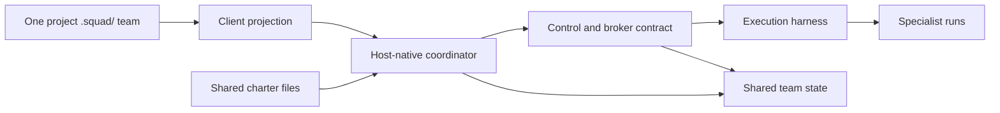
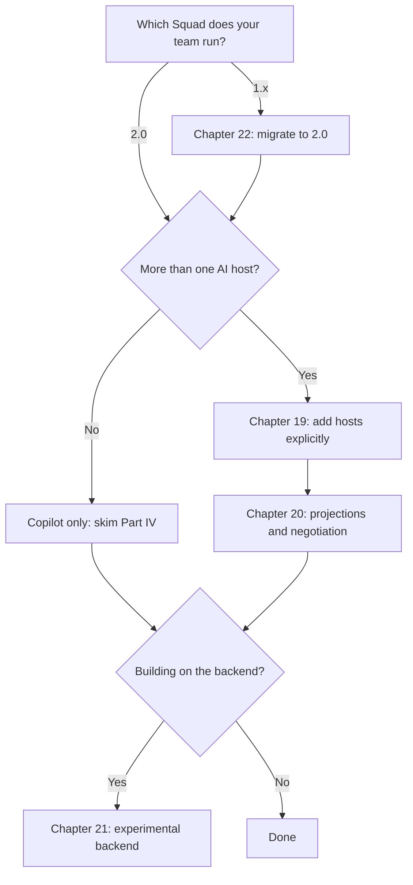

# Chapter 18: Squad 2.0: What Changed and Why

> **Prerequisites:** Volume 1 (or equivalent Squad experience); Chapter 5.

Squad v2.0.0 (2026-11-18) is the release the rest of this book runs on, and most of what it changed sits under the surface you have used so far. The Copilot default is the same. What is new is that one project team can now work in seven AI hosts. This chapter is the map for Part IV: why 2.0 is built this way, what changed since 1.x, what is still experimental, and which of the following chapters you need.

## What You'll Learn

- Explain why Squad 2.0 projects one repository-owned `.squad/` team into seven AI hosts rather than maintaining a separate team per host.
- Describe the client, control/broker, and execution planes, and how shared charters let a host-native coordinator dispatch specialists.
- Summarize ADR-001's boundary and the alternatives it rejects without confusing the experimental backend contract with a shipped remote service.
- List what v2.0.0 adds after the previews: Claude Code as a first-class host, self-contained coordinators for the other hosts, governed memory, work claims, the portable launcher and the move to `github/squad`.
- Work through the 1.x→2.0 checklist: SDK import paths, backend exports and opt-in, mutable versus static state, removed personal features, project-only resolution, and upstream precedence.
- Separate the security safeguards v2.0.0 ships from the ones ADR-001 still lists as future work.
- Inventory what 2.0 generated for Tasktrack with `squad client list`, `squad health --json` and `squad doctor`, and opt an optional built-in into the roster.

## Why Squad 2.0 Exists: One Team, Many Hosts

Squad 1.x made the team model tangible in the repository: `.squad/team.md` names its members, `.squad/agents/<member>/charter.md` describes specialist identity and boundaries, and shared files preserve routing, decisions, and other team knowledge. But interaction depended heavily on the host. A team designed around one host's configuration and subagent API could not simply be assumed to behave natively in another host. Recreating the team for each editor or CLI would duplicate the roster and memory, then let those copies drift.

Squad 2.0 changes the integration seam. You still own one project team in `.squad/`; the CLI projects the coordinator and state-MCP connection into whichever host configurations you explicitly choose. Squad 2.0 recognizes seven canonical client IDs:

| Client ID | Host | Example projection |
|---|---|---|
| `copilot` | GitHub Copilot CLI / VS Code | `.github/agents/squad.agent.md` and `.mcp.json` |
| `claude` | Claude Code | `.claude/agents/squad.md`, one `.claude/agents/<member>.md` per member, `.claude/skills/`, `.claude/settings.json`, a managed `CLAUDE.md` block, and `.mcp.json` (or the Squad plugin plus the per-repository files) |
| `kiro` | Kiro | `.kiro/steering/squad.md`, `.kiro/agents/squad.json`, and `.kiro/settings/mcp.json` |
| `opencode` | OpenCode | `.opencode/agent/squad.md` and `opencode.json` / `opencode.jsonc` |
| `cursor` | Cursor | `.cursor/agents/squad.md`, `.cursor/rules/squad.mdc`, and `.cursor/mcp.json` |
| `codex` | OpenAI Codex | `.codex/agents/squad.toml`, an `AGENTS.md` pointer, and `.codex/config.toml` |
| `antigravity` | Google Antigravity | `.agents/agents/squad.md` and a `GEMINI.md` pointer |

These are projections, not seven independently maintained squads. The `.squad/` charters remain the source text for specialist roles. Each host gets a coordinator expressed in its own conventions. On most hosts the coordinator dispatches specialists as generic subagents, with the selected specialist's charter inlined into the spawn context. Claude Code goes one step further: each member is projected from its charter into its own named subagent, and the coordinator routes to it by name. This is the portability trick: host-specific syntax at the edge, shared team identity and work guidance in the repository. Chapter 19 walks through using each client; Chapter 20 examines the projection and adapter machinery.

The `--client` selection is strict opt-in for additional host projections. A default Copilot initialization remains a Copilot setup: it does not silently add Claude, Cursor, Kiro, Codex, OpenCode, or Antigravity files. An explicit selection such as `--client claude,cursor`, or `--client all`, makes the choice visible and records portable client IDs in `.squad/config.json` under `clients[]`. That distinction matters for a committed repository: generated host files are part of the project's integration surface, so Squad does not guess which other tools you use.

## The Squad 2.0 Architecture

Squad 2.0 names three planes to keep related but distinct responsibilities from collapsing into a single adapter. Think of these as architectural responsibilities, not necessarily separate machines or processes.



### Client plane: speak the host's language

The client plane owns host bootstrap, projected files, host-specific event and tool adaptation, declared capabilities, and the mapping from Squad's coordinator to a host's dispatch primitive. The SDK's `@bradygaster/squad-sdk/client` entry point contains client-side projections and adapters. The older `@bradygaster/squad-sdk/clients` entry point remains as a deprecated alias in 2.0.0, not the preferred import.

A client adapter makes the same conceptual coordinator legible to different tools. Copilot, Claude Code, Kiro, OpenCode, Cursor, Codex, and Antigravity each have their own conventions for agent definition, rules, MCP setup, and subagent spawning. Projection translates into those conventions while keeping team identity shared. Some host files include pointers to shared instructions; some embed a host-specific coordinator prompt. The specifics belong in Chapter 20, not in a second source of truth for agent behavior.

### Control and broker plane: keep conversation meaning portable

The control/broker plane is the contract for conversation identity, ordering, capability negotiation, approval state, cancellation, and durable event history. Its job is to ensure that changing the user interface or transport does not redefine what a conversation means. The SDK's experimental `@bradygaster/squad-sdk/backend` subpath contains `SquadBackend` contracts and implementations such as the local backend and the outbound Durable HTTP client.

At a high level, the contract uses stable `runId` values for a run, monotonic sequence numbers for ordered events, and opaque cursors for reconnect. It also defines how a pending approval becomes a decided approval and how cancellation addresses a run rather than a host's local turn. The core capability rule is an intersection:

> Effective capabilities are the capabilities allowed by the client **and** supported by the backend **and** permitted by policy: `client ∩ backend ∩ policy`.

This is deliberately not a union. If a host can render an approval but the backend cannot preserve it, or a policy disables the capability, the system must not claim that the full feature is available. The project config's `clients[]` selects which host files to generate; it does not grant authorization or widen runtime capabilities. Chapter 21 covers this boundary and the experimental backend in detail.

### Execution plane: run work without changing the team contract

The execution plane is the Harness Adapter interface for workers that execute tasks, invoke tools, stream results, checkpoint, and respond to approvals. A host may provide a subagent mechanism, or an integrator may supply a custom harness. This separation allows execution implementations to evolve without changing `.squad/` or the broker's conversation semantics.

Squad 2.0.0 does **not** bundle a remote DurableSquad server. It does ship the first two execution harnesses, `ClaudeAgentSdkHarness` and `CopilotSdkHarness`, in the experimental `backend` subpath. `squad state-mcp` exposes the local state surface; its experimental `squad_backend_*` tools are gated, and they execute turns only when a harness is registered. The bridge registers the Claude harness when the optional `@anthropic-ai/claude-agent-sdk` peer is installed, and the Copilot harness only when `SQUAD_BACKEND_HARNESSES` lists it. An API shape, a local bridge with an optional harness, and a production hosted service are three different deliverables. Keep that distinction in mind whenever you see the word "backend."

> **Preview:** The backend contract, the `squad_backend_*` tools and both harnesses are experimental in v2.0.0. Remote durable-server integration and the promotion of the v0.2 profiles are still pending. Chapter 21 covers what each piece does today.

## ADR-001: A Boundary Between Client, Control, and Execution

ADR-001 is the accepted draft baseline for the boundary, paired with the `squad-protocol-v2.0-rc1` protocol fixture. It assigns local UX, authentication bootstrap, host event parsing, rendering, and transport adaptation to the client plane. The control/broker plane owns conversation identity, event sequencing, capability rules, approvals, routing, cancellation, durable history, and compatibility policy. The execution plane owns task workers, tool execution, checkpoints, retries, and transient telemetry.

The central decision is about ownership: a host can adapt how a person and coordinator interact, but it should not be the authority that invents durable conversation semantics. The same work may be observed through a host today and resumed or inspected through a different transport tomorrow. A versioned contract gives all those views a common basis. MCP remains useful for local host integration and tool exposure, but it is a bridge, not the canonical conversation wire protocol.

The ADR rejects two tempting shortcuts. First, it rejects putting conversation sequencing, replay, approvals, and cancellation rules inside every host adapter. That would make each adapter a subtly different protocol implementation, and host-specific quirks would leak into semantics. Second, it rejects treating MCP itself as the long-lived conversation protocol. MCP is an integration transport; it does not by itself establish the durable ordering, reconnect, approval, and cancellation contract Squad needs. The alternative chosen is a portable backend contract with clients and execution harnesses on either side.

The ADR also makes an important governance point: code is the source of truth when an architectural note and the implementation differ. Its conformance gates include stable run IDs, monotonic ordering, versioned approvals, negotiated capabilities, cursor recovery, run-scoped cancellation, health checks outside protocol resources, unknown-event tolerance, and frozen fixtures. These gates are not a promise that every desired property is complete. For example, the ADR records that unknown event kinds are not yet projected loss-tolerantly, cursors are unsigned, and approval hashes are opaque harness-supplied values rather than broker-computed canonical payload digests. Read "gate" as a compatibility target or test boundary, not as a blanket production-security certification.

ADR-001 has two companions at v2.0.0. ADR-002 defines the work-claim contract that `squad watch --claims git-ref` implements (Chapter 17 and Chapter 9 (Volume 1)). ADR-003, accepted on 2026-11-13, makes the coordinators for the six non-Copilot hosts complete on their own instead of pointing at Copilot's `.github/agents/squad.agent.md`; Chapter 20 explains how that works.

## What Changed in 2.0.0

The 2.0.0 CHANGELOG entry folds in four previews (preview.1 on 2026-10-23 through preview.4 on 2026-11-09) and adds the Claude Code work that landed only in the stable release. Read the highlights as changes to your team's workflow. Each one has its own migration note.

### Seven host projections, selected explicitly

`init` and `upgrade` accept `--client <list>` for one or more canonical host IDs, or `all`. The selected projections are stored as `clients[]` in `.squad/config.json`. `squad client add <list>` adds hosts to an existing project, and `squad client sync` refreshes the configured hosts' files without a full upgrade. This is the feature most users will notice: the roster and charters travel with the repository, while host-native instructions and MCP wiring appear only where requested.

**Migration note:** Existing repositories remain Copilot-only unless you opt in. Decide which host files your project should commit, then add only those IDs with `squad client add <list>` or `squad upgrade --client <list>`. Review the diff before committing, especially in shared JSON, TOML, Markdown, and ignore files. See Chapter 19 for host-by-host setup.

### Claude Code as a first-class host

Claude Code is the first host after Copilot where Squad uses the host's own features instead of the shared minimum. Four pieces matter:

- **The Squad plugin for Claude Code.** `claude plugin marketplace add github/squad` and `claude plugin install squad@squad` bring in the coordinator (as the `squad:squad` agent), the `squad_state` MCP server, Squad's skills, the slash commands `/squad:ralph`, `/squad:cast`, `/squad:ceremony`, `/squad:status` and `/squad:dashboard`, and the advisory hooks. With `squad init --client claude --claude-plugin`, the repository keeps only its own files.
- **Member subagents.** Every member, built-ins included, becomes `.claude/agents/<member>.md`, with model and effort taken from the charter. The coordinator dispatches through Claude Code's `Agent` tool (formerly `Task`).
- **Native skills and a smaller coordinator.** Squad's template skills are projected into `.claude/skills/`, and Init Mode, Ralph mode, ceremonies, Issues mode and PRD mode load on demand from `squad-coordinator-*` skills. Copilot already loaded Init Mode on demand; Claude moves more modes out of the always-loaded prompt.
- **Governance and tooling.** Opt-in advisory hooks (`"claudeHooks": "advisory"`), `squad lockout` for reviewer lockouts, a scoped permission allowlist in `.claude/settings.json`, `squad dashboard`, and a Claude runner for `squad watch --execute` (`--agent-preset claude`).

The Claude projection is now version 3, and every generated Claude Markdown file is stamped with it.

**Migration note:** Nothing changes for a Copilot-only repository. If you used a preview Claude projection, `squad upgrade` recognizes the older files as Squad's and upgrades them in place. Chapter 19 covers setup and Chapter 20 the projection internals.

### Self-contained coordinators for the other hosts

Under ADR-003, the coordinators for Claude Code, Kiro, OpenCode, Cursor, Codex and Antigravity are complete on their own. They no longer tell the model to treat `.github/agents/squad.agent.md` as the authority, so they behave the same whether that file is absent, stock or customized. These coordinators also gained shared behavior from live testing: they run the reviewer gate unasked, they wait for an explicit human sign-off when `team.md` or `routing.md` requires one, they spawn Scribe in the same turn for a decision you state, and they stop instead of writing `decisions.md` directly when `squad_state` is unavailable on a non-local backend. Copilot's output is unchanged.

**Migration note:** If you customized `.github/agents/squad.agent.md` and relied on other hosts reading it, move those rules into `.squad/` files (`routing.md`, charters, decisions) that every coordinator reads.

### A portable launcher instead of machine paths

Squad 1.1.0 wrote an exact-version `npx -y @bradygaster/squad-cli@<version> state-mcp` command into `.mcp.json`. During the 2.0 previews, a machine with the CLI installed could instead get an absolute path (`node /your/path/cli-entry.js state-mcp`) in `.mcp.json`, other hosts' MCP configs and Claude hooks, and a clone on any other machine failed. Squad 2.0.0 commits a launcher, `.squad/squad.mjs`, and writes a short `node -e` command that finds the repository root and runs `node .squad/squad.mjs state-mcp`. The launcher looks for a CLI in `SQUAD_CLI`, the project's `node_modules`, then `squad` on PATH, and uses `npx` only when `SQUAD_ALLOW_NPX=1` is set. `squad doctor` flags machine-specific launch commands and a missing launcher.

**Migration note:** Run `squad upgrade` once in each existing repository to rewrite its MCP configuration. Chapter 21 covers the bridge in depth.

### Governed memory and work claims

`squad memory` and the MCP `memory.*` tools share one backend-aware governed store, with cross-process locking and transactional migration when you move to the `orphan` or `two-layer` backend; `.squad/casting/` stays on the source branch on every backend. Separately, `squad watch` can coordinate several watchers on different machines through fenced git-ref work claims (`--claims git-ref`). Claims are off by default.

**Migration note:** These are opt-in or automatic. Read Chapter 15 (Volume 1) and Chapter 2 for memory and Chapter 9 (Volume 1) for claims. One default-path change affects every watcher: a malformed, empty or unreadable `.squad/config.json` now stops `squad watch` instead of falling back to defaults.

### A new home: `github/squad`

The repository moved to `https://github.com/github/squad`, and the docs live at `https://github.github.com/squad/`. Package metadata, runtime links, templates and workflow identities follow. The npm packages keep their names, `@bradygaster/squad-cli` and `@bradygaster/squad-sdk`, and so do the Homebrew tap and WinGet IDs.

**Migration note:** Update bookmarks and any scripts that clone or link the old repository. Install commands do not change.

### One coordinator pattern and shared charters

Each projection describes the same team, not a bespoke roster. A host runs its coordinator using native dispatch support; on most hosts, specialists are generic subagents whose shared `.squad/agents/<member>/charter.md` text is included when they are spawned. Claude Code is the exception: each member is a generated `.claude/agents/<member>.md` subagent that the coordinator dispatches by name, and that file is still generated from the member's charter. This preserves one team identity across hosts even when their user interfaces and execution APIs differ.

**Migration note:** Do not copy agent charters into one host directory and then edit them independently. Keep role, boundaries, and specialist guidance in `.squad/agents/`; treat generated host files as derived integration artifacts and let the CLI refresh them. That includes the generated member files under `.claude/agents/`. Don't hand-edit them: Squad never overwrites a user-authored file at a member path, so an edited one stops receiving updates (Chapter 19 covers this).

### Transactional casting repair and roster backfill

The 2.0 upgrade path repairs legacy handwritten `.squad/casting/registry.json` data record by record. It preserves retired and inactive members and unknown metadata where it can prove their identity, can backfill an empty registry from `team.md` using the `.squad/agents/<id>/charter.md` folder ID, and writes pre-repair originals to a hash-named `handwritten-archive-<sha256>/` location. If it cannot establish that an entry is safe to preserve, it fails closed and reports a `dropped` list instead of silently inventing or discarding a mapping. This repair is separate from changing `team.md` membership. Since preview.3 it also migrates Squad 0.9.x casting arrays when the evidence is unambiguous, and casting it cannot repair no longer blocks the rest of `squad upgrade`.

**Migration note:** Back up or commit `.squad/` before upgrading. Inspect any `dropped` list and archive before accepting the result; don't "fix" a registry by hand while the migration is in progress. Chapter 22 treats upgrade and rollback procedures in depth.

### Experimental backend and harness SPI

The SDK adds an experimental backend subpath, the `SquadBackend` interface, a local state backend, a Durable HTTP client, state-backend store support, harness registry/interfaces, and the two harnesses described earlier. The 11 `squad_backend_*` tools are exposed by `squad state-mcp` only when explicitly enabled. `squad-protocol-v2.0-rc1` fixtures test protocol behaviors, but a conformance fixture is not the same as a hosted DurableSquad deployment.

**Migration note:** Existing users do not need to turn on these tools. If you are experimenting with them, enable them intentionally and read Chapter 21 before connecting a service. `SQUAD_BACKEND_URL` by itself does not switch on the tools or make the CLI's SDK instantiate a remote server.

### Strict opt-in and reversible projection

A normal Copilot-only repo gains no extra non-Copilot files and no client-specific ignore entries unless you pass `--client` for those hosts. When you do opt in, JSON/TOML config is merged additively, and marked regions in shared text files are designed to preserve unrelated user content. The SDK's `uninstallClients()` restores recorded shared-file content byte-for-byte, and in 2.0.0 that includes the managed `CLAUDE.md`, `AGENTS.md` and `GEMINI.md` blocks.

**Migration note:** Treat opting in as a reviewable repository change, not as an invisible user preference. Inspect the changes in the host's files and shared config. The 2.0.0 CLI has `client list`, `client add` and `client sync` but no `client remove`, so removing a host is a Git operation (revert the commit that added it) or an SDK call to `uninstallClients()`. Don't delete a managed marker from the middle of a shared file by hand. Chapter 19 walks through both routes.

### Upstream inheritance is resolved at runtime

Squad 2.0 exposes `squad_state_upstreams` and resolves `.squad/upstream.json` from locally synced snapshots when a session requests upstream data. It does not fetch remote Git repositories at session start. Resolution gives the project's local `.squad/` precedence, then follows configured upstreams in declared order, depth-first, with a depth limit and cycle detection. Inherited items carry provenance such as `upstream:<name>@<ref>`. Missing, stale, or unavailable sources are soft failures rather than reasons to destroy local team state.

**Migration note:** Run `squad upstream sync` after upgrade to refresh Git snapshots. If you depended on the v1.x later-entry-wins behavior, reorder the list because earlier configured entries now win conflicts. The local project team's values continue to win over inherited values.

### Bridge and compatibility fixes

Squad 2.0 also improves state bridge reporting: `squad_state_health` identifies the backend (`local`, `orphan`, or `two-layer`), and a root-level `squad_state_list` call can list the root for git-backed backends. `squad_state_health` and `squad health --json` report versioned runtime metadata, including `resolvedTeamRoot` (the directory that contains `.squad`) and `resolvedSquadDir`, and `squad doctor` now exits non-zero when a check fails. `squad_state` also works when the team folder is reached through a symlink, such as macOS `/tmp`. Claude Code's declared runtime capabilities include `background-runs`. These improvements make host bridges more observable; they do not mean every host has identical runtime behavior.

**Migration note:** Most users should simply refresh configured projections with `squad upgrade`; diagnose a backend by its health response rather than inferring it from a host's config file. For detailed differences in host capability tokens and adapter limits, see Chapter 20.

## Breaking and Behavior Changes: Plan the Migration

If you are coming from Squad 1.x, work through this table before you upgrade a team that matters. The first eight rows match the "Breaking & Behavior Changes" table on the What's New page. The last three come from the 2.0.0 CHANGELOG and catch 1.x users who skip it. They range from mechanical import edits to removed concepts. Do not treat them as one automatic migration: some are CLI-only, some affect SDK consumers, and some require a human decision about where old personal state belongs. Chapter 22 turns the checklist into an upgrade and rollback procedure.

| Area | 2.0 behavior | Migration |
|---|---|---|
| Client SDK import path | `@bradygaster/squad-sdk/client` is canonical; `@bradygaster/squad-sdk/clients` is a deprecated alias. | Change imports to `@bradygaster/squad-sdk/client`; the alias offers transition time but should not be the destination. |
| Backend exports | `@bradygaster/squad-sdk/backend` is exported only through the `./backend` package subpath, not the root barrel. | Import `SquadBackend`, `HarnessAdapter`, and related backend types from `@bradygaster/squad-sdk/backend`; update package consumers and build checks. |
| `squad_backend_*` gating | `squad state-mcp` does not expose experimental conversation tools unless `--experimental-backend` or `SQUAD_EXPERIMENTAL_BACKEND=1` is set. `SQUAD_BACKEND_URL` alone is not the gate. | Add the explicit flag to the MCP server invocation or set the opt-in environment variable only in the intended environment. Don't mistake URL configuration for consent to expose experimental tools. |
| Durable HTTP `baseUrl` | `DurableHttpSquadBackend` requires explicit `baseUrl`; SDK code does not read `SQUAD_BACKEND_URL`. HTTPS is required except loopback HTTP. | Pass `baseUrl` (and, if needed, a token) to `createSquadBackend` or `DurableHttpSquadBackend`. Use `https://` for non-local endpoints and keep credentials out of the URL. |
| Static config vs mutable state | State-MCP writes reject static team files such as `team.md`, `routing.md`, `config.json`, and `charter.md`; `.squad/casting/` is not a hand-edit surface. | Edit static files in the workspace. Use `squad cast --name <Name> --role "<Role>"` for ordinary roster additions; use `squad roster add` for optional built-ins. Let supported state tools write mutable runtime state. |
| Removed personal-squad features | Personal squads, consult mode, and the `--global` squad option are removed. Former personal-squad and global team directories in the user profile are no longer read or written as teams. | There is no automatic conversion. Copy wanted knowledge into the appropriate project's `.squad/` by hand, preserving provenance and avoiding accidental cross-project exposure. Remove old data only after reviewing it. |
| Project-only resolution | Squad resolution walks from the current directory to its parents, respecting repository/worktree boundaries; it no longer falls back to a user-profile team. Outside a project it reports `No squad in this directory`. | Run `squad init` in the repository. For a tool intentionally operating on a different team root, use `--team-root <path>` where supported; do not rely on ambient profile state. |
| Upstream precedence | Earlier `upstream.json` entries now win conflicts, whereas older 1.x documentation described later entries winning. Git upstreams are read from the local clone created by `squad upstream sync`. | Sync after upgrading and reorder entries to express your intended precedence. Keep project-local values local; they override inherited content. |
| `squad_state` launch command | Committed MCP configs run the repository's `.squad/squad.mjs` launcher instead of an exact-version `npx` command. | Run `squad upgrade` once, commit `.squad/squad.mjs` with the rewritten configs, and run `squad doctor` to confirm the launch command is portable. |
| `squad watch` config handling | A malformed, empty or unreadable `.squad/config.json` stops watch; an invalid `watch.claims` value is an error. Only a missing file selects defaults. | Validate `config.json` (for example with `squad doctor`) before restarting long-running watchers. |
| Host Node.js | npm packages do not embed Node. Standalone archives vendor Node.js 22.23.4. | npm users run a patched host Node.js (22.23.4 or a newer patched release); the `engines` field is a compatibility floor, not a security guarantee. |

The removal of `--global` can be confusing because `--team-root` still exists. They are not equivalent. `--global` selected a profile-owned team; `--team-root` is an explicit path override for resolving a team in a command context. Similarly, a profile-level Squad home may still exist for machine-independent presets and configuration, and externalized project state has its own support. Neither makes a personal squad a valid fallback for project resolution.

## What the 2.0 Docs Add or Correct

The docs mapped to this chapter tell a coherent story, but each page changes a different piece of the migration picture.

- **`whatsnew`** is the most complete migration summary. Its v2.0.0 entry is now headed "Current Stable Release": it names all seven hosts, the Claude Code plugin, member subagents, advisory hooks and the local-only dashboard, the changes table, opt-in projections, upstream precedence, and the experimental backend caveats. The preview notes stay below it as history. Use it as a checklist, not as a substitute for reading migration-specific pages.
- **`your-team`** adds the optional charter `## Examples` section. It can provide sample requests and expected behavior, and structured charter edits preserve it. It is prompt-visible guidance, not a test suite, permission system, or proof that a specialist passes an evaluation. The page itself remains mostly the v1 team explanation; the architectural shared-charter/client model is introduced in the dedicated 2.0 architecture page.
- **`portability`** corrects upstream conflict order. The repository's own `.squad/` comes first, then earlier upstream entries outrank later ones for a conflict. Nested upstreams resolve depth-first; remote Git sources are snapshots that must be synced, not live fetched during a session. This reverses the later-wins statement in the v1.1.0 guide, so check existing `upstream.json` ordering.
- **`guide`** removes `squad init --global` from its quick reference. It remains a broad, Copilot-centric product guide rather than a full multi-host 2.0 tutorial. Do not infer the full architecture or every breaking change from the guide alone; use the architecture and release notes pages as the authoritative context for 2.0.

One caution about the architecture page: its host table still lists only the Claude coordinator, `CLAUDE.md`, `.mcp.json` and the `.gitignore` block for Claude Code. At v2.0.0 the Claude projection also writes member subagents, skills and `.claude/settings.json`. Use Chapter 20 and the host feature matrix for the full list.

One detail worth carrying forward from the code: the historical name `resolveGlobalSquadPath()` still appears in the SDK, but its continued existence does not restore global squads. In 2.0 that path supports Squad's platform configuration/externalized-state concerns; project-team discovery rejects profile-owned locations. This is a distinction between a remaining path utility and a removed product behavior.

## Security and Isolation in 2.0.0

The trust model is simple to state. Host-generated files and client requests are untrusted inputs. The local broker is trusted for correctness, but it runs in your process or user account, so it is not a privilege boundary against another process running as you. A remote backend relies on TLS and its bearer token. Within that model, v2.0.0 ships these safeguards:

| Area | What v2.0.0 does | Limits to keep in mind |
|---|---|---|
| Static and mutable state | `squad_state` writes reject static team files (`team.md`, `routing.md`, `config.json`, `charter.md`). File-state paths are confined to the team root; a path that leaves it, including through a symlink inside it, is refused. | A same-user process can still edit files directly. The boundary protects against confused tools, not hostile local code. |
| Experimental backend tools | The 11 `squad_backend_*` tools appear only with `--experimental-backend` or `SQUAD_EXPERIMENTAL_BACKEND=1`. Approvals are single-use and must echo the harness-supplied hash. The Claude harness keeps your settings' deny rules and does not apply repository or user allow rules to broker approvals. | ADR-001 lists broker-computed digests, approval expiry and version-checked responses as future work. |
| Client projection files | MCP merges are additive and keep unrelated servers and fields; malformed JSON fails without overwrite. Projection paths reject traversal and symlinks. | Squad does not validate the `command` and `args` you put in your own MCP entries, so review shared config like code. |
| Upstream sources | `squad upstream add` and `sync` accept only `https://`, `ssh://` and `git@host:path` sources. Remote helpers (`ext::`, `fd::`), `file://` and plain `http://` are refused, and URLs with embedded credentials are never stored. | An allowed URL can still point at content you should not trust. Pin a `--ref` and review what you inherit. |
| Claude Code permissions | `squad init` and `squad upgrade` add a scoped allowlist to `.claude/settings.json`: the named `squad_state` tools (never the backend approval tools) and four CLI steps (`squad cast`, `squad client sync`, `squad lockout reject`, `squad lockout status`). Your own rules come first; Squad records its rules in `.claude/.squad-permissions.json` so rollback removes only those. `"claudePermissions": "off"` turns it off. | Claude Code applies project allow rules only after you trust the folder. Releasing a lockout still asks. |
| Dashboard | `squad dashboard` listens on `127.0.0.1` only, rejects other `Host` headers (a DNS-rebinding guard), sends a Content Security Policy with no inline script, and renders transcript text as text. | It shows your session transcripts to anyone who can reach that port on your machine. |
| Epochs and cursors | Stale epochs are fenced; cursors are validated and report resumability. | Epochs are client-asserted: any caller that presents a larger epoch takes over. Cursors are unsigned. Neither is an authorization token. |
| Unknown events | Extension validation exists. | ADR-001 marks gate G8 as incomplete: unknown event kinds are not yet projected loss-tolerantly. The architecture page lists G8 among its gates without that caveat; trust the ADR. |

The practical consequence is cautious use of the experimental parts. Don't treat the backend interface as a remotely hosted, isolated, adversarially secure execution service. Don't put secrets in generated host configuration. Keep backups before upgrade, inspect host-file diffs, and use only backends and harnesses whose trust assumptions you understand. Chapter 21 goes deeper on `DurableHttpSquadBackend`, state MCP and the harnesses, and Chapter 6 covers the wider security picture.

## Release Channels and Optional Built-Ins

Since 2026-11-18 the npm `latest` tag carries Squad 2.0.0, so a plain `npm install -g @bradygaster/squad-cli` installs it. The other channels still exist. On npm, `insider` is the canonical prerelease dist-tag and `preview` is an alias of it, so there is no separate release-candidate tag. Homebrew casks (`squad`, `squad-preview`, `squad-insider`) and WinGet IDs (`bradygaster.Squad`, `.Preview`, `.Insider`) are separate packages, and the prerelease ones update only when a release run sets `publish_package_managers` (Chapter 8). `squad upgrade --self` follows the channel you installed from (a stable CLI updates from `latest`, a prerelease from `insider`), and `--insider` forces the insider channel.

The four previews are now history. Preview.1 (2026-10-23) was the first 2.0 build on `insider`, with `preview` as an alias. Preview.2 (2026-10-25) focused on upgrade safety and bridge reliability, preview.3 (2026-10-29) added work claims and a patched standalone runtime, and preview.4 (2026-11-09) completed the move to `github/squad` and transactional memory migration. During all four, `latest` stayed on v1.1.0. The tested upgrade paths in the upgrade guide are attested against the preview versions that were actually tested, and Chapter 22 says which.

Rai and Fact Checker are optional built-ins. In a new project they join the roster on their own: `squad init` always installs the Rai and Fact Checker charters alongside Scribe's and Ralph's, and the `team.md` it writes has no `## Built-in Support Agents` table. When `squad cast --name <Name> --role "<Role>"` adds a member to a `team.md` without that table, it adds one listing each built-in whose charter is installed, so the first member you cast this way puts all four on the roster. Plain `squad cast` only shows the roster. Claude Code and Copilot then report the same roster.

A roster that already has the support table is left alone. That is the case for a team cast under 1.1.0, whose template already listed all four built-ins, or one where someone removed the Rai or Fact Checker rows. There, an installed charter without a roster row is reported by health as an INFO condition, "available but not configured", and Squad does not add the member for you. To opt in, run `squad roster add rai`, `squad roster add fact-checker`, or `squad roster add all`. The upgrade command preserves `team.md`; it does not implicitly opt you into these members.

The roster command is itself conservative. It checks that the requested charter exists, shows the exact proposed diff, saves the original `team.md` bytes as a verifiable backup, and records precisely which lines it added. `--dry-run` prints the diff and does not write. If you later remove an entry, the command removes only rows it can prove it added; when all recorded additions remain unchanged, it can restore the original bytes. If a row has been edited or the backup/provenance is invalid, it refuses rather than guessing. The source for this workflow is `packages/squad-cli/src/cli/commands/roster.ts`.

## Who Needs Part IV?

Squad 2.0.0 is the stable release, so the question is no longer whether to adopt it. The question is how much of this part you need. That depends on where you start.

| You are… | What 2.0 means for you | Read |
|---|---|---|
| **Copilot-only.** Your team works in GitHub Copilot and nobody plans to use another host. | Nothing to opt into. Plain `squad init` and `squad upgrade` still set up Copilot alone. You still get the safer upgrades, the portable launcher and governed memory. | This chapter, then skim. Chapter 21 if you run the state bridge in unusual places. |
| **Mixed-host.** Some of the team uses Claude Code, Cursor, Kiro, OpenCode, Codex or Antigravity, or you want to try one. | Add hosts explicitly, commit the generated files, and keep `.squad/` as the one source of truth. Decide whether Claude Code users run the plugin or the full projection. | Chapter 19 for setup, Chapter 20 for how projection works, and Appendix H for host differences. |
| **Coming from 1.x.** A team still runs Squad 1.1.0 or earlier. | Plan the migration: removed personal/consult/global modes, upstream order, SDK imports and the launcher rewrite. | The checklist above, then Chapter 22. |
| **Building on the backend.** You want to drive Squad from your own service or try the harnesses. | Everything here is experimental in v2.0.0. Opt in deliberately and expect changes. | Chapter 21, then Appendix G. |

The rows overlap. A 1.x team that also wants Claude Code reads Chapter 22 first, upgrades, and then adds the host with Chapter 19. Do not treat 2.0 as a routine patch for a 1.x team: it removes features and reverses upstream precedence.



## Hands-On: Inventory What 2.0 Generated for Tasktrack

Your Tasktrack squad has run on Squad 2.0 with the Copilot host since Volume 1. Before you project it anywhere else in Chapter 19, take stock of what 2.0 already put in the repository. Everything in this lab is read-only except the last, optional roster step, and that one previews its change first.

Start in your Tasktrack checkout with a clean working tree, and confirm the CLI version:

```bash
cd ~/tasktrack
git status --short
squad --version
```

`git status --short` should print nothing, and the version should be `2.0.0`. If it prints `1.1.0` or older, you are on a 1.x CLI; read Chapter 22 before going further.

**Step 1: which hosts are projected?** Ask the CLI:

```bash
squad client list
```

For a Copilot-only Tasktrack you should see output like this:

```text
Configured clients (.squad/config.json → clients[])

  clients[] is empty — only the default host is projected
  ✓ copilot      GitHub Copilot (default) — projected (2/2 files)

Available: copilot, claude, kiro, opencode, cursor, codex, antigravity. Add with: squad client add <list>  (or: squad upgrade --client <list>)
```

The two Copilot files are `.github/agents/squad.agent.md` and `.mcp.json`. An empty `clients[]` is the normal Copilot-only state, not an error. `squad client list --json` gives the same answer as structured data, with one `present` flag per projected file. Confirm that no other host's directory exists:

```bash
ls -d .claude .kiro .opencode .cursor .codex .agents 2>/dev/null
```

This prints nothing on a Copilot-only project.

**Step 2: what does the state bridge report?** Run the health check in JSON form:

```bash
squad health --json
```

Look at the `metadata` block first. On a local backend it looks like this (paths shortened):

```json
{
  "schema": "squad-health/v1",
  "metadata": {
    "cliVersion": "2.0.0",
    "sdkVersion": "2.0.0",
    "stateBackend": "local",
    "resolvedTeamDir": "/home/you/tasktrack",
    "resolvedTeamRoot": "/home/you/tasktrack",
    "resolvedSquadDir": "/home/you/tasktrack/.squad",
    "bridgeVersion": "2.0.0",
    "launchMode": "cli"
  },
  "status": "pass"
}
```

`resolvedTeamRoot` is the folder that contains `.squad`, and `resolvedSquadDir` is the `.squad` folder itself. On macOS you may see `/private/...` in place of a `/tmp` or `/var` path; Squad stores the resolved spelling. Then read the `checks` array: `team`, `registry-charters` and `routing` should pass for a cast team. A `team` failure that says "team.md has no parseable members" means nobody has been cast yet. If Rai or Fact Checker are installed but not on the roster, you see that as INFO, not a failure.

**Step 3: is the repository portable?** Run the doctor:

```bash
squad doctor
```

The lines to look for are new in 2.0:

```text
✅  squad_state bridge — 2.0.0; 15 tools; project config /home/you/tasktrack/.mcp.json
✅  portable squad_state launch — 1 committed launch command(s) are portable
✅  .github/agents/squad.agent.md — file present (Copilot agent discovery file)
```

If the portable-launch line fails, a committed config still holds a machine-specific path or `.squad/squad.mjs` is missing; run `squad upgrade`, review the diff and commit it. `squad doctor` exits non-zero when any check fails, so you can run it in CI. Open `.mcp.json` and find the `squad_state` entry. Its `command` is `node`, and its `args` end with `.squad/squad.mjs` and `state-mcp`; the long `-e` argument before them is the script that finds the repository root.

**Step 4 (optional): opt in an optional built-in.** If Step 2 reported Rai or Fact Checker as available but not configured, preview the roster change, then apply it:

```bash
squad roster add rai --dry-run
squad roster add rai
git diff -- .squad/team.md
git status --short .squad
```

The dry run prints the exact `team.md` diff and writes nothing. The real add inserts one row, writes `.squad/team.md.roster-backup` with the original bytes, and records what it added in `.squad/.roster-provenance.json`, so a later `squad roster remove rai` deletes only that row. If both members are already on the roster, the command reports that and changes nothing.

Commit the roster change if you made one. You now know Tasktrack's baseline: one host, a portable bridge, and a roster that every host will share. Chapter 19 adds the next host.

## Configuration Reference

| Item | Purpose / default | Notes |
|---|---|---|
| `.squad/` | Shared project team, charters, memory, routing, and config | Primary source of team identity across hosts. |
| `.squad/config.json` → `clients[]` | Canonical host slugs selected for projection | Populated by `--client`; it is projection configuration, not authorization. |
| `squad init --client <list>` | Project selected host projections during initialization | Supports canonical client IDs and `all`; omitting the flag does not project extra non-Copilot hosts. |
| `squad upgrade [--dry-run] --client <list>` | Project or refresh selected hosts during upgrade | Existing configured clients may be refreshed; use dry-run and inspect the resulting diff where appropriate. |
| `squad roster add <rai|fact-checker|all> [--dry-run]` | Explicitly add optional built-ins to `team.md` | Requires installed charter files. Upgrade alone preserves roster membership. |
| `squad state-mcp --experimental-backend` | Opt into experimental `squad_backend_*` tools | Equivalent opt-in is `SQUAD_EXPERIMENTAL_BACKEND=1`; `SQUAD_BACKEND_URL` alone is not. |
| `@bradygaster/squad-sdk/client` | Canonical SDK import for projections and client adapters | `@bradygaster/squad-sdk/clients` is a deprecated alias. |
| `@bradygaster/squad-sdk/backend` | Experimental SDK subpath for backend/harness APIs | Not exported from the root barrel. |
| `DurableHttpSquadBackend` `baseUrl` | Explicit endpoint for the HTTP backend client | HTTPS required except loopback; SDK does not implicitly read `SQUAD_BACKEND_URL`. |
| `--team-root <path>` | Explicit team root override for commands that support it | Not a return of personal/global-squad resolution. |
| Upstream sources | Inherited from locally available upstream snapshots | Project-local content wins; then earlier entries win; synchronize Git sources with `squad upstream sync`. |
| `squad client list [--json]` / `client add <list>` / `client sync` | Inspect, add or refresh host projections | An empty `clients[]` means Copilot only. `add` and `sync` accept `--dry-run`. |
| `--claude-plugin` / `--no-claude-plugin` | Switch the Claude projection to plugin mode or back | Records `"claudePlugin": true` in `.squad/config.json`; see Chapter 19. |
| `.squad/config.json` → `claudePermissions`, `claudeHooks` | Claude Code permission allowlist (on unless `"off"`) and advisory hooks (off unless `"advisory"`) | Claude-only keys; Chapters 19 and 20. |
| `.squad/squad.mjs` | Committed launcher that MCP configs and Claude hooks call | Finds `SQUAD_CLI`, then the project's CLI, then `squad` on PATH; `npx` only with `SQUAD_ALLOW_NPX=1`. |
| `squad health --json` → `metadata` | Versioned runtime and backend metadata | Includes `resolvedTeamRoot` and `resolvedSquadDir`; `resolvedTeamDir` keeps its old meaning. |

The table is deliberately a working reference, not a replacement for Chapters 19–22. Host-specific settings and actual capability matrices are covered there, and backend options deserve their own chapter.

## Under the Hood

### The command table shows the product shift

In v2.0.0, `packages/squad-cli/src/cli-entry.ts` builds a top-level help table organized around explicit projections and roster consent, not a global-team mode. `init` and `upgrade` take `--client <list>` and `--claude-plugin`, and the table adds `client`, `roster`, `lockout` and `dashboard`. (`squad hook` is dispatched too, but it is not listed in the help.) The entry point rejects `--global` with `Unknown option: --global` and a pointer to the project `.squad/`, rather than silently treating it as project initialization. The dispatcher lazy-imports each of the new commands.

A small excerpt from the v2.0.0 help construction shows the opt-in surface:

```ts
console.log(`                    --client <list> (hosts, or "all"); --claude-plugin`);
console.log(`  ${BOLD}client${RESET}     Manage client host projections (Copilot, Claude, Kiro, …)`);
console.log(`             Usage: client list [--json] | client add <list> | client sync`);
console.log(`  ${BOLD}roster${RESET}     Explicitly opt optional built-ins into team.md`);
```

The 1.x command table exposed profile-level personal-team operations; the 2.0 table names client projections and explicit roster operations instead.

### What was removed (v1.1.0 paths)

These modules exist at v1.1.0 and are gone at v2.0.0:

- `packages/squad-sdk/src/agents/personal.ts`
- `packages/squad-sdk/src/sharing/consult.ts`
- `packages/squad-sdk/src/multi-squad.ts`
- `packages/squad-cli/src/cli/commands/personal.ts`
- `packages/squad-cli/src/cli/commands/consult.ts`
- `packages/squad-cli/src/cli/commands/extract.ts`

Treat their removal as feature removal, not as proof that their data was automatically migrated. A test keeps them gone: `test/retired-symbols.test.ts` greps every tracked file, plus the built `dist/` output that ships in the npm packages, for retired names such as "personal squad", `squad consult`, `squad extract`, Ghost Protocol and `init --global`. Its allowlist is deliberately small: the breaking-change line in the CHANGELOGs, release history for versions that shipped the features, and two tombstone tests. A contributor who brings back a retired name fails the build.

### Resolution no longer searches the profile for a team

`packages/squad-sdk/src/resolution.ts` tightens the project resolver. `resolveSquad()` walks from the start directory upward, respects repository and worktree boundaries, and stops before turning the home directory, platform config directory, or `SQUAD_HOME` into a project squad. In the 2.0 path, if no project `.squad/` is found, the resolver returns `null`; command-level guards surface the "No squad in this directory" message. A project config that still points to a retired profile root is not followed as a team root.

The function name `resolveGlobalSquadPath()` remains in the SDK, which can mislead readers scanning only symbol names. The implementation and comments now distinguish a platform config path from a global team. The profile path can still support roaming presets or externalized project data; project squad discovery does not fall back to it. `--team-root` is a deliberate override for supported commands, not automatic profile discovery.

### Roster opt-in is auditable

The literal file `packages/squad-cli/src/cli/commands/roster.ts` implements `squad roster add|remove`. It validates the target (`rai`, `fact-checker`, or `all`), checks that each requested charter is present, and computes the insertion against `team.md`. Before editing, it stores the original bytes in `.squad/team.md.roster-backup` and writes `.squad/.roster-provenance.json` with hashes and exact inserted rows. A later remove operation verifies both before deleting only command-owned lines. If the record is missing, malformed, or no longer matches, the command refuses to infer ownership.

The dispatcher calls it with the project start directory and the remaining CLI arguments:

```ts
if (cmd === 'roster') {
  const { runRosterCommand } = await import('./cli/commands/roster.js');
  const exitCode = await runRosterCommand(getSquadStartDir(), args.slice(1));
  process.exitCode = exitCode;
  return;
}
```

This helps explain why the optional built-ins are informational until you opt in: shipping a charter makes it available; changing `team.md` is a separate, provenance-tracked action.

### Read the status labels

The architecture page and the ADRs are useful design references, but their status labels matter. The architecture page says the backend contract is experimental and that server-side DurableSquad Phase 2 work is pending. ADR-001 is an "Accepted draft baseline" and says code wins when it differs from the specification; its gate table marks G3, G5 and G8 with explicit caveats. The 2.0.0 CHANGELOG says the same about the profiles: Claude Code is the non-Copilot host the two v0.2 profiles need before promotion, and promotion is still pending. (ADR-001 still links to a security proposal under `docs/proposals/`; that directory existed only in the previews and is not in the v2.0.0 tree.) The correct reading is not "all of 2.0 is secure and production-ready". It is "2.0.0 has a stable multi-host surface, a new boundary with tested safeguards, and an experimental backend with a written list of remaining work."

## Pitfalls and Troubleshooting

- **Still on a 1.x CLI:** an older global install shadows a new one, or a machine was never upgraded. `squad --version` must print `2.0.0`. A 1.1.0 CLI does not understand `--client`, `client`, `roster`, `lockout` or `dashboard`; Chapter 22 covers the upgrade.
- **Pinned to a stale preview:** if you installed from `insider` or `preview` during the previews, you may still be on a `2.0.0-preview.N` build. Reinstall from `latest` (or let `squad upgrade --self` follow your channel) and check the version.
- **Copying a machine path into a commit:** a `.mcp.json` written by a preview build can hold `node /your/path/cli-entry.js`. `squad doctor` flags it; `squad upgrade` rewrites it to the launcher.
- **Expecting `--client` to install every host:** it installs only the host projections you select. Conversely, plain init does not add other client files behind your back.
- **Confusing config with capability:** `.squad/config.json` `clients[]` records which host files to generate. It is not a permission grant and does not widen negotiated runtime capabilities.
- **Turning on experimental tools accidentally:** `SQUAD_BACKEND_URL` is not an opt-in. The experimental tools require the explicit backend flag or environment variable. Conversely, enabling the tools does not provide a remote server, and turns execute only if a harness is registered.
- **Writing static files through MCP:** update static team definitions in the repository. Use state tools for mutable runtime state; use CLI commands for supported roster changes.
- **Looking for an old personal team:** `--global` and personal-squad resolution are gone. Find the old directory, review what belongs to which project, and copy selected knowledge manually. Do not expect `squad status` or `doctor` to discover it.
- **Surprised by upstream conflicts:** the first configured upstream now wins over later upstreams, after local project data. Reorder entries if the old later-wins order encoded an intentional priority, and sync Git upstreams before relying on them.
- **Rai or Fact Checker appears only as INFO:** that is expected. Check that the charter is installed, then run `squad roster add rai`, `squad roster add fact-checker`, or `squad roster add all` to make the member part of `team.md`.
- **Rai and Fact Checker appeared after you cast a member:** on a `team.md` with no built-in support table, `squad cast --name <Name> --role "<Role>"` adds one for every installed built-in charter. Use `squad roster remove` only for rows `squad roster add` wrote; edit `team.md` by hand for rows `squad cast` wrote.
- **Expecting a `client remove` command:** there isn't one in 2.0.0. Revert the commit that added the host, or call the SDK's `uninstallClients()`.
- **Roster add refuses to write:** confirm `team.md` contains a recognized Members or Built-in Support Agents table and that the optional charter exists. Do not hand-edit or delete the backup/provenance to bypass a refusal; preserve it and inspect the specific mismatch.
- **Treating a concurrency token as authentication:** cooperative epochs and unsigned cursors help with replay/recovery and stale-worker correctness, not with hostile callers. Use a properly secured service boundary for adversarial multi-tenant scenarios.

## Summary

Squad 2.0 projects one shared `.squad/` team into seven host environments. It separates client adaptation, conversation control, and work execution so that host-native integrations can vary without forking the team model. A coordinator for each host reads shared charters and dispatches specialists; on Claude Code each member is its own subagent. Capability negotiation is an intersection among client, backend, and policy, not an automatic union of what the host can do.

v2.0.0 adds more than the previews did: Claude Code as a first-class host with a plugin, member subagents, native skills, advisory hooks and a local dashboard; self-contained coordinators for the other six hosts under ADR-003; a committed launcher in place of machine paths; governed memory; opt-in work claims; and the move to `github/squad`. For a 1.x team it is also a migration. It introduces explicit host opt-in and a new SDK import structure, gates experimental backend tools, requires explicit Durable HTTP endpoints, separates static team config from mutable runtime writes, removes personal squads/consult/global behavior, changes squad resolution to project context, and reverses upstream conflict order. The backend contract, harnesses and remote integration remain experimental. Check your CLI version, take inventory of what 2.0 generated, and pick the chapters in this part that match how your team works.

## Exercises

1. **Map the planes.** Choose one operation your team performs (for example, ask a specialist to update a Tasktrack API route). Write down which parts belong to the client, control/broker, and execution planes. Name one behavior that should stay the same if you switch hosts.
2. **Plan a two-host projection.** For Tasktrack, decide whether to add Claude Code, Cursor, or another host. List which host-specific files you expect from the table in this chapter, and explain why those files are projections rather than separate teams.
3. **Write a migration checklist.** For a hypothetical SDK consumer importing from `@bradygaster/squad-sdk`, identify the changes needed for client and backend imports, backend opt-in, explicit `baseUrl`, and static configuration writes. Include a verification step for each.
4. **Audit the safeguards.** Select three entries from the "Limits to keep in mind" column of the security table in this chapter. For each, describe a failure mode it leaves open and what you would do in your own deployment to cover it.
5. **Resolve upstream order.** Suppose a project defines a local routing rule, then upstreams `org`, `team`, and `legacy` in that order. State which source wins a conflict in 2.0 and how the outcome would differ under the old later-wins documentation. Recommend one safe way to migrate.
6. **Take Tasktrack's inventory.** Complete the Hands-On. Record the output of `squad --version` and `squad client list`, the `resolvedTeamRoot` and `resolvedSquadDir` values from `squad health --json`, and the doctor's portable-launch line. Then explain what `squad client list` would show after `squad client add claude`, and which new files you would expect.

## Quiz

1. What is the fundamental portability goal of the Squad 2.0 client projections?
2. Name the three planes in the 2.0 architecture and give one responsibility of each.
3. Why is `client ∩ backend ∩ policy` an intersection rather than a union?
4. What enables the experimental `squad_backend_*` MCP tools, and when can they actually execute a turn?
5. A team sees `No squad in this directory` while outside the repository. What changed, and what are two supported next steps?
6. What is the new upstream precedence order, and what should a team do after upgrading?
7. How do you add Rai to the team without making upgrades silently change the roster?
8. ADR-001 says stale epochs are fenced. Does that mean epochs authenticate an exclusive lease holder? Explain.

## Further Reading

- [Squad 2.0 Overview](https://github.com/github/squad/blob/v2.0.0/docs/SQUAD-2.0-OVERVIEW.md)
- [Squad 2.0 architecture](https://github.github.com/squad/docs/concepts/squad-2-0-architecture/)
- [ADR-001: Client, Control, and Execution Boundary](https://github.com/github/squad/blob/v2.0.0/docs/specification/adr-001-client-control-execution-boundary.md)
- [What's New](https://github.github.com/squad/docs/whatsnew/)
- [Your Team](https://github.github.com/squad/docs/concepts/your-team/)
- [Portability & Extensions](https://github.github.com/squad/docs/concepts/portability/)
- [Product Guide](https://github.github.com/squad/docs/guide/)
