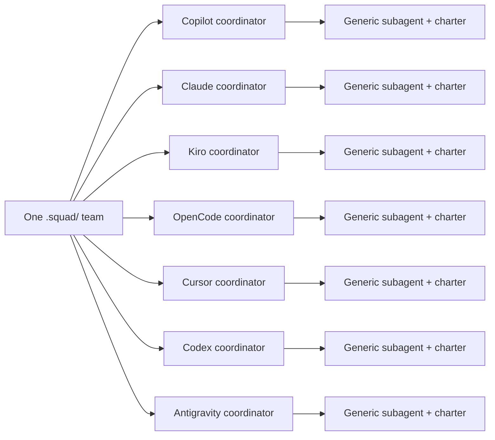
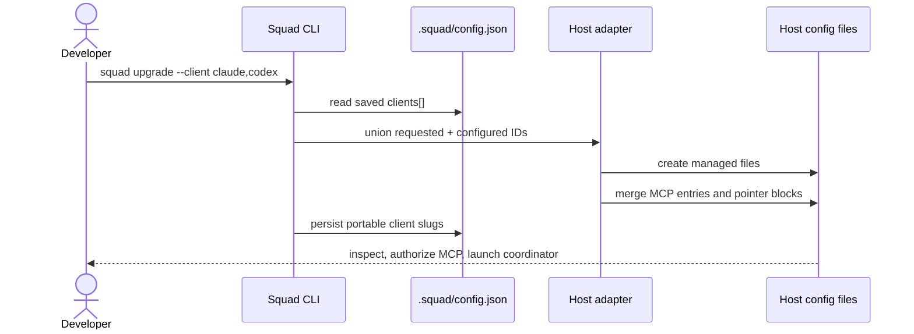
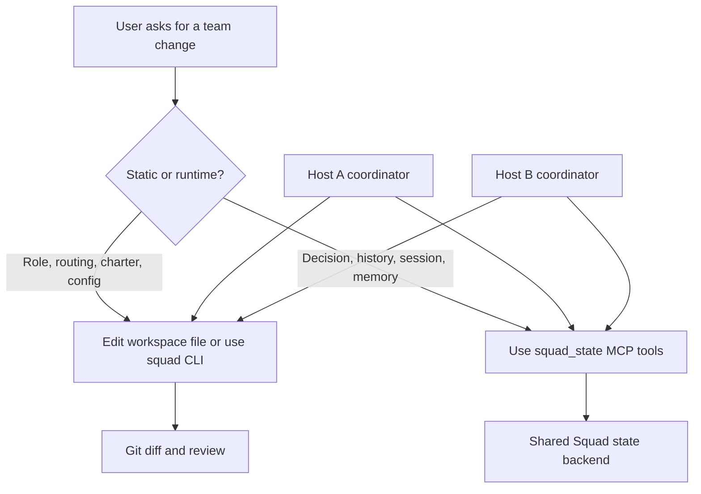
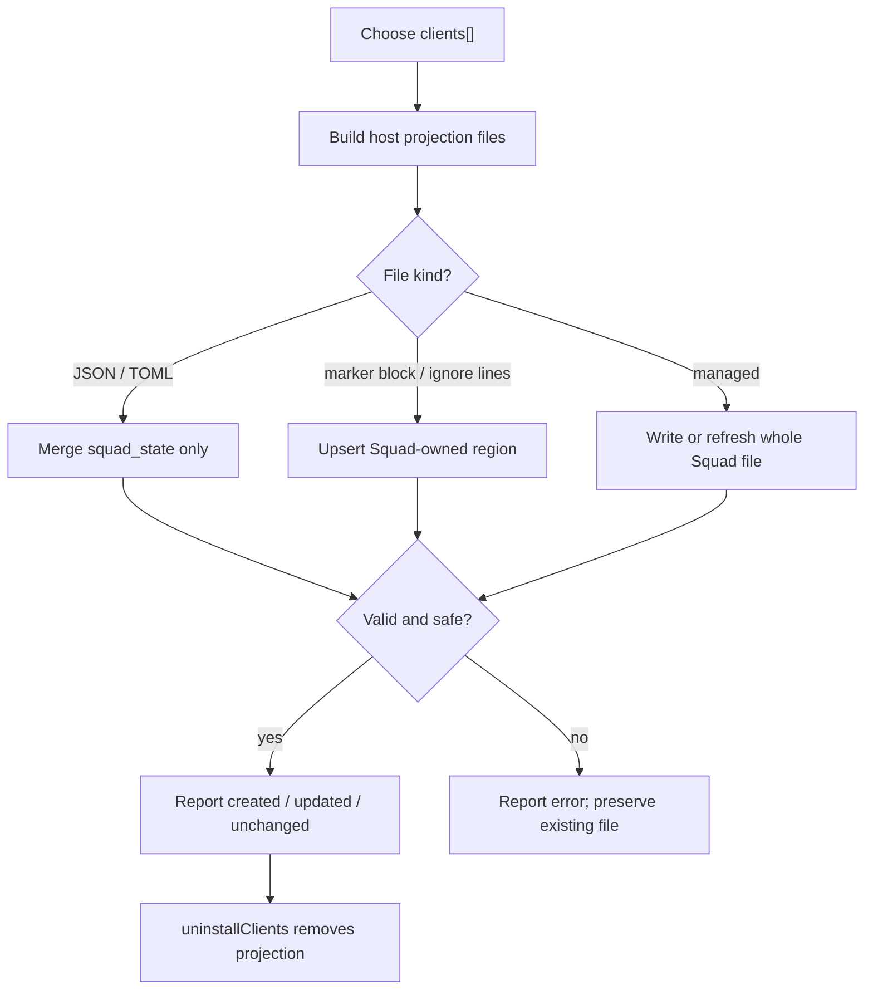

# Chapter 19: Using Squad Across Clients

> **Prerequisites:** Volume 1 (or equivalent Squad experience); Chapters 5 and 18.

> **Preview:** This chapter describes Squad 2.0 (`v2.0.0-preview.2`, the insider channel). Client projections and their host integrations are preview behavior; paths and details may change before Squad 2.0.0 is stable.

## What You'll Learn

- Explain how one `.squad/` team can be used from several different AI hosts without creating a separate Squad roster for every host.
- Install the Squad 2.0 preview, project one or more hosts with `squad init` or `squad upgrade`, and inspect the configured projection set.
- Identify exactly which files each of the seven adapters creates and how it merges with files you already own.
- Launch the generated coordinator in each host, understand sign-in and first-run MCP checks, and recognize when a documented headless path is not available.
- Keep static team configuration separate from mutable decisions and memory, so different hosts share the right kind of state.
- Add or remove a host deliberately, including preserving shared configuration and checking the result with Git.

## One Team, Many Hosts

The simplest useful model is **one Squad team, many host entry points**. Your roster, routing rules, charters, skills, decisions, and other shared Squad data live under one `.squad/` directory. A host projection gives that host a native way to start the Squad coordinator and connect it to shared state. It does not create another team or copy each specialist into a separate host-specific agent file.

Each host gets one generated **coordinator**. That coordinator reads the common team definition and routes work. When it assigns a task to a teammate, it launches an ordinary host-native subagent and includes that teammate's `.squad/agents/<name>/charter.md` in the subagent prompt. The specialist is therefore a role and charter applied to a generic subagent—not a seventh or eighth host-specific Squad agent that must be kept synchronized. The adapter changes the dispatch instructions to fit the host; it does not change who is on the roster.



The shared folder is the team definition, not an instruction to pretend every host behaves identically. Hosts differ in how they discover a coordinator, start subagents, ask for MCP approval, and present results. Squad generates a host-specific dispatch section so the coordinator can use those host-native mechanisms. For example, Copilot's coordinator is told about Copilot's `task`, app `create_session`, and VS Code `runSubagent` paths; Claude's uses `Task`; Codex's uses its custom-agent and worker mechanism; Antigravity's uses `invoke_subagent`. Each path still tells the coordinator to inline the relevant charter and team context.

This is the big change from Chapter 5. That v1.1.0 chapter examined compatibility among **Copilot surfaces**—CLI, VS Code, JetBrains, and GitHub.com—and warned that several surfaces were untested. Squad 2.0 instead adds generated, native host projections for seven named clients. The older compatibility matrix remains useful as historical context for Copilot surfaces, but it is not the 2.0 host list and does not certify every host feature. Chapter 20 examines host capabilities and negotiation in more detail; Chapter 21 covers the shared state boundary.

A cross-client repo still needs normal collaboration discipline. If two people open the same branch and checkout from different hosts, they are editing the same files, not isolated copies of the team. Decide how you will divide work, use branches or worktrees where appropriate, and inspect `git status` before accepting a result. Shared Squad state can coordinate decisions; it cannot prevent two clients from making conflicting edits to the same source file.

## Installing the 2.0 Preview and Selecting Hosts

For this Part IV chapter, use the v2 preview channel. The brief for this part pins the version to `v2.0.0-preview.2` and names the insider channel; the 1.1.0 CLI already on your machine does not understand these client flags.

```bash
npm install -g @bradygaster/squad-cli@insider
squad --version
```

If you installed Squad from another supported channel and want to switch the CLI itself, the preview instructions also permit:

```bash
squad upgrade --self --insider
```

Keep the CLI upgrade separate from refreshing a repository. The CLI must first be new enough to understand the host projection feature; then you use `init` or `upgrade` inside the project to create or refresh the files. A Squad CLI update does not sign you in to Claude, Kiro, Cursor, Codex, OpenCode, or Antigravity. Install each host client through its own supported vendor channel and authenticate with that host or model provider. A Copilot entitlement covers Copilot and can cover OpenCode when OpenCode is configured to use the GitHub Copilot provider. It does not grant access to the other providers; those require their own sign-in, plan, or credentials. Plans and provider terms can change, so check the provider account you intend to use.

The two main projection commands are:

```bash
# New project: create its Squad team and request these host projections.
squad init --client copilot,claude,codex

# Existing project: add these projections and refresh any previously configured ones.
squad upgrade --client copilot,claude,codex

# Request all seven supported host projections.
squad init --client all

# Preview the upgrade plan without writing files or persisting the selection.
squad upgrade --dry-run --client copilot,claude,codex
```

The accepted IDs are `copilot`, `claude`, `kiro`, `opencode`, `cursor`, `codex`, and `antigravity`; `all` expands to those seven. Lists are comma-separated. Parsing trims whitespace, treats IDs case-insensitively, removes duplicates, and emits them in canonical order. The CLI also accepts the plural spelling `--clients`, `--client=<list>`, and repeated `--client` flags. An unknown ID or an empty list is an error rather than a silently ignored selection.

Plain `squad init` and `squad upgrade` retain the default Copilot bootstrap. Additional host projections are strictly opt-in: they are applied when you name them on the command or when `.squad/config.json` already has a `clients` array to refresh. `squad upgrade --client a,b` is additive: it includes the requested clients and the clients already configured, rather than replacing that saved list. This prevents a routine upgrade from accidentally uninstalling a teammate's host.

To inspect the saved configuration and the files expected for each selected host, run:

```bash
squad client list
squad client list --json
squad client add cursor --dry-run
squad client add cursor
```

`client list` (also `client ls`) reports configured or implicit-default clients and marks each projection `projected`, `partial`, or `missing` according to whether the expected files exist. The `--json` form is useful for scripts. `client add <list>` projects additional hosts; it accepts `all`, and `--dry-run` reports the prospective selection without writing. `squad clients` is an alias for `squad client`. There is no `squad client remove` subcommand in this preview: removal is a deliberate uninstall/configuration operation, discussed below.

> **Tip:** Confirm `squad --version` and which `squad` is first on `PATH` before you use `squad cast` or the preview client commands. The source docs warn that an older published executable can shadow the intended build. In particular, do not assume an unqualified `npx squad` resolves to the same preview CLI you just installed globally.

### The portable `clients` setting

When you request projections, Squad records their host IDs in `.squad/config.json`:

```json
{
  "clients": ["copilot", "claude", "codex"]
}
```

This is projection metadata. It is not a credentials file and should never hold a token, provider URL, machine-specific path, thread ID, lease, or checkpoint. `normalizeClientIds()` accepts known IDs, trims and lowercases them, de-duplicates them, and returns canonical order. The adapter layer's `assertPortableClients()` is stricter: its input must be an array containing only valid known IDs without duplicates. Non-strings, sensitive-looking values, and unknown values are rejected; sensitive values are redacted in diagnostics.

There is a forward-compatibility nuance: the CLI also preserves safe, slug-shaped unknown IDs already found in configuration, because a newer CLI may have written them. An older CLI warns that it cannot project those IDs and skips them, but does not erase them on a config update. That preservation behavior is narrower than accepting arbitrary values: values that resemble secrets, paths, URLs, or other sensitive material are not carried forward. The setting is plain JSON, so hand-edit it carefully; if it is malformed, the CLI refuses to overwrite it when persisting a selection.

## The Seven Host Projections

The following inventory distinguishes **fully managed files** from user-owned files with a Squad-owned merge area. “Managed” means Squad refreshes the generated file as a whole; put durable custom instructions in `.squad/` or in files you own, not inside generated content. JSON and TOML rows identify the exact location of the `squad_state` entry.

| Host ID | Generated files | MCP configuration | Shared-file marker or merge area |
|---|---|---|---|
| `copilot` | `.github/agents/squad.agent.md`; `.mcp.json` | `.mcp.json` → `mcpServers.squad_state` | The agent file is managed by the CLI's init/upgrade pipeline. `.mcp.json` is user-shared JSON; only Squad's `mcpServers.squad_state` entry is managed. |
| `claude` | `.claude/agents/squad.md`; `.mcp.json`; `CLAUDE.md`; `.gitignore` | `.mcp.json` → `mcpServers.squad_state` | `CLAUDE.md` gets a `<!-- squad:begin ... -->` / `<!-- squad:end -->` block. `.gitignore` gets `.claude/worktrees/` under `# squad:claude`. The MCP key is shared with Copilot. |
| `kiro` | `.kiro/steering/squad.md`; `.kiro/agents/squad.json`; `.kiro/settings/mcp.json` | `.kiro/settings/mcp.json` → `mcpServers.squad_state` | Steering and agent files are managed; the MCP JSON config is merged by key. The steering file declares `inclusion: manual`; the agent points to `file://../steering/squad.md`. |
| `opencode` | `.opencode/agent/squad.md`; `opencode.json` (or `opencode.jsonc` when it is the only OpenCode config) | `opencode.json` or `.jsonc` → `mcp.squad_state` | The agent prompt is managed. Squad merges the `mcp.squad_state` object and adds the OpenCode schema default only when absent. |
| `cursor` | `.cursor/agents/squad.md`; `.cursor/rules/squad.mdc`; `.cursor/mcp.json` | `.cursor/mcp.json` → `mcpServers.squad_state` | Agent and rule files are managed; MCP JSON is merged by key. The rule sets `alwaysApply: false` so unrelated chats do not automatically become Squad sessions. |
| `codex` | `.codex/agents/squad.toml`; `AGENTS.md`; `.codex/config.toml` | `.codex/config.toml` → `[mcp_servers.squad_state]` | `AGENTS.md` gets a Codex-specific `<!-- squad:begin:codex ... -->` / `<!-- squad:end:codex -->` pointer block. The agent TOML is managed; the MCP table is upserted. |
| `antigravity` | `.agents/agents/squad.md`; `GEMINI.md` | `.agents/agents/squad.md` frontmatter → `mcpServers` entry named `squad_state` | `GEMINI.md` gets an Antigravity-specific `<!-- squad:begin:antigravity ... -->` / `<!-- squad:end:antigravity -->` pointer block. The agent file is managed. |

There is one implementation detail worth knowing for Copilot: the SDK's Copilot host projection owns the `.mcp.json` wiring, while the CLI's existing `init`/`upgrade` pipeline creates `.github/agents/squad.agent.md`. Together those are the Copilot projection listed above. The Copilot launch instruction may use `--additional-mcp-config @.mcp.json` if the host does not auto-load the repository file; the CLI's init output says the root `.mcp.json` is auto-loaded on the next Copilot CLI invocation.

The OpenCode choice is deterministic: if `opencode.json` exists, that is the target; if it does not exist and `opencode.jsonc` exists, Squad targets the JSONC-named file. If both are missing, it creates `opencode.json`. JSONC comments are not parsed or preserved by this merger, so a comment-containing `opencode.jsonc` is refused; Squad does not strip comments and rewrite the file behind your back.

The MCP defaults vary slightly by host, even though all adapters use the same logical server name:

| Host | Generated `squad_state` fields and defaults |
|---|---|
| Copilot | `.mcp.json`: `command`, `args`, default `env: {}` and `tools: ["*"]`. |
| Claude | `.mcp.json`: `command`, `args`, and default `env: {}`. If Copilot already added the same entry, the shared file keeps the Copilot-added fields. |
| Kiro | `.kiro/settings/mcp.json`: `command`, `args`, and defaults `env: {}`, `disabled: false`, `autoApprove: []`. |
| OpenCode | `opencode.json` / `.jsonc`: `type: "local"`, `command: [<executable>, ...args]`; `enabled: true` is a default on the MCP entry. A missing `$schema` gets `https://opencode.ai/config.json`. |
| Cursor | `.cursor/mcp.json`: `command`, `args`, and default `env: {}`. |
| Codex | `.codex/config.toml`: `command`, `args`, and default `startup_timeout_sec = 60`. |
| Antigravity | `.agents/agents/squad.md` frontmatter: a `mcpServers` list item named `squad_state`, with `command` and `args`. |

Defaults apply only when absent; the adapter owns the launch fields it writes. Do not copy one host's MCP stanza into another host's file and assume its schema or approval behavior transfers.



## Launching Each Host

First install the host application or CLI you intend to use, sign in with that host's account, and open the same Tasktrack checkout. Then project its files and launch its one `squad` coordinator. The generated prompt is the piece that routes to generic subagents and sends shared state through `squad_state`; choosing a custom agent called `squad` is not the same as starting one of the specialists directly.

The exact install commands for the seven external host products are not part of the four mapped chapter sources. The following table therefore names the host and the required account boundary without inventing vendor installers or changing commands that may vary by operating system. Follow each vendor's current installation and sign-in instructions. For the Squad CLI itself, use the insider install command above.

| Host | Install and access | Start the Squad coordinator | First-run MCP check and headless use |
|---|---|---|---|
| GitHub Copilot | Install Copilot CLI or use Copilot in VS Code; sign in with an account that has Copilot access. | Copilot CLI: `copilot --agent squad`. In VS Code, select the generated `squad` agent. | Inspect `.mcp.json`; the CLI says it auto-loads it on next invocation. If needed, use `copilot --agent squad --additional-mcp-config @.mcp.json`. Approve any host prompt for the local server. The mapped sources do not specify a print/headless flag for this coordinator. |
| Claude Code | Install Claude Code and authenticate with a Claude account or configured provider access. | `claude --agent squad --mcp-config .mcp.json`; alternatively delegate to the `squad` subagent. | Project `.mcp.json` servers are pending until approved once. Check `claude mcp list`. For headless use, pass `--mcp-config .mcp.json` with `claude -p`; otherwise state tools may be missing and an orphan/two-layer backend handshake halts. |
| Kiro | Install/open Kiro and sign in with the Kiro account or organization identity your workspace uses. | In the repository, select the generated `squad` agent. | Check `.kiro/settings/mcp.json` and handle Kiro's MCP trust prompt if shown. `autoApprove` is initialized to an empty list, not to “approve every tool.” The mapped quickstart documents the interactive agent picker, not a headless invocation. |
| OpenCode | Install OpenCode and sign in to a model provider. A Copilot license may cover the model when OpenCode is explicitly using the GitHub Copilot provider; other provider choices need their own access. | Type `@squad` or use the host's `task` flow. The generated agent has `mode: primary`. | Verify `opencode.json` (or the sole `opencode.jsonc`) has `mcp.squad_state` and that the server is enabled. The source gives the interactive invocation, not a specific headless/print command. |
| Cursor | Install Cursor and sign in to the Cursor account or provider plan you use. This access is separate from the Copilot entitlement. | Select the generated `squad` agent, or invoke the non-auto-applied rule on demand. | Run `cursor-agent mcp enable squad_state` once to enable the generated server. Confirm `.cursor/mcp.json`; this approval command is the documented setup step. The mapped sources do not provide a headless coordinator command. |
| OpenAI Codex | Install Codex and sign in with an OpenAI account/provider that can use it. | Run `codex` in the repo and choose the `squad` custom agent from `.codex/agents/squad.toml`. | Mark the project trusted in the Codex home configuration using its full path. The generated MCP config is in `.codex/config.toml`; honor Codex's trust and approval prompts. The sources document starting `codex` in the repo, not a headless `exec` invocation. |
| Google Antigravity | Install Antigravity and sign in with the Google identity/provider access available to you. Model quotas are per model. | `agy --agent squad`. Press Esc to dismiss the first-run verbosity banner if it appears. | The agent frontmatter attaches `squad_state`. If the tools are absent, the docs give `agy mcp add squad_state <command> <args...>` as a global fallback; use the launch spec in `.agents/agents/squad.md`. Select another model with `--model` when one model's quota is exhausted. No separate print-mode flag is documented in the mapped guide. |

### GitHub Copilot

Install Copilot CLI or use Copilot in VS Code, then sign in with a GitHub account whose Copilot access is enabled. The project coordinator is `.github/agents/squad.agent.md`; start it in CLI with `copilot --agent squad`, or select `squad` in VS Code. Both surfaces use the same team files but the actual delegated-task tool is host/surface-specific. The CLI writes `.mcp.json` with `mcpServers.squad_state`; init reports that it will auto-load it on the next Copilot CLI invocation. If it is not discovered, pass `--additional-mcp-config @.mcp.json`. A host may still ask you to trust a local MCP server; review the command before approving. The mapped sources do not specify a print-mode/headless flag for this generated agent, so use a separately verified Copilot CLI mode for automation rather than guessing one.

### Claude Code

Install Claude Code and authenticate with the Claude account or provider access allowed by your organization; Copilot access does not cover this host. Start the generated agent with `claude --agent squad --mcp-config .mcp.json`. Claude's project MCP server remains pending until you approve it once; `claude mcp list` shows whether `squad_state` is pending. Headless `claude -p` must receive `--mcp-config .mcp.json` too. Without it, the prompt can load while the state tools do not, and orphan/two-layer state handshakes stop rather than pretending file reads are equivalent. Squad deliberately does not enable every project MCP server through `enableAllProjectMcpServers` in `.claude/settings.json`.

### Kiro

Install/open Kiro and authenticate with the Kiro identity or organization your team uses. Select the generated `squad` agent in the project; its `.kiro/agents/squad.json` points at `file://../steering/squad.md`, and its resources include `.squad/team.md` and `.squad/routing.md`. The steering file's `inclusion: manual` is important: it keeps non-Squad conversations from inheriting coordinator instructions. Check `.kiro/settings/mcp.json` and respond to any host trust or first-use approval prompt; the generated `autoApprove` list is empty. The supplied guide does not establish a Kiro headless coordinator command, so the verified path is the project agent picker.

### OpenCode

Install OpenCode and sign into a model provider. A Copilot license can provide model access when you deliberately configure the GitHub Copilot provider; using another provider requires its access. Start Squad by addressing `@squad` or using OpenCode's `task` flow. The managed agent is `.opencode/agent/squad.md` with `mode: primary`. Confirm `mcp.squad_state` in the selected OpenCode config and its `enabled` default. The cited quickstart does not specify a noninteractive invocation for the generated agent. If OpenCode presents a local server approval or trust step, review it in OpenCode; the projection's `enabled: true` setting is configuration, not a universal authorization bypass.

### Cursor

Install Cursor, sign in with the Cursor account or provider plan your team uses, and open the project. Its generated coordinator is `.cursor/agents/squad.md`; the separate `.cursor/rules/squad.mdc` has `alwaysApply: false` so you opt into Squad rather than injecting the coordinator into unrelated work. Select the `squad` agent or invoke its rule. Run `cursor-agent mcp enable squad_state` once to approve/enable the local state server, then confirm the entry under `.cursor/mcp.json`. The source documents that MCP enablement step but not a headless command that selects this generated coordinator; do not substitute a guessed `cursor-agent` prompt flag.

### OpenAI Codex

Install Codex and authenticate using the OpenAI account or provider access available to your organization. From the project root, run `codex` and select the `squad` custom agent. Its full developer instructions live in `.codex/agents/squad.toml`; `.codex/config.toml` contains the state MCP entry, while root `AGENTS.md` has only a pointer so tools that auto-load that file do not inherit all coordinator instructions. Mark the project trusted in Codex's home configuration with the full project path. Trust and approval remain Codex decisions. The guide documents launching `codex` in the repo but gives no headless `exec` form for this agent.

### Google Antigravity

Install Antigravity and authenticate with the Google identity/provider access available to you. Start the project agent with `agy --agent squad`; press Esc to dismiss the first-run verbosity banner when it appears. The coordinator file `.agents/agents/squad.md` carries the `squad_state` MCP server in frontmatter, and `GEMINI.md` is only a pointer. If the MCP tools do not appear, use the documented global fallback `agy mcp add squad_state <command> <args...>` with the launch spec from the generated agent. Model quotas are per model: choose another with `--model` if one is exhausted. No separate print-mode invocation is described in the mapped guide.

For Claude, the MCP behavior is especially easy to misread. The generated `.mcp.json` is project-scoped, but Claude Code does not automatically make project servers available before approval. The first approval is a host trust decision, not a special Squad setup step. Squad intentionally does **not** set `enableAllProjectMcpServers: true` in `.claude/settings.json` on your behalf. Keeping the approval explicit is the safe default. A headless invocation that omits `--mcp-config .mcp.json` can appear to start the coordinator while leaving it without `squad_state_*` tools; with local state it might read files, but non-local backends require the handshake and cannot silently fall back.

Codex has a different prerequisite: a correct `.codex/config.toml` does not replace project trust. Use the full path in the Codex home configuration; the quickstart specifically warns against short 8.3-style paths. For Antigravity, remember that quotas are per model, so a quota failure for one model does not mean the Squad projection is broken. Use `--model` to select an available model. For Cursor, the documented command is `cursor-agent mcp enable squad_state`; running it once is the approval step, not a replacement for checking that the generated server definition is right.

The headless column is intentionally conservative. The guides explicitly document Claude's `-p` requirement and the Antigravity agent launch, but do not specify noninteractive prompt flags for every other host. Do not copy flags like `--print`, `exec`, or `-p` from another vendor's CLI and assume they apply to the generated Squad agent. Use only a host's current documented headless mechanism after verifying MCP discovery and the `squad` agent in an interactive session.

## A Polyglot Repository in Practice

A polyglot repo is a repository whose contributors use different AI hosts. One person may use Copilot CLI, another Claude Code, and a third Codex. Each opens the same repository and the same `.squad/` team, but each starts the host-native `squad` coordinator file. The coordinator's host-specific dispatch section handles how it launches generic specialists; the common team files keep roster, roles, and routing aligned.

A low-friction rollout is incremental:

1. Start with one host that already works for the team.
2. Add a second adapter with `squad upgrade --client <new-host>`.
3. Review its generated prompt, MCP definition, and shared-file block before committing them.
4. Have one contributor complete a small task from the new host while another performs a read-only check from the original host.
5. Record a decision with the state tool in one host and read it from the other.
6. Add the remaining hosts only after the team is comfortable with the review and trust steps.

Commit generated **static** host files when you want every clone to discover the same coordinator and MCP endpoint definition. Do not commit credentials simply to make clients “match.” Authentication belongs to each developer or the host's secure credential store. If a team uses different providers, the model results and host capabilities can differ even though all clients read the same team charter and durable decisions.

The generated files don't make two editors' changes transactional. A coordinator can delegate to several specialists inside its host, but different users in a polyglot team still need branch discipline. Keep one owner per file or task where possible, ask each coordinator to summarize its diff, and use Git review to reconcile changes. Shared state improves the information flow; Git remains the code-change audit and merge mechanism.

## Static Team Configuration and Mutable Runtime State

A portable setup needs a firm boundary between what defines the team and what changes while the team works.

| Kind | Examples | How to read or change it | Shared across clients? |
|---|---|---|---|
| Static team configuration | `.squad/team.md`, `.squad/routing.md`, `.squad/config.json`, `.squad/agents/<name>/charter.md`, templates, skills | Read as workspace files; update with ordinary file edits and Squad CLI commands such as `squad cast --name X --role "Y"`. | Yes, as repository/project files. Review and commit intended team changes. |
| Mutable runtime state | Decisions, agent history, session records, logs, scratch entries, memory | Use `squad_decide`, `squad_state_*`, and available `memory.*` MCP tools. | Yes, through the shared state backend; each host uses its configured `squad_state` transport. |



Use `squad_decide` to record a decision, not a raw filesystem write to `decisions.md`. Use the `squad_state_*` family for governed runtime reads and writes, and the `memory.*` tools when the backend exposes them. Host tool names are namespaced differently—for example, Claude may display `mcp__squad_state__squad_state_read`, OpenCode may show `squad_state_squad_state_read`, and Kiro may show `@squad_state/squad_state_read`. Call the actual tool name visible in that host.

Conversely, do not write static files through `squad_state_write`. The state boundary rejects static configuration; edit the file normally or use the CLI. To add a teammate, use the supported casting command, for example `squad cast --name Morgan --role "Owns API integration tests"`, then inspect the roster and generated charter. Don't hand-edit `.squad/casting/` bookkeeping. Chapter 21 explains how the state MCP boundary and alternate backends work; this chapter's rule is the practical one: **files describe the team; state tools record what the team learns and decides**.

## Add or Remove a Host Later

Adding hosts is safe to do incrementally. `squad client add claude,codex` and `squad upgrade --client claude,codex` both add those IDs to the existing configured set and re-project configured clients. `squad upgrade --dry-run --client claude,codex` previews the planned set; it does not persist the new IDs or write generated files. After applying, inspect every reported file path, ensure the MCP launch command matches your deployment, and commit the reviewed output.

Removing a host is deliberately not the inverse of `client add` on the CLI. The preview has `client list` and `client add`, but no `client remove`; an upgrade refreshes configured IDs. At the SDK level, `uninstallClients` removes the projection, and a config edit removes the host ID from `.squad/config.json` so the next upgrade does not recreate it. The API accepts a `keep` list to preserve shared JSON config files still used by remaining hosts.

```ts
import { uninstallClients } from '@bradygaster/squad-sdk/client';

const results = uninstallClients(
  ['claude'],
  { root: process.cwd(), mcp: { command: 'squad', args: ['state-mcp'] } },
  ['copilot', 'codex'],
);
console.log(results);
```

The sample uses the short launch spec shown in the docs. In a real project, pass the same launch specification that the generated MCP entry uses. `keep` prevents removal of `.mcp.json` while Copilot still needs the shared `squad_state` entry. Afterward, update `.squad/config.json` to list only the hosts that remain. Uninstalling files does not edit the `clients` array for you, and it never deletes `.squad/` team state.

The apply layer distinguishes file types: it deletes a fully managed file, removes only the `squad_state` entry from a shared JSON/TOML config, strips only Squad's marker block from a shared Markdown file, or removes only the lines it added to `.gitignore`. If there was no user content in a host-specific file before projection, the host-specific paths should return to their prior state. When a shared config is still needed by another adapter, it is not expected to return to its pre-projection bytes; it should retain that other adapter's entry. Compare the relevant host-specific paths to the pre-projection commit rather than expecting the entire polyglot repo to become clean.

For a true rollback check, commit a clean baseline before projection. After adding and committing the clients, remove one host with `uninstallClients`, remove that host from `clients[]`, and compare its unique files against the baseline. For example, removing Claude while keeping Copilot and Codex should remove `.claude/agents/squad.md`, restore the pre-existing `CLAUDE.md` and `.gitignore` content, and leave the shared `.mcp.json` entry that Copilot still needs. `git diff <baseline> -- .claude/agents/squad.md CLAUDE.md .gitignore` should show no differences if those paths had no independent edits after the baseline. Inspect `.mcp.json` separately: it is still used by Copilot, so its remaining Squad entry is expected. If you uninstall every host that uses a shared file, compare that file too.

> **Warning:** Treat this as a managed projection, not a backup system. Do not edit inside Squad's marker blocks or replace a managed file with private notes. Put changes in your own content outside the marker or in the static source under `.squad/`. If you've made edits since installation, review the result before uninstalling.

## How Additive Merging and Rollback Work

A projection may create new files, refresh a fully Squad-managed file, or merge a small section into a user-owned file. The merger is additive in the sense that it changes only the adapter's own key, table, or marker region. Existing unrelated MCP servers and top-level settings remain. It is not an arbitrary structural three-way merge, and it does not promise to preserve every comment in every config format.

- **JSON MCP configs:** Squad parses a JSON object, keeps unrelated root keys and server entries, and upserts `squad_state`. The launch fields (`command` and `args`) are Squad-owned; other fields on that entry remain, while defaults such as `env`, `tools`, or `enabled` are supplied only when missing. The writer preserves the existing indentation style, dominant line ending, and trailing-newline convention. A malformed JSON file, a non-object root, or a non-object MCP container/entry causes that file's projection to report an error rather than overwrite it. Other files in the requested projection may still be processed.
- **JSONC:** OpenCode can target `opencode.jsonc` when it is the only OpenCode config, but the code refuses a JSONC file containing `//` or `/* ... */` comments. Convert it to plain JSON or add the MCP entry manually; the merger will not erase comments to make parsing succeed.
- **TOML:** Codex uses a targeted upsert for `[mcp_servers.squad_state]`, setting the `command` and `args` launch fields and adding `startup_timeout_sec = 60` only when that key is absent. Unrelated tables and keys are retained. The merger also handles common dotted or inline definitions, preserving non-managed keys when it can convert them safely; it refuses conflicts such as trying to extend an inline or scalar ancestor as a normal table. It preserves the file's line-ending style. This is a focused updater, not a general TOML formatter.
- **Markdown:** `CLAUDE.md`, `AGENTS.md`, and `GEMINI.md` are updated between their managed begin/end markers. The Codex and Antigravity blocks have IDs so they can coexist with other Squad-managed blocks. Text outside the selected block stays in place. An unclosed marker causes a refusal rather than deleting the rest of the file.
- **`.gitignore`:** Claude's adapter upserts `.claude/worktrees/` under `# squad:claude`. If that ignore line was already present, Squad does not claim it as a new line; uninstall leaves pre-existing user content alone.
- **Managed agent files:** The host coordinator prompt, Kiro's JSON agent descriptor, and Cursor's rule are regenerated from the current templates. Do not treat those files as the source of truth for your roster or durable custom policy.

The adapter writes changed files atomically through a sibling file and rename, and resolves every projection path under the project root. A bad or unsafe path does not escape the workspace. Its result list reports `created`, `updated`, `unchanged`, `removed`, or `error`; a failed file is visible instead of being silently treated as installed. The CLI can keep an already-configured host in the saved list even if one of its existing projection files fails, while a newly requested host with a failed projection is not persisted as if it were healthy.



No snapshot archive of every original byte is needed for the ordinary managed-block case: the removal logic deletes owned files or removes the owned region/entry. Still, “byte-for-byte” should be interpreted with the right boundary. For a previously clean, host-specific path, comparing with its baseline should show exact restoration. A shared JSON file may remain because another client still uses it; in that case preserve the other projection with `keep` and compare the portions and paths the removed host owns. Do not remove the shared key while a remaining host depends on it.

## 2.0 Client Compatibility and Installation: What's Different

Chapter 5 framed compatibility around Copilot's interaction surfaces. In that version, the client matrix was a research guide and explicitly marked JetBrains and GitHub.com as unclear. Squad 2.0 changes the unit of compatibility: the CLI can now project a coordinator and `squad_state` wiring into seven named host formats. Each adapter declares host capabilities and dispatch instructions. This is a concrete setup improvement, not a claim that every tool, model, approval system, or user experience is interchangeable.

The installation flow is consequently two-layered:

1. Install or update the **Squad CLI** at the preview version so it can emit 2.0 projections.
2. Install and authenticate the **host client** you want to use.
3. Run `squad init --client ...` for a new Squad project, or `squad upgrade --client ...` for an existing team.
4. Inspect the host files, trust/approve the local MCP server as required, then launch that host's `squad` coordinator.

The 1.1.0 installation story centered on `.github/agents/squad.agent.md` and `.squad/`; the multi-client flow keeps that underlying team, then adds native host files. The generated adapters do not move your roster to each host's private profile, and they do not turn one provider's account into a universal license. A Copilot license can be used from OpenCode through its Copilot provider; Kiro, Cursor, Antigravity, Claude Code, and Codex still use their own access boundary. Verify your organization's provider policy before distributing a shared repository config.

The generic installation page included in the chapter source set still emphasizes installing GitHub Copilot CLI as a prerequisite. For the 2.0 multi-host workflow, read that as the pre-existing Copilot-centered installation baseline, not a requirement to use Copilot as the coordinator for every projection. Each host's generated files and the client tutorial are the 2.0-specific path. Likewise, the older compatibility page still contains historical `.ai-team/` and Copilot-surface language alongside its new 2.0 banner; use its legacy matrix as background, not as the exact 2.0 projection inventory.

## Hands-On: Project Tasktrack into Three Hosts

This exercise uses the Tasktrack companion project. If you have advanced it through earlier chapters, use that existing repository and preserve its team and memory. If you are starting fresh, copy the starter and initialize Squad once. Do not replace an existing roster just to follow this exercise.

```bash
cp -R sample ~/tasktrack
cd ~/tasktrack
git init
git add .
git commit -m "Tasktrack starter"
npm test
```

Confirm Node.js is at least 22.18 for the companion project, and confirm the starter tests pass. For a fresh repository, install the Squad 2.0 insider CLI, then run `squad init` to create the team. For a repository with an existing Tasktrack team, install the preview CLI and start with `squad upgrade`. If your baseline already includes the hosts from an earlier attempt, note the current client list first.

Before projection, commit or tag a clean baseline so you can later compare the host-specific paths. Then project Copilot, Claude, and Codex (or use `all` if you have authenticated all seven hosts):

```bash
# On an existing Tasktrack Squad:
squad upgrade --client copilot,claude,codex

# To preview instead of writing:
squad upgrade --dry-run --client copilot,claude,codex

# On a fresh Tasktrack repo, choose hosts during init:
# squad init --client copilot,claude,codex

# Optional all-host variant:
# squad upgrade --client all
```

Review the projection before accepting it:

```bash
squad client list
git status --short
git diff -- .squad/config.json .mcp.json CLAUDE.md AGENTS.md .gitignore
```

Inspect each generated coordinator file, not just the diff summary. Check the `squad_state` launch command, the marker boundaries, and the host-specific dispatch section. Verify that Codex's `AGENTS.md` is only a short pointer and that its full instructions are in `.codex/agents/squad.toml`. Verify that Claude's `.gitignore` block covers `.claude/worktrees/`. Commit the reviewed projection files so you can distinguish generated work from later edits.

Open the same Tasktrack checkout from two hosts—for example, start Copilot with `copilot --agent squad` and Claude with `claude --agent squad --mcp-config .mcp.json`. Approve the project MCP server once in Claude and confirm its status with `claude mcp list`. Ask each coordinator to perform the same small, read-only task, such as identifying the API's task routes and reporting the test command. Compare which teammate each routed the request to, whether each host actually used a subagent, and whether both results refer to the same repository paths. Do not assume the tools behave identically; confirm by reading the host's output and your Git status.

Next ask the coordinator in one host to record a small durable decision using `squad_decide`, for example: “For this exercise, use `node:test` and do not add dependencies to Tasktrack.” Then ask the other host to read the decisions through its `squad_state_*` tools and restate that decision. Verify the decision through the host's state tool, not by opening and hand-editing `decisions.md`. That is the practical proof that both coordinator entry points reach the same Squad state backend.

Now remove Claude while leaving Copilot and Codex installed. `uninstallClients` is an SDK function, not a `squad client remove` subcommand. In a Node environment that can resolve `@bradygaster/squad-sdk/client`, run:

```ts
import { uninstallClients } from '@bradygaster/squad-sdk/client';

const root = process.cwd();
const results = uninstallClients(
  ['claude'],
  { root, mcp: { command: 'squad', args: ['state-mcp'] } },
  ['copilot', 'codex'],
);
console.log(results);
```

Pass the actual launch spec from your generated `.mcp.json` in place of the illustrative short spec if it differs. Edit `.squad/config.json` so its `clients` array lists only `copilot` and `codex`; the uninstaller does not edit that setting. Then check:

```bash
git diff <baseline-commit> -- .claude/agents/squad.md CLAUDE.md .gitignore
git diff -- .mcp.json
squad client list
```

The first command should be empty when those Claude-owned paths had no later independent edits. The `.mcp.json` diff should retain the Copilot `squad_state` entry, because Copilot is in the `keep` set. `squad client list` should show Claude no longer configured and report Copilot/Codex according to their remaining files. If you want to prove the entire original pre-projection state is restored, uninstall the remaining hosts too, remove the `clients` key if it was absent in the baseline, and compare the relevant paths to that baseline. Never expect a shared file to lose an entry that a retained client still needs.

**Copilot-only fallback:** If you do not have Claude or Codex access, run `squad upgrade --client copilot`, inspect `.github/agents/squad.agent.md` and `.mcp.json`, then open the same repo in Copilot CLI and VS Code (or two Copilot CLI sessions). Ask one session to record a decision and another to read it. You can still practice the static/runtime boundary and compare the generated host files, but you will not be testing independent third-party provider sign-in or approvals.

## Configuration Reference

| Command or setting | Meaning | Important behavior |
|---|---|---|
| `squad init --client <list>` | Create a team and project selected clients | A comma-separated list or `all`; additional host projections require opt-in. The default Copilot bootstrap remains. |
| `squad upgrade --client <list>` | Refresh configured clients and add requested clients | Selection is a union with saved `clients[]`; it is not a removal operation. |
| `squad upgrade --dry-run --client <list>` | Preview client projection along with upgrade work | Writes nothing and does not persist the new selection. |
| `squad client list [--json]` | Inspect configured hosts and presence of expected files | `ls` is an alias; an empty saved list means Copilot is the implicit default. |
| `squad client add <list> [--dry-run]` | Add and project hosts | Same additive projection behavior as upgrade. `all` is accepted. |
| `.squad/config.json` → `clients` | Persist portable host IDs | Canonical IDs, no secrets or machine-specific state. Safe unknown slug IDs from a newer CLI may be preserved by this CLI. |
| `.mcp.json` → `mcpServers.squad_state` | Copilot/Claude state bridge | Shared JSON file; use uninstall `keep` when either host remains. |
| `.kiro/settings/mcp.json` → `mcpServers.squad_state` | Kiro state bridge | Configured additively; generated default `autoApprove` is empty. |
| `opencode.json` / `.jsonc` → `mcp.squad_state` | OpenCode state bridge | JSONC comments are not mergeable; `.json` wins if it exists. |
| `.cursor/mcp.json` → `mcpServers.squad_state` | Cursor state bridge | Enable once with `cursor-agent mcp enable squad_state`. |
| `.codex/config.toml` → `[mcp_servers.squad_state]` | Codex state bridge | Project trust is also required; default startup timeout is 60 seconds when absent. |
| `.agents/agents/squad.md` frontmatter | Antigravity state bridge | Local agent declares `squad_state`; the documented CLI launch is `agy --agent squad`. |
| `uninstallClients(clients, ctx, keep?)` | Remove selected host projections | Leaves `.squad/` intact; retains shared JSON paths still projected by `keep`. |
| `claude --agent squad --mcp-config .mcp.json` | Start Claude coordinator with project MCP config | Approve the project server once; headless `claude -p` must include the same config. |
| `cursor-agent mcp enable squad_state` | Approve Cursor's generated MCP server | Run once per Cursor MCP setup. |
| `agy --agent squad [--model …]` | Start Antigravity coordinator or choose another model | Model quotas are per model. |

## Under the Hood

The CLI separates flag parsing and persistence from host-file projection. `packages/squad-cli/src/cli/core/clients.ts` handles `--client` parsing, reads and writes `.squad/config.json`, forms the union of explicitly requested and already configured IDs, and calls the SDK. It treats a dry run as a calculation only. `packages/squad-cli/src/cli/core/init.ts` keeps the standard Copilot bootstrap and then applies requested projections; `packages/squad-cli/src/cli/core/upgrade.ts` refreshes configured projections and plans them in `--dry-run` mode. Both delegate the common host work to the client core.

The public command surface lives in `packages/squad-cli/src/cli/commands/client.ts`. Its `listClients()` function is read-only: it asks the adapters which paths should exist and compares them with disk. The CLI command supports `list`/`ls` and `add`; the source does not define a remove subcommand. This is why the chapter uses `uninstallClients` for removal rather than inventing `squad client remove`.

The SDK adapter directory defines the shared contracts and implementations:

- `packages/squad-sdk/src/client/adapters/types.ts` contains the canonical `ClientId` list, host capability metadata, projection file kinds (`managed`, `json`, `block`, `lines`, and `text`), and result actions.
- `packages/squad-sdk/src/client/adapters/coordinator.ts` builds the common coordinator protocol and appends the chosen dispatch strategy. Its host-specific text explains that specialists are generic subagents with charters inlined.
- `packages/squad-sdk/src/client/adapters/adapters.ts` defines each `HOST_PROJECTIONS` entry and its file paths. The current registry has seven hosts. Its file header comment still says “five client host adapters,” a stale count; use `CLIENT_IDS` and `HOST_PROJECTIONS` as the actual list.
- `packages/squad-sdk/src/client/adapters/apply.ts` performs safe path resolution, JSON/TOML/block/line updates, formatting preservation, per-file error reporting, and removal. `uninstallClients()` computes which JSON files remain needed from the `keep` list before removing a projection.
- `packages/squad-sdk/src/client/adapters/portable.ts` implements normalization, safe forward-compatible unknown-slug preservation, and strict portable-client assertions. `capabilities.ts` distinguishes declared host capabilities from the negotiated intersection with backend and policy; Chapter 20 focuses on that contract.

The SDK also exposes programmatic installation when an application wants to project clients without invoking the CLI:

```ts
import { installClients, parseClients } from '@bradygaster/squad-sdk/client';

installClients(parseClients('claude,cursor,codex'), {
  root: process.cwd(),
  mcp: { command: 'squad', args: ['state-mcp'] },
});
```

This is the same projection API used by the CLI; `parseClients()` keeps IDs canonical, and `installClients()` returns one result per file so callers can surface errors.

For example, the common parser accepts `all` and returns the canonical registry order:

```ts
export function parseClients(value: string | readonly string[] | undefined): ClientId[] {
  if (value === undefined) return [];
  const parts = (typeof value === 'string' ? value.split(',') : [...value])
    .map((p) => p.trim().toLowerCase())
    .filter(Boolean);
  if (parts.length === 0) throw new Error('No client specified.');
  const wanted = new Set<ClientId>();
  for (const p of parts) {
    if (p === 'all') CLIENT_IDS.forEach((c) => wanted.add(c));
    else if ((CLIENT_IDS as readonly string[]).includes(p)) wanted.add(p as ClientId);
    else throw new Error(`Unknown client "${p}".`);
  }
  return CLIENT_IDS.filter((c) => wanted.has(c));
}
```

And the removal API preserves JSON files still in use by a retained client:

```ts
export function uninstallClients(
  clients: readonly ClientId[], ctx: ClientContext, keep: readonly ClientId[] = [],
): ApplyResult[] {
  const keepPaths = new Set(
    projectClients(keep.filter((c) => !clients.includes(c)), ctx)
      .filter((f) => f.kind === 'json').map((f) => f.path),
  );
  return removeProjection(ctx.root,
    projectClients(clients, ctx).filter((f) => !(f.kind === 'json' && keepPaths.has(f.path))));
}
```

The implementation is additive at file boundaries, not at every possible semantic layer. `mergeMcpServer()` owns the Squad launch fields, while JSON formatting and unrelated MCP entries are retained. `upsertTomlTable()` targets Codex's one table. Markdown blocks have stable markers, and `.gitignore` lines are owned only when Squad inserts them under its marker. Managed coordinator prompts are refreshed from the source template. These boundaries explain both the value and the limits of rollback: the uninstaller knows which pieces Squad owns, but a user edit inside an owned region is not treated as an independent version to merge.

Two source-document details are worth keeping straight. First, the general installation page still describes Copilot CLI as the primary runtime prerequisite; this chapter's seven-host workflow follows the newer preview projections and does not require Copilot to be the selected host for Claude, Kiro, OpenCode, Cursor, Codex, or Antigravity. Second, the client compatibility page carries older Copilot-surface material, including `.ai-team/` references; use the 2.0 scenario and tutorial for projection filenames. Neither is a reason to ignore the host's own trust model.

## Pitfalls and Troubleshooting

| Host | Symptom | Check and next step |
|---|---|---|
| Copilot | `squad` agent starts but state tools are missing | Confirm you are using the preview CLI, inspect `.mcp.json`, and try `copilot --agent squad --additional-mcp-config @.mcp.json`. Check the host's MCP approval prompt. |
| Claude Code | State tools show pending or disappear in `claude -p` | Approve once; inspect `claude mcp list`; include `--mcp-config .mcp.json` on every headless run. Squad does not set `enableAllProjectMcpServers`. |
| Kiro | Coordinator instructions appear in unrelated sessions or MCP is unavailable | Check that `inclusion: manual` is present, `.kiro/agents/squad.json` points at `file://../steering/squad.md`, and `.kiro/settings/mcp.json` contains the entry. Review the empty `autoApprove` list and host trust prompt. |
| OpenCode | Wrong file changed, or merge refuses | If `opencode.json` exists, Squad prefers it over `.jsonc`. A comment-containing `.jsonc` cannot be merged. Preserve the existing config and add the MCP entry manually or convert it to plain JSON. |
| Cursor | Coordinator loads, but shared state tools are absent | Run `cursor-agent mcp enable squad_state`; verify `.cursor/mcp.json` and select the `squad` agent or invoke its rule on demand. |
| Codex | Custom agent or MCP server is not discovered | Confirm `.codex/agents/squad.toml`, `.codex/config.toml`, and the `AGENTS.md` pointer; trust the project using its full path in Codex home config. |
| Antigravity | `agy --agent squad` lacks state tools or a model quota error occurs | Inspect the agent's `mcpServers` frontmatter; if needed, register `squad_state` using the documented `agy mcp add` form. Try `--model` if that model's quota is exhausted. |

Common across hosts:

- **Files are missing after a projection:** Run `squad client list` (or `--json`) and read each missing path. Check command output for a per-file error; a malformed config can block one file without aborting every other host file.
- **A config looks valid but was not updated:** JSON comments are not valid JSON for this merger. OpenCode JSONC comments are explicitly refused. Back up or convert the file rather than deleting content by hand.
- **A new host is added back after removal:** Remove its projection and also remove its slug from `.squad/config.json`. A later `squad upgrade` refreshes saved hosts.
- **An old host list is unexpectedly preserved:** `upgrade --client` adds to the configured set. It is not a replacement argument. Edit the static `clients` list when your intended set is smaller.
- **The host starts but a specialist does not:** Check the generated coordinator's dispatch section, host availability, model/provider access, and tool permission. The roster charter is in `.squad/agents/<name>/charter.md`; it is not a separate projected host agent.
- **Different hosts see different decisions:** Confirm they are opening the same project and same `.squad/` root, that `squad_state` points to the intended backend, and that each host approved/loaded it. Do not use direct file writes as a substitute for a broken non-local state bridge.
- **A cast appears to do nothing:** Check `squad --version` and `command -v squad`; a stable CLI earlier on `PATH` may be shadowing the insider build. The current coordinator prompt recommends `squad cast --name <Name> --role "<Role>"` for registering a member.
- **Removal leaves a config entry:** This is expected if another host remains in `keep`; shared MCP config must survive while that host uses it. Compare host-owned paths, not the whole repo, against the baseline.

## Summary

Squad 2.0 gives each of seven supported hosts a native coordinator entry point while preserving one `.squad/` team. The coordinator dispatches host-native generic subagents and includes the appropriate specialist charter; it does not create one host-specific copy of every teammate. `squad init --client ...` selects hosts at creation, `squad upgrade --client ...` adds and refreshes hosts, and `squad client list` helps verify what is present. The configured `clients` list contains portable IDs, not credentials.

Host projections merge through explicit ownership boundaries: generated files are managed, shared JSON and TOML configs get a targeted MCP entry, Markdown uses marker-delimited blocks, and Claude's `.gitignore` line has its own marker. Check each host's sign-in and approval flow, especially Claude's explicit `--mcp-config`, Cursor's `mcp enable`, Codex project trust, and Antigravity's per-model quota. Keep static team files in the repository and mutable decisions and memory behind `squad_state`. When removing a host, use `uninstallClients`, preserve shared files needed by retained hosts, and remove its ID from config so upgrades do not bring it back.

## Exercises

1. **Map the projection.** Pick Copilot, Claude, and Codex. List every file each generates, label each as managed, JSON/TOML merge, marker block, or ignore-line update, and identify any path shared by two hosts. Explain which path would remain if you uninstall only Claude.
2. **Portable client configuration.** Given a `clients` list containing mixed-case IDs, duplicates, a token-like string, a machine path, and a safe unknown slug, explain how `normalizeClientIds()` handles each category and what an older CLI may preserve.
3. **MCP approval diagnosis.** A teammate launches Claude headlessly and the coordinator reports no `squad_state_*` tools. Write the corrected launch form and explain why enabling all project MCP servers globally is not the generated fix. Add the corresponding one-time Cursor setup command.
4. **Static or mutable?** Classify each action: add an API specialist, update a routing rule, record a decision, append an agent learning, and add a host projection. Name the correct file or tool for each.
5. **Removal plan.** A repo uses Copilot, Claude, and Codex. Describe how to remove Claude without deleting Copilot's shared `.mcp.json` configuration, how to prevent `squad upgrade` from recreating Claude, and which paths to compare with the baseline.

## Quiz

1. Does `squad init --client all` create seven separate Squad rosters or seven host coordinators backed by one team?
2. What does `squad upgrade --client claude,codex` do when Copilot is already in `.squad/config.json`?
3. Which CLI subcommands are defined under `squad client`, and is there a `remove` subcommand?
4. What MCP file and approval detail must be remembered for Claude Code headless runs?
5. Which command enables the Cursor MCP server named `squad_state`?
6. What must Codex project trust use: a full path or a short 8.3-style path?
7. Which host's quickstart calls out per-model quota and the `--model` option?
8. Where should a durable runtime decision be recorded, and where should a routing-rule change be made?

## Further Reading

- [Using Squad across clients](https://bradygaster.github.io/squad/docs/scenarios/using-squad-across-clients/)
- [Multi-client quickstart for Squad 2.0](https://github.com/bradygaster/squad/blob/v2.0.0-preview.2/docs/tutorials/multi-client-quickstart.md)
- [Client compatibility matrix](https://bradygaster.github.io/squad/docs/scenarios/client-compatibility/)
- [Installation](https://bradygaster.github.io/squad/docs/get-started/installation/)
