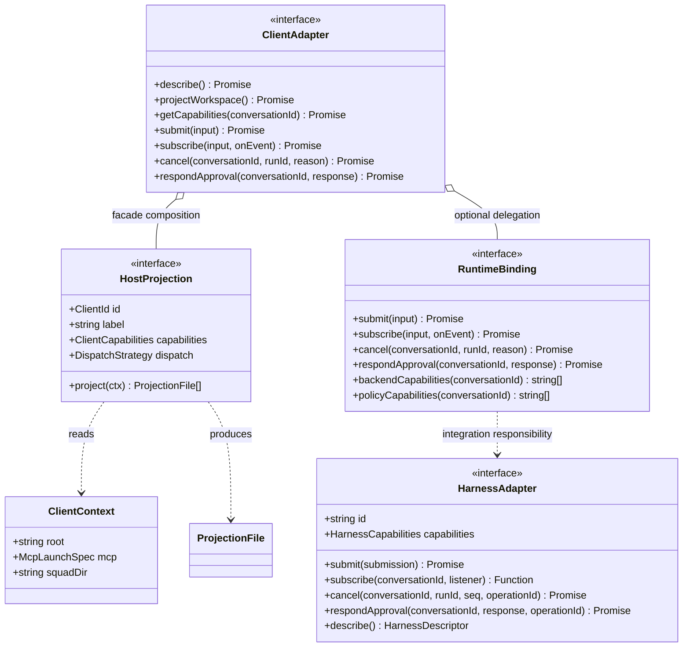
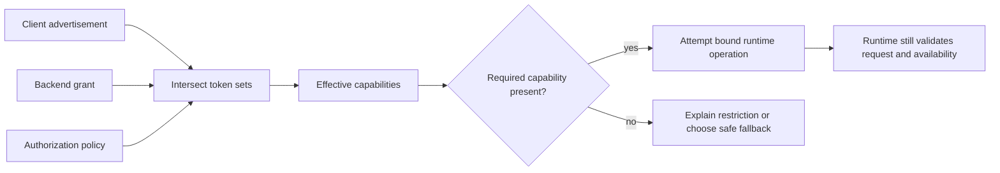
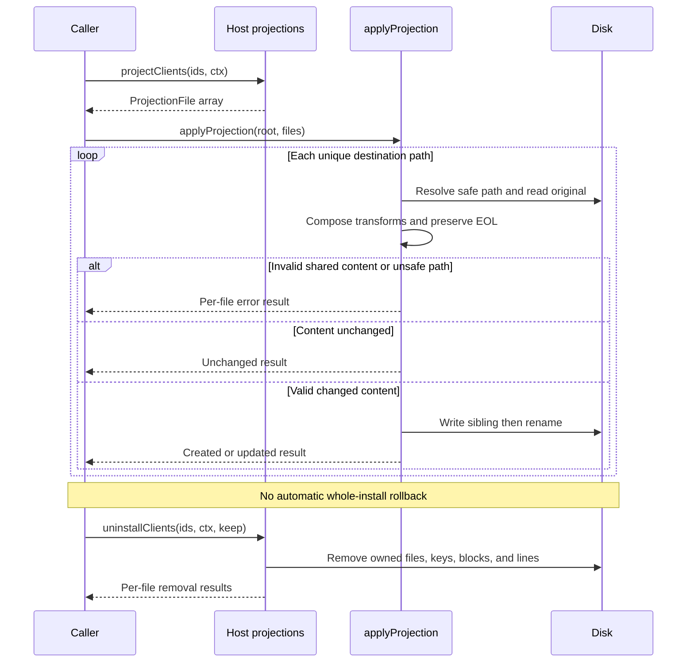

# Chapter 20: Host Projections, Client Adapters, and Capability Negotiation

> **Prerequisites:** Volume 1 (or equivalent Squad experience); Chapters 14 and 19.

> **Preview:** This chapter describes Squad 2.0 (`v2.0.0-preview.2`, insider channel). Interfaces, host integrations, and compatibility details may change before 2.0.0 is stable.

## What You'll Learn

- Separate a workspace-only `HostProjection` from a runtime-bound `ClientAdapter` and an execution-side `HarnessAdapter`.
- Read canonical capability tokens, derive compatibility flags, and calculate the client/backend/policy intersection without confusing advertisement with authorization.
- Trace coordinator instructions into seven host formats, including dispatch-time charter inlining.
- Keep persisted client IDs portable and understand additive merge, refusal, uninstall, and ownership rules.
- Interpret the host feature matrix as evidence rather than a blanket compatibility promise.
- Design a host inspection script and a testable adapter extension without inventing runtime behavior.

Chapter 19 showed you how to use one Squad across clients. Now you will examine the machinery that makes those commands possible. Your Tasktrack team remains the same team: the API owner, frontend owner, tester, and reviewer retain their identities and shared decisions. What changes is the packaging that the host discovers and the execution primitive that its coordinator can invoke.

This distinction matters most when something almost works. A host may discover its Squad agent but not load its MCP server. A subagent may run successfully but lack access to state tools. An installer may update the coordinator while refusing a malformed shared configuration. You need to diagnose each boundary separately rather than declaring the entire integration either supported or broken.

## Three Boundaries, Not One Adapter

The word *client* covers two different SDK concerns. `SquadClient` and `SquadClientWithPool`, introduced in Chapter 14, manage Copilot connections and sessions. The newer host adapter surface describes and projects Squad into other products. Sharing an import path does not turn the older session client into a universal seven-host execution engine.

### Workspace projection

The implemented `HostProjection` has five members: `id`, `label`, `capabilities`, `dispatch`, and `project(ctx)`. Its `project` method returns `ProjectionFile[]`. It does not submit prompts, negotiate a network session, authenticate a provider, or launch a worker.

A `ClientContext` supplies `root`, the MCP launch specification `{ command, args }`, and optional `squadDir`, defaulting to `.squad`. A projection can inspect local files to choose an appropriate configuration path. OpenCode, for example, chooses `opencode.jsonc` when that is the only existing OpenCode configuration. Therefore *pure workspace projection* means no runtime/backend dependency and no application of writes during planning; it does not mean a mathematical function with no filesystem reads.

`getHostProjection('claude').project(ctx)` builds descriptions of changes. `projectClients(ids, ctx)` concatenates those descriptions. `applyProjection(root, files)` applies them, and `installClients(ids, ctx)` combines planning and application. This separation is what makes a no-write inspection tool straightforward.

### Client facade

`createClientAdapter({ host, ctx, runtime? })` builds the higher-level `ClientAdapter`. `host` accepts a known `ClientId` or a `HostProjection` object. The locally usable methods are:

| Method | Result and boundary |
|---|---|
| `describe()` | Adapter identity, advertised summary flags, and projected file paths |
| `projectWorkspace()` | Repository root, working directory, anchor paths, and companion files |
| `getCapabilities(conversationId?)` | Advertised tokens, backend and policy lists, and the computed intersection |

The runtime methods are `submit`, `subscribe`, `cancel`, and `respondApproval`. They delegate to a supplied `RuntimeBinding`. Without one, they reject with `AdapterUnboundError`. Merely creating the facade does not bind it to a backend inferred from `.squad/config.json`.

The implementation reports `workspaceKind: 'repository'`, sets both `repoRoot` and `workingDirectory` to `ctx.root`, and does not discover a branch. The interface permits folder, multi-root, cloud, and branch information, but this factory does not currently populate those richer variations. Treat the returned facts as the implementation's description, not a live inventory of your editor.



The diagram shows architectural composition, not TypeScript inheritance. In particular, a `RuntimeBinding` is not automatically interchangeable with a `HarnessAdapter`: an integration must translate their different signatures.

### Execution harness

The broker-side `HarnessAdapter`, exported from `@bradygaster/squad-sdk/backend`, receives already-admitted work. Its `submit` returns `Promise<void>` because the broker has already assigned the run identity and sequence. Its subscription registration is synchronous, unlike the client facade's asynchronous subscription setup and asynchronous unsubscribe function.

Cancellation and approval deliveries carry stable operation IDs so a harness can make redelivery idempotent. Harness event envelopes carry run identity and sequence, with optional lease epoch information. These are execution integration requirements, not jobs for a file generator.

> **Warning:** The preview ships the harness SPI and registry, not a concrete execution harness implementation. Installing seven projections is not installing seven broker-integrated execution engines. Chapter 21 explains why the bundled experimental MCP conversation bridge reports execution unavailable without a registered harness.

## Capability Tokens Are the Vocabulary

`CAPABILITY_TOKENS_BY_HOST` is the authoritative declaration used by the adapter facade. It combines runtime/transport baseline tokens with projection-level tokens. It is a static table, not a probe of your installed CLI version, account plan, quota, network, or current tools.

The complete client token list in this preview contains nine entries:

| Token | Meaning at the adapter boundary |
|---|---|
| `approvals` | The client can participate in approval interactions; an advertised UI/translation ability, not permission to approve an action |
| `background-runs` | The host can keep dispatched work running without blocking the coordinator turn |
| `cancel-run` | The client can target cancellation at a portable run identity |
| `cursor-reconnect` | The client can resume event consumption using a transcript/event cursor; *cursor* here is not the Cursor product |
| `mcp-bridge` | The host can reach Squad through an MCP tool-transport bridge |
| `subagents` | The host exposes a specialist delegation primitive |
| `typed-content-parts` | The client can participate in the backend's typed content-part representation rather than assuming every payload is plain text |
| `native-hooks` | Projection-level declaration that the host supports native hook mechanisms |
| `steering-files` | Projection-level declaration that the host supports steering/instruction file mechanisms |

The first seven are the adapter specification's baseline. The last two extend the implementation's projection vocabulary. Neither hook nor steering declaration means `installClients` installs an exhaustive native-hook workflow. Tokens describe a surface; inspect the emitted files to learn what this release actually configures.

Every host declares `approvals`, `cancel-run`, `cursor-reconnect`, `mcp-bridge`, `subagents`, and `typed-content-parts`. Copilot, Claude Code, and OpenCode additionally declare `background-runs`. Projection tokens differ:

| Projection token | copilot | claude | kiro | opencode | cursor | codex | antigravity |
|---|---|---|---|---|---|---|---|
| `native-hooks` | yes | yes | yes | yes | no | yes | no |
| `steering-files` | yes | yes | yes | no | yes | yes | yes |

`CAPABILITIES` is a derived `ClientCapabilities` view with `supportsSubagents`, `supportsMcpTransport`, `supportsNativeHooks`, `supportsSteeringFiles`, and `transportModes`. All hosts list `mcp-bridge` and `http-backend` transport modes; Copilot also lists `in-process`. These are declarations of architectural connection possibilities, not proof that your host is currently connected over each transport.

`capabilityFlagsFromTokens` derives the four booleans. `capabilityTokensFromFlags` performs only the partial inverse: four booleans cannot reconstruct approval, cancellation, typed-content, reconnect, or background tokens. `assertConsistentCapabilities` checks explicit boolean inputs against the authoritative token membership. For example, `createClientAdapter` rejects `declaredFlags: { supportsSubagents: false }` for Claude because its token set includes `subagents`.

Do not resolve this conflict by silently dropping one representation. A stale UI and a newer installer should fail visibly rather than disagree over what work may be delegated.

## Negotiation Is an Intersection

The rule is simple: **effective capability = client ∩ backend ∩ policy**. Each party can remove a capability; none can add one that another party lacks.

`resolveEffectiveCapabilityTokens(client, backend?, policy?)` implements the rule by filtering the client list. Output order follows the client list. An omitted backend or policy argument means *no restriction supplied by that party*. An explicit empty array means *that party allows nothing*. Those two cases are deliberately different.



### Worked example: policy disables delegation

Suppose Tasktrack's OpenCode coordinator advertises its full token set. Your backend grants `approvals`, `mcp-bridge`, `subagents`, and `background-runs`. A read-only audit policy permits only `approvals` and `mcp-bridge`.

```ts
import {
  CAPABILITY_TOKENS_BY_HOST,
  resolveEffectiveCapabilityTokens,
} from '@bradygaster/squad-sdk/client';

const effective = resolveEffectiveCapabilityTokens(
  CAPABILITY_TOKENS_BY_HOST.opencode,
  ['approvals', 'mcp-bridge', 'subagents', 'background-runs'],
  ['approvals', 'mcp-bridge'],
);
// ['approvals', 'mcp-bridge']
```

OpenCode's native task tool has not disappeared. It simply lies outside this negotiated grant. Your integration must not use a direct host call to bypass the broker policy. Likewise, an approval token does not authorize the coordinator to approve its own work: the approval decision remains governed by policy and the broker's approval identity checks.

### Worked example: the host cannot run in the background

Now select Kiro. Give both backend and policy the list `['mcp-bridge', 'subagents', 'background-runs']`. The result is `['mcp-bridge', 'subagents']`. Kiro's missing background token cannot be manufactured by a permissive backend.

You can preserve the *outcome* by waiting for a specialist synchronously. The matrix describes Scribe and Rai running as the last synchronous spawn where background work is unavailable. That fallback changes scheduling, not the truth of the capability declaration. Do not relabel it background execution.

### Worked example: no grant versus an empty grant

With no runtime binding, `adapter.getCapabilities()` still works. Internally, absent backend and policy callbacks produce `undefined` restrictions, so `effectiveCapabilities` equals the advertised client list. The returned `backendCapabilities` and `policyCapabilities` fields nevertheless appear as empty arrays.

That is a preview-level reporting subtlety: those empty report fields can mean *no provider was bound*, not an explicit deny-all grant. Never use an unbound inspection result as evidence that a remote service authorized anything. Compare this with an actual `RuntimeBinding` callback returning `[]`: that explicit restriction makes the effective list empty.

The boolean helper `resolveEffectiveCapabilities` has analogous partial-object semantics: omitted keys do not restrict; explicit `false` does. It intersects transport-mode lists and removes `mcp-bridge` if `supportsMcpTransport` becomes false. Use the token helper for the full nine-token vocabulary; use the boolean helper only when an older integration really requires its narrower representation.

Finally, the facade delegates runtime methods rather than enforcing every capability itself. The broker and binding must enforce the negotiated contract. A computed intersection is descriptive data, not an authorization middleware magically wrapped around every `submit`.

## Rendering One Coordinator for Seven Hosts

Chapter 12 examined the canonical coordinator, and Chapter 5 discussed client compatibility in the earlier deployment model. The preview adds explicit projections rather than assuming all hosts load Copilot's file format.

There are two rendering tracks. The CLI's init/upgrade pipeline renders and stamps `.github/agents/squad.agent.md` from its coordinator template. The SDK's Copilot projection only supplies MCP wiring; it does not generate that agent file. The other projections call `buildCoordinatorInstructions(host, squadDir, repoRoot)` and wrap the resulting compact coordinator digest in the host's native representation.

The compact body combines `coreCoordinatorProtocol`, a per-host `Dispatch adapter` section, and a transport section. `resolveCanonicalCoordinatorSource` inspects the canonical file when present, extracts recognized headings and a version stamp, and adds a pointer instructing the host to read that canonical contract. It does not mechanically translate every paragraph of the canonical template. This is why a synchronized digest can still have explicit feature gaps.

### Native envelopes and discovery

| Host | Agent anchor and envelope | Companion discovery or MCP surface |
|---|---|---|
| Copilot | `.github/agents/squad.agent.md`; full CLI-rendered coordinator | `.mcp.json`; other Copilot support files are handled by the CLI |
| Claude | `.claude/agents/squad.md`; YAML `name`, `description`, `tools` | `.mcp.json`, managed `CLAUDE.md` block, Claude worktree ignore lines |
| Kiro | `.kiro/steering/squad.md`; YAML `inclusion: manual` | `.kiro/agents/squad.json`, `.kiro/settings/mcp.json` |
| OpenCode | `.opencode/agent/squad.md`; YAML `description`, `mode: primary` | `opencode.json`, or existing `opencode.jsonc` when no JSON file exists |
| Cursor | `.cursor/agents/squad.md`; YAML `name`, `description`, `model: inherit` | `.cursor/rules/squad.mdc` with `alwaysApply: false`; `.cursor/mcp.json` |
| Codex | `.codex/agents/squad.toml`; `name`, `description`, multiline `developer_instructions` | Short `AGENTS.md` discovery block; `.codex/config.toml` |
| Antigravity | `.agents/agents/squad.md`; `name`, `description`, `mainAgent: true`, `subagent: false`, explicit tools | Inline `mcpServers:` frontmatter; managed `GEMINI.md` block |

Claude's tools field names `Task, Read, Write, Edit, Bash, Glob, Grep, mcp__squad_state`. Its discovery block recommends `claude --agent squad --mcp-config .mcp.json`, reflecting project-server approval requirements. The table describes generated configuration, not an assertion that every future host release retains those tool names.

Kiro's descriptor deserves special attention. Its prompt URI is `file://../steering/squad.md`, relative to the agent descriptor directory. Its team and routing resources use workspace-root forms such as `file://.squad/team.md`. Making all three paths relative to the same directory would break discovery.

Cursor receives the digest twice, in a rule file and an agent file. `alwaysApply: false` avoids turning every unrelated Cursor interaction into the Squad coordinator. Codex takes a different precaution: `AGENTS.md` contains only a pointer, because other hosts and subagents may auto-load that filename. The full coordinator belongs in the custom agent's TOML instructions, and Codex project configuration requires a trusted project.

Antigravity receives an explicit tool list because omitting tools means no tools on that projection surface. Its MCP server is embedded in agent frontmatter rather than a separate JSON file. The SDK facade reports its agent anchor but omits a separate `mcpConfigPath`; inspect the anchor's frontmatter for the launch specification.

### Charter inlining happens at dispatch

Do not confuse rendering the coordinator with compiling every specialist charter into it. `buildCoordinatorInstructions` does not enumerate `.squad/agents/` and paste all charters into the generated file. Instead, the protocol tells the coordinator to read the selected member's charter and inline it into that member's delegation prompt, along with the task, relevant decisions, working directory, and state-tool rules.

Claude dispatch uses a general-purpose `Task` subagent. OpenCode uses its `general` child-session agent. Codex explicitly requests one `worker` agent per specialist and waits for results. Antigravity uses `invoke_subagent` with `self` and a clean-context prompt. Kiro and Cursor document an explicit charter-adoption fallback if subagents are unavailable. Copilot selects `task`, `create_session`, or `runSubagent` according to its surface.

This is identity portability through authored context, not a promise that every product registers a native agent definition for each Tasktrack member. Charters remain static team configuration. Their optional examples and responsibilities travel with the member's prompt, while mutable histories and decisions remain behind the state boundary.

## Portable IDs, Not Portable Credentials

Persisted `.squad/config.json` `clients[]` is projection metadata. Its canonical values are `copilot`, `claude`, `kiro`, `opencode`, `cursor`, `codex`, and `antigravity`. The selection word `all` is accepted by `parseClients`, but it is not a persisted `ClientId`.

`normalizeClientIds(input)` accepts arbitrary input, processes an array if present, trims and lowercases strings, de-duplicates recognized IDs, and returns them in `CLIENT_IDS` order. It also returns rejected entries with `non-string`, `sensitive`, or `unknown` reasons.

For example, `['Cursor', ' claude ', 'cursor', 'future-host', '/Users/me/key']` becomes `['claude', 'cursor']`. The unknown host remains reportable; the path-like value is redacted. Sensitive detection includes credential-shaped prefixes and terms, URLs, separators, machine paths, session/thread/lease/checkpoint language, and assignment-like strings. Object entries are reported as `[object]` rather than serialized.

`assertPortableClients(input)` adds strict acceptance rules: input must be an array, nothing may be rejected, and there must be no duplicates after normalization. Despite its wording about canonical IDs, the implementation accepts case and whitespace variants that normalize cleanly. It returns the normalized canonical array rather than requiring exact input casing or canonical input order.

> **Note:** Normalization is hygiene, not a general secret scanner. Never persist credentials, provider thread IDs, leases, checkpoints, or machine-specific launch paths in `clients[]`, even if you think you have found a string the heuristic would accept.

Forward compatibility uses a third helper, `extractUnknownPortableClientIds`. The CLI preserves safe, unknown identifier-shaped strings written by newer versions, warns that this version skips them, and avoids erasing future configuration. Such IDs do not become recognized projections. This permissive persistence policy differs intentionally from the strict assertion suitable for a local inspection tool.

## Applying and Removing a Projection Safely

The apply/uninstall lifecycle is transaction-like, but its transaction boundary is **one destination file**, not the complete set of host files. Understanding that limit prevents dangerous assumptions about error recovery.

`ProjectionFile` is a discriminated union:

| Kind | Ownership and operation |
|---|---|
| `managed` | Entire generated file; refresh replaces its contents |
| `json` | Shared JSON object; update only the declared Squad keys |
| `block` | Marker-scoped text within a user-owned document |
| `lines` | Missing lines added under an ID-scoped comment |
| `text` | Structured shared text transformation; currently used for Codex TOML |

`applyProjection` groups transformations by relative path, so Copilot and Claude updates to `.mcp.json` compose before one write. It reads the original, computes the next content, preserves the dominant LF/CRLF convention, compares the result, and writes changed content through a sibling file followed by rename. The result is `created`, `updated`, `unchanged`, or `error` per path. Failure on one path does not stop remaining paths, and successful earlier writes are not rolled back automatically.



### Additive JSON merges

`mergeMcpServer` clones the top-level object and server container, preserves unrelated settings and other servers, and refreshes the Squad launch fields. Existing `env`, tool filters, and custom fields on the Squad entry survive unless the projection explicitly owns that field. Defaults apply only when the corresponding property is absent.

Copilot and Claude use `mcpServers.squad_state` in `.mcp.json`. Kiro and Cursor use that same container name in their host-specific JSON files. OpenCode instead uses `mcp.squad_state`, whose local command is an array containing the executable followed by arguments; other hosts use separate `command` and `args` fields. OpenCode also receives a default `$schema` only when absent.

This is additive by key, not append-only. A changed launch command is replaced because Squad owns it. A user server alongside `squad_state` remains untouched semantically. JSON is parsed and reserialized, preserving detected indentation and trailing-newline convention but not arbitrary spacing or original property layout.

Refusal is essential to this contract. A non-object JSON root, malformed JSON, a scalar server container, or a scalar `squad_state` entry produces an error rather than destructive replacement. An existing `.jsonc` file containing comments is explicitly refused. A comment-free `.jsonc` still goes through strict `JSON.parse`, so trailing commas remain invalid. Selecting the filename is not claiming full JSONC editing support.

### TOML updates without rewriting the world

Codex's text projection calls `upsertTomlTable` for `[mcp_servers.squad_state]`. Squad owns `command` and `args`; `startup_timeout_sec = 60` is a default, not an override of a user's existing timeout. Other keys in that table, such as environment values or tool filters, remain.

The helper recognizes quoted dotted keys, multiline arrays and strings, and section boundaries. It can convert target-specific inline or dotted definitions into the standard table while retaining non-managed keys. It must not mistake a bracket inside a multiline string for a new section or confuse a quoted literal dot with a nested path.

A scalar target or an ancestor defined as an inline/scalar value is refused when it cannot safely be extended. For example, `mcp_servers = { other = ... }` cannot simply acquire a later standard child table: TOML's inline-table rules prohibit that extension. Refusing is safer than generating an apparently reasonable but invalid configuration. This helper is a scoped editor, not a general TOML validator for every unrelated part of your file.

### Markdown markers and ignore lines

Shared Markdown uses `<!-- squad:begin ... -->` and `<!-- squad:end -->`, with ID-scoped variants such as `squad:begin:codex` and `squad:end:codex`. Existing text outside the managed region is retained during replacement; new blocks are separated from existing content. An opened marker without its matching closing marker causes refusal, because treating the rest of the user's document as disposable would be unsafe.

Claude's `.gitignore` integration is line-oriented, not an HTML-marker block. It adds `.claude/worktrees/` under `# squad:claude` only when that line is missing. A preexisting user-authored ignore line does not become Squad-owned. Removal takes back the marker and matching adjacent lines rather than deleting every matching occurrence throughout the file.

### Uninstall and the precise rollback promise

The SDK operation is real and synchronous:

```ts
import { uninstallClients } from '@bradygaster/squad-sdk/client';

const results = uninstallClients(['claude'], {
  root: process.cwd(),
  mcp: { command: 'squad', args: ['state-mcp'] },
}, ['copilot']);
```

The third argument lists hosts that remain installed. It keeps shared JSON paths, particularly `.mcp.json`, when a remaining host still projects that path. Omitting it while removing Claude can remove the bridge used by Copilot. The example's launch specification describes a locally available preview `squad`; it is not a recommendation to mix CLI versions.

`removeProjection` deletes managed files, removes `squad_state` from recognized JSON server containers, removes the Codex table and its sub-tables or equivalent definitions, and strips owned blocks and lines. Empty files and directories are pruned. It never removes `.squad/` team state. It does not update persisted `clients[]`; an SDK caller that wants permanent removal must also reconcile static configuration deliberately, or a later upgrade may project the host again. There is no `squad client remove` subcommand in this preview.

The regression suite contains an all-seven-host install, idempotent-refresh, and byte-exact uninstall round trip for selected user-file fixtures. That is valuable evidence, but it does not establish a universal snapshot restoration guarantee. The implementation stores no original-byte journal. A minified JSON file can emerge pretty-printed; a preexisting Squad entry is removed rather than restored to its former launch fields; marker separator normalization can change whitespace; an OpenCode `$schema` equal to the generated schema can be removed with the entry. Fully managed files are deleted even if they existed before installation.

Therefore interpret *byte-preserving rollback* as the specification's intent for unowned content and the demonstrated fixture behavior, not an arbitrary-file time machine. If Tasktrack requires forensic byte identity, capture hashes or a Git baseline before projection and compare after uninstall. Keep backups for unusual formatting or preexisting owned keys. Never describe this API as a whole-workspace atomic rollback.

## Squad-Owned Files Have Separate Provenance

Host projections coexist with the CLI's broader upgrade machinery. `squad-owned-files.ts` tracks templates, skills, workflows, and mirrored template files in `.squad/templates/.shipped-manifest.json`, using schema `squad-shipped-files/v1`.

The manifest maps repository-relative POSIX paths to SHA-256 hashes of EOL-normalized shipped content and records the CLI version. `planSquadOwnedFiles` reads this provenance, compares existing content with the new template, and classifies each destination as create, overwrite, or unchanged.

A file is locally customized when it differs from both the new template and the last shipped version. If provenance is absent, the planner consults prior skill/workflow copies under `.squad/templates/`. If that also fails, it chooses the conservative backup path. Empty existing files do not count as meaningful customization.

Before overwriting a customized file, `writeVerifiedBackup` writes `<file>.local-backup` and reads it back to verify exact original bytes. Failed verification aborts that file's overwrite. An identical existing backup can be reused; a different existing backup can be replaced, so this is not a versioned archive. Unchanged files are not rewritten.

Retirement has a similarly cautious rule. A formerly shipped file absent from the new plan is removed only if its current hash still matches its recorded shipped hash. Modified retired files stay and are reported. Without a manifest, the planner cannot prove ownership history and does not retire files speculatively.

Do not transfer these guarantees to every `managed` SDK projection. The host apply layer has no automatic `.local-backup` step. The canonical `squad.agent.md` also has a separate stamp-aware upgrade writer and is excluded from the generic owned-file candidate plan. These mechanisms cooperate in the CLI but have different provenance and failure boundaries.

## A Distilled Seven-Host Feature Matrix

The reference matrix contains 51 feature rows per host. Its main lesson is not the count of green cells; it is the distinction between *dependency* and *evidence*.

A feature can depend on the CLI alone, coordinator-prompt content, the state MCP bridge, host runtime features, or platform tools such as `gh` and `az`. Passing a CLI test does not prove a real model invoked the right tool inside a host. Conversely, an expected-failure test can positively prove that a coordinator section is missing.

In the following compact tables, **S** means supported in the published matrix, **D** means degraded, **U** means unsupported, and **—** means not applicable. Runtime mechanism rows use explicit descriptions instead. These tables distill the pinned preview source, not a fresh certification of today's third-party products.

### Dispatch, isolation, and model control

| Area | copilot | claude | kiro | opencode | cursor | codex | antigravity |
|---|---|---|---|---|---|---|---|
| Specialist primitive | task/session/editor | Task | subagent | task/general | subagent/composer | worker spawn | invoke_subagent |
| Parallel specialist fan-out | S | S | S | S | S | S | S |
| Non-blocking support agents | S | S | D | S | D | D | D |
| Git worktree workflow | S | S | S | S | S | S | S |
| Per-spawn model runtime parameter | yes | no | no | no | no | no | no |
| Complete projected model-selection behavior | U | U | U | U | U | U | U |

The model rows are intentionally different. Copilot's runtime offers a model override parameter, but the projected digest lacks the section teaching per-agent model, reasoning-effort, and context-tier selection. Claude can specify a model in an agent definition, and OpenCode can configure a model per agent; neither is the same as a per-call override. Chapter 12 (Volume 1)'s model-control workflow must not be assumed portable just because the runtime has some model setting.

Worktrees require shell access and Git, not a magical adapter-owned isolation token. The matrix reports worktree workflows supported while separately reporting team-root/subfolder prompt gaps. Basic isolated branches and complete monorepo discovery are not the same feature.

### State, MCP, hooks, and instructions

| Area | copilot | claude | kiro | opencode | cursor | codex | antigravity |
|---|---|---|---|---|---|---|---|
| Projected state MCP connection | S | S | S | S | S | S | S |
| Specialist MCP inheritance | S | S | S | S | S | S | D |
| Native-hook declaration | yes | yes | yes | yes | no | yes | no |
| Steering-file declaration | yes | yes | yes | no | yes | yes | yes |
| Decisions/history/memory governance | S | S | S | S | S | S | S |
| Local/orphan/two-layer state bridge | S | S | S | S | S | S | S |
| Experimental conversation tools | S | S | S | S | S | S | S |

The last row means the opt-in backend contract can be reached over the bridge, not that a shipped harness executes prompts. Antigravity's clean-context specialists may not inherit frontmatter-attached MCP servers, so the coordinator may need to persist their returned results. Do not give them a direct mutable-state-file fallback.

Hook and steering rows come from the SDK token declarations; they are not additional independently live-validated matrix cells. Chapter 15's SDK hooks are also not identical to native product hook configuration. Separate host extension points from Squad runtime extension points before designing enforcement around either.

### Team behavior and integrations

| Area | copilot | claude | kiro | opencode | cursor | codex | antigravity |
|---|---|---|---|---|---|---|---|
| Casting/routing/response modes/skills | S | S | S | S | S | S | S |
| Reviewer lockout/Rai/Fact Checker | S | S | S | S | S | S | S |
| Ceremonies/humans/PRD mode | S | S | S | S | S | S | S |
| GitHub issues/labels/interactive Ralph | S | S | S | S | S | S | S |
| Ralph CLI execution without host override | S | D | D | D | D | D | D |
| Automatic marketplace-on-cast behavior | U | U | U | U | U | U | U |
| Interactive GitLab/ADO issue behavior | U | U | U | U | U | U | U |
| Complete monorepo/team-root prompt behavior | U | U | U | U | U | U | U |
| Dual-root remote-mode prompt behavior | U | U | U | U | U | U | U |

Ralph's interactive coordinator loop differs from the CLI's execution launcher. The latter defaults to Copilot unless `--agent-cmd` is configured; installing a Claude projection does not rewrite that default. An authenticated platform CLI is still required inside the host for issue operations.

The unsupported rows identify prompt gaps, not necessarily absent low-level functions. Azure DevOps CLI/platform adapters exist, and observed models sometimes followed an on-demand issue reference, but the projected Issues section is GitHub-focused. GitLab has further SDK/CLI gaps in this matrix. Similarly, CLI marketplace commands can work while the coordinator omits the browse-on-cast step. Preserve the matrix's *unsupported* label rather than upgrading an improvised workaround into a supported integration.

Upstream inheritance and cross-squad delegation are supported across hosts through shared tools and skills. Chapter 21 covers runtime upstream resolution; the essential boundary here is that local snapshots and provenance remain backend concerns, not a new inheritance implementation in each adapter.

### Infrastructure and evidence

| Area | copilot | claude | kiro | opencode | cursor | codex | antigravity |
|---|---|---|---|---|---|---|---|
| Export/import and SDK-first builds | S | S | S | S | S | S | S |
| Standalone install and maintenance CLI | S | S | S | S | S | S | S |
| Storage/notifications/boards/observability | S | S | S | S | S | S | S |
| Fleet mesh/rate limiting/autoscaling | S | S | S | S | S | S | S |
| Copilot VS Code integration | S | — | — | — | — | — | — |
| Squad RC/start and gh-aw surface | S | — | — | — | — | — | — |
| Recorded passing live-model host runs | none here | yes | blocked | yes | blocked | unavailable | blocked |

Most infrastructure rows are host-independent, which is why seven supported cells can arise from one CLI or SDK test suite. Copilot-specific wrappers do not become generic simply because seven clients share state.

The recorded live runs are dated October 22, 2026. Claude Code and OpenCode have passing recorded scenarios, including roster reads, parallel delegation, decisions, reviewer lockout, and worktrees. Kiro, Cursor, and Antigravity were blocked by usage limits; Codex lacked a binary/auth setup on the reference machine. These environmental limits do not prove the products lack the capabilities, but they prevent a passing live claim.

There are five evidence labels: `validated-test`, `validated-live`, `static-only`, `untested`, and `blocked`. The repository distinguishes opt-in headless tests that observe an actual `squad_state_read` JSON-RPC call from weaker checks that merely recognize text in stdout. For your own acceptance tests, inspect the tool event or bridge transcript, not the model's assertion that it read a roster.

### Choosing a host for Tasktrack

Choose Copilot when you rely on its app/editor surfaces, existing Ralph execution defaults, or Copilot-specific remote-control tooling. Choose Claude Code or OpenCode when you want the strongest non-Copilot live evidence recorded in this preview and background specialists. Expect Claude project MCP approval/configuration steps; expect OpenCode's different MCP manifest shape.

Choose Kiro or Cursor for their native steering/editor workflow, but budget for synchronous support agents and verify actual discovery in your workspace. Choose Codex when its trusted-project custom-agent model fits your environment; validate its TOML role and MCP setup locally because the published reference machine did not exercise it live. Treat Antigravity as an experimental projection and explicitly test whether specialists can reach state tools.

For every host, make the acceptance question concrete: can it read Tasktrack's existing roster through the correct bridge, route an API test task, spawn the intended member with its charter, record a decision, and respect reviewer lockout? That checklist is more valuable than comparing total supported-cell counts.

## Walking the v0.2 Adapter Specification

`client-harness-adapters-v0.2.md` is a non-normative requirements draft, marked non-claimable with no claimable capabilities. Do not call an adapter conformant merely because it generates the expected filenames. The source is useful as a design contract and a list of promotion requirements, but it is not a completed certification scheme.

Its opening sections separate workspace projection, client-to-broker interaction, and broker-to-execution interaction. Host adapters own bootstrap, event translation, rendering, local lifecycle, and transport mechanics. They must not redefine routing, authorization, durable state, canonical error meanings, ordering, causation, cancellation, or resumability.

The portable SPI then identifies submissions, subscriptions, approval responses, capability projections, and workspace descriptions. Read these alongside the actual SDK types: the draft's illustrated `HostProjection` uses asynchronous `describe`, `projectWorkspace`, and `removeProjection`, whereas the implemented pure projection uses synchronous `project(ctx)`. The SDK exposes description/workspace behavior through `ClientAdapter` and removal through helper functions. Likewise, the draft shows an adapter capability token array in its description, while the implementation's `AdapterDescription.capabilities` is a small boolean summary; obtain full tokens through `getCapabilities`.

The host chapters establish canonical agent anchors, MCP locations, companion files, and execution primitives. They explain why Codex uses a discovery pointer, why Kiro distinguishes resource and prompt URI roots, and why Antigravity embeds MCP configuration. Those decisions are the portability layer; they are not a common host tool catalog.

The final sections define ownership, layout, and promotion criteria. Promotion requires common contract tests across Copilot and another host, all-seven-host path fixtures, portable approval/cancellation traces, stable MCP projections, broker-to-harness identity preservation, reconnect traces preserving unknown events, and rollback tests preserving unowned bytes. The principle of forwarding unknown event kinds protects extensibility: a UI must not discard durable events simply because its current renderer does not recognize them.

Some draft details lag implementation. It describes Kiro's MCP JSON as fully managed, while code applies an additive JSON merge. It mentions uppercase Claude marker blocks, while the actual ignore integration uses `# squad:claude`. Its opening implementation-status wording also understates the seven projections now present. Follow code for operational instructions and retain the draft as architectural intent.

### Four related 2.0 documentation changes

The SDK reference now puts `HostProjection` and `ClientAdapter` alongside the existing client/session exports under `/client`, explicitly deprecates `/clients`, and adds the experimental `/backend` entrypoint. Its new adapter section documents local facade behavior, unbound errors, token authority, and portable IDs.

The API reference changes the meaning described for `resolveGlobalSquadPath()`: it returns the platform configuration directory used for externalized project state under `projects/<projectKey>/`, not a globally resolved personal Squad. The SDK overview removes the personal-state example accordingly. Do not interpret that directory as another team that a host adapter should discover and merge automatically. Chapter 22 revisits migration consequences.

The specification index adds the client/backend decoupling and client/harness adapter v0.2 drafts to its registry and dependency graph. Its implementation notes explicitly distinguish seven projections from the absence of a shipped execution harness. Chapter 17's profile discipline still applies: implementation presence and normative maturity are different axes.

The charter profile adds optional `## Examples`, after optional `## Model` and before namespaced extensions. Editors must preserve examples during unrelated edits and round trips; duplicate sections produce `SQC011`, and a canonical no-op preserves original bytes. The sample YAML assertion shape is informative, not an installed runner. Examples grant no permissions and are not held-out evaluations. When a charter is inlined into a specialist prompt, its examples are authored behavioral guidance, not evidence that the agent passed an evaluation. Deeper evaluation tooling and result storage remain outside that profile.

## Thinking About a New Host Adapter

Start with a projection acceptance fixture, not a runtime integration. Identify the host's real discovery anchor, MCP schema, instruction precedence, trust/approval requirements, tool allowlist behavior, and whether subagents inherit servers. Decide which files are fully generated and which require key- or marker-scoped ownership.

Represent those edits with the existing `ProjectionFile` kinds. Avoid whole-file replacement of a shared host manifest. Keep launch-command selection outside the projection so the CLI can supply an installed standalone binary or version-pinned package invocation. Keep credentials and mutable provider handles outside persisted `clients[]`.

Then define dispatch instructions that preserve Squad ownership and identity: how the coordinator chooses a member, how the charter enters the prompt, how independent work fans out, and what happens when background tasks or inherited MCP servers are unavailable. A fallback must identify the limitation rather than pretend to implement a missing host primitive.

Next add capability declarations and tests. A useful fixture begins with user configuration, applies twice to prove idempotency, and uninstalls while checking unrelated content. Add malformed JSON, unexpected JSON types, commented JSONC, incomplete markers, CRLF, missing final newline, existing ignore entries, quoted TOML keys, multiline values, and unsafe path cases. Test shared-file retention when another host remains installed.

Only after projection behavior is dependable should you bind a runtime. A `RuntimeBinding` must preserve the client's submit, subscription, cancellation, approval, and capability semantics. A broker-side harness additionally needs stable run identity, idempotent redelivery handling, event ordering, cancellation targeting, reconnect behavior, and correct approval translation. The client approval shape uses `requestHash` and `approved`/`rejected`/`cancelled`; the backend harness shape uses `hash` and `approve`/`deny`. They require deliberate translation, not a type assertion.

This preview does not expose a general plugin registration API for adding an eighth arbitrary client ID to all these tables. `ClientId`, host-kind and anchor mappings, capability declarations, and CLI parsing are coordinated source-level registries. Passing a custom `HostProjection` for an existing ID is possible, but inventing a new ID with a cast will leave those mappings undefined. Extend the registries and tests together in a source contribution rather than advertising a nonexistent `registerClientAdapter` API.

## Hands-On: Inspect Tasktrack Without Writing Host Files

Your deliverable is a small script you would place at `sample/scripts/inspect-hosts.ts` in the companion tree, or `scripts/inspect-hosts.ts` inside your Tasktrack checkout. This chapter presents it; the book's baseline sample does not include a generated copy. Use your own `v2-ch20-start` and `v2-ch20-end` tags to record the exercise.

The script uses Node's built-in filesystem/path modules and the SDK—no argument-parser, table, dotenv, or TypeScript-runner dependency. Tasktrack's application remains zero-dependency. Strictly speaking, a script importing an external SDK is not dependency-free: the preview SDK is an explicit tooling prerequisite, as in Chapter 14. A global CLI installation alone does not make the SDK resolvable by Node's ESM importer.

In your Tasktrack checkout, ensure the matching SDK is locally resolvable. If you have not installed it for SDK work already, these are reader-side setup commands:

```bash
npm install --no-save --package-lock=false @bradygaster/squad-sdk@2.0.0-preview.2
mkdir -p scripts
squad client list --json
```

The npm command supplies tooling without adding an application dependency declaration; it still downloads the SDK's dependency graph. Use Node 22.18+ and a preview `squad` binary for the CLI inspection. Do not run these commands against the author's stable CLI and assume it supports preview subcommands.

Create the following script in your exercise checkout:

```ts
import { readFileSync } from 'node:fs';
import { resolve } from 'node:path';
import {
  assertPortableClients,
  createClientAdapter,
  projectClients,
  resolveEffectiveCapabilityTokens,
} from '@bradygaster/squad-sdk/client';

const root = resolve(process.argv[2] ?? '.');
const config = JSON.parse(readFileSync(resolve(root, '.squad/config.json'), 'utf8'));
const configured = assertPortableClients(config.clients ?? []);
const clients = configured.length ? configured : assertPortableClients(['copilot']);
const backend = ['approvals', 'background-runs', 'mcp-bridge', 'subagents'];
const policy = ['approvals', 'mcp-bridge', 'subagents'];
const ctx = { root, mcp: { command: 'squad', args: ['state-mcp'] } };

console.log('Simulation only: backend and policy are local example allowlists.');
for (const host of clients) {
  const adapter = createClientAdapter({ host, ctx });
  const caps = await adapter.getCapabilities();
  const effective = resolveEffectiveCapabilityTokens(
    caps.clientCapabilities, backend, policy,
  );
  console.log(JSON.stringify({ host, effective, workspace: await adapter.projectWorkspace() }));
}
for (const file of projectClients(clients, ctx)) {
  console.log(`PLAN ${file.kind.padEnd(7)} ${file.path}`);
}
```

This `.ts` file intentionally uses JavaScript-compatible syntax, so no compilation step or custom loader is required. Run it from Tasktrack's root:

```bash
node scripts/inspect-hosts.ts .
git status --short
npm test
```

For `clients: ['claude', 'kiro']`, both rows report `['approvals', 'mcp-bridge', 'subagents']` in the source token order. Claude advertises background execution, but policy removes it. Kiro never advertised it. Claude's plan includes a managed agent, shared JSON, a Markdown block, and ignore lines; Kiro's includes steering, descriptor JSON as a managed file, and shared MCP JSON. Copilot-only fallback uses `clients: []` or an absent `clients` property in an existing config and plans `.mcp.json`; the canonical Copilot agent is still owned by the CLI bootstrap path.

The root must already have an initialized `.squad/config.json`; missing or malformed files intentionally fail rather than silently pretending to inspect a configured team. Unknown clients also fail through the strict assertion. If you are auditing forward-version configuration, use `normalizeClientIds` and report rejected *reasons* instead, taking care not to log arbitrary raw values.

This is a **projection-plan dry run**, not a merge-validating apply dry run: it lists intended file kinds and destinations but never invokes JSON update callbacks against existing configuration. It cannot certify that installation would succeed on malformed TOML/JSON or unsafe paths. The MCP launch command is illustrative; because nothing is applied or executed, the script does not start a bridge.

Similarly, the printed capabilities are a simulated negotiation with explicit backend and policy lists. The script does not claim to query an authenticated backend. The unbound facade supplies the host advertisement and workspace facts; the helper computes the hypothetical negotiated result. Real conversation negotiation belongs to a bound integration, discussed in Chapter 21.

No second host login or license is required to complete this inspection. Running a real host afterward requires that product's installation, authentication, and applicable account access. You can finish entirely with the Copilot fallback and verify Tasktrack's ordinary API tests still pass. `git status` should show only your intentionally added exercise script or tooling-related changes, not newly generated host projections.

## Configuration Reference

| Surface | Relevant setting or default | Operational meaning |
|---|---|---|
| `.squad/config.json` | `clients[]`; absent/empty means default Copilot in CLI inspection | Portable projection selection, never runtime credentials |
| CLI selection | `--client`, also accepted as `--clients`; comma list or `all` | Repeated selections merge in canonical order |
| `ClientContext` | Required `root` and `mcp`; `squadDir` defaults to `.squad` | Explicit workspace and bridge launch description |
| `CreateClientAdapterOptions` | Required `host`, `ctx`; optional `runtime`, `declaredFlags` | Build facade; reject conflicting explicit flags |
| `RuntimeBinding` | Optional backend/policy capability callbacks | Omitted callback is unrestricted in the local calculation |
| `uninstallClients` | Third `keep` argument defaults to `[]` | Retain shared JSON used by remaining hosts |
| Codex MCP table | Default `startup_timeout_sec = 60` | Applied only when absent, preserving an explicit user timeout |
| Shipped manifest | `.squad/templates/.shipped-manifest.json` | CLI upgrade provenance, not an SDK projection rollback journal |
| Backup suffix | `.local-backup` | Verified original bytes for customized CLI-owned upgrade files |

No environment variable is required by the pure host projection API. CLI/backend environment configuration belongs to the layers discussed in Chapters 19 and 21, not to an implicit credential lookup in `project(ctx)`.

New host selection is additive in the CLI. `syncClients` unions requested hosts with already configured hosts; it does not interpret `--client claude` as “remove everything except Claude.” A plain init/upgrade still bootstraps Copilot. When no client flag and no persisted clients exist, the multi-host synchronization layer does nothing beyond that default bootstrap.

## Under the Hood

Follow the implementation in three stages. First, `packages/squad-sdk/src/client/adapters` contains the projection machinery: `types.ts` defines the union and pure interface; `capabilities.ts` owns tokens and intersections; `portable.ts` handles persisted IDs; `coordinator.ts` builds the digest and dispatch sections; `adapters.ts` supplies seven projections; `apply.ts` performs guarded updates and removal; `index.ts` re-exports them.

Second, `packages/squad-sdk/src/client/adapter-contract.ts` builds the runtime facade. Its essential capability computation is small:

```ts
return client.filter((t) =>
  (!backend || backend.includes(t)) &&
  (!policy || policy.includes(t))
);
```

That excerpt is the filtering rule in `resolveEffectiveCapabilityTokens`; the facade obtains its optional lists from the binding before invoking the helper. Notice that an empty array is truthy in JavaScript: it restricts everything, while `undefined` removes that side's restriction.

Third, `packages/squad-cli/src/cli/core/clients.ts` connects command parsing and persisted configuration to SDK installation. It resolves a version-appropriate state MCP launch specification, computes `squadDir` relative to the destination, calls `installClients`, and examines per-file errors. A newly requested host with a failed projection path is not persisted as newly healthy; already-configured hosts remain configured. Unknown portable IDs are preserved and warned about. `syncClients({ dryRun: true })` returns the computed set without writes or persistence; it does not run all merge callbacks to discover file-level conflicts.

`packages/squad-cli/src/cli/core/squad-owned-files.ts` is the separate provenance/planning layer described earlier. `packages/squad-cli/src/cli/core/managed-file.ts` provides EOL-aware writes and Copilot-instructions marker integration. Its atomic writer uses a flushed sibling file and rename. Do not assume the SDK writer has identical flushing behavior merely because both avoid direct in-place replacement.

Finally, inspect the public entrypoints. `packages/squad-sdk/src/client/index.ts` exports the preexisting session APIs and re-exports both adapter modules. `packages/squad-sdk/src/clients/index.ts` is a deprecated re-export of the same host adapter symbols, with runtime reference identity verified by tests. Prefer:

```ts
import { getHostProjection, createClientAdapter } from '@bradygaster/squad-sdk/client';
```

The plural alias does not offer a second implementation or its own host registry. It also does not re-export the older session client classes from the canonical client index. Use `/client` for new code and `/backend` for broker/harness contracts; do not build integrations against internal source paths.

## Pitfalls and Troubleshooting

**The host sees Squad, but not state tools.** Verify its actual MCP configuration and project trust/approval state. Discovery is not bridge readiness. Claude may require explicit project config approval or `--mcp-config`; Codex requires trusted project configuration. Antigravity attaches the server to agent frontmatter. Confirm a real health/read tool call, not a reassuring model sentence.

**A capability appears enabled, but execution fails.** Separate static advertisement, negotiated grant, runtime binding, and current availability. An unbound facade cannot submit. A real host can hit quota even when its static capability table is correct. The facade's boolean description is not its full token vocabulary.

**Install reports both success and errors.** This is expected per-file behavior. Inspect every `ApplyResult`, repair malformed shared files or markers without destroying user content, then retry. Do not assume successful files were undone. Check persisted clients because new failing hosts and previously configured hosts are treated differently.

**OpenCode files disagree with a matrix path.** The implementation uses singular `.opencode/agent/squad.md`; the matrix's host overview uses a plural directory. Prefer the projection and canonical spec path at this tag. Also check whether an existing JSONC file was selected and refused because it contains comments.

**Uninstall damages another client's connection.** Pass remaining clients through `keep`. Then deliberately update static `clients[]` if you intend lasting removal. Keep team state intact, and do not manually delete a shared `.mcp.json` that contains user servers.

**An upgrade reorders or rewrites a file unexpectedly.** Distinguish shared JSON reserialization from managed template replacement and owned-file provenance. Check `.local-backup` only where the CLI backup mechanism applies. For byte-sensitive rollback, compare your own baseline; the installer does not retain arbitrary original formatting.

**A feature worked once but is marked unsupported.** A model can improvise from a canonical reference or on-demand template. That is not equivalent to a shipped digest contract with adequate tests. Keep the six pinned prompt-gap categories unsupported until their sections and evidence change.

## Summary

A host projection is a workspace plan; a client adapter is a locally inspectable facade with optional runtime delegation; a harness is a separate execution integration. Tokens are authoritative, effective capability is an intersection, and no advertisement grants authority by itself.

Seven projections preserve one team through native file envelopes and dispatch-time charter context. Their apply/uninstall helpers preserve owned boundaries but are neither a whole-install transaction nor a universal original-byte restore system. The CLI's shipped-file hashes and verified backups solve a related but distinct upgrade problem. Use the feature matrix's dependency and evidence axes to decide what you can actually rely on in Tasktrack.

## Exercises

1. Calculate OpenCode's effective set when the backend allows `approvals`, `cancel-run`, `subagents`, and `mcp-bridge`, but policy allows only `cancel-run` and `mcp-bridge`. Repeat with an explicit empty policy.
2. Adapt the inspection script to tolerate unknown future IDs using normalization. Report known IDs and rejection counts by reason without printing sensitive input values. Explain how your strict and tolerant modes differ.
3. Design a Claude/Copilot uninstall test with a user server, an existing user-authored `.claude/worktrees/` ignore line, and both clients installed. State which files/keys remain when only Claude is removed.
4. Construct a rollback acceptance plan for a hypothetical eighth host using a shared JSON manifest and Markdown discovery pointer. Include one byte-level limitation and three refusal cases; do not invent a registration API.
5. Choose a host for a Tasktrack audit that needs independent specialists and a durable decision record, but prohibits background work. Justify the capability intersection, runtime prerequisites, and evidence you would collect.

## Quiz

1. Which implemented interface has `project(ctx)`, and which factory creates the runtime facade?
2. Why is `cursor-reconnect` unrelated to selecting the Cursor product?
3. What differs between an omitted policy list and `[]` in token negotiation?
4. Does `getCapabilities()` on an unbound facade prove backend authorization? Why?
5. Where does a specialist charter get inlined, and is every charter embedded during projection?
6. What extra argument protects Copilot's shared MCP entry when uninstalling Claude?
7. Why can a feature be both unsupported and `validated-test` in the matrix?
8. What does the plural `/clients` alias preserve, and what does it not add?

## Further Reading

- [Client and Harness Adapter Profile v0.2](https://github.com/bradygaster/squad/blob/v2.0.0-preview.2/docs/specification/client-harness-adapters-v0.2.md): requirements draft, host anchors, SPI boundaries, and promotion criteria.
- [Host Feature Matrix](https://bradygaster.github.io/squad/docs/reference/host-feature-matrix/): the complete per-feature capability/evidence ledger and recorded live-run log.
- [SDK Reference](https://bradygaster.github.io/squad/docs/reference/sdk/): canonical `/client` exports, deprecated alias, and experimental backend boundary.
- [API Reference](https://bradygaster.github.io/squad/docs/reference/api-reference/): signatures and the revised externalized-state meaning of the platform config directory.
- [Specification Index](https://github.com/bradygaster/squad/blob/v2.0.0-preview.2/docs/specification/README.md): profile maturity registry and the v0.2 dependency additions.
- [Charter Profile v0.1](https://github.com/bradygaster/squad/blob/v2.0.0-preview.2/docs/specification/charter-v0.1.md): canonical sections, optional examples, preservation rules, and evaluation limits.
