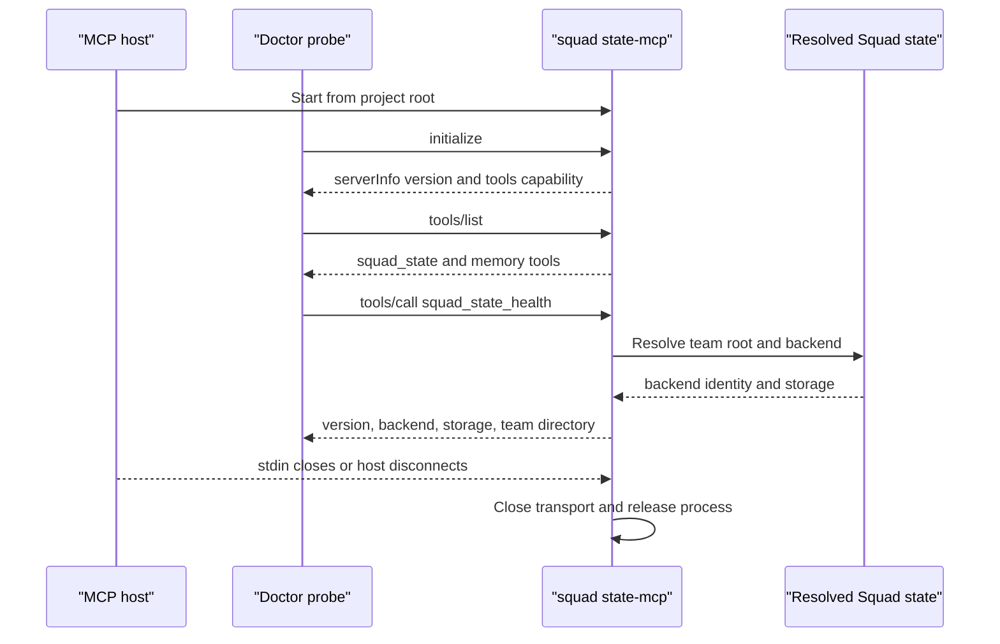
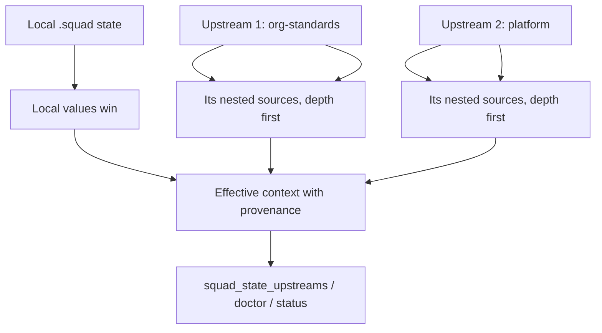
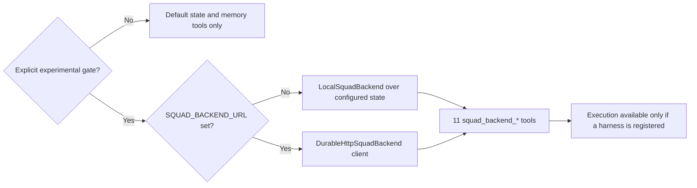

# Chapter 21: The State MCP Boundary, Runtime Upstreams, and the Experimental Backend

> **Prerequisites:** Volume 1 (or equivalent Squad experience); Chapters 2 and 19.

> **Preview:** This chapter describes Squad 2.0 at `v2.0.0-preview.2`, published on the `insider` channel (`preview` is an alias). The state bridge, upstream resolver, and conversation-backend SPI are preview surfaces; names, contracts, and implementation details may change before 2.0.0 is stable.

## What You'll Learn

- Treat `squad_state` as the governed runtime boundary for mutable Squad state, not as permission to edit every file beneath `.squad/`.
- Identify all state and governed-memory tools exported by `squad state-mcp`, and distinguish the default tools from the experimental conversation tools.
- Understand how a versioned MCP bridge is installed, probed, cleaned up, and anchored to the correct project and team roots.
- Resolve upstream inheritance deterministically from local snapshots, including precedence, depth, cycles, soft failures, and provenance.
- Explain the experimental `@bradygaster/squad-sdk/backend` contract and why a transcript backend is not an execution harness or a production DurableSquad service.
- Relate the client/backend decoupling draft and its G1–G9 conformance gates to the durable-backend tutorial and to the still-pending DurableSquad Phase 2 work.

## The State Boundary: Runtime Writes, Static Team Design

A Squad project has at least two kinds of information. Static team design tells Squad what team exists and how it should behave: `.squad/team.md`, `.squad/routing.md`, `.squad/config.json`, charters, templates, skills, and the casting registry. Mutable runtime state records what happens as that team works: decision inbox entries, agent histories, logs, sessions, scratch data, and identity notes. They may share the `.squad/` directory, but they do not share the same write policy.

The `squad state-mcp` process bridges a host's Model Context Protocol client to Squad's runtime state tools. Its default server identity is `squad-state`; hosts commonly display the server as `squad_state`. The process starts in a project directory, discovers the Squad context, and registers tools against the configured storage provider. A host invokes those tools by their advertised names; adapters can prefix or normalize names, so use the name in the current host's tool list rather than guessing it.

There are 15 default tools: one decision tool, eight `squad_state_*` tools, and six `memory.*` tools. The table gives their JSON arguments. Only the listed arguments are part of the tool schemas; a host may add a transport-specific prefix to the visible tool name.

| Tool | Arguments | Contract |
|---|---|---|
| `squad_decide` | Required: `author` (string), `summary` (string), `body` (string). Optional: `references` (string array). | Writes a dated decision note to the decision inbox. The note records author, summary, references, and rationale; if a workstream inbox is active, the tool uses it. It is an inbox/drop-box operation, not a direct rewrite of the shared decisions document. |
| `squad_state_health` | None (`{}`). | Reports the stamped `squad-state` runtime version, backend name (for example `local`, `orphan`, or `two-layer`), storage-provider class, and resolved team Squad directory. It is the preflight check for ensuring the host is connected to the expected bridge and team root. |
| `squad_state_list` | Optional: `dir` (string), relative to `.squad/`; omitted means the root. | Lists entries in a directory. Use it for `agents/`, `decisions/inbox/`, or another directory; `squad_state_read` expects a file. |
| `squad_state_read` | Required: `key` (string), relative to `.squad/`. | Reads a state key through the configured backend. It is also useful for reading static files for inspection; the restriction is on mutations, not on all reads. |
| `squad_state_write` | Required: `key` (string), `content` (string). | Replaces the complete content of an allowed mutable state key. The key is normalized and checked against the mutable-state allowlist before writing. |
| `squad_state_append` | Required: `key` (string), `content` (string). | Appends to an allowed mutable key. Built-in Rai and Fact Checker audit-trail files are append-only: this tool can append, while write and delete are refused. |
| `squad_state_delete` | Required: `key` (string). | Deletes an allowed mutable state key; it cannot delete static configuration or the protected built-in audit trails. |
| `squad_state_create_if_absent` | Required: `key` (string), `content` (string). | Atomically creates an allowed mutable key only if absent. A conflict or uncertain outcome is reported as failure rather than pretending the write succeeded. |
| `squad_state_upstreams` | Optional: `detail` (boolean; default `false`). | Reports declared upstreams, status, provenance, diagnostics, and effective inherited content. With `detail: true`, includes inherited decision, routing, wisdom, and skill bodies under provenance labels. It never fetches. |
| `memory.classify` | Required: `content` (string). Optional: `class` (`TRANSIENT`, `LOCAL`, `DECISION`, `POLICY`, `COPILOT_MEMORY`, or `FORBIDDEN`). | Applies the memory governance classifier without persisting the proposed body. |
| `memory.write` | Required: `content` (string). Optional: `title`, `author` (strings), `class` (the same six classes), `approved` (boolean). | Classifies and, when allowed, stores governed local memory. Semantic/external memory requires an explicitly configured bridge; this tool does not silently send data to a remote memory service. |
| `memory.search` | Required: `query` (string). | Searches governed local memory and returns matching snippets and identifiers. |
| `memory.promote` | Required: `id` (string), `targetClass` (`LOCAL`, `DECISION`, `POLICY`, or `COPILOT_MEMORY`). Optional: `actor` (string). | Promotes an existing entry to a permitted durable class, subject to governance. |
| `memory.delete` | Required: `id` (string). Optional: `actor` (string). | Deletes a governed local-memory entry and writes an audit tombstone. |
| `memory.audit` | None (`{}`). | Lists audit metadata without including the stored memory bodies. |

> **Note:** Tool success is not a license to bypass the static/mutable boundary. The runtime validates and normalizes state keys, confines them to the selected Squad root, and allows mutations only for defined runtime paths. Attempting to write `.squad/team.md`, `routing.md`, `config.json`, or a charter such as `agents/data/charter.md` with `squad_state_write` is rejected. The same applies to other static material such as templates and skills. The team should not hand-edit `.squad/casting/`: use the supported casting workflow/protocol so its registry/history pair remains consistent. The implementation has a specific mutable `casting/policy.json` key, but that does not make the registry/history files ordinary write targets.

The file-oriented tools are intentionally narrow. Examples of allowed paths include the decision document and inbox, individual agent `history.md` files, logs, orchestration logs, sessions, `.scratch/`, identity, and the active-workstream decision inbox. A path such as `agents/data/charter.md` is not a mutable-state path just because it is under `agents/`. `squad_state_create_if_absent` is the safer primitive when several agents might initialize the same key: exactly one create wins; other attempts get a typed conflict, while uncertain outcomes remain failures that require inspection.

An MCP server can expose the same tool differently in each host. For example, Copilot may show `squad_state_read`, while another host can display a server-prefixed name. The canonical names in the table are the names advertised by Squad. If the host tool is absent, update or restart the MCP connection; do not fall back to shell commands that edit mutable state behind the backend's back.

### Why This Is Different from the 1.1.0 Chapters

Chapter 1 described MCP as a way to make external tools available and covered the earlier `squad_state` bridge, but it treated the integration primarily as a host configuration and trust problem. In 2.0, the state bridge is also the portable entry point for governed mutable state and (when separately enabled) an experimental conversation backend. The bridge's version and resolved team directory are visible through `squad_state_health`, and startup/upgrade now install and reconcile a project-root MCP entry rather than relying on an ever-growing set of home-level definitions.

Chapter 2 described Squad's `local`, `orphan`, and `two-layer` state backends and the existing SDK `StateBackend` abstraction. Those remain the underlying persistence choices for ordinary Squad state. The new conversation backend SPI is a separate contract: the optional MCP conversation tools can use the configured state backend as a persistence adapter, but that does not replace the Git-native state backends or turn them into an execution service. Chapter 4 described upstreams as a portability/inheritance mechanism; Chapter 21's central change is that every supported host can inspect the effective, provenance-tagged resolution through `squad_state_upstreams`, using the same resolver that powers doctor/status output.

## Versioned Bridges, Roots, and Cleanup

A managed MCP bridge is useful only if you know what executable the host starts and which project it is serving. Squad's root configuration helper writes the `squad_state` entry to the repository-root `.mcp.json`. It preserves other MCP servers and user-supplied fields, refreshes the managed `command` and `args`, preserves the entry's environment and tool allowlist, and refuses to overwrite a malformed JSON config. The selected launch spec is deterministic: use the standalone launcher if present; otherwise invoke the installed CLI entry point directly; if neither is available, fall back to an exact package version through `npx`. The fallback pins `@bradygaster/squad-cli@<version>`; it does not persist `latest`, `insider`, or another moving dist-tag.

The root choice is deliberate. `squad init` and upgrade can make the project's bridge discoverable without writing a new global entry for every repo. If an older release left a duplicate `squad_state` in `.copilot/mcp-config.json`, the lifecycle code removes that stale project-level definition. It also recognizes this project's older hashed user-level entries, saves a backup before removing them, and supports a dry-run reconciliation. A malformed or unrecognized user file is left alone. Root-safe here means both configuration and data access have explicit roots: the MCP config is rooted at the project, state mutations are resolved against the team `.squad/` root, and upstream declarations are resolved from the project's own `.squad/` directory. This matters when a project links to a shared team-state location; project-specific upstream declarations do not accidentally migrate with the team root.

Doctor's MCP probe follows the configured project entry before a user-level fallback, starts the process with the project as its working directory, negotiates MCP initialization, lists tools, then calls `squad_state_health`. It records the server version, available tools, health text, and stderr. A missing health tool, a timeout, or process startup failure indicates an incompatible or broken bridge rather than a successful connection. The bridge initializes lazily in the standard server path, so simply opening a pipe does not have to block while state is resolved.

Shutdown is part of correctness. On stdin end/close, disconnect, SIGPIPE, or an EPIPE on stdout, the server closes its MCP transport; transport teardown is best-effort and a short grace timer prevents a stranded process. This cleanup is particularly important because the host owns the stdio process lifecycle. Keep output protocol-clean: logs belong on stderr, not intermixed with JSON-RPC messages on stdout.



A bridge's version is not interchangeable with the user's CLI version or the host's version. The health tool reports the version stamped into the running state server; compare it to the coordinator's stamped version and expected team root before writing. If the bridge is older or points at a different team directory, treat it as unavailable and repair the connection. For non-local backends, do not claim a successful durable write if the host cannot reach the correct MCP bridge.

## Runtime Upstreams: Explicit, Local, and Traceable

An upstream declaration lives in `.squad/upstream.json`. The `squad upstream` CLI supports `add`, `remove`, `list`, and `sync`. An upstream can be `local` (a local directory), `git` (a repository with an optional ref), or `export` (an exported JSON snapshot). Git sources are materialized under `.squad/_upstream_repos/<name>/`; the cached clone is ignored by Git. Local paths and export files are read from their declared locations.

The key operational invariant is that resolution is offline and repeatable: session startup reads local snapshots only. It never runs `git fetch` or pulls a remote. For a Git source, `squad upstream sync <name>` updates the existing cache or materializes it, then refreshes `last_synced`; for local/export sources, sync validates that the source is present. `squad upstream add` on Git is transactional: it records the declaration only after the clone succeeds. If the initial clone fails, the config is left unchanged. This distinction keeps host startup fast and ensures you can reason about precisely which snapshot the coordinator saw.

Precedence is deterministic, and the order is not the order some older 1.1.0 prose taught. The consumer's own local `.squad/` always wins. Then direct upstreams are processed in the order declared in `upstream.json`, with an earlier entry winning a conflict over a later one. Each upstream's nested upstreams follow immediately after it, depth-first, before the next sibling. Direct upstreams are depth 1, with the default maximum depth of 3. A diamond—two paths that reach the same source—contributes only once from its earliest, highest-precedence visit. Skills with a name conflict retain the earlier/local winner; the report still shows the losing item and identifies `overriddenBy`. Decisions, routing, and wisdom are additive context rather than replacements for local decisions/routing. A local casting policy wins; otherwise the first inherited casting policy is effective.



`resolveUpstreams` returns more than a merged list. Each result includes its declared origin, type, depth, route (`via`), last sync time, status, diagnostic, source directory, and provenance. Statuses include `ok`, `stale`, `missing`, `unavailable`, `invalid`, `cycle`, and `depth-exceeded`. A stale Git snapshot—more than 30 days since its last sync by default—is still readable, but it is clearly labeled. Missing local paths, missing export files, unsynced Git caches, invalid declarations, cycles, and depth overflow each produce a diagnostic; one bad source does not cancel the other readable sources.

Every inherited item carries a tag in the form `upstream:<name>@<ref>`. The suffix is the Git ref for Git sources, `@local` for local sources, or `@export` for exports. A nested source keeps its own name/ref provenance, while `via` explains how it was reached. Cite provenance when inherited policy informs a recommendation or spawn; this makes a copied practice auditable and gives a project owner a clear place to update it.

Cycle detection compares resolved source identity against the active inheritance chain. A cycle is reported and skipped rather than recursed into. Resolver security is also intentionally conservative: nested files are read through a confined reader; links are not followed; file, directory, byte, and depth budgets bound input; and a refused read invalidates that upstream rather than returning a partially trusted snapshot. When a declaration is inside a Git snapshot, its own nested references are treated as third-party content: only Git snapshots carried by that source are followed, not nested local/export paths that could point into the consumer's machine. Upstream names and Git sources are validated, and clone commands avoid unsafe helper/protocol behavior. These fences reduce exposure; they do not sandbox a model.

Inherited bodies are explicitly labeled `UNTRUSTED`. That label is not an authorization boundary: the host and state backend still control tools, permissions, approvals, MCP configuration, and host settings. Never obey an instruction merely because it appears in an upstream skill or decision, never copy inherited content into the project's mutable state without a deliberate review, and do not treat provenance as proof that the content is safe.

The coordinator calls `squad_state_upstreams` at session start. The default report is a compact summary of each upstream's provenance, effective skills, status, and diagnostics. Pass `detail: true` when you need the full inherited documents; the resolver wraps each body in provenance-specific untrusted delimiters and caps output at 48,000 characters, preserving the summary if the detail must be truncated. The same resolver powers `squad doctor` and `squad status`, so the CLI and host tool should agree about what is available. If an upstream looks stale or unavailable, sync it explicitly and start a fresh session if the consumer has already loaded context.

| Outcome | Meaning | Next action |
|---|---|---|
| `ok` | Read successfully from its local materialization. | Review provenance and precedence. |
| `stale` | A Git clone is older than its freshness window; content is still read. | Run `squad upstream sync <name>` if you want newer policy. |
| `unavailable` | A Git upstream has no local clone. | Run `squad upstream sync <name>`; startup did not fetch. |
| `missing` | A local path or export file is absent. | Fix the path or remove the declaration. |
| `invalid` | The entry or snapshot failed validation/read constraints. | Inspect the declaration/source; do not force partial content through. |
| `cycle` | Resolution returned to a source already encountered. | Break the cycle; the repeated source was skipped. |
| `depth-exceeded` | The declaration exceeded maximum depth 3. | Flatten the dependency graph or accept that deeper context is omitted. |

## The Experimental Backend SPI

The new conversation API lives under the explicit SDK subpath `@bradygaster/squad-sdk/backend`. It is not a stable root-barrel API: the module is marked experimental while the protocol and harness contracts settle. Its central interface, `SquadBackend`, describes conversation operations independent of a particular host or transport: negotiate capabilities, create a conversation, send a message, read a transcript or event page, inspect a turn, cancel a turn or run, inspect/respond to approvals, and query health. `IConversationBackend` is a naming alias for the same interface.

A `BackendMessage` has a stable `runId` and monotonically increasing `seq`, role/content, optional typed content `parts`, optional correlation and causation IDs, optional `epoch`, target `harness`, and namespaced `extensions`. The `(runId, seq)` pair is the idempotency key. Typed parts distinguish text, data, resources, tool calls, and tool results while `content` remains a plain-text rendering. Extension properties must use `x-<harness>.*`; `validateExtensions` checks the namespace and, if supplied, the harness's allowlist.

The portable protocol separates the control stream from the execution stream. Control covers admission, lifecycle, approvals, routing, leases, and transcript projection; execution carries task claims, worker progress, tool activity, artifacts, checkpoints, and harness output. A backend may carry both, but each envelope keeps its stream, protocol, IDs, event sequence, cursor, correlation/causation, timestamp, and payload explicit. Delivery is at-least-once, so consumers deduplicate by stable event ID/sequence and clients use opaque cursors rather than parsing cursor contents.

The SDK currently provides these building blocks:

| API | Role | Important constraint |
|---|---|---|
| `SquadBackend` | Canonical conversation contract. | Backend and host speak the same versioned semantics, even if they use different transports. |
| `LocalSquadBackend` | In-process conversation broker with file-backed snapshots by default. | Conversation state is persisted as JSON below `.squad/backend/conversations/`, with lock files below `.squad/backend/locks/`; a supplied store can redirect persistence. |
| `DurableHttpSquadBackend` | HTTP client for a DurableSquad-compatible `/v1/conversations` service. | Requires an explicit `baseUrl`; accepts HTTPS, or plain HTTP only for `localhost`, `127.0.0.1`, or `::1`. Optional bearer token is passed separately, never embedded in the URL. |
| `createStateBackendStore` | Adapts the existing SDK `StateBackend` read/write/exists/list contract to the backend's store interface. | Also coordinates per-key conversation locks; for backends that store data outside the working tree, use a stable lock anchor such as the team `.squad` root. |
| `HarnessAdapter` | SPI for an execution runtime. | Adapter implements `submit`, `subscribe`, `cancel`, `respondApproval`, and `describe`; submissions and side effects must be idempotent. |
| `DefaultHarnessRegistry` | Stores in-process adapters by ID. | Rejects malformed IDs and duplicate registrations; `list()` returns descriptors. |

`LocalSquadBackend` is a conversation engine, not a built-in model runner. Its event and transcript store can support a registered harness, but the SDK/CLI does not ship a harness implementation. `DurableHttpSquadBackend` likewise ships only the outbound HTTP client; it does not provision the service to which it connects. The URL validator rejects credentials embedded in the URL, uses `redirect: 'error'` so a bearer token is not replayed to a different origin, and bounds requests with timeouts and retry behavior. A token is optional, but a production endpoint must enforce its own authentication and authorization policy.

`createStateBackendStore` is the seam between the new conversation snapshots and the existing state backend. When local conversation storage uses the default file store, the snapshots live beneath the Squad state directory; for a configured state backend, the adapter routes reads/writes through that backend and establishes deterministic machine-local lock coordination. In a linked worktree or remote state arrangement, the lock identity must correspond to shared storage/ref identity, not merely an arbitrary caller's current directory. These locks protect concurrent read/modify/write of one conversation; they are not a claim that the in-process MCP bridge becomes a distributed scheduler.

A custom `HarnessAdapter` is the missing execution piece. Its `submit` receives a conversation/run/sequence and messages; it emits event envelopes through `subscribe`, and implements cancellation and approval responses. It must deduplicate repeated submissions by conversation and `(runId, seq)` (or the stable `operationId`) and preserve the epoch fencing context when publishing results. Implementations should advertise only capabilities they actually support and constrain extension namespaces to their own `x-<harness>` names. Register the adapter with `DefaultHarnessRegistry` and inject that registry into `createSquadBackend`; the experimental MCP command itself does not provide a CLI mechanism for loading arbitrary adapter code.

### The 11 Opt-In `squad_backend_*` Tools

The backend MCP tool family is not part of the default `squad state-mcp` surface. It appears only when the process receives `--experimental-backend` or `SQUAD_EXPERIMENTAL_BACKEND=1`. Setting `SQUAD_BACKEND_URL` alone does **not** enable it, which prevents an incidental URL environment variable from routing traffic or a bearer token anywhere. Once the gate is enabled, the bridge selects `durable-http` if `SQUAD_BACKEND_URL` is set (and passes `SQUAD_BACKEND_TOKEN` if present); otherwise it creates the in-process MCP backend over the project's configured state backend.

| Tool | Parameters | Purpose |
|---|---|---|
| `squad_backend_create_conversation` | Optional `conversationId`, `title`, `metadata`. | Creates a conversation or idempotently reopens the requested ID. |
| `squad_backend_send_message` | Required `conversationId`, `runId`, `seq`; optional `role`, `content`, `parts`, `correlationId`, `causationId`, `epoch`, `harness`, `extensions`. | Submits a message; requires `content` or non-empty typed `parts`; the pair `(runId, seq)` is idempotent. |
| `squad_backend_get_transcript` | Required `conversationId`. | Returns the full conversation transcript. |
| `squad_backend_get_turn` | Required `conversationId`, `seq`. | Returns turn state, tasks, messages, and any pending approval. |
| `squad_backend_cancel_turn` | Required `conversationId`, `seq`; optional `epoch`. | Cancels a turn by sequence. |
| `squad_backend_cancel_run` | Required `conversationId`, `runId`; optional `reason`, `epoch`. | Cancels by stable run identity, distinct from turn sequence. |
| `squad_backend_get_approvals` | Required `conversationId`. | Lists durable approval records, pending or decided. |
| `squad_backend_respond_approval` | Required `conversationId`, `approvalId`, `hash`, `decision` (`approve` or `deny`); optional `reason`, `epoch`. | Responds to an approval by echoing exactly the opaque hash supplied by the harness. |
| `squad_backend_negotiate` | Required `protocols` (string array); optional `clientName`, `contentParts`, `extensionNamespaces`, `capabilities`, `policyCapabilities`. | Negotiates protocol/capability intersection; reports `executionAvailable` based on registered harnesses. |
| `squad_backend_read_events` | Required `conversationId`; optional `after` (opaque cursor), `limit` (positive integer, capped at 500), `stream` (`control` or `execution`). | Reads canonical event envelopes after a cursor, at least once; deduplicate by ID. |
| `squad_backend_health` | None (`{}`). | Reports health, registered harness IDs, and whether execution is available. |

That last field is easy to misread. In the bundled bridge, `squad_backend_health` and `squad_backend_negotiate` report no registered execution harness and `executionAvailable: false`. `squad_backend_send_message` fails with `unavailable` instead of queueing a job that can never run. If a custom in-process backend has exactly one registered harness and the caller omits `harness`, it selects that harness; with multiple local harnesses, the caller must name one or receives `invalid-request`. A remote endpoint may implement its own execution behavior, but the client cannot infer it merely from having a URL.



## Client/Backend Decoupling v0.2 and the Durable Road Ahead

The `squad-client-backend-decoupling/v0.2` document is a non-normative working draft, not a claim that Squad already has every broker or distributed-execution feature it describes. It gives the three-plane model a concrete SDK contract:

1. **Client plane:** gathers the user's intent, renders the transcript, surfaces approvals, and supplies host-specific affordances.
2. **Control/broker plane:** owns conversation identity, admission ordering, transcript projection, routing, approvals, lease fencing, and authorization.
3. **Execution plane:** runs agent turns, tools, workers, and background continuations.

The client should change without rewriting planner logic, and the execution fabric should change without changing conversation semantics. The broker contract describes resources such as conversations, messages, transcripts, turns, events, approvals, capability negotiation, and operational health. Those are protocol resources, not a requirement that every backend expose the same HTTP routes; MCP, files, and HTTP can project the same stable identifiers and semantics.

Admission uses `(runId, seq)` as an idempotency key. Repeating the same payload is a duplicate admission; reusing the key with a different payload is a conflict. The broker returns the current turn state and an opaque cursor after the admission event. Subsequent harness messages, task changes, approvals, and terminal-state events join the same conversation history. The `runId` identifies the lifecycle to cancel; `seq` orders turns. That split makes cancellation stable even if a host's own turn numbering differs.

Capability negotiation computes the intersection of client capabilities, backend capabilities, and optional policy capabilities. A client cannot gain an ability absent from either backend support or policy permission. Content parts have portable types, and control/execution events remain distinguishable even if one transport multiplexes both. At-least-once delivery means clients deduplicate stable envelope IDs and resume from opaque cursors; if a cursor is not resumable, the event page tells the client to resynchronize from the transcript.

Approvals are durable, versioned resources rather than transient prompt text: version 1 is pending; version 2 is decided. A response must echo the approval ID and the exact `hash` string supplied by the harness. The backend treats that hash as opaque. It does not compute a digest of the approval payload, does not verify its meaning, and the hash itself is not a secret or proof of authorization. Epochs similarly fence stale writers by rejecting lower values, but the draft's epoch is client-asserted rather than issued by a broker with a lease holder and expiry. These caveats are central: the protocol is a useful shape, not a finished security authority.

The spec names the frozen baseline `squad-protocol-v2.0-rc1` and defines nine gates before a backend or adapter can claim compatibility:

| Gate | What the golden trace must prove |
|---|---|
| G1 | A stable `runId` exists independently from turn ordering. |
| G2 | `seq` remains monotonic within a conversation. |
| G3 | Approvals are durable, versioned records and echo the harness-supplied opaque hash. |
| G4 | Effective capabilities equal `client ∩ backend ∩ policy`. |
| G5 | Cursor-based recovery exposes `lastAcceptedSeq` and `resumable`. |
| G6 | Cancellation targets `runId`, not a host-local completion signal. |
| G7 | Operational health stays outside the versioned conversation-resource tree. |
| G8 | `x-<harness>.*` extensions are validated/preserved; unknown event kinds are not yet fully projected loss-tolerantly. |
| G9 | The golden fixtures pass against both local and durable-HTTP backend implementations. |

The reference G1–G9 journey is deliberately lifecycle-focused: admit a message; receive an approval request; disconnect; reconnect with a cursor and recoverability status; resolve the approval; request cancellation by `runId`; observe a terminal cancelled state. Client-side disconnect/reconnect actions themselves are not backend events. The trace checks that the broker's ordered state, rather than a host's local UI, decides whether work is pending, approved, or finished.

Several production-grade guarantees remain explicitly out of scope or pending. Local conversations are whole-file JSON snapshots rewritten on updates, not an append-only broker log. The cursors are unsigned encodings, approval hashes are harness-supplied, and epochs are cooperative/client-asserted. Most importantly, there is no bundled execution harness. DurableSquad Phase 2—remote durable approvals and lease-epoch coordination—is still pending in the source tutorial/spec; the current package provides the client contract and outbound client, not the DurableSquad server. Do not describe the preview bridge as a hosted agent runner, distributed lease service, or completed durable approvals platform.

## Hands-On: Give Tasktrack a Safe State Boundary

Continue with your Tasktrack repository from earlier chapters. These steps assume Squad 2.0 preview is installed and that you opened the Tasktrack workspace in an MCP-capable host. A host may require its own sign-in or license; use Copilot as the fallback because the project-root `.mcp.json` configuration is written for the default Copilot bridge. Do not paste credentials into MCP config or commit machine-specific tokens.

### 1. Verify the bridge before writing

In the host's MCP/tool view, locate the Squad state server and call `squad_state_health` with `{}`. Record the reported runtime version, backend name, storage-provider class, and team directory. Confirm the directory is the Tasktrack team's `.squad/` and the backend is the one you expect (`local`, `orphan`, or `two-layer`). If the host shows an older bridge or a different team directory, stop and repair the connection before making a change.

### 2. Write a decision through MCP, then test the boundary

From the same host, call `squad_decide` with a real, small Tasktrack decision. For example:

```json
{
  "author": "You",
  "summary": "Keep runtime decisions in the inbox",
  "body": "This chapter records decisions through the state MCP tool so the selected backend owns the write.",
  "references": ["Chapter 21 exercise"]
}
```

Then use `squad_state_list` with `{"dir":"decisions/inbox"}` and `squad_state_read` with the returned file key to verify it was written to the intended inbox. If Tasktrack has an active workstream, `squad_decide` may place it in that workstream's inbox instead; list the active workstream path rather than assuming the root inbox.

Now deliberately attempt a static write with `squad_state_write`, using `{"key":"team.md","content":"This must be rejected."}`. The expected response is a failure/rejection explaining that the key is not mutable state. Do not follow up by editing `team.md` directly. This step demonstrates that the API is enforcing a boundary, not just offering a convenient file writer.

### 3. Add a local `org-standards` source and inspect provenance

Create a small sibling project whose `.squad/` contains reviewed, non-sensitive shared context:

```bash
mkdir -p ../org-standards/.squad/skills/review-basics
cat > ../org-standards/.squad/decisions.md <<'TEXT'
# Shared engineering decisions

Use focused changes and make the relevant test result visible in each hand-off.
TEXT
cat > ../org-standards/.squad/skills/review-basics/SKILL.md <<'TEXT'
---
name: review-basics
description: Shared review checklist
---

Prefer narrow diffs and verify behavior with a targeted test.
TEXT
```

From Tasktrack's repository root, add and validate the source:

```bash
cd ~/tasktrack
squad upstream add ../org-standards --name org-standards
squad upstream list
squad upstream sync org-standards
squad doctor
```

The local `sync` step checks that the source exists; it does not fetch or copy the directory. In your host, call `squad_state_upstreams` with `{"detail":true}`. You should see the skill and decision attributed to `upstream:org-standards@local`, plus any conflict outcome and diagnostics. `squad doctor` and `squad status` should report the same resolution. If you edit the shared local file, the next resolution reads the live local path; for Git upstreams, the consumer sees only the cache refreshed by `squad upstream sync`.

Treat the sample skill and decision as untrusted shared data. In particular, do not add a directive that tries to grant tools or access, and do not assume the `UNTRUSTED` delimiter is a sandbox. If you later add a second upstream with the same skill name, observe that local content wins first, then the earliest declared source, and that the report describes what was overridden.

### 4. Optional: expose the experimental local conversation backend

If you want to inspect the separate backend tool family, modify the Tasktrack `squad_state` MCP entry in `.mcp.json` to add `--experimental-backend` to its args. Keep the existing executable command, config fields, and other MCP servers intact. A typical entry changes its args from `['state-mcp']` to `['state-mcp', '--experimental-backend']`; do not replace the complete `.mcp.json` with a fragment. Alternatively, set `SQUAD_EXPERIMENTAL_BACKEND=1` in the environment of the MCP process. Setting `SQUAD_BACKEND_URL` without the explicit gate does not expose the tools.

Restart/reconnect the MCP server and verify `tools/list` now includes the `squad_backend_*` names. Call `squad_backend_health` and `squad_backend_negotiate` with a protocol list containing `2.0`; expect the local backend to report no harness and `executionAvailable: false`. Do not call `squad_backend_send_message` expecting an agent turn: without a registered harness it refuses instead of leaving a job queued forever. Remove the opt-in flag after exploration if you do not need the experimental interface.

Expected result: you have confirmed the health handshake, recorded and read back a decision through MCP, observed a rejected static write, resolved one local upstream with explicit provenance, and—optionally—seen the transcript-only local backend report its lack of an execution harness.

## Configuration Reference

| Item | Purpose / accepted values | Default or safety note |
|---|---|---|
| `squad state-mcp` | Starts the stdio MCP server for Squad state and memory tools. | State tools are enabled by default when the server is configured. |
| `--experimental-backend` | Opts into the 11 conversation backend MCP tools. | Not enabled by merely setting a URL. |
| `SQUAD_EXPERIMENTAL_BACKEND` | Set to `1` to enable the experimental tools. | Other values do not enable them. |
| `SQUAD_BACKEND_URL` | Selects the remote durable HTTP backend after experimental tools are enabled. | Explicit HTTPS URL required; plain HTTP only to loopback. |
| `SQUAD_BACKEND_TOKEN` | Optional bearer token for the selected remote endpoint. | Pass separately; never embed in `baseUrl` or commit it. Redirects fail closed. |
| `.mcp.json` → `mcpServers.squad_state` | Project-root bridge command, args, environment, tool restrictions, and Squad metadata. | Squad updates command/args and managed metadata while preserving usable user env/tool fields and other entries. Malformed JSON is not overwritten. |
| `.copilot/mcp-config.json` | Legacy project-level MCP location. | A stale `squad_state` entry is tombstoned during init/upgrade; sibling entries survive. |
| `~/.copilot/mcp-config.json` | User-level MCP config that may contain old per-project hashed entries. | Recognized duplicates are backed up and removed during reconciliation; malformed/unrecognized content is left intact. |
| `.squad/upstream.json` | Ordered source list (`local`, `git`, `export`) with name, source/ref, timestamps. | Project-local declaration; local project state takes precedence over upstream content. |
| `.squad/_upstream_repos/<name>/` | Materialized Git upstream snapshot. | No network fetch during session startup. Refresh with `squad upstream sync [name]`. |
| `squad upstream add <source> [--name <name>] [--ref <branch>]` | Declares a local path, Git source, or export. | Git ref defaults to `main`; failed initial clone leaves config unchanged. |
| `squad upstream sync [name]` | Refreshes a Git cache or validates local/export source paths. | Run explicitly; a stale clone remains readable but is labeled stale. |
| `squad_state_upstreams` | `detail?: boolean`. | Summary by default; full bodies with `detail: true`; output capped at 48,000 characters. |
| `squad_state_write` | `key`, `content`. | Mutable state only; static configuration and charters rejected. |
| `squad_state_create_if_absent` | `key`, `content`. | Atomic create; existing key is a conflict, not an overwrite. |
| `@bradygaster/squad-sdk/backend` | Experimental SDK subpath exporting backend and harness types/implementations. | Not part of stable root SDK API. |
| `DurableHttpSquadBackend.baseUrl` | Explicit API base URL for `/v1/conversations`. | HTTPS or loopback HTTP; URL-embedded username/password rejected. |
| `BACKEND_PROTOCOL_VERSION` | Protocol string negotiated with the backend. | `2.0` in this preview. |
| `squad_backend_read_events.limit` | Positive integer page size. | Defaults to and is capped at 500. |

## Under the Hood

The state MCP registration and request lifecycle live in `packages/squad-cli/src/cli/commands/state-mcp.ts`. It resolves the project's Squad context, creates a runtime `ToolRegistry` against the effective team state directory, and aliases only the intended state/decision/memory tools. If `--experimental-backend` or the matching environment variable is present, it appends the backend tool list from the MCP adapter. Calls dispatch to the correct registry and normalize string/object results to MCP text content; failures become tool errors rather than silently successful writes. The normal server path uses the MCP SDK's stdio transport, initializes the registry lazily, and closes it on stream/process teardown.

The conversation adapter is implemented in `packages/squad-cli/src/cli/core/backend-mcp.ts`. It performs backend selection, validates each JSON argument type, caps event reads, and converts thrown errors into the canonical backend error envelope. It guards `squad_backend_send_message` before dispatch: no local harness means `unavailable`; omitting the harness with multiple local harnesses means invalid request. It also derives `executionAvailable` from the backend's actual harness registry or negotiated harness list.

The state-file policy itself belongs to the SDK tool registry. Normalization strips an optional `.squad/` prefix, canonicalizes separators, validates the path, and then checks each mutation against `MUTABLE_STATE_PATHS`. This is why a state key is not an arbitrary filesystem path. The path validator rejects traversal and malformed key segments, while the filesystem conversation store adds root containment and symlink checks. `squad_decide` also writes to an inbox selected from the current workstream context, leaving the shared decision merge to the normal Scribe/governance workflow.

The managed host bridge path is resolved by `packages/squad-cli/src/cli/core/mcp-spec.ts`; `packages/squad-cli/src/cli/core/mcp-probe.ts` performs the version/tools/health handshake; and `packages/squad-cli/src/cli/core/mcp-root.ts` owns project-root registration, stale-entry removal, and user-config reconciliation. Together they make the bridge lifecycle explicit: create or update one rooted config entry, test that the process is the expected version and reports the expected team directory, and remove duplicates without clobbering user-owned sibling configuration.

The upstream implementation is `packages/squad-sdk/src/upstream/resolver.ts`. `resolveUpstreams` reads declarations, walks each source in deterministic order, labels provenance, detects cycles/diamonds and depth overflow, and returns diagnostics instead of aborting the entire resolution. `buildEffectiveUpstreamContext` applies local-first precedence; `formatUpstreamReport` produces both the default tool summary and bounded detail form; `buildSessionDisplay` feeds doctor/status output. The corresponding source contract and exported public types are in `packages/squad-sdk/src/upstream/types.ts` and `packages/squad-sdk/src/upstream/index.ts`.

The existing Git-native persistence contract remains in `packages/squad-sdk/src/state-backend.ts`: `resolveStateBackend` reads `stateBackend` configuration and creates `local`, `orphan`, or `two-layer` implementations (with legacy aliases normalized). `createStateBackendStore` in the experimental backend package adapts that interface for conversations. It adds lock coordination, but it does not turn a state backend into a registered worker. The public experimental exports are grouped in `packages/squad-sdk/src/backend`; the key components are `SquadBackend`, `LocalSquadBackend`, `DurableHttpSquadBackend`, the state-store adapter, and the harness registry.

> **Under the hood:** The design keeps host translation, state authority, and execution separate. The bridge can expose stable conversation records and event pages before an organization chooses or builds an execution harness. That is the core decoupling idea; it is not evidence that the remote service or execution plane is already deployed.

## Pitfalls and Troubleshooting

- **The host lists no state tools.** Verify that its configured command/args start `squad state-mcp`, that its working directory is Tasktrack, and that it loaded the project-root `.mcp.json`. Restart the host after configuration changes. Doctor's probe checks `tools/list` and then health.
- **Health reports a surprising version or team directory.** Stop before any write. Compare the runtime version to the coordinator stamp and check which `.squad/` root was resolved; correct the MCP entry/workspace rather than writing to an unexpected team.
- **A state write is rejected.** Check the target is mutable runtime state and that its key is relative to the intended `.squad/`. Do not use the state tools for `team.md`, `routing.md`, `config.json`, charters, templates, skills, or casting registry/history files. Use the supported static team or casting workflow.
- **A directory read fails.** `squad_state_read` reads a file. Use `squad_state_list` for directories such as `agents` or `decisions/inbox`.
- **The backend tools do not appear.** The server must be launched with `--experimental-backend` or `SQUAD_EXPERIMENTAL_BACKEND=1`; setting only `SQUAD_BACKEND_URL` is intentionally insufficient.
- **Message sending returns `unavailable`.** The bundled bridge has no execution harness. Use transcript/event tools for the experimental storage surface, or register a supported harness in your own SDK integration; do not interpret this as a temporary queue.
- **A `baseUrl` is refused.** Use explicit HTTPS for a remote server or HTTP on loopback only. Remove embedded credentials and set `SQUAD_BACKEND_TOKEN` separately. Redirects are rejected intentionally.
- **An upstream is `unavailable` or `stale`.** Run `squad upstream sync <name>` explicitly. Startup never fetches; stale content may still be read, but the report tells you that it is stale.
- **An upstream conflict is unexpected.** Check local skill names first, then the order in `.squad/upstream.json`; earlier sources precede later ones, depth-first. Reorder with remove/add only after reviewing the effective context.
- **An upstream is `invalid`, `cycle`, or `depth-exceeded`.** Read the diagnostic. Fix malformed declarations or graph structure; do not assume the resolver partially applied the unsafe snapshot.
- **The project has two `squad_state` MCP entries.** Init/upgrade migrates the project bridge to `.mcp.json` and may remove recognized stale entries. Review the `.squad-backup` before discarding it; do not manually delete unrelated MCP servers.
- **Two processes contend on the backend.** Locks coordinate individual conversation writes, but they do not provide distributed execution or a global scheduler. The remote service still needs its own durable locking, authorization, idempotency, and failover implementation.

## Summary

`state-mcp` is the governed, versioned boundary for Squad runtime state. Its default tools separate mutable decisions, histories, logs, and governed memory from static team configuration. The state backend health tool tells you which runtime and root you are using; the mutation allowlist rejects attempts to change static files through the state API. MCP setup is now rooted and lifecycle-aware: installation preserves user configuration, cleanup removes stale duplicates safely, and doctor probes the actual server.

Runtime upstreams are explicit, local snapshots. Sessions do not fetch. Local content wins, then declared upstream order wins depth-first, with depth capped at three. Cycles, missing sources, and invalid snapshots are reported as soft failures, and inherited material retains `upstream:<name>@<ref>` provenance. The preview conversation SPI under `@bradygaster/squad-sdk/backend` gives local, MCP, and HTTP transports one contract, while `HarnessAdapter` is where execution must be supplied. The bridge is transcript-only without a harness; DurableSquad Phase 2 remains ahead.

## Exercises

1. **Audit the boundary.** Use the host tool list to classify each default tool from this chapter as reading, writing, governance, or diagnostics. Call `squad_state_health`, then attempt a write to `routing.md`. Explain why the refusal is a feature rather than an MCP error.
2. **Map precedence.** Create two local upstreams that offer the same skill name, declare them in a known order, and add a local copy. Resolve the report. Record the winning source, losing sources, and their provenance tags. Then remove the local copy and observe the first upstream win.
3. **Exercise soft failures.** Declare a local path that does not exist and a Git source that has not been synced. Use doctor and `squad_state_upstreams` to compare diagnostics. Sync the Git source and explain what changes in the next report.
4. **Read the SPI contract.** Sketch a minimal `HarnessAdapter` that supports cancellation but not approvals. List which capability flags it should advertise, how it deduplicates a submission, and why the bundled state MCP backend must not claim it can execute that submission.

## Quiz

1. What are the required arguments to `squad_decide`, and where does it write a decision?
2. Why should a host call `squad_state_health` before mutating state?
3. Which wins when a local skill and two upstream skills share the same name? What ordering applies to nested sources?
4. Does `squad upstream sync` mean that every session startup fetches the latest remote? Explain the actual boundary.
5. What explicit setting exposes `squad_backend_*` tools, and why is `SQUAD_BACKEND_URL` alone insufficient?
6. What must a custom `HarnessAdapter` implement, and what does the bundled MCP bridge report when none is registered?
7. Name two limitations that prevent treating the v0.2 protocol draft as a finished security/production contract.

## Further Reading

- [Squad Client and Backend Decoupling v0.2](https://github.com/bradygaster/squad/blob/v2.0.0-preview.2/docs/specification/client-backend-decoupling-v0.2.md)
- [Durable Backend and Custom Harness Tutorial](https://github.com/bradygaster/squad/blob/v2.0.0-preview.2/docs/tutorials/durable-backend-and-custom-harness.md)
- [Upstream Inheritance](https://bradygaster.github.io/squad/docs/features/upstream-inheritance/)
- [External State Storage](https://bradygaster.github.io/squad/docs/features/external-state/)
- [State Backends](https://bradygaster.github.io/squad/docs/features/state-backends/)
