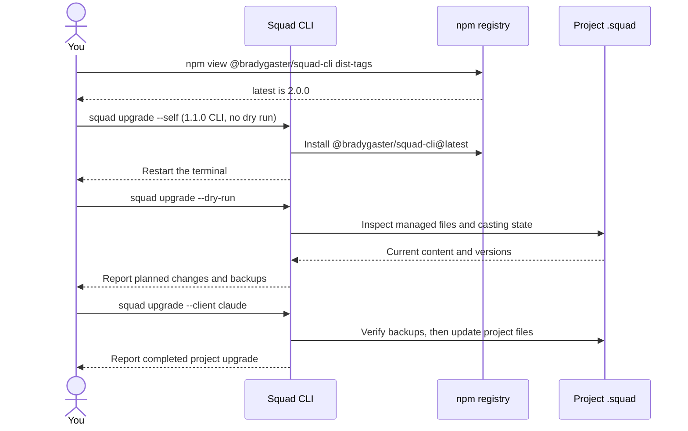
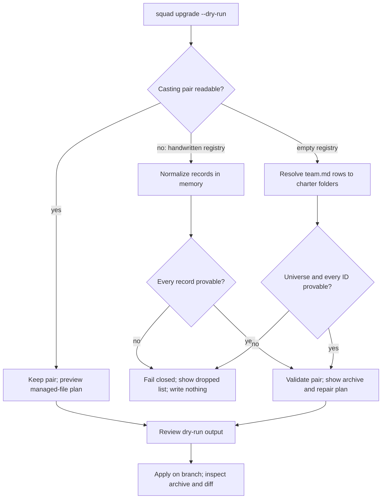

# Chapter 22: Migrating from Squad 1.x to Squad 2.0

> **Prerequisites:** Volume 1 (or equivalent Squad experience); Chapters 18–21.

## What You'll Learn

- Distinguish upgrading the globally installed CLI from upgrading one repository, and choose a release channel without accidentally downgrading.
- Preview and apply a content-aware project upgrade while preserving team state and verifying backups.
- Understand casting repair, roster backfill, and the evidence Squad requires before it will reconstruct agent identity.
- Migrate removed personal or global squad knowledge by hand, while keeping project resolution explicit.
- Recognize the 2.0 CLI, configuration, integration, and release-process changes, and safely plan a rollback to 1.1.0.
- Rehearse the whole migration on a scratch copy pinned to Squad 1.1.0, without touching your real Tasktrack project.
- Separate shipped 2.0 behavior from what v2.0.0 still labels experimental or pending.

## Two Upgrades, Three Channels

This chapter is for readers with an existing Squad 1.x team. If you started with this edition, your Tasktrack project is already on 2.0 and you can treat the chapter as a reference, or run the Hands-On drill on a scratch copy to see what a 1.x team goes through.

“Upgrade Squad” can mean two distinct operations. A **self-upgrade** replaces the CLI package installed for your user. A **project upgrade** refreshes Squad-managed files in one repository. Installing a new executable does not rewrite any project; running `squad upgrade` in a project does not replace the executable. That separation is intentional: you can update the tool once, then review and upgrade repositories one at a time.

Squad 2.0.0 is the stable release (CHANGELOG date 2026-11-18), so the stable channel now carries it. The release process publishes three channels from two branches:

| Channel | npm tag | Built from | What it carries now |
|---|---|---|---|
| Stable | `latest` | Sanitized promotion to `main` | Squad 2.0.0; also Homebrew cask `squad` and WinGet `bradygaster.Squad` |
| Insider | `insider` | Manual insider dispatch from `dev` | `X.Y.Z-insider.N` snapshots (Homebrew `squad-insider`, WinGet `bradygaster.Squad.Insider`) |
| Preview | `insider`, plus the `preview` alias | Manual release dispatch of an exact `dev` SHA | `X.Y.Z-preview.N` builds; the four 2.0 previews were published this way |

There is no `preview` branch: "preview" names a GitHub prerelease and an npm dist-tag. Install an exact version when reproducibility matters:

```bash
npm install -g @bradygaster/squad-cli@2.0.0
squad --version
```

If you installed the standalone bundle through Homebrew or WinGet, upgrade through that package manager instead. Standalone archives vendor Node.js 22.23.4; an npm install runs on your own Node, so keep it at a patched release (the CLI requires Node 22.5 or later).

### Self-upgrading from a 1.1.0 CLI

A 1.1.0 CLI's `squad upgrade --self` runs your package manager's global install of `@bradygaster/squad-cli@latest` (with `--insider`, `@insider`). Today `latest` resolves to 2.0.0, so the plain command moves you to stable 2.0. Three things about the 1.1.0 implementation matter before you run it:

- It has **no self-upgrade dry run**. A 1.1.0 CLI ignores `--dry-run` when `--self` is present and performs the install. Check the target first with `npm view @bradygaster/squad-cli dist-tags` instead.
- It has no downgrade guard and no channel detection; it simply installs the tag you name.
- It does not refresh any repository. It prints a restart message and returns (except when you also pass `--state-backend`, which runs a project upgrade too; do not combine them for a major upgrade).

> **Warning:** The self-upgrade docs page shows `npm install -g @bradygaster/squad@latest`. That package name does not exist on npm (it returns 404); the CLI package is `@bradygaster/squad-cli`, and that is what both 1.1.0 and 2.0.0 actually install. The same page shows a self-upgrade that goes on to refresh repository templates. Neither version does that: run the project upgrade yourself.

### Self-upgrade in 2.0

From 2.0 on, `squad upgrade --self` detects the channel of the running CLI: a stable install follows `@latest`, and a `-preview.N` or `-insider.N` install follows `@insider` (the canonical prerelease channel; `preview` is only an alias). `--insider` forces the insider channel. Squad compares the target with the running version and refuses to downgrade; `--force` bypasses that guard, so use it only when you have deliberately chosen an older CLI and have already restored a compatible project state. The ordinary `--force` behavior for project upgrades is different: it reprocesses a repository that is already stamped as current.

```bash
# Preview the exact install command first (2.0 CLIs only)
squad upgrade --self --dry-run

# Apply after reviewing the package manager and target version
squad upgrade --self
```

The dry run performs a read-only lookup of the npm dist-tag so the output can show its target; it does not execute the package-manager install command or change the global package. If the registry cannot be reached, the CLI reports that it cannot confirm the target. For a normal self-upgrade, Squad detects npm, pnpm, or Yarn from the invoking environment, then runs the matching global-install command for `@bradygaster/squad-cli`. On success it asks you to restart the terminal and returns. If you were on a 2.0 preview, the self-upgrade keeps you on `insider`; to move to stable, install `@bradygaster/squad-cli@2.0.0` or `@latest` explicitly.

## A Safe, Content-Aware Project Upgrade

Before a major upgrade, get a clean baseline. Commit or stash all work, record `squad --version`, and create a branch. Make a separate private backup of `.squad/` and any important coordinator customization; a casting archive and local backups can contain private team context. Once the new CLI is installed, preview the project operation from the repository root:

```bash
squad upgrade --dry-run
```

The dry run reports content changes: files it would create or overwrite, which customized files would first receive a `.local-backup`, obsolete shipped files that can be removed, files it would leave because they were customized, ignore-file additions, and applicable casting repairs. It also plans client projections if `--client` is supplied. It writes nothing and installs nothing: no project writes, casting archives, locks, transaction files, backend migration or hook installation, even with `--state-backend`.

There is one important boundary to that guarantee: the CLI processes `--migrate-directory` before reaching the project dry-run handler. Do not combine `--dry-run` with `--migrate-directory` and assume the legacy directory rename is simulated. The self-upgrade dry run is separate; it only previews the install command. For the safest first inspection, run `squad upgrade --dry-run` alone.

After reviewing the dry run, apply the upgrade:

```bash
squad upgrade
squad doctor
squad status
```

Squad 2.0 compares managed content rather than blindly copying a whole `.squad/` tree. It normalizes line endings before comparison, and uses the shipped-content manifest (or, for older installs without one, the prior shipped snapshot where available) to distinguish a user edit from a template change. Files matching the last version Squad shipped can be refreshed without a backup. A file that differs from both its shipped version and the new template is treated as customized.

Before replacing a customized managed file, Squad writes `<file>.local-backup`, reads it back, and checks that its bytes match the original. If that verification fails, it leaves that particular file untouched and reports the failure. The backup has a fixed path, not a history of versions: move a backup you need before a later upgrade can replace it. Backups are not automatically ignored by Git, so include them in your diff review and decide whether to retain or remove them.

The managed-file plan covers the coordinator, shipped skills, managed workflows, flat casting-template copies, and `.squad/templates/` snapshots. Ignore and attributes files receive only missing Squad-managed lines; existing lines and line-ending style are preserved. Files retired from the shipped set are removed only when their current content still matches the recorded shipped hash. Customized retired files are kept and reported. This makes a second upgrade with no intervening edits a no-op rather than a new wave of backups. Two 1.x annoyances are fixed: the upgrade no longer mistakes its own version stamps in `squad.agent.md` for a customization (so an existing `squad.agent.md.local-backup` survives repeated upgrades), and a customized `squad-ci` workflow is preserved. `squad doctor` now exits non-zero when a check fails, so you can script it.

The project upgrade does **not** regenerate your team from scratch. It preserves `team.md`, routing, decisions, agent charters and histories, and the casting registry/history pair unless a supported casting migration is needed. It keeps existing user configuration fields and updates the portable `clients` list when you request client projections. It may add or refresh Squad-owned templates and scaffolding, and it can remove obsolete generated files when their prior content is provably unchanged. The working-tree diff—not the success message—is your record of what changed.

### Safe Upgrade Sequence

The commands operate in two distinct scopes: the first updates the installed CLI, and the second updates a project. Because a 1.1.0 CLI cannot preview its own self-upgrade, the registry lookup stands in for that dry run; the project dry run uses the new 2.0 CLI.



## Upgrading to Squad 2.0

Existing Copilot-only teams can upgrade without reinitializing. A plain `squad upgrade` remains Copilot-only; it will not silently create Claude Code, Kiro, OpenCode, Cursor, Codex, or Antigravity files. To add a host, preview and apply it explicitly:

```bash
squad upgrade --dry-run --client claude
squad upgrade --client claude
squad client list
```

A 1.x project picks up these Copilot-path changes on its first 2.0 upgrade, whether or not you add hosts:

| Change | What you see in the diff |
|---|---|
| Committed launcher | A new `.squad/squad.mjs`, and the `squad_state` entry in `.mcp.json` rewritten from the `npx -y @bradygaster/squad-cli@<version> state-mcp` command that 1.x wrote (or bare `squad state-mcp` for a standalone bundle) to `node -e <root finder> .squad/squad.mjs state-mcp` (Chapter 21). Commit both. |
| Ignore lines | `.squad/backend/` added to `.gitignore`; `.claude/worktrees/` only when `claude` is a configured client |
| Templates | `.squad/templates/human-members.md` ships again, with the human sign-off gate |
| Stale settings | A `teamRoot` pointing at the old user-profile squad is removed (`Removed obsolete "teamRoot" setting …`); a `teamRoot` that points at another repository stays |
| Roster | Unchanged. `squad upgrade` never edits `team.md`. A team cast from the 1.1.0 template already lists all four built-ins. If `team.md` has no support table, the first 2.0 `squad cast --name <Name> --role "<Role>"` adds one; `squad roster add` is for a roster that has the table without Rai or Fact Checker |
| Casting | `.squad/casting/` stays on the source branch for every state backend |

The Copilot coordinator, `.github/agents/squad.agent.md`, is refreshed like any other managed file; its behavior for Copilot is the 2.0 behavior described in Volume 1.

You can name multiple hosts separated by commas, or use `all`. The selected host IDs are saved in `.squad/config.json` under `clients[]`; future project upgrades refresh the saved projections. These values are portable host identifiers, not credentials, paths, URLs, or session IDs. See Chapter 19 for host-specific setup and Chapter 20 for the adapter and capability model. Generating a projection does not grant access to that host: you still need the host's supported installation and account or license to run it. If you have only Copilot, leave the project Copilot-only and complete the rest of the upgrade and validation steps.

The standalone `squad client` command lists configured hosts and can add more without re-running all project setup. `squad client list --json` is useful for tooling; `squad client add <list> --dry-run` previews a projection; `squad client sync` refreshes the configured hosts' files without a full upgrade. For Claude Code you can choose plugin mode (`--claude-plugin`) instead of the full projection; Chapter 19 compares them. The SDK's `uninstallClients()` can remove projections and restore shared files byte-for-byte outside their managed sections. It is an **uninstall of generated host projections only**—it does not downgrade Squad or change your project state.

### Tested upgrade paths

The upgrading guide includes a version-by-state-shape matrix for five published producers: 0.9.1, 0.13.1 and 1.0.0 from npm, and the 1.0.1 and 1.1.0 standalone bundles from GitHub Releases. Each producer runs `squad init` under up to seven state shapes (`default`, `profile`, `legacy-casting`, `orphan`, `two-layer`, `ai-team`, `upstream`), and the 2.0 CLI then upgrades the result on Linux and Windows. The checks go beyond exit codes: user files and state-backend references survive, casting pairs remain readable, a second upgrade is idempotent, new client projections parse, `doctor` passes, and projection uninstall restores shared content.

Read the attestation for what it is. The recorded runs at the v2.0.0 tag were made on 2026-11-19 against commit `8c2b93d5`, two commits before the `v2.0.0` tag, with the target labelled `v2.0.0`: 35 rows passed on each OS, 4 of them with a known expected failure, and 7 cells are structurally inapplicable. Earlier runs against the previews are kept as history in the fixture and do not attest the current harness; the CHANGELOG says historical attestations remain tied to the versions actually tested.

The "not applicable" cells are explained one by one: 0.9.1 has no `--state-backend` flag, so it cannot produce the `orphan` or `two-layer` shapes, and the `upstream` shape runs only on the current tree. The matrix calls upstream inheritance a 2.0 feature that the old producers cannot declare, although the 1.1.0 CLI does have a `squad upstream` command; if your 1.x project has an `upstream.json`, that path is not attested, so check it yourself (next sections). “Not applicable” is not a failed or skipped run.

The matrix also documents four findings. Three were real 2.0 upgrade defects, fixed before release: a stale profile `teamRoot` that survived upgrade (F1), the coordinator's own version stamp being reported as a customization on every run (F2), and a 0.9.x project needing a second upgrade to converge (F4). F3 stays open because it is a property of an old CLI: Squad 0.9.1's `squad upgrade --dry-run` is not dry. Pointed at an upgraded project, it rewrites about 68 files back to 0.9.1. The 0.13.1 through 1.1.0 CLIs honor `--dry-run`, but their real upgrade still has no newer-workspace guard. Never run an old CLI's project-upgrade command against a 2.0 workspace. For a release-critical migration, reproduce the test on a copy with the exact CLI package and OS you plan to use.

## Casting Repair: Preserve Evidence, Do Not Guess

Some 1.x teams have a registry written by a model in an informal JSON shape, or an empty registry even though `team.md` and agent folders are populated. Squad 2.0 repairs these cases before it refreshes managed project files. This is a conservative data migration, not a recasting operation: the CLI only fills in facts it can establish from the existing files.

For a handwritten registry, Squad reads the registry/history/commit-manifest set under the casting writer lock, recovers any durable transaction already in progress, and snapshots the pre-repair bytes. It normalizes supported records into the managed provenance schema. Complete valid records remain intact, including extra producer-specific fields and lifecycle state such as `inactive` or `retired`; incomplete but recoverable records get only missing fields supplied. The managed registry revision advances. The original registry, history, and manifest files are archived under a content-addressed directory such as:

```text
.squad/casting/handwritten-archive-<sha256>/
```

An existing archive is not replaced with different bytes. The repair validates the new pair, writes it through the casting transaction mechanism, and reads it back. If a failure occurs before the transaction journal is durable, the pre-repair snapshot is restored. Once a durable journal exists, recovery rolls that transaction forward; the tool does not silently discard it and invent a fresh cast. Do not edit the registry/history pair while this repair is in progress.

If a record is ambiguous or invalid, repair fails closed. The result includes a `dropped` list naming every entry that could not be normalized and why. “Dropped” here describes a rejected candidate in a proposed repair; it does not mean Squad committed a partial registry and discarded the entry. No partial normalized registry is written. Correct the source JSON so every entry proves a name and role (or use the suggested `squad cast --name <Name> --role <Role>` operation), preview again, and preserve the original archive. Bare strings are ambiguous because the program cannot know whether they mean role-to-name or name-to-role.

The second path backfills an **empty** registry from the current `team.md` roster. It is eligible only when the registry has no agents and no meaningful prior cast history. Each specialist must map to a real folder under `.squad/agents/`: the roster's charter path is preferred, then a matching `## Identity` name in a charter, then a literal normalized folder name. If a name maps to multiple folders, a folder is missing, or two roster rows claim the same folder, the backfill refuses. The roster must also declare the casting universe; Squad will not infer it from today's agent names. Built-in and human rows are not converted into specialist records.

You may encounter the failure in the dry-run. Use its per-entry `dropped` reasons as a checklist: restore the original charter or roster path, resolve duplicate names, or add the documented universe. Do not “fix” the preview by hand-inserting guessed IDs or a fabricated usage history. If the relevant historical files are missing, retain the old project and seek recovery from version control rather than claiming that migration succeeded.

This backfill is distinct from optional built-in roster management. `squad upgrade` can install Rai and Fact Checker charters, but it never edits `team.md`. In 1.1.0 they were mandatory, so a team cast from the 1.1.0 template already lists all four built-ins. A `team.md` with no `## Built-in Support Agents` table, such as an uncast 1.1.0 project's, gets one from the first 2.0 `squad cast --name <Name> --role "<Role>"`: it lists each built-in whose charter is installed. For a roster that has the table without Rai or Fact Checker, opt them in with `squad roster add rai`, `squad roster add fact-checker`, or `squad roster add all`. The command previews the exact diff, verifies a byte-exact `team.md.roster-backup`, and records ownership in `.squad/.roster-provenance.json`. A later `remove` deletes only the exact rows it can prove this command inserted; when the whole file is unchanged, it can restore the original bytes. This is a separate consent boundary from casting repair.



## Compatibility: Charters and Routing

2.0 can read a 1.x charter without forcing you to rewrite every charter before using the squad. Health validation recognizes older responsibility headings, and a missing 2.0 `## Identity` block is a warning with a suggested `Name` and `Role`, not an immediate failure. If a charter does include an identity, its name must agree with the persistent name recorded in casting; a mismatch is a validation failure. The optional `## Examples` charter section is now recognized as a supported section and survives structured SDK edits. You can add useful examples, but they are Markdown guidance—not executable test configuration—and they are not required for a valid charter.

Routing files have a similar compatibility layer. The parser accepts documented historical header names and column arrangements, as well as a recognized flattened legacy table. The optional Examples column can clarify work types. Compatibility does not mean accepting a broken route. `squad health` fails closed if it finds no parseable routing rules, cannot validate targets because the casting registry is invalid, or finds a route to an unknown/off-roster agent. Duplicate or conflicting work-type rows are reported deterministically as warnings so that you can resolve ambiguity instead of relying on whichever row happens to win. A legacy table can parse successfully and still fail health because it names a nonexistent agent.

Keep the distinction between diagnostics straight: `squad doctor` checks that `routing.md` exists and that the casting registry/history pair is consistent; `squad health` performs the stronger routing-reference validation intended for a CI gate. Run both after the upgrade. `squad migrate --to sdk` is a different tool for converting between markdown-only and SDK-First configuration; `squad migrate --from ai-team` renames a legacy `.ai-team/` directory. Neither command migrates personal squads or consult mode.

## Removed Personal Squads and Project Resolution

Squad 2.0 removed personal squads, consult mode, and the old global-squad option. The user-profile `personal-squad/` and global `.squad/` directories are no longer read or written. There is no conversion command that discovers these directories and moves their content into repositories. `squad init --global` is rejected as an unknown option. A project may no longer fall back to a personal team just because it has no `.squad/` locally.

Instead, 2.0 resolves project state from `.squad/` in the current directory or its parents. Outside a project, state commands such as `squad status`, `squad doctor`, `squad cast`, and `squad cost` report that no squad was found and tell you to initialize one. The retired features' command surfaces, environment switches, coordinator instructions, and SDK exports have been removed along with the feature; there is no supported consult-mode compatibility flag.

If a personal team contains knowledge you need, migrate the **content**, not the old profile directory. In each repository that should own it, start from a branch and create the project squad with `squad init`. Then review and copy selected agent charter/history folders, durable decisions, routing rules, skills, ceremonies, and policy into that repository's `.squad/`. Reconcile duplicate agent IDs and names against the project's current `team.md`; keep only decisions and histories appropriate to that codebase. Do not copy credentials, caches, tokens, unrelated repositories' notes, or the old global configuration wholesale. Have the team review the result, run `squad doctor` and `squad health`, and commit the project-owned state. Repeat for each project that needs the knowledge. A shared fact can be copied selectively or published through the project's normal upstream process; the removed personal squad is not a shared remote source.

The removal of profile fallback does **not** abolish all explicit linked-team workflows. `squad init --mode remote <path>` and `squad link <team-repo-path>` still support a project that intentionally uses a separate team root. The global `--team-root <path>` flag (also exposed to subprocesses as `SQUAD_TEAM_ROOT`) overrides the root used for resolution. Use it deliberately—for example, when a spawned command's working directory differs from the project root—not as a hidden replacement for the removed user-profile default. A pre-2.0 `teamRoot` pointing to an obsolete platform profile is removed during upgrade; a legitimate team root pointing to another repository is retained.

## Upstream Inheritance: Recheck Precedence

Upstreams are declared in `.squad/upstream.json`, and 2.0 resolves them at runtime through `squad_state_upstreams` (Chapter 21). The changed behavior matters if you configured them under 1.x: precedence now favors **earlier** entries. The old 1.x documentation said later entries won, while the implementation did not consistently realize that rule. In 2.0 the intended deterministic order is the project's own `.squad/` first, then upstreams in declaration order, traversed depth-first within the documented depth limit. If two upstreams provide the same item, the earlier one wins.

After installing 2.0, review the ordering in `upstream.json`; if you used the old documented later-wins behavior, reorder the list so your preferred source appears first. Then run:

```bash
squad upstream list
squad upstream sync
squad doctor
squad status
```

Sync refreshes the local snapshots from configured sources. Sessions read those local snapshots at startup; they do not fetch remote Git repositories on every prompt. `squad doctor` can report a fresh clone's upstream as unavailable until you sync. That normal unavailable state is a warning; missing, invalid, cyclic, or over-depth declarations are hard failures. This is also why a cleanly upgraded repo still needs an explicit `upstream sync` before you expect new upstream content to be visible.

## CLI Reference: What Changed in 2.0

The 2.0.0 CLI has more commands than the reference page's “17 commands” heading suggests. The table below lists the 2.0 surfaces most relevant to a 1.x migration; the inventory afterward groups the top-level command list and its important flags. Appendix A is the full reference. Commands not mentioned as changed retain their ordinary project behavior.

| Surface | 1.1.0 → 2.0.0 change | Flags / usage to know |
|---|---|---|
| `squad init` | Adds client projection and continues to initialize project-local `.squad/`; personal/global initialization is gone. | `--client <list>`, `--claude-plugin`; `--sdk`, `--roles`, `--no-workflows`, `--no-vscode-default`, `--preset <name>`, `--state-backend <type>`, `--mode remote <path>`. |
| `squad upgrade` | Now plans and compares shipped content; project state is preserved, backups are verified, configured hosts are refreshed, and committed MCP configs switch to the `.squad/squad.mjs` launcher. | `--dry-run`, `--client <list>`, `--claude-plugin` / `--no-claude-plugin`, `--force`, `--migrate-directory`, `--state-backend <type>`. |
| `squad upgrade --self` | Self-upgrade follows the running CLI's stable/prerelease channel, refuses older targets by default, supports `--dry-run`, and does not run a project upgrade. | `--self`, `--insider`, `--dry-run`, `--force`; use project `squad upgrade` separately. A 1.1.0 CLI ignores `--dry-run` here. |
| `squad client` | New projection management command. | `client list [--json]`; `client add <list> [--dry-run]`; `client sync [--dry-run]`; `clients` is an alias. |
| `squad lockout` | New durable reviewer-lockout ledger in `.squad/governance/lockouts.json`; see Chapter 18 (Volume 1). | `reject|assign|submit|approve|override|status`; no detailed `--help`. |
| `squad hook` | New Claude Code hook entry point; not listed in `squad --help`. | `hook claude <SessionStart|SubagentStart|PreToolUse|PostToolUse|Stop>` (Chapter 20). |
| `squad dashboard` | New local view of Claude Code sessions on 127.0.0.1 (Chapter 19). | `[start|stop|status]`, `--port`, `--session`, `--stream`, `--detach`, `--open`, `--json`. |
| `squad watch` / `triage` | Adds opt-in work claims, bounded runs and a Claude Code runner; a malformed `config.json` now stops watch. | `--claims <none|git-ref>`, `--max-rounds N`, `--max-duration 8h`, `--agent-preset <copilot|claude>`, `--claude-flags "..."`. |
| `squad roster` | New explicit opt-in/removal path for optional built-ins; upgrades no longer modify the roster. | `roster add|remove <rai|fact-checker|all> [--dry-run]`; `disable` and `uninstall` alias `remove`. |
| `squad update-check` | New cache-aware status command for scripts and editors. | `--json`, `--refresh`; cache older than 24 hours is marked stale, and stale data cannot claim an update. Exit codes: `0` current/no cache, `1` update available, `2` refresh transport failure. |
| `squad health` | CI-oriented validation, including routing targets; not the same as the file-presence checks in `doctor`. The JSON adds `cliVersion`, `sdkVersion`, `stateBackend`, `resolvedTeamRoot` and `resolvedSquadDir` metadata to the existing `squad-health/v1` schema. | `--json`. |
| `squad migrate` | Supports `--from ai-team` and `--to sdk|markdown`; this migrates file/config formats, not personal squads. | `--from ai-team`, `--to sdk|markdown`, `--dry-run`. |
| `squad state-mcp` | Adds opt-in experimental backend conversation tools; `SQUAD_BACKEND_URL` alone does not enable them. | `--experimental-backend` or `SQUAD_EXPERIMENTAL_BACKEND=1`; experimental server calls require configured backend details. |
| `squad upstream` | New runtime inheritance commands; 2.0 applies earlier-wins order and reads locally synced snapshots. | `upstream add <source> [--name <n>] [--ref <branch>]`, `remove <name>`, `list`, `sync [name]`. |
| `squad status` / `doctor` | Project-only resolution; profile fallback is removed. `status` reports resolution/upstreams; `doctor` checks state, bridge readiness and portable launch commands, and exits non-zero on a failed check. | `--team-root <path>` is an explicit root override, not a return of personal squads. |
| `squad cast` / `hire` | Project cast operations remain; `cast --name` / `--role` can explicitly add an agent and repair guidance can point to it. | `cast [--name <name> --role <role>] [--force]`; `hire` aliases cast. |
| `squad shell` / default invocation | The old consult mode is removed. The no-argument shell entry is still distinct from consult; use the documented host invocation to launch a coordinator. | No `--consult` or profile-mode compatibility flag. |
| `squad export` / `import` | Portable project state workflows remain, but they are not automatic personal-squad migration. | `export [--out <path>]`; `import <file> [--force]`. |
| `--global` | Removed; invoking it fails instead of writing to a profile location. | No replacement flag. Initialize inside a project; copy selected content by hand. |
| `--team-root` | Retained as an explicit global resolution override. | `squad --team-root <path> <command>` or environment `SQUAD_TEAM_ROOT`; use only when resolution needs an explicit project/team root. |
| `@bradygaster/squad-sdk/clients` | Deprecated SDK subpath alias; canonical APIs moved to the singular package subpath. | Change imports to `@bradygaster/squad-sdk/client`. |

### Full top-level command inventory

| Command | Main purpose and key flags / forms |
|---|---|
| No arguments | Launch the interactive shell. Consult mode itself is removed. |
| `init` | Initialize project; options shown in the preceding table. |
| `upgrade` | Upgrade project or CLI; options shown in the preceding table. |
| `client` | `list [--json]`; `add <list> [--dry-run]`; `sync [--dry-run]`. |
| `lockout` | `reject`, `assign`, `submit`, `approve`, `override`, `status [subject] [--json]`. |
| `hook` | `hook claude <Event>`; run by Claude Code, not by hand. |
| `dashboard` | `[start|stop|status]` with `--port`, `--session`, `--stream`, `--detach`, `--open`, `--json`. |
| `roster` | `add|remove <rai|fact-checker|all> [--dry-run]`. |
| `update-check` | `--json`, `--refresh`. |
| `migrate` | `--from ai-team`, `--to sdk|markdown`, `--dry-run`. |
| `sync` | Synchronize state backend: `--push`, `--pull`, `--remote <name>`, `--quiet`. |
| `status` | Show the active squad and why it resolved. |
| `roles` | List built-in roles: `--category <name>`, `--search <query>`. |
| `cost` | Report orchestration token usage: `--all`, `--agent <name>`. |
| `triage` | Scan/categorize work: `--interval <minutes>`, `--execute`, `--copilot-flags`, `--max-concurrent`, `--timeout`, `--max-rounds`, `--max-duration`, `--claims`, plus capabilities such as `--self-pull`, `--board`, `--monitor-teams`, `--monitor-email`, `--two-pass`, `--wave-dispatch`, `--retro`, `--decision-hygiene`, and `--no-<capability>`. |
| `watch` | Triage alias / work monitor with the same monitoring and execution capabilities, plus `--agent-preset <copilot|claude>` and `--claude-flags`. |
| `loop` | Prompt-driven loop: `--init`, `--file <path>`, `--interval`, `--timeout`, `--copilot-flags`, `--monitor-email`, `--monitor-teams`, `--self-pull`. |
| `cast` / `hire` | Show or add a cast member: `--name`, `--role`, `--force`. |
| `copilot` | Add/remove coding agent: `--off`, `--auto-assign`. |
| `plugin` | `marketplace add|remove|list|browse`. |
| `export` / `import` | Export to JSON (`--out <path>`) or import `<file> [--force]`. |
| `scrub-emails` | Scrub state at an optional `[directory]`; the default is still the legacy `.ai-team/`, so pass `.squad` for a current project. |
| `start` | Start Copilot with optional `--tunnel`, `--port <n>`, `--command <cmd>` and passthrough Copilot flags. |
| `nap` | Context cleanup: `--deep`, `--dry-run`. |
| `memory` | Governed memory operations, including `write --content "..." --class LOCAL`; diagnostics accept `--log-level` / `--verbose`. |
| `state-mcp` | Serve runtime MCP tools; `--experimental-backend` is opt-in. |
| `doctor` / `health` | Diagnose setup, or run structured CI checks (`health --json`). |
| `subsquads` | `list`, `status`, `activate <name>`; `workstreams` and `streams` are deprecated aliases. |
| `link` / `init-remote` | Link a project to a remote team root; `init-remote <path>` is shorthand. |
| `externalize` / `internalize` | Move project state to/from external team storage; `externalize --key <name>` sets an explicit project key. |
| `build` | Compile `squad.config.ts`: `--check`, `--dry-run`, `--watch`. |
| `aspire` | Launch observability dashboard: `--docker`, `--port <n>`. |
| `schedule` | `list`, `run <id>`, `init`, `status`. |
| `preset` | `list`, `show <name>`, `apply <name> [--force]`, `save <name>`, `init [--remote]`. |
| `rc` | Remote Control: `--tunnel`, `--port <n>`, `--path <dir>`; `remote-control` is an alias. |
| `copilot-bridge` / `rc-tunnel` | Check Copilot ACP stdio compatibility or devtunnel availability. |
| `discover` / `delegate` | Discover known squads or create work in another squad (`delegate <name> <description>`). |
| `registry` | Peer squad discovery without inheritance: `add <name> <path>`, `list`, `remove <name>`. |
| `upstream` | Manage inherited sources: `add`, `remove`, `list`, `sync [name]`. |
| `economy` | Toggle economy mode: `on|off`; global `--economy` activates it for one session. |
| `config` | Read or set configuration through the command's supported `get` / `set` operations. |
| `version` / `help` | Print version or help; root flags also include `--version`/`-v`, `--help`/`-h`, `--economy`, and `--team-root`. |

Do not infer a 2.0 feature from an old command name alone. For example, `squad migrate --from ai-team` handles the historical directory rename, not the removed personal-squad format. The unrelated `upstream` feature is inheritance, not the personal team registry. Consult is not a hidden default mode: start the normal coordinator in the chosen host and use project-local files.

## Configuration Reference

The 2.0 configuration change most visible to a multi-host repository is `.squad/config.json`'s `clients` array. The list stores client slugs, and an empty or absent list does not opt a Copilot-only repo into other hosts. The CLI writes and maintains it when you pass `--client`; avoid editing it to include host-specific credentials or machine paths. Per-host projection files live in host-owned locations, and the adapter tries to preserve user MCP settings and shared-file content.

| Key or setting | 2.0 meaning | Upgrade guidance |
|---|---|---|
| `clients` | Portable configured host list (`copilot`, `claude`, `kiro`, `opencode`, `cursor`, `codex`, `antigravity`). | Prefer `squad upgrade --client ...` so projection and config stay synchronized. `all` is an input option, not a stored credential bundle. |
| `version` | Squad configuration/schema version metadata. | Preserve it; let the CLI migration update managed state rather than copying an old `config.json` wholesale. |
| `teamRoot` | Explicit remote/dual-root setting may still identify another team repository; retired profile paths are removed. | Inspect any pre-2.0 value. An old user-profile path is not a supported project link. Use a project-relative remote root when intended. |
| `stateBackend` | Selects supported state storage such as `local`, `orphan`, or `two-layer` (with compatibility aliases in the backend layer). | Confirm the `squad-state` branch and hooks remain healthy after upgrade; do not mix project rollback with backend migration. |
| `platform` / `ado` | Platform detection/configuration, including optional ADO org, project, work-item type, area path, and iteration path. | ADO CLI triage/watch support is more complete than coordinator Issues mode; do not assume every ADO example is a first-class interactive adapter. |
| `SQUAD_EXPERIMENTAL_BACKEND` | Set to `1` to expose experimental `squad_backend_*` MCP tools. | Explicit opt-in; a URL alone does not enable the tools. |
| `SQUAD_BACKEND_URL` / `SQUAD_BACKEND_TOKEN` | MCP bridge endpoint and optional bearer token when experimental backend tools are enabled. | For SDK calls, pass explicit `baseUrl` and optional token; only `https://` is accepted, with `http://` allowed for localhost. Keep tokens out of committed config. |
| `SQUAD_TEAM_ROOT` / `--team-root` | Explicit resolution override for a command or subprocess. | Use only when the working directory is not the project root. It does not restore personal or global fallback. |
| `claudePlugin`, `claudeHooks`, `claudePermissions` | Claude Code projection settings: plugin mode, opt-in advisory hooks (`"advisory"`), scoped allowlist (on unless `"off"`). | Only relevant once `claude` is a configured client (Chapter 20). |
| `watch.claims`, `watch.agentPreset`, `watch.claudeFlags` | Work claims (`none` by default, or `git-ref`), the runner preset, and limited Claude flags for `squad watch`. | A malformed `config.json` or an invalid `watch.claims` value now stops watch instead of being ignored. |
| `governance.authorities` | Extra names allowed to record `squad lockout override`. | The user is always allowed. |
| `SQUAD_CLI` / `SQUAD_ALLOW_NPX` | Read by the committed `.squad/squad.mjs` launcher: an explicit CLI to run, and permission to fall back to `npx`. | Leave `SQUAD_ALLOW_NPX` unset unless you accept downloading and running the pinned package. |
| `SQUAD_BACKEND_HARNESSES` | Experimental bridge harness selection (`claude-agent-sdk`, `copilot-sdk`, `none`). | Experimental; see Chapter 21. |

2.0 also added a backend opt-in rule: `SQUAD_BACKEND_URL` alone no longer turns on the experimental conversation tools. In SDK code the backend APIs are under `@bradygaster/squad-sdk/backend`; client adapters use the canonical `@bradygaster/squad-sdk/client`. The old plural `/clients` remains a deprecated compatibility alias, not the recommended import path.

## Platforms and Adapters: Read the Status Labels

The 2.0 docs revised their claims about integrations, so check the status before designing a migration around an example.

| Area | 2.0 status | What to plan for |
|---|---|---|
| Azure DevOps | Platform detection and CLI monitor flows (`squad triage`, `squad watch`) use `az boards`; interactive coordinator Issues mode remains GitHub-oriented. | Validate your exact work-item workflow. The ADO issue-lifecycle template is reference guidance the model applies, not proof of a first-class interactive adapter. The example ADO MCP entry is seeded into Copilot's `.mcp.json` only. |
| GitLab issues | Planned, not shipped. The adapter type is not present; `triage` / `watch` have no `glab` path, and the host coordinator digests do not define a GitLab workflow. | Treat GitLab walkthroughs as aspirational. You may ask a coordinator to use `glab` ad hoc, but it improvises rather than following a shipped adapter. Do not automate against the examples as a stable interface. |
| Microsoft Teams communications adapter | The 2.0 doc change shown here only replaced a named example UPN with `user@example.com`; it did not announce a new adapter behavior. | Re-check the adapter's OAuth scopes, tenant settings, and chat/channel configuration independently. The documentation edit is privacy hygiene, not evidence of an upgrade migration. |

This distinction is useful when upgrading because a content-compatible project can still depend on a feature whose documentation status changed. Do not delete working integration configuration solely because an example was relabeled, but do not assume a “planned” workflow is available in the runtime either.

## Release Process: Why the Tags Matter

For a migration, the release channels matter because they decide what an unpinned install gives you. Since 2.0.0 is stable, `npm install -g @bradygaster/squad-cli` and a 1.1.0 self-upgrade both land on 2.0.0, and so does a CI job that installs the CLI without a version. Pin the version in CI (`@bradygaster/squad-cli@2.0.0`, or `npx @bradygaster/squad-cli@<version>` per repository) so a team does not migrate by accident.

Maintainers keep the root, SDK and CLI versions in lockstep. A stable release starts with a preparation PR on `dev` that sets the versions and adds the dated CHANGELOG heading (`## [2.0.0] - 2026-11-18`) while keeping the historical preview entries, because `2.0.0-preview.4` and `2.0.0` are different immutable releases. A human then runs the promotion, which merges `dev` into `main`, strips internal team state and other development-only files from the release tree, and validates and tests it. The release workflow checks the exact `main` SHA, creates the tag, publishes npm `latest`, uploads standalone archives, updates Homebrew and WinGet, and marks the GitHub Release latest only after the selected channels complete. The `docs/proposals/` folder that the previews carried was removed while sanitizing the 2.0.0 promotion branch.

Previews and insider snapshots stay separate operations. A preview publishes a prepared `X.Y.Z-preview.N` version from an exact reviewed `dev` SHA to `insider` with the `preview` alias, and held Homebrew, WinGet and `latest` for all four 2.0 previews. The insider workflow computes its own `X.Y.Z-insider.N` version, so it must not be used to publish a prepared preview. An unknown registry outcome is not treated as proof that publication failed; recovery reconciles against the immutable tag and release evidence rather than recreating or moving a tag. Chapter 8 covers the release workflows in depth.

## Rollback Plan: Return to 1.1.0 Safely

The supported upgrade direction is forward. There is no in-place 2.0-to-1.1 migration command, and an old CLI has no guard that protects a newer workspace. `uninstallClients()` only removes projections. It does not reverse casting migrations, remove the 2.0 managed template set, or make a 1.1.0 project.

Use a pre-upgrade commit or backup as the rollback boundary. First stop work and preserve the current 2.0 state for diagnosis. Then restore the **project** to its known 1.1.0 commit: the old `.squad/` state (including the original casting files and config), the coordinator, shipped skills, managed workflows, and any shared host/ignore files that changed. Do not overlay only the old coordinator onto a 2.0 casting pair or leave `clients[]` and 2.0 projections behind. The 2.0 files to watch for are `.squad/squad.mjs`, the launcher-based `squad_state` entry in `.mcp.json`, `.squad/governance/`, and any host projection files (`.claude/`, `CLAUDE.md` blocks and the like); a 1.1.0 CLI does not know about any of them. If the project did not have a pre-upgrade commit, recover those files from a verified backup and manually reconcile any team knowledge created after the boundary.

Only after the repository files have been restored should you install the 1.1.0 CLI, for example:

```bash
npm install -g @bradygaster/squad-cli@1.1.0
squad --version
squad doctor
```

Validate the restored state before continuing. If you accidentally ran an older `squad upgrade` against a 2.0 tree, stop immediately, restore the 2.0 project files from version control or backup, and re-run the current 2.0 upgrade only if your intent is to return forward. Do not rely on an older CLI's `--dry-run`: 0.9.1 is known to write during that path, and other old CLIs can preview a downgrade even if they do not write until asked.

## Hands-On: Upgrade and Roll Back Tasktrack

Your real Tasktrack project is already on Squad 2.0, so this drill runs on a scratch copy that you initialize with Squad 1.1.0. Nothing here touches your main checkout or your global 2.0 CLI. The 1.1.0 CLI lives in its own npm prefix and is called by full path.

1. **Make a scratch copy at the baseline.** Clone your Tasktrack repository into a throwaway directory and start from the pre-Squad baseline tag:

   ```bash
   mkdir -p ~/squad-ch22 && cd ~/squad-ch22
   git clone ~/tasktrack tasktrack-1x
   cd tasktrack-1x
   git switch -c v2-ch22-drill ch02-start
   git status --short
   ```

   Expected: a clean working tree with no `.squad/` directory. If your clone has no `ch02-start` tag, copy the book's `sample/` folder into a new Git repository instead.

2. **Install Squad 1.1.0 in an isolated prefix.** This does not replace your global `squad`:

   ```bash
   npm install --prefix ~/squad-ch22/cli-1.1.0 @bradygaster/squad-cli@1.1.0
   SQUAD11=~/squad-ch22/cli-1.1.0/node_modules/.bin/squad
   "$SQUAD11" --version
   squad --version
   ```

   Expected: `1.1.0` from the first command and `2.0.0` from your normal `squad`.

3. **Create the 1.x project and mark the rollback point.**

   ```bash
   "$SQUAD11" init
   git add -A
   git commit -m "Squad 1.1.0 baseline"
   git tag v2-ch22-start
   ```

   Expected: a 1.1.0 `.squad/`, `.github/agents/squad.agent.md`, and an `.mcp.json` whose `squad_state` entry runs `npx -y @bradygaster/squad-cli@1.1.0 state-mcp`. Casting a team in Copilot first makes the drill more realistic, but it is optional. After the upgrade, an uncast team adds no `doctor` warnings or failures, but `squad health` reports the team checks as failures and exits 1.

4. **Check what a self-upgrade would install.** Do not run `"$SQUAD11" upgrade --self --dry-run`: a 1.1.0 CLI ignores `--dry-run` with `--self` and runs a global install. Ask the registry instead:

   ```bash
   npm view @bradygaster/squad-cli dist-tags
   ```

   Expected: `latest` is `2.0.0` (or a later stable release). That is what `squad upgrade --self` would install from a 1.1.0 CLI. Your global CLI is already 2.0.0, so the drill skips the self-upgrade.

5. **Preview the project upgrade with the 2.0 CLI.**

   ```bash
   squad upgrade --dry-run
   git status --short
   ```

   Expected: a list of planned managed-file updates and any backups or casting repairs, ending with an instruction to run without `--dry-run`, and an empty `git status`. Resolve every `dropped` casting item or other blocking diagnostic before applying.

6. **Apply the project upgrade, then inspect the result rather than trusting it.**

   ```bash
   squad upgrade
   git status --short
   git diff --stat
   git diff -- .mcp.json .gitignore
   ls .squad/squad.mjs
   find . -type f -name '*.local-backup' -print
   find .squad/casting -maxdepth 1 -type d -name 'handwritten-archive-*' -print
   npm test
   ```

   Expected: the coordinator, skills, workflows and templates change; team state does not. `.mcp.json` now runs `node -e … .squad/squad.mjs state-mcp`, the launcher file exists, and `.gitignore` gained `.squad/backend/`. Review every `.local-backup` and casting archive privately before you decide what to commit. Tasktrack's own tests still pass.

7. **Add one host explicitly (optional).** Claude Code is the example; you can inspect the generated files without a Claude Code login.

   ```bash
   squad upgrade --dry-run --client claude
   squad upgrade --client claude
   squad client list
   ```

   Expected: the dry run names the host in one line, `Would project client host files for: claude`, and lists no files; the applied command records `claude` in `.squad/config.json` `clients[]` and creates the host files without replacing unrelated MCP entries or shared-file paragraphs. Copilot-only fallback: skip this step and leave `clients` unset.

8. **Validate the new CLI against the project.**

   ```bash
   squad doctor; echo "doctor exit: $?"
   squad health --json
   squad status
   git diff --check
   ```

   Expected: `doctor` reports the resolved project, a passing `portable squad_state launch` check, and a non-zero exit only if a check failed; an uncast team passes, so expect exit 0. `squad health --json` includes `resolvedTeamRoot` and `resolvedSquadDir` under `metadata`; on an uncast team it fails the `team`, `registry-charters` and `routing` checks and exits 1. If `doctor` finds an invalid casting pair or bridge, use its exact diagnostic and the repair section rather than deleting `.squad/`.

9. **Roll back to the 1.1.0 baseline.** Preview untracked cleanup first and make sure every listed file is an output of this drill:

   ```bash
   git clean -nd
   git reset --hard v2-ch22-start
   git clean -fd
   "$SQUAD11" doctor
   ```

   Expected: the repository is back at the 1.1.0 commit and the 1.1.0 CLI reads it. Use the 1.1.0 CLI only for read-only checks here: never run `"$SQUAD11" upgrade` against a tree a 2.0 CLI has upgraded. If `git clean -nd` lists anything you did not create in this drill, remove only the known generated files. This is a rollback demonstration, not a supported downgrade of a live 2.0 project.

10. **Clean up.** Delete `~/squad-ch22` when you are done. Your main Tasktrack checkout and global CLI were never changed.

## Under the Hood

`packages/squad-cli/src/cli/core/upgrade.ts` coordinates the project upgrade. It detects the project squad, reads the installed coordinator version, handles stale profile `teamRoot` values, runs casting repair and preflight, and makes separate choices for a dry run, an already-current project, and a regular update. It applies the casting preflight before writing the coordinator because the coordinator's capabilities block depends on a valid registry/history pair. It also refreshes configured client projections after managed templates and infrastructure checks.

Self-upgrade lives beside that flow. `detectSelfUpgradeTag()` detects whether the running CLI is stable or prerelease (a `-preview` or `-insider` suffix keeps it on `insider`), `selfUpgradeCommand()` builds the npm, pnpm or Yarn command for that tag, and the code compares the tag's version to the current CLI, and refuses an older target unless `--force` is explicit. In dry-run mode it prints the concrete npm/pnpm/Yarn command and returns before invoking the installer. The CLI dispatcher deliberately returns after a successful self-only operation; that is the implementation proof that `squad upgrade --self` does not implicitly modify the current repository. The 1.1.0 code is much simpler, which is why the Hands-On avoids it: its `selfUpgradeCli()` builds `@bradygaster/squad-cli@latest` (or `@insider`), runs the install, and never sees the `--dry-run` flag.

The launcher migration also happens in the project upgrade. `packages/squad-cli/src/cli/core/mcp-spec.ts` resolves the committed launch spec and writes `.squad/squad.mjs`, refusing to write through a symlink or over a file without Squad's marker, and the `portable squad_state launch` check in `doctor.ts` confirms the result.

`packages/squad-cli/src/cli/core/squad-owned-files.ts` plans content-aware changes. Its shipped manifest records normalized hashes, so CRLF versus LF does not masquerade as customization. The planner classifies each candidate as create, overwrite, or unchanged; only modified user content or content without reliable provenance requires a backup. `writeVerifiedBackup()` writes the backup and checks the read-back bytes before any overwrite. Retired files are only removed when their content still matches the old shipped hash. The dry-run formatter uses that same plan, which is why its output can enumerate both updates and backups.

`packages/squad-sdk/src/casting/handwritten-registry.ts` performs the handwritten normalization and empty-registry backfill. It validates the path against symlinks, takes the casting lock before reading live files, captures an exact snapshot, archives originals, validates the registry/history/manifest pair, and delegates to the durable transaction writer. Before a transaction is durable it can restore the snapshot; after that point it rolls forward. `normalizeHandwrittenCastingRegistry()` collects all entries that cannot be proven in `dropped`, and refuses to return a partially normalized registry. `backfillCastingRegistryFromTeam()` resolves the roster against charter folder evidence and requires an explicit universe.

`packages/squad-cli/src/cli/commands/roster.ts` provides the independent opt-in path for optional built-ins. It stores a verified backup plus provenance hashes and exact inserted table rows. Its removal path refuses to delete a row that was edited or was not inserted by the command. `packages/squad-cli/src/cli/core/squad-owned-files.ts` and the roster command therefore protect different ownership boundaries: one for managed shipped files, one for optional roster rows.

The parser and diagnostics round out the compatibility layer. `packages/squad-sdk/src/config/markdown-migration.ts` recognizes canonical and historical routing table headers, flexible column order, Examples/Reason/Notes columns, and a guarded flattened legacy form. The CLI's `migrate` command can render a typed config from markdown or rebuild markdown from SDK-first config. Doctor checks file and casting-pair health; the separate health validator resolves routing targets against known roster/registry names, warns on duplicates/conflicts, and fails closed for unparseable rules or unresolved agents.

Finally, `packages/squad-cli/src/cli/commands/update-check.ts` exposes cached update status without a network call by default. `--refresh` fetches from npm, while a cached result older than 24 hours is marked stale and cannot claim that an update is available. The command's JSON and exit codes make update checks usable in CI without duplicating cache-path logic.

## Pitfalls and Troubleshooting

| Symptom | Likely explanation | Safe response |
|---|---|---|
| `squad upgrade --self` reports “Refusing to downgrade” | The chosen dist-tag resolves below the CLI you are running. | Install the exact version you want, or stop and plan a full rollback. Avoid `--force` as a routine fix. |
| `squad upgrade --self --dry-run` installed something | You ran it with a 1.1.0 CLI, which has no self-upgrade dry run. | Check `squad --version`; if you did not intend 2.0 yet, reinstall `@bradygaster/squad-cli@1.1.0`. Use `npm view @bradygaster/squad-cli dist-tags` to preview next time. |
| A CI job is suddenly on 2.0 | It installs the CLI without a version, and `latest` is now 2.0.0. | Pin the version per repository until that repository has been migrated. |
| The self-upgrade preview shows an unexpected version | The tag is moving, or the npm registry could not confirm its current target. | Install an exact version for reproducibility and verify `squad --version` in a new terminal. |
| You expected templates to refresh after `--self` | Self-upgrade changes only the global CLI package. | Restart the terminal, then run `squad upgrade --dry-run` and `squad upgrade` in each intended repository. |
| A dry run reports a `dropped` entry | An agent record, roster-to-charter mapping, or universe is ambiguous. | Preserve the originals, fix only facts supported by the project, and re-run the preview. No partial repair should be accepted. |
| `.local-backup` is missing or fails verification | The backup write/read-back could not be proven. | That file should not be overwritten. Restore a verified copy or resolve filesystem permissions before retrying. |
| A second upgrade creates another backup | The file changed after the last shipped hash or the prior provenance is missing. | Compare the content with both the backup and template; move valuable backups elsewhere before repeating. |
| `squad status` or `doctor` says no squad was found | There is no project `.squad/` in the current directory or parents, or an old profile squad was the only source. | Run inside the project, initialize if appropriate, or provide an explicit project root. Manually copy only chosen profile knowledge. |
| `doctor` passes but a route is invalid | Doctor checks that routing exists; it does not perform every semantic routing assertion. | Run `squad health` and fix unknown targets, missing rules, or invalid cast state. |
| `squad health` rejects a legacy routing file | Its table may parse to zero rules, target an unregistered member, or contain ambiguous work types. | Preserve the old file, adapt to documented headers, and verify every agent against roster and casting state. |
| An upstream exists but new content is absent | A session reads local snapshots; it does not fetch at startup. | Review precedence and run `squad upstream sync`, then inspect `doctor` and `status`. |
| `state-mcp` processes linger after closing an editor | The host can keep stdio child servers alive, or old wrapper-based MCP entries may remain. | Run `squad upgrade --force`, restart the specific host sessions, inspect parent/child ownership, and stop only confirmed orphan PIDs whose parent is gone, not processes by image name. |
| `squad doctor` flags `portable squad_state launch` on a repository last written by a 2.0 preview CLI | A committed MCP config or hook names a path on one machine: the previews' `node /…/cli-entry.js state-mcp` form, or a hand-edited config. 1.x wrote an `npx` or bare `squad` command, which passes. | Run `squad upgrade` with the 2.0 CLI once and commit the rewritten `.mcp.json` and `.squad/squad.mjs`. |
| `squad_state` says "no Squad CLI found" on a fresh clone | The launcher could not find `SQUAD_CLI`, a project install, or `squad` on PATH. | Install the CLI (pinned), or set `SQUAD_ALLOW_NPX=1` deliberately. |
| An older CLI was pointed at a 2.0 repo | Old upgrade logic may overwrite newer managed templates; 0.9.1 can even write on its dry-run. | Stop. Restore the 2.0 managed files from backup or rerun the 2.0 CLI; do not keep testing the older upgrade command. |
| A GitLab issue example does not work as written | GitLab issue mode is marked planned, not shipped. | Treat `glab` use as an ad-hoc request, not a supported adapter workflow. |
| An ADO coordinator prompt lacks issue operations | CLI triage/watch support is stronger than interactive Issues mode. | Use supported `az boards` monitor workflows and validate the issue-lifecycle template separately. |

A separate support detail: 2.0's release notes say a stale profile `teamRoot` is removed during upgrade, while a `teamRoot` that points to another repository remains as a deliberate dual-root link. If the old setting was intentional, inspect the path rather than deleting every `teamRoot` field indiscriminately.

## The Road Ahead

The 2.0 previews shipped seven proposal documents under `docs/proposals/`. They were removed when the 2.0.0 promotion branch was sanitized, so they are no longer a source for what comes next. Five of them described skills that already ship as template skills, in 1.1.0 and in 2.0.0: `error-recovery`, `iterative-retrieval`, `reflect`, `retro-enforcement` and `tiered-memory` under `.squad/templates/skills/`. The governed `memory.*` store is older than any of them: it shipped in 0.12.0 and is in 1.1.0 (Chapter 21 and Chapter 15 (Volume 1)). Read the shipped skill files, not the old proposals.

What v2.0.0 itself still calls experimental or pending is a shorter list, and it is the honest road ahead. The CHANGELOG's `[Unreleased]` section is empty at the tag, so nothing here is promised for a particular release.

| Item | Status in v2.0.0 | Where |
|---|---|---|
| `@bradygaster/squad-sdk/backend` and the 11 `squad_backend_*` tools | Experimental (`BACKEND_CONTRACT_STAGE = 'experimental'`), opt-in | Chapter 21 |
| `ClaudeAgentSdkHarness` and `CopilotSdkHarness` | Experimental; the strengthened Claude golden-trace live run awaits a credentialed run | Chapter 21 |
| Remote durable-server integration (DurableSquad Phase 2: remote durable approvals and lease-epoch coordination) | Pending; Squad ships only the outbound `durable-http` client | Chapter 21 |
| Promotion of the client/harness-adapter (§15.1) and client/backend-decoupling (§14.4) v0.2 profiles | Pending; both remain non-claimable requirements drafts | Chapters 17, 20, 21 |
| ADR-003 option B (a host-neutral canonical coordinator file that generates Copilot's) | Not adopted; kept as an opt-in, bounded spike (#2488) | Chapter 20 |
| Not writing `.github/agents/squad.agent.md` in repositories without Copilot | A separate behavior change that ADR-003 leaves to its own decision | Chapter 20 |
| Digest gaps pinned as expected failures: monorepo team-root resolution, Azure DevOps and GitLab issue tracking, plugin-marketplace browse on cast, per-agent model selection on hosts other than Claude Code | Unsupported until the sections ship | Chapter 20 |
| GitLab issue mode | Planned, not shipped; no GitLab platform adapter | This chapter |

> **Preview:** The first four rows are experimental or pending in v2.0.0. Do not build production workflows on them, and recheck the CHANGELOG before you rely on any of them.

For a migration, the practical reading is short. Nothing on this list blocks moving a 1.x team to 2.0: the Copilot path, the project upgrade, the state backends and the multi-host projections are stable. The experimental items matter only if you opt into them.

## Summary

- `latest` is now 2.0.0, so a 1.1.0 `squad upgrade --self` (which has no dry run) and any unpinned install land on 2.0. Self-upgrade and project upgrade are separate actions; preview the target with `npm view` and pin CI until each repository is migrated.
- `squad upgrade --dry-run` previews managed writes, backups, casting repair, and optional client files; inspect the plan before applying. The first 2.0 upgrade also commits the portable `.squad/squad.mjs` launcher and rewrites `.mcp.json` to use it.
- Backups are content-aware and verified, while casting repair and roster backfill require evidence and fail closed rather than guessing.
- Personal squads, consult mode, and `--global` were removed without a migration command. Copy appropriate knowledge into a project `.squad/` by hand.
- 2.0 changes routing precedence to earlier-wins, so review order and run `squad upstream sync` after upgrade.
- A rollback to 1.1.0 means restoring the pre-upgrade project first and then installing the older CLI, not running an old upgrade against 2.0. Rehearse it on a scratch copy pinned to 1.1.0.
- The road ahead is what v2.0.0 itself labels experimental or pending: the backend tools and harnesses, remote durable-server integration, and v0.2 profile promotion. None of it blocks a migration. With the upgrade path and its limits established, Part V turns to reusable patterns, an end-to-end capstone, and contribution practice.

## Exercises

1. A developer on Squad 1.1.0 wants to see what `squad upgrade --self --dry-run` would install before committing to 2.0. What actually happens, what should they run instead, and which package will the real self-upgrade install? How does the same command behave once they are on 2.0.0, and what protection does `--force` bypass there?
2. A dry run reports one malformed registry entry in `dropped` and two other entries that could be normalized. What should the developer expect the real upgrade to write? Explain the role of the archive and why a partial repair would be unsafe.
3. You have a personal squad with a useful API charter, a stale frontend history, and a decision that applies to two projects. Describe a safe hand-migration plan for one project and name three kinds of data you would not copy wholesale.
4. Your `upstream.json` lists `team-defaults` before `org-security`, but the latter should take priority. What should you change after upgrading, and what does `squad upstream sync` do that a session start does not?
5. A developer runs `squad upgrade --self --dry-run --migrate-directory` and expects no writes. Is that assumption safe? Explain the ordering issue and give a safer preview command.
6. Tasktrack was upgraded, `clients` contains `claude`, and `squad doctor` passes. Does that prove Claude Code is authenticated and licensed? What does the projection establish, and what must still be checked?
7. A teammate last upgraded a repository with a 2.0 preview CLI, and now `squad doctor` on your machine fails `portable squad_state launch`. What two kinds of committed command does the check reject, and what is the fix?

## Quiz

1. Which npm tag does a 1.1.0 CLI's `squad upgrade --self` install, and which version does that tag resolve to since 2026-11-18?
2. Does `squad upgrade --self` automatically run a project `squad upgrade` after installing the CLI?
3. What must be true before Squad backfills an empty casting registry from `team.md`?
4. What does a non-empty `dropped` list mean during handwritten casting repair? Does it indicate a committed partial repair?
5. Which command performs the stronger semantic check that routing references resolve to known squad agents: `squad doctor` or `squad health`?
6. In 2.0 upstream conflict resolution, do earlier or later declared entries win?
7. Can `uninstallClients()` roll a 2.0 workspace back to Squad 1.1.0? What does the first 2.0 project upgrade add that a rollback must also remove?
8. Name the correct sequence for a safe 1.1.0 rollback: restore project state first or install the older CLI first?

## Further Reading

- [Upgrading Squad](https://github.github.com/squad/docs/scenarios/upgrading/)
- [Self Upgrade](https://github.github.com/squad/docs/features/self-upgrade/)
- [Migration Guide](https://github.github.com/squad/docs/get-started/migration/)
- [Troubleshooting](https://github.github.com/squad/docs/scenarios/troubleshooting/)
- [Release Process for Squad Maintainers](https://github.github.com/squad/docs/scenarios/release-process/)
- [CLI Reference](https://github.github.com/squad/docs/reference/cli/)
- [Configuration Reference](https://github.github.com/squad/docs/reference/config/)
- [Enterprise Platforms](https://github.github.com/squad/docs/features/enterprise-platforms/)
- [GitLab Issues Mode](https://github.github.com/squad/docs/features/gitlab-issues/)
- [GitLab Issues Walkthrough](https://github.github.com/squad/docs/tour-gitlab-issues/)
- [Teams Communication Adapter](https://github.com/github/squad/blob/v2.0.0/docs/features/teams-adapter.md)
