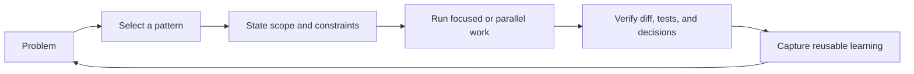
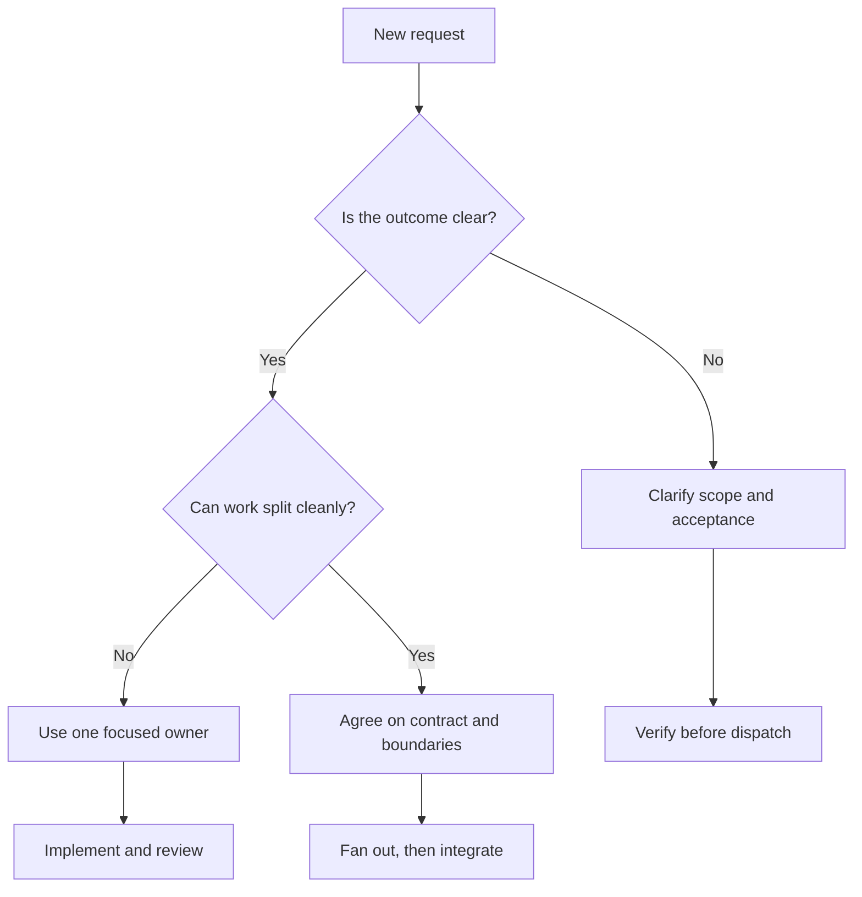

# Chapter 23: Patterns, Anti-Patterns, and the Cookbook

> **Prerequisites:** Volume 1 (or equivalent Squad experience); Chapters 18–22.

## What You'll Learn

- Recognize repeatable ways to scope, route, parallelize, and govern Squad work.
- Turn a vague request into a testable prompt without prescribing every keystroke.
- Spot common anti-patterns before they waste agent time or create inconsistent changes.
- Adapt cookbook recipes and sample prompts to a real repository instead of pasting them blindly.
- Diagnose frequent Squad questions by distinguishing conversational behavior from CLI behavior.

## How to Use This Cookbook

This chapter is a field guide, not a required ceremony. Start with the problem you have: unclear requirements, a large backlog, a disagreement between agents, or a team that has forgotten a constraint. Find the named pattern, apply its smallest useful version, then check the result against tests, diffs, issues, and decisions.

The patterns below are coordination techniques, not hidden commands. A quoted prompt is an example of a natural-language request to your active Squad interface. A `squad` command is an actual CLI invocation. That distinction matters: for example, “Ralph, go” is a conversational cue; `squad triage --execute` is a CLI command with documented flags. Chapter 9 (Volume 1) explains Ralph and the loop, Chapter 7 (Volume 1) covers issue-driven work, and Chapter 10 (Volume 1) covers PRD mode and streams.

A useful mental model is that your prompt is an input contract. It should make the scope and constraints visible, while leaving implementation decisions to the agents when those decisions are genuinely theirs to make.



A quick routing decision helps choose between a direct request, a team fan-out, and a short planning step:



## Pattern Catalog

Each pattern is expressed as a recurring problem, a coordination solution, and a prompt or workflow example. Compose patterns when needed, but resist treating every task as an excuse to activate every agent.

### 1. Boundary-First Scope

**Problem:** A short request such as “build authentication” leaves key decisions unstated. Agents may produce OAuth, sessions, refresh tokens, and account recovery when you wanted only a login endpoint.

**Solution:** Specify what is in scope, what is explicitly out, the relevant constraints, and what can wait. Boundaries reduce avoidable clarification and keep the first implementation reviewable.

**Example:**

```text
Implement email-and-password sign-in for Tasktrack.
In scope: POST /sessions, password verification, and tests for success and invalid credentials.
Out of scope: OAuth, password reset, and long-lived refresh tokens.
Use the existing API conventions; do not add dependencies without proposing them first.
```

### 2. Team Fan-Out

**Problem:** A cross-functional feature is delivered serially even though its UI, API contract, and tests can be explored at the same time.

**Solution:** Say “Team” when independent roles should start together. Give them one shared outcome and identify shared contracts that must be agreed before parallel implementation diverges. Use routing from Chapter 5 (Volume 1) to keep ownership legible.

**Example:**

```text
Team, add due dates to Tasktrack tasks. Backend owns API and validation,
frontend owns the form and display, and Tester owns acceptance tests.
First agree on the date format and invalid-date behavior; then implement in parallel.
```

A fan-out is useful only if work can be divided safely. If every agent needs to edit the same file or decide the same data contract, align first or use sequential work.

### 3. Named-Agent Focus

**Problem:** A whole-team request for a narrow issue adds coordination cost and can create overlapping edits.

**Solution:** Address the agent with the relevant expertise for a contained, sequential, or specialist task. The coordinator can still route ordinary unaddressed requests using the team's configuration.

**Example:**

```text
Tester, inspect the task API tests for missing PATCH edge cases. Do not edit the API yet;
report the cases and the expected status codes first.
```

The name in this sample is a role, not a guarantee that every team has an agent literally named “Tester.” Use the roster actually recorded in `.squad/team.md`.

### 4. Contract-First Parallelism

**Problem:** Frontend and backend agents independently choose incompatible names, field types, status codes, or error shapes.

**Solution:** Identify the small interface that joins their work. Ask the team to propose that contract first, capture the decision, and then split implementation behind it. The contract is often a request/response example or acceptance table—not an elaborate architecture document.

**Example:**

```text
Before editing code, agree on the JSON shape for a task with a due date,
how an omitted dueDate differs from null, and how an invalid date is reported.
Record the decision. Then Backend and Frontend can implement against it.
```

### 5. Decision-Then-Build

**Problem:** The team discovers a durable convention halfway through implementation, so earlier work has to be changed or reviewers encounter two competing approaches.

**Solution:** Separate exploration from implementation when a choice affects multiple files, agents, or future tasks. Ask for alternatives and a recommendation, record the accepted decision in the canonical team memory, and only then authorize the build.

**Example:**

```text
Keaton, compare storing due dates as date-only values versus timestamps for this app.
Explain timezone consequences and recommend one option. Do not change files yet.
After I approve the decision, implement it and add tests.
```

Do not turn every trivial choice into a decision record. Capture choices with lasting consequences; leave local implementation details with the person doing the work.

### 6. Spike → Decision → Build

**Problem:** The solution space is unfamiliar, and committing to a large implementation before testing an assumption risks rework.

**Solution:** Time-box a small investigation that answers one concrete question. Require evidence, trade-offs, and a recommendation. Treat the spike as research, not a promise to merge its prototype.

**Example:**

```text
Lead, spend one short investigation comparing two ways to store Tasktrack task tags.
Check the current API and test structure, list migration and validation costs,
and recommend a minimal approach. Do not implement the feature.
```

### 7. Test-While-You-Build

**Problem:** Testing starts after implementation, when the team has already made assumptions about empty state, invalid input, or failure behavior.

**Solution:** Ask the tester to translate requirements into observable examples while implementation proceeds. Keep tests tied to the contract, then run them against the result rather than accepting a report that tests were merely written.

**Example:**

```text
Tester, write node:test cases for create-task validation from this acceptance list.
Backend, implement the handler against those cases. Do not weaken assertions to make
an implementation pass; flag any requirement ambiguity instead.
```

### 8. One Owner, Clear Handoff

**Problem:** Two agents edit the same area, or each assumes the other will finish integration.

**Solution:** Name the owner of each deliverable and the handoff artifact. Owners can consult each other without transferring responsibility. The coordinator should merge the work, run the tests, and report files changed.

**Example:**

```text
Backend owns api/src/tasks.ts and its unit tests. Frontend owns web/.
Backend publishes the endpoint shape before Frontend binds to it. Tester owns
cross-layer acceptance checks and reports failures to the owning agent.
```

### 9. Batch the Backlog, Protect the Critical Path

**Problem:** You spend attention triaging routine work while a time-sensitive issue is blocked, or manually process each eligible issue one by one.

**Solution:** Keep urgent work as a direct, bounded request. Use the work monitor on a backlog only after confirming the routing and issue conventions. In CLI automation, use `squad triage` and its actual options; without `--execute`, it scans and categorizes rather than spawning work.

**Example:**

```bash
squad triage --interval 10 --execute --max-concurrent 2
```

This runs a recurring scan with execution enabled and a limit of two parallel issues. Stop it with Ctrl+C when finished. Review permissions, repository scope, and the effect of automated issue handling before leaving a loop unattended.

### 10. Decision Inbox, Then Canonical Memory

**Problem:** Several parallel investigations produce valuable decisions, but agents overwrite one another or leave proposals scattered in chat.

**Solution:** Ask each workstream to propose a decision in the team’s established decision workflow. Have the responsible maintainer or Scribe reconcile duplicates and disagreements before promotion to the canonical record. Treat proposals as proposals until reconciled.

**Example:**

```text
Backend and Frontend, independently identify the API fields each needs for task tags.
Submit a concise proposal with evidence and trade-offs; do not edit the canonical decision file.
Scribe, reconcile the proposals and call out any unresolved conflict.
```

Use the actual directory and workflow your version of Squad configures; do not assume an old path copied from a blog post is current.

### 11. Phase-Close Summary

**Problem:** A long session ends with many agent replies but no durable account of what changed, what remains, or why a choice was made.

**Solution:** Ask for a compact handoff: completed work, files, tests, decisions, risks, and the next smallest action. Verify the claims against Git and test output before closing the session.

**Example:**

```text
Team, close this Tasktrack milestone. Summarize changed files, test commands and results,
open questions, decisions, and the next three actions. Do not claim a test passed unless
it was actually run successfully.
```

### 12. Recovery by Evidence

**Problem:** An agent repeats a mistake or loses context, and adding another paragraph to the prompt does not solve the underlying issue.

**Solution:** Find the missing piece of evidence: inspect the relevant decision, routing rule, charter, test, or current file. Correct the durable source only when the guidance should persist. A summary is not a substitute for restoring a missing artifact.

**Example:**

```text
The API returned a task's internal field in JSON. First identify the serializer and test
that allowed it. Fix the test and response mapping, then propose a durable rule only if
this applies across endpoints.
```

## Anti-Pattern Catalog

These named failure modes are deliberately paired with a recovery path. “More agents” and “more prompt” are not universal fixes.

### 1. The Vague Feature

**Problem:** “Make the app better” provides no acceptance criteria or completion boundary.

**Solution:** State user-visible outcome, scope, exclusions, and verification.

**Example:** Replace it with: “Add task filtering by status; preserve current default ordering; cover empty and no-match results with tests.”

### 2. The Unbounded Mega-Prompt

**Problem:** One request mixes redesign, migration, authentication, deployment, and cleanup, making ownership and review unclear.

**Solution:** Split by dependency and checkpoint. Ask for a plan or PRD first for cross-cutting work, then dispatch small increments.

**Example:** “Write a PRD for task tags with acceptance criteria and data migration concerns. Do not change code yet.”

### 3. The Premature Team Fan-Out

**Problem:** Every agent starts coding before shared contracts or ownership exist.

**Solution:** Establish interfaces and file ownership, or serialize the tightly coupled portion.

**Example:** Agree whether tags are strings or objects before frontend and API implementation begin.

### 4. The Mid-Flight Interruption

**Problem:** You inject new requirements while parallel work is underway; agents proceed from different snapshots.

**Solution:** Let the current batch reach a checkpoint. Submit the new requirement as a follow-up that explicitly says whether it supersedes the earlier scope.

**Example:** “Finish the agreed due-date change. After it passes tests, we will consider timezone display in a separate task.”

### 5. The Invisible Rule

**Problem:** You expect agents to remember a convention that exists only in your head or an old chat.

**Solution:** Put lasting rules in the appropriate durable artifact and reference it from the task. Avoid storing temporary task details as permanent policy.

**Example:** Record the project’s date format once in its API conventions skill, then ask agents to follow it.

### 6. The Conflicting Memory

**Problem:** Old and new rules coexist without a clear status, so different agents follow different versions.

**Solution:** Supersede or update the canonical record, state what changed and when, and remove obsolete ambiguity. Do not assume agents infer that the latest dated line wins.

**Example:** Replace “timestamps are UTC strings” with a specific date-only contract and point to the migration issue.

### 7. The Unchecked “Done”

**Problem:** You accept “tests pass” or “feature complete” without output, changed files, or a reproducible check.

**Solution:** Run the smallest relevant test command, inspect the diff, and compare behavior to acceptance criteria. Separate reported work from verified work.

**Example:** `npm test`, inspect `git diff --check` and the task endpoint tests, then review the implementation.

### 8. The Unattended Wildcard Loop

**Problem:** An automated loop can take on more issues, run longer, or modify more than you intended.

**Solution:** Confirm the repo and issue labels, start with a low concurrency cap and short observation window, inspect logs, and stop the process when the scope is exhausted.

**Example:** Start `squad triage --execute --max-concurrent 1`; observe one bounded run before expanding concurrency.

### 9. The Blind Copy-Paste Prompt

**Problem:** A sample prompt includes another project's stack, assumptions, or unsafe requirements that do not fit yours.

**Solution:** Replace every project-specific noun and verify each tool, library, permission, and output expectation before dispatch.

**Example:** Convert “Use Postgres and Redis” to “Use the existing in-memory store; propose a migration separately.”

## Tips and Tricks That Survive Project Changes

- Use bullets for independently testable requirements; use prose for context and trade-offs.
- State negative scope explicitly (“no OAuth in this change”) when a tempting adjacent feature would expand the work.
- Identify the intended reviewer and the source of truth. “Follow `.squad/skills/tasktrack-api-conventions/SKILL.md`” is more actionable than “follow our style.”
- Prefer one agent per independent deliverable. Add specialists only when their contribution has a boundary.
- Ask for status at a checkpoint, not every few minutes. A useful status answer names what changed and what is blocked.
- Record decisions only when they should influence future work. A one-off local choice need not become team doctrine.
- Keep `.squad/` storage aligned with your team's privacy and portability needs. Chapter 2 compares backends; do not commit sensitive project data merely because memory is useful.
- Give an agent a “do not edit” boundary when you want analysis only. Say what evidence its report should contain.
- Ask agents to flag unknowns, not silently choose a high-impact default.
- After parallel work, review the combined diff—not just each agent's individual summary.

A prompt template that balances flexibility and control is:

```text
Outcome: [user-visible result]
Scope: [files, feature surface, or bounded domain]
Acceptance:
- [observable behavior]
- [edge case]
Constraints: [existing conventions, dependencies, security/privacy limits]
Out of scope: [adjacent work to defer]
Coordination: [owner, contract, or review handoff]
Verification: [test/build/manual check]
If you find a material ambiguity, stop and report options rather than guessing.
```

## Cookbook Recipes

### Recipe: Polyglot team: teammates on different AI hosts

**Problem:** Teammates use different AI hosts, but the repository should keep one shared team, routing policy, and charter set rather than forking its Squad identity.

**Pattern:** In Squad 2.0, select each supported host projection with `squad init --client <list>` for a new project or `squad upgrade --client <list>` for an existing one. Keep `.squad/` as the shared team source, review the generated coordinator and MCP configuration for each host, and test the delegation behavior on the actual clients your team uses. Host features and authentication differ; do not assume one license or tool set covers every client. Follow Chapter 19 for the walkthrough and compatibility caveats ([client scenario](https://bradygaster.github.io/squad/docs/scenarios/using-squad-across-clients/)).


The recipes below are starting points. Adjust the role names and stack to the roster you actually cast.

### Recipe: Start a New Repository

**Problem:** The first request comes before the project has conventions or an informed team.

**Solution:** Ask Squad to inspect the repository, explain what it inferred, and propose a small roster before implementing. Confirm any important assumptions.

**Example prompt:**

```text
This is a new TypeScript service. Inspect the repository and its tests first.
Propose a small team and routing for API, tests, and operations. State assumptions
and ask before adding dependencies. Once I approve the plan, implement one vertical slice.
```

### Recipe: Join a Mature Codebase

**Problem:** New contributors do not know why the system looks the way it does.

**Solution:** Start with a read-only map: architecture, test commands, high-risk boundaries, recent decisions, and open issues. Then select one low-risk task.

**Example prompt:** “Read-only first: summarize the API boundaries, test commands, active decisions, and one safe starter issue. Cite file paths; do not edit.”

### Recipe: Deliver a Vertical Slice

**Problem:** Backend, UI, and tests are all “done” but do not compose into a usable feature.

**Solution:** Agree on one end-to-end user journey, assign component ownership, and define an integration check.

**Example prompt:** “Team, implement create-task from browser form to API response. Agree on payload first; keep changes limited to this flow; prove it with API tests and a manual browser check.”

### Recipe: Split a Monorepo Safely

**Problem:** Broad ownership causes agents to explore unrelated packages or collide on shared configuration.

**Solution:** Set package-specific routing and ownership, and keep shared API changes with one owner. Use worktrees when workstreams must have isolated working trees; see Chapter 6 (Volume 1).

**Example prompt:** “Agent A owns `packages/api/**`; Agent B owns `packages/web/**`. Neither changes shared schema files; propose a contract and wait for integration approval.”

### Recipe: Close a Release Candidate

**Problem:** “Ship it” does not identify which checks or approvals are required.

**Solution:** Ask for a release checklist based on the repo's real workflow. Review open issues, changes, tests, security notes, artifact/version consistency, and rollback plan. Keep human approval on publish/deploy actions.

**Example prompt:** “Prepare a release checklist from this repository's actual workflows. List missing evidence; do not tag, publish, or deploy.”

### Recipe: Recover the Team

**Problem:** Team context was lost or a local artifact was damaged.

**Solution:** Verify what remains in Git, backups, exports, and configured storage before rebuilding. Preserve the authoritative copy and report uncertainties.

**Example prompt:** “Diagnose missing `.squad` state read-only. Check configured backend, Git history, and available exports. Do not overwrite or reset anything; report the safest recovery path.”

## Sample Prompts

Treat prompts as adaptable starting points, not templates to paste unchanged: replace assumptions with verified repository facts, state scope and acceptance checks, and keep sensitive data out. Appendix D (Sample Prompts) collects reusable examples; the Further Reading links below include the source prompt guides.

## Frequently Asked Questions

### Should I use the Squad CLI or Copilot CLI?

Use the interface appropriate to the task. The Squad CLI handles setup, diagnostics, triage, export/import, state, and other explicit commands. Copilot is the conversational surface for asking the team to inspect, plan, or build. Their capabilities are not interchangeable; check `squad --help` for the installed v1.1.0 command surface.

### Is Ralph the same as `squad triage`?

They are related, but do not collapse the names into a guarantee that every interface behaves identically. “Ralph” commonly refers to the work-monitor role/loop discussed in Chapter 9 (Volume 1). The v1.1.0 CLI exposes `squad triage`; it scans and categorizes work, and `--execute` enables spawning agents. Verify flags with `squad triage --help`; avoid relying on a legacy `squad ralph` command unless the installed CLI documents it.

### Can Squad work without GitHub Issues?

Yes. Conversational work, team memory, and local development do not inherently require an issue tracker. Issue polling, label-based handling, and board automation do require the relevant GitHub integration and permissions. If your task is not issue-driven, use a direct prompt and the project's normal Git workflow.

### What happens if I run `squad init` twice?

The v1.1.0 `squad init` help says it is safe to re-run and preserves existing files. That is not a license to skip backups or assume every custom artifact will be merged. Read the resulting diff and protect custom configuration before initialization or upgrades.

### Why does an issue workflow not pick up my issue?

Check that the CLI is in the intended repository, GitHub authentication can read the repository, the issue is open and eligible, and your team has routing guidance that matches its labels/content. Run a non-executing scan first where appropriate; enable `--execute` only after confirming the selection.

### How many agents should I start with?

Use the smallest roster that covers distinct responsibilities. More agents help when work is independent; they add coordination and review overhead when tasks overlap. Begin with the existing roster and introduce a specialist when a specific gap appears.

### Should `.squad/` be committed?

There is no universal answer. The local backend places state in the project working tree; other backends change how state is stored. Consider whether team decisions and histories are appropriate for source control, who needs them, and whether they can contain sensitive data. Chapter 2 explains backend choices.

### Why is the same mistake repeated?

Check whether the instruction exists in a durable, authoritative place and whether it applies to the agent's task. Then examine the failing test or example. A longer conversational reminder may help once; a durable convention or regression test is better when the problem recurs.

### Can I safely leave triage running?

Only after you understand its scope, permissions, execution setting, concurrency, and stopping behavior. Begin with a narrow repository and low concurrency, observe what it selects, then decide whether unattended execution is appropriate. Keep merge and production release authority separate from issue execution.

### How do I share a team between projects?

Chapter 4 covers export/import and portability. Export only after reviewing the data for project-specific or sensitive information; portable skills do not make histories automatically safe to share.

### Where should I report an error or request?

Use the repository's issue tracker for reproducible bugs and feature proposals, and its discussion forum for questions or broader design conversation. Include the Squad version, operating system, exact command or prompt, expected behavior, actual behavior, and redacted output. Never post credentials or private repository content.

## Hands-On: Turn a Recipe into a Verified Change

Work from your current Tasktrack checkpoint. The goal is not to finish a large feature; it is to practice a scoped prompt, a shared contract, and evidence-based verification.

1. Choose one small backlog item, such as filtering tasks by status. Confirm it does not duplicate existing behavior.
2. Ask the team to state the acceptance criteria and the API/UI contract before editing. For example, define which status values are valid and what an empty result looks like.
3. Assign one owner to the API, one to the UI only if both layers are in scope, and one tester to write behavior-focused cases. If the task is API-only, do not fan out unnecessarily.
4. Review the work as a single integrated diff. Ask the owner to report files changed and tests actually executed.
5. Run the companion test suite yourself:

```bash
npm test
```

Expected result: Node's test runner executes the Tasktrack tests and reports a passing suite. If it fails, do not tag the task as complete; use the failure output to assign a focused follow-up.

6. Capture a durable decision only if the task established a convention likely to recur. Add a Git checkpoint if that is part of your team's workflow; use `v2-ch23-start` and `v2-ch23-end` as descriptive tags in your own repository if you are tracking chapter states.

> **Tip:** A tag is a reader-managed comparison marker, not a Squad command. The sample project does not create chapter tags for you.

## Configuration Reference

The cookbook mostly concerns prompts rather than new settings. These are the durable surfaces and CLI options worth checking before applying a recipe.

| Surface | Purpose | Safe use |
|---|---|---|
| `.squad/team.md` | Team roster and role information | Address names and roles that exist in the current team |
| `.squad/routing.md` | Routes task areas to agents | Keep rules specific and non-overlapping; see Chapter 5 (Volume 1) |
| `.squad/decisions.md` and the configured decision workflow | Durable team choices | Record active, reusable choices; mark superseded decisions clearly |
| `.squad/skills/` | Project or team guidance in skill files | Point prompts at the actual skill path and avoid secrets |
| `squad triage --interval <minutes>` | Poll for work; default interval is 10 minutes | Use a bounded interval and observe before enabling execution |
| `squad triage --execute` | Spawn agents to work on selected issues | Enable only after verifying repository scope and issue selection |
| `squad triage --max-concurrent N` | Set maximum parallel issue count; default is 1 | Start low; more concurrency increases overlap and review load |
| `squad triage --timeout N` | Set maximum minutes per issue; default is 30 | Choose a value appropriate to the work; do not interpret timeout as proof of completion |
| `squad triage --self-pull`, `--board`, `--two-pass`, `--wave-dispatch`, `--retro`, `--decision-hygiene` | Optional triage capabilities listed by v1.1.0 help | Opt in only when the repository and team are configured for that capability; `--no-<capability>` can disable one |

## Under the Hood

The advice in this chapter is about prompt design, but the behaviors it references have concrete CLI boundaries. The v1.1.0 command entry point lists `triage`, `loop`, `state-mcp`, `doctor`, `health`, and `aspire` separately. That is why this chapter labels prompt cues as prompts and shell invocations as commands rather than implying that natural-language phrases are executable CLI flags.

The triage interface and its option parsing live under `packages/squad-cli/src/cli/commands/watch/` and `packages/squad-cli/src/cli-entry.ts`. The top-level help describes `triage` as scanning and categorizing issues; its help distinguishes core execution flags from opt-in capabilities. The actual work monitor must be understood from the installed version and configuration, not from an old sample prompt alone.

The cookbook sources are examples, not normative configuration schemas. Several source pages contain older naming and workflow descriptions; when they conflict with the v1.1.0 command help or current repository state, prefer the verified version-specific behavior. Treat sample project names, roster names, and stack choices as illustrative.

## Pitfalls and Troubleshooting

| Symptom | Likely cause | Next check |
|---|---|---|
| Agents ask repeated questions | Scope, conventions, or expected output are missing | Add acceptance examples or reference a durable skill |
| Parallel agents disagree | Shared contract was not settled or memory is stale | Pause integration, reconcile the contract, then update the canonical decision |
| Too many overlapping edits | Task boundaries or file ownership are unclear | Narrow scope, assign owners, or work sequentially |
| Triage proposes irrelevant work | Repository, labels, or routing do not match expectations | Run an observational scan, review routing, and check the current repo context |
| Work report says “done,” but behavior is missing | Completion claim was not independently verified | Run tests, inspect the diff, and compare each acceptance criterion |
| A copied prompt requests an unsupported feature | The prompt came from a different version or environment | Check the v1.1.0 CLI help and source before executing it |

## Summary

Patterns make collaboration repeatable when they preserve clear boundaries: define the outcome, establish contracts before risky parallel work, record durable decisions, and verify claims independently. Anti-patterns are usually boundary failures—too much scope, too many owners, too little evidence, or unsafe automation. Cookbook prompts are adaptable starting points, not magic words. Use the installed CLI's help for command behavior, keep human review in the loop, and let the next chapter combine these techniques into one Tasktrack journey.

## Exercises

1. Rewrite “Add tags” as a boundary-first prompt with three acceptance criteria and one explicit exclusion.
2. You have a UI and API change that depend on a new field. Write a contract-first prompt that assigns ownership and defines a handoff before implementation.
3. A Ralph/triage process selected an issue you did not expect. List five pieces of evidence to check before enabling `--execute` again.
4. A previous decision says “all dates are timestamps,” but the new feature is a calendar date with no time. Propose a safe memory update and migration sequence.
5. Choose two of the anti-patterns in this chapter and describe an observable symptom and a concrete recovery action for each.

## Quiz

1. What must a boundary-first prompt state besides the desired outcome?
2. When is a named-agent request usually preferable to “Team”?
3. In the v1.1.0 CLI, what does `--execute` change about `squad triage`?
4. Why should a shared API contract be settled before parallel frontend and backend implementation?
5. Is a “tests pass” statement sufficient evidence that a feature is complete? Why or why not?
6. What is the distinction between a conversational Ralph cue and the `squad triage` command?
7. When should a choice be recorded as a durable decision rather than left as local implementation detail?

## Further Reading

- [Recipes & Advanced Scenarios](https://bradygaster.github.io/squad/docs/cookbook/recipes/)
- [Frequently Asked Questions](https://bradygaster.github.io/squad/docs/guide/faq/)
- [Sample Prompts (Guide)](https://bradygaster.github.io/squad/docs/guide/sample-prompts/)
- [Tips and Tricks (Guide)](https://bradygaster.github.io/squad/docs/guide/tips-and-tricks/)
- [Sample Prompts](https://bradygaster.github.io/squad/docs/sample-prompts/)
- [Tips and Tricks](https://bradygaster.github.io/squad/docs/tips-and-tricks/)
