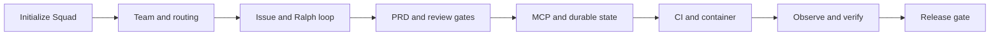
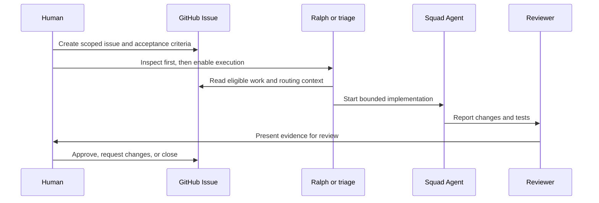

# Chapter 24: Capstone: Tasktrack to Production

> **Prerequisites:** Volume 1 (or equivalent Squad experience); Chapters 2, 8, and 22.

## What You'll Learn

- Take the Tasktrack companion project from a starter checkout to a reviewed, tested release candidate.
- Initialize Squad, create a small team, and connect issues and routing rules to bounded work.
- Use the Ralph work-monitor loop and PRD mode without confusing conversation prompts with CLI commands.
- Add review gates, the Squad state MCP server, a durable state backend, CI, and a container.
- Observe Squad CLI telemetry locally and distinguish it from application telemetry.
- Prepare a release using evidence and human approval rather than treating agent output as a deployment gate.

## Hands-On: A Thin, Verified Path to Production

This chapter brings together the companion progression rather than introducing a new Squad feature. It assumes you have worked through Chapters 2–3 (Volume 1) and have the Tasktrack starter in a Git repository. Part IV (Chapters 18–22) has already introduced the Squad 2.0 preview; the core production path here stays on Squad v1.1.0, with an optional multi-host extension at the end. The task is to prepare one small feature—due dates and tags are the continuing example—through planning, issue execution, review, packaging, and release readiness.

Do the stages in order, but keep the work intentionally small. An end-to-end capstone is not a request to build every possible production feature. We will preserve Tasktrack's documented zero-dependency design unless a deliberate decision changes it. We will also distinguish the app's CI and container from Squad's own CLI workflows: Squad coordinates and records work; it does not silently deploy your application.

In this walkthrough, assume:

- You copied `sample/` to a separate `~/tasktrack` directory and are working there.
- Node.js 22.18 or later is available; the starter runs TypeScript directly with Node's built-in type stripping.
- You can use GitHub CLI (`gh`) and have permission to create a repository, issues, and pull requests.
- Squad v1.1.0 is installed and the Copilot interface you use is authenticated.
- `main` is Tasktrack's default branch. The dev-first branch policy explained in Chapter 25 applies to contributions to Squad itself, not automatically to every user's application repository.



This sequence is a set of checkpoints, not a fully autonomous pipeline. At every boundary, a person validates the change before expanding the system's authority.

## Stage 1: Prepare Tasktrack and Initialize Squad

Start from a copy of the book's baseline, not the book repository itself. In a shell, copy the folder, initialize Git, run the tests, and initialize Squad:

```bash
cp -R sample ~/tasktrack
cd ~/tasktrack
git init -b main
git add .
git commit -m "chore: add Tasktrack starter"
npm test
squad init
```

`sample/README.md` documents the baseline workflow; its package scripts map `npm test` to `node --test api/test/` and `npm start` to `node api/src/server.ts`. At the first Git commit, the test command should pass before Squad adds any files. After `squad init`, expect the Squad-owned `.squad/` structure and default agent/workflow scaffolding. Inspect `git status --short` and the generated files; do not assume an initialization preserved a custom project file until you have checked it.

Check the installation and team state:

```bash
squad --version
squad doctor
squad health
```

The installed version should be the one you intend to use. `doctor` and `health` have different diagnostic purposes; use their output to identify missing setup rather than treating a clean status as proof that the app itself is correct. If `squad init` asks the conversational interface to help cast the team, request a compact roster such as Backend, Frontend, Tester, and Reviewer. If your interface is separate, ask the coordinator to inspect the project and create or confirm those roles.

Give each role one clear responsibility. Backend owns the API and data behavior. Frontend owns `web/`. Tester owns acceptance tests and reports reproducible results. Reviewer checks the integrated diff and governance rules. If the feature is API-only, leave Frontend out of that task rather than forcing every specialist into every change.

Next ask the coordinator to inspect the code and draft routing rules for `api/` and `web/`. Review the generated `.squad/routing.md` and `.squad/team.md`. Rules should route by area, not by a broad catch-all that sends every request to the same agent. Record only stable Tasktrack conventions—for example, “API behavior is tested with `node:test`”—in the appropriate durable guidance.

> **Note:** The companion app's `npm start` runs a server on port 3000 by default. It is not a Squad command, and its API process is independent of the Squad CLI.

## Stage 2: Connect Tasktrack to GitHub Issues

Squad can work conversationally without a GitHub issue tracker, but the issue-driven stages need a repository the CLI and team can access. Create a GitHub repository for Tasktrack and push its starter branch. If you have not created a remote, one common GitHub CLI flow is:

```bash
gh repo create tasktrack --public --source . --remote origin --push
```

Use a private repository if the code or team context should not be public. Confirm the repository and remote before creating automation:

```bash
gh repo view --json nameWithOwner,url,defaultBranchRef
git remote -v
```

Now create one small issue with explicit acceptance criteria. For example, “Add optional due dates to tasks” can specify that the date is date-only, invalid values are rejected, and tasks without a date remain valid. If you want labels to guide routing, first create a label and add a corresponding rule in `.squad/routing.md`; a label name alone does not magically define ownership.

```bash
gh issue create --title "Add optional task due dates" \
  --body "Acceptance criteria: accept a valid date-only value; reject invalid dates; preserve tasks with no due date; add tests." \
  --label "squad:backend"
```

The sample label is illustrative. Create it in the repository first if it does not exist, and use the exact label vocabulary in your routing configuration. Inspect the issue in GitHub and make sure its body is specific enough to work without guessing. Chapter 7 (Volume 1) covers the full GitHub issue lifecycle, status labels, and pull request workflow.

A safe first pass is observational: ask the team or run the installed CLI's scan without enabling execution, inspect what it selected, and only then allow agents to begin. For the actual v1.1.0 CLI loop, the relevant command and flags are:

```bash
squad triage --interval 10
```

This starts recurring scans at the configured interval; it does not itself request issue execution. Once the routing and issue selection are correct, stop that observational process and explicitly enable execution:

```bash
squad triage --interval 10 --execute --max-concurrent 1 --timeout 30
```

The CLI help documents `--execute` as the flag that spawns agents to work on issues, with maximum concurrent issues defaulting to one and maximum minutes per issue defaulting to 30. Press Ctrl+C to stop the foreground process. Do not start a long-running loop in a repository you have not confirmed, and do not increase concurrency until you have reviewed issue selection and merge boundaries.

In a conversational session, you can ask the work monitor to triage a particular backlog or say “Ralph, go” using the workflow in Chapter 9 (Volume 1). That natural-language cue is not a CLI argument. Keep the two surfaces distinct so you know which process is polling, what it may execute, and how to stop it.



## Stage 3: Write a PRD Before Broad Work

One small issue is useful for verifying the integration. A feature spanning API, UI, data, and migration deserves a brief planning checkpoint. In the conversational interface, ask the coordinator to use PRD mode as described in Chapter 10 (Volume 1). Do not invent a `squad prd` CLI command: the installed v1.1.0 command help does not list one.

For Tasktrack's “due dates and tags” increment, the PRD should answer:

- Who needs the feature and what problem it solves.
- What an accepted due date means: date-only or timestamp, timezone handling, and invalid input behavior.
- What a tag is: allowed characters/length, duplicate handling, and whether matching is case-sensitive.
- Which API operations change, what the UI displays, and what happens for existing tasks.
- What is deliberately excluded, such as reminders or tag administration.
- Acceptance criteria that can be proven by tests, not subjective phrases such as “works well.”
- Risks, unresolved assumptions, and an implementation order.

A good prompt asks for a draft and explicit unknowns:

```text
Draft a PRD for optional due dates and tags on Tasktrack tasks.
Read the current API, UI, and tests first. Keep the app dependency-free unless you
identify a blocker and ask before adding a package. Define the date representation,
tag validation, API/UI behavior, migration implications, acceptance criteria, and
out-of-scope features. Do not edit code. Mark unresolved assumptions visibly.
```

Review the PRD as a person. Choose one coherent slice—for example, due dates only—then create separate issues for the API, interface, and acceptance work if they are independently actionable. Keep one canonical contract decision. If the PRD assumes a persistent database but Tasktrack still uses a simple in-memory store, call out the mismatch rather than letting an agent quietly invent a storage migration.

The PRD becomes a planning artifact, not proof that the requirements were accepted. Once approved, ask the team to propose a task breakdown and dependencies. Keep the first implementation thin enough that tests and review can finish in one loop.

## Stage 4: Add Review Gates and Deliver the Slice

Define the review gate before code starts. A minimal gate for this capstone is:

1. The issue's acceptance criteria are reflected in tests.
2. The owner reports every changed file and any assumptions.
3. The relevant automated test command passes.
4. A reviewer inspects the full integrated diff, not only the agent summaries.
5. A human decides whether the PR is ready to merge.

Ask Tester to write or identify behavior tests first. Ask Backend to implement the API contract and tests, then Frontend only if the UI is included. Reviewer should check for backward compatibility, data handling, error responses, dependency changes, secrets, and scope. Chapter 18 (Volume 1) explains ceremonies and review governance; Chapter 7 (Volume 1) explains GitHub workflow.

The exact workflow depends on whether you use a code-editing Copilot session or issue-driven automation. When appropriate, create a feature branch, push it, and open a PR with the issue linked. For an ordinary Tasktrack repository whose default branch is `main`, target that branch unless you intentionally created a separate integration branch. Do not copy Chapter 25's Squad-repository `dev` target into Tasktrack without deciding that Tasktrack itself uses the same branch policy.

Run the tests and inspect changes:

```bash
npm test
git diff --check
git status --short
git diff --stat
git diff
```

Expected result: Node's test runner exits successfully, `git diff --check` reports no whitespace errors, and the diff contains only the intended feature. If the project has no new tests or the output is ambiguous, ask for evidence before approving. Never merge merely because an agent says “complete.”

Use branch protection or repository settings for required CI and human review if your GitHub plan and repository configuration support them. The Squad Reviewer role can advise, but it is not a substitute for an enforced GitHub protection rule. Keep merge and production credentials away from an agent process unless your threat model explicitly allows their use.

## Stage 5: Enable the State MCP and Select a Backend

Squad v1.1.0's `squad init` configures a project `.mcp.json` entry for the `squad_state` server. Inspect the managed entry and preserve any unrelated MCP servers or user-owned settings. The server is a local stdio process launched by the Copilot client; it is not an HTTP endpoint to expose to the internet. It gives the client tools backed by Squad's runtime state provider.

The entry typically references the `squad` executable and `state-mcp` argument, but the generated launcher may be version-pinned or otherwise vary with the installed distribution. Treat `.mcp.json` as generated configuration: inspect it, and rerun `squad doctor` if the client cannot initialize the server. Do not paste credentials into the MCP config or start `squad state-mcp` manually as if it were an interactive command; it waits for the protocol over standard input/output.

Choose a backend according to how Tasktrack collaborators need to share state. The default local backend is the simplest place to begin. If you want state isolated from the source branch, the v1.1.0 CLI offers `orphan` and `two-layer` options. For example, migrate after you have committed the starter and confirmed the remote:

```bash
squad upgrade --state-backend two-layer
squad health --json
```

The command's purpose is to configure/migrate the backend, not to change Tasktrack's application storage. Review the resulting `.squad/config.json` and the health report. The `two-layer` backend uses the Squad state branch together with Git notes for its layered storage behavior; `orphan` stores state on the separate `squad-state` branch. The project needs a Git repository, and remote sharing requires pushing the relevant refs/notes through the configured sync path. Verify Chapter 2 for backend semantics and recovery details before adopting one for a team.

Do not treat “two-layer” as a backup policy. A state backend affects where Squad state lives; you still need access controls, retention, recovery tests, and a decision about which history belongs in the shared project. Check that state does not contain secrets, private prompts, or customer data before syncing it.

## Stage 6: Add CI for Tasktrack

Tasktrack is intentionally dependency-free, so its initial CI job does not need `npm install`. Add a workflow such as `.github/workflows/tasktrack-ci.yml` that runs the same test command contributors run locally:

```yaml
name: Tasktrack CI

on:
  push:
    branches: [main]
  pull_request:
    branches: [main]

jobs:
  test:
    runs-on: ubuntu-latest
    steps:
      - uses: actions/checkout@v4
      - uses: actions/setup-node@v4
        with:
          node-version: '22.18'
      - run: npm test
```

This is an app workflow example, not Squad's own workflow. It pins a Node release with TypeScript stripping support, checks out the source, and runs Node's built-in test runner. There is no dependency installation step because the baseline package has no dependencies or lockfile. If a reviewed feature later adds dependencies, create and commit the lockfile and use the package manager's reproducible installation command; do not retain the no-install assumption.

Push a branch and open a pull request so the workflow runs on the actual GitHub host. Confirm that the Actions check appears on the PR and that an intentional failing test makes it fail before calling the gate complete. Chapter 8 covers CI/release design; the important capstone lesson is to make the check enforce the same acceptance command the team trusts locally.

## Stage 7: Containerize the API

The API uses `node:http` and starts through `npm start`. A minimal production image can run the app directly with the Node version required by the companion. Create a `Dockerfile` at the Tasktrack root:

```dockerfile
FROM node:22.18-alpine
WORKDIR /app
COPY package.json ./
COPY api ./api
ENV NODE_ENV=production
ENV PORT=3000
EXPOSE 3000
CMD ["npm", "start"]
```

This image copies only the package manifest and API source; the static front end remains a separate static asset and is not served by this API process. For a real deployment, review the base image lifecycle, user privileges, filesystem permissions, health check, and vulnerability scanning. A non-root runtime user and pinned base-image digest are sensible hardening follow-ups, but adapt them to the target platform and verify filesystem behavior before adding them to a sample recipe.

Build and run locally:

```bash
docker build -t tasktrack:local .
docker run --rm --name tasktrack -p 3000:3000 tasktrack:local
```

In another terminal, confirm the health endpoint:

```bash
curl --fail http://localhost:3000/health
```

Expected result: the API logs that it is listening on port 3000, and `/health` returns HTTP 200 with `{ "ok": true }`. Stop the container with Ctrl+C. Then test a task operation and the UI separately; an HTTP health response proves only that the process is reachable, not that every feature or user journey works. Chapter 7 discusses container and cloud-hosting concerns in depth.

## Stage 8: Observe Squad Work and the Running Service

Observability should answer a question. For this capstone, observe Squad CLI operations locally using the v1.1.0 OpenTelemetry path from Chapter 9. Start the Aspire dashboard in a terminal:

```bash
squad aspire --docker
```

In the shell where you will run Squad CLI diagnostics, set the OTLP endpoint:

```bash
export OTEL_EXPORTER_OTLP_ENDPOINT="http://localhost:4317"
squad doctor
```

Open `http://localhost:18888` and inspect traces and metrics. The Aspire dashboard is a local receiver/viewer, and the CLI's OTLP exporter sends data to the configured endpoint. The health diagnostics are an example of a CLI action that can produce telemetry. Stop the dashboard with Ctrl+C when finished. Do not expose this unauthenticated local setup as a production collector.

This measures Squad's own CLI behavior, not Tasktrack's HTTP request latency. The starter API does not include an OpenTelemetry dependency or request tracing. Keep the distinction explicit: for the capstone's app-level operational signal, the `/health` endpoint and container logs are basic checks; production service metrics, tracing, alerting, and authenticated export require a separately designed application instrumentation and collector path. Do not imply that Squad's spans magically cover Tasktrack requests.

Define a small operations checklist: the API health check must pass, the container must restart according to the host's policy, logs must not include secrets or task content unnecessarily, and an operator must know where to inspect deployment health. Add a production OTel pipeline only after selecting the host, receiver, privacy policy, and data retention. Chapter 9 explains export configuration and data-handling constraints.

## Stage 9: Release Deliberately

A release is a reviewed, reproducible artifact plus a safe operational handoff. Do not let the Squad agent publish or deploy simply because the implementation is complete. For this Tasktrack capstone, decide the deployment target and container registry outside this chapter; their login and push commands differ by provider and must be verified for the chosen platform.

Before release, require all of the following:

- The issue and PR describe the behavior and link the accepted requirements.
- CI is green on the exact commit to release.
- Tests pass locally or in the trusted pipeline; review findings are resolved.
- The container builds from the release commit and its health endpoint responds.
- Configuration, secrets, data handling, rollback, and ownership have been checked for the target environment.
- A human approves the deployment and records the version or image digest.

For a GitHub source release, after the reviewed change is merged to Tasktrack's default branch, a maintainer can tag and publish a GitHub Release:

```bash
git checkout main
git pull --ff-only origin main
git tag -a v1.0.0 -m "Tasktrack v1.0.0"
git push origin v1.0.0
gh release create v1.0.0 --generate-notes
```

This publishes a GitHub source release; it does not deploy the running API or publish a container image. For production, publish the reviewed image to the selected registry and roll it out using the platform's approved workflow. Record the deployed tag/digest, confirm health after rollout, and retain a rollback target. Chapter 8 describes release automation and approval boundaries.

When the release is complete, tag your own working repository with the chapter marker if you use the companion convention:

```bash
git tag v2-ch24-end
```

The book describes these comparison tags; the sample does not create them for you.

## Configuration Reference

| File or setting | Role in the capstone | Verification |
|---|---|---|
| `squad init` | Creates the Squad layout and default workflows in the current project | `squad --version`, `squad doctor`, inspect `git status` |
| `.squad/team.md` | Team roster and responsibilities | Confirm every role used in routing exists |
| `.squad/routing.md` | Routes areas or labels to the appropriate agents | Check rules against actual paths and GitHub labels |
| `.squad/config.json` → `stateBackend` | Selects the Squad state backend | `squad health --json`; inspect configured value |
| `.mcp.json` → `mcpServers.squad_state` | Client launch specification for the Squad state MCP | Inspect the managed entry; verify the client initializes it |
| `squad triage --interval <minutes>` | Polls for eligible issue work | Run observationally first; Ctrl+C stops foreground process |
| `squad triage --execute` | Enables agent execution on selected work | Use only after reviewing scope and permissions |
| `squad triage --max-concurrent N` / `--timeout N` | Bounds concurrent issues and issue duration | Start with low concurrency and a reasonable timeout |
| `OTEL_EXPORTER_OTLP_ENDPOINT` | OTLP/gRPC receiver for Squad's SDK/CLI telemetry | Local Aspire example: `http://localhost:4317` |
| `PORT` | Tasktrack API listen port; defaults to `3000` | Container maps host port to the configured port |
| `.github/workflows/tasktrack-ci.yml` | Runs Tasktrack's test command on pushes and PRs | Inspect the Actions run for the release commit |
| `Dockerfile` | Builds the API container | `docker build`, `docker run`, and `/health` check |

## Under the Hood

In v1.1.0, `packages/squad-cli/src/cli/core/init.ts` parses `--state-backend` and writes the canonical backend choice into `.squad/config.json`. For `orphan` and `two-layer`, initialization can create a `squad-state` branch using Git plumbing without checking that branch out. The same initialization path installs synchronization hooks where appropriate. This explains why state-backend setup is distinct from Tasktrack's application database.

The state MCP entry point is `packages/squad-cli/src/cli/commands/state-mcp.ts`. It creates a runtime `ToolRegistry` using the resolved Squad state and exposes tools over the Model Context Protocol's stdio transport. The registered names include `squad_decide`, state read/write/append/list/delete/health operations, and memory operations. The managed `.mcp.json` writer is `packages/squad-cli/src/cli/core/mcp-root.ts`; it preserves other server entries and user-owned settings while refreshing Squad's launch command and arguments. That is why the generated file should be inspected rather than replaced wholesale.

The top-level CLI help defines `triage` as the issue scanner and lists the `--execute`, `--interval`, `--max-concurrent`, and `--timeout` options. The command routes into `packages/squad-cli/src/cli/commands/watch/`; do not infer that a prompt phrase or a legacy command name has the same behavior. Use `squad triage --help` for the installed command's exact option list.

Tasktrack's `sample/api/src/server.ts` reads `PORT` with a default of 3000, creates the app, and logs when it begins listening. `sample/package.json` runs `node api/src/server.ts` and `node --test api/test/`. The proposed CI and Docker examples preserve those existing entry points rather than inventing a build step or a runtime dependency.

## Pitfalls and Troubleshooting

| Symptom | Likely explanation | Response |
|---|---|---|
| Triage does not execute work | `--execute` was omitted, or the run lacks required project/context | Check `squad triage --help`, current repo, and logs; enable execution explicitly only after review |
| Triage selects an unexpected issue | Routing, labels, or repository context differ from assumptions | Stop the loop, inspect selection and rules, refine a single boundary, then re-run observationally |
| MCP server is unavailable | The client cannot launch the executable, configuration is malformed, or no Squad state resolves | Inspect `.mcp.json`, run `squad doctor`, confirm the project root and installed CLI |
| `two-layer` state does not appear on another machine | Git refs/notes have not been synchronized or the remote is misconfigured | Inspect backend configuration and sync state; follow Chapter 2 recovery guidance |
| Container starts but `/health` fails | Wrong port mapping, startup error, or app binding issue | Read container logs and compare `PORT`, host mapping, and expected endpoint |
| CI cannot run TypeScript directly | Runner Node version is below the sample's requirement | Pin a supported Node version (22.18+) |
| Aspire is empty | The telemetry endpoint is unset/unreachable, or no CLI process emitted data | Set the endpoint in the CLI shell, run a telemetry-emitting CLI command, and inspect exporter setup |
| Release tag exists but service is unchanged | A GitHub release is not a deployment | Publish and roll out the reviewed image using the selected platform workflow |

## Summary

The capstone has turned a starter repository into a managed delivery path: Squad initializes the team, routing connects work to owners, GitHub issues bound the backlog, Ralph/triage processes eligible work, PRD mode clarifies cross-cutting scope, and explicit review gates protect merge authority. MCP exposes local Squad state through a client-launched stdio server; a selected state backend governs persistence. Tasktrack's own CI tests the application, its Docker image packages the API, and Aspire helps observe Squad CLI telemetry. A release still requires an approved application deployment path and a human decision.

### Optional: Going multi-host with 2.0

Part IV has already covered the preview architecture, host setup, state boundary, and upgrade procedure. As an optional extension to this stable single-host path, project the same Tasktrack team into another supported AI host with `squad upgrade --client <list>`. This preserves the shared `.squad/` team while generating host-specific coordinator and MCP configuration; use Chapter 22 for migration checks and Chapter 19 for the client walkthrough.

## Exercises

1. Adapt the issue in this chapter to add tags instead of due dates. Specify tag validation, API behavior, compatibility, and at least three acceptance tests.
2. Write a PRD prompt for adding persistence to Tasktrack. Make clear what current storage behavior must be inspected and which decisions must not be guessed.
3. Draft a review checklist for the Tasktrack due-date PR. Include tests, API compatibility, invalid input, UI behavior, and secret/privacy checks.
4. Explain the difference between the Tasktrack `/health` route, `squad health`, and an OpenTelemetry trace. State what each proves and what it does not.
5. Design one production release gate for a container deployment. Identify the artifact, required evidence, human approval, health check, and rollback target.

## Quiz

1. What does `squad init` add to a project, and what should you inspect afterward?
2. What is the effect of `--execute` in `squad triage`?
3. Is PRD mode a `squad` CLI command in v1.1.0?
4. What process launches the `squad_state` MCP server, and what transport does it use?
5. Does changing `stateBackend` change Tasktrack's own persistence layer?
6. Why does the sample CI workflow omit `npm install`?
7. Does `squad aspire --docker` automatically instrument Tasktrack HTTP requests?
8. What additional action is required after creating a source tag to deploy Tasktrack?

## Further Reading

- Chapter 7 (Volume 1): GitHub Workflow and Issue-Driven Development
- Chapter 9 (Volume 1): Ralph, the Loop, and Scheduling
- Chapter 10 (Volume 1): PRD Mode, Streams, and Fleet Dispatch
- Chapter 2: State Backends and Storage Providers
- Chapter 7: Containers, Cloud Hosting, and Deployment Modes
- Chapter 8: CI/CD and Release
- Chapter 9: Observability
- [Squad v1.1.0 CLI source](https://github.com/bradygaster/squad/tree/v1.1.0/packages/squad-cli/src/cli/)
- Tasktrack companion README: `sample/README.md` in the book repository.
