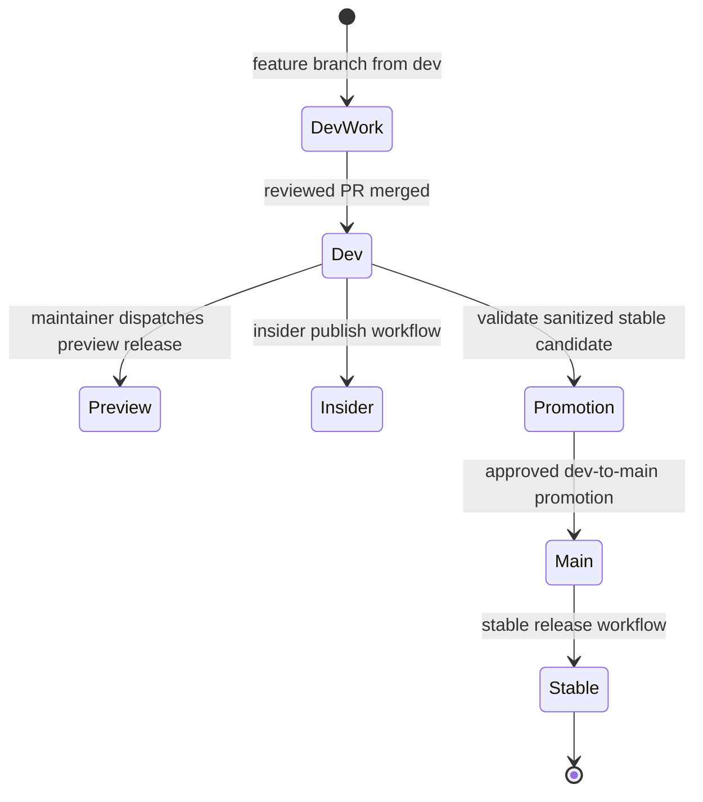

# Chapter 25: Contributing to Squad

> **Prerequisites:** Volume 1 (or equivalent Squad experience); Chapters 8 and 22.

## What You'll Learn

- Find a useful contribution opportunity and report it with enough evidence to reproduce.
- Build, test, and type-check Squad from its v1.1.0 monorepo source.
- Follow the dev-first contribution path: branch from `dev`, open a PR targeting `dev`, and leave release promotion to maintainers.
- Understand how CI, changelog/version checks, preview releases, stable releases, and insider builds differ.
- Participate in the community through code, reviews, issues, documentation, deployments, and discussions.
- Verify the repository's actual workflows rather than relying on stale command examples.

## Contribution Is More Than Code

A healthy open-source project needs more than feature implementation. A precise bug report can prevent a regression; a test can preserve a contract; a documentation correction can save many users time; a code review can find an unsafe assumption before release. Squad's own community pages recognize issue reports, discussions, deployments, case studies, documentation, videos, tests, and merged code as useful forms of contribution.

Start with the smallest contribution that addresses the real problem. Before opening an issue, search existing issues and discussions. Before changing behavior, read the code path and its tests. Before changing a template or policy document, identify which artifact is authoritative and who owns it. A small, well-supported PR is easier to review and safer to merge than a broad cleanup mixed with a feature.

This book targets Squad v1.1.0. Repository guidance can change as the project evolves, and documentation pages may describe a different snapshot than a checked-out source tree. For a real contribution, inspect the branch, package scripts, workflow files, and contributor guide in the checkout you intend to change. The examples below describe the dev-first model and source behaviors verified for this book's target.

```mermaid
flowchart LR
  O["Observe a problem"] --> E["Collect evidence"]
  E --> D["Check issues and design"]
  D --> F["Branch from dev"]
  F --> B["Build, test, and document"]
  B --> P["Open draft PR to dev"]
  P --> C["CI and review"]
  C --> M["Maintainer merges"]
  M --> R["Release channel workflow"]
```



## Choose a Contribution That Fits

### Report a bug

A useful bug report includes the Squad version, operating system, Node version where relevant, exact command or interaction, expected behavior, actual behavior, a minimal reproduction, and relevant redacted output. State whether you can reproduce it on a clean checkout. For a CLI bug, include `squad --version` and the command's help output when its flags matter. For a state or workflow problem, include the relevant sanitized configuration and workflow name—not secrets, tokens, private prompts, or customer data.

Prefer an issue with one clear failure mode. If an issue mixes a bug report with a broad redesign, split the reproducible defect from the design proposal. Search for duplicates and add supporting evidence to an existing report where appropriate.

### Propose a feature

A feature issue should explain the user problem, the constraints, the expected behavior, and what is out of scope. For a change that affects coordination, state formats, command compatibility, or agent authority, first document the alternatives and migration impact. Use the project's proposal process for significant design work rather than asking maintainers to infer a product decision from a code diff.

### Improve documentation

Documentation patches are often the best first contribution. Keep a correction narrow, test links and code snippets, and distinguish stable behavior from preview or environment-dependent behavior. Commands must match the installed CLI version, not an old screenshot or memory. A docs-only PR may have a different changeset requirement from a product-code change; check the current workflow and PR checklist.

### Contribute code or tests

A code PR should have a focused diff and tests that demonstrate the intended contract. A test that passes only because it repeats the implementation's assumptions is not enough; include the edge case that would have exposed the bug. Keep generated output and unrelated formatting changes out of the patch. If a change affects a shared interface, update every affected package or document the boundary explicitly.

### Help the community

Answer a question with a reproducible explanation, share a deployment case study, review a proposed fix, or report a compatibility issue. Avoid asking users to publish credentials, private code, personal data, or sensitive agent transcripts. Use private security reporting for suspected vulnerabilities rather than publishing an exploit path in a public issue.

## Understand the Monorepo Before Editing

Squad v1.1.0 is a workspace repository. The major implementation boundaries are:

| Area | Responsibility | What to inspect |
|---|---|---|
| `packages/squad-sdk/` | Runtime SDK, orchestration, state and tools | Public exports, tests, runtime abstractions |
| `packages/squad-cli/` | CLI command surface and implementation | Command routing, help text, command tests |
| `templates/`, `.squad-templates/`, package templates | Scaffolding and agent instructions | Generated paths and any synchronization process |
| `docs/` | User guides, technical specs, proposals, and release notes | Source page frontmatter, links, version qualification |
| `.github/workflows/` | CI and release automation | Trigger branches, permissions, gates, artifacts |
| `test/` and package tests | Regression and integration coverage | Existing test conventions and fixtures |

The SDK and CLI are separate packages, but the release workflow and package manifests in this target release align their versions. Do not assume that “workspace” means every package can be independently published in every workflow. Read the actual release workflow before changing package metadata.

Use repository search and tests to trace behavior. If a CLI command changes, search for its parser, help text, tests, docs, and template references. If the behavior is scaffolded into a new repo, unit tests alone may not prove the generated result; add a focused initialization or template test where appropriate. Avoid changing code and its tests in separate PRs when the API contract requires them to land together.

## Set Up a Development Checkout

The project contributor instructions describe a fork-and-upstream workflow. For an external contribution, fork `bradygaster/squad`, clone your fork, and configure the original repository as `upstream`:

```bash
git clone git@github.com:<your-account>/squad.git
cd squad
git remote add upstream git@github.com:bradygaster/squad.git
git fetch upstream dev
git checkout dev
git pull --ff-only upstream dev
```

If you cloned the canonical repository with permission, `origin` and `upstream` may differ, but the base rule remains: start work from the latest `dev` integration branch. Do not branch from `main` for ordinary feature work. The `main` branch represents the stable release line.

Install and build from the repository root using the supported Node/npm versions:

```bash
node --version
npm --version
npm install
SKIP_BUILD_BUMP=1 npm run build
```

The root package manifest requires Node.js `>=22.5.0`; the companion Tasktrack requirement is separate and is Node 22.18+. Workspace installation links the CLI and SDK packages locally. `npm run build` builds the SDK and CLI workspaces. In this source snapshot, the root `prebuild` hook increments the version in the root, SDK, CLI, and lockfile manifests unless `SKIP_BUILD_BUMP=1` or `CI=true` is set. For a build-only local check that should not alter release versions, use `SKIP_BUILD_BUMP=1 npm run build`. If a version increment is intended, review all affected manifests and lockfile changes deliberately.

The CI workflow runs the repository's build, type-check, source/test lint, and tests. The verified root scripts include:

```bash
npm run build
npm test
npm run lint
npm run lint:eslint
```

Run the smallest relevant test during iteration, then run all required checks before requesting review. A TypeScript type check is not a substitute for tests, and a passing unit test does not prove a generated template behaves correctly. For changes to agent instructions, templates, scaffolding, or integration flows, identify the appropriate end-to-end validation in the current repository guide.

To use a local linked CLI, the root contributor guide documents `npm run dev:link` and `npm run dev:unlink`. Linking is a developer convenience; it must not leak local filesystem paths, local package overrides, or unpublished dependencies into a release PR.

## Follow the Dev-First Branch Model

Squad's contribution flow is organized around three concepts:

| Branch or channel | Purpose | Contributor action |
|---|---|---|
| `dev` | Integration branch for unreleased work | Base ordinary feature branches here; target PRs here |
| `main` | Stable, released code | Do not push ordinary feature work directly; maintainers promote validated code |
| `preview` / `insider` npm tags | Distribution channels | Do not treat them as Git branches; maintainers dispatch the relevant publishing workflow |

Create a focused feature branch from current `dev`. The `.squad` git-workflow skill, when installed for a working team, uses the `squad/{issue-number}-{kebab-case-slug}` convention:

```bash
git checkout dev
git pull --ff-only upstream dev
git checkout -b squad/217-fix-version-stamp
```

The root `CONTRIBUTING.md` also contains historical/user- or agent-named examples. Follow the actual branch naming rule supplied by the active repository policy; do not assume those examples override a current team convention. The key invariant is branch origin and PR target: ordinary work originates from `dev` and goes back to `dev` through review.

For issue-driven work, mark the issue appropriately if the repository uses the `status:in-progress` label, and link it in the PR body. Then push your branch and create a draft PR targeting `dev`:

```bash
git push -u origin squad/217-fix-version-stamp
gh pr create --repo bradygaster/squad --base dev --head <your-account>:squad/217-fix-version-stamp \
  --draft --title "Fix version stamp" --body "Closes #217"
```

The exact account, issue number, title, labels, and remote names will differ. A draft PR is a collaboration surface while work is still in progress. When the change is ready and local validation is complete, mark the PR ready for review. Keep the PR narrow and based on an up-to-date `dev`; rebase with care and use `--force-with-lease` when updating a fork branch after a rebase.

Do not commit directly to `dev` or `main`, and do not aim an ordinary feature PR at `main`. Those shortcuts bypass the integration and release gates. If multiple issues need simultaneous implementation, use isolated worktrees from `dev` as described in Chapter 6 (Volume 1) rather than switching branches in one shared working tree.

## Make the Change Reviewable

Before editing, read the issue and the exact implementation/test surface. Write down the intended invariant. Then change only what is needed and add tests that would fail before the fix. For a CLI command, update its help output and documentation if the user-facing contract changes. For an SDK tool, ensure the export and package boundary remain intentional. For a template, validate the generated files as well as the template source.

Before opening or updating a PR:

1. Rebase or otherwise synchronize with latest `upstream/dev` according to project instructions.
2. Run `SKIP_BUILD_BUMP=1 npm run build` and the relevant tests; before handoff, run the full required CI commands.
3. Run `npm run lint` and `npm run lint:eslint` when applicable.
4. Check `git diff --stat`, `git diff --check`, and the complete diff for accidental changes.
5. Add a changeset for changes covered by the repository's changelog gate. The root `CONTRIBUTING.md` identifies CLI/SDK source and governed template/scaffolding paths; confirm the current gate rather than adding release metadata to a docs-only change blindly.
6. Link the issue, explain behavior and test evidence, and list known limitations.
7. Open as a draft while work remains; mark ready only when your contribution is reviewable.

External contributors generally cannot apply GitHub's suggestion buttons or merge changes on the upstream repository. The repository's contribution guide describes a handoff: the contributor updates their fork, waits for CI and automated review, applies any accepted suggestions manually, and marks the PR ready. Maintainers then handle remaining review and merge. If you cannot resolve a bot comment, explain why with evidence instead of ignoring it.

## CI and Release Channels

CI is an engineering gate, not a release decision. In v1.1.0, the Squad CI workflow runs on pull requests targeting `dev` or `main` and on pushes to `dev`. It includes path-aware work, tests, build, TypeScript checking, linting, and additional repository-specific policy gates. Check the actual run because not every job runs for every path. A green check says the configured commands passed for that commit; it does not mean a human approved its design or that it is safe to deploy.

Changesets and changelog checks serve release communication and version hygiene. The root `CONTRIBUTING.md` says to add a changeset when changing SDK/CLI source or governed scaffolding/template paths, and its CI gate also accepts a direct changelog edit in the documented compatibility path. Use the repository's current instructions and CI result; do not hand-edit versions merely to silence a check. The release automation validates that the root, SDK, CLI, and lockfile versions agree before publishing.

The high-level release path is:



In v1.1.0, the root `squad-release.yml` workflow accepts manual dispatch from `dev` for a version such as `X.Y.Z-preview.N`, or from `main` for a stable `X.Y.Z`; a push to `main` can also trigger a stable release. It validates the version, checks package consistency and changelog presence, creates the release tag if needed, and creates the GitHub Release. It then invokes the npm and standalone release workflows. Preview packages use the npm `preview` dist-tag; stable packages publish to npm `latest` when the npm job succeeds. The workflow marks the GitHub stable release as latest only after the npm and standalone jobs succeed and required release assets are present. The stable pipeline also produces standalone archives and updates the Homebrew and WinGet distribution paths when their release jobs succeed. A maintainer performs the release action; contributors do not tag or publish as part of an ordinary feature PR.

The separate `squad-promote.yml` workflow validates the stable promotion path from `dev` to `main`, including version consistency and the absence of specified internal or consumed release artifacts on the promotion branch. It supports a dry-run path and a validated promotion-branch PR path. Promotion is not the same as merging a contributor's feature branch directly to `main`. After a stable release, the npm workflow also checks that the `insider` dist-tag is not left behind the stable `latest` version; that maintenance does not turn insider into a Git branch or replace the separate insider publishing workflow.

Insider builds are also not a branch. The `squad-insider-publish.yml` workflow is manually dispatched, checks out `dev`, builds and tests, verifies npm registry access and credentials, computes the next `X.Y.Z-insider.N` version, and publishes the CLI and SDK with the npm `insider` dist-tag. It also creates an immutable GitHub prerelease and publishes standalone bundles. Preview and insider are distinct prerelease audiences and workflow paths. Do not infer that a green CI run automatically publishes an insider package; verify the workflow trigger and its successful run.

> **Note:** The repository's docs have drifted across snapshots. The v1.1.0 root contributor guide and checked-in workflows describe dev integration, explicit preview/insider publishing, and stable promotion; another docs-site guide describes independent package versioning and command names that do not match the root package scripts. This chapter uses the checked-in source and release workflows for concrete behavior. Recheck these files before following release steps on a newer checkout.

## Contributors and Community

Contributions accumulate in different ways. The project community page recognizes code, issue reports, feedback, real deployments, case studies, videos, and documentation. The contributor list gives concrete examples: a docs-site rebuild and navigation fixes improve discoverability; reports of a credential leak, an ESM startup problem, and installation failures surfaced user-visible issues; an external deployment contributed the `squad:` label convention. These examples demonstrate that community feedback can shape product behavior even when the reporter does not submit the implementation.

Use GitHub Issues for reproducible bugs and actionable proposals. Use Discussions for questions and broader conversation. Use a pull request for a concrete patch. For security concerns, use the repository's private reporting route instead of posting sensitive details publicly. The community and contributor pages may be updated independently of tagged code; treat contributor names and project metrics as a living record rather than a versioned API.

Good community participation is specific, kind, and evidence-based. Explain what you tried, distinguish a confirmed defect from a question, and avoid posting private content. When reviewing, critique the change and its impact, not the contributor. When sharing a deployment, remove internal hostnames, tokens, customer names, and private architecture details.

Open-source attribution is also a maintenance practice. Credit prior work when a proposal or patch depends on it. Keep license notices and third-party terms intact. Squad's root contributing guide states contributions are MIT-licensed; read the repository's current license and contribution terms before submitting work.

## Hands-On: Prepare a Small Squad PR

This exercise rehearses the local steps without asking you to publish a change to the actual Squad repository. If you use a fork, choose a small documented issue and follow the current repository checklist.

1. Confirm the checkout and toolchain. Check `git status`, `git branch --show-current`, `node --version`, `npm --version`, and the root `package.json` engine field.
2. Fetch `upstream/dev`, check out `dev`, and create a branch using the current team naming convention. Do not branch from `main`.
3. Make one narrow change with a regression test. If the change is covered by the changelog gate, add the required changeset or changelog entry according to the root contribution guide.
4. Run the verified repository checks from the root:

```bash
SKIP_BUILD_BUMP=1 npm run build
npm test
npm run lint
npm run lint:eslint
```

The environment variable keeps a local build-only validation from incrementing the package versions. CI sets `CI=true`, which also skips the prebuild bump.

5. Inspect the complete diff and status. Confirm no secrets, generated files, unrelated formatting changes, or accidental version edits were introduced.
6. Push the feature branch and create a draft PR whose base is `dev`. Link the issue and provide the command output or CI evidence.
7. When ready, mark it ready for review. As an external contributor, apply accepted review suggestions in your fork and push updates; leave merge and release authority with maintainers.

Expected result: the feature branch is based on `dev`, relevant checks pass, the PR targets `dev`, the issue is linked, and the change is narrow enough for a reviewer to understand. You do not need to trigger a preview, insider, or stable publish workflow to complete an ordinary contribution.

## Configuration Reference

| Item | v1.1.0 purpose | Contributor check |
|---|---|---|
| Node.js engine | Root `package.json` requires `>=22.5.0` | Compare `node --version` before installing/building |
| `npm install` | Installs workspace dependencies and links local packages | Run from repo root; use the repository lockfile and current instructions |
| `npm run build` | Builds the SDK and CLI workspaces | Root `prebuild` increments versions; set `SKIP_BUILD_BUMP=1` for build-only validation |
| `SKIP_BUILD_BUMP=1` | Skips the local version bump in `scripts/bump-build.mjs` | Use only when validating code without preparing a build version; CI also skips via `CI=true` |
| `npm test` | Runs Vitest test suite | Use focused tests while iterating and full suite before handoff |
| `npm run lint` | Type-checks SDK and CLI TypeScript projects | Resolve type errors rather than suppressing them |
| `npm run lint:eslint` | Lints package and test sources | Run before PR readiness |
| `npm run dev:link` / `npm run dev:unlink` | Links or unlinks the local CLI development build | Do not commit machine-specific link state |
| `dev` | Integration branch | Feature branches start here; PRs target here |
| `main` | Stable line | Maintainers promote reviewed code and release it |
| `squad-release.yml` | Creates preview or stable GitHub/npm release based on ref and version | Manual dispatch requires exact confirmation tag; stable push path is from `main` |
| `squad-promote.yml` | Validates and stages stable promotion | Maintainer action; inspect dry-run and validation results |
| `squad-insider-publish.yml` | Publishes insider build from `dev` | Manual dispatch; requires configured npm credentials and passing gates |
| `.changeset/*.md` | Describes user-facing package changes where the gate applies | Follow current path-specific changelog requirements |

## Under the Hood

At v1.1.0, the root package manifest declares the workspace scripts. `build` chains the SDK and CLI workspace builds; `test` invokes Vitest; `lint` runs TypeScript checks for each package; `lint:eslint` covers package and test sources. The CI workflow in `.github/workflows/squad-ci.yml` confirms those commands and adds repository-specific checks. This is a more reliable guide to runnable commands than a docs page copied from another release state.

The release workflow `.github/workflows/squad-release.yml` selects a release channel from the checked-out branch, package version, and dispatch input. A manually dispatched `dev` release must have a preview SemVer suffix; a manually dispatched `main` release must be stable. A stable release is also triggered from `main`. The workflow compares the submitted confirmation tag with the exact package version, checks package and lockfile alignment, validates the changelog, and avoids recreating an existing tag.

The promotion workflow `.github/workflows/squad-promote.yml` is deliberately separate. Its validation checks that a promotion branch descends from current `main`, filters prohibited internal paths and consumed changeset fragments, validates stable package versions and lockfile entries, checks the release notes entry, and builds/tests the resulting release tree before promotion. Its dry-run input is a validation mechanism, not a stable deployment.

The insider workflow `.github/workflows/squad-insider-publish.yml` is a manually dispatched pipeline that checks out `dev`, builds and tests the source, checks registry health and the npm token, then computes an incremented insider version. The channel name in npm metadata is not a Git branch. Read the rest of the workflow before making assumptions about registry tags, publishing permissions, or artifact handling.

The contributor doc and docs-site guide are not fully synchronized with one another. The docs-site `guide/contributing` page describes Node `>=20`, independent package versioning, and a `build:cli` command. The target root manifest requires Node `>=22.5`, the root contributor guide says release versions are aligned, and the verified root scripts use `npm run build` rather than a root `build:cli` script. Use the latter facts for v1.1.0 source and call out the drift rather than repeating an unverified command.

## Pitfalls and Troubleshooting

| Pitfall | Why it causes trouble | Safer response |
|---|---|---|
| Branching from `main` | The PR bypasses the intended integration line | Rebase or recreate the feature branch from current `dev` before opening the PR |
| Targeting the feature PR at `main` | It skips ordinary integration and review flow | Use `dev` as the base; maintainers handle promotion |
| Copying a build command from an older docs page | The command may not exist in this package version | Inspect root `package.json` scripts and CI workflow |
| Using an old Node version | TypeScript/build/runtime features may fail or behave differently | Follow the root package's `engines` declaration |
| Publishing a changeset-only change without checking CI | The actual release gate may require different paths or metadata | Read current PR checklist, changelog gate, and CI result |
| Treating green CI as release approval | Tests do not decide product readiness or permissions | Keep maintainer review and explicit release approval |
| Confusing preview and insider | They have different versions, triggers, and audiences | Inspect `squad-release.yml` and `squad-insider-publish.yml` separately |
| Treating `insider` as a branch | It is an npm channel in this release flow | Work on `dev`; maintainers dispatch the insider workflow |
| Pushing directly to `dev` or `main` | It avoids review and can destabilize release branches | Use a feature branch and PR |
| Posting secrets in an issue | Public content is durable and searchable | Redact output; use private security reporting for sensitive issues |

## Summary

Contributing to Squad is a path from evidence to a reviewable change, not merely a code edit. Learn the monorepo boundaries, use the verified Node and npm scripts, branch from `dev`, and target ordinary feature PRs at `dev`. Add tests and the required release notes, preserve a focused diff, and leave merge and release decisions to maintainers. Preview and insider are explicit release channels, not branches; stable releases are tied to the `main` line and validated promotion. The community also needs careful reports, documentation, reviews, discussions, and responsible deployment stories. That completes the journey from first use through production operations, internals, the 2.0 preview, and mastery: keep verifying what the version you run actually does, and contribute evidence that helps the next reader do the same.

## Exercises

1. A docs page tells you to use `npm run build:cli`, but the root package has no such script and CI runs `npm run build`. Describe how you would verify the correct command and report the discrepancy.
2. Write a concise bug report for a hypothetical `squad init` regression. Include the environment, command, expected and actual behavior, and redaction requirements.
3. A feature branch was accidentally created from `main`. Explain how to return it to the dev-first flow without losing work.
4. A PR changes `packages/squad-cli/src/` but has no tests or changeset. What should the contributor check and add before requesting review?
5. Explain the difference between preview, insider, and stable releases in this source snapshot. Identify which branch and workflow are involved.

## Quiz

1. Which branch is the base for ordinary Squad feature work, and where should the PR target?
2. What is the root Node.js engine requirement in the v1.1.0 source used here?
3. Which root command builds both SDK and CLI workspaces?
4. Does a green CI run itself authorize a stable release?
5. Is `insider` a Git branch in the v1.1.0 release model described here?
6. Which workflow validates promotion to the stable line?
7. Name two non-code contribution types that help the Squad community.
8. Why should a contributor avoid using the docs-site guide's `build:cli` command without verification?

## Further Reading

- [Squad Community](https://bradygaster.github.io/squad/docs/community/)
- [Contributing Guide](https://bradygaster.github.io/squad/docs/guide/contributing/)
- [Squad Contributors Guide](https://bradygaster.github.io/squad/docs/guide/contributors/)
- [Repository CONTRIBUTING.md at v1.1.0](https://github.com/bradygaster/squad/blob/v1.1.0/CONTRIBUTING.md)
- [Squad CI workflow at v1.1.0](https://github.com/bradygaster/squad/blob/v1.1.0/.github/workflows/squad-ci.yml)
- [Squad release workflow at v1.1.0](https://github.com/bradygaster/squad/blob/v1.1.0/.github/workflows/squad-release.yml)
- [Squad promotion workflow at v1.1.0](https://github.com/bradygaster/squad/blob/v1.1.0/.github/workflows/squad-promote.yml)
- [Squad insider publish workflow at v1.1.0](https://github.com/bradygaster/squad/blob/v1.1.0/.github/workflows/squad-insider-publish.yml)
